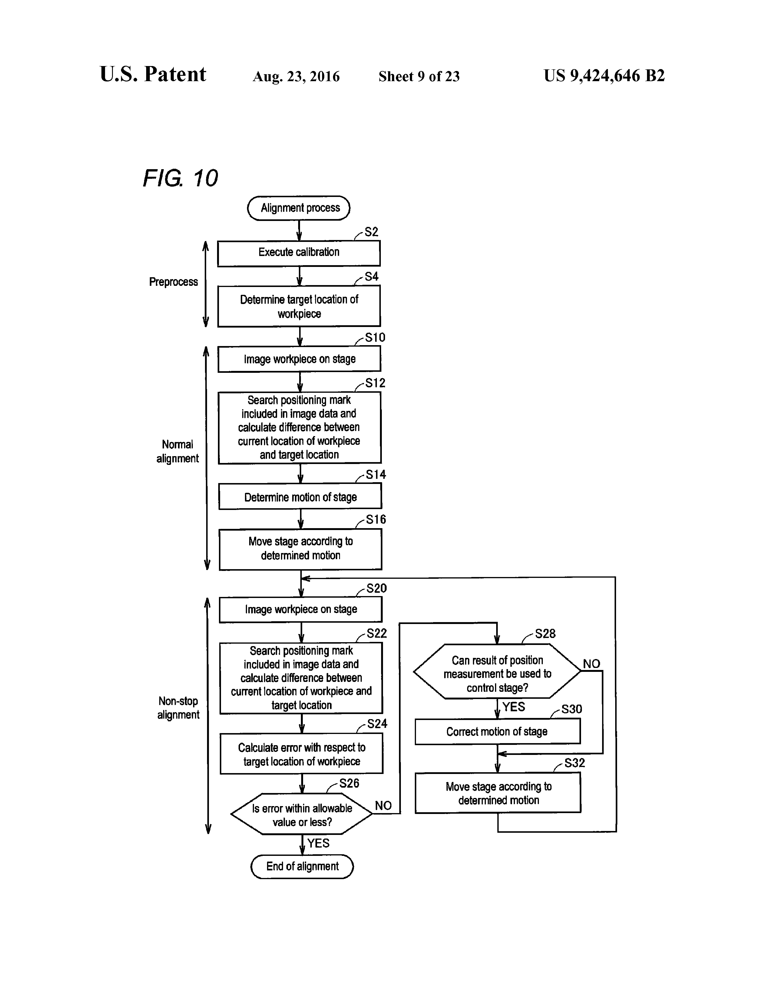
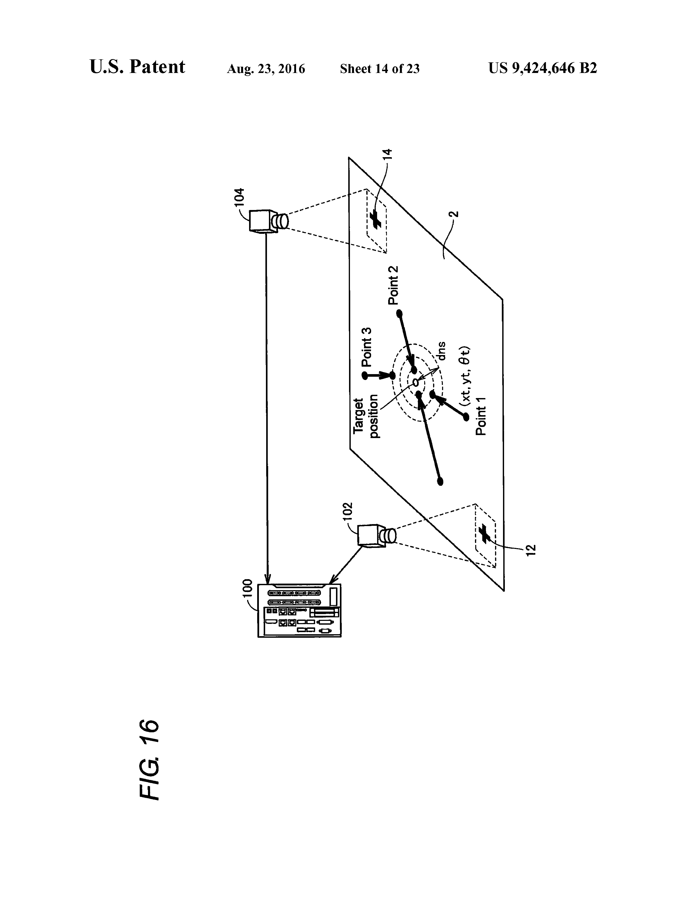

# US9424646B2 — 제어 시스템 및 제어 방법 (Omron)

| 항목 | 내용 |
|---|---|
| 원문 | `US9424646.pdf`(등록, 2016-08-23) · `US20140301632.pdf`(공개, 2014-10-09) |
| 출원인 | OMRON Corporation |
| 우선일 | 2013-04-08 (JP 2013-080774) |
| 청구항 | 13항 (독립항 2개: 1 시스템, 10 방법) |
| 핵심 | 유리 기판의 위치 결정 마크를 카메라로 찍어 XYθ 스테이지를 정렬할 때, 1회 촬영으로 최고 속도 접근(통상 얼라인먼트)한 뒤 목표 앞 **마진 거리 dns**에서 멈추지 않고 이동 중 연속 촬영·보정(논스톱 얼라인먼트)으로 전환한다. dns는 "실제로 이동시킨 뒤 영상으로 잰 위치와 지령 이동량의 차이"의 최댓값으로 정해, 목표를 지나쳐 반대로 되돌아오는 일(백래시 유발)을 막는다. |
| 관련도 | ◎ 문제를 직접 해결하는 구성 |
| 해결하는 P# | P4(반복 보정 루프의 종료 조건·측정 실패 시 생략·전환 순환 방지), P3(목표를 지나치지 않는 단방향 접근으로 반전·백래시 회피), P1·P2(지령 이동 대비 영상 측정 오차의 최댓값을 실험으로 측정), P6(요구 정확도 R에서 속도 상한 유도) |
| 링크 | [Google Patents](https://patents.google.com/patent/US9424646B2/en) |

---

## 상세 요약 (번역본 기준)

### 1. 해결하려는 문제
- 반복 위치 결정(촬영 → 이동 → 정지 → 재촬영, 오차가 허용값 이하가 될 때까지)은 캘리브레이션 오차·카메라 노이즈 때문에 필요하지만, 매번 가감속·정지·정정 시간이 들어 느리다.
- 비주얼 서보(논스톱 얼라인먼트)는 멈추지 않지만, **목표를 지나치면 이동 기구를 반전해야 하고 반전 때 백래시가 생기거나 관성으로 기구가 손상될 수 있다** → 그래서 매우 느린 속도로만 쓸 수 있다.

### 2. 핵심 구성
| 구성 | 부호 | 역할 |
|---|---|---|
| 영상 처리 장치 | 100 | 카메라 102·104로 마크 12·14 촬영, 위치 특정, 측정 가능 여부 판정 |
| 모션 컨트롤러 | 200 | 모션(경로·속도·가속도 패턴) 결정·보정, 서보 3축 |
| 스테이지 | 300 | XY 이동 + θ 회전 |
| 시스템 파라미터 | 도 8 | 허용 최대 가속도 α, 이동 최대량 dmax, 제어 주기 f, 요구 정확도 R, 분해능 res, NSA 시작 거리 dns, NSA 최대 속도 Vns_max |
| 변형예 1 | 102-1/-2 | 광시야 → 협시야 카메라 전환(멈추지 않고) |
| 변형예 2 | 도 23 | Z축 이동에 따른 XY 편차를 X = X′ + AZ, Y = Y′ + BZ로 목표 위치 보정 |

### 3. 동작 순서 (도 10)
1. 전처리: 캘리브레이션(ΔX·ΔY 이동 전후 마크로 아핀 변환 a~f), 회전 중심을 목표 위치로 결정(지그·마스터 워크, θ 회전 전후 마크의 수직 이등분선).
2. 통상 얼라인먼트(S10~S16): 촬영 → 목표까지 차이(벡터) 계산 → 최대 가속도·최고 속도로 **중간 목표(최종 목표 − dns)**까지 이동.
3. 논스톱 얼라인먼트(S20~S32): 이동 중 촬영 → 오차 계산 → **오차 ≤ 허용값이면 종료**(S26) → 측정 결과를 쓸 수 없으면 보정 생략하고 기존 모션 유지(S28) → 아니면 모션 보정 후 이동, 제어 주기마다 반복.
4. 측정 불가 판정 기준: 워크 미검출, 지난 측정 대비 이동이 너무 크거나 인코더 추정 위치와 차이가 임계값 이상, 처리 시간이 제어 주기 f 초과.
- 속도·거리 설계식: Vns_max ≤ α·f, Vns_max ≤ 2R/3f(한 주기 지연 동안의 이동이 요구 정확도 R보다 작게), dns 이론값 = Vns_max·f + α·t5²/2.
- dns 실험값 결정(도 16~19): 지그로 놓은 마스터 워크의 회전 중심을 목표로 두고, ① 무작위 이동 후 목표로 복귀시켜 측정 좌표와 목표의 거리 d를 재 최댓값이 더 이상 갱신되지 않을 때까지 반복, 또는 ② X·Y·θ 격자의 각 점에서 목표로 복귀시켜 d의 최댓값을 dns로 출력. 오차 원인은 (a) 측정마다 바뀌는 카메라 노이즈와 (b) 위치에 따라 정해지는 스테이지·광학계 특성으로 나눈다.

### 4. 청구항 요지
- 청구항 1·10: 1차 제어(제1 속도 가속 → 제2 속도 감속, 최종 목표에서 마진 거리 떨어진 중간 목표로 이동) 후 멈추지 않고 2차 제어(이동 중 영상으로 최종 위치 결정). **마진 거리는 제2 속도에서 허용 최대 가속도로 감속해도 최종 목표를 지나치지 않게 정한다.**
- 청구항 2: 2차 제어에서 측정·지령 결정 반복. 3: 마진 = (지령 이동량과 영상 측정 비교로 정한 거리) + (처리 지연·감속 동안의 이동량). 4: 1차는 허용 최대 가속도.
- 청구항 5·7: 위치 특정이 정상이 아니면 지령 결정을 건너뜀. 6·8: 광시야 → 협시야 카메라 전환. 9: 다른 좌표계(Z축) 이동 오차로 지령 보정.
- 청구항 11: 대상과 목표 거리가 영상 위치 오차에 따른 거리 이하가 되면 전환하고, 그 거리는 **소정량 이동 → 영상으로 위치 특정 → 여러 번 반복해 지령량과 비교**로 정한다. 12·13: 1차 제어 전에 위치 측정.

### 5. 대표 도면

*도 10 — 통상 얼라인먼트 후 논스톱 얼라인먼트: 오차 허용값 판정(S26), 측정 결과 사용 가능 판정(S28)*

*도 16 — 무작위 이동 후 목표 복귀를 반복해 측정 오차 거리 d의 최댓값으로 dns 결정*

### 6. 본 과제(Y·Θ 얼라인먼트)와 비교
- 같은 점:
  - 마크(위치 결정 마크)를 카메라로 찍어 XYθ 스테이지를 정렬하는 look-and-move 반복 구조. 본 과제의 "보정 → 재촬영" 20턴 루프와 같은 문제(종료 조건, 반복 횟수)를 다룬다.
  - 회전 중심을 목표 위치로 미리 구하고, 캘리브레이션을 실제 이동량(ΔX·ΔY)과 영상 이동량 비교로 한다 → 본 과제의 감도계수(14.25 px/mm, 80.04 px/T) 재측정 절차와 같다.
- 다른 점:
  - 목적이 정렬 시간 단축이고, 스테이지는 연속 서보 제어다. 본 과제는 정지 상태에서 찍고 정수 단위(0.05 mm) 명령으로 움직이는 정적 look-and-move다.
  - Y와 θ가 영상에서 섞이는 문제는 다루지 않는다(마크 두 개를 떨어진 두 카메라로 봄).
- 참고할 점:
  - **"목표를 지나치지 않도록 마진을 두고 접근"** = 반전(백래시) 회피 원리. 본 과제에서는 보정 이득을 1보다 작게 두거나(한쪽에서 단조 접근) 마진만큼 덜 가도록 명령해 P3·P4를 함께 다룰 수 있다(논문 결과서 4.4절 g·a < 1 권장과 같은 방향).
  - **마진(= 시스템 오차 최댓값)을 실험으로 정하는 절차**(무작위 또는 격자 이동 후 목표 복귀, 측정 좌표와 목표의 거리 최댓값)는 그대로 본 과제의 실기 검증 실험 설계가 된다: Y·T 격자 각 점에서 목표로 명령 복귀 → 촬영 → 남는 오차의 최댓값·분포.
  - 오차를 (a) 측정마다 바뀌는 성분과 (b) 위치마다 정해진 성분으로 나누는 것은 오차 예산의 A형/계통 성분 분리와 같다(P1).
  - 측정 실패(검출 불가, 직전 대비 비정상 점프, 처리 시간 초과) 때 보정을 건너뛰는 규칙 → 본 과제의 판정 거부·재촬영 규칙과 전환 순환 방지에 쓸 수 있다.
  - Vns_max ≤ 2R/3f처럼 요구 정확도 R에서 동작 조건을 역산하는 방식 → 허용오차 0.09에서 제어 단위·이득 조건을 역산하는 근거(P6).
