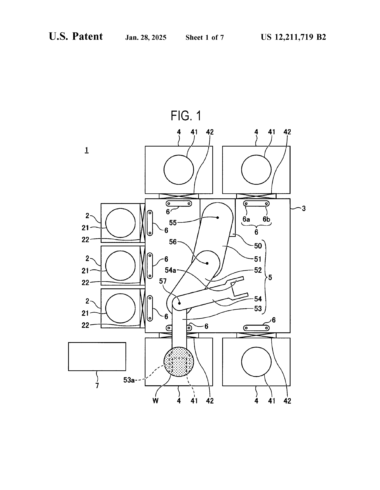
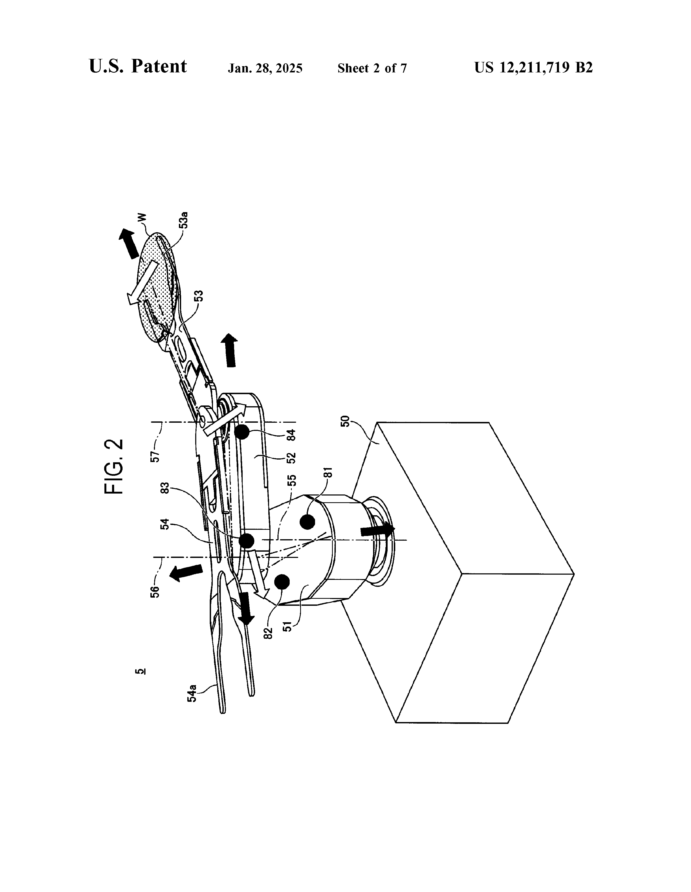
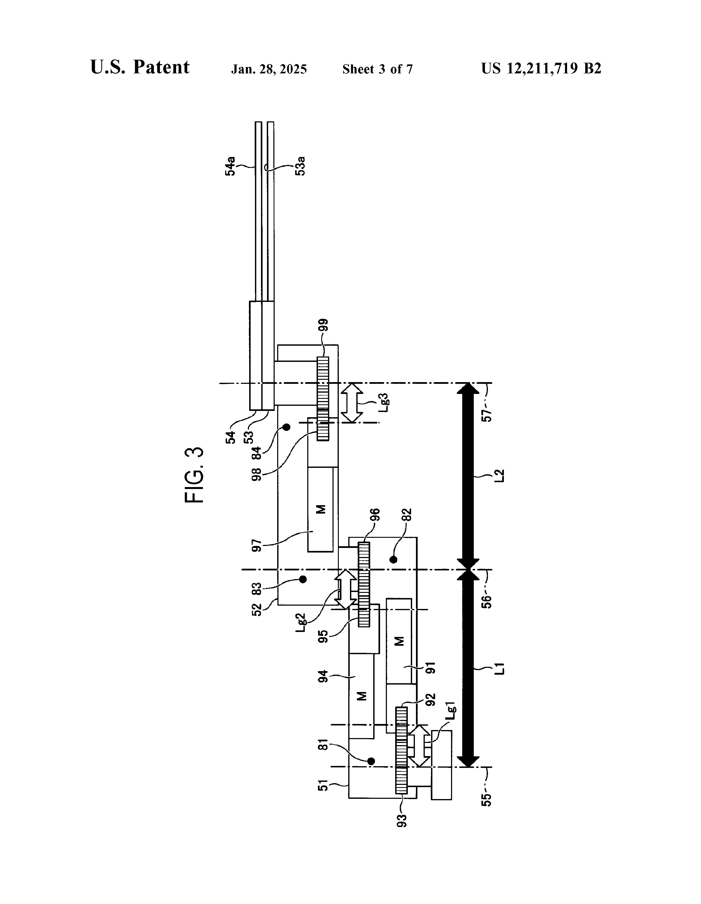
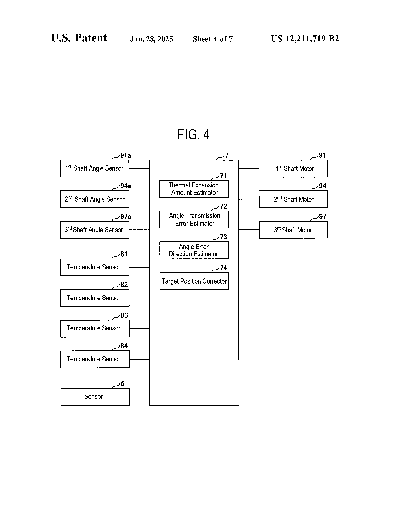
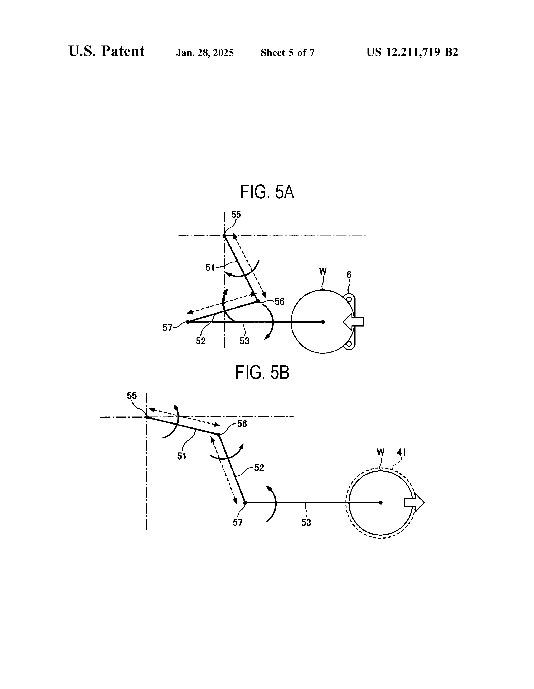
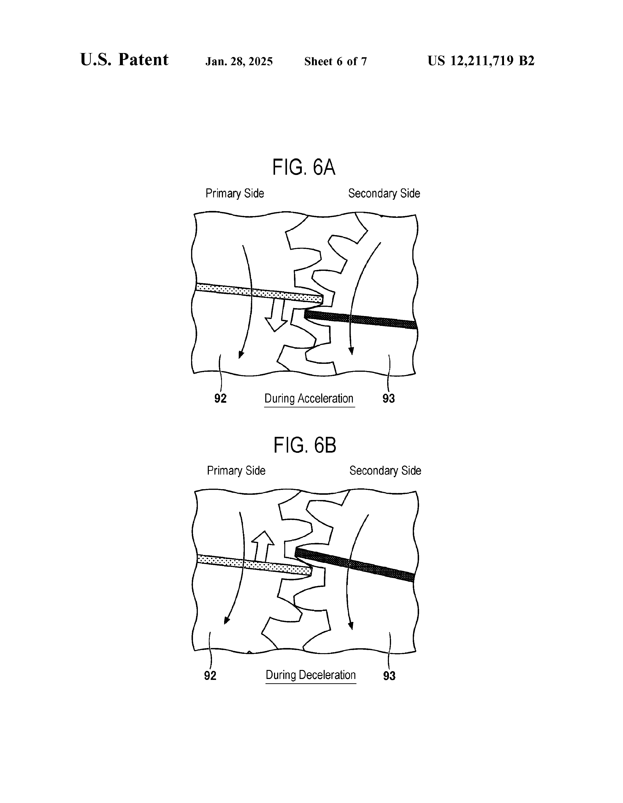
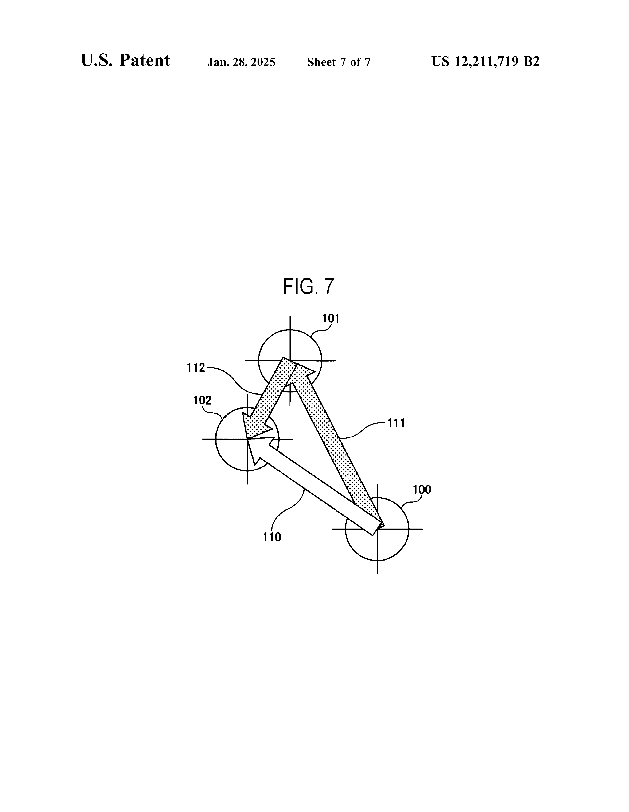

# 기판 이송 시스템의 제어 방법 및 기판 이송 시스템 (US12211719B2)
- 원제: Method of controlling substrate transfer system and the substrate transfer system
- 원문: 같은 폴더의 PDF(`US12211719.pdf` 등록본, `US20220068683.pdf` 공개본), https://patents.google.com/patent/US12211719B2/en
- 번역 기준: USPTO 등록본 PDF의 원문을 한국어로 옮김. 조사일(2026-10-30) Google Patents 페이지가 응답하지 않아(HTTP 503), PDF 본문 쪽을 문자 인식한 뒤 쪽 이미지와 대조해 옮겼다. 원문 오기(예: 재질 "A1", 보정량 식의 부호)는 고치지 않았다.
- 도면: 원문 PDF 도면 시트 7장을 도면/ 폴더에 넣고 본문에서 처음 설명되는 곳에 삽입함

## 요약

홀더를 갖는 이송 기구와, 기판의 외주를 검출하여 기판의 중심 위치를 측정하는 측정부를 포함하여 기판을 목표 위치로 이송하는 기판 이송 시스템의 제어 방법은, 홀더의 기준 위치와 기판의 중심 위치 사이의 위치 편차량, 기판의 외주가 검출되는 측정 위치에서 이송 기구의 열팽창에 의한 홀더 기준 위치의 제1 열변위량, 그리고 목표 위치에서 이송 기구의 열팽창에 의한 홀더 기준 위치의 제2 열변위량에 기초하여 목표 위치를 보정하는 단계; 및 홀더의 기준 위치가 보정된 목표 위치가 되도록 이송 기구를 제어하는 단계를 포함한다.

## 청구범위

청구하는 것은 다음과 같다.

1. 기판 이송 시스템의 제어 방법으로서,

상기 기판 이송 시스템은,

이송 기구로서,

기판을 유지하도록 구성되고 상기 기판을 이송하도록 구성되는 홀더를 포함하는 암; 및

복수의 기어를 포함하는 동력 전달 기구를 통해 상기 암을 회전시키도록 구성되는 구동원을 포함하는 이송 기구; 및

상기 이송 기구에 의해 이송되는 상기 기판의 둘레를 따라 점들을 검출하고 상기 기판의 중심 위치를 측정하여, 상기 기판을 목표 위치로 이송하도록 구성되는 측정부를 포함하며,

상기 방법은,

상기 측정부에 의해 상기 홀더의 기준 위치와 상기 기판의 상기 중심 위치 사이의 위치 편차량을 계산하는 단계;

상기 측정부에 의해 상기 기판의 둘레를 따라 상기 점들이 검출되는 측정 위치에서 이송 기구의 열팽창에 의한 상기 홀더의 상기 기준 위치의 제1 열변위량을 계산하는 단계;

상기 기판이 이송될 상기 목표 위치에서 상기 이송 기구의 상기 열팽창에 의한 상기 홀더의 상기 기준 위치의 제2 열변위량을 계산하는 단계;

상기 위치 편차량, 상기 제1 열변위량 및 상기 제2 열변위량에 기초하여 상기 목표 위치를 보정하는 단계; 및

상기 홀더의 상기 기준 위치가 보정된 상기 목표 위치가 되도록 상기 이송 기구를 제어하는 단계를 포함하고,

상기 홀더의 상기 기준 위치의 상기 제1 열변위량 및 상기 제2 열변위량은, 상기 암의 온도에 기초하여 추정되는 열팽창량; 상기 동력 전달 기구의 온도에 기초하여 추정되는 상기 동력 전달 기구의 각도 전달 오차량; 및 상기 구동원의 가속/감속 상태에 기초하여 추정되는 상기 각도 전달 오차의 방향에 기초하여 추정되며,

상기 각도 전달 오차량은 기준 온도에서 상기 복수의 기어 중 두 기어 사이의 기준 축간 거리에 기초하여 추정되는, 방법.

2. 제1항에 있어서, 상기 각도 전달 오차량은 상기 두 기어의 온도, 상기 두 기어 사이의 열팽창 계수의 차이, 및 상기 두 기어 사이의 상기 기준 축간 거리에 더 기초하여 추정되는, 방법.

3. 제2항에 있어서, 상기 이송 기구는 상기 이송 기구의 온도를 검출하도록 구성되는 온도 검출기를 포함하는, 방법.

4. 기판 이송 시스템으로서,

이송 기구로서,

기판을 유지하도록 구성되고 상기 기판을 이송하도록 구성되는 홀더를 포함하는 암; 및

복수의 기어를 포함하는 동력 전달 기구를 통해 상기 암을 회전시키도록 구성되는 구동원을 포함하는 이송 기구;

상기 이송 기구에 의해 이송되는 상기 기판의 둘레를 따라 점들을 검출하고 상기 기판의 중심 위치를 측정하여, 상기 기판을 목표 위치로 이송하도록 구성되는 측정부; 및

상기 이송 기구를 제어하도록 구성되는 제어기를 포함하고,

상기 제어기는,

상기 측정부에 의해 상기 홀더의 기준 위치와 상기 기판의 상기 중심 위치 사이의 위치 편차량을 계산하고;

상기 측정부에 의해 상기 기판의 둘레를 따라 상기 점들이 검출되는 측정 위치에서 이송 기구의 열팽창에 의한 상기 홀더의 상기 기준 위치의 제1 열변위량을 계산하고;

상기 기판이 이송될 상기 목표 위치에서 상기 이송 기구의 상기 열팽창에 의한 상기 홀더의 상기 기준 위치의 제2 열변위량을 계산하고;

상기 위치 편차량, 상기 제1 열변위량 및 상기 제2 열변위량에 기초하여 상기 목표 위치를 보정하고;

상기 홀더의 상기 기준 위치가 보정된 상기 목표 위치가 되도록 상기 이송 기구를 제어하도록 구성되며,

상기 홀더의 상기 기준 위치의 상기 제1 열변위량 및 상기 제2 열변위량은, 상기 암의 온도에 기초하여 추정되는 열팽창량; 상기 동력 전달 기구의 온도에 기초하여 추정되는 상기 동력 전달 기구의 각도 전달 오차량; 및 상기 구동원의 가속/감속 상태에 기초하여 추정되는 각도 전달 오차의 방향에 기초하여 추정되고,

상기 각도 전달 오차량은 기준 온도에서 상기 복수의 기어 중 두 기어 사이의 기준 축간 거리에 기초하여 추정되는, 기판 이송 시스템.

## 상세한 설명

### 관련 출원의 상호 참조(CROSS-REFERENCE TO RELATED APPLICATION)

본 출원은 2020년 8월 31일 출원된 일본 특허출원 제2020-146296호에 기초하여 그 우선권의 이익을 주장하며, 그 전체 내용은 참조로 본 명세서에 포함된다.

### 기술 분야(TECHNICAL FIELD)

본 개시는 기판 이송 시스템의 제어 방법 및 기판 이송 시스템에 관한 것이다.

### 배경(BACKGROUND)

웨이퍼 등의 기판을 이송하는 이송 기구를 포함하는 기판 이송 시스템이 알려져 있다.

특허문헌 1은 기판에 소정 처리를 수행하는 처리 시스템을 개시한다. 이 처리 시스템은 각각 기판에 소정 처리를 수행하도록 구성된 복수의 처리 챔버; 한 방향으로 소정 길이를 갖고 처리 챔버들이 공통으로 연결되는 한쪽 측부를 갖는 공통 이송 챔버; 한쪽 끝에 구동원을 갖고, 공통 이송 챔버 안에서 그 길이 방향을 따라 이동 가능하게 구성된 베이스를 포함하는 슬라이더 기구; 베이스 위에 설치되어 기판을 유지한 채 처리 챔버에 반입하거나 처리 챔버에서 반출하도록 구성된 굴곡·선회 가능한 기판 이송 기구; 베이스의 이동이 정지되는 위치에 대응하도록 소정 간격으로 배치되어 기판 이송 기구에 유지된 기판의 위치 편차를 검출하도록 구성된 복수의 위치 편차 검출 유닛; 그리고 복수의 위치 편차 검출 유닛 중 하나가 검출한 값을 기준 검출값으로 사용하여, 다른 위치 편차 검출 유닛이 검출한 값에 대해 신축 보정을 수행하도록 기판 이송 기구의 동작을 제어하도록 구성된 유닛 제어기를 포함한다.

한편, 이송 기구에서는 이송 기구의 동력원에서 발생하는 열이나 고온 기판의 이송 때문에 이송 기구의 각 부분이 열팽창하고, 이로 인해 기판의 이송 정확도가 저하될 수 있다.

### 선행 기술 문헌(PRIOR ART DOCUMENT)

특허문헌

특허문헌 1: 일본 특허 공개 제2007-027378호

### 개요(SUMMARY)

본 개시의 일 실시예에 따르면, 기판을 유지하도록 구성되고 기판을 이송하도록 구성되는 홀더를 갖는 이송 기구와, 이송 기구에 의해 이송되는 기판의 외주를 검출하고 기판의 중심 위치를 측정하도록 구성되는 측정부를 포함하여, 기판을 목표 위치로 이송하는 기판 이송 시스템의 제어 방법이 제공된다. 이 방법은 측정부가 측정한 홀더의 기준 위치와 기판의 중심 위치 사이의 위치 편차량, 측정부가 기판의 외주를 검출하는 측정 위치에서 이송 기구의 열팽창에 의한 홀더 기준 위치의 제1 열변위량, 그리고 기판이 이송될 목표 위치에서 이송 기구의 열팽창에 의한 홀더 기준 위치의 제2 열변위량에 기초하여 목표 위치를 보정하는 단계; 및 홀더의 기준 위치가 보정된 목표 위치가 되도록 이송 기구를 제어하는 단계를 포함한다.

### 도면의 간단한 설명(BRIEF DESCRIPTION OF DRAWINGS)

명세서에 포함되어 그 일부를 이루는 첨부 도면은 본 개시의 실시예를 나타내며, 위에 제시한 일반적 설명 및 아래에 제시하는 실시예의 상세한 설명과 함께 본 개시의 원리를 설명하는 데 쓰인다.

도 1은 일 실시예에 따른 기판 처리 시스템의 구성의 일례를 나타내는 평면도이다.

도 2는 이송 기구의 일례를 나타내는 사시도이다.

도 3은 이송 기구의 구성의 일례를 나타내는 개략도이다.

도 4는 제어기의 일례를 나타내는 기능 블록도이다.

도 5a 및 도 5b는 이송 기구의 자세의 예를 개략적으로 나타내는 도면이다.

도 6a 및 도 6b는 각도 전달 오차의 오차 방향의 예를 나타내는 도면이다.

도 7은 목표 위치 보정의 일례를 설명하기 위한 개략도이다.

### 상세한 설명(DETAILED DESCRIPTION)

이하, 첨부 도면을 참조하여 본 개시의 실시예를 설명한다. 각 도면에서 같은 구성 요소에는 같은 부호를 붙이고 중복 설명은 생략할 수 있다. 다음의 상세한 설명에서는 본 개시를 충분히 이해할 수 있도록 여러 구체적 세부 사항을 제시한다. 그러나 이러한 구체적 세부 사항 없이도 본 개시를 실시할 수 있음은 통상의 기술자에게 명백할 것이다. 다른 경우에는, 여러 실시예의 측면을 불필요하게 흐리지 않도록 잘 알려진 방법, 절차, 시스템, 구성 요소는 상세히 설명하지 않았다.

### 기판 처리 시스템(Substrate Processing System)

먼저, 일 실시예에 따른 기판 처리 시스템 1의 전체 구성의 일례를 도 1을 참조하여 설명한다. 도 1은 일 실시예에 따른 기판 처리 시스템 1의 구성의 일례를 나타내는 평면도이다. 도 1에서 기판 W에는 점 해칭을 했다. 이하의 설명에서는 기판 W가 이송 기구 5의 제3 암 53에 유지되어 진공 이송 챔버 3에서 처리 챔버 4 안의 스테이지 41 위로 이송된다고 가정한다.

*도 1 — 기판 처리 시스템 1: 로드록 챔버 2, 진공 이송 챔버 3, 처리 챔버 4, 이송 기구 5, 센서 6(6a·6b), 제어기 7*

도 1에 나타낸 기판 처리 시스템 1은 클러스터 구조(멀티 챔버형)의 시스템이다. 기판 처리 시스템 1은 로드록 챔버 2, 진공 이송 챔버 3, 처리 챔버 4, 이송 기구 5, 센서 6, 제어기 7을 포함한다. 또한 이송 기구 5, 센서 6, 제어기 7은 기판 W를 이송하는 기판 이송 시스템을 구성한다.

각 로드록 챔버 2는 진공 이송 챔버 3과 대기 이송 챔버(도시하지 않음) 사이에 설치된다. 각 로드록 챔버 2는 기판 W가 놓이는 스테이지 21을 갖는다. 각 로드록 챔버 2의 내부는 대기 환경과 진공 분위기 사이에서 전환되도록 구성된다. 각 로드록 챔버 2와 진공 분위기로 유지되는 진공 이송 챔버 3은 각각의 게이트 밸브 22의 개폐에 의해 서로 연통한다. 각 로드록 챔버 2와 대기 분위기로 유지되는 대기 이송 챔버(도시하지 않음)는 게이트 밸브(도시하지 않음)의 개폐에 의해 서로 연통한다. 로드록 챔버 2 내부의 진공 분위기와 대기 분위기 사이의 전환은 제어기 7이 제어한다.

진공 이송 챔버 3은 소정의 진공 분위기로 감압된다. 또한 진공 이송 챔버 3은 그 안에 기판 W를 이송하는 이송 기구 5를 포함한다.

처리 챔버 4는 진공 이송 챔버 3에 인접하여 배치된다. 각 처리 챔버 4는 기판 W가 놓이는 스테이지 41을 포함한다. 각 처리 챔버 4는 소정의 진공 분위기로 감압된다. 각 처리 챔버 4 안에서 스테이지 41 위에 놓인 기판 W에 원하는 공정(예: 식각, 성막, 세정, 애싱 등)이 수행된다. 각 처리 챔버 4와 진공 이송 챔버 3은 각각의 게이트 밸브 42의 개폐에 의해 서로 연통한다. 각 처리 챔버 4에서 처리를 위한 각 부분의 동작은 제어기 7이 제어한다.

이송 기구 5는 게이트 밸브 22의 개폐에 따라 각 로드록 챔버 2와 진공 이송 챔버 3 사이에서 기판 W를 이송한다. 또한 이송 기구 5는 게이트 밸브 42의 개폐에 따라 각 처리 챔버 4와 진공 이송 챔버 3 사이에서 기판 W를 이송한다. 이송 기구 5의 동작과 게이트 밸브 22·42의 개폐는 제어기 7이 제어한다.

이송 기구 5는 예를 들어 베이스부 50, 제1 암 51, 제2 암 52, 제3 암 53, 제4 암 54를 포함하는 다관절 암으로 구성된다. 베이스부 50과 제1 암 51의 길이 방향 한쪽은 회전축 55로 서로 회전 가능하게 연결된다. 제1 암 51의 길이 방향 다른 쪽과 제2 암 52의 길이 방향 한쪽은 회전축 56으로 서로 회전 가능하게 연결된다. 제2 암 52의 길이 방향 다른 쪽과 제3 암 53의 길이 방향 한쪽은 회전축 57로 서로 회전 가능하게 연결된다. 제3 암 53의 길이 방향 다른 쪽에는 기판 W를 유지(재치)하도록 구성된 홀더 53a가 있다. 제2 암 52의 길이 방향 다른 쪽과 제4 암 54의 길이 방향 한쪽은 회전축 57로 서로 회전 가능하게 연결된다. 제4 암 54의 길이 방향 다른 쪽에는 기판 W를 유지(재치)하도록 구성된 홀더 54a가 있다.

이송 기구 5가 이송하는 기판 W를 검출하도록 구성된 센서(측정부) 6이 진공 이송 챔버 3 안에 각 처리 챔버 4와 각 로드록 챔버 2마다 설치된다. 센서 6은 이송 기구 5가 기판 W를 진공 이송 챔버 3에서 처리 챔버 4나 로드록 챔버 2로 이송할 때, 또는 처리 챔버 4나 로드록 챔버 2에서 진공 이송 챔버 3으로 이송할 때 기판 W가 지나가는 위치에 설치된다.

센서 6은 두 센서 6a와 6b를 갖는다. 센서 6a와 6b는 예를 들어 광전 센서이며, 이송 기구 5에 유지된 기판 W가 센서 6a와 6b 위를 지나갈 때 기판 W 외주의 네 점을 검출할 수 있다. 제어기 7은 센서 6(센서 6a·6b)의 기판 W 외주 검출과 그때의 이송 기구 5의 동작에 기초하여 제3 암 53에 유지된 기판 W 외주의 좌표를 검출한다. 그 후 제어기 7은 검출된 외주 네 점의 좌표로부터 기판 W의 중심 위치를 계산한다. 따라서 센서 6과 제어기 7은 제3 암 53에 유지된 기판 W의 중심 위치를 측정하는 측정부로 기능한다. 그 결과 제어기 7은 제3 암 53 위에서 기판 W가 놓이도록 미리 설정된 기준 위치(예: 홀더 53a의 중심 위치)와, 센서 6으로 검출한 제3 암 53에 유지된 기판 W의 중심 위치 사이의 편차(편심량)를 검출한다.

제어기 7은 중앙 처리 장치(CPU), 읽기 전용 메모리(ROM), 랜덤 액세스 메모리(RAM), 하드 디스크 드라이브(HDD)를 갖는다. 제어기 7은 HDD에 한정되지 않고 솔리드 스테이트 드라이브(SSD) 같은 다른 저장 영역을 가질 수 있다. 공정 절차, 공정 조건, 이송 조건이 설정된 레시피가 HDD, RAM 등의 저장 영역에 저장된다.

CPU는 레시피에 따라 각 처리 챔버에서 기판 W의 처리를 제어하고, 기판 W의 이송을 제어한다. HDD 또는 RAM은 각 처리 챔버에서의 기판 W 처리와 기판 W 이송을 실행하기 위한 프로그램을 저장할 수 있다. 프로그램은 저장 매체에 저장된 상태로 제공되거나, 네트워크를 통해 외부 장치에서 제공될 수 있다.

### 이송 기구(Transfer Mechanism)

다음으로 도 2와 도 3을 참조하여 이송 기구 5를 더 설명한다. 도 2는 이송 기구 5의 일례를 나타내는 사시도이다. 도 3은 이송 기구 5의 구성 예를 나타내는 개략도이다.

*도 2 — 이송 기구 5: 검은 화살표는 암의 길이 방향 열팽창, 흰 화살표는 기어 백래시에 의한 각도 전달 오차*

*도 3 — 암 내부 구성: 모터 91·94·97, 기어쌍 92-93·95-96·98-99, 링크 길이 L1·L2, 기어 축간 거리 Lg1~Lg3, 온도 센서 81~84*

제1 암 51에는 온도 센서(온도 검출기) 81과 82가 설치된다. 온도 센서 81과 82로는 예를 들어 열전대를 사용할 수 있다. 온도 센서 81은 제1 암 51의 길이 방향 한쪽(회전축 55 쪽)에 설치된다. 온도 센서 82는 제1 암 51의 길이 방향 다른 쪽(회전축 56 쪽)에 설치된다. 온도 센서 81과 82가 검출한 제1 암 51의 온도는 제어기 7에 입력된다.

제2 암 52에는 온도 센서(온도 검출기) 83과 84가 설치된다. 온도 센서 83과 84로는 예를 들어 열전대를 사용할 수 있다. 온도 센서 83은 제2 암 52의 길이 방향 한쪽(회전축 56 쪽)에 설치된다. 온도 센서 84는 제2 암 52의 길이 방향 다른 쪽(회전축 57 쪽)에 설치된다. 온도 센서 83과 84가 검출한 제2 암 52의 온도는 제어기 7에 입력된다.

구동원으로 쓰이는 제1 축 모터 91이 제1 암 51 안에 설치된다. 제1 축 모터 91은 기어 92를 회전시킨다. 기어 93은 베이스부 50에 고정되고 회전축 55와 동축으로 배치된다. 기어 92와 기어 93은 서로 맞물려 동력 전달 기구를 이룬다. 그 결과 제1 축 모터 91은 회전축 55를 이용해 베이스부 50에 대해 제1 암 51을 회전시킨다.

구동원으로 쓰이는 제2 축 모터 94가 제1 암 51 안에 설치된다. 제2 축 모터 94는 기어 95를 회전시킨다. 기어 96은 제2 암 52에 고정되고 회전축 56과 동축으로 배치된다. 기어 95와 기어 96은 서로 맞물려 동력 전달 기구를 이룬다. 그 결과 제2 축 모터 94는 회전축 56을 이용해 제1 암 51에 대해 제2 암 52를 회전시킨다.

구동원으로 쓰이는 제3 축 모터 97이 제2 암 52 안에 설치된다. 제3 축 모터 97은 기어 98을 회전시킨다. 기어 99는 제3 암 53에 고정되고 회전축 57과 동축으로 배치된다. 기어 98과 기어 99는 서로 맞물려 동력 전달 기구를 이룬다. 그 결과 제3 축 모터 97은 회전축 57을 이용해 제2 암 52에 대해 제3 암 53을 회전시킨다. 마찬가지로 제2 암 52 안에는 모터(도시하지 않음)와 동력 전달 기구(도시하지 않음)가 설치된다. 이 모터는 회전축 57을 이용해 제2 암 52에 대해 제4 암 54를 회전시킨다.

또한 회전축 55와 회전축 56 사이의 거리(제1 암 51의 링크 길이)를 L1이라 한다. 회전축 56과 회전축 57 사이의 거리(제2 암 52의 링크 길이)를 L2라 한다. 기어 92와 기어 93 사이의 축간 거리를 Lg1이라 한다. 기어 95와 기어 96 사이의 축간 거리를 Lg2라 한다. 기어 98과 기어 99 사이의 축간 거리를 Lg3이라 한다. 기어 92, 95, 98의 재질은 각각 Fe이고, 제1 암 51, 제2 암 52, 제3 암 53, 그리고 기어 93, 96, 99의 재질은 각각 A1이라고 가정하여 설명한다.

이송 기구 5에서는 이송 기구 5 안에 설치된 제1 축 모터 91 등이 열원이 되어 열을 낸다. 또한 고온으로 유지되는 처리 챔버 4에서 이송 기구 5로 열이 들어온다. 또한 처리 챔버 4 안에서 고온으로 가열된 기판 W에서 이송 기구 5로 열이 들어온다. 그 결과 이송 기구 5는 열팽창한다.

도 2의 검은 화살표로 나타낸 바와 같이, 이송 기구 5의 제1 암 51, 제2 암 52, 제3 암 53은 길이 방향으로 열팽창한다. 또한 기어 92와 93의 열팽창으로 기어 92와 93의 백래시가 커진다. 도 2에서 제1 암 51의 길이 방향 중심축 위치는 일점 쇄선으로, 백래시에 의한 제1 암 51의 길이 방향 중심축 위치는 이점 쇄선으로 나타냈다. 도 2의 흰 화살표로 나타낸 바와 같이, 제1 암 51이 회전축 55를 이용해 기어 92와 93에 의해 회전할 때 각도 전달 오차가 생긴다. 마찬가지로 기어 95와 96, 기어 98과 99에서도 백래시가 커져 각도 전달 오차가 생긴다.

다음으로 이송 기구 5를 제어하는 제어기 7을 도 4를 참조하여 설명한다. 도 4는 제어기 7의 기능 블록도의 일례를 나타낸다.

*도 4 — 제어기 7의 기능 블록: 열팽창량 추정부 71, 각도 전달 오차 추정부 72, 각도 오차 방향 추정부 73, 목표 위치 보정부 74*

제1 축 각도 센서 91a는 제1 축 모터 91의 회전 각도를 검출한다. 제1 축 각도 센서 91a가 검출한 값은 제어기 7에 입력된다. 제2 축 각도 센서 94a는 제2 축 모터 94의 회전 각도를 검출한다. 제2 축 각도 센서 94a가 검출한 값은 제어기 7에 입력된다. 제3 축 각도 센서 97a는 제3 축 모터 97의 회전 각도를 검출한다. 제3 축 각도 센서 97a가 검출한 값은 제어기 7에 입력된다.

또한 온도 센서 81~84가 검출한 값이 제어기 7에 입력된다. 센서 6이 검출한 값이 제어기 7에 입력된다.

제어기 7은 제1 축 모터 91, 제2 축 모터 94, 제3 축 모터 97을 제어한다. 제어기 7은 제1 축 각도 센서 91a, 제2 축 각도 센서 93a, 제3 축 각도 센서 97a가 검출한 값에 기초하여 제1 축 모터 91, 제2 축 모터 94, 제3 축 모터 97을 제어함으로써 이송 기구 5의 동작을 제어한다.

제어기 7은 열팽창량 추정부 71, 각도 전달 오차 추정부 72, 각도 오차 방향 추정부 73, 목표 위치 보정부 74를 포함한다.

열팽창량 추정부 71은 제1 암 51과 제2 암 52의 열팽창량을 추정한다.

제1 암 51의 열팽창량은 예를 들어 제1 암 51의 온도, 제1 암 51의 열팽창 계수, 제1 암 51의 기준 링크 길이 L1에 기초하여 추정된다. 제1 암 51의 온도는 온도 센서 81과 82로 검출된다. 예를 들어 온도 센서 81과 82의 평균값을 제1 암 51의 온도로 할 수 있다. 제1 암 51이 A1로 만들어진 경우, 제1 암 51의 열팽창 계수는 A1의 열팽창 계수로 할 수 있다. 제1 암 51의 기준 링크 길이 L1은 기준 온도에서 제1 암 51의 링크 길이이다.

제2 암 52의 열팽창량은 예를 들어 제2 암 52의 온도, 제2 암 52의 열팽창 계수, 제2 암 52의 기준 링크 길이 L2에 기초하여 추정된다. 제2 암 52의 온도는 온도 센서 83과 84로 검출된다. 예를 들어 온도 센서 83과 84의 평균값을 제2 암 52의 온도로 할 수 있다. 제2 암 52가 A1로 만들어진 경우, 제2 암 52의 열팽창 계수는 A1의 열팽창 계수로 할 수 있다. 제2 암 52의 기준 링크 길이 L2는 기준 온도에서 제2 암 52의 링크 길이이다.

각도 전달 오차 추정부 72는 기어 백래시에 의한 각도 전달 오차량을 추정한다.

제1 암 51이 회전축 55를 이용해 회전할 때의 각도 전달 오차량은 예를 들어 기어 92와 93의 온도, 기어 92와 93 사이의 열팽창 계수 차이, 기어 92와 93 사이의 기준 축간 거리 Lg1에 기초하여 추정된다. 기어 92와 93의 온도는 예를 들어 온도 센서 81로 검출된다. 기어 92가 Fe로, 기어 93이 A1로 만들어진 경우, 기어 92와 93 사이의 열팽창 계수 차이는 A1의 열팽창 계수와 Fe의 열팽창 계수의 차이로 할 수 있다. 기준 축간 거리 Lg1은 기준 온도에서 기어 92와 93 사이의 축간 거리이다.

제2 암 52가 회전축 56을 이용해 회전할 때의 각도 전달 오차량은 예를 들어 기어 95와 96의 온도, 기어 95와 96 사이의 열팽창 계수 차이, 기어 95와 96 사이의 기준 축간 거리 Lg2에 기초하여 추정된다. 기어 95와 96의 온도는 예를 들어 온도 센서 82로 검출된다. 기어 95가 Fe로, 기어 96이 A1로 만들어진 경우, 기어 95와 96 사이의 열팽창 계수 차이는 A1의 열팽창 계수와 Fe의 열팽창 계수의 차이로 할 수 있다. 기준 축간 거리 Lg2는 기준 온도에서 기어 95와 96 사이의 축간 거리이다.

제3 암 53이 회전축 57을 이용해 회전할 때의 각도 전달 오차량은 예를 들어 기어 98과 99의 온도, 기어 98과 99 사이의 열팽창 계수 차이, 기어 98과 99 사이의 기준 축간 거리 Lg3에 기초하여 추정된다. 기어 98과 99의 온도는 예를 들어 온도 센서 84로 검출된다. 기어 98이 Fe로, 기어 99가 A1로 만들어진 경우, 기어 98과 99 사이의 열팽창 계수 차이는 A1의 열팽창 계수와 Fe의 열팽창 계수의 차이로 할 수 있다. 기준 축간 거리 Lg3은 기준 온도에서 기어 98과 99 사이의 축간 거리이다. 제4 암 54가 회전축 57을 이용해 회전할 때의 각도 전달 오차량도 같은 방식으로 추정된다.

각도 오차 방향 추정부 73은 각도 전달 오차의 방향을 추정한다.

도 5a와 도 5b는 이송 기구 5의 자세의 예를 개략적으로 나타내는 도면이다. 도 5a는 센서 6이 기판 W를 측정하는 측정 위치에서 이송 기구 5의 자세의 일례를 나타내는 도면이다. 도 5b는 기판 W가 이송될 목표 위치에서 이송 기구 5의 자세의 일례를 나타내는 도면이다.

*도 5a — 측정 위치(가속 중 센서 6 통과)의 자세, 도 5b — 목표 위치(감속 후 정지)의 자세. 점선 화살표는 링크 열팽창, 실선 화살표는 각도 전달 오차 방향*

파선 화살표로 나타낸 바와 같이 제1 암 51과 제2 암 52의 링크 길이가 열팽창한다. 기판 W가 놓이는 제3 암 53 위의 기준 위치는 회전축 57로부터 소정 거리로 설정되므로, 제3 암 53의 열팽창은 고려할 필요가 없다.

또한 도 5a에 나타낸 측정 위치에서 이송 기구 5는 기판 W를 가속한 상태로 센서 6 위를 지나가게 한다. 따라서 이송 중인 기판 W는 흰 화살표 방향으로 관성력을 받는다. 한편 도 5b에 나타낸 목표 위치에서 이송 기구 5는 기판 W를 감속한 상태로 스테이지 41의 목표 위치를 향한 뒤 정지한다. 따라서 이송 중인 기판 W는 흰 화살표 방향으로 관성력을 받는다.

여기서 가속/감속 상태와 각도 전달 오차의 오차 방향의 관계를 도 6a와 도 6b를 참조하여 설명한다. 도 6a와 도 6b는 각도 전달 오차의 오차 방향의 예를 나타내는 도면이다. 도 6a는 제1 축 모터 91이 가속되는 상태를 나타낸다. 도 6b는 제1 축 모터 91이 감속되는 상태를 나타낸다. 도 6a와 도 6b의 실선 화살표는 기어의 회전 방향을 나타낸다.

*도 6a — 가속 중: 1차측 기어 92의 이가 2차측 기어 93을 밀어 접촉, 도 6b — 감속 중: 2차측 기어 93의 이가 1차측 기어 92를 밀어 접촉. 백래시에 의한 오차 방향이 반대*

도 6a에 나타낸 제1 축 모터 91의 가속 중에는 1차측 기어 92가 시계 방향으로, 2차측 기어 93이 반시계 방향으로 회전한다. 이때 1차측 기어 92의 이는 관성력 때문에 2차측 기어 93의 이를 미는 방향으로 2차측 기어 93의 이와 접촉한다. 그 결과 백래시에 의한 각도 전달 오차가 흰 화살표로 나타낸 방향으로 생긴다.

한편, 도 6b에 나타낸 제1 축 모터 91의 감속 중에는 1차측 기어 92가 시계 방향으로, 2차측 기어 93이 반시계 방향으로 회전한다. 이때 2차측 기어 93의 이는 관성력 때문에 1차측 기어 92의 이를 미는 방향으로 1차측 기어 92의 이와 접촉한다. 그 결과 백래시에 의한 각도 전달 오차가 흰 화살표로 나타낸 방향으로 생긴다.

이처럼 기어 92와 93의 백래시에 의한 각도 전달 오차의 방향은 제1 축 모터 91의 가속과 감속에 따라 서로 다르다. 기어 95와 96, 기어 98과 99의 백래시에 의한 각도 전달 오차의 방향에서도 마찬가지이다. 도 5a와 도 5b에서는 각도 전달 오차 방향의 예를 실선 화살표로 나타냈다. 각도 전달 오차의 방향은 도 5a에 나타낸 측정 위치와 도 5b에 나타낸 목표 위치에서 바뀐다.

각도 오차 방향 추정부 73은 제1 축 모터 91의 가속/감속 상태에 기초하여, 제1 암 51이 회전축 55를 이용해 회전할 때의 각도 전달 오차 방향을 추정한다. 마찬가지로 각도 오차 방향 추정부 73은 제2 축 모터 94의 가속/감속 상태에 기초하여, 제2 암 52가 회전축 56을 이용해 회전할 때의 각도 전달 오차 방향을 추정한다. 각도 오차 방향 추정부 73은 제3 축 모터 97의 가속/감속 상태에 기초하여, 제3 암 53이 회전축 57을 이용해 회전할 때의 각도 전달 오차 방향을 추정한다. 제4 암 54가 회전축 57을 이용해 회전할 때의 각도 전달 오차 방향도 같은 방식으로 추정된다.

목표 위치 보정부 74는 제3 암 53의 기준 위치와 제3 암 53에 유지된 기판 W의 중심 위치 사이의 위치 편차, 측정 위치에서 열팽창에 의한 제3 암 53 기준 위치의 위치 편차, 그리고 목표 위치에서 열팽창에 의한 제3 암 53 기준 위치의 위치 편차에 기초하여 목표 위치를 보정한다.

제3 암 53의 기준 위치와 제3 암 53에 유지된 기판 W의 중심 위치 사이의 위치 편차는 센서 6이 검출한 값에 기초하여 추정된다.

측정 위치에서 열팽창에 의한 제3 암 53 기준 위치의 위치 편차(열변위량)는 열팽창량 추정부 71이 추정한 제1 암 51과 제2 암 52의 열팽창량, 각도 전달 오차 추정부 72가 추정한 각도 전달 오차량, 각도 오차 방향 추정부 73이 추정한 측정 위치에서의 각도 전달 오차 방향(도 5a 참조), 그리고 이송 기구 5의 자세(각도 센서 91a, 94a, 97a가 검출한 값)에 기초하여 계산된다.

목표 위치에서 열팽창에 의한 제3 암 53 기준 위치의 위치 편차(열변위량)는 열팽창량 추정부 71이 추정한 제1 암 51과 제2 암 52의 열팽창량, 각도 전달 오차 추정부 72가 추정한 각도 전달 오차량, 각도 오차 방향 추정부 73이 추정한 목표 위치에서의 각도 전달 오차 방향(도 5b 참조), 그리고 이송 기구 5의 자세(각도 센서 91a, 94a, 9a가 검출한 값)에 기초하여 계산된다.

기판 W를 이송하는 동안 이송 기구 5의 온도 변화가 충분히 작다고 가정하면, 측정 위치와 목표 위치에서 제1 암 51과 제2 암 52의 열팽창량, 그리고 회전축 55, 56, 57에서의 각도 전달 오차량은 변하지 않는다고 볼 수 있다. 한편 기판 W가 가속 상태로 이송되는 측정 위치에서의 각도 전달 오차 방향과, 기판 W가 감속 상태로 이송되는 목표 위치에서의 각도 전달 오차 방향은 서로 다르다. 또한 측정 위치에서의 이송 기구 5의 자세와 목표 위치에서의 이송 기구 5의 자세는 서로 다르다. 따라서 측정 위치에서의 기준 위치의 위치 편차와 목표 위치에서의 기준 위치의 위치 편차는 서로 다르다.

여기서 목표 위치의 보정을 도 7을 참조하여 더 설명한다. 도 7은 목표 위치 보정의 일례를 나타내는 개략도이다. 위치 100은 목표 위치를 나타낸다. 위치 101은 제3 암 53의 기준 위치(홀더 53a의 중심 위치)를 보정 없이 목표 위치로 옮기는 제어를 수행했을 때의 제3 암 53의 기준 위치이다. 화살표 111은 목표 위치에서 제3 암 53의 열팽창에 의한 기준 위치의 편차량(열변위량)을 나타낸다. 도 5b에 나타낸 바와 같이, 이송 기구 5의 열팽창은 목표 위치에서 기준 위치의 편차를 일으킨다.

*도 7 — 목표 위치 보정: 목표 위치 100, 보정 없는 도달 위치 101, 센서 6만으로 보정했을 때의 도달 위치 102, 화살표 110·111·112는 각 편차량*

센서 6을 사용하여 제3 암 53의 기준 위치(홀더 53a의 중심 위치)와 제3 암 53에 유지된 기판 W의 중심 위치 사이의 편차에 기초해 목표 위치를 보정하는 경우, 위치 102는 제3 암 53의 기준 위치를 보정된 목표 위치로 옮기는 제어를 수행했을 때의 제3 암 53의 기준 위치에 해당한다. 화살표 110은 기준 위치의 편차량을 나타낸다. 도 5a에 나타낸 바와 같이, 이송 기구 5의 열팽창은 측정 위치에서 기준 위치의 편차를 일으킨다. 따라서 제3 암 53의 기준 위치와 제3 암 53에 유지된 기판 W의 중심 위치 사이의 위치 편차량에는 측정 위치에서의 기준 위치의 위치 편차량이 포함된다. 따라서 센서 6을 사용하여 제3 암 53의 기준 위치와 제3 암 53에 유지된 기판 W의 중심 위치 사이의 위치 편차에 기초해 목표 위치를 보정하면, 화살표 111로 나타낸 측정 위치에서의 기준 위치의 위치 편차량만큼 보정이 이루어진다. 즉, 화살표 111로 나타낸 목표 위치에서 제3 암 53의 열팽창에 의한 기준 위치의 편차량(열변위량)과, 화살표 112로 나타낸 측정 위치에서 제3 암 53의 열팽창에 의한 기준 위치의 위치 편차량(열변위량)의 음수 값이 겹쳐서 위치 편차량(화살표 110으로 나타냄)이 생긴다.

여기서 센서 6으로 검출한 제3 암 53의 기준 위치와 제3 암 53에 유지된 기판 W의 중심 위치 사이의 위치 편차량을 (X0, Y0), 측정 위치에서의 기준 위치의 위치 편차량을 (X1, Y1), 목표 위치에서의 기준 위치의 위치 편차량을 (X2, Y2)라 하면, 목표 위치에 적용하는 보정량은 (−X0−X2+X1, −Y0−Y2+Y1)로 나타낸다.

다시 말해, 센서 6으로 검출한 제3 암 53의 기준 위치와 제3 암 53에 유지된 기판 W의 중심 위치 사이의 위치 편차량 (X0, Y0)과, 측정 위치에서의 기준 위치의 위치 편차량 (X1, Y1)에 기초하여, 기준 위치와 기판 W의 중심 위치 사이의 참 위치 편차량 (X0−X1, Y0−Y1)을 구할 수 있다. 그 후 목표 위치에서의 기준 위치의 위치 편차량 (X2, Y2)와, 기준 위치와 기판 W의 중심 위치 사이의 참 위치 편차량 (X0−X1, Y0−Y1)에 기초하여, 목표 위치의 보정량 (X0−X2+X1, −Y0−Y2+Y1)을 구한다.

또한 제어기 7은 제3 암 53의 기준 위치가 보정된 목표 위치가 되도록 이송 기구 5를 제어한다. 예를 들어 제어기 7은 보정된 목표 위치에 기초하여 회전축 55의 목표 각도, 회전축 56의 목표 각도, 회전축 57의 목표 각도를 계산한다. 또한 제어기 7은 각도 센서 91a, 94a, 97a가 검출한 값이 각각의 목표 각도가 되도록 모터 91, 94, 97을 제어한다.

앞서 설명한 바와 같이, 본 실시예에 따른 기판 이송 시스템에 따르면 이송 기구 5의 열변위를 고려하여 목표 위치를 보정할 수 있다. 이에 따라 기판 W를 목표 위치로 이송할 때의 이송 정확도를 향상시킬 수 있다. 이송 기구 5가 이송한 기판 W의 중심 위치와 목표 위치 사이의 편차를 줄일 수 있다. 기판 W를 제3 암 53으로 이송하는 경우를 예로 설명했지만, 기판 W를 제4 암 54로 이송하는 경우에도 같은 방식으로 제어하여 이송 정확도를 향상시킬 수 있다.

이상 기판 처리 시스템 1, 기판 이송 시스템 등의 실시예를 설명했지만, 본 개시는 앞서 설명한 실시예 등에 한정되지 않으며, 청구범위에 기재된 본 개시의 요지 범위 안에서 다양한 변형, 생략, 치환이 가능하다.

이송 기구 5에는 암마다 온도 센서가 설치되는 것으로 설명했지만, 본 개시는 이에 한정되지 않는다. 온도 센서가 설치되지 않은 암에서는 앞뒤 암의 온도와 미리 취득한 데이터에 기초하여 그 암의 온도를 추정할 수 있다.

본 개시의 일 측면에 따르면, 이송 정확도를 향상시키는 기판 이송 시스템의 제어 방법 및 기판 이송 시스템을 제공할 수 있다.

특정 실시예를 설명했지만, 이 실시예들은 예시로만 제시된 것이며 개시의 범위를 한정하려는 것이 아니다. 실제로 본 명세서에 설명된 실시예는 다양한 다른 형태로 구현될 수 있다. 나아가 본 명세서에 설명된 실시예의 형태에 다양한 생략, 치환, 변경을 개시의 취지를 벗어나지 않고 할 수 있다. 첨부된 청구범위와 그 균등물은 개시의 범위와 취지에 속하는 그러한 형태나 변형을 포함하도록 의도된다.
