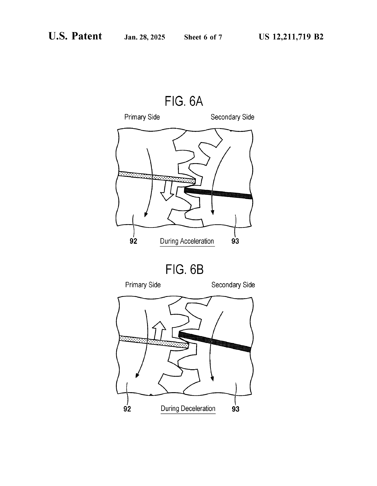
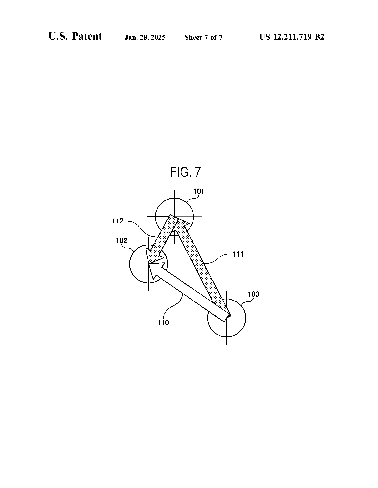

# US12211719B2 — 기판 이송 시스템의 제어 방법 및 기판 이송 시스템 (Tokyo Electron)

| 항목 | 내용 |
|---|---|
| 원문 | `US12211719.pdf`(등록, 2025-01-28) · `US20220068683.pdf`(공개, 2022-03-03) |
| 출원인 | Tokyo Electron Limited |
| 우선일 | 2020-08-31 (JP 2020-146296) |
| 청구항 | 4항 (독립항 2개: 1 방법, 4 시스템) |
| 핵심 | 이송 로봇이 지나가는 광센서로 웨이퍼 중심 편차를 잴 때, 그 측정값에는 **측정 위치에서의 로봇 열변위**가 섞여 있다. 암 온도로 링크 열팽창을, 기어 온도·재질 차·축간 거리로 백래시에 의한 각도 전달 오차량을, **모터 가속/감속 상태로 그 오차의 방향**을 추정해 측정 위치(가속 중)와 목표 위치(감속 중)의 열변위를 따로 계산하고 목표 위치를 보정한다. |
| 관련도 | ○ 부분적으로 해결 |
| 해결하는 P# | P1(오차를 열팽창·백래시 크기·백래시 방향 성분으로 나눠 합성), P3(가감속 방향에 따라 백래시 오차 방향이 바뀜), P2(측정값 자체에 측정 장치 쪽 변위가 섞임을 분리) |
| 링크 | [Google Patents](https://patents.google.com/patent/US12211719B2/en) |

---

## 상세 요약 (번역본 기준)

### 1. 해결하려는 문제
- 이송 기구의 모터 발열, 고온 챔버·고온 기판에서 들어오는 열로 암이 열팽창하고 기어 백래시가 커져 이송 정확도가 떨어진다.
- 센서로 기판 편심을 재서 목표를 보정해도, 측정 순간의 로봇 자체 변위가 측정값에 포함되어 보정이 틀어진다.

### 2. 핵심 구성
| 구성 | 부호 | 역할 |
|---|---|---|
| 이송 기구 | 5 (암 51~54, 홀더 53a·54a) | 다관절 암, 축 55~57 |
| 동력 전달 | 모터 91·94·97, 기어쌍 92-93·95-96·98-99 | Fe/A1 이종 재질 기어 |
| 온도 센서 | 81~84 | 각 암 양 끝의 열전대 |
| 센서(측정부) | 6 (6a·6b) | 기판 외주 4점 검출 → 중심 위치 |
| 제어기 | 7 | 열팽창량 추정부 71, 각도 전달 오차 추정부 72, 각도 오차 방향 추정부 73, 목표 위치 보정부 74 |

### 3. 동작 순서
1. 센서 6으로 홀더 기준 위치와 기판 중심의 편차 (X0, Y0) 측정(가속 상태로 통과).
2. 측정 위치에서의 기준 위치 열변위 (X1, Y1) 계산: 링크 열팽창(온도 × 열팽창 계수 × 기준 링크 길이) + 각도 전달 오차량(기어 온도, 열팽창 계수 차, 기준 축간 거리) + 오차 방향(가속 → 1차측 기어가 2차측을 밈) + 자세(각도 센서).
3. 목표 위치에서의 열변위 (X2, Y2) 계산(감속 → 2차측 기어가 1차측을 밈, 방향 반대, 자세도 다름).
4. 참 편차 = (X0 − X1, Y0 − Y1), 목표 보정량 = (−X0 − X2 + X1, −Y0 − Y2 + Y1).
5. 보정된 목표에서 각 축 목표 각도를 구해 모터 제어.

### 4. 청구항 요지
- 청구항 1·4: 편차량, 측정 위치의 제1 열변위량, 목표 위치의 제2 열변위량으로 목표 위치를 보정. 열변위량은 ① 암 온도로 추정한 열팽창량, ② 동력 전달 기구 온도로 추정한 각도 전달 오차량, ③ **구동원 가속/감속 상태로 추정한 각도 전달 오차 방향**으로 추정. 각도 전달 오차량은 기준 온도의 두 기어 축간 거리로 추정.
- 청구항 2: 두 기어의 온도, 열팽창 계수 차, 기준 축간 거리. 청구항 3: 온도 검출기 포함.

### 5. 대표 도면

*도 6 — 가속 중과 감속 중에 기어 이가 맞닿는 면이 바뀌어 백래시 오차 방향이 반대가 됨*

*도 7 — 측정 위치와 목표 위치의 열변위를 함께 보정해야 목표 100에 도달*

### 6. 본 과제(Y·Θ 얼라인먼트)와 비교
- 같은 점:
  - 측정값 = 참값 + 측정 순간 기구 변위라는 분해. 본 과제의 영점 변동도 "촬영 순간 판 위치 = 명령값 + 백래시/열 변위"로 볼 수 있다.
  - 백래시 오차의 **방향이 마지막 구동 상태(가속/감속, 즉 기어가 밀던 쪽)로 정해진다**는 점을 명시 — 본 과제 영점 변동이 접근 방향에 따라 달라진다는 가설과 같다.
- 다른 점:
  - 카메라가 아니라 광센서 4점, 대상은 웨이퍼 편심이다. 보정은 모델(온도·재질·축간 거리) 기반 피드포워드다.
  - 본 과제 장비의 열원·온도 측정은 없다.
- 참고할 점:
  - 오차 예산 표의 열 드리프트 항을 "링크 열팽창 + 백래시 증가 × 방향"으로 쪼개는 방식(P1).
  - 백래시 방향을 상태로 기록(마지막 이동이 + 였는지 − 였는지)하고 방향별 보정값을 적용하는 근거(P3: 영점 후보 6개 → 방향별 2개).
  - 같은 TEL·같은 장치 계열의 후속 특허 US12198955(05번)는 두 측정 위치의 차이로 이 물리 모델의 오차를 온라인으로 고친다.
