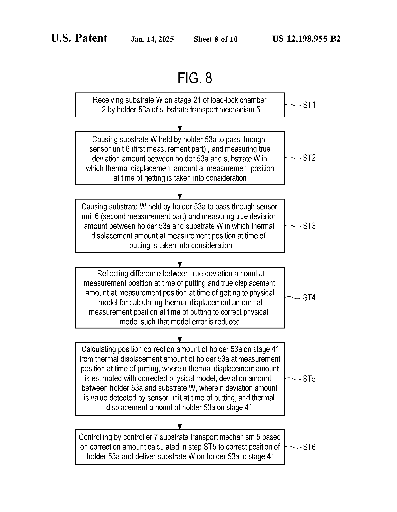
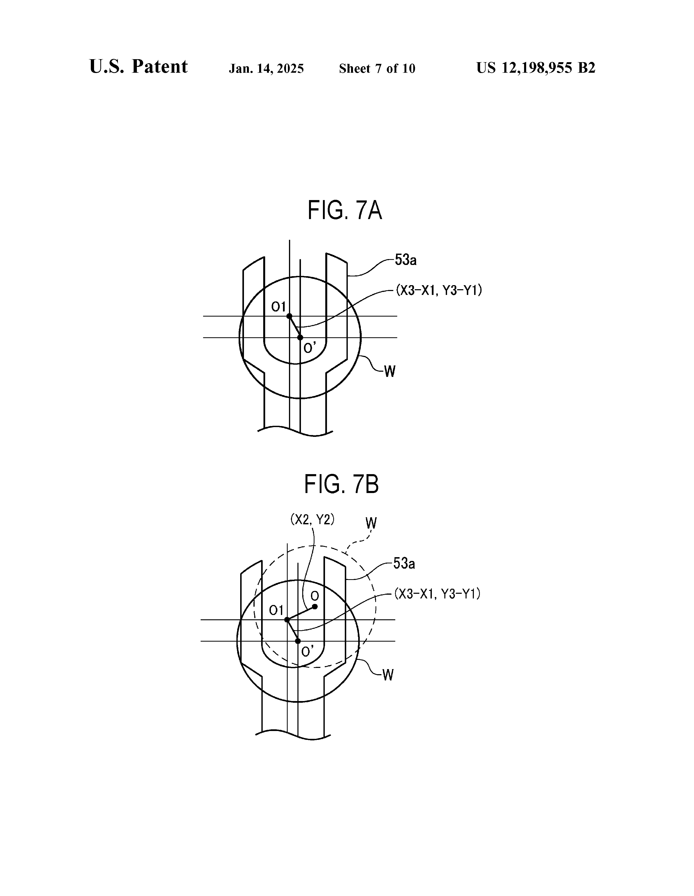

# US12198955B2 — 기판 이송 방법 및 기판 이송 시스템 (Tokyo Electron)

| 항목 | 내용 |
|---|---|
| 원문 | `US12198955.pdf`(등록, 2025-01-14) · `US20230019299.pdf`(공개, 2023-01-19) |
| 출원인 | Tokyo Electron Limited |
| 우선일 | 2021-07-14 (JP 2021-116712) |
| 청구항 | 16항 (등록본 표지 기준) |
| 핵심 | 같은 기판을 받을 때(로드록 옆 센서)와 놓을 때(공정 챔버 옆 센서) 두 번 재면, 열변위를 뺀 "참 편차"는 이상적으로 같아야 한다. 두 참 편차의 차이 Δ를 열변위 물리 모델의 오차로 보고, Δ/2를 더하거나(제1 예) Δ = 0이 되도록 모델 물리량(링크 길이, 관절 각, 열팽창 계수, 온도 변화, 오차항 β(ΔT))을 선형 계획법 등으로 맞춰(제2 예) 모델을 고친 뒤 목표 위치를 보정한다. |
| 관련도 | △ 참고 (요약만, 번역 없음) |
| 해결하는 P# | P1(중복 측정으로 모델 오차 크기 추정), P2(측정값과 모델 추정값을 서로 검증), P4(보정 모델의 온라인 갱신) |
| 링크 | [Google Patents](https://patents.google.com/patent/US12198955B2/en) |

---

## 상세 요약 (등록본 PDF 기준, 번역본 없음)

### 1. 해결하려는 문제
- 04번(US12211719)처럼 열변위를 물리 모델로 추정해 보정해도 **모델에는 항상 모델 오차가 있어** 보정 정확도에 한계가 있다.

### 2. 핵심 구성
| 구성 | 부호 | 역할 |
|---|---|---|
| 기판 이송 기구 | 5 | 04번과 같은 다관절 암, 기어 백래시·열팽창 |
| 센서 유닛 | 6 | 로드록 쪽(제1 측정부)과 공정 챔버 쪽(제2 측정부)에 각각 |
| 이송 위치 보정부 | 74 | 물리 모델 보정·보정량 계산 |

### 3. 동작 순서 (도 8)
1. ST1: 로드록 스테이지에서 기판 받기.
2. ST2: 제1 측정부 통과 → 받을 때 참 편차 (X3′ − X1′, Y3′ − Y1′).
3. ST3: 제2 측정부 통과 → 놓을 때 참 편차 (X3 − X1, Y3 − Y1).
4. ST4: 두 참 편차의 차 Δ를 물리 모델에 반영해 모델 오차 축소(X1(Ave) = X1 + Δ/2, 또는 Δ = 0이 되게 물리량 피팅해 X1(True), X2(True)).
5. ST5·ST6: 보정량 −X3 − X2 + X1(Ave) 또는 −X3 − X2(True) + X1(True)로 홀더 위치 보정 후 전달.
- 도 11: 추정한 물리량과 온도를 한 세트로 저장해 이후에 쓴다(ST17).

### 4. 청구항 요지 (등록본 표지 초록 기준)
- 제1 측정 위치에서 제1 참 편차, 제2 측정 위치에서 제2 참 편차 측정 → 차이를 제2 측정 위치 열변위 추정 물리 모델에 반영해 모델 오차를 줄이도록 보정 → 보정 모델로 제2 스테이지 위 홀더 위치 보정량 계산 → 보정 후 전달.

### 5. 대표 도면

*도 8 — 받을 때·놓을 때 두 번 측정한 참 편차의 차이로 물리 모델을 고친 뒤 보정량 계산*

*도 7 — 참 편차(기판 중심 O′와 기준 위치 O1)와 스테이지 위 열변위(O1과 목표 O)*

### 6. 본 과제(Y·Θ 얼라인먼트)와 비교
- 참고할 점: "같은 양을 두 경로로 재서 차이를 모델 오차로 쓴다"는 아이디어. 본 과제에서는 같은 자세를 control 추정기와 joint 추정기로 각각 추정하거나, 이동 전후 촬영으로 "명령 이동량 vs 추정 이동량" 차이를 매 턴 기록하면 W(학습 투영)의 감도 오차를 온라인으로 고칠 수 있다(논문 결과서 4.4절 Broyden 갱신과 같은 방향).
- 다른 점: 대상은 열변위 물리 모델이고 측정은 광센서다. 번역은 하지 않았으므로 세부 수식(식 1~6)은 원문 PDF 16~18쪽을 본다.

---

> **같은 특허의 다른 폴더:** `문헌연구/01_주제_관련/원인분석/특허/05_US12198955_TEL_두지점실측_물리모델보정` (번역 있음). 두 폴더는 주제 관점이 달라 요약을 따로 두었다.
