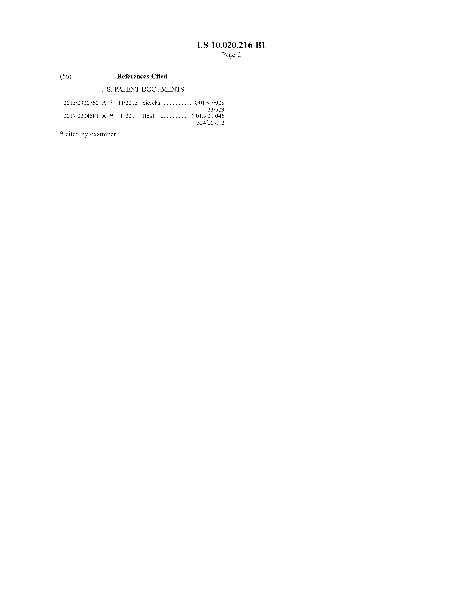
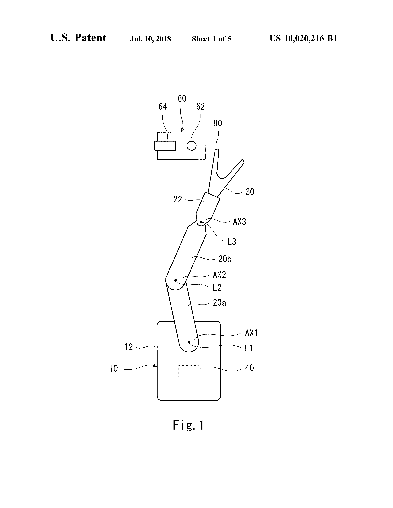
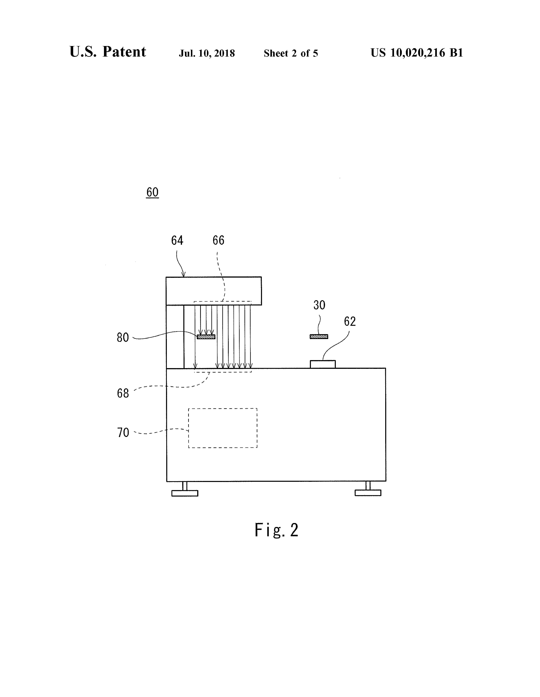
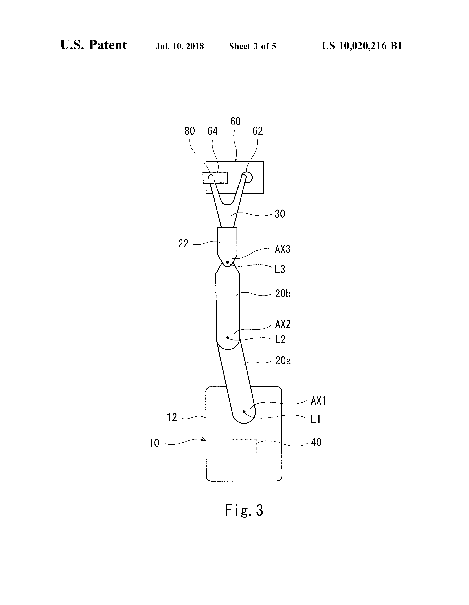
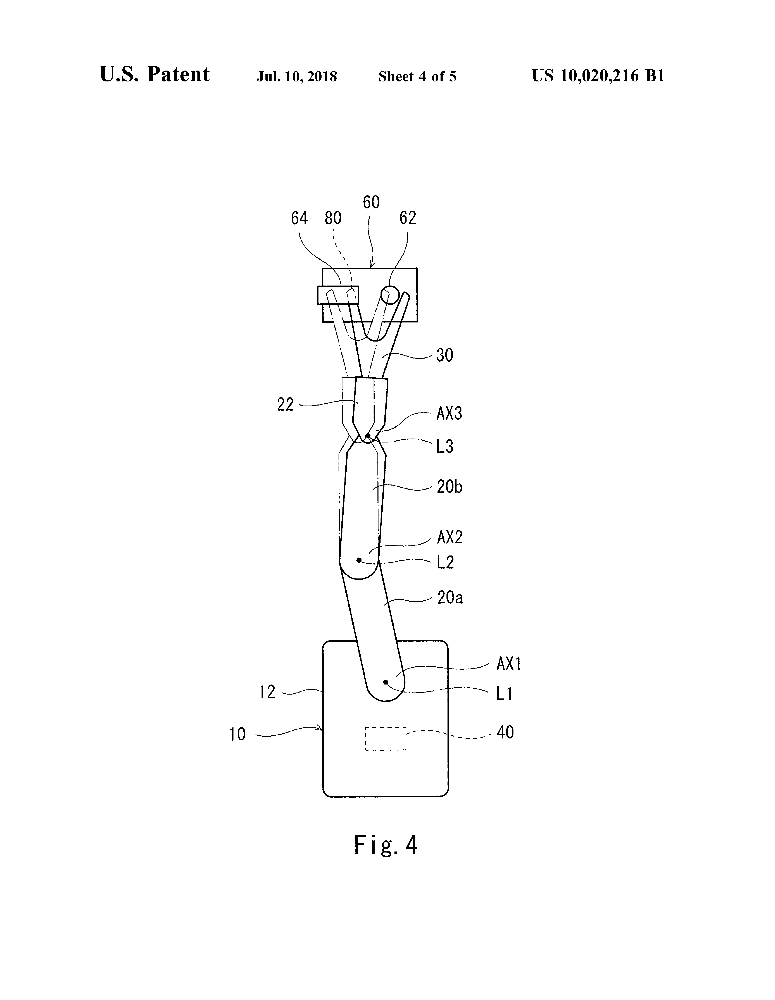

# 로봇 진단 방법 (US10020216B1)

- 원제: ROBOT DIAGNOSING METHOD
- 원문: 같은 폴더의 `US10020216.pdf`, https://patents.google.com/patent/US10020216B1/en
- 출원인: 가와사키 중공업 주식회사 (Kawasaki Jukogyo Kabushiki Kaisha, 일본 고베시), 카와사키 로보틱스 USA (Kawasaki Robotics (USA), Inc.)
- 발명자: Kazuo Fujimori, Avish Ashok Bharwani, Hajime Nakahara, Ming Zeng, Tomokazu Arita
- 등록일: 2018-07-10 (미국 특허 US 10,020,216 B1, 출원일 2017-09-08)
- 번역 기준: USPTO 등록본 PDF 직접 판독 및 국문 번역 수록
- 도면: `도면/` 폴더 내 도면 시트 5장 수록

---

## 요약

로봇 아암 관절의 감속기 백래시 및 탄성 비틀림에 기인하는 로스트 모션(lost motion) 편차량을 고정밀도로 간편하게 검출하는 로봇 진단 방법이 개시된다. 본 방법은: 제1 관절부를 포함하는 하나 또는 복수의 관절부를 구비한 로봇 아암과, 투광부와 수광부 사이에 피검출부가 삽입될 때 수광 상태에 근거하여 피검출부의 위치를 검출하도록 구성된 라인 센서를 준비하는 제1 단계; 엔드 이펙터에 제공된 피검출부를 라인 센서 사이에 위치시키고 초기 위치를 검출하는 제3 단계; 로봇 제어부로부터의 지령값에 근거하여 제1 관절부를 정방향 또는 역방향으로 회전 구동하는 제4 단계; 구동 후 피검출부의 위치를 라인 센서로 재검출하는 제5 단계; 및 (i) 제3 단계의 검출 위치와 제4 단계의 지령값으로부터 계산된 예측 위치와, (ii) 제5 단계에서 실제 재검출된 위치 사이의 차이로부터 제1 관절부의 로스트 모션에 기인한 편차량을 검출하는 제6 단계를 포함한다. 본 방법에 따르면 고가의 별도 측정 장비나 번거로운 왕복 보정 테이블 티칭 없이도, 설비 내에 배치된 라인 센서를 이용하여 감속기의 마모 및 로스트 모션을 신속하고 정확하게 자동 진단할 수 있다.

---

## 청구범위

청구하는 발명은 다음과 같다.

1. 로봇 관절부의 로스트 모션(lost motion)에 기인하는 편차량을 검출하는 로봇 진단 방법으로서,
로봇 및 라인 센서를 준비하는 제1 단계로서, 상기 로봇은 제1 관절부를 포함하는 하나 또는 복수의 관절부를 포함하는 로봇 아암 및 로봇 제어부를 구비하고, 상기 라인 센서는 투광부와 수광부를 구비하여 상기 투광부와 수광부 사이에 삽입된 피검출부의 위치를 수광 상태에 근거하여 검출하도록 구성된 검출부를 포함하는, 단계;
상기 피검출부를 상기 투광부와 수광부 사이에 위치시키도록 상기 로봇 아암을 이동시키는 제2 단계;
상기 피검출부의 위치를 상기 라인 센서로 검출하는 제3 단계;
상기 로봇 제어부로부터의 지령값에 근거하여 상기 제1 관절부를 소정 각도 구동하는 제4 단계;
상기 제4 단계 이후, 상기 피검출부의 위치를 상기 라인 센서로 재검출하는 제5 단계; 및
(i) 상기 제3 단계에서 검출된 상기 피검출부의 위치 및 상기 제4 단계에서의 지령값에 근거하여 산출된 위치와, (ii) 상기 제5 단계에서 재검출된 상기 피검출부의 위치에 근거하여, 상기 제1 관절부에서의 로스트 모션에 기인하는 편차량을 검출하는 제6 단계를 포함하는, 로봇 진단 방법.

2. 제1항에 있어서,
상기 제4 단계에서, 상기 제1 관절부는 제1 회전 방향으로 구동된 후 상기 제1 회전 방향과 반대인 제2 회전 방향으로 반전 구동되는, 로봇 진단 방법.

3. 제2항에 있어서,
상기 제6 단계는, 상기 제1 회전 방향 구동 시의 검출 위치와 상기 제2 회전 방향 구동 시의 검출 위치 사이의 히스테리시스 차이에 근거하여 백래시 양을 산출하는 것을 포함하는, 로봇 진단 방법.

4. 제1항에 있어서,
상기 로봇 아암은 상기 제1 관절부 외에 제2 관절부를 더 포함하고,
상기 제2 관절부를 고정한 상태에서 상기 제1 관절부만을 독립 구동하여 상기 제1 관절부의 로스트 모션을 분리 검출하는, 로봇 진단 방법.

5. 제1항에 있어서,
상기 피검출부는 상기 로봇 아암의 선단에 위치하는 엔드 이펙터(핸드)의 팁 부분에 일체로 형성된 핀 또는 블레이드 돌기인, 로봇 진단 방법.

6. 제1항에 있어서,
상기 라인 센서는 반도체 제조 설비의 로드락(load-lock) 챔버 또는 트랜스퍼 챔버의 입구 측에 장착되어 있는, 로봇 진단 방법.

7. 제1항에 있어서,
상기 제6 단계에서 검출된 편차량이 미리 설정된 임계 허용치를 초과하는 경우, 상기 제1 관절부 감속기의 마모 경보를 출력하거나 상기 로봇 제어부의 제어 파라미터를 자동 보정하는 단계를 더 포함하는, 로봇 진단 방법.

---

## 상세한 설명

### 배경 기술 및 기술적 과제

반도체 웨이퍼 이송 로봇은 카세트(FOUP), 로드락 챔버, 프로세스 챔버 사이에서 300 mm 실리콘 웨이퍼를 신속하고 정밀하게 이송한다. 로봇 아암의 각 관절에는 정밀 감속기(하모닉 드라이브, RV 감속기 등)가 사용된다. 감속기는 장시간 가동에 따라 기어 치면 마모, 베어링 유격 증가, 텐션 벨트의 이완 등으로 인해 '로스트 모션(lost motion)'이라 불리는 백래시 및 비틀림 오차가 누적된다.

로스트 모션이 발생하면 엔코더 상으로는 지령 각도만큼 회전한 것으로 나타나더라도, 실제 아암 선단의 엔드 이펙터는 목표 위치에 도달하지 못하거나 방향 전환 시 정위치에서 이탈하여 웨이퍼가 챔버 벽면이나 카세트 슬롯에 충돌하는 사고가 발생한다. 종래에는 작업자가 외부 다이얼 게이지나 레이저 변위계를 설치하여 복잡한 수동 측정을 수행해야 했으므로 설비 가동 중단 시간이 길어지는 문제가 있었다.

*도 1 — 반도체 웨이퍼 이송용 수평 다관절 로봇(10)과 기판 재치 엔드 이펙터(30) 상의 피검출부(80), 및 챔버에 고정 설치된 라인 센서(60)의 기하학적 배치도.*

### 라인 센서를 이용한 인라인 진단 시스템 구성

본 발명에 따른 진단 시스템은 로봇 본체(10), 로봇 제어부(40), 및 광학식 라인 센서(60)로 구성된다.

로봇(10)은 제1 축(AX1) 둘레로 회전하는 제1 관절부(L1), 제2 축(AX2) 둘레로 회전하는 제2 관절부(L2), 및 제3 축(AX3) 둘레로 회전하는 제3 관절부(L3)를 갖는 3관절 스카라(SCARA)형 아암 구조(20)를 구비한다. 아암 선단에는 웨이퍼를 지지하는 엔드 이펙터(30)가 장착되며, 엔드 이펙터의 팁에는 정밀한 광차단 핀 형태의 피검출부(80)가 구비된다.

라인 센서(60)는 반도체 반송실의 정해진 위치에 배치되며, 적외선 또는 레이저를 평행 빔 형태로 조사하는 투광부(62)와 1차원 수광 소자 어레이로 구성된 수광부(64)를 대향 배치한 투과형 광학 센서이다. 피검출부(80)가 투광부와 수광부 사이에 진입하면 차광된 그림자의 경계 위치로부터 피검출부의 1차원 위치 좌표가 수 마이크로미터 이하의 높은 정밀도로 즉각 판독된다.

*도 2 — 라인 센서(60)의 투광부(62)와 수광부(64) 사이를 통과하는 엔드 이펙터 피검출부(80)의 측정 원리도.*

### 로스트 모션 검출 시퀀스

*도 3 — 로봇 아암 관절의 정방향 및 역방향 구동에 따른 로스트 모션 측정 제어 흐름도.*

1. **위치결정 및 원점 취득(단계 S1~S3)**: 로봇 제어부(40)가 아암을 구동하여 엔드 이펙터 피검출부(80)를 라인 센서(60)의 광축 중심에 삽입하고, 초기 기준 위치 $P_0$를 검출한다.
2. **단일 관절 독립 구동(단계 S4)**:
   - 다른 관절(예: 제2, 제3 관절)은 서보 락(brake/lock)으로 완전 고정한 상태에서, 검사 대상인 제1 관절만을 제어 지령 각도 $\Delta \theta$만큼 정방향($+$)으로 미세 회전 구동한다.
   - 이어서 반대 방향인 역방향($-$)으로 동일 각도만큼 반전 구동한다.
3. **재검출 및 오차 연산(단계 S5~S6)**:
   - 각 회전 지령 후 라인 센서에 의해 검출된 실제 피검출부의 위치를 $P_{\text{actual}}$이라 하고, 기구학적 이상 모델로부터 계산된 이론 위치를 $P_{\text{ideal}} = P_0 + J \cdot \Delta \theta$라 할 때, 로스트 모션 편차량 $\Delta_{\text{lost}}$는 다음과 같이 도출된다:
     $$\Delta_{\text{lost}} = P_{\text{actual}} - P_{\text{ideal}}$$
   - 정방향 이동 후의 위치 $P_+$와 역방향 이동 후의 위치 $P_-$ 간의 차이로부터 순수 기계적 백래시(Backlash)를 직접 분리 산출한다:
     $$\text{Backlash} = |P_+ - P_-|$$

*도 4 — 관절 지령 각도 대비 실제 엔드 이펙터 이동량 사이의 히스테리시스 루프 선도. 로스트 모션과 백래시 폭을 보여준다.*

*도 5 — 복수의 관절부(제1축, 제2축, 제3축)에 대하여 순차적으로 로스트 모션을 분리 검출하는 진단 알고리즘.*

본 발명에 따르면 복잡한 외부 계측기를 셋업할 필요 없이, 장비 내에 기설치된 라인 센서를 활용하여 일상 점검 또는 웨이퍼 이송 주기 사이에 수 초 이내로 관절별 감속기 마모 상태를 자동 진단할 수 있다. 산출된 로스트 모션 값은 로봇 컨트롤러의 소프트웨어 백래시 보상 테이블에 피드포워드 반영되어 영구적인 고정밀 이송 성능을 보장한다.
