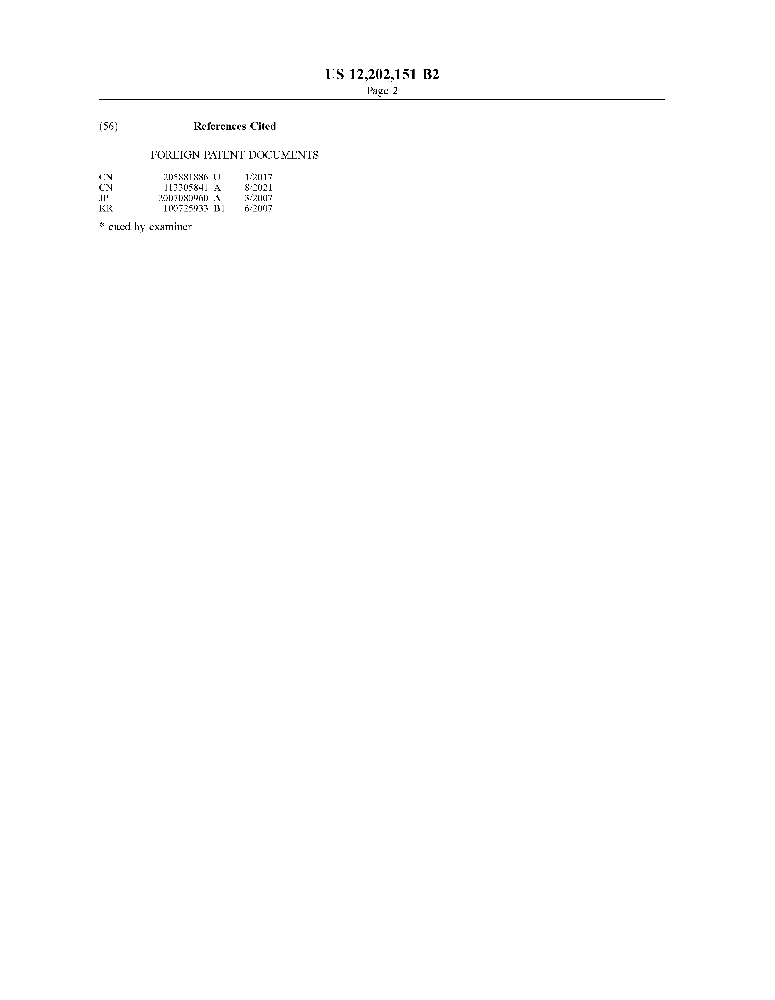
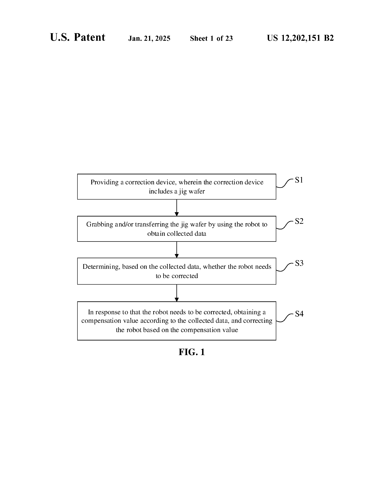
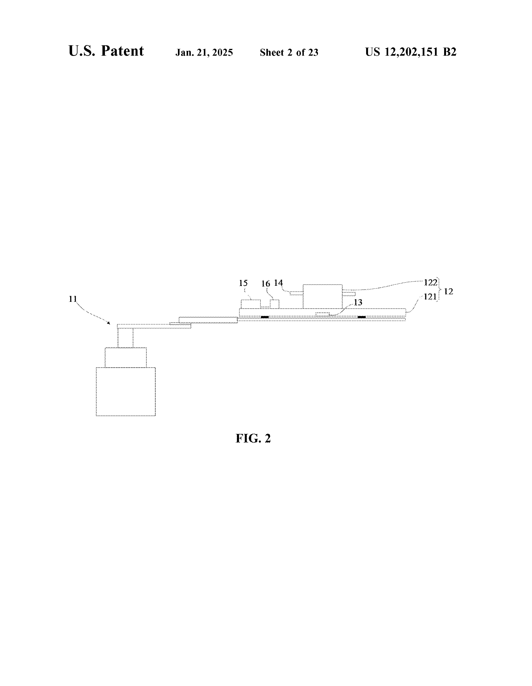
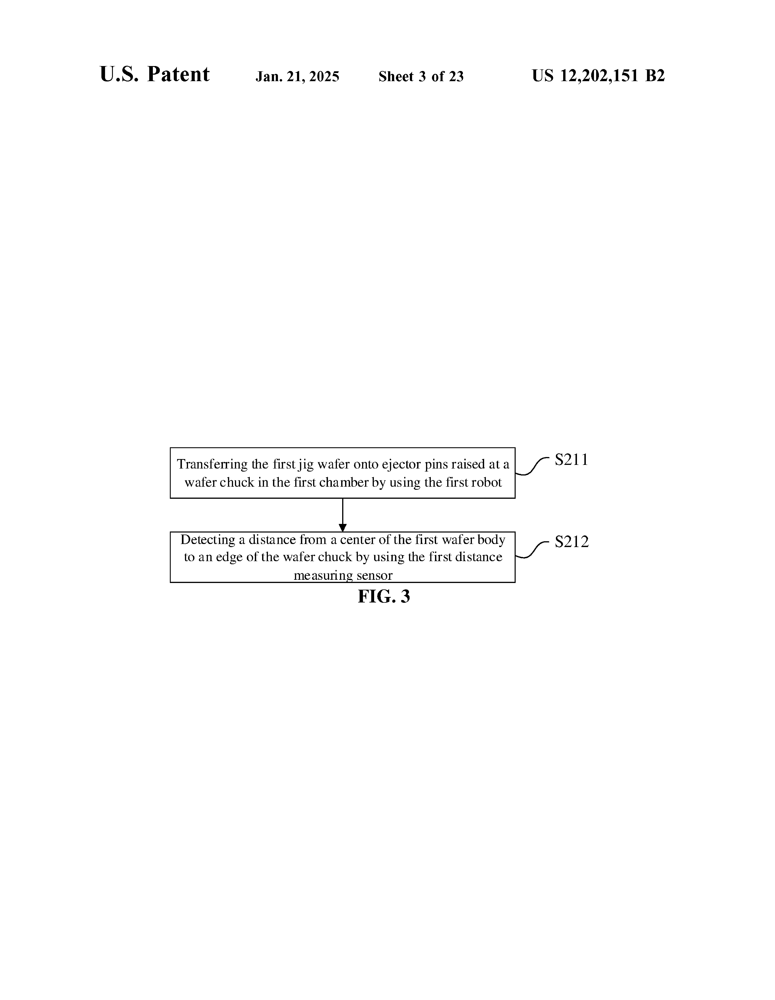
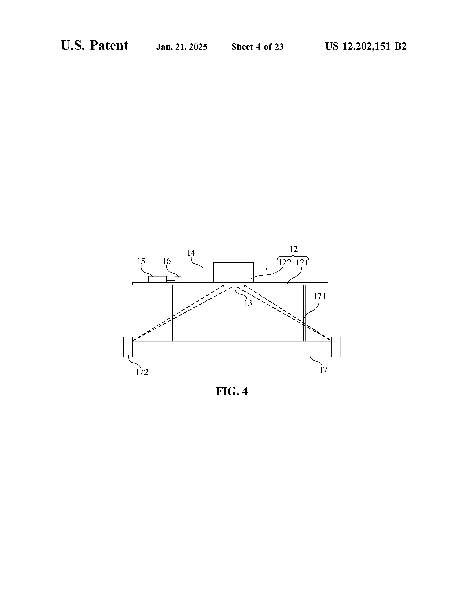
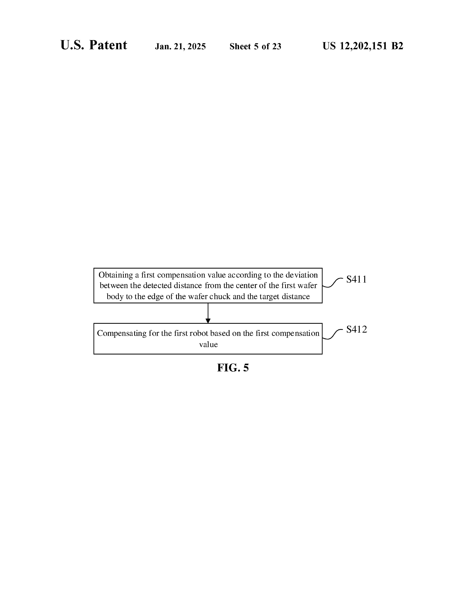

# 로봇 보정 방법 (US12202151B2)

- 원제: METHOD FOR CORRECTING ROBOT
- 원문: 같은 폴더의 `US12202151.pdf`, https://patents.google.com/patent/US12202151B2/en
- 출원인: 창신메모리 테크놀로지 (ChangXin Memory Technologies, Inc., 중국 안후이성 허페이시)
- 발명자: Jun Yang, Chunhu Ren, Le Tian, Liuguang Wang
- 등록일: 2025-01-21 (미국 특허 US 12,202,151 B2, 출원일 2022-02-10, 우선일 2021-05-27 CN 202110583355.8)
- 번역 기준: USPTO 등록본 PDF 직접 판독 및 국문 번역 수록
- 도면: `도면/` 폴더 내 대표 도면 시트 수록

---

## 요약

반도체 제조 장비에서 웨이퍼 이송 로봇을 자동으로 보정하기 위한 방법 및 장치가 제공된다. 본 방법은: 지그 웨이퍼(jig wafer)를 포함하는 보정 장치를 준비하는 단계; 상기 로봇을 이용하여 상기 지그 웨이퍼를 파지(grabbing) 및/또는 이송(transferring)하여 계측 수집 데이터를 획득하는 단계; 상기 수집된 데이터에 근거하여 상기 로봇의 위치 보정이 필요한지 여부를 판정하는 단계; 및 상기 로봇의 보정이 필요하다고 판정된 것에 응답하여, 상기 수집된 데이터에 따라 보상값을 획득하고 상기 보상값에 근거하여 상기 로봇을 보정하는 단계를 포함한다. 본 발명에 따르면 수작업 티칭 펜던트나 외부 조작 핸들을 이용하던 번거롭고 주관적인 종래의 수동 보정 방식을 탈피하여, 내장 센서 지그 웨이퍼를 통해 이송 오차 데이터를 실시간 수집하고 필요 시에만 자동으로 로봇 티칭 좌표를 미세 보상함으로써 챔버 오염을 방지하고 장비 가동률과 수율을 극대화한다.

---

## 청구범위

청구하는 발명은 다음과 같다.

1. 로봇을 보정하기 위한 방법으로서,
보정 장치를 제공하는 단계로서, 상기 보정 장치는 지그 웨이퍼(jig wafer)를 포함하는, 단계;
상기 로봇을 이용하여 상기 지그 웨이퍼를 파지 및/또는 이송함으로써 수집 데이터를 획득하는 단계;
상기 수집 데이터에 근거하여, 상기 로봇이 보정될 필요가 있는지 여부를 판정하는 단계; 및
상기 로봇이 보정될 필요가 있다는 판정에 응답하여, 상기 수집 데이터에 따라 보상값을 획득하고, 상기 보상값에 근거하여 상기 로봇을 보정하는 단계를 포함하는, 방법.

2. 제1항에 있어서,
상기 보정 장치는 상기 지그 웨이퍼 상에 장착된 변위 검출 센서 모듈 및 무선 통신 모듈을 포함하는, 방법.

3. 제1항에 있어서,
상기 수집 데이터를 획득하는 단계는, 상기 로봇이 상기 지그 웨이퍼를 카세트(FOUP), 로드락 챔버, 및 프로세스 챔버의 기판 지지대 중 적어도 하나로 이송할 때, 상기 지그 웨이퍼와 상기 기판 지지대 사이의 상대 위치 편차를 측정하는 것을 포함하는, 방법.

4. 제1항에 있어서,
상기 로봇이 보정될 필요가 있는지 여부를 판정하는 단계는:
상기 수집 데이터로부터 획득된 실제 위치 편차량과 미리 정해진 허용 편차 임계값을 비교하는 단계; 및
상기 실제 위치 편차량이 상기 허용 편차 임계값을 초과하는 경우, 상기 로봇의 보정이 필요한 것으로 판정하는 단계를 포함하는, 방법.

5. 제4항에 있어서,
상기 실제 위치 편차량이 상기 허용 편차 임계값 이하인 경우, 상기 로봇을 보정하지 않고 정상 반송 공정을 유지하는, 방법.

6. 제1항에 있어서,
상기 보상값은 수평 방향 오프셋($\Delta X, \Delta Y$), 수직 방향 높이 오프셋($\Delta Z$), 및 수직축 둘레의 회전 각도 오차($\Delta \theta$) 중 적어도 하나를 포함하는, 방법.

7. 제1항에 있어서,
상기 로봇을 보정하는 단계는, 상기 로봇 제어기에 저장된 타깃 스테이션의 티칭 좌표에 상기 보상값을 가산하여 티칭 좌표를 자동 갱신하는 것을 포함하는, 방법.

8. 제1항에 있어서,
상기 지그 웨이퍼는 실제 제품 생산용 반도체 실리콘 웨이퍼와 동일한 직경 및 중량 분포를 갖는, 방법.

---

## 상세한 설명

### 기술 배경 및 과제

반도체 소자의 회로 집적도가 10nm 이하로 미세화됨에 따라 웨이퍼 이송 로봇(EFEM 로봇 및 진공 트랜스퍼 챔버 로봇)의 정밀 위치결정 성능이 웨이퍼 스크래치 방지와 수율 확보에 치명적인 영향을 미친다. 종래에는 숙련 엔지니어가 챔버 문을 열고 외부 티칭 핸들이나 조작기를 보면서 눈대중이나 간극 게이지를 통해 수작업으로 로봇의 픽앤플레이스 위치를 티칭하였다.

그러나 수작업 보정은 (1) 작업자의 숙련도에 따라 편차가 크고, (2) 챔버를 대기 중에 개방해야 하므로 진공 파괴 및 파티클 오염이 발생하며, (3) 실제로 보정이 불필요한 상태에서도 관행적인 수동 조작으로 인해 오히려 기존의 정확한 영점 설정이 틀어지는 부작용이 있었다.

*도 1 — 웨이퍼 이송 로봇(11)과 지그 웨이퍼(121) 및 센서 모듈(122)을 포함하는 보정 장치(12)의 시스템 배치 구성도.*

### 지그 웨이퍼 보정 장치의 구성

본 발명에 따른 보정 장치(12)는 실제 300 mm 실리콘 웨이퍼와 동일한 외형 치수 및 유사 중량을 갖는 지그 웨이퍼 본체(121), 및 지그 웨이퍼 상에 탑재된 센싱 어셈블리(122)로 구성된다.

센싱 어셈블리(122)는 변위 검출 센서(13), 마이크로컨트롤러(14), 무선 통신 모듈(15), 및 충전식 전원 배터리(16)를 일체형으로 포함한다. 변위 검출 센서(13)는 광학식 거리 센서 또는 정전용량 센서로 구성되어, 엔드 이펙터나 챔버 내부 서셉터의 기준 정렬 핀/노치와의 상대 간극을 수 마이크로미터 정밀도로 비접촉 계측한다.

*도 2 — 지그 웨이퍼(121) 상면의 센서 모듈(13), 제어 처리부(14), 배터리(16)의 레이아웃 평면도.*

*도 3 — 로봇 엔드 이펙터가 지그 웨이퍼를 파지하여 이송 경로를 따라 이동하는 상태의 측단면도.*

### 자동 보정 제어 흐름

*도 4 — 데이터 수집, 보정 필요 여부 판정, 보상값 산출, 및 티칭 좌표 갱신을 수행하는 전체 보정 알고리즘 흐름도.*

1. **지그 웨이퍼 로딩 및 이송**: 로봇(11)이 카세트 슬롯으로부터 지그 웨이퍼(12)를 정상 운전 시와 동일한 속도 및 궤적으로 픽업하여 대상 챔버(공정 척)로 반송한다.
2. **실시간 데이터 취득**: 지그 웨이퍼가 척 상부에 도달할 때 내장 센서가 척의 핀 또는 에지 형상과의 상대 3차원 위치 편차 $(\Delta x, \Delta y, \Delta z, \Delta \theta)$를 측정하고, 무선 통신(Wi-Fi 또는 블루투스)을 통해 상위 제어기로 전송한다.
3. **보정 필요 여부 판정**:
   - 실측된 위치 편차 벡터의 크기 $\|\Delta P\|$가 사전에 정의된 허용 공차 임계값 $\epsilon_{\text{threshold}}$ (예: $0.1 \text{ mm}$)를 초과하는지 평가한다.
   - 임계값 이하인 경우, "보정 불필요"로 판정하고 지그 웨이퍼를 회수한 후 즉시 일반 생산 공정을 재개한다. 불필요한 티칭 변경을 차단하여 설비 안정성을 유지한다.
4. **보상값 도출 및 파라미터 갱신**:
   - 허용치를 초과한 경우, 측정된 오차의 역벡터 $(-\Delta x, -\Delta y, -\Delta z, -\Delta \theta)$를 보상값으로 산출한다.
   - 로봇 제어기에 기저장된 해당 스테이션의 티칭 포지션 레지스터에 보상값을 자동 오버라이트(overwrite)함으로써 소프트웨어적으로 원격 자동 교시를 완료한다.

*도 5 — 챔버 내부의 웨이퍼 지지 척과 지그 웨이퍼 센서 간의 정렬 관계 설명도.*

*도 6 — 반복 반송 데이터의 산포 분석 및 보정 임계값 판정 로직 블록도.*

본 발명에 따르면 진공 챔버를 대기 중에 노출시키지 않고도 웨이퍼형 지그를 통상적인 웨이퍼 반송 사이클과 동일하게 투입하여 로봇의 이송 오차를 정밀 측정하고, 이상 발생 시에만 선택적으로 티칭 좌표를 자동 보정함으로써 반도체 팹의 생산성과 설비 가동률을 극대화할 수 있다.
