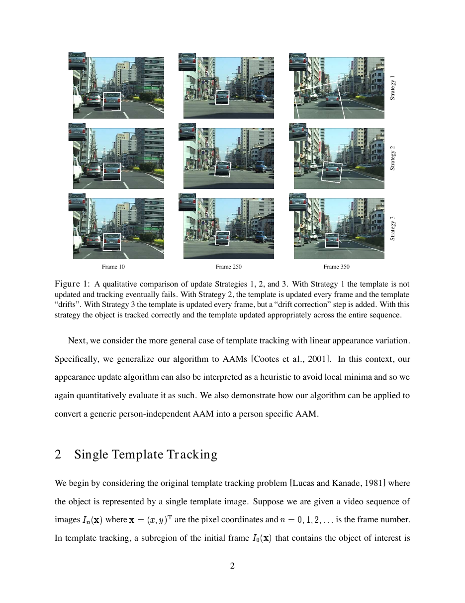
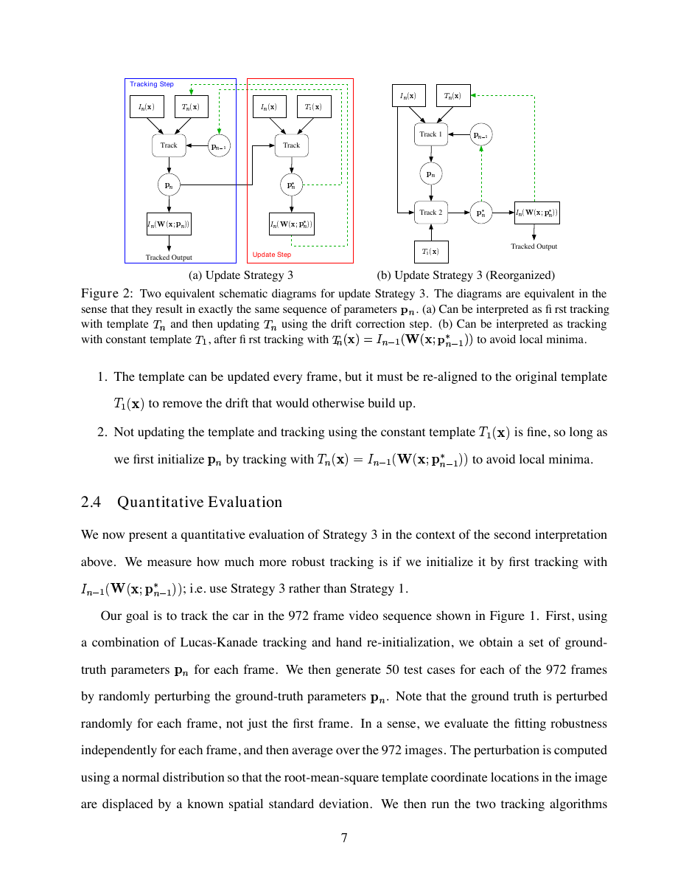
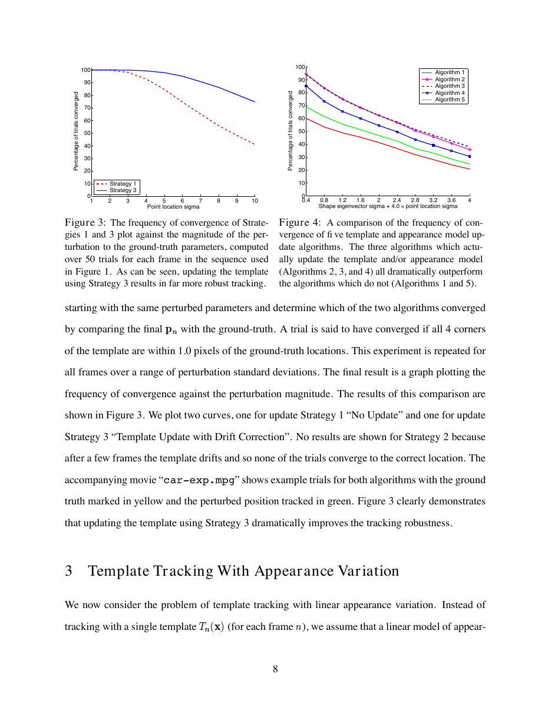

# 번역: 템플릿 갱신 문제 (The Template Update Problem)

- 원문 파일: [Matthews2004_TPAMI_template_update.pdf](Matthews2004_TPAMI_template_update.pdf)
- 원문 출처: CMU Robotics Institute 저자 공개본 (https://www.ri.cmu.edu/pub_files/pub4/matthews_iain_2004_1/matthews_iain_2004_1.pdf, 2026-11-04 HTTP 200으로 받음)
- 번역 범위: 전문 (초록, 본문, 그림 캡션, 감사의 글). 참고문헌은 원문 그대로 둔다.
- 주의
  - 받은 파일은 저자 공개본이다. 한 단 원고 형식, 본문 15쪽이다. 학술지 인쇄본(TPAMI 26(6):810-815, 6쪽)과 쪽 번호, 배치가 다르다. 감사의 글에 "anonymous PAMI reviewers"가 있어 심사 후 원고로 보인다. 인쇄본과 문구가 완전히 같은지는 확인하지 않았다.
  - 조사방법론의 PDF 후보 링크(`matthews_iain_2004_2.pdf`)는 다른 논문(Active Appearance Models Revisited)이었다. 그래서 같은 사이트의 `matthews_iain_2004_1.pdf`를 받았다.
  - pdftotext로 뽑으면 수식 글꼴이 깨진다. 수식은 쪽 이미지를 보고 옮겼다.
  - 아래 쪽 번호는 원문 원고의 쪽 번호다 (PDF 쪽 = 원고 쪽 + 2).

---

## 초록

템플릿 추적은 1981년의 Lucas-Kanade 알고리즘까지 거슬러 올라간다.
그런데 거의 다뤄지지 않은 질문이 하나 있다.
추적하는 물체를 계속 잘 나타내도록 템플릿을 어떻게 갱신할 것인가이다.
우리는 단순한(naive) 알고리즘에 본래 있는 "드리프트(drifting)"를 피하는 템플릿 갱신 알고리즘을 제안한다.

핵심어: 템플릿 추적, Lucas-Kanade 알고리즘, 능동 외형 모델(Active Appearance Models).

## 1 서론

템플릿 추적은 컴퓨터 비전에서 많이 연구된 문제이며 [Lucas and Kanade, 1981]까지 거슬러 올라간다.
물체를 비디오에서 추적하는 방법은 이렇다.
첫 프레임에서 물체의 예시 영상, 곧 템플릿을 잘라 낸다.
그다음 나머지 프레임에서 템플릿과 가장 잘 맞는 영역을 찾는다.
템플릿 추적은 여러 방향으로 확장되었다.

1. 템플릿의 임의의 매개변수 변환을 허용한다 [Bergen et al., 1992].
2. 선형 외형 변화를 허용한다 [Black and Jepson, 1998, Hager and Belhumeur, 1998].
3. 효율을 높인다 [Hager and Belhumeur, 1998, Baker and Matthews, 2004].

이 확장들을 Lucas-Kanade에 합쳐서, 능동 외형 모델(AAM) 같은 비강체 외형 모델을 실시간으로 맞출 수 있게 되었다 [Cootes et al., 2001, Matthews and Baker, 2004].

템플릿 추적의 기본 가정은 물체의 겉모습이 비디오 전체에서 같다는 것이다.
이 가정은 어느 정도 시간 동안은 대체로 맞다.
그러나 결국 템플릿은 물체의 겉모습을 더 이상 정확히 나타내지 못한다.
이 문제의 단순한 해결책은 매 프레임(또는 몇 프레임마다) 템플릿을 갱신하는 것이다.
현재 영상에서, 템플릿의 현재 위치에 있는 영역을 새 템플릿으로 잘라 낸다.
이 단순한 알고리즘의 문제는 템플릿이 "드리프트"한다는 것이다.
템플릿을 갱신할 때마다 템플릿 위치에 작은 오차가 들어간다.
갱신할수록 이 오차가 쌓이고, 템플릿은 물체에서 점점 멀어진다.
예시는 그림 1에 있다.

이 논문에서는 이런 드리프트가 없는 템플릿 갱신 알고리즘을 제안한다.
템플릿을 매 프레임 갱신해도 원래 물체에 단단히 붙어 있다.
알고리즘은 단순한 알고리즘을 조금 확장한 것이다.
현재 템플릿 추정값을 유지하면서, 첫 프레임의 첫 템플릿도 함께 보관한다.
먼저 단순한 알고리즘처럼, 현재 템플릿 위치의 영상으로 템플릿을 갱신한다.
드리프트를 없애기 위해, 이렇게 갱신한 템플릿을 첫 템플릿에 다시 정렬해 최종 갱신값을 얻는다.
먼저 알고리즘을 정성적으로 평가하고, 드리프트 없이 템플릿을 갱신할 수 있음을 보인다.
다음으로 알고리즘을 국소 최소를 피하는 경험적 방법(heuristic)으로 다시 해석한다.
그리고 국소 최소를 피하는 기법으로서 정량적으로 평가한다.

그림 1: 갱신 전략 1, 2, 3의 정성 비교. 전략 1은 템플릿을 갱신하지 않으며 결국 추적에 실패한다. 전략 2는 매 프레임 템플릿을 갱신하며 템플릿이 "드리프트"한다. 전략 3은 매 프레임 템플릿을 갱신하되 "드리프트 보정" 단계를 더한다. 이 전략에서는 시퀀스 전체에서 물체를 바르게 추적하고 템플릿도 알맞게 갱신된다. (그림 안 표기: Frame 10, Frame 250, Frame 350)

다음으로 선형 외형 변화가 있는 템플릿 추적이라는 더 일반적인 경우를 다룬다.
구체적으로, 알고리즘을 AAM [Cootes et al., 2001]으로 일반화한다.
이 맥락에서도 외형 갱신 알고리즘은 국소 최소를 피하는 경험적 방법으로 해석할 수 있다.
그래서 다시 그런 관점에서 정량 평가한다.
또한 사람에 무관한 일반 AAM을 특정 사람 전용 AAM으로 바꾸는 데 이 알고리즘을 쓸 수 있음을 보인다.

## 2 단일 템플릿 추적

원래의 템플릿 추적 문제 [Lucas and Kanade, 1981]부터 시작한다.
여기서는 물체를 템플릿 영상 하나로 나타낸다.
비디오 영상 열 $I_n(\mathbf{x})$가 있다고 하자.
$\mathbf{x} = (x, y)^\mathrm{T}$는 화소 좌표이고 $n = 0, 1, 2, \ldots$는 프레임 번호다.
템플릿 추적에서는 첫 프레임 $I_0(\mathbf{x})$에서 관심 물체가 들어 있는 부분 영역을 잘라 템플릿 $T(\mathbf{x})$로 삼는다.
템플릿이 꼭 직사각형일 필요는 없다. 예를 들어 얼굴 모양 영역일 수도 있다 [Cootes et al., 2001, Matthews and Baker, 2004].

$\mathbf{W}(\mathbf{x}; \mathbf{p})$를 템플릿에 허용하는 변형의 매개변수 집합이라 하자.
$\mathbf{p} = (p_1, \ldots, p_k)^\mathrm{T}$는 매개변수 벡터다.
변형 $\mathbf{W}(\mathbf{x}; \mathbf{p})$는 템플릿 $T(\mathbf{x})$ 좌표계의 화소 $\mathbf{x}$를 비디오 $I_n(\mathbf{x})$ 좌표계의 부화소 위치 $\mathbf{W}(\mathbf{x}; \mathbf{p})$로 옮긴다.
허용하는 변형 집합은 추적하는 물체에 예상되는 움직임의 종류에 따라 정한다.
물체가 2차원에서 움직이는 거의 평면인 영상 조각이라면 닮음 변형 집합을 생각할 수 있다.

$$
\mathbf{W}(\mathbf{x};\mathbf{p}) =
\begin{pmatrix}
(1+p_1)\,x - p_2\,y + p_3 \\
p_2\,x + (1+p_1)\,y + p_4
\end{pmatrix}
\tag{1}
$$

여기서 매개변수는 $\mathbf{p} = (p_1, p_2, p_3, p_4)^\mathrm{T}$로 4개다.
일반적으로 매개변수 수 $k$는 얼마든지 클 수 있고 $\mathbf{W}(\mathbf{x}; \mathbf{p})$도 얼마든지 복잡할 수 있다 [Bergen et al., 1992].
특히 복잡한 예는 AAM에서 비강체로 움직이는 물체를 나타내는 조각별 아핀 변형이다 [Cootes et al., 2001, Matthews and Baker, 2004].

템플릿 추적의 목표는 이후 모든 프레임에서 템플릿과 가장 잘 맞는 곳을 찾는 것이다.
맞음의 정도는 보통 템플릿과 비디오 프레임 사이의 제곱 오차 합으로 잰다.
따라서 목표는 다음을 계산하는 것이다.

$$
\mathbf{p}_n = \arg\min_{\mathbf{p}} \sum_{\mathbf{x} \in T} \left[ I_n(\mathbf{W}(\mathbf{x};\mathbf{p})) - T(\mathbf{x}) \right]^2
\tag{2}
$$

여기서 $n \ge 1$이고, 합은 템플릿 안의 모든 화소에 대해 한다 (편의상 용어를 조금 느슨하게 썼다).
식 (2)의 비선형 최적화에 대한 최초의 해법은 Lucas-Kanade 알고리즘이다 [Lucas and Kanade, 1981].
이후 여러 알고리즘이 나왔다. 최근 정리는 [Baker and Matthews, 2004]를 보라.

### 2.1 템플릿 갱신 전략

이 논문에서는 템플릿 $T(\mathbf{x})$를 어떻게 갱신할지를 다룬다.
프레임마다 (잠재적으로) 다른 템플릿을 쓴다고 하자.
$n$번째 프레임에서 쓰는 템플릿을 $T_n(\mathbf{x})$라 한다.
그러면 추적은 다음을 계산하는 것이다.

$$
\mathbf{p}_n = \arg\min_{\mathbf{p}} \sum_{\mathbf{x} \in T_n} \left[ I_n(\mathbf{W}(\mathbf{x};\mathbf{p})) - T_n(\mathbf{x}) \right]^2
\tag{3}
$$

템플릿 갱신 문제는 영상 $I_0(\mathbf{x}), \ldots, I_n(\mathbf{x})$와 템플릿 $T_1(\mathbf{x}), \ldots, T_n(\mathbf{x})$로부터 $T_{n+1}(\mathbf{x})$를 계산하는 것이다.
가장 단순한 전략은 템플릿을 전혀 갱신하지 않는 것이다.

**전략 1: 갱신 없음**

- 모든 $n \ge 1$에 대해 $T_{n+1}(\mathbf{x}) = T_1(\mathbf{x})$.

실제로 템플릿을 갱신하는 가장 단순한 전략은, $I_n(\mathbf{x})$에서 템플릿이 추적된 영역을 새 템플릿으로 삼는 것이다.

**전략 2: 단순 갱신**

- 모든 $n \ge 1$에 대해 $T_{n+1}(\mathbf{x}) = I_n(\mathbf{W}(\mathbf{x};\mathbf{p}_n))$.

두 전략 모두 좋지 않다.
첫 번째 전략에서는 템플릿이 결국, 그리고 피할 수 없이 낡아서, 추적하는 물체의 겉모습을 더 이상 대표하지 못한다.
두 번째 전략에서는 템플릿이 결국 물체에서 떠나간다.
변형 매개변수 $\mathbf{p}_n$의 작은 오차 때문에 새 템플릿 $I_n(\mathbf{W}(\mathbf{x};\mathbf{p}_n))$는 늘 이상적인 템플릿에서 조금 밀린 판이 된다.
이 오차가 쌓여 얼마 뒤 템플릿은 처음 추적하려던 물체에서 떠나간다.
템플릿이 이렇게 드리프트하는 예는 그림 1에 있다.
이 전략의 단순한 변형, 예를 들어 몇 프레임마다 템플릿을 갱신하는 방법은 더 강건하지만 결국 같은 드리프트 문제를 겪는다.

템플릿을 매 프레임 갱신하면서 떠돌지 않게 하려면 어떻게 해야 할까?
한 가지 방법은 첫 템플릿 $T_1(\mathbf{x})$를 보관해 두고 $T_{n+1}(\mathbf{x})$의 드리프트를 보정하는 데 쓰는 것이다.
예를 들어 전략 2에서 계산한 $T_{n+1}(\mathbf{x})$ 추정값을 $T_1(\mathbf{x})$에 정렬해 드리프트를 없앨 수 있다.
$T_{n+1}(\mathbf{x}) = I_n(\mathbf{W}(\mathbf{x};\mathbf{p}_n))$이므로, 이것은 영상 $I_n(\mathbf{x})$에서 먼저 템플릿 $T_n(\mathbf{x})$로 추적하고, 이어서 템플릿 $T_1(\mathbf{x})$로 추적하는 것과 같다.
식 (2)와 (3)의 비선형 최소화를 완벽하게 풀 수 있다면, 이론적으로 이것은 그냥 $T_1(\mathbf{x})$로 추적하는 것과 정확히 같다.
그러나 비선형 최소화는 경사 하강 알고리즘으로 풀기 때문에 이 전략은 실제로는 다르다.
경사 하강 알고리즘으로 식 (3)을 푼다는 점을 드러내도록 표기를 조금 바꾸자.
식 (3)을 다음처럼 다시 쓴다.

$$
\mathbf{p}_n = \operatorname{gd}\min_{\mathbf{p}=\mathbf{p}_{n-1}} \sum_{\mathbf{x} \in T_n} \left[ I_n(\mathbf{W}(\mathbf{x};\mathbf{p})) - T_n(\mathbf{x}) \right]^2
\tag{4}
$$

여기서 $\operatorname{gd}\min_{\mathbf{p}=\mathbf{p}_{n-1}}$은 "$\mathbf{p} = \mathbf{p}_{n-1}$에서 시작해 경사 하강 최소화를 한다"는 뜻이다.
전략 2의 드리프트를 보정하기 위해, 다음과 같이 갱신한 매개변수를 계산하자고 제안한다.

$$
\mathbf{p}^*_n = \operatorname{gd}\min_{\mathbf{p}=\mathbf{p}_{n}} \sum_{\mathbf{x} \in T_1} \left[ I_n(\mathbf{W}(\mathbf{x};\mathbf{p})) - T_1(\mathbf{x}) \right]^2
\tag{5}
$$

이것은 고정 템플릿 $T_n = T_1$로 추적하는 다음 식과 다르다는 점에 주의하라.

$$
\operatorname{gd}\min_{\mathbf{p}=\mathbf{p}_{n-1}} \sum_{\mathbf{x} \in T_1} \left[ I_n(\mathbf{W}(\mathbf{x};\mathbf{p})) - T_1(\mathbf{x}) \right]^2
\tag{6}
$$

경사 하강의 시작점이 다르기 때문이다.
시작점이 $\mathbf{p}_{n-1}$이 아니라 $\mathbf{p}_n$이다.
드리프트를 보정하기 위해, 다음 영상의 템플릿을 만들 때 $\mathbf{p}_n$ 대신 $\mathbf{p}^*_n$을 쓴다.
정리하면 (그림 2도 보라), 템플릿을 다음과 같이 갱신한다.

**전략 3: 드리프트 보정이 있는 템플릿 갱신**

- $\lVert \mathbf{p}^*_n - \mathbf{p}_n \rVert \le \epsilon$ 이면 $T_{n+1}(\mathbf{x}) = I_n(\mathbf{W}(\mathbf{x};\mathbf{p}^*_n))$
- 그렇지 않으면 $T_{n+1}(\mathbf{x}) = T_n(\mathbf{x})$

여기서 $\epsilon > 0$은 작은 임계값이다.
두 번째 경사 하강의 결과가 첫 번째 결과에서 너무 멀어지지 않도록 하는 조건이다.
너무 멀어지면 무언가 문제가 있는 것이므로, 그 단계에서는 템플릿을 갱신하지 않고 보수적으로 행동한다.
전략 3의 작은 변형으로, 드리프트 보정 정렬을 원 영상 대신 영상과 템플릿의 기울기 크기로 하는 방법이 있다.
조명 변화에 대한 강건성을 높이기 위해서다.

### 2.2 정성 비교

이제 전략들을 정성적으로 비교한다.
지면이 부족해 결과 한 묶음만 싣지만, 이 결과는 전형적이다.
정량 평가는 2.4절에 있다.

세 갱신 전략을 모두 구현했다.
그리고 식 (1)의 2차원 닮음 변환으로 자동차를 추적하는 972프레임 비디오에 돌렸다.
각 갱신 알고리즘의 예시 프레임이 그림 1에 있다.
템플릿을 갱신하지 않으면(전략 1) 312번째 프레임 뒤로는 자동차를 바르게 추적하지 못한다.
단순한 방법으로 매 프레임 갱신하면(전략 2) 200번째 프레임 무렵 템플릿이 자동차에서 떠나간다.
갱신 전략 3 "드리프트 보정이 있는 템플릿 갱신"에서는 시퀀스 전체에서 자동차를 추적한다.
템플릿도 매 프레임 바르게 갱신되고 드리프트가 생기지 않는다.
이 시퀀스의 추적 결과는 함께 제공하는 동영상 "car-track.mpg"를 보라.

각주 1: 동영상은 http://www.ri.cmu.edu/projects/project_513.html 에서도 받을 수 있다.

### 2.3 갱신 전략 3의 재해석

전략 3의 구성도는 그림 2(a)에 있다.
영상 $I_n(\mathbf{x})$를 먼저 템플릿 $T_n(\mathbf{x})$로, 이전 매개변수 $\mathbf{p}_{n-1}$에서 시작해 추적한다 (왼쪽 상자).
결과는 추적된 영상 $I_n(\mathbf{W}(\mathbf{x};\mathbf{p}_n))$와 매개변수 $\mathbf{p}_n$이다.
그다음 $I_n(\mathbf{x})$에서 $T_1(\mathbf{x})$를 매개변수 $\mathbf{p}_n$에서 시작해 추적하여, 새 템플릿 $T_{n+1}(\mathbf{x}) = I_n(\mathbf{W}(\mathbf{x};\mathbf{p}^*_n))$를 계산한다 (오른쪽 상자).

그림 2(a)를 조금 재배치하면 그림 2(b)가 된다.
바뀐 것은 "추적 출력"이 $I_n(\mathbf{W}(\mathbf{x};\mathbf{p}_n))$가 아니라 $I_n(\mathbf{W}(\mathbf{x};\mathbf{p}^*_n))$라는 점뿐이다.
그림 2(a)와 2(b)의 차이는 계산이 아니다 (두 그림은 같은 매개변수 열 $\mathbf{p}_n$을 낸다).
차이는 해석이다.
그림 2(a)는 $T_n(\mathbf{x})$로 추적한 다음 $T_n(\mathbf{x})$를 갱신하는 것으로 해석할 수 있다.
그림 2(b)는 $T_n(\mathbf{x})$로 추적해 초기 추정값을 얻고, 그것으로 $T_1(\mathbf{x})$ 추적을 시작하는 것으로 해석할 수 있다.
이 초기 추정값이 강건성을 높인다. $T_1(\mathbf{x})$로 추적하면 국소 최소에 빠지기 쉽기 때문이다.
$I_{n-1}(\mathbf{W}(\mathbf{x};\mathbf{p}^*_{n-1}))$로 추적하면 국소 최소에 덜 빠진다.
이것으로 $T_1(\mathbf{x})$ 추적의 시작점을 잡아 주어, 국소 최소를 피할 만큼 가까운 곳에서 시작하게 한다.
정리하면, 전략 3은 두 가지 같은 방식으로 해석할 수 있다.

그림 2: 갱신 전략 3의 두 가지 동등한 구성도. 두 그림은 정확히 같은 매개변수 열 $\mathbf{p}_n$을 낸다는 뜻에서 동등하다. (a) 템플릿 $T_n$으로 먼저 추적하고, 드리프트 보정 단계로 $T_n$을 갱신하는 것으로 해석할 수 있다. (b) 국소 최소를 피하려고 먼저 $T_n(\mathbf{x}) = I_{n-1}(\mathbf{W}(\mathbf{x};\mathbf{p}^*_{n-1}))$로 추적한 뒤, 고정 템플릿 $T_1$로 추적하는 것으로 해석할 수 있다. (그림 안 표기: Tracking Step 추적 단계, Update Step 갱신 단계, Track 추적, Track 1 추적 1, Track 2 추적 2, Tracked Output 추적 출력)

1. 템플릿은 매 프레임 갱신해도 된다. 다만 그렇지 않으면 쌓일 드리프트를 없애기 위해 원래 템플릿 $T_1(\mathbf{x})$에 다시 정렬해야 한다.
2. 템플릿을 갱신하지 않고 고정 템플릿 $T_1(\mathbf{x})$로 추적해도 된다. 다만 국소 최소를 피하기 위해 먼저 $T_n(\mathbf{x}) = I_{n-1}(\mathbf{W}(\mathbf{x};\mathbf{p}^*_{n-1}))$로 추적해 $\mathbf{p}_n$의 시작점을 잡아야 한다.

### 2.4 정량 평가

이제 위의 두 번째 해석의 맥락에서 전략 3을 정량 평가한다.
$I_{n-1}(\mathbf{W}(\mathbf{x};\mathbf{p}^*_{n-1}))$로 먼저 추적해 시작점을 잡으면 추적이 얼마나 더 강건해지는지 잰다.
곧 전략 1 대신 전략 3을 쓰는 효과다.

목표는 그림 1의 972프레임 비디오에서 자동차를 추적하는 것이다.
먼저 Lucas-Kanade 추적과 손으로 하는 재초기화를 함께 써서, 프레임마다 정답 매개변수 $\mathbf{p}_n$을 얻는다.
그다음 정답 매개변수 $\mathbf{p}_n$을 무작위로 흔들어, 972프레임 각각에 대해 시험 사례 50개를 만든다.
첫 프레임만이 아니라 프레임마다 정답을 무작위로 흔든다는 점에 주의하라.
어떤 의미에서는 프레임마다 따로 맞춤 강건성을 평가하고, 972장에 대해 평균한 것이다.
흔듦은 정규분포로 만든다. 영상 안 템플릿 좌표 위치의 제곱평균제곱근(RMS) 변위가 알려진 공간 표준편차가 되도록 한다.
그다음 두 추적 알고리즘을 같은 흔든 매개변수에서 시작해 돌린다.
최종 $\mathbf{p}_n$을 정답과 비교해 두 알고리즘 중 어느 것이 수렴했는지 판정한다.
템플릿의 네 모서리가 모두 정답 위치에서 1.0화소 안에 있으면 수렴했다고 본다.
이 실험을 모든 프레임에서, 여러 흔듦 표준편차에 걸쳐 되풀이한다.
최종 결과는 수렴 빈도를 흔듦 크기에 대해 그린 그래프다.
비교 결과는 그림 3에 있다.
두 곡선을 그렸다. 하나는 갱신 전략 1 "갱신 없음", 하나는 갱신 전략 3 "드리프트 보정이 있는 템플릿 갱신"이다.
전략 2의 결과는 싣지 않았다. 몇 프레임 뒤 템플릿이 드리프트해 어떤 시행도 바른 위치로 수렴하지 않기 때문이다.
함께 제공하는 동영상 "car-exp.mpg"에 두 알고리즘의 시행 예가 있다. 정답은 노란색, 흔든 위치에서 추적한 결과는 녹색으로 표시했다.
그림 3은 전략 3으로 템플릿을 갱신하면 추적 강건성이 크게 좋아짐을 분명히 보여 준다.

그림 3: 정답 매개변수에 준 흔듦의 크기에 따른 전략 1과 3의 수렴 빈도. 그림 1에 쓴 시퀀스의 각 프레임에서 50회씩 시행해 계산했다. 전략 3으로 템플릿을 갱신하면 추적이 훨씬 강건해진다. (축: 가로 Point location sigma 점 위치 시그마, 세로 Percentage of trials converged 수렴한 시행 비율 %)

그림 4: 다섯 가지 템플릿 및 외형 모델 갱신 알고리즘의 수렴 빈도 비교. 템플릿 또는 외형 모델을 실제로 갱신하는 세 알고리즘(알고리즘 2, 3, 4)이 갱신하지 않는 알고리즘(알고리즘 1, 5)보다 모두 크게 낫다. (축: 가로 Shape eigenvector sigma + 4.0 × point location sigma 형상 고유벡터 시그마 + 4.0 × 점 위치 시그마, 세로 수렴한 시행 비율 %)

## 3 외형 변화가 있는 템플릿 추적

이제 선형 외형 변화가 있는 템플릿 추적 문제를 다룬다.
(프레임 $n$마다) 템플릿 하나 $T_n(\mathbf{x})$로 추적하는 대신, 선형 외형 변화 모델을 쓴다고 가정한다.
곧 외형 영상 집합 $A^i_n(\mathbf{x})$, $i = 1, \ldots, d_n$을 쓴다.
템플릿 $T_n(\mathbf{x})$가 (알맞게 변형되어) 입력 영상 $I_n(\mathbf{x})$에 나타난다고 가정하는 대신, 다음이 나타난다고 가정한다.

$$
T_n(\mathbf{x}) + \sum_{i=1}^{d_n} \lambda^i A^i_n(\mathbf{x})
\tag{7}
$$

이것이 알 수 없는 외형 매개변수 $\boldsymbol{\lambda} = (\lambda^1, \ldots, \lambda^{d_n})^\mathrm{T}$에 대해 (알맞게 변형되어) 입력 영상에 나타난다고 본다.
외형 영상 $A^i_n(\mathbf{x})$는 조명 변화 [Hager and Belhumeur, 1998] 또는 더 일반적인 선형 외형 변화 [Black and Jepson, 1998, Cootes et al., 2001]를 나타내는 데 쓸 수 있다.
이 논문에서는 특히 능동 외형 모델 [Cootes et al., 2001, Matthews and Baker, 2004]에 집중한다.
AAM은 선형 외형 모델과, 형상 변형을 나타내는 (매개변수가 적은) 조각별 아핀 변형 $\mathbf{W}(\mathbf{x};\mathbf{p})$를 합친 것이다.
이런 선형 외형 모델로 추적하는 과정은 다음을 최소화하는 것이다.

$$
(\mathbf{p}_n, \boldsymbol{\lambda}_n) = \arg\min_{(\mathbf{p}, \boldsymbol{\lambda})} \sum_{\mathbf{x} \in T_n} \left[ I_n(\mathbf{W}(\mathbf{x};\mathbf{p})) - T_n(\mathbf{x}) - \sum_{i=1}^{d_n} \lambda^i A^i_n(\mathbf{x}) \right]^2
\tag{8}
$$

이 비선형 최적화 문제를 푸는 효율적인 경사 하강 알고리즘이 여럿 나와 있다.
이동, 아핀 변형, 2차원 닮음 변환에는 [Hager and Belhumeur, 1998], 군을 이루는 임의의 변형에는 [Baker and Matthews, 2001], 능동 외형 모델에는 [Matthews and Baker, 2004]가 있다.
그 결과를 다음과 같이 적는다.

$$
(\mathbf{p}_n, \boldsymbol{\lambda}_n) = \operatorname{gd}\min_{(\mathbf{p}_{n-1}, \boldsymbol{\lambda}_{n-1})} \sum_{\mathbf{x} \in T_n} \left[ I_n(\mathbf{W}(\mathbf{x};\mathbf{p})) - T_n(\mathbf{x}) - \sum_{i=1}^{d_n} \lambda^i A^i_n(\mathbf{x}) \right]^2
\tag{9}
$$

여기서 경사 하강은 $(\mathbf{p}_{n-1}, \boldsymbol{\lambda}_{n-1})$에서 시작한다.

### 3.1 템플릿과 외형 모델을 함께 갱신하기

처음 템플릿 $T_1$과 외형 모델 $A^i_1$이 주어졌다고 하자.
선형 외형 변화가 있는 템플릿 갱신 문제는 $I_0(\mathbf{x}), \ldots, I_n(\mathbf{x})$, $T_1(\mathbf{x}), \ldots, T_n(\mathbf{x})$, $A^i_1, \ldots, A^i_n$으로부터 $T_{n+1}$과 $A^i_{n+1}$을 추정하는 것이다.
앞에서와 같이, 처음 템플릿 $T_1$과 외형 모델 $A^i_1$에 대해 정렬하되, 현재 템플릿 $T_n$과 외형 모델 $A^i_n$으로 정렬한 결과에서 경사 하강을 시작한 결과를 다음과 같이 적는다.

$$
(\mathbf{p}^*_n, \boldsymbol{\lambda}^*_n) = \operatorname{gd}\min_{(\mathbf{p}_n, \boldsymbol{\lambda}_n)} \sum_{\mathbf{x} \in T_n} \left[ I_n(\mathbf{W}(\mathbf{x};\mathbf{p})) - T_1(\mathbf{x}) - \sum_{i=1}^{d_1} \lambda^i A^i_1(\mathbf{x}) \right]^2
\tag{10}
$$

템플릿과 외형 모델을 갱신하는 한 가지 방법은 다음과 같다.

**전략 4: 드리프트 보정이 있는 템플릿 및 외형 모델 갱신**

- $\lVert \mathbf{p}^*_n - \mathbf{p}_n \rVert \le \epsilon$ 이면 $(T_{n+1}(\mathbf{x}), A^i_{n+1}) = \mathrm{PCA}\big(I_1(\mathbf{W}(\mathbf{x};\mathbf{p}^*_1)), \ldots, I_n(\mathbf{W}(\mathbf{x};\mathbf{p}^*_n))\big)$
- 그렇지 않으면 $T_{n+1}(\mathbf{x}) = T_n(\mathbf{x})$, $A^i_{n+1} = A^i_n$

여기서 PCA()는 주성분 분석을 해서 $T_n$을 평균으로, $A^i_n$을 처음 $d_n$개 고유벡터로 두는 것이다.
$d_n$은 정해진 에너지 비율, 보통 95%를 유지하도록 고른다.
(다른 변형도 있다. 예를 들어 외형 모델 $A^i_n$이 새 측정 $I_n(\mathbf{W}(\mathbf{x};\mathbf{p}^*_n))$를 포함하도록 점진적으로 갱신할 수 있다.)
이 알고리즘을 2.3절처럼 다시 해석하면, 다음의 두 단계 추적 알고리즘이 된다.

- 단계 1: $I_1(\mathbf{W}(\mathbf{x};\mathbf{p}^*_1)), \ldots, I_{n-1}(\mathbf{W}(\mathbf{x};\mathbf{p}^*_{n-1}))$에 PCA를 한다. $T_n$을 평균 벡터로, $A^i_n$을 처음 $i = 1, \ldots, d_n$개 고유벡터로 둔다. 이렇게 계산한 뒤 템플릿 $T_n$과 외형 모델 $A^i_n$으로 추적한다.
- 단계 2: 미리 주어진 템플릿 $T_1(\mathbf{x})$와 선형 외형 모델 $A^i_1(\mathbf{x})$로 추적한다. 경사 하강은 단계 1의 결과에서 시작한다.

이 두 단계는 "점진적 외형 복잡도"를 쓰는 것으로 해석할 수 있다.
이는 "점진적 변환 복잡도" [Bergen et al., 1992]와 비슷하다.
점진적 변환 복잡도는 변형 $\mathbf{W}(\mathbf{x};\mathbf{p})$의 복잡도를 늘려 가며 추적 알고리즘의 강건성을 높이는 표준적인 경험적 방법이다.
예를 들어 아핀 변형 추적은 흔히 먼저 이동으로, 다음 2차원 닮음 변환으로, 마지막으로 전체 아핀 변형으로 추적한다.
여기서는 한 외형 모델로 추적한 결과를 다른 외형 모델 추적의 시작점으로 쓴다.
이 비유에 따라 위 알고리즘에 단계를 하나 더한다.

- 단계 0: 템플릿 $T_n(\mathbf{x}) = I_{n-1}(\mathbf{W}(\mathbf{x};\mathbf{p}^*_{n-1}))$로, 외형 모델 없이 추적한다.

이 단계는 위의 두 단계 전에 하며, 그 두 단계의 시작점을 잡는 데 쓴다.

### 3.2 정량 평가

전략 4 "드리프트 보정이 있는 템플릿 및 외형 모델 갱신"을 2.4절의 전략 3과 같은 방법으로 평가한다.
얼굴을 찍은 600프레임 비디오를 쓴다.
무작위로 고른 80프레임에서 특징점을 손으로 표시해 처음 AAM을 만든다.
그다음 AAM 맞춤 [Matthews and Baker, 2004], 피라미드 탐색, 점진적 변환 복잡도, 손으로 하는 재초기화를 함께 써서 비디오 전체에 AAM을 추적해 정답 매개변수를 만든다.
함께 제공하는 동영상 "face-gt.mpg"는 비디오의 모든 영상에 정답 AAM 특징점을 그린 것이다.
이 시퀀스는 자동차 운전자의 얼굴이며, 중간 정도의 얼굴 자세 변화와 조명 변화가 있다.
AAM 매개변수를 무작위로 흔들어 600프레임 각각에 시험 사례 50개를 만든다.
2.4절과 비슷하게, [Matthews and Baker, 2004]의 절차를 그대로 따라, AAM의 닮음 변환과 형상 매개변수 모두에 흔듦을 준다.
구체적으로, 닮음 변위의 RMS 표준편차를 형상 고유벡터 표준편차의 4배로 잡는다. 각각을 상대 중요도에 맞춰 가중하기 위해서다.
시험 사례마다 네 알고리즘을 비교했다.

- 알고리즘 1: 단계 2 (갱신 없음).
- 알고리즘 2: 단계 1 다음 단계 2.
- 알고리즘 3: 단계 0 다음 단계 1 다음 단계 2.
- 알고리즘 4: 단계 0 다음 단계 2.

이 네 알고리즘의 수렴 빈도를 $50 \times 600$개 시험 사례 전체 평균으로 계산해, AAM 매개변수 흔듦의 크기에 대해 그림 4에 그렸다.
(함께 제공하는 동영상 "face-exp.mpg"에 한 알고리즘의 시행 예가 있다. 정답은 노란색, 흔든 위치에서 추적한 결과는 녹색이다.)
2절의 단일 템플릿 추적과 마찬가지로, 템플릿과 외형 모델을 갱신하는 알고리즘(알고리즘 2, 3, 4)이 모두 갱신하지 않는 알고리즘(알고리즘 1)보다 낫다.
예상할 수 있듯이 알고리즘 3(단계 0, 1, 2)은 단계 1과 2만 쓰는 알고리즘 2보다 조금 낫다.
알고리즘 4는 알고리즘 2, 3보다 크게 나쁘다. 가장 좋은 성능에는 단계 1이 꼭 필요하다는 뜻이다.
마지막으로 다섯 번째 알고리즘의 곡선도 그렸다.
알고리즘 5는 갱신 알고리즘이 최종으로 계산한 AAM으로 시퀀스를 추적하는 것이다.
곧 고정 템플릿 $T_{600}$과 고정 선형 외형 모델 $A^i_{600}$을 쓴다.
이것은 600프레임 전체로 계산한 AAM이므로, 80프레임만으로 계산한 사전 AAM보다 성능이 크게 낫다.
그래도 AAM을 매 프레임 갱신하는 알고리즘 2만큼 좋지는 않다.

### 3.3 일반 AAM을 특정 사람 전용 AAM으로 바꾸기

위의 단계 1을 쓰면, 비디오에서 얼굴을 추적하는 동안 새 템플릿과 외형 모델이 온라인으로 계산된다.
이 과정을 보이기 위해, 사람에 무관한 일반 AAM으로 얼굴 비디오를 추적하는 데 알고리즘 2를 적용했다.
함께 제공하는 동영상 "face-app.mpg"는 추적된 얼굴, $A_1$과 처음 두 $A^i_1$, 그리고 프레임마다 현재 $A_n$과 처음 두 $A^i_n$을 보여 준다.
그 결과 시퀀스가 끝날 때, 템플릿 및 외형 모델 갱신 알고리즘은 그 사람 전용 외형 모델을 계산해 낸다.

이 과정을 그림 5에 보였다.
그림 5(a)는 추적한 얼굴의 4프레임이다.
일반 AAM을 계산할 때 이 비디오 속 사람의 영상은 하나도 쓰지 않았다.
그림 5(b)는 일반 AAM의 외형 고유벡터다. 외형 고유벡터는 주로 사람마다 다른 생김새를 나타낸다.
그림 5(c)는 우리 알고리즘으로 계산한 특정 사람 전용 AAM의 외형 고유벡터다. 고유벡터는 주로 조명 변화를 나타내고 생김새 변화는 나타내지 않는다.
그림 5(d)는 두 AAM의 외형 고윳값이다.
특정 사람 전용 AAM은 외형 변화가 훨씬 적다. 그래서 같은 표현력을 내는 데 외형 매개변수가 훨씬 적게 든다.

그림 5: 일반 AAM을 특정 사람 전용 AAM으로 바꾸는 과정. (a) 추적하는 비디오의 4프레임. (b) 일반 AAM의 외형 변화. (c) 계산한 특정 사람 전용 AAM의 외형 변화. (d) 두 AAM의 외형 고윳값. 특정 사람 전용 AAM은 매개변수가 훨씬 적게 들고 조명 변화만 나타낸다. 반면 일반 AAM은 주로 사람마다 다른 생김새를 나타낸다. (그림 안 표기: Generic AAM 일반 AAM, Person Specific AAM 특정 사람 전용 AAM, 가로축 Eigenvector 고유벡터 번호 5~50, 세로축 Eigenvalue 고윳값 로그 눈금 $10^3$~$10^8$. 그림은 원문 PDF 14쪽에 있으며 여기에는 넣지 않았다.)

## 4 결론

템플릿 갱신 문제를 조사했다.
먼저 단순한 알고리즘에 본래 있는 "드리프트"를 겪지 않는 템플릿 갱신 알고리즘을 제안했다.
다음으로 이 알고리즘을 국소 최소를 피하는 경험적 방법으로 다시 해석하고, 그 관점에서 정량 평가했다.
결과는 "드리프트 보정이 있는 템플릿 갱신"으로 템플릿을 갱신하면 추적 강건성이 좋아짐을 보여 준다.
그다음 알고리즘을 선형 외형 모델이 있는 템플릿 추적으로 확장하고, 갱신 전략의 다섯 변형을 정량 비교했다.
결과는 다시 한번, 템플릿과 외형 모델을 드리프트 보정과 함께 갱신하면 맞춤이 더 강건해짐을 보여 준다.
마지막으로, 선형 외형 모델 갱신 전략이 일반 AAM으로 추적하는 동안 특정 사람 전용 AAM을 자동으로 계산할 수 있음을 보였다.
템플릿 갱신은 비지도 모델 구축의 한 형태로 볼 수 있다는 점에 주의하라.
그런 면에서 이 문제에 대한 늘어나는 연구들과 관련이 있으며, 한 예가 [Vetter et al., 1997]이다.

우리 알고리즘이 성공했다는 것에는 한 가지 함의가 있다.
물체의 겉모습이 바뀌면 템플릿 추적 문제가 국소 최소에 더 취약해진다는 것이다.
비공식적으로 말하면, 국소 최소가 "더 가까워지거나" 전역 최소(더 정확히는 바른 추적에 해당하는 최소)가 "덜 깊어진다".
템플릿을 갱신하지 않으면 추적 알고리즘은 결국 국소 최소 중 하나에 빠지고 추적에 실패한다.
직전 프레임에서 잘라 낸 템플릿은 겉모습 변화가 작으므로, 원래 템플릿보다 이런 국소 최소를 훨씬 덜 겪는다.

우리 알고리즘에는 몇 가지 한계가 있다.
첫째, 템플릿(과 외형 모델)을 갱신하면 추적의 계산 비용이 크게 늘어난다.
추적 비용의 많은 부분은 템플릿(과 외형 모델)마다 한 번만 하면 되기 때문이다 [Hager and Belhumeur, 1998, Baker and Matthews, 2004, Matthews and Baker, 2004].
실험 결과에서는 템플릿을 매 프레임 갱신했지만, 이는 드리프트 문제를 더 분명히 보이기 위해서일 뿐이다.
매 프레임 갱신하는 대신, 템플릿이 크게 바뀌었다고 판단될 때만 갱신하면 평균 계산 비용을 줄일 수 있다.

둘째, 우리 알고리즘은 추적하는 물체의 보이는 부분이 바뀌지 않는 경우만 다룬다.
물체의 새 부분이 시야에 들어올 때 템플릿을 어떻게 갱신할지는 다루지 않았다.
예를 들어 사람 머리를 원통 모델로 추적하면, 머리가 돌 때 머리의 다른 부분이 보이게 된다 [Xiao et al., 2002].
우리 알고리즘은 이런 상황에는 도움이 되지 않는다.
우리는 보이는 부분은 그대로이고 겉모습만 바뀌는 경우에 집중했다.
보이는 부분이 바뀔 때 템플릿을 넓히는 기법 [Xiao et al., 2002]과 우리 알고리즘을 합치는 일은 앞으로의 과제로 남긴다.

## 감사의 글

이 보고서의 연구는 일본 Denso Corporation의 일부 지원을 받았다.
연구는 Takahiro Ishikawa가 방문 산업 연구원으로 CMU에 있는 동안 수행했다.
또한 미국 국방부 과제 번호 N41756-03-C4024의 일부 지원을 받았다.
3.3절의 일반 AAM 모델은 IBM Research가 제공한 ViaVoice TM AV 데이터베이스로 학습했다.
Bob Collins와 익명의 PAMI 심사자들에게 감사한다.

## 참고문헌 (원문 그대로)

[Baker and Matthews, 2001] S. Baker and I. Matthews. Equivalence and efficiency of image alignment algorithms. In Proceedings of the IEEE Conference on Computer Vision and Pattern Recognition, volume 1, pages 1090–1097, 2001.

[Baker and Matthews, 2004] S. Baker and I. Matthews. Lucas-Kanade 20 years on: A unifying framework. International Journal of Computer Vision, 53(3):221–255, 2004.

[Bergen et al., 1992] J.R. Bergen, P. Anandan, K.J. Hanna, and R. Hingorani. Hierarchical model-based motion estimation. In Proceedings of the European Conference on Computer Vision, pages 237–252, 1992.

[Black and Jepson, 1998] M. Black and A. Jepson. Eigen-tracking: Robust matching and tracking of articulated objects using a view-based representation. International Journal of Computer Vision, 36(2):63–84, 1998.

[Cootes et al., 2001] T. Cootes, G. Edwards, and C. Taylor. Active appearance models. IEEE Transactions on Pattern Analysis and Machine Intelligence, 23(6):681–685, 2001.

[Hager and Belhumeur, 1998] G. Hager and P. Belhumeur. Efficient region tracking with parametric models of geometry and illumination. IEEE Transactions on Pattern Analysis and Machine Intelligence, 20(10):1025–1039, 1998.

[Lucas and Kanade, 1981] B. Lucas and T. Kanade. An iterative image registration technique with an application to stereo vision. In Proceedings of the International Joint Conference on Artificial Intelligence, pages 674–679, 1981.

[Matthews and Baker, 2004] I. Matthews and S. Baker. Active Appearance Models revisited. International Journal of Computer Vision, 2004. (Accepted subject to minor revisions, also appeared as CMU Robotics Institute Technical Report CMU-RI-TR-03-02).

[Vetter et al., 1997] T. Vetter, M. Jones, and T. Poggio. A bootstrapping algorithm for learning linear models of object classes. In Proceedings of the IEEE Conference on Computer Vision and Pattern Recognition, pages 40–46, 1997.

[Xiao et al., 2002] J. Xiao, T. Kanade, and J. Cohn. Robust full-motion recovery of head by dynamic templates and re-registration techniques. In Proceedings of the IEEE International Conference on Automatic Face and Gesture Recognition, pages 163–169, 2002.
