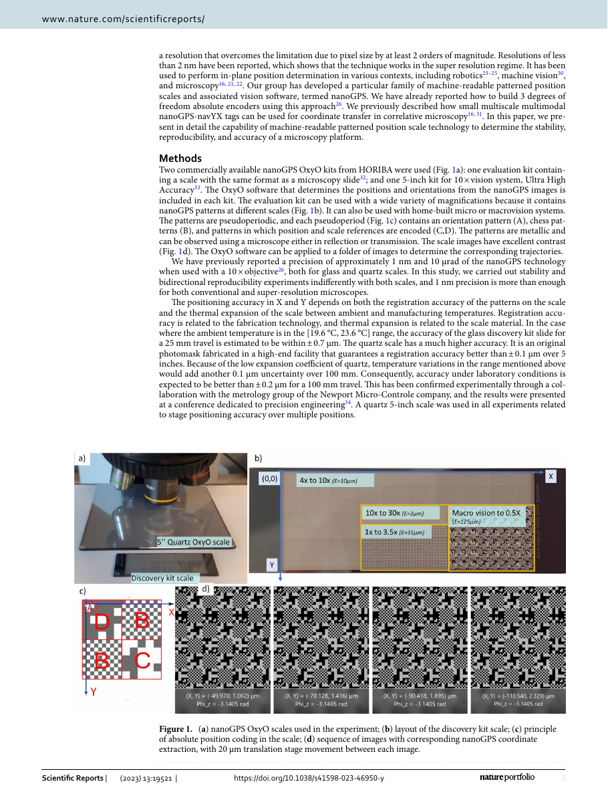
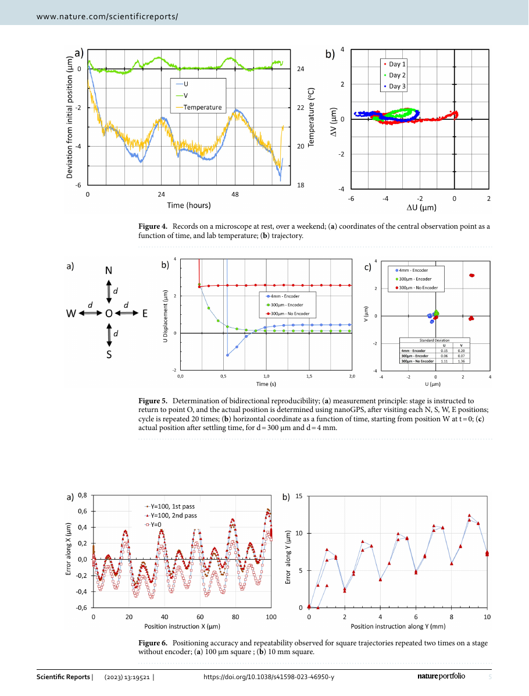
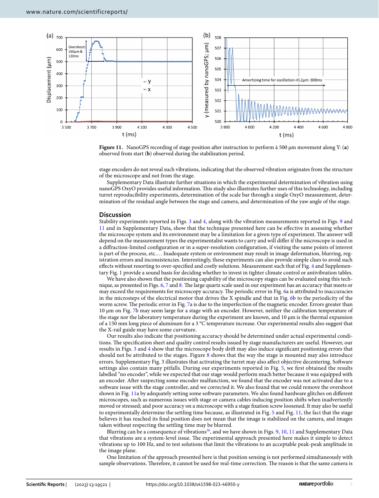

# 기계 판독 가능한 패턴 위치 눈금으로 현미경의 평면 내 위치 결정 및 안정성 문제를 찾고 고치기

- 원제: Identifying and fixing in-plane positioning and stability issues on a microscope using machine-readable patterned position scales
- 저자: Olivier Acher, Matheus Belisario de Abreu, Alexander Grigoriev, Philippe de Bettignies, Maxime Vilotta, Thanh-Liêm Nguyên (HORIBA France SAS)
- 서지: Scientific Reports 13:19521, 2023. doi:10.1038/s41598-023-46950-y
- 원문: 같은 폴더의 `Acher2023_SciRep_patterned_position_scales.pdf` (Nature 오픈 액세스, CC BY 4.0, 10쪽)
- 번역 범위: 전문(초록, 본문, 그림 캡션). 참고문헌은 원문 그대로. 보충 자료(Supplementary Data)는 받지 않아 번역하지 않았다.
- 그림은 해당 쪽 전체를 110 dpi로 이미지화했다.

---

## 초록

기계 판독 가능한 부호화 패턴 눈금을 써서 현미경의 평면 내 위치 결정 능력을 조사한 결과를 제시한다.
이 눈금의 패턴에는 절대 위치 정보가 들어 있다.
알맞은 소프트웨어가 현미경 카메라로 찍은 눈금 영상에서 평면 내 위치를 정확히 구한다.
그래서 평면 내 위치 결정 실험이 간단하고 빠르다.
이 연구에 쓴 눈금과 소프트웨어는 시판품이다.
여러 현미경 시스템을 조사했고, 위치 결정 성능은 스테이지 성능만으로 정해지지 않는 시스템 문제임을 알았다.
어떤 경우에는 실험으로 위치 성능을 제한하는 소프트웨어나 하드웨어 결함을 찾았고, 이를 쉽게 고쳤다.
이 방법으로 진동을 조사하고 진동이 영상 번짐에 주는 영향을 정량화할 수 있음도 보였다.
이것은 예를 들어 스테이지 이동 뒤의 정착 시간(settling time)을 실험으로 정하는 데 유용하다.

## 서론

현미경에서 평면 내 위치의 안정성과 정확도는 점점 더 중요해지고 있다(1~4).
강력한 소프트웨어로 움직이는 최신 완전 자동 현미경에서는 관찰이 몇 시간, 밤새, 또는 며칠 동안 이어질 수 있다(5~7).
이때 드리프트나 부정확한 위치 결정은 사용자가 지정한 관심 영역(ROI)을 놓치거나 영상을 번지게 한다.
최신 대물렌즈는 아베 법칙에 따라 200 nm 분해능을 낼 수 있다.
이 값과 비슷하거나 더 큰 드리프트나 위치 오차는 번짐이나 결함을 만든다.
단일 분자 위치 추정과 초해상 기법(8, 9)은 분해능을 한 자릿수 더 낮췄다.
그래서 일부 위치 보정 알고리즘이 안정성 문제를 줄여 주더라도(10, 11), 10 nm 수준의 안정성이 더 필요해졌다.
현미경은 순서대로 쓰는 측정 방식(모달리티)도 점점 많이 제공한다.
정확한 고해상도 다중 모달 영상을 얻으려면 위치 재현성이 핵심이다(12~14).
상관 관찰을 서로 다른 기기에서 하기도 한다.
두 플랫폼의 좌표계 사이에서 좌표를 옮기는 여러 방법이 개발되었다(15~18).
상관 관찰의 정확도를 얻으려면 두 기기 모두에서 위치 정확도가 좋아야 한다.

광학 현미경의 안정성, 재현성, 정확도에 대한 요구가 커지면서, 이 주제를 실험으로 조사하는 방법이 여러 개 개발되었다.
안정성은 보통 형광 비드 같은 기준점(fiducial)을 현미경 시야에 두고 드리프트를 재서 조사한다(10, 19).
이 방법으로 한 위치에서의 재위치 재현성도 잴 수 있다.
간섭계로 스테이지 성능을 아주 정밀하게 조사할 수 있지만, 현미경에 설치하기가 어려울 수 있다.
또 다른 한계는 간섭계가 현미경 바깥의 기준계에서 위치를 준다는 점이다.
실제로 의미 있는 기준계는 카메라다.
또 다른 위치 감지 기법은 기계 판독 가능한 패턴 위치 눈금(21~30)을 컴퓨터 마이크로비전(20)으로 읽는 방식이다.
이 방식에서는 미세 패턴 눈금이 부호화된 위치 정보를 담고 있고, 알맞은 소프트웨어가 그 영상을 평면 내 위치와 방향으로 풀어낸다.
최근에는 평면 밖 좌표도 구할 수 있음이 보고되었다(25).
이 일반적인 방법은 여러 종류의 패턴, 여러 알고리즘, 배율이 크게 다른 여러 영상 시스템으로 구현되었다.
이 방법은 화소 크기로 생기는 한계를 적어도 두 자릿수 넘는 분해능을 주는 것으로 보인다.
2 nm보다 작은 분해능도 보고되었고, 이는 이 기법이 초해상 영역에서 동작함을 보여 준다.
이 방법은 로봇공학(23~25), 머신 비전(30), 현미경(16, 21, 22) 등 여러 분야에서 평면 내 위치 결정에 쓰였다.

우리 그룹은 기계 판독 가능한 패턴 위치 눈금의 한 계열과 이에 맞는 비전 소프트웨어를 개발했고, 이를 nanoGPS라고 부른다.
이 방식으로 3자유도 절대 엔코더를 만드는 방법을 이미 보고했다(26).
또 작은 다중 스케일, 다중 모달 nanoGPS-navYX 태그를 상관 현미경의 좌표 이전에 쓰는 방법도 보고했다(16, 31).
이 논문에서는 기계 판독 가능한 패턴 위치 눈금 기술로 현미경 플랫폼의 안정성, 재현성, 정확도를 정하는 능력을 자세히 제시한다.

## 방법

HORIBA의 시판 nanoGPS OxyO 키트 두 개를 썼다(그림 1a).
하나는 현미경 슬라이드와 같은 형식의 눈금이 든 평가 키트(32)다.
다른 하나는 10배 비전 시스템용 5인치 키트, 초고정확도(Ultra High Accuracy)형(33)이다.
nanoGPS 영상에서 위치와 방향을 구하는 OxyO 소프트웨어가 각 키트에 들어 있다.
평가 키트는 서로 다른 크기의 nanoGPS 패턴을 담고 있어 여러 배율에서 쓸 수 있다(그림 1b).
직접 만든 마이크로 또는 매크로 비전 시스템에도 쓸 수 있다.
패턴은 의사주기(pseudoperiodic) 구조다.
각 의사주기(그림 1c)에는 방향 패턴(A), 체스 패턴(B), 위치와 스케일 기준이 부호화된 패턴(C, D)이 들어 있다.
패턴은 금속이며 반사나 투과 방식 현미경으로 볼 수 있다.
눈금 영상은 대비가 매우 좋다(그림 1d).
OxyO 소프트웨어를 영상 폴더에 적용하면 그에 해당하는 궤적을 구할 수 있다.

> **그림 1.** (a) 실험에 쓴 nanoGPS OxyO 눈금. (b) 평가 키트(discovery kit) 눈금의 배치. (c) 눈금에서 절대 위치를 부호화하는 원리. (d) 영상 사이마다 병진 스테이지를 20 µm씩 움직이며 찍은 영상 열과, 각 영상에서 구한 nanoGPS 좌표.

앞서 10배 대물렌즈에서 유리와 석영 눈금 모두 nanoGPS 기술의 정밀도가 약 1 nm, 10 µrad임을 보고했다(26).
이 연구에서는 안정성 실험과 양방향 재현성 실험을 두 눈금 중 아무것으로나 했다.
1 nm 정밀도는 일반 현미경과 초해상 현미경 모두에 충분하고도 남는다.

X, Y 위치 정확도는 눈금 위 패턴의 정합(registration) 정확도와, 사용 온도와 제작 온도 사이의 눈금 열팽창 둘 다에 달려 있다.
정합 정확도는 제작 기술에, 열팽창은 눈금 재료에 관련된다.
주변 온도가 19.6~23.6 °C 범위일 때, 유리 평가 키트 슬라이드의 정확도는 25 mm 이동에서 ±0.7 µm 이내로 추정된다.
석영 눈금은 정확도가 훨씬 높다.
석영 눈금은 고급 시설에서 만든 원본 포토마스크이며, 5인치에 걸쳐 ±0.1 µm보다 좋은 정합 정확도를 보증한다.
석영은 팽창 계수가 낮아서, 위 범위의 온도 변화가 100 mm에 걸쳐 0.1 µm 불확도를 더할 뿐이다.
따라서 실험실 조건의 정확도는 100 mm 이동에서 ±0.2 µm보다 좋을 것으로 기대된다.
이는 Newport Micro-Controle 사 계측 그룹과의 협업으로 실험 확인되었고, 정밀공학 학회에서 발표했다(34).
여러 위치에 걸친 스테이지 위치 정확도 실험에는 모두 석영 5인치 눈금을 썼다.

nanoGPS 시스템이 재는 평면 내 방향각은 정밀도가 10 µrad보다 좋고, 2π 전체에 걸쳐 정확도가 63 µrad보다 좋다(27).

조사는 서로 다른 모델의 병진 스테이지를 단 여러 Nikon, Olympus 정립 현미경에서 했다.
현미경은 방진 테이블 위에 놓였다.
카메라는 2메가픽셀 글로벌 셔터 흑백 카메라 또는 5메가픽셀 롤링 셔터 컬러 카메라였고, 모두 USB3 연결이었다.
노출 시간은 포화를 피하도록 골랐다.
영상 크기는 그림 1d에 나온 시야로 줄였다.
이 크기면 위치를 아주 잘 구할 수 있으면서 높은 프레임률과 짧은 위치 계산 시간을 얻는다.
10배 대물렌즈를 썼다.
관찰은 반사(명시야) 조명이나 투과 조명 중 아무것으로나 했다.
고속 프레임 실험(200 Hz 초과)은 투과 조명으로 했다.
빛이 더 많아 노출 시간을 3 ms까지 줄일 수 있었기 때문이다.

이 논문은 현미경의 평면 내 위치 결정 능력을 조사하는 방법을 설명한다.
특정 장치의 능력을 기록하려는 것이 아니다.
그래서 각 현미경, 스테이지, 방진 테이블과 그 열 환경, 진동 환경을 다 설명하지는 않는다.

스테이지 이동을 제어하고 영상을 얻는 Python 프로그램을 만들었다.
영상은 실험마다 폴더 하나에 비트맵 파일(.bmp)로 저장했다.
실험 뒤 OxyO 소프트웨어로 영상 폴더를 처리해 시간에 따른 위치 정보 파일을 만들었다.
안정성과 드리프트 실험은 일부러 스테이지를 움직이지 않고 일정한 시간 간격으로 영상을 찍어서 했다.
진동 측정은 조명 조건과 영상 크기에 따라 초당 200~300장의 최대 획득 속도로 했다.
nanoGPS 위치를 얻는 데 필요한 가장 작은 영상 크기는 OxyO 소프트웨어로 정했다.

OxyO 소프트웨어가 주는 궤적은 눈금의 (O, X, Y) 좌표계로 표현된다.
그림 2처럼 카메라 좌표계(U, V 축)로 나타내는 편이 더 편할 때가 많다.
눈금 좌표에서 카메라 좌표로의 변환은 각도 φz만큼 회전해서 한다.
눈금과 카메라 사이의 이 각도는 어차피 OxyO 소프트웨어가 구하므로 이 일은 아주 쉽다.
(X, Y) 좌표에 일정한 평균 각도 <φz>만큼 회전을 적용해 (U, V) 좌표를 얻었다.

스테이지 특성을 조사할 때는 실험 결과를 스테이지 좌표계로 주는 것도 매우 의미 있을 수 있다.
스테이지와 카메라의 축이 거의 맞는 경우가 많지만, 정확한 측정에는 스테이지와 카메라 사이의 잔여 각도 θ를 정해야 한다.
각도 [φz + θ]는 스테이지에 x 방향으로 크게 움직이라고 명령하고 ΔY/ΔX = tan(φz + θ)를 구해 쉽게 정할 수 있다.

여러 실험에서 눈금을 90°, 180°, 270° 돌리거나, 손으로 일정 거리 옮긴 뒤 실험을 반복해 타당성을 확인했다.
모든 경우에 스테이지 기준계로 나타낸 위치 오차가 본질적으로 같았다.
이 간단한 확인은 측정된 위치 오차가 눈금의 결함이나 nanoGPS 방법의 다른 한계와 관련 없음을 보여 준다.
nanoGPS 기법의 타당성은 잘 문서화되어 있지만, 새 카메라와 새 광학 장치에서 잘 동작하는지 확인하는 것은 좋은 습관일 수 있다.

> **그림 2.** NanoGPS 좌표, 카메라 좌표, 스테이지 좌표.

## 결과

실험 결과는 다음 순서로 정리한다.
먼저 안정성 성능 조사를 제시한다.
다음으로 몇몇 현미경 스테이지의 성능을 평가한다.
한 위치에 대한 양방향 재현성, 정확도, 더 복잡한 궤적에서의 재현성을 보고한다.
그다음 진동 문제를 조사한다.
진동이 외부 환경에만 관련된 것이 아니라 현미경 동작 자체에서도 생길 수 있음을 보인다.
보충 자료에는 대물렌즈 회전판(turret) 재현성을 정량화하는 방법, 스케일 바를 아주 간단히 정하는 방법, 각도 측정이 유용한 경우를 보여 주는 추가 결과를 실었다.

### 안정성

카메라 기준계에서 nanoGPS 눈금의 위치를 기록해 여러 시간 규모의 안정성을 조사했다.
30 Hz로 10분 동안(그림 3), 그리고 금요일 오후부터 월요일 아침까지 68시간 동안 분당 2장으로(그림 4) 기록했다.

그림 3은 10분 동안의 전형적인 드리프트가 보통 0.1~0.4 µm 범위임을 보여 준다.
연속한 두 드리프트 기록이 크게 다른 이유는 뚜렷이 찾지 못했다.
68시간 관찰(그림 4)에서 영상 세로 방향 드리프트는 0.5 µm보다 작았다.
그러나 가로 방향 드리프트는 5 µm를 넘을 수 있었고, 실험실 온도와 상관이 있었다.

> **그림 3.** 쉬고 있는 현미경에서 10분 동안 기록한 중앙 관찰점의 시간별 좌표(a, c)와 궤적(b, d).

> **그림 4.** 주말 동안 쉬고 있는 현미경의 기록. (a) 중앙 관찰점의 시간별 좌표와 실험실 온도. (b) 궤적.

### 한 위치의 양방향 재현성

양방향 재현성 측정은 QUAREP-LiMi 프로토콜(35)에서 착안했다.
형광 비드 대신 nanoGPS 눈금을 썼다.
스테이지가 점 O와, O에서 거리 d만큼 떨어진 동서남북 네 점 사이를 오가도록 프로그램했고, 이를 20번 반복했다(그림 5a).
눈금 영상은 10 Hz로 얻었다.
정착 시간을 쉽게 정할 수 있다(그림 5b).
정착 위치는 그림 5c에 있다.
이 스테이지에는 켜고 끌 수 있는 내장 엔코더가 있다.
엔코더를 끄면 양방향 재현성 오차가 두 방향 모두 3 µm까지 커질 수 있다.
그러나 같은 접근 방향 안에서는 흩어짐이 아주 작다.
이는 백래시 보정을 제대로 하면 양방향 재현성이 매우 좋아질 수 있음을 뜻한다.
엔코더를 켜면 d = 300 µm에서 재현성이 좋지만 정착 시간이 늘어난다.
d = 4 mm에서는 재현성이 조금 나빠진다.

> **그림 5.** 양방향 재현성 측정. (a) 측정 원리: 스테이지가 N, S, W, E 각 위치를 들른 뒤 점 O로 돌아오도록 명령받고, 실제 위치를 nanoGPS로 잰다. 이 주기를 20번 반복한다. (b) t = 0에 위치 W에서 출발했을 때 가로 좌표의 시간 변화. (c) d = 300 µm와 d = 4 mm에서 정착 시간 뒤의 실제 위치.
>
> (그림 5c 안의 표, 표준편차 µm: 4 mm 엔코더 U 0.15, V 0.20 / 300 µm 엔코더 U 0.06, V 0.07 / 300 µm 엔코더 없음 U 1.11, V 1.36.)

### 길이 규모가 다른 궤적의 정확도와 재현성

엔코더가 없는 스테이지에서 관찰한 위치 오차가 그림 6에 있다.
궤적은 연속한 정사각형 두 개다.
하나는 한 변 100 µm(그림 6a), 다른 하나는 한 변 10 mm(그림 6b)다.
여기서 주기 20 µm, 최고점 사이 0.6 µm의 반복되는 오차와, 의사주기 2 mm, 진폭 5 µm의 반복되는 오차가 드러난다.

> **그림 6.** 엔코더 없는 스테이지에서 정사각형 궤적을 두 번 반복했을 때의 위치 정확도와 반복도. (a) 100 µm 정사각형. (b) 10 mm 정사각형.

그림 7은 자기 엔코더가 달린 스테이지의 반복도와 정확도 자료다.
그림 7a에서는 주기 0.5 µm, 진폭 1 µm의 반복되는 오차가 보인다.
여기에 X의 반복 함수가 아닌, 진폭 약 0.5 µm의 오차가 겹쳐 있다.
테이블 전체 범위의 반복도와 정확도는 그림 7b에 있다.
구석의 한 점(주황색 원)을 빼면 재현성은 꽤 좋다.
정확도는 X로 15 µm, Y로 17 µm보다 좋지 않다.

> **그림 7.** 자기 엔코더 스테이지에서 관찰한 위치 정확도와 반복도. (a) 2 mm 정사각형 안의 무작위 위치. (b) 25점 격자, 각 점을 3번 방문(최대 오차 X 15.3 µm, Y 17.7 µm).

위 두 그림은 네 자릿수에 걸친 길이의 궤적, 곧 0.1 mm, 1 mm, 10 mm, 70 mm의 위치 오차를 보고한다.
스테이지 종류마다 네 궤적 계열 중 두 개만 골라 보였다.
최대 오차와 이동 거리의 비는 그림 6a의 5 µm 이동에서 10%로 가장 크고, 그림 6b와 7a에서 0.5%, 그림 7b에서 0.1%다.
특정 스테이지 모델을 자세히 평가하려는 것이 아니라 조사 방법을 탐색하려는 것이었으므로, 특징이 가장 눈에 띄는 것을 골랐다.
결과는 여러 이동 길이의 궤적에서 위치 오차를 살펴보는 것이 의미 있음을 보여 준다.

### 무거운 스테이지의 경우

큰 이동 범위 스테이지를 단 현미경의 위치 정확도가 그림 8a에 빨간색으로 나와 있다.
y 스테이지 축의 위치 오차는 y에 대해 선형이고, 제조사 사양을 넘는다.
이 오차는 스테이지를 현미경 본체에 잇는 기계 부품의 휨 때문으로 볼 수 있다(그림 8b, c).
이 스테이지는 이동 범위가 작은 스테이지보다 훨씬 무겁다.
더 중요한 것은, 첫 측정으로 보정표를 만들어 스테이지 제어기에 올리면 위치 정확도가 좋아진다는 점이다(그림 8a, 초록색).

> **그림 8.** 무거운 대면적 스테이지의 경우. (a) 제조사 교정을 쓴 경우(빨강)와 보정 뒤(초록)의 무작위 (x, y) 위치 결정에서 y_stage 오차. (b), (c) 보정이 없을 때 y_stage 위치 오차의 원인으로 제안한 스테이지 홀더의 휨.

nanoGPS 눈금 영상을 얻으려면 자동 초점 장치가 꼭 필요했다.
스테이지를 y 방향으로 움직이면 초점이 크게 벗어났기 때문이다.
이 초점 이탈은 현미경 본체와 스테이지 홀더의 강성이 부족해서 생기는 나쁜 효과 중 하나이며, 여기서 제시한 방법으로는 보정되지 않는다.

### 진동

투과 조명을 쓰면 200 Hz보다 높은 프레임률로 nanoGPS 눈금 영상을 얻을 수 있다.
안정성 실험 결과가 그림 9에 있으며, 한 방향으로 최고점 사이 80 nm의 불안정이 보인다.
그림 9b의 푸리에 분석은 35 Hz 근처의 강한 공진이 그 원인임을 보여 준다.
그림 10은 고속 측정 궤적(파랑)과, 노출 30 ms로 30 Hz에서 기록한 궤적을 함께 보여 준다.
30 Hz에서 잰 위치의 잡음이 250 Hz에서보다 상당히 작아 보인다.

> **그림 9.** 몇 초 동안의 현미경 영상 위치 안정성. (a) 카메라 (U, V) 기준계에서 중앙 관찰점 좌표의 시간 변화. (b) (a)의 푸리에 변환.
>
> **그림 10.** 몇 초 동안의 현미경 영상 위치 안정성. 노출 3 ms, 고속 프레임으로 잰 것(파랑)과 노출 30 ms, 낮은 프레임률로 잰 것(빨강).

광학 엔코더가 달린 스테이지의 과도 위치도 조사했다.
그림 11은 Y로 500 µm 움직이라는 명령을 받은 뒤 nanoGPS로 구한 스테이지 위치다.
일부 영상은 너무 번져 해독되지 않고 오류를 냈다.
그런 점은 그래프에 "이전 점과 같은 위치"로 표시했다.
그래도 스테이지 궤적의 대부분은 충분히 잘 추적할 수 있다.
두 가지 주요 관찰이 있다.
그림 11a에서 보듯, Y 방향 이동에 오버슈트가 있다.
그림 11b는 스테이지가 최종 위치에 거의 도달한 뒤의 움직임을 가까이 보여 준다.
39 Hz 주파수, 초기 최고점 사이 2 µm가 넘는 진동이 위치에 뚜렷하다.
진동은 감쇠하지만 진폭이 0.2 µm 아래로 내려가는 데 0.8초가 걸린다.
스테이지 엔코더는 이 진동을 보여 주지 않는다.
이는 관찰된 진동이 스테이지가 아니라 현미경 구조물에서 생긴다는 뜻이다.

> **그림 11.** Y로 500 µm 이동하라는 명령 뒤 스테이지 위치의 nanoGPS 기록. (a) 시작부터 관찰. (b) 안정화 구간에서 관찰.

보충 자료에는 nanoGPS OxyO로 진동을 실험적으로 정하는 것이 유용한 다른 상황을 실었다.
또 이 기술의 다른 쓰임도 보였다.
대물렌즈 회전판 재현성 실험, OxyO 측정 한 번으로 스케일 바 정하기, 스테이지와 카메라 사이 잔여 각도 정하기, 스테이지의 요(yaw) 각 정하기가 그것이다.

## 고찰

그림 3, 4의 안정성 실험과, 그림 9, 11과 보충 자료의 진동 측정은 여기서 제시한 기법이 현미경 시스템과 그 환경이 특정 실험의 제약이 되는지 평가하는 데 효과적임을 보여 준다.
답은 실험자가 하려는 측정 종류에 따라 다르다.
현미경을 회절 한계 구성으로 쓰는지 초해상 구성으로 쓰는지, 같은 관심 지점을 다시 방문하는 것이 과정에 들어 있는지 등에 따라 달라진다.
부적절한 시스템이나 환경은 영상 변형, 번짐, 정합 오류, 불일치를 낳을 수 있다.
흥미롭게도 이 실험들은 과도한 사양이나 비싼 해결책에 기대지 않고 그런 효과를 피하는 간단한 단서도 줄 수 있다.
그림 4와 보충 그림 1 같은 측정은 더 엄격한 온도 관리나 방진 테이블에 투자할지 정하는 탄탄한 근거가 된다.

그림 6, 7, 8에서 보였듯, 이 기법으로 현미경 스테이지의 위치 결정 능력도 평가할 수 있다.
실험에 쓴 큰 석영 눈금의 정확도는 현미경 정확도 요구를 만족하거나 넘을 수 있다.
그림 6a의 주기 오차는 X 스핀들을 모는 전동기의 마이크로스텝 부정확 때문이고, 그림 6b의 오차는 웜 나사의 주기성 때문으로 본다.
그림 7a의 주기 오차는 자기 엔코더의 불완전성 때문이다.
그림 7b의 10 µm 넘는 오차는 엔코더 달린 스테이지치고 커 보일 수 있다.
그러나 스테이지의 교정 온도도, 실험 중 실험실 온도도 알 수 없다.
10 µm는 길이 150 mm 알루미늄 부품이 3 °C 올랐을 때의 열팽창 양이다.
실험 결과는 X 레일 가이드가 조금 휘어 있을 수도 있음을 시사한다.

결과는 또한 위치 정확도를 실제 실험 조건에서 정해야 함을 보여 준다.
스테이지 제조사가 낸 사양서와 품질 검사 결과는 유용하다.
그러나 그림 3, 4의 결과는 현미경 본체 드리프트도 큰 위치 오차를 만들 수 있고, 이를 스테이지 탓으로 돌리면 안 됨을 보여 준다.
그림 8은 스테이지를 설치하는 방식도 오차를 만들 수 있음을 보여 준다.
보충 그림 3은 회전판을 작동시키는 것이 대물렌즈 중심 어긋남에 영향을 줄 수 있음을 보여 준다.
소프트웨어 설정에도 함정이 많다.
그림 5 실험에서 처음에는 "엔코더 없음"이라고 표시된 결과를 얻었다.
스테이지에 엔코더가 있으니 훨씬 좋을 것으로 기대했었다.
엔코더 고장을 의심한 뒤, 스테이지 제어기의 소프트웨어 문제로 엔코더가 켜져 있지 않았음을 찾아 고쳤다.
몇몇 소프트웨어 파라미터를 알맞게 설정해 그림 11a의 오버슈트도 없앨 수 있었다.
여러 현미경에서 하드웨어 결함도 찾았다.
예를 들어 스테이지나 카메라 케이블이 실수로 움직이거나 당겨지면 위치가 바뀌는 문제가 많았고, 스테이지 고정 나사가 풀린 현미경에서는 정확도가 나빴다.
정착 시간을 실험으로 정하는 것도 유용할 수 있다.
그림 5와 그림 11처럼, 스테이지가 최종 위치에 도달했다고 판단해도 카메라 영상이 안정되었다는 뜻은 아니다.
정착 시간을 지키지 않고 찍은 영상은 번질 수 있다.

번짐은 진동의 결과일 수 있다(36).
그림 9, 10, 11과 보충 자료에서 진동이 시스템 수준의 문제임을 보였다.
여기서 제시한 실험 방법으로 100 Hz까지의 진동을 쉽게 검출하고, 영상면에서 진동을 허용 가능한 최고점 사이 진폭으로 줄이는 해결책을 시험할 수 있다.

이 방법의 한계 하나는 위치 감지를 시료 관찰과 동시에 하지 않는다는 점이다.
그래서 실시간 보정에 쓸 수 없다.
그 이유는 같은 카메라를 눈금과 시료를 보는 데 함께 쓰기 때문이다.
z 초점을 시료에서 패턴 커버슬립으로 옮겨 시료와 눈금을 순서대로 관찰하는 방법이 시연되었고(21, 22), 긴 실험을 드리프트에 강하게 만드는 데 매우 알맞을 수 있다.
다른 방법으로 눈금을 읽는 카메라를 하나 더 쓸 수 있다.
현미경 본체의 변형이 주 카메라와 추가 카메라에 똑같이 영향을 주도록 설계하면, 현미경 본체에 통합된 더 좋은 위치 엔코더가 될 수 있다.

## 결론

기계 판독 가능한 부호화 패턴 눈금이 일반 현미경과 초해상 현미경 모두에서 위치 정확도와 안정성 문제를 조사하는 데 편리함을 보였다.
이 방법은 현미경 카메라로 패턴 눈금을 찍는 데 바탕을 둔다.
기준점이나 형광 비드를 찍어 안정성과 재현성을 정하던 기존 기법처럼, 이 방법도 관심 기준계인 카메라 기준계에서 위치를 준다.
슬라이드 표면 전체를 쓸 수 있으므로, 특별한 준비 없이 어느 위치에서나 절대 위치를 잴 수 있다.
위치 측정을 200 Hz 넘는 프레임률로 할 수 있음을 보였고, 이는 영상 불안정이나 번짐을 일으킬 수 있는 진동을 조사하는 데 아주 유용하다.

또 하나의 결론은, 위치 안정성, 재현성, 정확도 평가를 현미경의 실제 운용 조건과 환경에서 해야 한다는 것이다.
이것은 움직이는 스테이지만의 문제가 아니라 시스템 문제이기 때문이다.
현미경의 위치 결정 능력이 특정 실험에 충분한지는, 실험대로 현미경과 스테이지 이동을 프로그램하고 시료 대신 기계 판독 가능한 부호화 패턴 눈금을 두면 쉽게 알 수 있다.
이 모의 실험에서 얻은 눈금 영상이 실제 궤적을 준다.
측정한 궤적을 실험 요구와 비교하고, 진동 진폭을 요구 분해능과 비교하면, 위치 결정 능력의 제약이 있는지 실험자에게 바로 알려 준다.
이 실험 방법은 현미경 위치 성능을 해치는 소프트웨어나 하드웨어 결함을 쉽게 찾아 해결하게 해 줄 뿐 아니라, 온도나 진동 관리 같은 더 비싼 개조의 요구 조건을 정량적으로 정해 준다.

## 자료 이용 가능성

이 연구에서 분석한 자료는 합당한 요청이 있으면 교신 저자에게서 받을 수 있다.

접수 2023-08-22, 채택 2023-11-07.

## 감사의 글

저자들은 앞선 실험과 토론에 영감을 준 A. Podzorov, M. Leroy, M. Gaillet에게 감사한다.

## 저자 기여

O.A.는 nanoGPS OxyO 개념을 개발하고 진동 실험을 설계했으며 원고를 준비했다.
O.A.와 T.L.N.은 평가 키트 눈금을 설계했다.
T.-L.N.과 A.G.는 OxyO 소프트웨어를 개발했다.
Ph.dB.는 그림 6, 7의 실험을 설계하고 수행했다.
M.V.는 그림 8의 실험을 설계하고 수행했다.
M.B.A.는 그림 3, 4, 5, 9, 10의 실험을 수행하고 원고를 수정했다.

## 이해 상충

저자들은 이해 상충이 없다고 밝힌다.
(번역자 메모: 저자 전원이 눈금과 소프트웨어를 파는 HORIBA France 소속이다.)

## 추가 정보

보충 정보는 https://doi.org/10.1038/s41598-023-46950-y 의 온라인판에 있다.
이 논문은 Creative Commons Attribution 4.0 국제 라이선스로 공개된다.

## 참고문헌 (원문 그대로)

1. Boehm, U. et al. QUAREP-LiMi: A community endeavor to advance quality assessment and reproducibility in light microscopy. Nat. Methods 18, 1423–1426. https://doi.org/10.1038/s41592-021-01162-y (2021).
2. Faklaris, O. et al. Quality assessment in light microscopy for routine use through simple tools and robust metrics. J. Cell Biol. https://doi.org/10.1083/jcb.202107093 (2022).
3. Chalfoun, J. et al. MIST: Accurate and scalable microscopy image stitching tool with stage modeling and error minimization. Sci. Rep. https://doi.org/10.1038/s41598-017-04567-y (2017).
4. Tan, N., Clévy, C. & Chaillet, N. Calibration of nanopositioning stages. Micromachines 6, 1856–1875. https://doi.org/10.3390/mi6121461 (2015).
5. Reinhardt, S. C. M. et al. Ångström-resolution fluorescence microscopy. Nature 617, 711–716. https://doi.org/10.1038/s41586-023-05925-9 (2023).
6. Paramasivam, P. et al. Endosomal escape of delivered mRNA from endosomal recycling tubules visualized at the nanoscale. J. Cell Biol. 221, e202110137 (2021).
7. Emmerich, K. et al. Nanoparticle-based targeting of microglia improves the neural regeneration enhancing effects of immunosuppression in the zebrafish retina. Commun. Biol 6, 534 (2023).
8. Lelek, M. et al. Single-molecule localization microscopy. Nat. Rev. Methods Primers https://doi.org/10.1038/s43586-021-00038-x (2021).
9. Schermelleh, L. et al. Super-resolution microscopy demystified. Nat. Cell Biol. 21, 72–84. https://doi.org/10.1038/s41556-018-0251-8 (2019).
10. Youn, Y., Ishitsuka, Y., Jin, C. & Selvin, P. R. Thermal nanoimprint lithography for drift correction in super-resolution fluorescence microscopy. Opt. Exp. 26, 1670–1680. https://doi.org/10.1364/OE.26.001670 (2018).
11. Wang, Y. et al. Localization events-based sample drift correction for localization microscopy with redundant cross-correlation algorithm. Opt. Exp. 22, 15982–15991. https://doi.org/10.1364/OE.22.015982 (2014).
12. Popp, J. & Mayerhöfer, T. Micro-Raman Spectroscopy: Theory and Application (Walter de Gruyter GmbH & Co KG, 2020).
13. Schnitzbauer, J., Strauss, M. T., Schlichthaerle, T., Schueder, F. & Jungmann, R. Super-resolution microscopy with DNA-PAINT. Nat. Protocols 12, 1198–1228. https://doi.org/10.1038/nprot.2017.024 (2017).
14. Burri, O., Laroche, T., Guiet, R. & Seitz, A. In Super-Resolution Microscopy: Methods and Protocols (ed. Erfle, H.) 95–103 (Springer, New York, 2017).
15. Kraus, A. et al. Characterizing intraindividual podocyte morphology in vitro with different innovative microscopic and spectroscopic techniques. Cells 12, 1245. https://doi.org/10.3390/cells12091245 (2023).
16. Acher, O. et al. An efficient solution for correlative microscopy and co-localized observations based on multiscale multimodal machine-readable nanoGPS tags. Meas. Sci. Technol. 32, 045402. https://doi.org/10.1088/1361-6501/abce39 (2021).
17. Paul-Gilloteaux, P. et al. eC-CLEM: flexible multidimensional registration software for correlative microscopies. Nat. Methods 14, 102–103. https://doi.org/10.1038/nmeth.4170 (2017).
18. Ando, T. et al. The 2018 correlative microscopy techniques roadmap. J. Phys. D Appl. Phys. 51, 443001. https://doi.org/10.1088/1361-6463/aad055 (2018).
19. Lee, S. H. et al. Using fixed fiduciary markers for stage drift correction. Opt. Exp. 20, 12177–12183. https://doi.org/10.1364/OE.20.012177 (2012).
20. Yao, S. et al. A review of computer microvision-based precision motion measurement: Principles, characteristics, and applications. IEEE Trans. Instrum. Meas. 70, 1–28 (2021).
21. Sandoz, P., Zeggari, R., Froehly, L., Pretet, J.-L. & Mougin, C. Position referencing in optical microscopy thanks to sample holders with out-of-focus encoded patterns. J. Microsc. 225, 293–303. https://doi.org/10.1111/j.1365-2818.2007.01745.x (2007).
22. Galeano, Z. J. A. et al. Position-referenced microscopy for live cell culture monitoring. Biomed. Opt. Express 2, 1307–1318. https://doi.org/10.1364/BOE.2.001307 (2011).
23. André, A. N., Sandoz, P., Mauzé, B., Jacquot, M. & Laurent, G. J. Sensing one nanometer over ten centimeters: A microencoded target for visual in-plane position measurement. IEEE/ASME Trans. Mechatron. 25, 1193–1201 (2020).
24. André, A. N., Sandoz, P., Mauzé, B., Jacquot, M. & Laurent, G. J. Robust phase-based decoding for absolute (X, Y, Θ) positioning by vision. IEEE Trans. Instrum. Meas. 70, 1–12. https://doi.org/10.1109/TIM.2020.3009353 (2021).
25. André, A. N., Sandoz, P., Jacquot, M. & Laurent, G. J. Pose measurement at small scale by spectral analysis of periodic patterns. Int. J. Comput. Vis. 130, 1566–1582 (2022).
26. Acher, O. & Nguyen, T.-L. Turning a machine vision camera into a high precision position and angle encoder: nanoGPS-OxyO. SPIE Opt. Metrol. https://doi.org/10.1117/12.2524938 (2019).
27. Pisani, M. et al. Characterization of angle accuracy and precision of 3-degree-of-freedom absolute encoder based on nanoGPS OxyO technology. Sensors 20, 3462. https://doi.org/10.3390/s20123462 (2020).
28. Kim, J.-A., Kim, J. W., Kang, C.-S. & Lee, J. Y. On-machine self-calibration of a two-dimensional stage using an absolute X-Y–Θ position sensor. Int. J. Precision Eng. Manuf. 21, 1629–1636. https://doi.org/10.1007/s12541-020-00365-1 (2020).
29. Chen, Z.-H. & Huang, P. S. A vision-based method for planar position measurement. Meas. Sci. Technol. 27, 125018. https://doi.org/10.1088/0957-0233/27/12/125018 (2016).
30. Bošnak, M. & Klančar, G. Fast and reliable alternative to encoder-based measurements of multiple 2-DOF rotary-linear transformable objects using a network of image sensors with application to table football. Sensors 20, 3552 (2020).
31. Acher, O., Richard, S., Gaillet, M., Podzorov, A. & Knowles, A. Micro-localisation method and device for an imaging instrument and a measuring apparatus. US10565428 (2020).
32. nanoGPS-OxyO discovery kit. <https://store.eu.horiba.com/collections/optical-microscopy/products/nanogps-oxyo-discovery-kit> (2023).
33. 5-inch (120mm) OxyO kit for 10x vision systems, Ultra High Accuracy (Quartz). <https://store.eu.horiba.com/collections/optical-microscopy/products/5-x5-nanogps-scale-quartz-ultra-high-accuracy> (2023).
34. Acher, O. et al. in Proceedings of the Euspen 19th International Conference, Bilbao, Spain. 3–7.
35. Carvalho, M. T. et al. Repeatability of the XY positioning of motorized xy-tables of light microscopes. Protocols.io https://doi.org/10.17504/protocols.io.kxygxz2rdv8j/v1 (2023).
36. Amick, H. & Stead, M. Vibration sensitivity of laboratory bench microscopes. Sound Vib. 41, 10–17 (2007).
