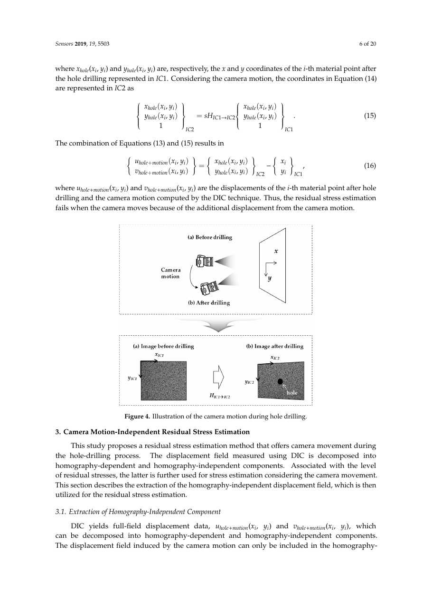
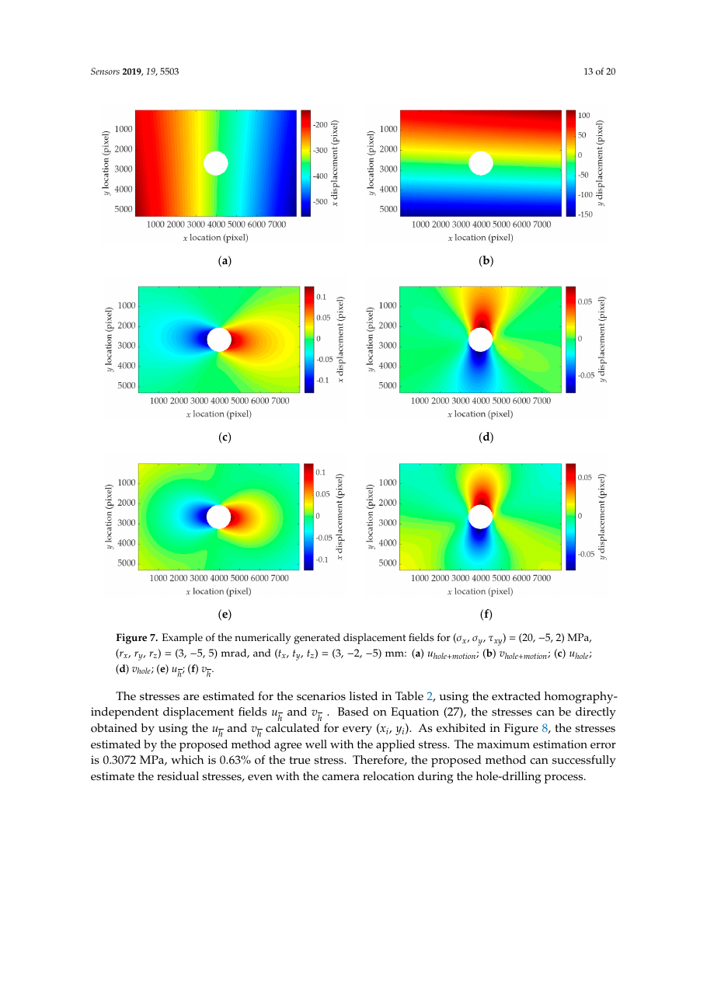
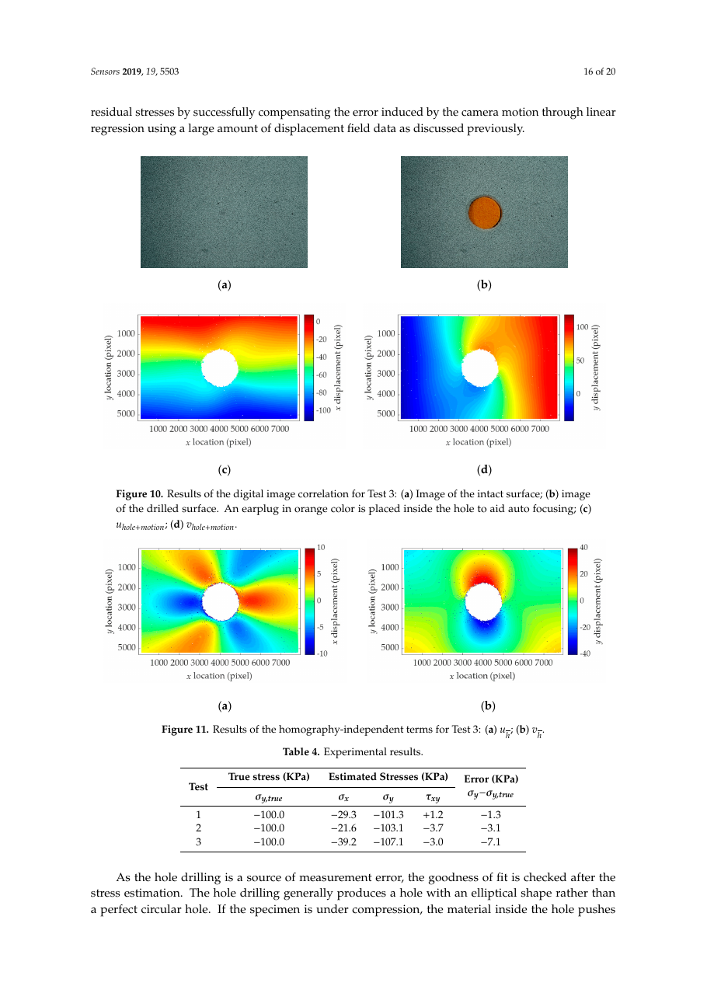

# 번역: 카메라 움직임 오차를 보정한 디지털 영상 상관법 기반 응력 추정

- 원제: Stress Estimation Using Digital Image Correlation with Compensation of Camera Motion-Induced Error
- 원문 파일: [Lee2019_Sensors_camera_motion_DIC.pdf](Lee2019_Sensors_camera_motion_DIC.pdf) (20쪽)
- 원문 출처: PMC 공개 접근 자료 묶음(NIH PMC Open Access, AWS 공개 저장소 `pmc-oa-opendata`의 `PMC6960850.1/PMC6960850.1.pdf`). 2026-11-04 HTTP 200으로 받았다. 저장소 메타데이터의 md5(439fc3588d679d0b99d796e6862cb350)와 받은 파일이 같다. 라이선스 CC BY.
- 받기 기록
  - MDPI PDF 링크(`/pdf?version=1576643389`)는 curl에 403이었다.
  - PMC 웹 PDF는 작업 증명(proof-of-work) 확인 화면이 떴고, Europe PMC PDF 렌더도 접근 확인 화면(403)이었다. 둘 다 우회하지 않았다.
  - 그 뒤 PMC가 공식 공개한 Open Access 자료 묶음에서 같은 출판사 PDF를 받았다.
- 번역 범위: 전문 (초록, 본문, 그림, 표 캡션, 기호표, 저자 기여, 연구비). 참고문헌은 원문 그대로 둔다.
- 주의
  - pdftotext -layout 결과는 이 PDF에서 글자가 겹쳐 나온다(같은 쪽에 심사본 글자층이 남아 있다). 본문은 PMC 공개 텍스트(`PMC6960850.1.txt`)와 대조했고, 수식은 쪽 이미지를 보고 옮겼다.
  - 수식의 첨자 $\bar h$는 "호모그래피와 무관한 성분", $h$는 "호모그래피에 따르는 성분"이다.
  - 식 (10)의 "− −"는 원문 표기 그대로 두었다.
  - 4.1절에서 $a$를 "구멍 지름 12 mm"라고 적지만, 2.1절에서는 $a$를 "구멍 반지름"이라고 정의한다. 원문의 불일치를 그대로 옮겼다.

---

## 초록

사용 중인 구조물의 응력 수준을 재면, 구조물의 현재 상태에 대한 중요하고 쓸모 있는 정보를 얻는다.
응력 해방법(stress relaxation method, SRM)은 가장 전통적이고 실용적인 방법이다.
금속 재료의 잔류 응력을 재는 데 널리 받아들여져 왔다.
SRM을 디지털 영상 상관법(digital image correlation, DIC)과 합치면 토목 구조물의 응력 추정에 큰 가능성을 보였다.
그러나 지금까지 연구된 SRM/DIC 방법에는 구멍을 뚫는 동안 카메라가 흔들리는 실용 문제가 있다.
카메라 움직임으로 생기는 오차를 줄이려고 촬영 장치를 시편에서 멀리 둔다.
그 결과 화소 밀도가 낮아지고, 시편에 내는 손상이 커진다.
이 연구는 구멍을 뚫는 동안 카메라를 떼어 냈다가, 다시 놓고 뚫은 뒤 영상을 찍을 수 있는 SRM/DIC 기반 응력 추정법을 제안한다.
촬영 장치를 시편에 최대한 가깝게 놓을 수 있으므로 화소 밀도가 높아진다.
그래서 작은 손상이 만드는 미세한 변위 교란도 DIC로 잡을 수 있다.
이 연구는 DIC 결과에서 카메라 재설치가 만든 거짓 변위장을 없애는 수학식을 자세히 제시한다.
제안 방법은 수치 해석과 실험으로 검증한다.

핵심어: 디지털 영상 상관법, 구멍 뚫기 방법, 응력 추정

## 1. 서론

잔류 응력은 외력이 없어도 남아 있는 내부 응력이다.
미세 구조부터 실물 크기 토목 기반 시설까지, 어떤 고체 재료든 수명 동안 겪을 수 있다.
구속 경계 조건이 있을 때, 열이나 기계적 이유로 재료가 계속 늘거나 줄면 잔류 응력이 생긴다 [1].
이 잔류 응력은 재료 성질을 높이고 최종 제품의 수명을 늘리려고 일부러 넣기도 한다.
그래서 산업계는 레이저 충격 피닝 [2], 마르텐사이트 [3], 프리스트레스 [4] 같은 여러 강화 기법을 개발했다.
반면 구조물에 원치 않게 생긴 잔류 응력은 구조물이 견딜 수 있는 응력의 일부를 늘 차지한다.
그래서 수명이 줄거나, 최악의 경우 시스템이 무너진다.
잘 알려진 예가 무더운 날 열팽창을 받는 장대 레일의 좌굴이다.
선로가 조금만 굽어 있어도 휘어지기 쉬워진다.
여러 구조물이 이롭거나 해로운 잔류 응력을 겪으므로 알맞은 측정 기법이 필요하다.

잔류 응력 해방법(SRM) [5,6]은 잔류 응력을 추정하는 가장 전통적이고 효과적인 방법 가운데 하나다.
재료 표면에 작은 손상(예: 구멍)을 내면, 손상 주변에서 응력이 풀리며 변형이 생긴다.
변형의 크기와 무늬는 재료에 있던 잔류 응력과 선형 관계다.
유한 요소 모델 [7]이나 Kirsch 식 [8,9]에 기반한 해석해로 변형과 잔류 응력을 잇는다.
보통 SRM에서는 변형률 게이지로 손상 주변 변형을 재고, 이로부터 응력 수준을 추정한다.
변형률 로제트는 준비가 간단하고 직관적이어서, 실험실에서 변형률 게이지 방법을 검증한 연구가 많다 [10-16].
ASTM 표준 [17]에 자세한 지침이 있고, 오차 범위는 ±10%로 제시된다 [13].
그러나 변형률 게이지 방법에는 한계가 있다.
측정점이 적고, 변형의 작은 변화를 잡기 어렵고, 구멍이 중심에서 벗어나면 오차가 생긴다.
이 한계 때문에 응력 추정이 충분히 정확하지 않을 수 있다.

변형률 게이지 SRM 대신, 간섭계 기법으로 구멍이 만든 작은 교란을 재어 전 영역 변형을 얻는 방법이 있다 [18-23].
간섭 무늬 기반 연구는 보통 홀로그램 무늬, 모아레 무늬, 전자 스페클 무늬를 쓴다.
무늬의 변화가 구멍이 만든 변형을 반영한다.
간섭계 방법은 변형을 민감하게 재므로 작은 구멍을 쓸 수 있다.
예를 들어 Steinzig와 Takahashi [21]는 지름 1.59 mm 구멍으로 두께 12 mm인 2024-T351 알루미늄 링의 잔류 응력을 8.5% 오차로 추정했다.
Schmitt 등 [22]은 지름 5 mm 구멍과 전자 스페클 간섭계로 잔류 응력을 구했고, 최악의 경우 오차는 37%였다.
Albertazzi 등 [23]은 길이 3 m 탄소강 봉의 응력을 재어 변형률 게이지 방법과 디지털 스페클 간섭계 방법을 비교했다.
두 방법의 최대 차이는 19%였다.
이처럼 간섭계 방법은 잔류 응력 추정에 큰 가능성을 보인다.
다만 간섭 무늬를 만드는 일이 간단하지 않아, 연구자들은 실용을 위한 소형 측정 장치를 만들려고 애쓴다.

실물 구조물의 응력을 감시하는 데 디지털 영상 상관법(DIC)이 도입되었다 [24-29].
DIC는 변형률 기반 방법과 간섭계 기반 방법을 대신할 수 있다.
DIC는 변형 전과 후의 영상 두 장을 쓴다.
잘게 나눈 화소 묶음(부분 영역, subset)마다 상관이 가장 큰 곳을 찾아 변위장을 계산한다 [30,31].
화소마다 변위를 계산하므로 DIC는 조밀한 변위장을 준다.
또 DIC는 레이저 빔 없이 시편에 뿌린 무늬를 쓴다.
그래서 조밀한 변형 자료와 간단한 측정 장치로 두 방법을 모두 대신할 수 있다.
Trautner 등 [15]은 코어 뚫기와 DIC로 시편의 응력 수준을 쟀다.
응력은 10% 오차로 잘 추정되었지만, 실험에 쓴 지름 150 mm 코어는 일반 토목 구조물에는 비실용적이라고 여겨졌다.
Lee 등 [29]도 SRM과 DIC로 콘크리트 시편의 응력을 쟀다.
지름 10 mm, 깊이 40 mm 구멍을 뚫었다.
낸 손상은 작았지만 응력 추정 결과의 편차가 컸고, 오차는 5.67%에서 29.13%였다.
DIC는 보통 카메라가 고정된 위치에서 영상을 찍는다고 가정한다.
그래서 실험에서는 드릴을 놓을 자리를 마련하려고 카메라를 시편에서 2 m 떨어뜨렸다.
2 m 거리에서 카메라 분해능 0.08 mm/화소는 믿을 만하고 일관된 응력 추정에 충분히 높지 않았다.
SRM/DIC 응력 추정은 현장 적용 가능성이 크다.
그러나 구멍 뚫기로 생긴 카메라 진동은 변위장의 DIC 오차로 나타날 수 있고, 기존 문헌은 이를 다루지 않았다.

이 연구는 구멍을 뚫기 전과 후에 카메라를 다시 놓는 것을 고려한 SRM/DIC 응력 추정법을 제안한다.
제안 방법은 다음을 가정한다.
카메라를 화소 밀도가 최대가 되도록 시편 가까이 놓는다.
구멍을 뚫는 동안 카메라를 떼어 낸다.
원래 자리에 다시 놓고 손상 뒤 영상을 찍는다.
카메라를 정확히 같은 자리에 놓을 수는 없으므로, 카메라 위치 차이가 DIC 결과에 변위 오차로 나타난다.
DIC로 잰 변위는 응력 해방과 카메라 움직임이 동시에 만든 것이다.
제안 방법은 이 가운데 카메라 움직임 성분을 보정한다.
수치 검증과 실험 검증으로 카메라 움직임 오차를 잘 없애고 응력을 추정함을 보인다.

## 2. 잔류 응력 추정

잔류 응력은 구멍 뚫기 방법과 DIC 기법을 함께 써서 추정할 수 있다.
그러나 이 방법은 구멍을 뚫는 동안 카메라가 움직여서 응력 추정을 믿기 어렵다.
이 절에서는 잔류 응력 추정의 기초를 간단히 소개하고, 잔류 응력 방법의 실용 한계를 논의한다.

### 2.1. 잔류 응력 추정

등방성 판에 구멍을 뚫으면 변위장이 재분배된다.
그 무늬는 Kirsch 식 [8,9]으로 잘 설명된다.
기존 Kirsch 식은 선형 탄성 거동을 하는 등방성 재료를 다룬다.
그래서 소성과 이방성 때문에 예상하지 못한 오차가 나타날 수 있다 [13,32,33].
그림 1처럼 재료 전체에 균일한 2축 응력을 받는 무한 판을 생각하자.
Kirsch 식에 따르면, 원형 구멍이 만드는 교란은 다음과 같다.

$$
\begin{Bmatrix} u_{hole}(x_i,y_i) \\ v_{hole}(x_i,y_i) \end{Bmatrix}
= \begin{Bmatrix} P_u(x_i,y_i) \\ P_v(x_i,y_i) \end{Bmatrix}\sigma_x
+ \begin{Bmatrix} Q_u(x_i,y_i) \\ Q_v(x_i,y_i) \end{Bmatrix}\sigma_y
+ \begin{Bmatrix} R_u(x_i,y_i) \\ R_v(x_i,y_i) \end{Bmatrix}\tau_{xy}, \quad (1)
$$

여기서 $u_{hole}(x_i,y_i)$, $v_{hole}(x_i,y_i)$는 잔류 응력 $(\sigma_x,\sigma_y,\tau_{xy})$이 $i$번째 재료 위치 $(x_i,y_i)$에 만든 $x$, $y$ 방향 변위다.
응력 계수 $P_u, Q_u, R_u, P_v, Q_v, R_v$는 다음과 같이 전개된다.

$$P_u(x_i,y_i) = [A_i + (B_i + C_i)\cos(2\theta_i) - C_i]\cos(\theta_i) \quad (2)$$
$$Q_u(x_i,y_i) = [A_i - B_i\cos(2\theta_i)]\cos(\theta_i) + C_i\sin(2\theta_i)\sin(\theta_i), \quad (3)$$
$$R_u(x_i,y_i) = +2[(B_i + C_i)\cos(2\theta_i) + B_i]\sin(\theta_i), \quad (4)$$
$$P_v(x_i,y_i) = [A_i + (B_i + C_i)\cos(2\theta_i) + C_i]\cos(\theta_i), \quad (5)$$
$$Q_v(x_i,y_i) = [A_i - (B_i + C_i)\cos(2\theta_i) - C_i]\sin(\theta_i), \quad (6)$$
$$R_v(x_i,y_i) = -2[(B_i + C_i)\cos(2\theta_i) - B_i]\cos(\theta_i), \quad (7)$$

여기서 $\theta_i$는 극좌표계에서 위치 $(x_i,y_i)$의 각 좌표다.
계수 $A_i, B_i, C_i$는 다음과 같다.

$$A_i = \frac{a^2(1+\nu)}{2E}\frac{1}{r_i}, \quad (8)$$
$$B_i = \frac{2a^2}{E}\frac{1}{r_i} - \frac{a^4(1+\nu)}{2E}\frac{1}{r_i^3}, \quad (9)$$
$$C_i = -\frac{a^2(1-\nu)}{E}\frac{1}{r_i} - -\frac{a^4(1+\nu)}{2E}\frac{1}{r_i^3}, \quad (10)$$

여기서 $r_i$는 극좌표계에서 위치 $(x_i,y_i)$의 반지름 좌표, $a$는 구멍 반지름, $\nu$는 푸아송 비, $E$는 재료의 영률이다.
식 (1)을 쓰면 2축 잔류 응력을 선형 회귀 꼴로 다시 쓸 수 있다.

$$
\begin{Bmatrix} \sigma_x \\ \sigma_y \\ \tau_{xy} \end{Bmatrix}
=
\begin{bmatrix}
P_u(x_1,y_1) & Q_u(x_1,y_1) & R_u(x_1,y_1) \\
P_v(x_1,y_1) & Q_v(x_1,y_1) & R_v(x_1,y_1) \\
\vdots & \vdots & \vdots \\
P_u(x_n,y_n) & Q_u(x_n,y_n) & R_u(x_n,y_n) \\
P_v(x_n,y_n) & Q_v(x_n,y_n) & R_v(x_n,y_n)
\end{bmatrix}^{+}
\begin{Bmatrix} u_{hole}(x_1,y_1) \\ v_{hole}(x_1,y_1) \\ \vdots \\ u_{hole}(x_n,y_n) \\ v_{hole}(x_n,y_n) \end{Bmatrix}, \quad (11)
$$

여기서 $[\cdot]^+$는 무어-펜로즈 역행렬 [34]이다.
$n$은 변위 $u_{hole}$, $v_{hole}$을 잰 위치의 개수다.
$P_u, Q_u, R_u, P_v, Q_v, R_v$는 모든 측정 위치에서 계산한 응력 계수다.
미리 아는 정보($E$, $\nu$, $a$, $1 \le i \le n$인 $x_i$, $y_i$)로 식 (11)의 $3 \times 2n$ 앞곱 행렬을 세우면, 변형 측정 기법으로 잰 변위장으로 2축 잔류 응력을 추정할 수 있다.

> 그림 1. 구멍 뚫기 방법의 응력 배치와 좌표계.

식 (11)에 필요한 전 영역 변위는 DIC 기법으로 얻을 수 있다.
페인트를 뿌려 무작위 스페클 무늬를 입힌 시편의 영상을 변형 전과 후에 찍는다.
찍은 영상을 각각 기준 영상, 변형 영상이라 부른다.
그림 2처럼 기준 영상을 부분 영역으로 나눈다.
변형 영상에서 각 부분 영역의 새 위치를 상관 기준으로 찾는다.
상관 기준으로는 교차 상관, 정규화 교차 상관, 영평균 정규화 교차 상관 등이 있다 [30,31].
마지막으로 부분 영역마다 계산한 변위를 모아 2차원 변위장을 만든다.
이처럼 일반 DIC 방법은 상관 기준으로 재료 점의 위치를 추적해 변위장을 계산하고, 이를 식 (11)에 쓸 수 있다.

> 그림 2. 디지털 영상 상관법(DIC)으로 변위장 계산.

잔류 응력 추정의 전체 절차는 구멍 뚫기와 영상 취득으로 이루어진다.
구멍을 뚫으면 대상 재료 속 잔류 응력이 풀리면서 구멍 주변 표면 무늬가 변형된다.
구멍을 뚫기 전과 후 영상으로 DIC가 변형장을 계산한다.
마지막으로 식 (11)처럼 풀린 변형량과 풀린 응력 수준의 선형 관계로 시편의 잔류 응력을 추정한다.
여기서 변위장을 잘못 재면 응력 추정이 나빠진다.
따라서 믿을 만한 응력 추정을 하려면 구멍을 뚫는 동안 카메라를 한 자리에 고정해야 한다.

### 2.2. 카메라 움직임 오차가 있는 잔류 응력 추정

구멍 뚫기 과정 때문에 카메라 움직임은 피할 수 없다.
그림 3처럼 잔류 응력 추정법의 일반적인 장치 배치를 생각하자.
구멍을 뚫는 동안 카메라를 고정해야 한다.
이 과정에는 근거리 진동이 따르고, 진동은 카메라를 움직인다.
진동을 피하려고 카메라를 시편에서 멀리 둔다.
그러나 작업 거리가 길면 카메라가 조금만 흔들려도 오차가 생긴다.
이처럼 구멍 뚫기 방법을 실제로 쓸 때 카메라 움직임은 피하기 어렵다.

> 그림 3. DIC 기법과 결합한 구멍 뚫기 방법의 장치 구성.

카메라 움직임이 만든 변위장은 호모그래피 변환으로 나타낼 수 있다.
그림 4처럼 구멍 뚫기 전과 후의 영상 좌표계를 각각 IC1, IC2라 하자.
IC1과 IC2의 관계는 다음과 같다.

$$
\begin{Bmatrix} x_i \\ y_i \\ 1 \end{Bmatrix}_{IC2} = s H_{IC1\to IC2} \begin{Bmatrix} x_i \\ y_i \\ 1 \end{Bmatrix}_{IC1}, \quad (12)
$$

여기서 $\{x_i, y_i, 1\}^T_{IC1}$, $\{x_i, y_i, 1\}^T_{IC2}$는 $i$번째 재료 점을 IC1, IC2에서 나타낸 영상 좌표다.
$H_{IC1\to IC2}$는 카메라의 6자유도(6DOF) 움직임에 해당하는 호모그래피 변환 [35]이다.
$s$는 $\{x, y, 1\}^T_{IC2}$의 셋째 성분을 1로 맞추는 배율 인자다.
호모그래피 관계를 쓰면 카메라 움직임이 만든 변위장은 다음과 같다.

$$
\begin{Bmatrix} u_{motion}(x_i,y_i) \\ v_{motion}(x_i,y_i) \end{Bmatrix}
= \begin{Bmatrix} x_i \\ y_i \end{Bmatrix}_{IC2} - \begin{Bmatrix} x_i \\ y_i \end{Bmatrix}_{IC1}, \quad (13)
$$

여기서 $u_{motion}(x_i,y_i)$, $v_{motion}(x_i,y_i)$는 카메라 움직임이 $i$번째 재료 점에 만든 $x$, $y$ 방향 변위다.
서로 다른 좌표계의 벡터끼리 빼는 것은 성분끼리 빼는 것으로 한다.
따라서 카메라 움직임이 정한 호모그래피 행렬 $H_{IC1\to IC2}$가 모든 재료 점의 변위를 정한다.

> 그림 4. 구멍을 뚫는 동안의 카메라 움직임 설명. (위 이미지는 원문 6쪽 전체다.)

잔류 응력 추정에서 카메라 움직임의 영향은 식 (1)과 (12)로 간단히 나타낼 수 있다.
구멍을 뚫은 뒤 $i$번째 재료 점의 위치는 다음과 같다.

$$
\begin{Bmatrix} x_{hole}(x_i,y_i) \\ y_{hole}(x_i,y_i) \\ 1 \end{Bmatrix}_{IC1}
= \begin{Bmatrix} x_i + u_{hole}(x_i,y_i) \\ y_i + v_{hole}(x_i,y_i) \\ 1 \end{Bmatrix}_{IC1}, \quad (14)
$$

여기서 $x_{hole}(x_i,y_i)$, $y_{hole}(x_i,y_i)$는 구멍을 뚫은 뒤 $i$번째 재료 점의 $x$, $y$ 좌표를 IC1에서 나타낸 것이다.
카메라 움직임을 고려하면, 식 (14)의 좌표는 IC2에서 다음과 같다.

$$
\begin{Bmatrix} x_{hole}(x_i,y_i) \\ y_{hole}(x_i,y_i) \\ 1 \end{Bmatrix}_{IC2}
= s H_{IC1\to IC2} \begin{Bmatrix} x_{hole}(x_i,y_i) \\ y_{hole}(x_i,y_i) \\ 1 \end{Bmatrix}_{IC1}. \quad (15)
$$

식 (13)과 (15)를 합치면 다음을 얻는다.

$$
\begin{Bmatrix} u_{hole+motion}(x_i,y_i) \\ v_{hole+motion}(x_i,y_i) \end{Bmatrix}
= \begin{Bmatrix} x_{hole}(x_i,y_i) \\ y_{hole}(x_i,y_i) \end{Bmatrix}_{IC2} - \begin{Bmatrix} x_i \\ y_i \end{Bmatrix}_{IC1}, \quad (16)
$$

여기서 $u_{hole+motion}(x_i,y_i)$, $v_{hole+motion}(x_i,y_i)$는 구멍 뚫기와 카메라 움직임을 거친 뒤 DIC로 계산한 $i$번째 재료 점의 변위다.
따라서 카메라가 움직이면 카메라 움직임이 더한 변위 때문에 잔류 응력 추정이 실패한다.

## 3. 카메라 움직임과 무관한 잔류 응력 추정

이 연구는 구멍을 뚫는 동안 카메라가 움직여도 되는 잔류 응력 추정법을 제안한다.
DIC로 잰 변위장을 호모그래피에 따르는 성분과 호모그래피와 무관한 성분으로 나눈다.
잔류 응력 수준과 관련된 뒤의 것을 카메라 움직임을 고려한 응력 추정에 쓴다.
이 절에서는 호모그래피와 무관한 변위장을 뽑는 법을 설명하고, 이를 잔류 응력 추정에 쓴다.

### 3.1. 호모그래피와 무관한 성분 뽑기

DIC는 전 영역 변위 자료 $u_{hole+motion}(x_i,y_i)$, $v_{hole+motion}(x_i,y_i)$를 준다.
이를 호모그래피에 따르는 성분과 무관한 성분으로 나눌 수 있다.
카메라 움직임이 만든 변위장은 호모그래피에 따르는 항에만 들어간다(식 (12), (13) 참조).
반면 구멍 뚫기가 만든 변위장은 호모그래피에 따르는 항과 무관한 항으로 이루어진다.

$$
\begin{Bmatrix} u_{hole}(x_i,y_i) \\ v_{hole}(x_i,y_i) \end{Bmatrix}
= \begin{Bmatrix} u_{h}(x_i,y_i) \\ v_{h}(x_i,y_i) \end{Bmatrix}
+ \begin{Bmatrix} u_{\bar h}(x_i,y_i) \\ v_{\bar h}(x_i,y_i) \end{Bmatrix} \quad (17)
$$

여기서 첨자 $h$와 $\bar h$는 구멍 뚫기가 만든 변위장 가운데 호모그래피에 따르는 성분과 무관한 성분이다.
호모그래피에 따르는 항은 주(principal) 호모그래피 행렬 $H_h$를 앞에 곱한 것으로 바꿔 쓸 수 있다.

$$
\begin{Bmatrix} x_i + u_h(x_i,y_i) + u_{\bar h}(x_i,y_i) \\ y_i + v_h(x_i,y_i) + v_{\bar h}(x_i,y_i) \\ 1 \end{Bmatrix}
= s H_h \begin{Bmatrix} x_i + u_{\bar h}(x_i,y_i) \\ y_i + v_{\bar h}(x_i,y_i) \\ 1 \end{Bmatrix}, \quad (18)
$$

식 (18)을 식 (15)와 엮으면 다음과 같다.

$$
\begin{Bmatrix} x_i + u_h(x_i,y_i) + u_{\bar h}(x_i,y_i) \\ y_i + v_h(x_i,y_i) + v_{\bar h}(x_i,y_i) \\ 1 \end{Bmatrix}_{IC2}
= s H_{IC1\to IC2} H_h \begin{Bmatrix} x_i + u_{\bar h}(x_i,y_i) \\ y_i + v_{\bar h}(x_i,y_i) \\ 1 \end{Bmatrix}, \quad (19)
$$

이는 다시 다음과 같이 쓸 수 있다.

$$
\begin{Bmatrix} x_i + u_{hole+motion}(x_i,y_i) \\ y_i + v_{hole+motion}(x_i,y_i) \\ 1 \end{Bmatrix}
= s H_{IC1\to IC2} H_h \begin{Bmatrix} x_i + u_{\bar h}(x_i,y_i) \\ y_i + v_{\bar h}(x_i,y_i) \\ 1 \end{Bmatrix}. \quad (20)
$$

식 (20)은 호모그래피에 따르는 항을 호모그래피 행렬로 나타낸 것이다.
반대로 호모그래피와 무관한 항은 호모그래피 행렬로 나타낼 수 없다.
따라서 DIC로 계산한 변위장 $u_{hole+motion}(x_i,y_i)$, $v_{hole+motion}(x_i,y_i)$는 $H_{IC1\to IC2}H_h$로 나타나는 호모그래피에 따르는 항과, 무관한 항 $u_{\bar h}(x_i,y_i)$, $v_{\bar h}(x_i,y_i)$로 이루어진다.

호모그래피와 무관한 항은 아는 정보 $u_{hole+motion}(x_i,y_i)$, $v_{hole+motion}(x_i,y_i)$, $x_i$, $y_i$로 뽑을 수 있다.
다음 잔차를 최소로 하는 호모그래피 변환은 하나로 정해진다.

$$
\text{residue} = \sum_{i=1}^{n} \left| \begin{Bmatrix} x_i + u_{hole+motion}(x_i,y_i) \\ y_i + v_{hole+motion}(x_i,y_i) \\ 1 \end{Bmatrix} - sH \begin{Bmatrix} x_i \\ y_i \\ 1 \end{Bmatrix} \right|_2
= \sum_{i=1}^{n} \left| \begin{Bmatrix} u_{\bar h}(x_i,y_i) \\ v_{\bar h}(x_i,y_i) \\ 0 \end{Bmatrix} \right|_2, \quad (21)
$$

여기서 $|\cdot|_2$는 벡터의 2-노름이다.
식 (21)로 얻은 이 유일한 호모그래피 변환은 실제로 식 (20)의 $H_{IC1\to IC2}H_h$다.
호모그래피와 무관한 항 $u_{\bar h}$, $v_{\bar h}$가 잔차로 남기 때문이다.
식 (21)을 쓰면 식 (20)은 근사적으로 다음과 같이 다시 정리된다.

$$
\begin{Bmatrix} x_i + u_{hole+motion}(x_i,y_i) \\ y_i + v_{hole+motion}(x_i,y_i) \\ 1 \end{Bmatrix}
= sH \begin{Bmatrix} x_i \\ y_i \\ 1 \end{Bmatrix} + \begin{Bmatrix} u_{\bar h}(x_i,y_i) \\ v_{\bar h}(x_i,y_i) \\ 0 \end{Bmatrix}. \quad (22)
$$

직접 선형 변환(direct linear transform, DLT) [35]으로, $1 \le i \le n$에 대해 $\{x_i + u_{hole+motion}(x_i,y_i),\ y_i + v_{hole+motion}(x_i,y_i)\}$와 $\{x_i, y_i\}$의 대응으로부터 식 (22)의 $H$를 계산한다.
$u_{\bar h}$, $v_{\bar h}$는 호모그래피와 무관하므로 호모그래피 행렬을 정할 때 빠진다.
$H$를 정한 뒤 호모그래피와 무관한 항을 다음으로 뽑는다.

$$
\begin{Bmatrix} x_i + u_{\bar h}(x_i,y_i) \\ y_i + v_{\bar h}(x_i,y_i) \\ 1 \end{Bmatrix}
= sH^{-1} \begin{Bmatrix} x_i + u_{hole+motion}(x_i,y_i) \\ y_i + v_{hole+motion}(x_i,y_i) \\ 1 \end{Bmatrix}, \quad (23)
$$

이를 더 전개하면 다음과 같다.

$$
\begin{Bmatrix} u_{\bar h}(x_i,y_i) \\ v_{\bar h}(x_i,y_i) \end{Bmatrix}
= \begin{Bmatrix} x_i + u_{\bar h}(x_i,y_i) \\ y_i + v_{\bar h}(x_i,y_i) \end{Bmatrix} - \begin{Bmatrix} x_i \\ y_i \end{Bmatrix}. \quad (24)
$$

따라서 식 (22)의 $H$를 구하고 식 (24)를 쓰면, $1 \le i \le n$에 대해 호모그래피와 무관한 항 $u_{\bar h}$, $v_{\bar h}$를 뽑을 수 있다.

### 3.2. 호모그래피와 무관한 항으로 잔류 응력 추정

3.1절에서 얻은 호모그래피와 무관한 항만으로 잔류 응력을 추정할 수 있다.
식 (1)을 호모그래피 의존성의 관점에서 다시 쓰면 다음과 같다.

$$
\begin{Bmatrix} u_{hole} \\ v_{hole} \end{Bmatrix}
= \begin{Bmatrix} P_{uh} + P_{u\bar h} \\ P_{vh} + P_{v\bar h} \end{Bmatrix}\sigma_x
+ \begin{Bmatrix} Q_{uh} + Q_{u\bar h} \\ Q_{vh} + Q_{v\bar h} \end{Bmatrix}\sigma_y
+ \begin{Bmatrix} R_{uh} + R_{u\bar h} \\ R_{vh} + R_{v\bar h} \end{Bmatrix}\tau_{xy}, \quad (25)
$$

(각 항은 $(x_i,y_i)$의 함수다.)
덧붙은 첨자 $h$와 $\bar h$는 호모그래피에 따르는 성분과 무관한 성분이다.
식 (25)에서 호모그래피와 무관한 항은 다음과 같다.

$$
\begin{Bmatrix} u_{\bar h} \\ v_{\bar h} \end{Bmatrix}
= \begin{Bmatrix} P_{u\bar h} \\ P_{v\bar h} \end{Bmatrix}\sigma_x
+ \begin{Bmatrix} Q_{u\bar h} \\ Q_{v\bar h} \end{Bmatrix}\sigma_y
+ \begin{Bmatrix} R_{u\bar h} \\ R_{v\bar h} \end{Bmatrix}\tau_{xy}. \quad (26)
$$

잔류 응력은 다음으로 계산한다.

$$
\begin{Bmatrix} \sigma_x \\ \sigma_y \\ \tau_{xy} \end{Bmatrix}
=
\begin{bmatrix}
P_{u\bar h}(x_1,y_1) & Q_{u\bar h}(x_1,y_1) & R_{u\bar h}(x_1,y_1) \\
P_{v\bar h}(x_1,y_1) & Q_{v\bar h}(x_1,y_1) & R_{v\bar h}(x_1,y_1) \\
\vdots & \vdots & \vdots \\
P_{u\bar h}(x_n,y_n) & Q_{u\bar h}(x_n,y_n) & R_{u\bar h}(x_n,y_n) \\
P_{v\bar h}(x_n,y_n) & Q_{v\bar h}(x_n,y_n) & R_{v\bar h}(x_n,y_n)
\end{bmatrix}^{+}
\begin{Bmatrix} u_{\bar h}(x_1,y_1) \\ v_{\bar h}(x_1,y_1) \\ \vdots \\ u_{\bar h}(x_n,y_n) \\ v_{\bar h}(x_n,y_n) \end{Bmatrix}. \quad (27)
$$

모든 재료 점에서 $P_{u\bar h}, Q_{u\bar h}, R_{u\bar h}, P_{v\bar h}, Q_{v\bar h}, R_{v\bar h}$를 계산하면, 호모그래피와 무관한 항과 식 (27)로 잔류 응력을 얻는다.

호모그래피와 무관한 계수($P_{u\bar h}$ 등)는 변위장을 수치로 만들어 유도할 수 있다.
먼저 주어진 면내 응력에 대해 호모그래피에 따르는 변위장 $u_{hole}(x_i,y_i;\sigma_x,\sigma_y,\tau_{xy})$, $v_{hole}(x_i,y_i;\sigma_x,\sigma_y,\tau_{xy})$를 수치로 만든다.
주어진 면내 응력에 대해 $u_{hole}$, $v_{hole}$은 식 (1)-(10)에 $E$, $\nu$, $a$, $n$과 모든 화소의 위치 $(x_i,y_i)$를 넣어 만든다.
$1 \le i \le n$에 대해 $\{x_i + u_{hole},\ y_i + v_{hole}\}$와 $\{x_i, y_i\}$의 대응으로부터, 식 (18)의 주 호모그래피 변환 $H_h$를 직접 선형 변환 [35]으로 근사 계산한다. 이때 잔차는 다음과 같다.

$$
\text{residue} = \sum_{i=1}^{n} \left| \begin{Bmatrix} x_i + u_{hole}(x_i,y_i;\sigma_x,\sigma_y,\tau_{xy}) \\ y_i + v_{hole}(x_i,y_i;\sigma_x,\sigma_y,\tau_{xy}) \\ 1 \end{Bmatrix} - sH_h \begin{Bmatrix} x_i \\ y_i \\ 1 \end{Bmatrix} \right|_2
= \sum_{i=1}^{n} \left| \begin{Bmatrix} u_{\bar h}(x_i,y_i;\sigma_x,\sigma_y,\tau_{xy}) \\ v_{\bar h}(x_i,y_i;\sigma_x,\sigma_y,\tau_{xy}) \\ 0 \end{Bmatrix} \right|_2. \quad (28)
$$

계산한 $H_h$를 쓰면 식 (18)은 다음과 같이 정리된다.

$$
\begin{Bmatrix} x_i + u_h(x_i,y_i;\sigma_x,\sigma_y,\tau_{xy}) \\ y_i + v_h(x_i,y_i;\sigma_x,\sigma_y,\tau_{xy}) \\ 1 \end{Bmatrix}
= sH_h \begin{Bmatrix} x_i \\ y_i \\ 1 \end{Bmatrix}. \quad (29)
$$

그 결과 어떤 응력 조합이든 $u_{hole}(x_i,y_i;\sigma_x,\sigma_y,\tau_{xy})$, $v_{hole}(x_i,y_i;\sigma_x,\sigma_y,\tau_{xy})$를 준비할 수 있다.
둘째 단계는 수치로 만든 여러 $u_{hole}$, $v_{hole}$로 호모그래피와 무관한 항 $P_{u\bar h}, Q_{u\bar h}, R_{u\bar h}, P_{v\bar h}, Q_{v\bar h}, R_{v\bar h}$를 찾는 것이다.
계산을 간단히 하려고, 호모그래피에 따르는 항 $P_{uh}, Q_{uh}, R_{uh}, P_{vh}, Q_{vh}, R_{vh}$가 다음처럼 선형이라고 가정한다.

$$
\begin{Bmatrix} u_h(x_i,y_i) \\ v_h(x_i,y_i) \end{Bmatrix}
= \begin{Bmatrix} P_{uh,x}x_i + P_{uh,y}y_i \\ P_{vh,x}x_i + P_{vh,y}y_i \end{Bmatrix}\sigma_x
+ \begin{Bmatrix} Q_{uh,x}x_i + Q_{uh,y}y_i \\ Q_{vh,x}x_i + Q_{vh,y}y_i \end{Bmatrix}\sigma_y
+ \begin{Bmatrix} R_{uh,x}x_i + R_{uh,y}y_i \\ R_{vh,x}x_i + R_{vh,y}y_i \end{Bmatrix}\tau_{xy}, \quad (30)
$$

여기서 $P_{uh,x}$, $Q_{uh,x}$, $R_{uh,x}$, $P_{vh,x}$, $Q_{vh,x}$, $R_{vh,x}$, $P_{uh,y}$, $Q_{uh,y}$, $R_{uh,y}$, $P_{vh,y}$, $Q_{vh,y}$, $R_{vh,y}$는 정해야 할 상수다.
식 (30)을 다시 정리하면 다음과 같다.

$$
\begin{Bmatrix} P_{uh,x} \\ P_{uh,y} \\ Q_{uh,x} \\ Q_{uh,y} \\ R_{uh,x} \\ R_{uh,y} \end{Bmatrix}
=
\begin{bmatrix}
x_1\sigma_x & y_1\sigma_x & x_1\sigma_y & y_1\sigma_x & x_1\tau_{xy} & y_1\tau_{xy} \\
\vdots & \vdots & \vdots & \vdots & \vdots & \vdots \\
x_n\sigma_x & y_n\sigma_x & x_n\sigma_y & y_n\sigma_x & x_n\tau_{xy} & y_n\tau_{xy}
\end{bmatrix}^{+}
\begin{Bmatrix} u_h(x_1,y_1) \\ \vdots \\ u_h(x_n,y_n) \end{Bmatrix} \quad (31)
$$

그리고

$$
\begin{Bmatrix} P_{vh,x} \\ P_{vh,y} \\ Q_{vh,x} \\ Q_{vh,y} \\ R_{vh,x} \\ R_{vh,y} \end{Bmatrix}
=
\begin{bmatrix}
x_1\sigma_x & y_1\sigma_x & x_1\sigma_y & y_1\sigma_x & x_1\tau_{xy} & y_1\tau_{xy} \\
\vdots & \vdots & \vdots & \vdots & \vdots & \vdots \\
x_n\sigma_x & y_n\sigma_x & x_n\sigma_y & y_n\sigma_x & x_n\tau_{xy} & y_n\tau_{xy}
\end{bmatrix}^{+}
\begin{Bmatrix} v_h(x_1,y_1) \\ \vdots \\ v_h(x_n,y_n) \end{Bmatrix}. \quad (32)
$$

(행렬 넷째 열의 $y_i\sigma_x$는 원문 표기 그대로다. 문맥상 $y_i\sigma_y$로 보인다.)

$1 \le i \le n$의 호모그래피에 따르는 항 $u_h$, $v_h$는 식 (29)로 수치 계산한다.
그러므로 미지 상수 12개는 아는 $(x_i,y_i)$와 $(\sigma_x,\sigma_y,\tau_{xy})$로 식 (31), (32)에서 계산할 수 있다.
미지 상수를 구하면 식 (25)로 $P_{u\bar h}, Q_{u\bar h}, R_{u\bar h}, P_{v\bar h}, Q_{v\bar h}, R_{v\bar h}$를 얻는다.
그다음 $1 \le i \le n$의 호모그래피와 무관한 항 $u_{\bar h}$, $v_{\bar h}$와 식 (27)로 잔류 응력을 계산한다.

### 3.3. 제안 방법 요약

6자유도 카메라 움직임을 보정하는 제안 응력 추정 절차는 다음과 같다.

1. 재료 성질, 구멍 뚫기 계획, 영상 분해능에 따라 측정 전에 $E$, $\nu$, $a$, $n$, $x$, $y$를 준다.
2. 1단계에서 아는 $E$, $\nu$, $a$, $n$, $x$, $y$로 식 (2)-(10)에 따라 $P_u, Q_u, R_u, P_v, Q_v, R_v$를 유도한다.
3. 변위장 $(u_h, v_h)$과 잔류 응력 $(\sigma_x,\sigma_y,\tau_{xy})$의 쌍을 수치로 여러 개 만들어, 식 (31), (32)로 $P_{uh}, Q_{uh}, R_{uh}, P_{vh}, Q_{vh}, R_{vh}$를 유도한다.
4. 식 (25)에 따라 2단계의 $P_u, Q_u, R_u, P_v, Q_v, R_v$에서 3단계의 $P_{uh}, Q_{uh}, R_{uh}, P_{vh}, Q_{vh}, R_{vh}$를 각각 빼서 $P_{u\bar h}, Q_{u\bar h}, R_{u\bar h}, P_{v\bar h}, Q_{v\bar h}, R_{v\bar h}$를 유도한다.
5. 카메라 움직임이 낀, 구멍 뚫기 전과 후 영상에 DIC를 적용해 변위장 $u_{hole+motion}$, $v_{hole+motion}$을 얻는다.
6. 모든 재료 점에 대해 $\{x, y\}$(1단계)와 $\{u_{hole+motion}, v_{hole+motion}\}$(5단계)의 대응으로 직접 선형 변환 [35]을 써서 식 (22)의 $H$를 계산한다.
7. $u_{hole+motion}$, $v_{hole+motion}$(5단계)과 $H$(6단계)로 식 (22)-(24)에 따라 $u_{\bar h}$, $v_{\bar h}$를 계산한다.
8. $u_{\bar h}$, $v_{\bar h}$(7단계)와 $P_{u\bar h}, Q_{u\bar h}, R_{u\bar h}, P_{v\bar h}, Q_{v\bar h}, R_{v\bar h}$(4단계)로 식 (27)을 써서 잔류 응력 $\sigma_x$, $\sigma_y$, $\tau_{xy}$를 계산한다.

제안 SRM/DIC 방법은 그림 5처럼 변위장 측정과 응력 추정으로 이루어진다.

> 그림 5. 제안 응력 추정의 흐름도.
> 측정 절차: 시편 표면에 무작위 스페클 무늬를 뿌린다, 온전한 표면 영상을 찍는다, 카메라 움직임과 구멍 뚫기, 손상된 표면 영상을 찍는다, DIC로 변위장을 계산한다.
> 응력 추정 절차: 아는 변수 $E$, $\nu$, $a$, $n$, 모든 $i$의 $(x_i, y_i)$를 준비한다, 호모그래피와 무관한 계수 $P_{u\bar h}, Q_{u\bar h}, R_{u\bar h}, P_{v\bar h}, Q_{v\bar h}, R_{v\bar h}$를 계산한다, 변위장 $u_{hole+motion}$, $v_{hole+motion}$을 얻는다, 호모그래피와 무관한 변위 $u_{\bar h}$, $v_{\bar h}$를 계산한다, 식 (27)로 응력 $\sigma_x$, $\sigma_y$, $\tau_{xy}$를 추정한다.

## 4. 수치 검증

제안 방법을 검증하려고 구멍 뚫기와 카메라 움직임이 함께 있는 응력 추정을 수치로 모사한다.
임의의 면내 응력과 임의의 6자유도 카메라 움직임에 대해, 제안 추정에 쓰는 변위장 $u_{hole+motion}$, $v_{hole+motion}$을 수치로 만든다.
제안 방법으로 추정한 응력을 실제 가한 응력과 비교한다.
이 절에서는 구멍 뚫기 전과 후에 카메라가 움직일 때의 변위장을 수치로 만드는 법을 보이고, 추정 응력과 실제 응력을 비교한다.

### 4.1. 변위장의 수치 생성

상용 카메라 장치에 대해 구멍 뚫기가 만든 변위장을 수치로 만든다.
표 1의 사양을 가진 접사 렌즈 장착 카메라를 시야 79.52 × 53.04 mm로 모델링한다.
이 시야는 작업 거리를 100 mm로 맞추면 얻을 수 있다.
그림 6처럼 7952 × 5304 영상의 각 화소에 번호를 매겨, $i$번째 화소마다 $(x_i,y_i)$를 알맞게 배정한다.
영률($E$), 푸아송 비($\nu$), 구멍 지름($a$)은 각각 206 GPa, 0.3, 12 mm로 가정한다.
따라서 면내 응력($\sigma_x$, $\sigma_y$, $\tau_{xy}$)이 주어지면, 아는 변수 $E$, $\nu$, $a$와 식 (1)로 변위장 $u_{hole}$, $v_{hole}$을 세울 수 있다.

> 그림 6. 수치 모사의 시험 환경.

> 표 1. 장치 사양.
>
> | 항목 | 모델 | 사양 |
> |---|---|---|
> | 카메라 | Sony α7R II | 해상도: 7952 × 5304 화소 |
> | 렌즈 | SEL50M28 | 초점 거리: 50 mm |

응력과 관련된 항 $u_{hole}$, $v_{hole}$은 6자유도 카메라 움직임의 영향을 받는다.
이것이 최종 변위장 자료 $u_{hole+motion}$, $v_{hole+motion}$에 영향을 준다.
표 1의 카메라는 내부 매개변수 $K$가 다음이 되도록 모델링한다.

$$
K = \begin{bmatrix} 10000 & 0 & 3976 & 0 \\ 0 & 10000 & 2652 & 0 \\ 0 & 0 & 1 & 0 \end{bmatrix}. \quad (33)
$$

처음 작업 거리를 100 mm로 가정하면, 대상 표면에서 IC1로 가는 좌표 변환은 다음과 같다.

$$
K_1 = K \begin{bmatrix} 1 & 0 & 0 & 0 \\ 0 & 1 & 0 & 0 \\ 0 & 0 & 1 & 100 \\ 0 & 0 & 0 & 1 \end{bmatrix}. \quad (34)
$$

대상 표면에서 IC2로 가는 좌표 변환은 다음과 같다.

$$
K_2 = K \begin{bmatrix} R & T \\ 0^T & 1 \end{bmatrix} \begin{bmatrix} 1 & 0 & 0 & 0 \\ 0 & 1 & 0 & 0 \\ 0 & 0 & 1 & 100 \\ 0 & 0 & 0 & 1 \end{bmatrix}, \quad (35)
$$

여기서 $R$, $T$, $0^T$는 각각 3 × 3 회전 행렬, 3 × 1 평행 이동 벡터, 1 × 3 영벡터다.
식 (12)의 호모그래피 행렬 $H_{IC1\to IC2}$는 다음과 같이 계산한다.

$$
H_{IC1\to IC2} = [K_{2,1}\ K_{2,2}\ K_{2,4}]^{-1}[K_{1,1}\ K_{1,2}\ K_{1,4}], \quad (36)
$$

여기서 $K_{1,j}$, $K_{2,j}$는 $K_1$, $K_2$의 $j$번째 열이다.
(식 (33)-(36)은 원문 11-12쪽 이미지에서 읽었다. $K$는 3 × 4 행렬이고 초점 거리는 10000화소다. 식 (36)의 역행렬 위치는 원문 그대로 옮겼다. 식 (12)의 방향(IC1에서 IC2로)과 맞추려면 $[K_{2,1}\ K_{2,2}\ K_{2,4}][K_{1,1}\ K_{1,2}\ K_{1,4}]^{-1}$이어야 할 것으로 보인다. 이것은 번역자 판단이다.)
임의의 카메라 움직임 $R$, $T$에 대해 표 1의 카메라 모델로 $H_{IC1\to IC2}$를 세울 수 있다.
따라서 임의의 면내 응력과 카메라 움직임에 대해 $u_{hole}$, $v_{hole}$, $H_{IC1\to IC2}$로 식 (14)-(16)에 따라 변위장 $u_{hole+motion}$, $v_{hole+motion}$을 만들 수 있다.

### 4.2. 제안 방법을 이용한 응력 추정

제안 방법의 성능을 평가하려고, 표 2처럼 여러 응력 조건과 카메라 움직임에 대해 변위장을 만든다.
$r_x$, $r_y$, $r_z$는 각각 $x$, $y$, $z$축에 대한 회전이며 회전 행렬 $R$을 이룬다.
$t_x$, $t_y$, $t_z$는 각각 $x$, $y$, $z$축을 따른 평행 이동이며 평행 이동 벡터 $T$를 이룬다.
시험은 모두 100가지다.
시험 1-60은 특정 응력 조합($\sigma_x$ = 20 MPa, $\sigma_y$ = −5 MPa, $\tau_{xy}$ = 2 MPa)에서 회전과 평행 이동이 있는 카메라 움직임을 본다.
여기서는 한 자유도 움직임을 회전은 −10에서 10 mrad, 평행 이동은 −5에서 5 mm까지 점점 키워 가한다.
시험 61-100은 응력과 카메라 움직임을 무작위로 조합한다. unif(α, β)는 (α, β)로 묶인 균등 분포에서 무작위로 뽑은 값이다.
(원문은 "From Test 61 to Test 100, the 6DOF camera motions are controlled such that the applied single-DOF motions are increasingly applied ..."라고 적어, 61-100에 단일 자유도 증가를 적용하는 것처럼 쓴다. 표 2와 다음 문장은 1-60이 단일 자유도 증가이고 61-100이 무작위 조합임을 보인다. 번역은 표 2를 따랐다.)

> 표 2. 수치 모사 시나리오.
>
> | 시험 | σx (MPa) | σy (MPa) | τxy (MPa) | rx (mrad) | ry (mrad) | rz (mrad) | tx (mm) | ty (mm) | tz (mm) |
> |---|---|---|---|---|---|---|---|---|---|
> | 1-10 | 20 | −5 | 2 | [−10, 10] | 0 | 0 | 0 | 0 | 0 |
> | 11-20 | 20 | −5 | 2 | 0 | [−10, 10] | 0 | 0 | 0 | 0 |
> | 21-30 | 20 | −5 | 2 | 0 | 0 | [−10, 10] | 0 | 0 | 0 |
> | 31-40 | 20 | −5 | 2 | 0 | 0 | 0 | [−5, 5] | 0 | 0 |
> | 41-50 | 20 | −5 | 2 | 0 | 0 | 0 | 0 | [−5, 5] | 0 |
> | 51-60 | 20 | −5 | 2 | 0 | 0 | 0 | 0 | 0 | [−5, 5] |
> | 61-100 | unif(−50, 50) * | | | unif(−10, 10) * | | | unif(−5, 5) * | | |
>
> \* unif(α, β)는 (α, β)로 묶인 균등 분포에서 무작위로 고른 수다.

잔류 응력을 추정하려고, 수치 모사한 변위장 $u_{hole+motion}$, $v_{hole+motion}$에서 $u_{\bar h}$, $v_{\bar h}$를 뽑는다.
그림 7a, b에서 보듯 변위장은 주로 카메라 움직임이 만든 무늬가 차지한다.
이 무늬가 그림 7c, d의 응력 해방 무늬를 가린다.
2.1절처럼 $u_{hole}$, $v_{hole}$이 있으면 응력을 계산할 수 있다.
그러나 2.2절처럼 카메라 움직임 때문에 그 변위장을 직접 얻을 수 없다.
3.1절처럼 직접 선형 변환으로 호모그래피와 무관한 항을 그림 7e, f처럼 뽑는다.
뽑은 $u_{\bar h}$, $v_{\bar h}$를 응력 추정에 쓴다.

> 그림 7. $(\sigma_x, \sigma_y, \tau_{xy})$ = (20, −5, 2) MPa, $(r_x, r_y, r_z)$ = (3, −5, 5) mrad, $(t_x, t_y, t_z)$ = (3, −2, −5) mm일 때 수치로 만든 변위장의 예: (a) $u_{hole+motion}$; (b) $v_{hole+motion}$; (c) $u_{hole}$; (d) $v_{hole}$; (e) $u_{\bar h}$; (f) $v_{\bar h}$. (위 이미지는 원문 13쪽 전체다.)

뽑은 호모그래피와 무관한 변위장 $u_{\bar h}$, $v_{\bar h}$로 표 2의 시나리오에 대해 응력을 추정한다.
식 (27)에 따라 모든 $(x_i,y_i)$에서 계산한 $u_{\bar h}$, $v_{\bar h}$로 응력을 바로 얻는다.
그림 8처럼 제안 방법으로 추정한 응력은 가한 응력과 잘 맞는다.
최대 추정 오차는 0.3072 MPa이고, 이는 참 응력의 0.63%다.
따라서 제안 방법은 구멍을 뚫는 동안 카메라를 다시 놓아도 잔류 응력을 잘 추정한다.

> 그림 8. 응력 추정의 수치 모사 결과: (a) 추정 응력; (b) 추정 오차.

## 5. 실험실 규모 검증

실험실 환경에서 응력 추정을 실제로 해 보아 제안 방법을 검증한다.
코르크와 에틸렌-비닐 아세테이트(EVA)로 만든 시편 3개를 준비한다.
재료 성질과 치수는 표 3에 정리했다.
그림 9a처럼 만능 시험기(UTM)로 시편을 압축한다.
2차원 응력 상태를 만들려고, 강철 봉으로 이은 폴리카보네이트 판으로 수평 팽창을 막는다.
100 KPa의 수직 압축을 가한 뒤, 그림 9c의 카메라 장치로 그림 9b처럼 영상 촬영과 구멍 뚫기를 한다.
구멍 뚫기 전과 후에 카메라를 완전히 떼었다가 다시 붙인다. 이것이 미세한 카메라 움직임을 만든다.
시편 3개로 실험을 되풀이하여, 구멍 뚫기 전과 후 영상을 후처리용으로 준비한다.

> 표 3. 시편과 실험 정보.
>
> | 성질 | 값 |
> |---|---|
> | 영률 | 2.46 MPa |
> | 푸아송 비 | 0.1 |
> | 치수 (높이 × 너비 × 깊이) | 230 × 150 × 75 mm |
> | 구멍 지름 | 14 mm |
> | 화소 해상도 | 7952 × 5304 |
> | 화소 밀도 | 108.26 화소/mm |

> 그림 9. 실험실 규모 실험: (a) 실험 장치; (b) 실험 절차; (c) 카메라 장치.

구멍 뚫기 전과 후 영상으로 변위장을 계산한다.
그림 10a, b처럼 구멍 뚫기 전과 후 영상은 매우 비슷해 보이지만, 카메라 움직임은 분명히 있다.
변위장 계산에는 공개 DIC 소프트웨어 Ncorr [36]를 쓴다.
반지름 10화소의 원형 부분 영역을 경험적으로 골랐다.
결과 변위장은 그림 10c, d이며, 카메라 움직임 오차가 지배적이다.
이 DIC 결과를 제안 응력 추정법에 쓴다.

> 그림 10. 시험 3의 디지털 영상 상관 결과: (a) 온전한 표면 영상; (b) 구멍을 뚫은 표면 영상. 자동 초점을 돕도록 주황색 귀마개를 구멍 안에 넣었다; (c) $u_{hole+motion}$; (d) $v_{hole+motion}$.
>
> 그림 11. 시험 3의 호모그래피와 무관한 항: (a) $u_{\bar h}$; (b) $v_{\bar h}$.
>
> (위 이미지는 원문 16쪽 전체로, 그림 10, 그림 11, 표 4를 함께 담고 있다. 그림 10c, d의 색 막대는 약 −100에서 0화소, 0에서 100화소 범위다. 그림 11a, b는 약 ±10화소, ±40화소 범위다. 그래프 판독값이다.)

변위장으로 잔류 응력을 계산한다.
그림 11처럼 호모그래피와 무관한 항을 뽑고, 이를 잔류 응력 계산에 쓴다.
추정 응력을 UTM이 가한 응력과 비교한다.
표 4처럼 최대 오차는 7.1%로 계산된다.
수치 모사에서 오차는 0.7% 안이었지만, 실험실 시험은 구멍 뚫기 품질 같은 실험 조건 때문에 오차가 1.3%에서 7.1%였다.
그래도 앞선 연구가 ±10% 오차를 보고했으므로 [13], 7.1% 오차는 타당하다고 볼 수 있다.
따라서 제안 방법은 앞서 논의한 대로 많은 변위장 자료를 쓰는 선형 회귀로 카메라 움직임 오차를 잘 보정하여, 잔류 응력을 믿을 만하게 잰다.

> 표 4. 실험 결과.
>
> | 시험 | 참 응력 σy,true (KPa) | 추정 σx (KPa) | 추정 σy (KPa) | 추정 τxy (KPa) | 오차 σy − σy,true (KPa) |
> |---|---|---|---|---|---|
> | 1 | −100.0 | −29.3 | −101.3 | +1.2 | −1.3 |
> | 2 | −100.0 | −21.6 | −103.1 | −3.7 | −3.1 |
> | 3 | −100.0 | −39.2 | −107.1 | −3.0 | −7.1 |

구멍 뚫기는 측정 오차의 원인이므로, 응력 추정 뒤 적합도를 확인한다.
구멍 뚫기는 보통 완전한 원이 아니라 타원 모양 구멍을 만든다.
시편이 압축을 받으면, 구멍 중심 쪽으로 변위가 생겨 구멍 안 재료가 도는 드릴 날을 민다.
반대로 인장 영역은 구멍 중심에서 벗어나 인장 영역을 따라 작은 손상이 생긴다.
그 결과 구멍이 타원이 되기 쉽고, 이것이 응력 추정 오차를 낼 수 있다.
구멍 뚫기가 측정 정확도에 주는 영향을 보려고 적합도를 본다.
추정 응력과 식 (26)으로 호모그래피와 무관한 변위장을 그림 12처럼 다시 만든다.
잰 변위장(그림 11)과 다시 만든 변위장(그림 12)은 무늬가 비슷하지만 변위 크기가 조금 다르다.
차이를 정량으로 보려고 식 (37)로 정의한 두 변위장의 평균 제곱근 오차(RMSE)를 계산한다.

$$
RMSE = \frac{1}{n}\sum_{i=1}^{n}\sqrt{(u_{measured}(x_i,y_i) - u_{reconstructed}(x_i,y_i))^2 + (v_{measured}(x_i,y_i) - v_{reconstructed}(x_i,y_i))^2} \quad (37)
$$

여기서 첨자 measured와 reconstructed는 측정 변위장과 다시 만든 변위장이다.
RMSE는 화소마다의 평균 오차를 보여 준다.
시험 1-3의 RMSE는 각각 1.89 × 10⁻⁴, 3.41 × 10⁻⁴, 3.98 × 10⁻⁴ 화소다.
이 값들은 흔히 쓰는 DIC 오차 기준인 0.02화소보다 작다.
따라서 DIC가 타당한 오차 수준으로 알맞게 적용되었다.

> 그림 12. 시험 3에서 추정 응력으로 다시 만든 호모그래피와 무관한 변위장: (a) 다시 만든 $u_{\bar h}$; (b) 다시 만든 $v_{\bar h}$.

## 6. 결론

이 논문은 고해상도 영상을 얻으려고 카메라를 다시 놓아도 되는 SRM/DIC 기반 응력 추정법을 제안했다.
보통 DIC는 고정된 카메라로 찍은 변형 전과 후 영상 두 장을 쓴다.
SRM은 구멍을 뚫어야 하므로, 드릴 자리를 마련하려고 카메라를 시편에서 멀리 두어야 한다.
이 연구는 카메라 화소 분해능을 최대로 하려고, 카메라를 시편 바로 앞에 놓을 수 있는 응력 추정법을 개발했다.
제안 방법에서는 구멍을 뚫는 동안 카메라를 떼고, 변형 뒤 영상을 찍으려고 다시 놓는다.
카메라 재설치 오차를 보정하는 수학식을 자세히 제시했다.
여러 카메라 움직임과 응력 수준으로 모두 100가지 수치 모사를 했고, 최대 오차는 0.63%였다.
EVA 시편으로 실험실 실험도 했다.
UTM으로 시편에 100 KPa 응력을 주는 압축력을 가했다.
응력 수준은 최대 오차 7.1%로 추정되었다.
따라서 수치 모사와 실험은 카메라를 다시 놓아도 제안 방법이 응력 수준을 정확히 잴 수 있음을 보였다.

## 저자 기여

S.-H.S.와 Y.-J.L.이 연구를 구상했다.
J.L., S.-H.S., Y.-J.L.이 카메라를 다시 놓을 수 있는 응력 추정법을 제안했다.
J.L.과 S.J.가 실험실 규모 실험을 설계하고 수행했다.

## 연구비

이 연구는 국토교통부 지원 국토교통기술촉진연구사업(TARP)의 과제(19CTAP-C143249-02)로 지원받았다.

## 이해 상충

저자들은 이해 상충이 없다고 밝혔다.

## 기호표

| 기호 | 뜻 |
|---|---|
| $\sigma_x$ | 면내 잔류 응력 ($x$ 방향 수직 응력) |
| $\sigma_y$ | 면내 잔류 응력 ($y$ 방향 수직 응력) |
| $\tau_{xy}$ | 면내 잔류 응력 (전단 응력) |
| $x_i$, $y_i$ | $i$번째 재료 점의 $x$, $y$ 좌표 |
| $u_{hole}$, $v_{hole}$ | 구멍 뚫기가 $\{x_i, y_i\}$에 만든 $x$, $y$ 방향 변위 |
| $u_{motion}$, $v_{motion}$ | 카메라 움직임이 $\{x_i, y_i\}$에 만든 $x$, $y$ 방향 변위 |
| $u_{hole+motion}$, $v_{hole+motion}$ | 구멍 뚫기와 카메라 움직임이 $\{x_i, y_i\}$에 만든 $x$, $y$ 방향 변위 |
| $u_h$, $v_h$ | $u_{hole+motion}$, $v_{hole+motion}$ 가운데 호모그래피에 따르는 $x$, $y$ 방향 변위 |
| $u_{\bar h}$, $v_{\bar h}$ | $u_{hole+motion}$, $v_{hole+motion}$ 가운데 호모그래피와 무관한 $x$, $y$ 방향 변위 |
| $P_u$, $Q_u$, $R_u$ | $\sigma_x$, $\sigma_y$, $\tau_{xy}$와 $u_{hole}$의 선형 관계 응력 계수 |
| $P_v$, $Q_v$, $R_v$ | $\sigma_x$, $\sigma_y$, $\tau_{xy}$와 $v_{hole}$의 선형 관계 응력 계수 |
| $P_{uh}$, $Q_{uh}$, $R_{uh}$, $P_{vh}$, $Q_{vh}$, $R_{vh}$ | $\sigma_x$, $\sigma_y$, $\tau_{xy}$와 $u_h$, $v_h$의 선형 관계 응력 계수 (원문 기호표에 두 번 나온다) |
| $P_{u\bar h}$, $Q_{u\bar h}$, $R_{u\bar h}$, $P_{v\bar h}$, $Q_{v\bar h}$, $R_{v\bar h}$ | $\sigma_x$, $\sigma_y$, $\tau_{xy}$와 $u_{\bar h}$, $v_{\bar h}$의 선형 관계 응력 계수 |
| IC1 | 구멍 뚫기와 카메라 움직임 전의 영상 좌표계 |
| IC2 | 구멍 뚫기와 카메라 움직임 뒤의 영상 좌표계 |
| $s$ | 동차 좌표 $\{x, y, w\}^T$의 셋째 성분 $w$를 1로 맞추는 배율 인자 |
| $H_{IC1\to IC2}$ | 6자유도 카메라 움직임에 해당하는 IC1에서 IC2로의 호모그래피 변환 |
| $H_h$ | 주 호모그래피 변환 |
| $H$ | $H_{IC1\to IC2}H_h$ |

## 참고문헌 (원문 그대로)

1. Schajer, G.S. Advances in hole-drilling residual stress measurements. Exp. Mech. 2010, 50, 159–168.
2. Montross, C.S.; Wei, T.; Ye, L.; Clark, G.; Mai, Y.W. Laser shock processing and its effects on microstructure and properties of metal alloys: A review. Int. J. Fatigue 2002, 24, 1021–1036.
3. Krauss, G. Martensite in steel: Strength and structure. Mater. Sci. Eng. A Struct. Mater. Prop. Microstruct. Process. 1999, 273, 40–57.
4. Nilson, A.H.; Winter, G.; Urquhart, L.C.; Charles Edward, O.R. Design of Concrete Structures; McGraw-Hill: New York, NY, USA, 1991.
5. Mathar, J. Determination of initial stresses by measuring the deformation around drilled holes. Trans. ASME 1934, 56, 249–254.
6. Rossini, N.S.; Dassisti, M.; Benyounis, K.Y.; Olabi, A.G. Methods of measuring residual stresses in components. Mater. Des. 2012, 35, 572–588.
7. Schajer, G.S. Application of finite element calculations to residual stress measurements. J. Eng. Mater. Technol. 1981, 103, 157–163.
8. Kirsch, C. Die theorie der elastizitat und die bedurfnisse der festigkeitslehre. Z. VDI 1898, 42, 797–807.
9. Nelson, D.V.; Makino, A.; Fuchs, E.A. The holographic-hole drilling method for residual stress determination. Opt. Lasers Eng. 1997, 27, 3–23.
10. Rendler, N.J.; Vigness, I. Hole-drilling strain-gage method of measuring residual stresses. Exp. Mech. 1966, 6, 577–586.
11. Beaney, E.M. Accurate measurement of residual stress on any steel using the centre hole method. Strain 1976, 12, 99–106.
12. Keil, S. Experimental determination of residual stresses with the ring-core method and an on-line measuring system. Exp. Tech. 1992, 16, 17–24.
13. Scafidi, M.; Valentini, E.; Zuccarello, B. Error and uncertainty analysis of the residual stresses computed by using the hole drilling method. Strain 2011, 47, 301–312.
14. Owens, A. In-situ stress determination used in structural assessment of concrete structures. Strain 1993, 29, 115–124.
15. Trautner, C.; McGinnis, M.J.; Pessiki, S. Application of the incremental core-drilling method to determine in-situ stresses in concrete. ACI Mater. J. 2011, 108, 290–299.
16. Ruan, X.; Zhang, Y. In-situ stress identification of bridge concrete components using core-drilling method. Struct. Infrastruct. Eng. 2015, 11, 210–222.
17. ASTM E837-13a. Standard Test Method for Determining Residual Stresses by the Hole-Drilling Strain-Gage Method; ASTM International: West Conshohocken, PA, USA, 2013.
18. Lin, S.T.; Hsieh, C.T.; Hu, C.P. Two holographic blind-hole methods for measuring residual stresses. Exp. Mech. 1994, 34, 141–147.
19. Min, Y.; Hong, M.; Xi, Z.; Jian, L. Determination of residual stress by use of phase shifting moire interferometry and hole-drilling method. Opt. Lasers Eng. 2006, 44, 68–79.
20. Nelson, D.V. Residual stress determination by hole drilling combined with optical methods. Exp. Mech. 2010, 50, 145–158.
21. Steinzig, M.; Takahashi, T. Residual stress measurement using the hole drilling method and laser speckle interferometry part IV: Measurement accuracy. Exp. Tech. 2003, 27, 59–63.
22. Schmitt, D.R.; Diallo, M.S.; Weichman, F. Quantitative determination of stress by inversion of speckle interferometer fringe patterns: Experimental laboratory tests. Geophys. J. Int. 2006, 167, 1425–1438.
23. Albertazzi, G.; Viotti, M.R.; Kapp, W.A. A radial in-plane DSPI interferometer using diffractive optics for residual stresses measurement. In Proceedings of the SPIE 7155, Ninth International Symposium on Laser Metrology, Singapore, 30 June–2 July 2008; p. 21.
24. Caminero, M.A.; Lopez-Pedrosa, M.; Pinna, C.; Soutis, C. Damage assessment of composite structures using digital image correlation. Appl. Compos. Mater. 2014, 21, 91–106.
25. Caminero, M.A.; Lopez-Pedrosa, M.; Pinna, C.; Soutis, C. Damage monitoring and analysis of composite laminates with an open hole and adhesively bonded repairs using digital image correlation. Compos. Part B 2013, 53, 76–91.
26. Baldi, A. Residual stress measurement using hole drilling and integrated digital image correlation techniques. Exp. Mech. 2014, 54, 379–391.
27. McGinnis, M.J.; Pessiki, S.; Turker, H. Application of three-dimensional digital image correlation to the core-drilling method. Exp. Mech. 2005, 45, 359–367.
28. Trautner, C.; McGinnis, M.J.; Pessiki, S. Analytical and numerical development of the incremental core-drilling method of non-destructive determination of in-situ stresses in concrete structures. J. Strain Anal. Eng. Des. 2010, 45, 647–658.
29. Lee, J.; Kim, E.J.; Gwon, S.; Cho, S.; Sim, S.-H. Uniaxial static stress estimation for concrete structures using digital image correlation. Sensors 2019, 19, 319.
30. Pan, B.; Qian, K.; Xie, H.; Asundi, A. Two-dimensional digital image correlation for in-plane displacement and strain measurement: A review. Meas. Sci. Technol. 2009, 20, 062001.
31. Sutton, M.A.; Orteu, J.J.; Schreier, H. Digital image correlation (DIC). In Image Correlation for Shape, Motion and Deformation Measurements: Basic Concepts, Theory and Applications, 1st ed.; Springer Science & Business Media: New York, NY, USA, 2009.
32. Beghini, M.; Bertini, L.; Raffaelli, P. Numerical analysis of plasticity effects in the hole-drilling residual stress measurement. J. Test. Eval. 1994, 22, 522–529.
33. Hutchings, M.T.; Krawitz, A.D. (Eds.) Measurement of Residual and Applied Stress Using Neutron Diffraction; Springer Science & Business Media: New York, NY, USA, 2012.
34. Penrose, R. A generalized inverse for matrices. Proc. Camb. Philos. Soc. 1955, 51, 406–413.
35. Hartley, R.; Zisserman, A. Projective geometry and transformations of 2D. In Multiple View Geometry in Computer Vision, 2nd ed.; Cambridge University Press: New York, NY, USA, 2003.
36. Blaber, J.; Adair, B.; Antoniou, A. Ncorr: Open-source 2D digital image correlation Matlab software. Exp. Mech. 2015, 55, 1105–1122.

(원문 각 항목 끝의 "[CrossRef]" 표시는 뺐다.)

© 2019 by the authors. Licensee MDPI, Basel, Switzerland. This article is an open access article distributed under the terms and conditions of the Creative Commons Attribution (CC BY) license (http://creativecommons.org/licenses/by/4.0/).
