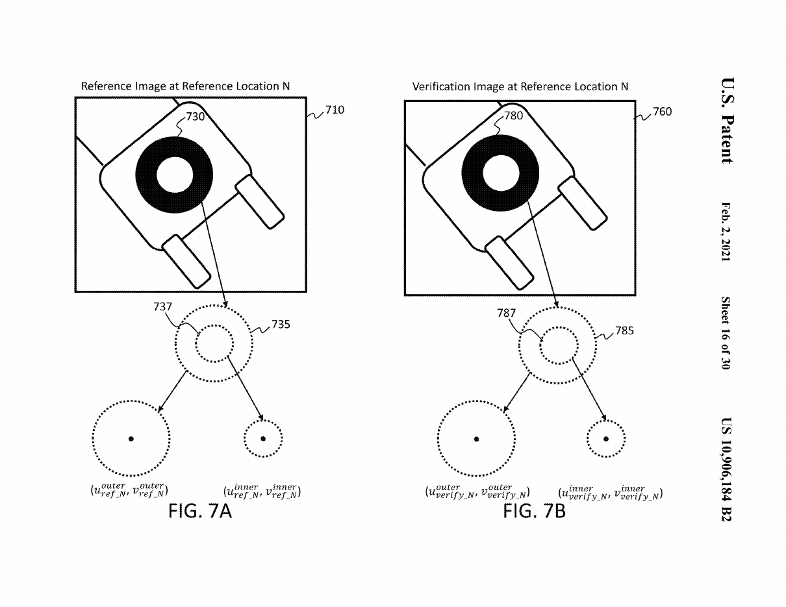
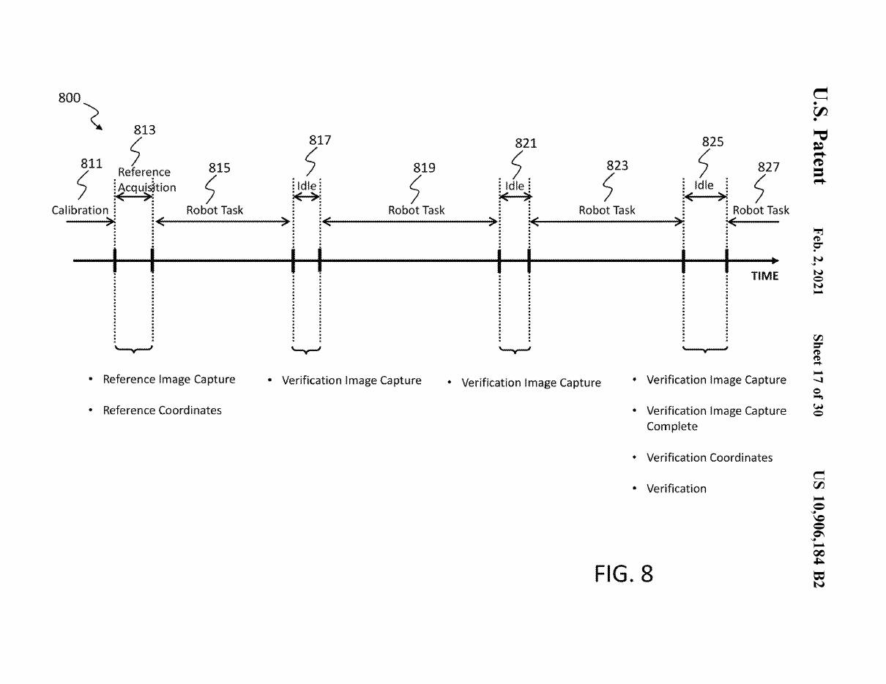
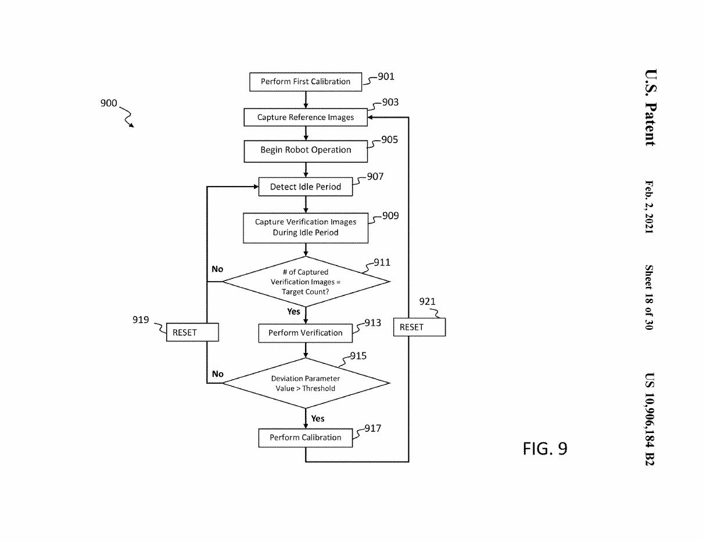

# US10906184B2 번역: 로봇 제어용 카메라 교정을 검증하고 갱신하는 방법과 제어 시스템

- 원제: Method and control system for verifying and updating camera calibration for robot control
- 원문: 같은 폴더의 `US10906184B2.pdf` (61쪽, 도면 30장, 청구항 20)
- 번역 범위: 전문 (서지, 초록, 상세한 설명 전체, 청구항 1~20, 도면 설명). 인용 문헌 목록은 원문 그대로 둔다(공보 1~2쪽).
- 번역 원본 텍스트: `pdftotext -layout`으로 뽑은 본문은 두 단이 섞여 있어, 같은 내용인 Google Patents 공개 본문(https://patents.google.com/patent/US10906184B2/en, 2026-11-04 확인)과 대조해 번역했다.
- 도면 번호(110, 165, 570 등)는 원문 부호를 그대로 둔다.
- 번역 2026-11-04.

## 서지

| 항목 | 내용 |
|---|---|
| 공보 | US 10,906,184 B2 (등록 2021-02-02) |
| 출원 | US 16/864,071, 2020-04-30 출원 |
| 공개 | US 2020/0306977 A1 (2020-10-01) |
| 출원인, 권리자 | MUJIN, INC., 도쿄 |
| 발명자 | Russell Islam, Xutao Ye, Rosen Diankov (모두 도쿄) |
| 관련 출원 | US 16/732,832 (2020-01-02)의 일부계속출원. 16/732,832는 16/525,004 (2019-07-29, 현 US 10,562,186)의 계속출원이고, 16/525,004는 16/369,630 (2019-03-29, 현 US 10,399,227)의 계속출원이다. 가출원 62/916,798 (2019-10-18) |
| 국제 분류 | B25J 9/16, G06T 7/80 |
| CPC | B25J 9/1692, B25J 9/1697, G06T 7/80, G05B 2219/39008, G06T 2207/30164 |
| 심사관 | Jaime Figueroa |
| 대리인 | Medler Ferro Woodhouse & Mills PLLC |

## 초록

교정 검증을 위한 컴퓨팅 시스템과 방법을 제시한다.
컴퓨팅 시스템은 제1 교정 작업을 하고, 로봇 팔을 제어해 검증 기호를 기준 위치로 옮긴다.
로봇 제어 시스템은 카메라로부터 검증 기호의 기준 영상을 받고, 검증 기호의 기준 영상 좌표를 정한다.
그 뒤 쉬는 시간(유휴 기간)에 로봇 팔을 제어해 검증 기호를 다시 기준 위치로 옮기고, 검증 기호의 추가 영상을 받아 검증 영상 좌표를 정한다.
로봇 제어 시스템은 기준 영상 좌표와 검증 영상 좌표로 편차 파라미터 값을 정하고, 이 값이 정해진 임계값을 넘는지 판단한다.
임계값을 넘으면 제2 교정 작업을 한다.

## 관련 출원과의 관계

이 출원은 미국 특허 출원 16/732,832(제목 "로봇 제어용 카메라 교정을 검증하고 갱신하는 방법과 제어 시스템", 2020-01-02 출원)의 일부계속출원이다.
16/732,832는 미국 특허 출원 16/525,004(같은 제목, 2019-07-29 출원)의 계속출원이다.
16/525,004는 미국 특허 출원 16/369,630(같은 제목, 2019-03-29 출원)의 계속출원이다.
이 출원들의 전체 내용을 참조로 여기에 포함한다.
이 출원은 또 미국 가출원 62/916,798(제목 "로봇 제어용 교정을 검증하는 방법과 제어 시스템", 2019-10-18 출원)의 이익을 주장하며, 그 전체 내용도 참조로 포함한다.

## 발명의 분야

이 발명은 로봇 제어용 교정 정보를 검증하고 갱신하는 방법과 제어 시스템에 관한 것이다.

## 배경

자동화가 흔해지면서 로봇은 창고, 제조 현장 같은 더 많은 환경에서 쓰인다.
예를 들어 로봇은 창고에서 팔레트에 물건을 싣거나 내리고, 공장에서 컨베이어 벨트의 물체를 집는다.
로봇의 움직임은 고정되어 있을 수도 있고, 창고나 공장의 카메라가 찍은 영상 같은 입력을 바탕으로 할 수도 있다.
뒤의 경우에는 카메라의 성질을 정하고, 카메라와 로봇이 있는 환경 사이의 관계를 정하기 위해 교정 작업을 할 수 있다.
교정 작업은 로봇 제어에 쓰는 교정 정보를 만든다.
어떤 구현에서는 교정 작업에 사람의 수작업이 들어간다.
사람이 로봇의 움직임을 손으로 제어하거나, 카메라를 손으로 제어해 로봇의 영상을 찍는다.

## 요약

여기의 실시예의 한 측면은 로봇 제어를 위한 교정 검증에 관한 것이다. 예를 들어 카메라 교정이나 다른 시스템 교정을 검증한다.
교정 검증은 통신 인터페이스와 제어 회로를 가진 로봇 제어 시스템이 수행할 수 있다.
통신 인터페이스는 받침대(베이스)와 로봇 팔을 가지고 로봇 팔에 검증 기호가 놓인 로봇과 통신하고, 카메라 시야를 가진 카메라와 통신하도록 구성될 수 있다.
로봇 제어 시스템의 제어 회로는 다음 단계로 교정 검증을 하도록 구성될 수 있다.

- a) 제1 교정 작업(예: 제1 카메라 교정)을 해서 교정 정보(예: 카메라 교정 정보)를 정한다.
- b) 제1 이동 명령을 통신 인터페이스로 출력한다. 통신 인터페이스는 이 명령을 로봇에 전달해, 제1 교정 작업 중이나 뒤에 로봇 팔이 검증 기호를 카메라 시야 안의 한 위치로 옮기게 한다. 이 위치는 제1 교정 작업을 검증하기 위한 하나 이상의 기준 위치 중 하나다.
- c) 카메라로부터 통신 인터페이스를 거쳐 검증 기호의 영상을 받는다. 카메라는 기준 위치에 있는 검증 기호의 영상을 찍도록 구성되어 있다. 이 영상이 검증용 기준 영상이다.
- d) 검증 기호의 기준 영상 좌표를 정한다. 기준 영상 좌표는 기준 영상에서 검증 기호가 나타나는 좌표다.
- e) 교정 정보에 바탕을 둔 제2 이동 명령을 통신 인터페이스로 출력한다. 통신 인터페이스는 이 명령을 로봇에 전달해 로봇 팔이 로봇 작업을 하도록 움직이게 한다.

한 실시예에서 제어 회로는 다음 단계를 더 해서 교정 검증을 하도록 구성된다.

- f) 로봇 작업 중 쉬는 시간(유휴 기간)을 감지한다.
- g) 제3 이동 명령을 통신 인터페이스로 출력한다. 통신 인터페이스는 이 명령을 로봇에 전달해, 쉬는 시간에 로봇 팔이 검증 기호를 적어도 기준 위치로 옮기게 한다.
- h) 카메라로부터 통신 인터페이스를 거쳐 검증 기호의 추가 영상을 받는다. 카메라는 쉬는 시간에 적어도 기준 위치에서 검증 기호의 추가 영상을 찍도록 구성되어 있다. 이 추가 영상이 검증용 검증 영상이다.
- i) 검증에 쓰는 검증 영상 좌표를 정한다. 검증 영상 좌표는 검증 영상에서 검증 기호가 나타나는 좌표다.
- j) 기준 영상 좌표와 검증 영상 좌표 사이의 편차 크기로 편차 파라미터 값을 정한다. 두 좌표는 모두 같은 기준 위치에 연결된다. 편차 파라미터 값은 제1 교정 작업 이후 통신 인터페이스가 통신하는 카메라에 생긴 변화, 또는 제1 교정 작업 이후 카메라와 로봇 사이 관계에 생긴 변화를 나타낸다.
- k) 편차 파라미터 값이 정해진 임계값을 넘는지 판단한다.
- l) 편차 파라미터 값이 정해진 임계값을 넘는다고 판단하면, 제2 교정 작업(예: 제2 카메라 교정 작업)을 해서 갱신된 교정 정보(예: 갱신된 카메라 교정 정보)를 정한다.

## 도면의 간단한 설명

앞에서 말한 특징, 목적, 장점과 그 밖의 것은 첨부 도면에 보인 실시예의 다음 설명에서 분명해진다.
첨부 도면은 명세서에 포함되어 그 일부를 이루며, 발명의 원리를 설명하고 해당 분야의 숙련자가 발명을 만들고 쓰게 돕는다.
도면의 축척은 실제와 다르다.

- 도 1A, 1B: 교정 정보의 검증을 수행하는 시스템의 블록도.
- 도 1C: 교정 검증을 수행하도록 구성된 로봇 제어 시스템의 블록도.
- 도 1D: 카메라 교정 대상인 카메라의 블록도.
- 도 2: 교정 작업에서 얻은 교정 정보를 바탕으로 로봇을 제어하는 시스템.
- 도 3: 교정 작업을 수행하는 시스템.
- 도 4A, 4B: 교정 정보의 검증 방법을 보이는 순서도.
- 도 5A, 5B: 로봇에 검증 기호를 두고, 이 검증 기호로 교정 정보를 검증하는 시스템.
- 도 5C: 검증 기호의 예.
- 도 6A~6D: 검증 기호의 영상을 각각 찍는 기준 위치의 예.
- 도 7A: 기준 영상 좌표를 정하는 예.
- 도 7B: 검증 영상 좌표를 정하는 예.
- 도 8: 교정 정보 검증의 시간축 예.
- 도 9: 교정 정보 검증 방법의 예를 보이는 순서도.
- 도 10A~10C: 로봇에 검증 기호 묶음을 두고, 이 묶음으로 교정 정보를 검증하는 시스템.
- 도 11A, 11B: 로봇에 검증 기호 묶음을 두고, 이 묶음으로 교정 정보를 검증하는 시스템.
- 도 11C: 크기가 서로 다른 검증 기호 묶음.
- 도 12A, 12B: 교정 정보의 검증 방법을 보이는 순서도.
- 도 13A, 13B: 로봇 팔의 제1 자세에 대한 기준 영상과 검증 영상.
- 도 14A, 14B: 로봇 팔의 제2 자세에 대한 기준 영상과 검증 영상.

## 상세한 설명

다음 상세한 설명은 예시일 뿐이며, 발명이나 그 응용과 용도를 제한하려는 것이 아니다.
앞의 기술 분야, 배경, 요약이나 다음 상세한 설명에 드러나거나 함축된 어떤 이론에도 얽매일 의도가 없다.

여기 설명하는 실시예는 로봇을 제어하는 데 쓰는 교정 정보를 검증하거나 갱신하는 것에 관한 것이다. 로봇은 창고, 제조 공장이나 다른 환경에서 쓰는 로봇일 수 있다.
더 구체적으로, 교정 정보는 로봇 운용 시스템의 제어를 돕기 위한 것이며, 교정 작업을 해서 정할 수 있다. 이 교정 작업을 시스템 교정이라고 부를 수 있다.
시스템 교정은 카메라의 교정(카메라 교정 또는 카메라 교정 작업), 로봇의 교정(로봇 교정), 로봇 운용 시스템의 다른 요소의 교정, 또는 이들의 조합을 포함할 수 있다.
시스템 교정은 예를 들어 로봇 제어 시스템(로봇 제어기라고도 한다)이 수행해 교정 정보(예: 카메라 교정 정보)를 만든다. 이 정보는 로봇 제어 시스템이 카메라가 찍은 영상을 바탕으로 로봇을 제어하는 능력을 돕는다.
예를 들어 로봇이 창고에서 소포를 집을 때, 로봇 팔이나 로봇의 다른 부품의 배치는 카메라가 찍은 소포 영상에 바탕을 둘 수 있다.
이때 교정 정보에 카메라 교정 정보가 들어 있으면, 카메라 교정 정보와 소포 영상을 함께 써서 로봇 팔에 대한 소포의 위치와 방향 등을 정할 수 있다.
시스템 교정에 카메라 교정이 들어 있으면, 카메라 교정은 카메라의 내부 파라미터 추정값들을 정하고, 카메라와 외부 환경 사이 관계의 추정값을 정하는 일을 포함할 수 있다.
카메라의 내부 파라미터는 행렬, 벡터, 스칼라 같은 하나 이상의 값을 가질 수 있다. 내부 파라미터의 예로 투영 행렬과 왜곡 파라미터가 있다.
한 경우에 카메라 교정은 외부 환경의 고정된 위치에 대한 카메라의 위치를 정하는 일을 포함할 수 있다. 이 위치는 카메라와 외부 환경의 고정 위치 사이 관계를 나타내는 변환 함수로 표현할 수 있다.
어떤 경우에는 교정 패턴의 도움으로 카메라 교정을 한다. 교정 패턴에는 정해진 자리에 패턴 요소들이 놓여 있다.
카메라는 교정 패턴의 패턴 요소 영상(교정 영상)을 찍고, 패턴 요소의 영상과 패턴 요소의 정해진 위치를 비교해 카메라 교정을 한다.
카메라 교정은 미국 출원 16/295,940(2019-03-07 출원, 제목 "로봇 제어를 위한 자동 카메라 교정 방법과 장치")에 더 자세히 나오며, 그 전체 내용을 참조로 포함한다.

앞에서 말했듯이, 이 개시의 한 측면은 이른 시점에 한 카메라 교정이나 다른 교정 작업이 나중 시점에도 여전히 정확한지 검증하는 것이다.
이른 시점에 한 카메라 교정은 그 시점의 카메라 성질을 반영하는 카메라 교정 정보를 만든다. 예를 들어 그 시점의 카메라 내부 파라미터나 카메라와 외부 환경의 관계다.
카메라 성질이 시간에 따라 바뀌면 이른 시점의 카메라 교정은 시간이 지나면서 정확도를 잃을 수 있다.
첫째 예로, 카메라의 내부 파라미터가 시간에 따라 바뀔 수 있다. 이런 변화는 예를 들어 온도 변화가 카메라 하우징이나 렌즈의 모양을 바꿔서 생긴다.
둘째 예로, 카메라와 외부 환경의 관계가 시간에 따라 바뀔 수 있다. 예를 들어 카메라가 로봇 받침대나 창고 안의 한 위치에 대해 위치나 방향이 움직일 수 있다.
이런 변화의 원인은 다음과 같다.

- 온도 변화로 카메라를 고정하는 부품이 늘어나거나 줄어듦
- 사람이나 다른 물체가 카메라에 부딪힘
- 카메라 외부 환경(예: 창고)의 진동
- 카메라 자체 무게에서 오는 힘(중력)
- 그 밖의 요인

이런 변화로 카메라 교정 정보나 다른 교정 정보가 낡을 수 있다. 낡은 정보로 나중에 로봇 팔이나 다른 부품을 놓으면 오류가 생길 수 있다.
다시 말해, 카메라에 관련된 성질이 시간에 따라 바뀌었는데 카메라 교정 정보가 그 변화를 반영해 갱신되지 않으면, 로봇은 낡거나 틀린 카메라 교정 정보로 움직이게 되고 로봇 작업에 원치 않는 오류가 생긴다.
카메라 성질 하나 이상이 바뀔 가능성에 대응하기 위해, 로봇 제어 시스템은 카메라 교정에서 나온 카메라 교정 정보가 더 이상 충분히 정확하지 않은 때를 감지하는 검증을 자동으로 할 수 있다. 더 일반적으로는 교정 작업에서 나온 교정 정보가 더 이상 충분히 정확하지 않은 때를 감지한다.
이런 상태를 감지하면 카메라나 로봇 운용 시스템의 다른 요소의 성질이 바뀌었다는 표시가 된다.
검증에서 교정 정보가 더 이상 충분히 정확하지 않다고 감지되면, 로봇 제어 시스템은 교정 작업을 해서 갱신된 교정 정보를 정한다. 이 정보는 카메라나 로봇 운용 시스템의 다른 요소의 더 최근 성질을 반영한다.
갱신된 교정 정보는 로봇 팔의 배치나 로봇 작업의 다른 측면을 제어하는 데 쓴다.
이렇게 교정 정보를 자동으로 검증하거나 갱신해, 로봇이 카메라나 로봇 운용 시스템의 다른 요소에 관한 올바른 정보로 움직이게 한다.

여기 실시예의 한 측면은 카메라가 찍은 기준 영상과 카메라가 찍은 검증 영상을 비교해 카메라의 교정 정보를 검증하는 것이다.
어떤 경우에 기준 영상은 이른 시점에 물체가 특정 위치에 있을 때 찍은 물체의 영상이고, 검증 영상은 나중 시점에 같은 위치에서 찍은 물체의 영상이다.
검증은 기준 영상과 검증 영상 사이의 편차가 너무 큰지, 예를 들어 어떤 임계값을 넘는지 판단한다.
어떤 구현에서 물체는 검증 기호일 수 있다.
더 구체적으로, 로봇 팔이나 로봇의 다른 부품에 교정 정보를 검증하는 데 쓰는 검증 기호가 있을 수 있다.
기준 영상과 검증 영상은 모두 검증 기호를 담고, 로봇 제어 시스템은 기준 영상 속 검증 기호의 모습과 검증 영상 속 검증 기호의 모습을 비교해 두 영상을 비교한다.
예를 들어 로봇 제어 시스템이 어느 시점에 교정 작업을 해서 교정 정보를 만든 뒤, 로봇 팔을 제어해(예: 이동 명령으로) 검증 기호를 카메라 시야 안의 미리 정한 위치 묶음으로 옮긴다. 이 위치들을 검증용 기준 위치 묶음으로 쓴다.
카메라는 기준 위치 묶음에서 검증 기호의 기준 영상을 각각 찍는다.
어떤 경우에는 교정 작업 직후에 기준 영상을 찍는다.
로봇 팔의 움직임, 더 구체적으로는 로봇 팔을 움직이는 이동 명령은 방금 한 교정 작업의 교정 정보에 바탕을 둘 수도 있고, 교정 정보와 무관할 수도 있다.
어떤 경우에는 로봇이 로봇 작업을 시작하기 전에 기준 영상을 찍는다.
기준 영상을 찍은 뒤에는 로봇이 작업을 시작할 준비가 된 것으로 보고, 로봇 제어 시스템은 이후 카메라가 찍는 영상으로 로봇 팔의 위치 등을 제어한다.

앞에서 말했듯이 기준 영상은 나중에 찍는 검증 영상과 비교한다.
한 실시예에서 검증 영상은 로봇 제어 시스템이 감지한 하나 이상의 쉬는 시간에 찍는다.
더 구체적으로, 로봇 작업이 시작되면 로봇은 로봇 일(예: 소포나 다른 물체를 다루는 일)을 하기 시작한다.
로봇이 로봇 작업을 하는 동안 로봇 제어 시스템은 로봇의 쉬는 시간을 하나 이상 감지한다.
어떤 경우에 쉬는 시간은 로봇 작업 중 로봇이 로봇 일을 하지 않는 시간이다.
어떤 경우에 로봇 제어 시스템은 로봇이 다뤄야 할 물체를 감지하거나 예상해서 로봇 작업 일정을 짜고, 다룰 물체가 없음을 감지하거나 예상해서 쉬는 시간을 감지한다.

쉬는 시간에 로봇 제어 시스템은 로봇 팔이나 다른 부품을(예: 이동 명령으로) 기준 위치로 옮기고, 각 기준 위치에서 검증 영상을(예: 카메라 명령으로) 찍는다.
로봇에 검증 기호가 있으면, 더 구체적으로 로봇 팔이 검증 기호를 기준 위치로 옮기게 해서 검증 영상을 찍는다.
그 뒤 로봇 제어 시스템은 각 기준 위치에서 검증 영상이 대응하는 기준 영상과 얼마나 다른지 정한다.
어떤 경우에 검증 영상과 기준 영상 사이 편차는 편차 파라미터로 나타낸다.
편차 파라미터의 값(편차 파라미터 값)이 편차 파라미터의 정해진 임계값(정해진 편차 임계값)을 넘으면, 로봇 제어 시스템은 추가 교정 작업(예: 추가 카메라 교정)을 해서 카메라의 갱신된 교정 정보(예: 갱신된 카메라 교정 정보)를 정한다.
편차 파라미터 값이 정해진 편차 임계값을 넘는 것은, 이전에 만든 교정 정보를 쓰면 로봇 작업에 원치 않는 크기의 오류가 생길 수 있음을 뜻한다.
그래서 어떤 경우에는 추가 교정 작업을 하는 동안 로봇 작업을 잠시 멈추거나 그만둔다(이 멈춤도 또 하나의 쉬는 시간으로 볼 수 있다).
추가 교정 작업이 끝나면 새 기준 영상 묶음을 찍고, 갱신된 교정 정보로 로봇 작업을 이어 간다.
이후 쉬는 시간에는 새 검증 영상 묶음을 찍고, 새 기준 영상 묶음과 새 검증 영상 묶음을 비교해 추가 교정 작업을 검증한다.

앞에서 말했듯이 편차 파라미터 값이 정해진 편차 임계값을 넘으면 로봇 제어 시스템은 추가 교정 작업을 한다.
편차 파라미터 값이 편차 임계값을 넘지 않으면, 쉬는 시간 뒤 추가 교정 작업 없이 로봇 작업을 이어 간다.
이 경우 카메라는 다음 쉬는 시간에 각 기준 위치에서 새 검증 영상 묶음을 찍는다.
새 검증 영상 묶음을 찍으면, 로봇 제어 시스템은 각 기준 위치에서 새 검증 영상이 기준 영상과 얼마나 다른지 정해 교정 정보를 다시 검증한다.

앞에서 말했듯이 로봇 팔에는 고리 무늬 같은 검증 기호가 놓일 수 있고, 검증 기호는 기준 영상과 검증 영상에 찍힌다.
한 실시예에서 로봇 제어 시스템은 기준 영상에서 검증 기호가 나타나는 위치와 검증 영상에서 검증 기호가 나타나는 위치로 기준 영상과 검증 영상 사이 편차를 정한다.
예를 들어 로봇 제어 시스템은 각 기준 위치마다 기준 영상 좌표를 정한다.
한 위치의 기준 영상 좌표는 검증 기호를 그 기준 위치에 두었을 때 찍은 기준 영상에서 검증 기호가 나타나는 좌표다.
더 구체적으로, 기준 영상 좌표는 한 기준 위치에 연결되며, 검증 기호를 그 기준 위치에 두었을 때 카메라가 찍은 기준 영상에서 검증 기호가 나타나는 영상 좌표를 말한다.
위 예에서 영상 좌표는 픽셀 좌표 같은 영상 안의 좌표를 말한다.
로봇 제어 시스템이 나중 시점에 검증 기호를 특정 기준 위치에 다시 두고 대응하는 검증 영상을 얻으면, 검증 영상 좌표를 정한다.
검증 영상 좌표도 그 기준 위치에 연결되며, 검증 기호를 그 기준 위치에 두었을 때 카메라가 찍은 검증 영상에서 검증 기호가 나타나는 영상 좌표(예: 픽셀 좌표)를 말한다.
로봇 제어 시스템은 한 기준 위치에 연결된 기준 영상 좌표를 같은 기준 위치에 연결된 검증 영상 좌표와 비교한다.
이 비교는 검증 영상과 기준 영상을 찍은 모든 기준 위치에서 한다.

한 경우에 기준 영상에서 검증 기호가 나타나는 기준 영상 좌표는 기준 영상 속 검증 기호 중심의 좌표(기준 영상 속 검증 기호의 중심 좌표)일 수 있다.
마찬가지로 검증 영상에서 검증 기호가 나타나는 검증 영상 좌표는 검증 영상 속 검증 기호 중심의 좌표(검증 영상 속 검증 기호의 중심 좌표)일 수 있다.
대응하는 검증 영상을 찍을 때 로봇 팔이나 검증 기호가 있던 각 기준 위치에서, 로봇 제어 시스템은 그 기준 위치에 연결된 기준 영상 좌표와 같은 기준 위치에 연결된 검증 영상 좌표 사이의 편차를 정한다.
로봇 팔이나 검증 기호를 여러 기준 위치에 두었다면, 로봇 제어 시스템은 여러 기준 위치마다 기준 영상 좌표와 검증 영상 좌표 사이의 편차 크기를 각각 정한다.
그리고 각 기준 위치의 기준 영상 좌표와 검증 영상 좌표 사이 편차 크기들로 편차 파라미터 값을 정한다.

한 경우에 검증 기호는 서로 동심인 여러 도형을 담아, 여러 도형의 중심이 같은 자리나 거의 같은 자리에 있을 수 있다.
예를 들어 검증 기호는 동심원 두 개 이상으로 된 고리 무늬일 수 있다.
어떤 경우에 검증 기호의 기준 영상 좌표가 기준 영상 속 검증 기호의 중심 좌표라면, 로봇 제어 시스템은 기준 영상 속 여러 도형의 중심 좌표들로 검증 기호의 중심 좌표를 정한다. 한 도형의 중심 좌표는 그 도형 중심의 좌표다.
검증 기호가 고리 무늬이면, 기준 영상 속 고리 무늬의 중심 좌표는 고리를 이루는 첫째 원의 중심 좌표와 둘째 원의 중심 좌표의 평균으로 정할 수 있다.
마찬가지로 검증 영상 속 검증 기호의 중심 좌표도 검증 영상 속 검증 기호를 이루는 여러 도형의 중심 좌표들로 정한다.
어떤 경우에는 여러 도형으로 검증 기호를 만들면 검증의 정확도가 좋아진다.
예를 들어 영상 속 여러 도형의 중심 좌표로 검증 기호의 중심 좌표를 정하면 영상 잡음에 대한 검증의 강건성이 좋아진다.
더 구체적으로, 검증 기호 영상에 영상 잡음이 있으면 로봇 제어 시스템이 검증 기호의 한 도형의 중심 좌표를 찾는 정확도가 떨어질 수 있다.
그러나 그 도형의 중심 좌표를 다른 도형의 중심 좌표와 평균해 검증 기호의 중심 좌표를 정하면, 평균한 중심 좌표는 영상 잡음의 영향을 줄인다.
그 결과 검증 기호의 중심 좌표를 정하는 정확도가 좋아진다.

한 경우에 검증 기호는 색이 서로 다른 여러 영역을 가지고, 여러 영역의 넓이는 뚜렷하게 정해진 비율을 가질 수 있다.
예를 들어 검증 기호는 첫째 색(예: 검정)의 첫째 영역과 둘째 색(예: 흰색)의 둘째 영역을 가지고, 첫째 영역 넓이와 둘째 영역 넓이의 비가 정해져 있거나 알려져 있다.
이 뚜렷한 비율은 영상에서 검증 기호를 찾는 일을 돕는다. 특히 영상에 교정 패턴의 점 같은 다른 특징이 함께 찍혔을 때 그렇다.
예를 들어 검증 기호를 옮기는 로봇 팔에 교정 패턴도 함께 놓여 있을 수 있다.
로봇 제어 시스템은 이 비율로 검증 기호를 교정 패턴의 점들과 구별한다.
더 구체적으로, 검증 기호의 여러 영역 넓이 비가 뚜렷한 비율로 정해져 있으므로, 로봇 제어 시스템은 정해진 비율로 영상에서 검증 기호를 찾는다.
영상에 나타난 검증 기호를 찾을 때, 로봇 제어 시스템은 정해진 비율로 검증 기호를 교정 패턴이나 다른 특징과 구별한다.
어떤 경우에 검증 기호는 영상에서 색이 다른 여러 영역을 가지고 그 넓이 사이에 정해진 비율이 있는 부분으로 찾는다.
로봇 제어 시스템이나 다른 시스템, 장치가 영상의 어떤 부분에 색이 다른 여러 영역이 없거나, 여러 영역의 넓이 비가 정해진 비율과 다르다고 판단하면, 그 부분은 검증 기호가 아니라고 판단한다.

한 경우에 로봇 제어 시스템은 로봇 주위 온도를 바탕으로 검증을 한다.
예를 들어 로봇 제어 시스템은 온도에 따라 정해진 편차 임계값을 조정한다(편차 임계값에 새 값을 정한다).
예를 들어 온도는 카메라나 로봇의 여러 부품에 영향을 줄 수 있다. 어떤 재료는 온도에 민감하거나 온도에 따라 늘어나고 줄어든다.
온도가 바뀌면 카메라의 내부 파라미터가 바뀌거나, 카메라와 외부 환경의 관계가 바뀔 수 있다.
한 실시예에서 온도가 정해진 범위 밖이면 편차 임계값을 첫째 값으로 두고, 온도가 정해진 범위 안이면 첫째 값보다 낮은 둘째 값으로 둘 수 있다.
예를 들어 온도가 정해진 정상 운전 온도 범위(예: 실온 ±10도) 안이면 편차 임계값은 첫째 값이다.
온도가 정상 운전 온도 범위 밖이면 편차 임계값은 첫째 값보다 낮은 둘째 값이다.
둘째 값을 첫째 값보다 낮게 두는 것은, 온도가 정상 운전 범위 밖일 때 추가 교정 작업이 더 쉽게 일어나게 하려는 것이다. 정상 운전 온도 범위 밖의 온도는 카메라나 카메라와 외부 환경의 관계를 바꿀 가능성이 더 크고, 따라서 이전에 만든 카메라 교정 정보나 다른 교정 정보로 로봇을 움직일 때 오류가 생길 가능성도 더 크기 때문이다.

(옮긴이 주: 원문은 이 문단 안에서 범위 안과 밖에 첫째 값과 둘째 값을 서로 반대로 붙이는 문장이 함께 있다. 뒤의 방법 400 설명(단계 459 뒤)에서도 "범위 밖이면 임계값을 높게"와 "범위 밖이면 임계값을 낮게"를 서로 다른 예로 함께 적는다. 이 문단의 마지막 문장 뜻은 "범위 밖일 때 임계값을 더 낮게"다.)

한 실시예에서 교정 정보 검증은 기준 위치 하나에만 기댈 수 있다.
또는 여러 기준 위치에 기댈 수 있다.
기준 위치는 카메라 시야 안의 아무 위치일 수도 있고, 특정하게 정한 위치일 수도 있다.
예를 들어 기준 위치를 카메라 쪽으로 오목한 가상의 구 하나 이상의 표면 위 위치로 정할 수 있다.
이 경우 각 기준 위치에서 로봇 팔은 검증 기호가 가상 구의 표면에 접하면서 카메라를 마주 보도록 놓는다.
이렇게 놓으면 카메라가 검증 기호를 정면에서(검증 기호가 카메라를 바로 마주 보는 상태로) 찍기 좋아, 검증 기호의 영상이 비스듬한 투시 모습이 아니라 위에서 본 모습에 가까워진다.
예를 들어 검증 기호가 고리 무늬이면, 고리 무늬를 가상 구 표면에 접하게 두면 고리 무늬의 영상이 타원이 아니라 원으로 보인다.
그 영상은 고리 무늬가 타원으로 보이는 경우보다 투시 왜곡이 적거나 없다.
투시 왜곡이 없으면 고리 무늬의 중심 좌표를 정확히 정하기 쉽다.
어떤 경우에는 기준 위치를 카메라 쪽으로 오목한 여러 가상 구에 나눠 둔다.
여러 가상 구는 같은 중심을 가지고 크기가 달라, 각 구의 표면이 카메라에서 서로 다른 거리에 있다.
어떤 경우에는 카메라가 모든 가상 구의 공통 중심이다.

도 1A는 자동 카메라 교정과 카메라 교정의 자동 검증을 하는 로봇 운용 시스템 100(시스템 100)의 블록도다.
아래 몇몇 예는 자동 카메라 교정과 그로부터 정한 카메라 교정 정보의 검증을 다루지만, 이 예들은 더 일반적으로 어떤 종류의 자동 교정 작업과 그로부터 정한 어떤 종류의 교정 정보의 검증에도 적용된다.
로봇 운용 시스템 100은 로봇 150, 로봇 제어 시스템 110(로봇 제어기), 카메라 170을 포함한다.
한 실시예에서 시스템 100은 창고, 제조 공장이나 다른 시설 안에 있다.
로봇 제어 시스템 110은 아래에서 자세히 다루는 카메라 교정을 해서 카메라 교정 정보를 정하도록 구성된다. 이 정보는 나중에 로봇 150이 창고에서 소포를 집는 것 같은 로봇 작업을 하도록 제어하는 데 쓴다.
로봇 제어 시스템 110은 또 아래에서 자세히 다루는 카메라 교정 검증을 해서 카메라 교정 정보가 여전히 충분히 정확한지 검증하도록 구성된다.
어떤 경우에 로봇 제어 시스템 110은 카메라 교정을 하고, 카메라 교정 정보로 로봇 150이 로봇 작업을 하도록 제어하도록 구성된다.
어떤 경우에 로봇 제어 시스템 110은 로봇 150, 카메라 170과 통신하는 단일 장치(예: 콘솔 하나나 컴퓨터 하나)를 이룬다.
어떤 경우에 로봇 제어 시스템 110은 여러 장치를 포함한다.

어떤 경우에 로봇 제어 시스템 110은 카메라 교정이나 카메라 교정 검증만 전담하고, 가장 최근 카메라 교정 정보를 다른 제어 시스템(다른 제어기, 도시하지 않음)에 넘긴다. 그 제어 시스템이 가장 최근 카메라 교정 정보로 로봇 150이 로봇 작업을 하도록 제어한다.
로봇 150은 카메라 170이 찍은 영상과 카메라 교정 정보를 바탕으로 위치가 정해진다.
더 구체적으로, 한 실시예에서 로봇 제어 시스템 110은 영상과 카메라 교정 정보로 이동 명령을 만들고, 이를 로봇 150에 보내 로봇 팔의 움직임을 제어하도록 구성된다.
어떤 경우에 로봇 제어 시스템 110은 로봇 작업 중 쉬는 시간에 카메라 교정 검증을 하도록 구성된다.
어떤 경우에 로봇 제어 시스템 110은 로봇 150으로 로봇 작업을 하는 동안 검증을 하도록 구성된다.

한 실시예에서 로봇 제어 시스템 110은 유선이나 무선 통신으로 로봇 150, 카메라 170과 통신하도록 구성된다.
예를 들어 로봇 제어 시스템 110은 RS-232 인터페이스, USB 인터페이스, 이더넷 인터페이스, 블루투스 인터페이스, IEEE 802.11 인터페이스나 이들의 조합으로 로봇 150이나 카메라 170과 통신한다.
한 실시예에서 로봇 제어 시스템 110은 PCI 버스 같은 로컬 컴퓨터 버스로 로봇 150이나 카메라 170과 통신한다.

한 실시예에서 로봇 제어 시스템 110은 로봇 150과 따로 있고, 앞의 무선이나 유선 연결로 로봇과 통신한다.
예를 들어 로봇 제어 시스템 110은 유선이나 무선 연결로 로봇 150, 카메라 170과 통신하는 독립 컴퓨터일 수 있다.
한 실시예에서 로봇 제어 시스템 110은 로봇 150의 일체형 부품이며, 앞의 로컬 컴퓨터 버스로 로봇 150의 다른 부품과 통신한다.
어떤 경우에 로봇 제어 시스템 110은 로봇 150만 제어하는 전용 제어 시스템(전용 제어기)이다.
다른 경우에 로봇 제어 시스템 110은 로봇 150을 포함한 여러 로봇을 제어한다.
한 실시예에서 로봇 제어 시스템 110, 로봇 150, 카메라 170은 같은 시설(예: 창고)에 있다.
한 실시예에서 로봇 제어 시스템 110은 로봇 150, 카메라 170과 멀리 떨어져 있고, 네트워크 연결(예: LAN)로 통신한다.

한 실시예에서 로봇 제어 시스템 110은 로봇 150(예: 로봇 팔)에 놓인 교정 패턴 160이나 검증 기호 165의 영상을 카메라 170에서 받아 오도록 구성된다.
어떤 경우에 로봇 제어 시스템 110은 카메라 170이 그런 영상을 찍도록 제어한다.
예를 들어 로봇 제어 시스템 110은 카메라 170이 카메라 시야의 영상을 찍게 하는 카메라 명령을 만들어 유선이나 무선 연결로 카메라 170에 보낸다.
같은 명령으로 카메라 170이 영상을 로봇 제어 시스템 110에, 더 일반적으로는 로봇 제어 시스템 110이 접근하는 저장 장치에 보내게 할 수도 있다.
또는 로봇 제어 시스템 110은 다른 카메라 명령을 만들어, 카메라 170이 그 명령을 받으면 찍어 둔 영상을 로봇 제어 시스템 110에 보내게 한다.
한 실시예에서 카메라 170은 로봇 제어 시스템 110의 카메라 명령 없이 주기적으로나 정해진 촉발 조건에 따라 카메라 시야의 영상을 자동으로 찍는다.
이 실시예에서 카메라 170은 로봇 제어 시스템 110의 카메라 명령 없이 영상을 로봇 제어 시스템 110이나, 더 일반적으로 로봇 제어 시스템 110이 접근하는 저장 장치에 자동으로 보낸다.

한 실시예에서 로봇 제어 시스템 110은 스스로 만들어 유선이나 무선 연결로 로봇 150에 보낸 이동 명령으로 로봇 150의 움직임을 제어한다.
로봇 150에는 교정 패턴 160과 검증 기호 165 중 하나나 둘 다 놓일 수 있다.
예를 들어 도 1B는 도 1A의 교정 패턴 160 없이 검증 기호 165만 로봇 150에 놓인 로봇 운용 시스템 100A를 보인다.
한 경우에 검증 기호 165는 로봇 150의 일부로서 로봇 150에 영구히 놓인다.
예를 들어 검증 기호 165는 로봇 150에 영구히 칠해지거나, 로봇 150에 영구히 붙인 스티커나 판의 일부일 수 있다.
다른 경우에 검증 기호 165는 로봇 150에 붙였다 뗄 수 있는 별도 부품이다.
검증 기호 165는 로봇 150에 영구히 놓일 수도 있고, 로봇 150에 붙였다 뗄 수 있는 별도 부품일 수도 있다.

한 실시예에서 시스템 100에서 로봇 150을 제어하는 데 쓰는 영상은 카메라 170이 찍은 것뿐이다.
다른 실시예에서 시스템 100은 여러 카메라를 포함하고, 로봇 150은 여러 카메라의 영상으로 제어된다.

도 1B는 또 로봇 제어 시스템 110이 사용자 인터페이스 장치 180과 통신하는 실시예를 보인다.
사용자 인터페이스 장치 180은 로봇 150이 있는 창고의 직원 같은 로봇 150의 운영자와 상호작용하도록 구성된다.
사용자 인터페이스 장치 180은 예를 들어 로봇 150의 운용 정보를 보여 주는 사용자 인터페이스를 제공하는 태블릿이나 데스크톱 컴퓨터다.
앞에서 말했듯이 로봇 제어 시스템 110은 편차 파라미터 값이 정해진 편차 임계값을 넘을 때를 감지한다.
한 실시예에서 사용자 인터페이스 장치 180은 경보나 다른 알림으로 편차 파라미터 값이 정해진 편차 임계값을 넘었음을 운영자에게 알린다.

도 1C는 로봇 제어 시스템 110의 블록도다.
블록도에서 보듯이 로봇 제어 시스템 110은 제어 회로 111, 통신 인터페이스 113, 비일시적 컴퓨터 판독 매체 115(예: 메모리)를 포함한다.
한 실시예에서 제어 회로 111은 하나 이상의 프로세서, PLC나 PLA, FPGA, ASIC이나 다른 제어 회로를 포함한다.

한 실시예에서 통신 인터페이스 113은 도 1A나 1B의 카메라 170, 로봇 150과 통신하도록 구성된 부품 하나 이상을 포함한다.
예를 들어 통신 인터페이스 113은 유선이나 무선 규약으로 통신하는 통신 회로를 포함한다.
예로 통신 회로는 RS-232 포트 제어기, USB 제어기, 이더넷 제어기, 블루투스 제어기, PCI 버스 제어기, 다른 통신 회로나 이들의 조합을 포함한다.
한 실시예에서 제어 회로 111은 이동 명령(예: 모터 이동 명령)을 만들어 통신 인터페이스 113으로 출력한다.
이 실시예에서 통신 인터페이스 113은 이동 명령을 로봇 150에 보내 로봇 팔이나 로봇 150의 다른 부품의 움직임을 제어한다.
한 실시예에서 제어 회로 111은 카메라 명령을 만들어(예: 영상 촬영 명령) 통신 인터페이스 113으로 출력한다.
이 실시예에서 통신 인터페이스 113은 카메라 명령을 카메라 170에 보내 카메라 170이 카메라 시야 안의 물체 영상을 찍게 한다.
한 실시예에서 통신 인터페이스 113은 카메라 170에서 영상이나 다른 자료를 받고, 제어 회로 111은 통신 인터페이스 113에서 영상을 받는다.

한 실시예에서 비일시적 컴퓨터 판독 매체 115는 컴퓨터 메모리를 포함한다.
컴퓨터 메모리는 예를 들어 DRAM, 반도체 집적 메모리, 하드 디스크 드라이브(HDD)다.
어떤 경우에 카메라 교정은 비일시적 컴퓨터 판독 매체 115에 저장된 컴퓨터 실행 명령(예: 컴퓨터 코드)으로 구현된다.
이 경우 제어 회로 111은 컴퓨터 실행 명령을 실행해 카메라 교정 검증(예: 도 4A, 4B, 9의 단계)을 하는 프로세서 하나 이상을 포함한다.

도 1D는 렌즈 하나 이상 171, 영상 센서 173, 통신 인터페이스 175를 포함하는 카메라 170의 블록도다.
통신 인터페이스 175는 도 1A, 1B, 1C의 로봇 제어 시스템 110과 통신하도록 구성되며, 로봇 제어 시스템 110의 도 1C 통신 인터페이스 113과 비슷할 수 있다.
한 실시예에서 렌즈 171은 카메라 170 밖에서 오는 빛을 영상 센서 173에 모은다.
한 실시예에서 영상 센서 173은 픽셀 세기 값으로 영상을 나타내는 픽셀 배열을 포함한다.
영상 센서 173은 CCD 센서, CMOS 센서, QIS(양자 영상 센서)나 다른 영상 센서를 포함한다.

앞에서 말했듯이 카메라 교정은 카메라가 찍은 영상으로 로봇을 제어하는 일을 돕기 위해 한다.
예를 들어 도 2는 영상으로 로봇 250을 제어해, 창고에서 물체 292를 집는 것 같은 로봇 작업을 하게 하는 로봇 운용 시스템 200(시스템 200)을 보인다.
더 구체적으로 시스템 200은 도 1A 시스템 100의 실시예이며, 카메라 270, 로봇 250, 로봇 제어 시스템 110을 포함한다.
카메라 270은 도 1A, 1B, 1D의 카메라 170의 실시예이고, 로봇 250은 도 1A, 1B의 로봇 150의 실시예다.
카메라 270은 창고의 컨베이어 벨트 293 위에 놓인 물체 292(예: 배송 소포)의 영상을 찍고, 로봇 제어 시스템 110은 로봇 250이 물체 292를 집도록 제어한다.
컨베이어 벨트 293에 물체가 하나 이상 있으면, 로봇 제어 시스템 110은 물체를 집도록 로봇 250의 움직임 일정을 짠다.
어떤 경우에 로봇 제어 시스템 110은 컨베이어 벨트 293에 물체가 없을 때, 또는 로봇 250이 닿을 수 있는 물체가 컨베이어 벨트 293에 없을 때를 감지해 로봇 작업의 쉬는 시간을 감지한다.

도 2의 실시예에서 로봇 250은 받침대 252와 받침대 252에 대해 움직이는 로봇 팔을 가진다.
더 구체적으로 로봇 팔은 여러 링크 254A~254E와 링크 254E에 붙은 로봇 손 255를 포함한다.
링크 254A~254E는 서로에 대해 회전하거나, 서로에 대해 직선으로 움직이는 직동 링크일 수 있다.
도 2의 로봇 250은 물체를 집는 데 쓰므로, 로봇 손 255는 물체 292를 잡는 그리퍼 255A, 255B를 포함한다.
한 실시예에서 로봇 제어 시스템 110은 링크 254A~254E 중 하나 이상을 회전시키는 이동 명령을 보낸다.
이동 명령은 모터 이동 명령 같은 저수준 명령이거나 고수준 명령일 수 있다.
로봇 제어 시스템 110의 이동 명령이 고수준 명령이면 로봇 150이 이를 저수준 명령으로 바꾼다.

한 실시예에서 카메라 교정으로 정한 카메라 교정 정보는 카메라 270과 로봇 250 사이 관계, 더 구체적으로 카메라 270과 로봇 250의 받침대 252에 대해 정지한 세계 점 294 사이 관계를 기술한다.
세계 점 294는 로봇 250이 있는 세계나 다른 환경을 나타내며, 받침대 252에 대해 정지한 아무 가상 점일 수 있다.
다시 말해 카메라 교정 정보는 카메라 270과 세계 점 294 사이 관계를 기술하는 정보를 포함한다.
한 실시예에서 이 관계는 세계 점 294에 대한 카메라 270의 위치와, 로봇 250의 기준 방향에 대한 카메라 270의 방향을 말한다.
카메라 270과 세계 점 294 사이의 이 관계를 카메라 대 세계 관계라 부르며, 카메라 270과 로봇 250 사이 관계를 나타내는 데 쓴다.
어떤 경우에 카메라 대 세계 관계로 카메라 270과 물체 292 사이 관계(카메라 대 물체 관계)와 물체 292와 세계 점 294 사이 관계(물체 대 세계 관계)를 정한다.
카메라 대 물체 관계와 물체 대 세계 관계로 로봇 250이 물체 292를 집도록 제어한다.

한 실시예에서 카메라 교정 정보는 카메라 270의 내부 파라미터를 기술한다. 내부 파라미터는 값이 카메라 270의 위치와 방향과 무관한 파라미터다.
내부 파라미터는 초점 거리, 영상 센서 크기, 카메라 270의 렌즈 왜곡 영향 같은 카메라 270의 성질을 나타낸다.

로봇 350의 자세한 구조 예는 도 3에 있다. 도 3은 카메라 370, 로봇 350과 통신하는 로봇 제어 시스템 110을 포함하는 로봇 운용 시스템 300을 보인다.
카메라 370은 도 1A, 1B, 1D, 2의 카메라 170/270의 실시예이고, 로봇 350은 도 1A, 1B, 2의 로봇 150/250의 실시예다.
카메라 370은 카메라 시야 330 안의 영상을 찍는다.
로봇 350은 받침대 352와 받침대 352에 대해 움직이는 로봇 팔을 포함한다.
로봇 팔은 링크 354A~354E 같은 링크 하나 이상과 로봇 손 355를 포함한다.
한 실시예에서 링크 354A~354E는 서로 회전 가능하게 붙어 있다.
예를 들어 링크 354A는 관절 356A로 로봇 받침대 352에 회전 가능하게 붙는다.
나머지 링크 354B~354E는 관절 356B~356E로 서로 회전 가능하게 붙는다.
한 실시예에서 받침대 352는 로봇 350을 설치 틀이나 설치면(예: 창고 바닥)에 고정하는 데 쓴다.
한 실시예에서 로봇 350은 링크 354A~354E를 회전시켜 로봇 팔을 움직이는 여러 모터를 포함한다.
예를 들어 모터 하나는 도 3의 점선 화살표처럼 첫째 링크 354A를 관절 356A와 받침대 302에 대해 회전시킨다.
마찬가지로 다른 모터들은 링크 354B~354E를 회전시킨다.
여러 모터는 로봇 제어 시스템 110이 제어한다.
도 3은 또 다섯째 링크 354E에 고정된 로봇 손 355를 보인다.
로봇 손 355에는 교정 패턴 320이 있어, 로봇 제어 시스템 110이 카메라 370으로 교정 패턴 320의 영상을 찍고, 찍은 교정 패턴 320 영상으로 카메라 교정을 한다.
예를 들어 로봇 제어 시스템 110은 카메라 370으로 교정 패턴 320의 영상(교정 영상)을 찍을 때 교정 패턴 320이 카메라 시야 330 안에 들어와 카메라 370에 보이도록 로봇 팔을 움직인다.
카메라 교정을 한 뒤에는 로봇 손 355를 떼고, 아래에서 자세히 다루듯 검증 기호가 놓인 로봇 손 같은 다른 로봇 손으로 바꿀 수 있다.

앞에서 말했듯이 한 실시예에서 교정 검증은 기준 영상에서 검증 기호가 나타나는 기준 영상 좌표를 검증 영상에서 검증 기호가 나타나는 검증 영상 좌표와 비교하는 일을 포함한다.
이 비교로 검증 영상 좌표와 기준 영상 좌표 사이 편차를 정하고, 그 편차로 추가 교정 작업을 할지 정한다.
검증 영상은 로봇 작업의 쉬는 시간에 찍을 수 있다.
도 4A와 4B는 한 실시예에 따른 카메라 교정 검증 방법 400의 순서도다.
아래 몇몇 실시예는 카메라 교정에서 정한 카메라 교정 정보의 검증을 다루지만, 방법 400은 더 일반적으로 로봇 운용 시스템에 대해 한 어떤 교정 작업에서 정한 교정 정보도 검증하는 데 쓸 수 있다.
한 실시예에서 방법 400은 로봇 제어 시스템 110의 제어 회로 111이 수행한다.
앞에서 말했듯이 로봇 제어 시스템 110은 도 1C의 통신 인터페이스 113을 포함하며, 이 인터페이스는 도 1A, 1B의 로봇 150, 도 1A, 1B, 1D의 카메라 170과 통신하도록 구성된다.
한 실시예에서 로봇은 받침대(예: 도 2의 받침대 252, 도 3의 받침대 352)와 검증 기호가 놓인 로봇 팔(예: 도 2, 도 3의 로봇 팔)을 가지며, 로봇 팔은 받침대에 대해 움직인다.

방법 400을 수행하는 환경의 예가 도 5A와 5B에 있다. 이 도면은 각각 카메라 570, 로봇 550과 통신하는 로봇 제어 시스템 110을 포함하는 로봇 운용 시스템 500/500A를 보인다.
카메라 570은 도 1, 2, 3의 카메라 170/270/370의 실시예이고, 로봇 550은 도 1A, 1B, 2, 3의 로봇 150/250/350의 실시예다.
로봇 550은 받침대 552와 받침대 552에 대해 움직이는 로봇 팔(도 5A, 5B에서 553)을 포함한다.
로봇 팔은 링크 554A~554E 같은 링크 하나 이상을 포함한다.
링크 554A~554E는 서로 움직일 수 있게 붙은 로봇 팔 553의 팔 부분의 예이기도 하다.
한 실시예에서 링크 554A~554E는 서로 회전 가능하게 붙는다.
예를 들어 링크 554A는 로봇 받침대 552에 회전 가능하게 붙는다.
나머지 링크 554B~554E는 여러 관절로 서로 회전 가능하게 붙는다.
한 실시예에서 받침대 552는 로봇 552를 설치 틀이나 설치면(예: 창고 바닥)에 고정하는 데 쓴다.
로봇 550은 도 3의 로봇 350과 비슷하게 움직인다.
예를 들어 로봇 550은 링크 554A~554E를 서로에 대해 회전시켜 로봇 팔을 움직이는 여러 모터를 포함한다.
로봇 팔은 링크 554E에 붙은 로봇 손을 더 포함한다.
예를 들어 도 5A는 첫째 로봇 손 555, 둘째 로봇 손 557, 셋째 로봇 손 559를 보이며, 각각 다섯째 링크 554E에 붙였다 뗄 수 있다.
로봇 손 555/557/559는 예를 들어 컨베이어 벨트 573에서 물체(예: 582A, 582B, 582C)를 집는 그리퍼나 흡착 장치를 포함한다.
로봇 손 555/557/559를 다섯째 링크 554E에 붙이는 방식은 섞여 있을 수 있다.
붙이고 떼는 일은 손으로나 자동으로 할 수 있다.
한 예에서 다섯째 링크 554E는 도 5A, 5B처럼 첫째 로봇 손 555에 붙어 있고, 로봇 제어 시스템 110은 로봇 550을 제어해 다섯째 링크 554E가 첫째 로봇 손 555를 놓고 둘째 로봇 손 557에 붙게 한다.
다른 실시예에서 다섯째 링크 554E는 로봇 손(예: 로봇 손 559)에 영구히 붙는다.

한 실시예에서 로봇 550에는 검증 기호 530이 놓인다.
어떤 경우에 검증 기호 530은 로봇 550에 영구히 놓인다.
어떤 경우에 검증 기호 530은 링크 554A~554E 중 하나 같은 로봇 550의 로봇 팔이나 로봇 손에 놓인다.
예를 들어 도 5A는 검증 기호 530이 첫째 로봇 손 555와 셋째 로봇 손 559에 놓인 모습을, 도 5B는 검증 기호 530이 링크 554E에 놓인 모습을 보인다.
검증 기호 530은 로봇 550에 직접 칠하거나, 스티커나 평판으로 로봇 550에 붙일 수 있다.
도 5A의 예에서 둘째 로봇 손 557이나 셋째 로봇 손 559는 각각 교정 패턴 520/527이 있으므로 카메라 교정에 쓰고, 첫째 로봇 손 555나 셋째 로봇 손 559는 각각 검증 기호 530이 있으므로 카메라 교정 검증에 쓴다.

도 4A로 돌아가, 한 실시예에서 방법 400은 단계 401로 시작한다. 이 단계에서 제어 회로 111은 제1 카메라 교정을 해서 카메라(예: 도 1, 2, 3, 5의 카메라 170/270/370/570)에 관한 카메라 교정 정보를 정한다.
더 구체적으로 카메라 교정 정보는 카메라의 카메라 교정 값을 포함한다.
이 실시예에서 제어 회로 111은 교정 패턴의 영상(교정 영상)으로 제1 카메라 교정을 한다.

예를 들어 제1 카메라 교정을 하려고 도 5A의 로봇 550에 교정 패턴 520이 있는 둘째 로봇 손 557이나 교정 패턴 527이 있는 셋째 로봇 손 559를 붙인다.
도 3은 제1 카메라 교정을 할 수 있는 비슷한 환경을 보인다.
이 단계에서는 첫째 로봇 손 555를 다섯째 링크 554E에서 떼고, 교정 패턴 320으로 카메라 교정을 한다.
제1 카메라 교정은 로봇 작업을 시작하기 전에 할 수 있다.
예를 들어 로봇 작업은 첫째 로봇 손 555가 컨베이어 벨트의 첫째 물체 582A를 다루는 로봇 일로 시작할 수 있다.
제1 카메라 교정 동안 로봇 550은 둘째 로봇 손 557을 단다.
로봇 제어 시스템 110은 이동 명령으로 로봇 550의 로봇 팔을 제어해 교정 패턴 520을 카메라 570의 카메라 시야 510 안 여러 위치로 옮기고, 그 위치들에서 교정 패턴 520의 영상을 각각 찍는다.
로봇 제어 시스템 110은 찍은 교정 패턴 520 영상으로 제1 카메라 교정을 해서 카메라 570의 카메라 교정 정보를 정한다.
한 예에서 카메라 교정 정보는 카메라 570과 로봇 550 사이 관계를 기술하는 정보를 포함한다.
한 예에서 카메라 교정 정보는 카메라 570의 내부 파라미터를 기술한다.
카메라 교정은 미국 출원 16/295,940(2019-03-07 출원, 제목 "로봇 제어를 위한 자동 카메라 교정 방법과 장치")에 더 자세히 나오며, 그 전체 내용을 참조로 포함한다.

도 4A로 돌아가, 방법 400은 단계 403을 더 포함한다. 이 단계에서 제어 회로 111은 로봇 제어 시스템 110의 통신 인터페이스 113으로 제1 이동 명령을 출력해, 제1 카메라 교정 중이나 뒤에 로봇 팔이 검증 기호(예: 도 5의 530)를 카메라(예: 570)의 카메라 시야(예: 510) 안 한 위치로 옮기게 한다.
통신 인터페이스 113은 이동 명령을 로봇에 전달해, 제1 카메라 교정 중이나 뒤에 로봇 팔이 검증 기호(예: 530)를 카메라 시야(예: 510) 안의 그 위치로 옮기게 한다.
이동 명령은 또 로봇 팔이 검증 기호를 카메라(예: 570) 쪽으로 향하게, 더 일반적으로는 카메라에 보이게 놓도록 할 수 있다.
이 위치는 제1 카메라 교정을 검증하기 위한 하나 이상의 기준 위치 중 하나로 쓴다.
예를 들어 검증 과정이 시간에 걸쳐 검증 기호의 영상을 얻을 때, 제어 회로 111은 로봇 팔이 검증 기호(예: 530)를 늘 같은 위치 하나 이상에 놓도록 제어해, 그 위치들을 기준 위치로 쓴다.
또 아래 단계 405~459에서 설명하듯, 검증 과정은 나중에 찍은 검증 기호 영상을 앞서 찍은 검증 기호(예: 530) 영상 묶음, 예를 들어 제1 카메라 교정 직후 얻은 영상과 비교한다.
나중 영상을 검증 영상으로, 비교 대상인 앞선 영상을 기준 영상으로 쓴다.

단계 405에서 제어 회로 111은 통신 인터페이스 113을 거쳐 카메라(예: 170/270/370/570)에서 검증 기호(예: 530)의 영상을 받는다(예: 가져온다). 이 영상이 검증용 기준 영상이다.
이 영상은 검증 기호가 기준 위치에 있는 동안이나 있었을 때 카메라가 찍은 것이다.
한 실시예에서 통신 인터페이스 113이 먼저 카메라에서 기준 영상을 받고, 그 뒤 제어 회로 111이 통신 인터페이스 113에서 기준 영상을 받는다.
한 실시예에서 단계 405는 제어 회로 111이 카메라 명령을 만들지 않고 수행된다.
한 실시예에서 단계 405는 제어 회로 111이 카메라 명령을 만들어 통신 인터페이스 113으로 카메라에 보내는 일을 포함한다.
카메라 명령은 카메라가 기준 위치에 있는 검증 기호의 영상을 찍게 한다.

도 5A~6B는 단계 403과 405의 측면을 보인다.
도 5A의 실시예에서는 예를 들어 둘째 로봇 손 557로 제1 카메라 교정을 한 뒤, 둘째 로봇 손 557을 검증 기호 530이 있는 셋째 로봇 손 559로 바꾼다.
이 경우 로봇 제어 시스템 110은 로봇 550의 로봇 팔을(예: 이동 명령 하나 이상으로) 제어해 검증 기호 530을 카메라 570의 카메라 시야 510 안의 기준 위치 하나 이상으로 옮긴다.
기준 위치는 카메라 시야 510 안의 아무 위치일 수도 있고, 아래에서 자세히 다루는 가상 구 표면 위의 위치 같은 특정 위치 묶음일 수도 있다.
다른 경우로 도 5B의 실시예에서는 제1 카메라 교정 중이나 뒤에 로봇 제어 시스템 110이 로봇 팔을 제어해 검증 기호 530을 카메라 시야 510 안의 기준 위치 하나 이상으로 옮긴다.
이 경우 기준 위치는 제1 카메라 교정 중에 검증 기호 530을(교정 패턴 520과 함께) 찍은 아무 위치일 수도 있고, 제1 카메라 교정 뒤에 검증 기호 530을 옮겨 놓는 특정 위치 묶음일 수도 있다.
이 단계에서 로봇 제어 시스템 110은 제1 카메라 교정으로 얻은 카메라 교정 정보에 따라 카메라 570의 안내를 받아 로봇 550의 로봇 팔을 움직일 수도 있고, 그런 안내 없이 움직일 수도 있다.
한 실시예에서 기준 위치는 로컬이나 원격 저장 장치에 저장해 두고 꺼내 쓰는 정해진 위치다.
기준 위치는 좌표(예: 직교 좌표)나 링크 554A~554E를 회전시키는 모터 명령, 또는 다른 방식으로 저장할 수 있다.

한 실시예에서 로봇 팔이 검증 기호(예: 530)를 옮기는 기준 위치 하나 이상은 여러 기준 위치이며, 각 기준 위치는 카메라 쪽으로 오목한 가상 구의 표면 위 위치다.
이 실시예에서 제어 회로 111은 또 각 기준 위치에서 검증 기호가 가상 구 표면에 접하도록 로봇 팔을 움직인다.
예를 들어 도 6A, 6B, 6C, 6D에서 보듯이, 로봇 제어 시스템 110은 로봇 550의 로봇 팔이 검증 기호 530을 기준 위치 610A~610I로 옮기게 하고, 카메라 570이 각 기준 위치 610A~610I에서 기준 영상을 찍게 한다.
도 6A, 6B의 기준 위치 610A~610I는 카메라 시야 510 안의 여러 가상 구에 나뉘어 있다.
기준 위치 610A, 610B는 첫째 가상 구 620의 첫째 구면 621 위에 있고, 첫째 구면 621은 카메라 시야 510 안에 있다.
기준 위치 610C, 610D, 610E는 둘째 가상 구 630의 둘째 구면 631 위에 있고, 둘째 구면 631은 카메라 시야 510 안에 있다.
기준 위치 610F, 610G, 610H, 610I는 셋째 가상 구 640의 셋째 구면 641 위에 있고, 셋째 구면 641은 카메라 시야 510 안에 있다.
도 6A, 6B에서 보듯이 첫째, 둘째, 셋째 구면 621, 631, 641은 카메라 570 쪽으로 오목하다.
도 6A, 6B의 예는 세 구에 바탕을 둔 구면 셋을 보이지만, 기준 위치를 두는 구면의 수는 셋보다 많거나 적을 수 있다.
한 실시예에서 카메라 570은 가상 구 620, 630, 640 각각의 중심이다.

한 실시예에서 도 6A~6D에서 보듯이, 검증 기호 530을 기준 위치로 옮길 때 로봇 제어 시스템 110은 로봇 550의 로봇 팔 553을(예: 이동 명령으로) 제어해 검증 기호 530이 그 기준 위치가 놓인 구면에 접하게 놓는다.
예를 들어 도 6A, 6B는 기준 위치 610D에서 둘째 구면 631에 접한 검증 기호 530을, 도 6C, 6D는 기준 위치 610C에서 둘째 구면 631에 접한 검증 기호 530을 보인다.
더 구체적으로 검증 기호 530은 평면(예: 스티커) 위에 놓이며, 검증 기호 530의 평면은 도 6A, 6B에서는 기준 위치 610D에서, 도 6C, 6D에서는 기준 위치 610C에서 둘째 구면 631에 접한다.
한 실시예에서 로봇 팔 553은 도 6A, 6B에서 첫째 자세에 있고, 도 6C, 6D에서 둘째 자세에 있다.
로봇 팔 553의 자세는 예를 들어 로봇 팔 553의 링크나 다른 팔 부분이 이루는 모양, 더 일반적으로는 기하를 말한다.
예를 들어 로봇 팔 553의 자세는 로봇 팔 553의 링크들이 앞 링크에 대해 회전하거나 이동(예: 늘어나거나 줄어듦)한 각도나 거리의 특정 조합을 말한다.
예로 도 6A의 첫째 자세는 로봇 팔 553의 이어진 링크들 사이 각도의 첫째 조합에, 도 6C의 둘째 자세는 그 각도의 둘째 조합에 대응한다.
이 예에서 검증 기호 630의 기준 위치 610D는 도 6A의 로봇 팔 553의 첫째 자세에, 검증 기호 630의 기준 위치 610C는 도 6C의 로봇 팔 553의 둘째 자세에 연결된다.

한 실시예에서 제어 회로 111은 검증 기호(예: 530)를 기준 위치로 옮길 때 검증 기호가 카메라를 바로 마주 보도록 로봇 팔을 움직인다.
예를 들어 도 6A에서 보듯이, 로봇 제어 시스템 110은 검증 기호 530을 기준 위치 610D로 옮길 때 검증 기호 530이 카메라 570을 바로 마주 보도록 로봇 550의 로봇 팔 553을 움직인다.
이 예에서 로봇 제어 시스템 110은 검증 기호 530이 카메라 570을 바로 마주 보도록 로봇 손 555를 회전시킨다.
어떤 경우에 검증 기호는 카메라 시야 510에서 구면에 접함으로써 카메라 570을 바로 마주 본다.
검증 기호 530이 카메라 570을 바로 마주 보면, 카메라 570은 검증 기호 530을 정면에서 찍을 수 있어 검증 기호 530의 영상에 투시 효과가 없거나 줄어든다.

한 실시예에서 검증 기호(예: 530)는 첫째 색의 첫째 영역과 둘째 색의 둘째 영역을 포함하며, 첫째 영역 넓이와 둘째 영역 넓이의 비가 정해져 로봇 제어 시스템 110의 비일시적 컴퓨터 판독 매체(예: 저장 장치)에 저장된다.
이 실시예에서 제어 회로 111은 정해진 비율로 기준 영상이나 검증 영상에서 검증 기호를 찾는다.
예를 들어 도 5C에서 보듯이, 검증 기호 530은 고리 모양에 첫째 색(예: 검정)인 첫째 영역 531과, 첫째 영역 531에 둘러싸인 둘째 색(예: 흰색)의 둘째 영역 533을 포함한다.
검증 기호 530에서 검정 첫째 영역 531 넓이와 흰 둘째 영역 533 넓이의 비는 뚜렷하게 정해진 값이다.
로봇 제어 시스템 110은 찍은 영상의 색을 분석해, 영상의 어떤 부분이 원 영역을 둘러싼 고리 영역을 가지는지, 고리 영역 넓이와 원 영역 넓이의 비가 정해진 비율과 맞는지 판단해 검증 기호 530에 대응하는 부분을 찾는다.
이렇게 해서 로봇 제어 시스템 110은 검증 기호 530을 영상에 찍힌 다른 특징과 구별한다.
예를 들어 도 5A에서 보듯이 로봇 550은 교정 패턴 527과 검증 기호 530을 함께 가진 셋째 로봇 손 559를 쓰도록 설정될 수 있다.
이 예에서 기준 영상에는 검증 기호 530과 교정 패턴 527이 함께 보인다.
이 예에서 교정 패턴 527에는 고리 무늬가 없거나, 앞의 정해진 비율과 다른 비율의 고리 무늬가 있다.
제어 회로 111은 기준 영상의 한 부분이 첫째 색의 첫째 영상 영역과 둘째 색의 둘째 영상 영역을 가지는지, 첫째 영상 영역 넓이와 둘째 영상 영역 넓이의 비가 정해진 비율과 같은지 판단해, 그 부분이 검증 기호 530인지 교정 패턴 527인지 정한다.

어떤 경우에 로봇 제어 시스템 110은 찍은 영상의 특정 부분이 첫째 색의 첫째 영역과 둘째 색의 둘째 영역을 가지는지, 첫째 영역 넓이와 둘째 영역 넓이의 비가 정해진 범위 안인지 판단한다.
한 예에서 정해진 비율이 1.5이면, 특정 영역의 비율이 1.4~1.6 범위 안일 때 로봇 제어 시스템 110은 그 영역이 검증 기호 530에 대응한다고 판단한다.
첫째 영역과 둘째 영역의 두 색은 검정과 흰색에 한정되지 않으며, 로봇 제어 시스템 110이 구별할 수 있는 서로 다른 아무 두 색일 수 있다.

한 측면에서 검증 기호(예: 530)는 서로 동심인 첫째 도형과 둘째 도형을 포함하며, 첫째 도형과 둘째 도형의 중심은 실질적으로 같은 자리에 있다.
예를 들어 검증 기호는 서로 동심인 첫째 원과 둘째 원으로 된 원형 고리 모양이다.
더 구체적으로 도 5C에서 보듯이 검증 기호 530은 첫째 도형 535(예: 바깥 원)와 둘째 도형 537(예: 안쪽 원)을 포함한다.
첫째 도형 535와 둘째 도형 537은 서로 동심이어서, 첫째 도형 535의 중심과 둘째 도형 537의 중심이 실질적으로 같은 자리에 있다.
예를 들어 첫째 도형 535의 중심이 좌표 (u_symbol^outer, v_symbol^outer)에, 둘째 도형 537의 중심이 좌표 (u_symbol^inner, v_symbol^inner)에 있으면, 두 좌표는 실질적으로 같다.

도 4A로 돌아가, 방법 400은 단계 407을 더 포함한다. 이 단계에서 제어 회로 111은 검증 기호의 기준 영상 좌표를 정한다. 기준 영상 좌표는 기준 영상에서 검증 기호(예: 530)가 나타나는 좌표다.
예를 들어 도 6A에서 보듯이 기준 위치 610D에서 검증 기호 530의 영상을 찍어 기준 영상으로 쓴다.
검증 기호 530은 기준 영상 안의 특정 좌표에 나타나며, 이 좌표를 기준 영상 좌표라 부른다.

한 실시예에서 앞에서 말했듯이 검증 기호(예: 530)는 서로 동심인 첫째 도형과 둘째 도형을 포함하고, 두 도형의 중심은 실질적으로 같은 자리에 있다.
이 실시예에서 단계 407의 제어 회로 111은 다음과 같이 그런 검증 기호의 기준 영상 좌표를 정한다.

- 기준 영상에서 첫째 도형 중심의 첫째 좌표를 정한다.
- 기준 영상에서 둘째 도형 중심의 둘째 좌표를 정한다.
- 기준 영상에서 첫째 좌표와 둘째 좌표의 평균을 기준 영상 좌표로 정한다.

*도 7A, 7B (공보 도면 16/30쪽). 기준 위치 N에서 찍은 기준 영상 710과 검증 영상 760. 바깥 원 735/785와 안쪽 원 737/787의 중심 좌표를 각각 구한 뒤 평균한다.*

예를 들어 도 7A는 기준 위치들 중 기준 위치 N(N은 정수)에서 찍은 기준 영상 710을 보인다.
기준 영상 710은 검증 부분 730을 포함한다. 검증 부분 730은 기준 영상 710에서 도 5A, 5B, 5C의 검증 기호 530을 보이는 영상 부분이다.
도 1A, 1B의 로봇 제어 시스템 110은 검증 부분 730에서 도 5C 검증 기호 530의 첫째 도형 535와 같거나 실질적으로 같은 첫째 도형 735(예: 바깥 원)를 찾는다.
로봇 제어 시스템 110은 또 검증 부분 730에서 도 5C 검증 기호 530의 둘째 도형 537과 같거나 실질적으로 같은 둘째 도형 737(예: 안쪽 원)을 찾는다.
그 뒤 기준 위치 N에 대해 로봇 제어 시스템 110은 기준 영상 710에 보이는 첫째 도형 735 중심의 첫째 좌표 (u_ref_N^outer, v_ref_N^outer)(첫째 도형 735의 중심 좌표)와 둘째 도형 737 중심의 둘째 좌표 (u_ref_N^inner, v_ref_N^inner)(둘째 도형 737의 중심 좌표)를 정한다.
검증 기호 530이 기준 위치 N에 있을 때에 대응하는 기준 영상 710 전체의 기준 영상 좌표 (u_ref_N, v_ref_N)를 정하려고, 로봇 제어 시스템 110은 기준 영상 710에서 첫째 좌표와 둘째 좌표의 평균을 다음과 같이 계산한다.

$$(u_{ref\_N},\ v_{ref\_N}) = \left(\frac{u_{ref\_N}^{outer} + u_{ref\_N}^{inner}}{2},\ \frac{v_{ref\_N}^{outer} + v_{ref\_N}^{inner}}{2}\right)$$

한 실시예에서 검증 기호의 기준 영상 좌표는 그 중심 좌표이며, 첫째 도형 735와 둘째 도형 735(원문 그대로, 737의 오기로 보임)의 중심 좌표로 검증 기호 530의 중심 좌표를 정하면 영상 잡음에 대한 검증 과정의 강건성이 좋아진다.
예를 들어 영상 잡음이 첫째 도형 735의 중심 좌표를 정하는 데는 오차를 넣고, 둘째 도형 737의 중심 좌표를 정하는 데는 넣지 않을 수 있다.
어떤 경우에 둘째 도형 737은 실제로는 첫째 도형 735와 중심이 같지만, 영상 잡음 때문에 영상에서 둘째 도형 737의 중심 좌표가 첫째 도형 735의 중심 좌표와 다르게 보일 수 있다.
이 경우 둘째 도형 737의 중심 좌표를 그대로 검증 기호 530의 중심 좌표로 쓰면 원치 않는 크기의 오차가 생길 수 있다.
첫째 도형 735의 중심 좌표와 둘째 도형 737의 중심 좌표의 평균을 검증 기호 530의 중심 좌표로 쓰면 오차를 줄일 수 있다.

한 실시예에서 앞의 기준 위치 하나 이상은 여러 기준 영상 좌표에 각각 대응하는 여러 기준 위치일 수 있다.
이 실시예에서 기준 영상 좌표는 여러 기준 영상 좌표 중 하나다.
예를 들어 도 6A, 6B에서 보듯이 검증 기호 530을 옮겨 놓는 기준 위치 610A~610I 같은 여러 기준 위치가 있을 수 있다.
검증 기호 530의 각 기준 위치 610A~610I마다 로봇 제어 시스템 110은 그 위치에서 카메라 570이 찍은 검증 기호 530의 기준 영상을 받아 오고, 각 기준 영상에서 검증 기호 530이 나타나는 자리를 나타내는 기준 영상 좌표를 정한다.

도 4A로 돌아가, 방법 400은 단계 409를 더 포함한다. 이 단계에서 제어 회로 111은 카메라 교정 정보를 바탕으로 로봇 팔의 움직임을 제어해 로봇 작업을 한다.
한 실시예에서 이 단계는 제어 회로 111이 카메라 교정 정보에 바탕을 둔 제2 이동 명령을 만들어 통신 인터페이스 113으로 출력하는 일을 포함한다.
통신 인터페이스 113은 제2 이동 명령을 로봇에 보내 로봇 팔의 움직임을 제어한다.
예를 들어 도 5A에서 보듯이 제1 카메라 교정 뒤 로봇 제어 시스템 110은 로봇 550이 물체 582A, 582B, 582C를 집는 것 같은 로봇 일을 포함하는 로봇 작업을 하게 한다.
로봇 550의 움직임은 제1 카메라 교정에서 얻은 카메라 교정 정보와 카메라 570이 찍은 물체 582A, 582B, 582C의 영상에 바탕을 둔다.

단계 411에서 제어 회로 111은 로봇 작업 중 쉬는 시간을 감지한다.
한 측면에서 로봇의 쉬는 시간은 로봇 작업 중 로봇이 로봇 일을 하지 않는 시간이다.
어떤 경우에 로봇 작업이 컨베이어 벨트 573에서 물체를 집는 일이면, 쉬는 시간은 컨베이어 벨트 573에 물체가 없음에 바탕을 둔다.
더 구체적으로 컨베이어 벨트 573은 로봇 팔 553이 닿을 수 있고, 제어 회로 111은 컨베이어 벨트 573에 물체가 없거나, 로봇 550과 컨베이어 벨트 573 위 가장 가까운 물체 사이 거리가 정해진 거리 임계값을 넘음을 감지해 쉬는 시간을 감지한다.
어떤 경우에 제어 회로 111은 곧 쉬는 시간이 온다는 신호를 받는다. 이 신호는 로봇 작업을 감시하는 다른 장치나 부품에서 온다.
예를 들어 도 5A에서 보듯이, 로봇 작업 중 둘째 물체 582B와 셋째 물체 582C 사이 거리가 크므로, 로봇 제어 시스템 110은 둘째 물체 582B를 집는 로봇 일과 셋째 물체 582C를 집는 로봇 일 사이의 쉬는 시간을 감지한다.
이 쉬는 시간에, 로봇 550이 둘째 물체 582B를 집은 뒤 물체 582C가 아직 로봇 550에 닿지 않으므로 로봇 550은 로봇 일을 하지 않는 쉬는 시간을 가진다.
한 예에서 로봇 제어 시스템 110은 컨베이어 벨트 573 위 어떤 물체도 로봇 550에 닿지 않을 때, 또는 로봇 550과 컨베이어 벨트 573 상류의 가장 가까운 물체(예: 셋째 물체 582C) 사이 거리가 어떤 임계값을 넘는다고 판단할 때 쉬는 시간을 감지한다.

도 4A, 4B로 돌아가, 방법 400은 단계 451을 더 포함한다. 이 단계에서 제어 회로 111은 쉬는 시간에 로봇 팔 553이 검증 기호 530을 적어도 단계 403에서 쓴 기준 위치(기준 영상을 찍은 위치)로 옮기게 한다.
한 실시예에서 단계 451은 제어 회로 111이 제3 이동 명령을 만들어 통신 인터페이스 113으로 출력하는 일을 포함한다.
통신 인터페이스 113은 제3 이동 명령을 로봇에 보내 로봇 팔 553이 이동 명령에 따라 움직이게 한다.
어떤 경우에 제3 이동 명령은 그 기준 위치에 대응하는 저장된 모터 명령 묶음이다.
어떤 경우에 제3 이동 명령은 단계 401의 카메라 교정 정보로 만든다.
다른 경우에 단계 451의 제3 이동 명령은 단계 401의 카메라 교정 정보에 기대지 않는다.

단계 453에서 제어 회로 111은 쉬는 시간에 카메라(예: 570)에서 검증 기호(예: 530)의 추가 영상을 받아 온다. 추가 영상은 검증용 검증 영상이며, 쉬는 시간에 적어도 기준 위치에 있는 검증 기호의 영상이다.
즉 그 기준 위치의 검증 영상은 검증 기호(예: 530)가 기준 위치에 있는 동안이나 있었을 때 찍는다.
한 실시예에서 단계 453은 제어 회로 111이 카메라(예: 570)가 검증 영상을 찍게 하는 카메라 명령을 만드는 일을 포함한다.
제어 회로 111은 카메라 명령을 통신 인터페이스 113으로 출력하고, 통신 인터페이스 113은 이를 카메라(예: 570)에 보낸다.
한 실시예에서 단계 451은 로봇 팔이 검증 기호를 여러 기준 위치로 옮기게 하고, 카메라가 찍은 여러 검증 영상을 받는 일을 포함한다.
예를 들어 도 6A, 6B에서 보듯이 쉬는 시간에 로봇 제어 시스템 110은 로봇 550의 로봇 팔 553이 검증 기호 530을 기준 위치 610A~610I 중 하나로 옮기게 하고, 그 위치에서 검증 기호 530의 영상을 검증 영상으로 찍는다.
쉬는 시간이 아직 끝나지 않았으면, 더 구체적으로 쉬는 시간이 충분히 남았으면, 로봇 제어 시스템 110은 로봇 팔 553이 검증 기호 530을 기준 위치 610A~610I 중 다른 하나로 옮기게 하고, 그 위치에서 검증 기호 530의 영상을 또 하나의 검증 영상으로 찍는다.
쉬는 시간이 끝나면 로봇 제어 시스템 110은 검증 영상 찍기를 멈춘다.
이렇게 각 쉬는 시간마다 로봇 제어 시스템 110은 로봇 팔 553이 검증 기호 530을 기준 위치 610A~610I 중 하나 이상으로 옮기게 하고, 각 위치에서 검증 영상을 찍는다.

도 4B로 돌아가, 방법 400은 단계 455를 더 포함한다. 이 단계에서 제어 회로 111은 검증에 쓰는 검증 영상 좌표를 정한다. 검증 영상 좌표는 검증 영상에서 검증 기호가 나타나는 좌표다.
검증 기호(예: 530)를 여러 기준 위치(예: 610A~610I)로 옮기면, 카메라(예: 570)는 여러 기준 위치에 각각 대응하는 여러 검증 영상을 찍고, 제어 회로 111은 여러 검증 영상과 여러 기준 위치에 각각 대응하는 여러 검증 영상 좌표를 정한다.
여러 검증 영상은 카메라(예: 570)가 한 쉬는 시간에 모두 찍을 수도 있고(예: 그 쉬는 시간이 로봇 팔이 검증 기호(예: 530)를 기준 위치 610A~610I 모두로 옮길 만큼 길 때), 여러 쉬는 시간에 나눠 찍을 수도 있다(예: 각 쉬는 시간이 로봇 팔이 검증 기호 530을 기준 위치 610A~610I 모두로 옮기기에 짧을 때).

한 실시예에서 검증 영상 좌표는 기준 영상 좌표와 비슷한 방식으로 정한다.
예를 들어 검증 영상 좌표는 검증 기호(예: 530)의 중심 좌표이며, 검증 영상(예: 760)에서 검증 기호의 첫째 도형 중심 좌표와 둘째 도형 중심 좌표의 평균으로 정한다.
예를 들어 도 7B는 기준 위치들 중 기준 위치 N에서 찍은 검증 영상 760을 보인다.
검증 영상 760은 검증 부분 780을 보인다. 검증 부분 780은 검증 영상 760에서 검증 기호 530을 보이는 영상 부분이다.
로봇 제어 시스템 110은 검증 부분 780에서 도 5C 검증 기호 530의 첫째 도형 585(원문 그대로, 535의 오기로 보임)와 같거나 실질적으로 같은 첫째 도형 785를 찾는다.
로봇 제어 시스템 110은 또 검증 부분 780에서 검증 기호 530의 둘째 도형 587(원문 그대로, 537의 오기로 보임)과 같거나 실질적으로 같은 둘째 도형 787을 찾는다.
또 로봇 제어 시스템 110은 검증 영상 760의 검증 부분 780에 보이는 첫째 도형 785의 중심 좌표 (u_verify_N^outer, v_verify_N^outer)와 둘째 도형 787의 중심 좌표 (u_verify_N^inner, v_verify_N^inner)를 정한다.
로봇 제어 시스템 110은 검증 영상 760의 검증 영상 좌표 (u_verify_N, v_verify_N)를 검증 영상 760에서 첫째 도형 785의 중심 좌표와 둘째 도형 787의 중심 좌표의 평균으로 다음과 같이 정한다.

$$(u_{verify\_N},\ v_{verify\_N}) = \left(\frac{u_{verify\_N}^{outer} + u_{verify\_N}^{inner}}{2},\ \frac{v_{verify\_N}^{outer} + v_{verify\_N}^{inner}}{2}\right)$$

도 4B로 돌아가, 방법 400은 단계 457을 더 포함한다. 이 단계에서 제어 회로 111은 단계 403(원문 그대로, 기준 영상 좌표를 정하는 단계는 407)의 기준 영상 좌표와 단계 455의 검증 영상 좌표 사이 편차 크기로 편차 파라미터 값을 정한다. 기준 영상 좌표와 검증 영상 좌표는 모두 기준 위치 N에 연결된다.
한 예에서 기준 영상 좌표와 검증 영상 좌표 사이 편차는 두 좌표 사이 거리다.
예를 들어 기준 위치 N의 기준 영상 좌표가 (u_ref_N, v_ref_N), 기준 위치 N의 검증 영상 좌표가 (u_verify_N, v_verify_N)이면, 기준 위치 N에서의 편차(예: 거리)는 다음과 같다.

$$\sqrt{(u_{ref\_N}-u_{verify\_N})^2+(v_{ref\_N}-v_{verify\_N})^2}$$

앞에서 말했듯이 기준 위치 하나 이상이 여러 기준 위치인 측면에서, 제어 회로 111은 여러 기준 위치에 각각 대응하는 여러 검증 영상 좌표를 정한다. 앞의 검증 영상 좌표는 그중 하나다.
이 측면에서 편차 파라미터 값은 여러 기준 위치에 대한 여러 기준 영상 좌표와 여러 검증 영상 좌표 사이의 편차 크기들에 바탕을 둔다. 각 편차 크기는 다음 둘 사이의 것이다.

- (a) 여러 기준 위치 중 한 기준 위치에 대응하는 기준 영상 좌표
- (b) 같은 기준 위치에 대응하는 검증 영상 좌표

여러 검증 영상 좌표는 여러 검증 영상에서 검증 기호가 나타나는 좌표들이며, 앞의 검증 영상은 여러 검증 영상 중 하나다.
제어 회로 111은 카메라가 여러 검증 영상을 한 쉬는 시간에 모두 찍게 하거나, 서로 다른 쉬는 시간에 나눠 찍게 한다.

예를 들어 도 6A, 6B처럼 기준 위치가 여럿이면, 로봇 제어 시스템 110은 여러 기준 위치에 대응하는 여러 기준 영상 좌표와 여러 검증 영상 좌표를 정하고, 그 사이의 편차 크기들을 정한다.
편차 파라미터 값은 여러 기준 영상 좌표와 여러 검증 영상 좌표 사이의 편차 크기들에 바탕을 둔다.
예를 들어 편차 파라미터는 편차 크기들의 평균으로 다음과 같다.

$$\text{편차 파라미터} = \frac{\sum_{N=1}^{M}\sqrt{(u_{ref\_N}-u_{verify\_N})^2+(v_{ref\_N}-v_{verify\_N})^2}}{M}$$

위 식에서 N은 N번째 기준 위치, M은 기준 위치의 총수다.

도 4B로 돌아가, 방법 400은 단계 459를 더 포함한다. 이 단계에서 제어 회로 111은 편차 파라미터 값이 정해진 임계값(정해진 편차 임계값)을 넘는지 판단한다.
또 단계 461에서 제어 회로 111은 편차 파라미터 값이 정해진 임계값을 넘는다고 판단하면, 제2 카메라 교정을 해서 카메라의 갱신된 카메라 교정 정보를 정한다.
예를 들어 편차 파라미터 값이 정해진 임계값을 넘는 것은 카메라의 카메라 교정 정보가 낡았거나, 로봇 작업에 원치 않는 크기의 오류를 낼 가능성이 크다는 뜻일 수 있다.
그래서 편차 파라미터 값이 정해진 임계값을 넘으면 카메라의 제2 카메라 교정을 해서 카메라(예: 570)의 카메라 교정 정보를 갱신한다.
제2 카메라 교정은 제1 카메라 교정과 같은 기법을 쓰지만, 카메라가 더 최근에 찍은 영상에 바탕을 둔다.
한 예에서 단계 459가 편차 파라미터 값이 정해진 임계값을 넘는다고 나타내면 로봇 작업을 멈추거나 잠시 세우고, 제2 카메라 교정으로 넘어간다. 제2 카메라 교정은 그 교정용 영상을 찍는 것으로 시작한다.
제2 카메라 교정이 끝나 카메라의 카메라 교정 정보가 갱신되면, 로봇 제어 시스템 110은 갱신된 카메라 교정 정보로 로봇 작업을 다시 시작한다.

한 실시예에서 제어 회로 111은 편차 파라미터 값이 정해진 임계값을 넘지 않는다고 판단하면, 추가 카메라 교정 없이 쉬는 시간 뒤 로봇 작업을 이어 가도록 로봇을 제어한다(예: 통신 인터페이스로 로봇에 제4 이동 명령을 출력해서).
이 상태는 단계 401의 카메라 교정 정보가 여전히 충분히 정확하며, 원치 않는 크기의 오류 없이 로봇 작업을 이어 갈 수 있음을 뜻한다.

한 실시예에서 제어 회로 111은 로봇이 있는 환경의 온도를 정하고, 측정한 온도로 정해진 편차 임계값(편차 임계값을 다시 정한다고도 한다)과 카메라의 카메라 교정 정보 중 적어도 하나를 조정한다.
예를 들어 제어 회로 111은 온도를 재거나 다른 장치나 부품에서 온도 자료를 받아 환경 온도를 정한다.
이 실시예에서 제어 회로 111은 측정한 온도로 정해진 임계값을 다음과 같이 조정한다. 측정 온도가 정해진 범위 밖이면 임계값을 첫째 값으로 두고, 정해진 범위 안이면 첫째 값보다 낮은 둘째 값으로 둔다.
예를 들어 지나치게 높거나 낮은 온도는 카메라를 바꿀 수 있다.
더 구체적으로 온도 변화는 카메라의 내부 파라미터에 영향을 줄 수 있다.
예를 들어 카메라 부품은 온도가 오르면 늘어나고 내리면 줄어들어 카메라의 내부 파라미터에 영향을 준다.
그래서 온도나 온도 변화량에 따라 정해진 편차 임계값을 조정하는 것이 유리할 수 있다.
예를 들어 온도가 정상 운전 온도 범위(예: 실온 근처로 정한 범위) 안이면, 온도가 카메라에 나쁜 영향을 주지 않으므로 정해진 편차 임계값을 낮게 둔다.
반면 온도가 정상 운전 온도 범위 밖이면, 차갑거나 뜨거운 온도가 카메라에 나쁜 영향을 주므로 편차 임계값을 높게 둔다.
다른 예에서는 온도가 정상 운전 온도 밖일 때 편차 임계값을 낮은 값으로 정해 추가 카메라 교정이 더 자주 일어나게 한다.
이 예에서는 온도가 정상 운전 온도 안일 때 편차 임계값을 높은 값으로 정해 추가 카메라 교정이 덜 자주 일어나게 한다.

*도 8 (공보 도면 17/30쪽). 교정 기간 811, 기준 획득 기간 813(기준 영상 촬영, 기준 좌표), 로봇 일 815, 819, 823, 827, 쉬는 시간 817, 821, 825(검증 영상 촬영). 마지막 쉬는 시간 825에 검증 영상 촬영이 끝나고 검증 좌표를 구해 검증한다.*

도 8은 카메라 교정과 카메라 교정 검증을 하는 시간축 800의 예를 보인다.
아래 예는 카메라 교정 검증을 다루지만, 더 일반적으로 로봇 운용 시스템에 대해 한 어떤 종류의 교정 작업 검증에도 적용된다.
로봇 작업이 시작되기 전, 도 1A, 1B의 로봇 제어 시스템 110은 교정 기간 811 동안 제1 카메라 교정을 해서 카메라(예: 도 5A, 5B의 카메라 570)의 카메라 교정 정보를 정한다.
제1 카메라 교정이 끝나면 로봇 제어 시스템 110은 기준 획득 기간 813 동안 여러 기준 위치에서 검증 기호(예: 검증 기호 530)의 기준 영상을 찍고, 각 기준 영상(예: 도 7A의 기준 영상 710)에서 검증 기호가 나타나는 기준 영상 좌표를 정한다.
기준 영상 좌표를 정하고 기준 획득 기간 813이 끝나면 로봇 작업을 시작할 수 있다.

로봇 작업이 시작된 뒤, 일 기간 815 동안 로봇 제어 시스템 110은 로봇(예: 도 5A, 5B의 로봇 550)이 로봇 일 하나 이상을 하도록 제어하므로, 한 실시예에서는 검증 영상(예: 도 7B의 검증 영상 760)을 모으지 못할 수 있다.
로봇 제어 시스템 110은 일 기간 815 뒤 로봇이 로봇 일을 하지 않는 쉬는 시간 817을 감지한다.
그래서 쉬는 시간 817 동안 로봇 제어 시스템 110은 기준 위치들 중 첫째 위치 묶음(예: 610A~610B)에서 검증 기호의 검증 영상 하나 이상을 각각 찍는다.
쉬는 시간 817이 끝나면 일 기간 819 동안 로봇 제어 시스템 110은 다시 로봇이 로봇 일을 하도록 제어하므로 검증 영상을 모으지 않을 수 있다.
로봇 제어 시스템 110은 일 기간 817(원문 그대로, 819의 오기로 보임) 뒤 로봇이 로봇 일을 하지 않는 쉬는 시간 821을 감지한다.
쉬는 시간 821 동안 로봇 제어 시스템 110은 기준 위치들 중 둘째 위치 묶음(예: 610C~610E)에서 검증 기호의 검증 영상 하나 이상을 각각 찍는다.
쉬는 시간 821 뒤 로봇 일 기간 823 동안 로봇 제어 시스템 110은 다시 로봇이 로봇 일을 하도록 제어하므로 검증 영상을 모으지 않을 수 있다.
로봇 제어 시스템 110은 일 기간 823 뒤 로봇이 로봇 일을 하지 않는 쉬는 시간 825를 감지한다.
쉬는 시간 825 동안 로봇 제어 시스템 110은 기준 위치들 중 셋째 위치 묶음(예: 610E~610I)에서 검증 기호의 검증 영상 하나 이상을 각각 찍는다.

쉬는 시간 817, 821, 825에 찍는 검증 영상(예: 760)은 기준 위치들 중 서로 다른 위치에서 찍을 수 있다.
예를 들어 첫째, 둘째, 셋째 위치 묶음은 서로 다르며 겹치는 위치가 없을 수 있다.
또 쉬는 시간 825 동안 로봇 제어 시스템 110은 검증 영상 촬영이 끝났다고 판단할 수 있다. 이는 카메라 교정 검증에 충분한 수의 검증 영상을 찍었다는 뜻이다.
한 실시예에서 로봇 제어 시스템 110은 모든 기준 위치(예: 610A~610I)에서 검증 영상을 찍었으면 검증 영상 촬영이 끝났다고 판단한다.
한 실시예에서 로봇 제어 시스템 110은 검증 영상 수가 정해진 목표 개수에 이르면 검증 영상 촬영이 끝났다고 판단한다.

검증 영상 촬영이 끝났다고 판단하면, 로봇 제어 시스템 110은 각 검증 영상에서 검증 기호가 나타나는 검증 영상 좌표를 정한다.
그 뒤 로봇 제어 시스템 110은 검증 영상 좌표가 기준 영상 좌표에서 벗어난 편차 크기들로 편차 파라미터 값을 정한다.
편차 파라미터가 정해진 임계값을 넘으면 로봇 제어 시스템 110은 카메라 교정을 다시 한다.
그러나 이 예에서는 편차 파라미터가 정해진 임계값을 넘지 않으므로, 로봇 제어 시스템 110은 추가 카메라 교정 없이 쉬는 시간 825 뒤 일 기간 827 동안 로봇 일을 이어 간다.

*도 9 (공보 도면 18/30쪽). 검증 과정 순서도 900.*

도 9는 도 8의 시간축과 관련된 검증 과정을 보이는 순서도 900의 예다.
단계 901에서 도 1A, 1B, 1C의 로봇 제어 시스템 110은 카메라(예: 도 5A, 5B의 카메라 570)의 제1 카메라 교정을 해서 카메라의 카메라 교정 정보를 정한다.
단계 903에서 로봇 제어 시스템 110은 로봇(예: 도 5A, 5B의 로봇 550)이 검증 기호(예: 도 5A, 5B의 검증 기호 530)를 기준 위치들로 옮기게 하고, 카메라로 각 기준 위치에서 검증 기호의 기준 영상(예: 도 7A의 기준 영상 710)을 찍는다.
단계 905에서 로봇 제어 시스템 110은 제1 카메라 교정에서 얻은 카메라 교정 정보로 로봇의 로봇 작업을 시작한다.

단계 907에서 로봇 제어 시스템 110은 로봇 작업 중 쉬는 시간을 감지한다.
단계 909에서 로봇 제어 시스템 110은 쉬는 시간에 로봇(예: 도 5A, 5B의 로봇 550)이 검증 기호(예: 도 5A, 5B의 검증 기호 530)를 기준 위치들 중 하나 이상으로 옮기게 하고, 카메라로 그 위치들에서 검증 영상(예: 도 7B의 검증 영상 760)을 하나 이상 찍는다.
어떤 경우에 로봇 제어 시스템 110은 쉬는 시간 길이가 허락하는 만큼 많은 기준 위치로 검증 기호를 옮기게 한다.
단계 911에서 로봇 제어 시스템 110은 찍은 검증 영상의 총수가 정해진 목표 개수에 이르렀는지 판단한다.
찍은 검증 영상의 총수가 목표 개수에 이르지 않았으면, 로봇 제어 시스템 110은 단계 907로 돌아가 로봇 작업 중 다음 쉬는 시간을 감지하려 하고, 검증 영상을 더 찍는다.

찍은 검증 영상의 총수가 목표 개수에 이르렀으면, 단계 913에서 로봇 제어 시스템 110은 기준 영상(예: 710)과 검증 영상(예: 760)으로 카메라 교정을 검증한다.
카메라 교정 검증은 편차 파라미터를 낸다.
단계 915에서 로봇 제어 시스템 110은 편차 파라미터가 정해진 임계값을 넘는지 판단한다.
편차 파라미터가 임계값을 넘지 않으면, 로봇 제어 시스템 110은 단계 919에서 찍은 검증 영상의 총수를 0으로 되돌리고, 쉬는 시간 뒤 로봇 작업을 이어 가면서 단계 907로 돌아가 새 검증 영상 묶음을 찍을 다음 쉬는 시간을 감지하려 한다.

편차 파라미터가 임계값을 넘으면, 단계 917에서 로봇 제어 시스템 110은 로봇 작업을 멈추고 제2 카메라 교정을 한다.
917의 제2 카메라 교정 뒤, 로봇 제어 시스템 110은 921에서 찍은 검증 영상의 총수를 0으로 되돌린다.
단계 921 뒤 순서는 단계 903으로 돌아간다. 여기서 로봇 제어 시스템 110은 로봇(예: 550)이 검증 기호(예: 530)를 기준 위치들로 옮기게 하고, 카메라(예: 570)로 각 기준 위치에서 검증 기호의 새 기준 영상(예: 710) 묶음을 찍어 나중 검증에 쓴다.

앞에서 말했듯이 이 개시의 한 측면은 기준 영상(예: 도 7A의 기준 영상 710)과 검증 영상(예: 도 7B의 검증 영상 760)을 받는 것이다. 두 영상은 모두 도 6A~6D 로봇 550의 로봇 팔 553 같은 로봇 팔 위 물리적 위치에 놓인 공통 검증 기호(예: 도 6A~6D의 검증 기호 530)를 담거나 나타낸다.
한 실시예에서 기준 영상(예: 710)은 이른 시점 같은 첫째 시점에 만들고, 검증 영상(예: 760)은 나중 시점 같은 둘째 시점에 만든 새 영상일 수 있다.
어떤 경우에 기준 영상은 도 1C의 로봇 제어 시스템 110 같은 컴퓨팅 시스템이 만든 명령(지시라고도 한다) 하나 이상에 따라 만든다.
어떤 경우에 명령 하나 이상은 이동 명령이나 카메라 명령을 포함한다.
이동 명령은 로봇 팔이 검증 기호를 기준 위치로 옮기게 하는 것이다.
예를 들어 이동 명령은 로봇 팔이 특정 자세를 취하게 하고, 그 결과 검증 기호가 로봇 팔의 그 자세에 연결된 기준 위치로 옮겨진다.
카메라 명령은 로봇 팔이 그 자세에 있는 동안이나 검증 기호가 그 자세에 연결된 기준 위치에 있는 동안 도 6A~6D의 카메라 570 같은 카메라가 기준 영상을 만들게 하는 것이다.
그래서 기준 영상은 기준 위치에 대응한다.
마찬가지로 검증 영상도 이동 명령이나 카메라 명령 같은 명령 하나 이상에 따라 만들며, 그 명령은 기준 영상에 대해 앞에서 말한 이동 명령이나 카메라 명령과 같거나 비슷하다.
검증 영상용 명령은 기준 영상을 만들게 한 같은 컴퓨팅 시스템(예: 로봇 제어 시스템 110)이 만들 수도 있고, 다른 컴퓨팅 시스템이 만들 수도 있다.
이 예에서 검증 영상을 만드는 명령은 검증 기호를 다시 기준 위치로 옮기게 한다.
예를 들어 명령은 로봇 팔이 그 기준 위치에 연결된 특정 자세를 다시 취하게 한다.

위 예에서 검증 영상을 받는 컴퓨팅 시스템은 이를 기준 영상과 비교해 교정 정보가 여전히 충분히 정확한지 판단한다.
교정 정보는 로봇 운용 시스템에 대해 한 교정 작업으로 정한다.
교정 작업(시스템 교정이라고도 한다)은 카메라 교정, 로봇 교정, 또는 로봇 운용 시스템의 부품 하나 이상을 제어하기 위한 다른 교정을 포함한다.
한 실시예에서 교정 정보는 카메라 교정 정보, 로봇 교정 정보, 또는 다른 교정 정보를 포함한다.
앞의 비교는 예를 들어 기준 영상에서 검증 기호가 나타나는 자리와 검증 영상에서 검증 기호가 나타나는 자리의 차이에 바탕을 둔 편차 파라미터 값을 정하는 일을 포함한다.
편차 파라미터 값이 너무 크면, 예를 들어 정해진 편차 임계값(예: 미리 정한 편차 임계값)을 넘으면, 컴퓨팅 시스템은 교정 정보가 더 이상 충분히 정확하지 않다고 판단한다.
이런 상황에서 교정 정보는 오교정이나 오정렬을 반영하거나 포함한다고 말한다.
카메라 교정 정보에 오교정이나 오정렬이 있으면, 그 정보는 카메라의 내부 특성(예: 투영 특성이나 렌즈 왜곡 특성)을 더 이상 정확히 기술하지 못하거나, 카메라와 외부 환경 사이 관계(예: 카메라와 로봇 받침대 사이의 공간 관계)를 더 이상 정확히 기술하지 못한다.
로봇 교정 정보에 오교정이나 오정렬이 있으면, 그 정보로는 로봇 팔이나 로봇의 다른 부품을 원하는 위치나 방향으로 정확히 옮기는 것을 더 이상 믿을 수 없다.

한 실시예에서 앞에서 말한 기준 영상과 검증 영상의 비교 방법은 여러 검증 기호를 쓸 수 있다.
예를 들어 도 10A~10C는 여러 검증 기호 530A~530C의 묶음을 보인다.
더 구체적으로 검증 기호 묶음 530A~530C는 로봇 운용 시스템 500의 실시예인 로봇 운용 시스템 500A의 일부다.
로봇 운용 시스템 500A는 로봇 550A(로봇 550의 실시예), 카메라 시야 510을 가진 카메라 570, 로봇 제어기 110 같은 컴퓨팅 시스템을 포함한다.
로봇 550처럼 로봇 550A도 서로 움직일 수 있게 붙은 여러 팔 부분을 가진 로봇 팔 553을 가진다.
예를 들어 여러 팔 부분은 링크 554A~554E와, 링크 554E에 붙은 로봇 손 555 같은 로봇 말단 장치를 포함한다.
어떤 경우에 도 10A~10C처럼 여러 팔 부분은 로봇 550A의 받침대 552에서 로봇 말단 장치(예: 로봇 손 555)까지 직렬로 이어진다.
이 경우 직렬 팔 부분은 운동 사슬을 이루며, 직렬에서 한 팔 부분이 움직이면 그 하류의 팔 부분 일부나 전부가 함께 움직인다.
한 팔 부분의 하류 팔 부분은 직렬에서 그 팔 부분 뒤에 오는 팔 부분을 말한다.
예를 들어 링크 554B~554E와 로봇 손 555는 링크 554A의 하류다.
다시 말해 링크 554A는 링크 554B~554E와 로봇 손 555의 상류다.
이 예에서 직렬 팔 부분 각각이나 그 일부는 직렬에서 바로 앞의 팔 부분에 대해 회전하거나, 늘어나거나, 줄어들거나, 다른 방식으로 움직인다.
예를 들어 링크 554C는 링크 554B에 대해 회전할 수 있으며, 링크 554B는 도 10A의 직렬 팔 부분에서 링크 554C 바로 앞의 팔 부분이다.
도 10A~10C의 예에서 링크 554A~554E와 로봇 손 555는 관절 556A~556D로 서로 움직일 수 있게 붙는다.

앞에서 말했듯이 로봇 팔(예: 553)은 여러 자세로 움직일 수 있으며, 자세는 로봇 팔의 팔 부분(예: 링크)이 이루는 모양, 더 일반적으로는 기하를 말한다.
예를 들어 도 10A~10C는 로봇 팔 553의 서로 다른 세 자세를 보인다.
한 실시예에서 도 10A~10C의 로봇 550A는 링크 554A~554E와 로봇 손 555를 서로에 대해 회전시키거나, 이동시키거나(예: 늘이거나 줄이거나), 다른 방식으로 움직이는 작동기(예: 모터)를 하나 이상 포함한다.
이 실시예에서 도 10A~10C의 각 자세는 작동기 하나 이상이 내는 움직임의 특정 조합에 연결된다.
예를 들어 이 조합은 로봇 팔 553의 여러 팔 부분이 바로 앞 팔 부분에 대해 회전한 각도 값이나, 바로 앞 팔 부분에 대해 이동한 거리를 기술한다.
예로 도 10A~10C의 자세들은 다섯 각도 값의 서로 다른 조합에 연결될 수 있다. 다섯 각도 값은 각각 다음을 기술한다.

- 링크 554A에 대한 링크 554B의 회전 방향과 크기
- 링크 554B에 대한 링크 554C의 회전 방향과 크기
- 링크 554C에 대한 링크 554D의 회전 방향과 크기
- 링크 554D에 대한 링크 554E의 회전 방향과 크기
- 링크 554E에 대한 로봇 손 555의 회전 방향과 크기

앞에서 말했듯이 도 10A~10C는 로봇 팔 553의 팔 부분 하나 이상에 놓인 여러 검증 기호 530A~530C의 묶음을 보인다.
더 구체적으로 검증 기호 530A는 링크 554B에, 검증 기호 530B는 링크 554C에, 검증 기호 530C는 로봇 손 555에 놓인다.
어떤 경우에 로봇(예: 로봇 550)은 검증 기호를 몇 개든 가질 수 있고, 어떤 방식으로든 로봇에 둘 수 있다.
예를 들어 검증 기호 530A~530C는 로봇 550A 위 위치에 무작위로 놓일 수 있다.
어떤 경우에 검증 기호(예: 530A~530C)의 수와 상대 배치는 정해진 제약 하나 이상을 따른다.
예를 들어 상대 배치는 이웃한 검증 기호(예: 530B와 530C)가 정해진 최소 거리(기호 간격), 예를 들어 5cm 이상 떨어지도록 요구하는 제약을 따른다.
이 제약은 컴퓨팅 시스템(예: 로봇 제어기 110)이 한 검증 기호(예: 530B)를 이웃 검증 기호(예: 530C)로 혼동할 가능성을 줄인다.

도 11A~11C는 여러 검증 기호 1130A~1130C의 묶음을 쓰는 다른 예를 보인다.
더 구체적으로 검증 기호 1130A~1130C는 로봇 1150, 카메라 시야 1110을 가진 카메라 1170, 로봇 제어기 110 같은 컴퓨팅 시스템을 포함하는 로봇 운용 시스템 1100의 일부다.
로봇 운용 시스템 1100과 카메라 1170은 예를 들어 각각 로봇 운용 시스템 500과 카메라 570의 실시예다.
로봇 1150은 링크 1154A~1154E와 로봇 손 1155(또는 다른 로봇 말단 장치) 같은 여러 팔 부분을 포함하는 로봇 팔 1153을 가진다.
여러 팔 부분은 예를 들어 관절 1156A~1156D로 서로 움직일 수 있게 붙는다.
도 11A는 첫째 자세의 로봇 팔 1153을, 도 11B는 둘째 자세의 로봇 팔 1153을 보인다.
도 10A~10C처럼 여러 팔 부분은 로봇 1150의 받침대 1152에서 로봇 손 1155까지 직렬로 이어진다.
직렬 팔 부분은 운동 사슬을 이루며, 직렬의 한 팔 부분의 움직임은 사슬의 하류 팔 부분으로 전해진다.
도 11A에서 보듯이 검증 기호 1130A는 링크 1154C에, 검증 기호 1130B는 링크 1154D에, 검증 기호 1130C는 로봇 손 1155에 놓인다.

한 실시예에서 검증 기호 묶음(예: 530A~530C, 1130A~1130C)의 검증 기호 하나 이상은 원 모양이다.
예를 들어 도 10A~10C의 검증 기호 530A~530C나 도 11A~11C의 1130A~1130C는 각각 도 5C에서 다룬 고리 무늬, 더 구체적으로는 원형 고리일 수 있다.
도 5C의 예에서 고리 무늬는 동심 원 영역(예: 531, 533)이나 동심원(예: 535, 537)을 가진다.
동심 원 영역이나 동심원은 예를 들어 안쪽 원 영역과 바깥 원 영역, 또는 안쪽 원과 바깥 원을 포함한다.
도 11C의 예에서 검증 기호 1130A는 반지름 r_{1,1130A}인 안쪽 원과 반지름 r_{2,1130A}인 바깥 원을 가진 원형 고리 모양일 수 있다.
이 예에서 검증 기호 1130B는 반지름 r_{1,1130B}인 안쪽 원과 반지름 r_{2,1130B}인 바깥 원을 가진 또 다른 원형 고리다.
검증 기호 1130C도 반지름 r_{1,1130C}인 안쪽 원과 반지름 r_{2,1130C}인 바깥 원을 가진 원형 고리 모양이다.

한 실시예에서 검증 기호 묶음(예: 530A~530C, 1130A~1130C)은 크기가 서로 다른 원형 고리 모양이다.
예를 들어 도 11C에서 보듯이 검증 기호 1130A~1130C는 바깥 원 영역이나 바깥 원의 반지름이 서로 다르다.
즉 r_{2,1130A}, r_{2,1130B}, r_{2,1130C}가 모두 다르다.
한 실시예에서 검증 기호 1130A~1130C의 원형 고리는 안쪽 원 영역이나 안쪽 원의 반지름과 바깥 원 영역이나 바깥 원의 반지름 사이 비율이 서로 다르다.
즉 비율 r_{2,1130A}/r_{1,1130A}, r_{2,1130B}/r_{1,1130B}, r_{2,1130C}/r_{1,1130C}가 모두 다르다.
아래에서 자세히 다루듯이, 컴퓨팅 시스템(예: 로봇 제어 시스템 110)은 검증 기호 1130A/1130B/1130C를 이루는 원형 고리의 크기나, 원형 고리의 안쪽 원 반지름과 바깥 원 반지름 사이 비율로 검증 기호 1130A/1130B/1130C를 찾는다.

한 실시예에서 검증 기호(예: 도 10A~10C의 530A~530C, 도 11A~11B의 1130A~1130C) 일부나 전부는 로봇 팔(예: 533(원문 그대로)이나 1130(원문 그대로))에 영구히 붙거나 놓인다.
이 실시예는 카메라 교정에 쓰는 교정 패턴(예: 도 5A, 5B의 520)을 쓴다. 교정 패턴은 카메라 교정에서 충분히 정확한 결과를 내도록, 충분히 복잡한 패턴이나 충분히 많은 패턴 요소를 담을 만큼 크다.
그러나 교정 패턴(예: 520)이 이렇게 크면 정상 로봇 작업을 방해하므로, 로봇 팔의 영구적이거나 지속적인 부분이 되기에는 너무 클 수 있다.
이런 예에서 교정 패턴 520은 예를 들어 정상 로봇 작업을 다시 시작하기 전에 로봇 팔(예: 553)에서 뗀다.
이 실시예에서 검증 기호(예: 530A~530C, 1130A~1130C) 일부나 전부는 교정 패턴(예: 520)보다 덜 복잡하거나 작다.
검증 기호가 작으면 정상 로봇 작업 동안 로봇 팔(예: 553, 1153)에 남아 있어도 정상 로봇 작업을 방해하지 않거나 아주 조금만 방해한다.
그래서 이런 예에서 검증 기호(예: 530A~530C, 1130A~1130C) 일부나 전부는 어떤 경우에 로봇 팔(예: 533(원문 그대로)이나 1133(원문 그대로))에 영구히 또는 지속적으로 놓인다.
이 배치는 로봇 제어기나 다른 컴퓨팅 시스템이 교정 검증을 더 자주, 더 빨리 하고, 갱신된 카메라 교정을 정해야 하는지 평가할 수 있게 하는 장점이 있다.

도 12A, 12B는 여러 검증 기호로 카메라 교정 정보 같은 교정 정보를 검증하는 방법 1200을 보인다.
한 실시예에서 방법 1200은 도 10A~10C나 도 11A~11B의 로봇 제어 시스템 110 같은 컴퓨팅 시스템, 더 구체적으로는 도 1C 로봇 제어 시스템 110의 제어 회로 111 같은 컴퓨팅 시스템의 제어 회로가 수행한다.
도 1C에서 보듯이 컴퓨팅 시스템은 카메라 시야를 가진 카메라, 예를 들어 카메라 시야 510을 가진 도 10A의 카메라 570이나 카메라 시야 1110을 가진 도 11A의 카메라 1170과 통신하도록 구성된 통신 인터페이스 113을 포함한다.
통신 인터페이스 113은 또 도 10A~10C의 로봇 550A나 도 11A~11C의 로봇 1150 같은 로봇과 통신하도록 구성된다.
앞에서 말했듯이 로봇 550A/1150은 서로 움직일 수 있게 붙은 여러 팔 부분을 가진 로봇 팔 553/1153과, 여러 팔 부분 중 각 팔 부분에 놓인 검증 기호 묶음을 포함한다.
도 10A~10C의 예에서 검증 기호 묶음은 링크 554B, 링크 554C, 로봇 손 555에 각각 놓인 검증 기호 530A~530C를 포함한다.
도 11A~11C의 예에서 검증 기호 묶음은 링크 1154C, 링크 1154D, 로봇 손 1155에 각각 놓인 검증 기호 1130A~1130C를 포함한다.

한 실시예에서 방법 1200은 단계 1201을 포함한다. 이 단계에서 로봇 제어 시스템이나 다른 컴퓨팅 시스템의 제어 회로 111은 로봇 팔(예: 로봇 팔 533(원문 그대로)/1153)이 로봇 작업을 하도록 움직임을 제어하는 이동 명령을 출력한다.
이동 명령은 예를 들어 교정 정보에 바탕을 둔다.
카메라 교정 정보 같은 교정 정보는 제1 카메라 교정 같은 제1 교정 작업으로 정한다.
어떤 경우에 단계 1201은 제어 회로 111이 로봇 팔의 움직임을 제어해 로봇 작업을 하는 방법 400의 단계 409와 같거나 비슷하다.
예를 들어 로봇 작업은 창고에서 상자나 다른 물체를 집는 일이다.
이 예에서 제어 회로 111은 카메라(예: 도 10A~10C의 카메라 570, 도 11A~11B의 카메라 1170)가 만든 상자 영상과 교정 정보로 카메라와 상자 사이 공간 관계나, 로봇(예: 로봇 550A, 1150)과 상자 사이 공간 관계를 정한다.
한 실시예에서 방법 1200은 제어 회로 111이 제1 교정 작업을 해서 교정 정보를 정하는 단계를 포함한다.
제1 교정 작업을 하는 이 단계는 도 4A 방법 400의 단계 401과 비슷하며, 단계 1201 전에 할 수 있다.
예로 제1 교정 작업은 카메라가 만든 교정 영상으로 카메라 교정 파라미터의 추정값을 정하는 카메라 교정이다.

한 실시예에서 방법 1200은 단계 1203을 포함한다. 이 단계에서 제어 회로 111이나 컴퓨팅 시스템의 다른 부품은 기준 영상 좌표 묶음을 정한다.
기준 영상 좌표 묶음은 예를 들어 검증 기호 묶음(예: 530A~530C/1130A~1130C)이 기준 영상에 나타나는 좌표들이며, 기준 영상은 검증 기호 묶음(예: 530A~530C/1130A~1130C)을 나타내는 영상이다.
한 실시예에서 기준 영상 좌표 묶음은 교정 정보를 검증하는 데 쓴다.

예를 들어 도 13A는 도 11A의 검증 기호 묶음 1130A~1130C를 나타내는 기준 영상 1120을 보인다.
도 13A의 예에서 기준 영상 좌표 묶음은 첫째, 둘째, 셋째 기준 영상 좌표를 포함한다.
이 예에서 첫째 기준 영상 좌표는 기준 영상 1120에서 검증 기호 1130A가 나타나는 자리를, 둘째 기준 영상 좌표는 검증 기호 1130B가 나타나는 자리를, 셋째 기준 영상 좌표는 검증 기호 1130C가 나타나는 자리를 가리킨다.
더 구체적인 예에서 첫째, 둘째, 셋째 기준 영상 좌표는 각각 픽셀 좌표 [u v]^T다.
더 구체적으로 도 13A는 검증 기호 1130A, 1130B, 11300(원문 그대로, 1130C)의 세 기준 영상 좌표를 각각 [u_ref_1 v_ref_1]^T_1130A, [u_ref_1 v_ref_1]^T_1130B, [u_ref_1 v_ref_1]^T_1130C로 보인다.
이 예에서 표기 ref_N(예: ref_1)은 로봇 팔 1153이 N번째 자세, 예를 들어 첫째 자세(N=1)일 때 만든 기준 영상에 연결된 좌표를 말한다.
아래에서 자세히 다루듯이 도 13A의 기준 영상 1120은 첫째 자세에 대응하거나 연결되며, 첫째 자세는 도 11A의 로봇 팔 1153 자세 예일 수 있다.
자세가 다르면 검증 기호 1130A~1130C가 카메라 시야 1110 안의 서로 다른 위치 묶음에 놓인다.
예를 들어 도 11A의 자세는 검증 기호 1130A~1130C를 각각 3차원 위치 [x_ref_1 y_ref_1 z_ref_1]^T_1130A, [x_ref_1 y_ref_1 z_ref_1]^T_1130B, [x_ref_1 y_ref_1 z_ref_1]^T_1130C에 둔다.
이 경우 이 3차원 위치들은 기준 영상 1120의 픽셀 좌표 [u_ref_1 u_ref_1(원문 그대로)]^T_1130A, [u_ref_1 u_ref_1(원문 그대로)]^T_1130B, [u_ref_1 v_ref_1]^T_1130C로 투영되거나 대응된다.
한 실시예에서 픽셀 좌표 [u_ref_1 v_ref_1]^T_1130A, [u_ref_1 v_ref_1]^T_1130B, [u_ref_1 v_ref_1]^T_1130C 각각은 해당 검증 기호 1130A/1130B/1130C가 기준 영상 1120에 나타나는 중심을 가리킨다.

한 실시예에서 단계 1203은 제어 회로 111이 로봇 제어 시스템 110이나 다른 컴퓨팅 시스템의 통신 인터페이스 113이나 비일시적 컴퓨터 판독 매체 115에서 기준 영상(예: 1120)을 받는 일을 포함한다.
예를 들어 도 13A의 기준 영상 1120은 로봇 팔 1153이 도 11A의 자세에 있을 때 카메라 1170이 만든다.
컴퓨팅 시스템 110은 통신 인터페이스 113으로 카메라 1170에서 기준 영상 1120을 받아 비일시적 컴퓨터 판독 매체 115에 저장한다.
단계 1203에서 제어 회로 111은 한 예에서 비일시적 컴퓨터 판독 매체 115에서 기준 영상 1120을 꺼내 받는다.
비일시적 컴퓨터 판독 매체 115는 검증 영상(아래에서 다룬다)도 저장하며, 제어 회로 111은 비일시적 컴퓨터 판독 매체 115에서 검증 영상을 받는다.

한 실시예에서 제어 회로 111은 로봇 팔(예: 1153)의 기하를 기술하는 정해진 모델로 기준 영상(예: 1120)에서 검증 기호 묶음(예: 1130A~1130C) 중 적어도 한 검증 기호(예: 1130A)를 찾는다.
예를 들어 정해진 모델은 어떤 링크, 로봇 말단 장치나 다른 팔 부분이 로봇 팔을 이루는지, 그 크기(예: 길이)와 연결 방식을 기술하거나, 어떤 팔 부분에 적어도 한 검증 기호(예: 1130A)가 놓였는지 기술한다.
이 실시예에서 제어 회로는 모델로 기준 영상(예: 1120) 안에서 그 검증 기호가 나타날 것으로 예상되는 영역을 정하고, 기준 영상의 그 영역 안에서 그 검증 기호(예: 1130A)를 찾는다.
한 실시예에서 모델은 로봇 팔(예: 1153) 위 검증 기호(예: 1130A)의 위치를 저장하거나, 더 일반적으로 기술한다.
검증 기호의 위치(기호 위치)는 로봇 팔(예: 1153) 위 검증 기호의 대략적 위치일 수 있다.

예를 들어 기준 영상(예: 1120)을 그 기준 영상에 연결된 자세, 더 구체적으로는 기준 영상에 나타나는 로봇 팔의 자세를 만든 이동 명령의 파라미터 값 하나 이상과 함께 저장했다면, 그 파라미터 값과 모델로 로봇 팔이 그 이동 명령대로 움직였을 때 로봇 팔(예: 1153)의 자세를 추정할 수 있다.
아래에서 자세히 다루듯이 그 파라미터 값은 한 실시예에서 로봇 팔(예: 1153)을 움직이는 작동기 하나 이상(예: 모터 하나 이상)을 제어하는 작동기 파라미터에 속한다.
추정한 자세로 로봇 팔(예: 1153) 위 검증 기호(예: 1130A)의 위치를 추정하고, 추정한 위치로 검증 기호가 기준 영상(예: 1120)에서 나타날 만한 자리를 추정한다.

위 예들에서 제어 회로 111은 기준 영상(예: 1120)에서 검증 기호들이 나타날 것으로 예상되는 영역에 집중할 수 있다.
이 기법으로 제어 회로 111은 기준 영상(예: 1120) 전체에서 검증 기호(예: 1130A~1130C)를 찾지 않아도 되므로, 기준 영상(예: 1120)에서 검증 기호(예: 1130A~1130C)를 더 빨리 찾는다.
위 예들의 모델은 검증 영상(아래에서 다룬다)에서 검증 기호를 찾는 데도 쓸 수 있다.

앞에서 말했듯이 한 실시예에서 검증 기호 묶음(예: 1130A~1130C)은 각각 원형 고리 모양이다.
이 실시예에서 제어 회로 111은 검증 기호를 이루는 원형 고리를 찾아 기준 영상(예: 1120)에서 검증 기호(예: 1130A)를 알아본다.
검증 기호 묶음이 도 11C처럼 크기가 서로 다른 원형 고리 모양이면, 제어 회로 111은 검증 기호를 이루는 원형 고리의 크기(예: 반지름 r_{2,1130A})로 검증 기호(예: 1130A)를 찾는다.
어떤 경우에 검증 기호(예: 1130A)가 적어도 첫째 원 영역이나 첫째 원과 둘째 원 영역이나 둘째 원을 가진 원형 고리 모양이면, 제어 회로 111은 첫째 원 영역이나 첫째 원의 반지름과 둘째 원 영역이나 둘째 원의 반지름 사이 비율로 검증 기호를 찾는다.
예를 들어 제어 회로 111은 원형 고리를 찾고 그 고리가 비율 r_{2,1130A}/r_{1,1130A}을 가지는지 확인해 검증 기호 1130A를 찾는다.

또 앞에서 말했듯이 단계 1203의 기준 영상(예: 도 13A의 1120)은 로봇 팔(예: 1153)이 도 11A의 자세 같은 첫째 자세에 있을 때 카메라(예: 도 11A의 1170)가 만든다.
기준 영상은 첫째 기간, 더 일반적으로는 첫째 시점에 카메라가 만든다.
첫째 기간은 기준 영상을 만드는 데 쓰이거나 그와 연결된 시간(예: 밀리초, 초, 분 단위)을 말한다.
예를 들어 첫째 기간은 기준 영상을 찍는 카메라 동작 시간을 포함하며, 어떤 경우에는 검증 기호를 카메라 시야에 두는 로봇 이동 시간도 포함한다.
어떤 경우에 기준 영상을 만드는 첫째 기간은 단계 1201이나 단계 1203보다 몇 시간, 며칠, 몇 주 앞설 수 있다.
한 실시예에서 단계 1201과 1203을 하는 컴퓨팅 시스템, 더 구체적으로 제어 회로 111은 기준 영상(예: 1120)을 만드는 데 관여하지 않는다.
한 실시예에서 단계 1201과 1203을 하는 컴퓨팅 시스템, 더 구체적으로 제어 회로 111은 기준 영상(예: 1120)을 만드는 데 관여한다.
예를 들어 컴퓨팅 시스템은 단계 1201이나 1203 앞의 단계에서, 첫째 기간 동안 로봇 팔(예: 1153)이 첫째 자세로 움직이게 하는 이동 명령을 출력한다.
이 경우 이 앞선 단계는 방법 1200의 일부일 수 있다.
첫째 자세는 검증 기호 묶음(예: 1130A~1130C)을 첫째 자세에 연결된 첫째 위치 묶음, 예를 들어 앞에서 말한 위치 [x_ref_1 y_ref_1 z_ref_1]^T_1130A, [x_ref_1 y_ref_1 z_ref_1]^T_1130B, [x_ref_1 y_ref_1 z_ref_1]^T_1130C로 옮긴다.
어떤 경우에 이 단계는 도 4A의 단계 403과 비슷하거나 같다.
위 예에서 컴퓨팅 시스템, 더 구체적으로 제어 회로 111은 이 단계에서 로봇 팔(예: 1153)이 첫째 자세에 있는 동안 카메라(예: 1170)가 기준 영상(예: 1120)을 만들게 하는 카메라 명령도 출력한다.
한 실시예에서 컴퓨팅 시스템은 카메라에서 기준 영상(예: 1120)을 받아 도 1C의 비일시적 컴퓨터 판독 매체 115나 다른 비일시적 컴퓨터 판독 매체에 저장한다.
어떤 경우에 컴퓨팅 시스템은 로봇 팔(예: 1153)이 첫째 자세로 돌아가거나, 검증 기호(예: 1130A~1130C)를 첫째 위치 묶음으로 되돌릴 수 있게 하는 정보도 저장한다.
예를 들어 컴퓨팅 시스템은 첫째 위치 묶음, 더 구체적으로 그 3차원 좌표를 저장하거나, 로봇 팔(예: 1153)이 첫째 자세로 움직이게 하는 이동 명령의 파라미터 값을 저장한다.
한 실시예에서 좌표나 이동 명령은 앞의 기준 영상(예: 1120)과 연결되도록 비일시적 컴퓨터 판독 매체 115에 저장된다.

한 실시예에서 로봇 팔을 첫째 자세로 옮기는 앞의 이동 명령은 로봇 팔(예: 1153)의 움직임을 기술하는 파라미터 값 하나 이상을 포함한다.
앞에서 말했듯이 어떤 경우에 그 파라미터 값은 로봇 팔(예: 1153)의 움직임을 만드는 작동기 하나 이상을 제어하는 작동기 파라미터에 속한다.
이 경우 그 파라미터 값을 작동기 파라미터 값(로봇 관절 값이라고도 한다)이라 부른다.
예를 들어 작동기 파라미터 값은 로봇 팔의 팔 부분들이 서로에 대해 회전한 양, 팔 부분들의 서로에 대한 위치나 방향, 팔 부분을 잇는 관절(예: 1156A~1156D)의 위치를 기술한다.
예를 들어 이동 명령의 작동기 파라미터 값은 로봇 1150의 모터들이 여러 팔 부분(예: 링크 1154A~1154E와 로봇 손 1155)을 바로 앞 팔 부분에 대해 회전시킬 각도 값들을 기술한다.

한 실시예에서 앞의 이동 명령은 어떤 파라미터 값(예: 무작위 파라미터 값)이든 가질 수 있고, 이동 명령이 만드는 첫째 자세는 어떤 자세든 될 수 있다.
한 실시예에서 앞의 이동 명령은 검증 기호(예: 1130A~1130C) 일부나 전부가 기준 영상(예: 1120)에서 원하는 모습으로 나타나게 하는 이동 명령이다.
예를 들어 앞에서 말했듯이 검증 기호 묶음(예: 1130A~1130C) 일부나 전부는 동심 원 영역이나 동심원으로 된 고리 모양 같은 원 모양이다.
이 예에서 적어도 한 검증 기호(예: 1130A)가 카메라(예: 1170)에 대해 어떤 방향에 있으면, 그 검증 기호(예: 1130A)는 기준 영상에서 완전한 원이 아니라 타원으로 보일 수 있다.
타원 모습은 부정확한 교정 검증으로 이어질 수 있다.
예를 들어 검증 기호 1130A의 기준 영상 좌표가 기준 영상에서 기호 중심이 나타나는 위치라면, 검증 기호 1130A가 기준 영상에서 타원으로 보일 때 이 기준 영상 좌표를 정확히 정하기가 더 어렵다.
또 기준 영상에서 검증 기호 1130A를 찾는 일(예: 기준 영상의 다른 특징과 검증 기호 1130A를 구별하는 일)이 기준 영상에서 고리 무늬를 찾고 그 고리 무늬가 기호에 연결된 동심원 사이의 특정 비율(예: 검증 기호 1130A에 연결된 비율 r_{2,1130A}/r_{1,1130A})을 가지는지 확인하는 데 기댄다면, 고리 무늬가 기준 영상에서 타원으로 보일 때 이 찾기를 정확히 하기가 더 어렵다.
그래서 제어 회로 111이 기준 영상을 만드는 데 연결된 이동 명령을 출력하는 데 관여한다면, 제어 회로 111은 검증 기호 묶음(예: 1130A~1130C)이 기준 영상에서 완전한 원이나 거의 원으로 보이게 놓이도록 하는 이동 명령을 만들려 한다.

예로 제어 회로 111은 검증 기호 묶음(예: 1130A~1130C)이 카메라(예: 1170)를 바로 마주 보는 자세로 로봇 팔(예: 1153)을 움직이게 하는 이동 명령을 만든다.
예를 들어 이 자세는 검증 기호 묶음(예: 1130A~1130C) 중 적어도 한 검증 기호가 카메라(예: 1170) 쪽으로 오목한 가상 구의 표면에 접하게 한다.
도 11A에서 로봇 팔 1153의 자세는 검증 기호 1130A와 1130B가 카메라 170(원문 그대로, 1170) 쪽으로 오목한 가상 구 1121의 표면에 접하는 방향을 가지게 하고, 검증 기호 1130C가 역시 카메라 1170 쪽으로 오목한 가상 구 1123의 표면에 접하는 방향을 가지게 한다.
이런 자세(앞의 첫째 자세일 수 있다)에서 검증 기호 묶음(예: 1130A~1130C)은 기준 영상(예: 1120)에서 각각 원 모양으로 나타난다.
더 구체적으로 이 예에서 검증 기호 묶음(예: 1130A~1130C)은 기준 영상에서 이심률 없이 나타나거나, 정해진 이심률 임계값보다 작은 이심률로 나타나도록 놓인다.
위 예에서 가상 원(원문 그대로, 가상 구) 1121과 1123은 카메라(예: 1170)를 중심으로 한다.
한 실시예에서 제어 회로 111은 무작위 이동 명령을 만들고, 그중 검증 기호 묶음에 앞의 방향을 만들 수 있는 것을 찾는다.
찾은 이동 명령을 제어 회로 111이 출력해 기준 영상(예: 1120)을 만든다.

도 12A~12B로 돌아가, 한 실시예에서 방법 1200은 단계 1205를 포함한다. 이 단계에서 제어 회로 111은 로봇 팔이 도 10A나 11A의 첫째 자세 같은 첫째 자세로 움직이도록 제어하는 이동 명령을 출력한다. 앞에서 말했듯이 첫째 자세는 첫째 기간 동안 기준 영상(예: 1120)을 만든 자세다.
어떤 경우에 이동 명령은 통신 인터페이스 113으로 로봇(예: 550A/1150)에 출력된다.
한 실시예에서 단계 1205의 이동 명령은 단계 1201의 이동 명령에 더해지는 것이므로 추가 이동 명령이라 부른다.
추가 이동 명령은 첫째 기간 뒤의 둘째 기간, 더 일반적으로는 둘째 시점에 출력된다.
둘째 기간은 검증 영상을 만드는 데 쓰이거나 그와 연결된 시간(예: 밀리초, 초, 분 단위)을 말한다.
예를 들어 둘째 기간은 검증 기호를 카메라 시야에 두는 로봇 이동 시간이나 검증 영상을 찍는 카메라 동작 시간을 포함한다.
어떤 경우에 둘째 기간(더 일반적으로 둘째 시점)은 첫째 기간(더 일반적으로 첫째 시점)보다 몇 시간, 며칠, 몇 주 뒤일 수 있다.
아래에서 자세히 다루듯이 추가 이동 명령은 둘째 기간 동안 검증 영상을 만드는 데 쓴다.
한 실시예에서 추가 이동 명령은 로봇 팔(예: 1153)이 검증 기호 묶음(예: 1130A~1130C)이 카메라(예: 1170)를 바로 마주 보는 자세(예: 도 11A의 첫째 자세)로 움직이게 한다.
예를 들어 검증 기호 묶음은 카메라 쪽으로 오목한 가상 구 하나 이상에 접하는 방향을 가진다.
이런 자세에서 검증 기호 묶음(예: 1130A~1130C)은 검증 영상(예: 도 13B의 1160)에서 각각 원 모양으로 나타난다.

한 실시예에서 방법 1200이 앞에서 말한 것처럼 첫째 기간 동안 기준 영상을 만드는 이동 명령을 출력하는 단계를 포함하면, 첫째 기간 동안 기준 영상을 만드는 이동 명령은 제1 추가 이동 명령이고, 둘째 기간 동안 검증 영상을 만드는 단계 1205의 이동 명령은 제2 추가 이동 명령이다.
어떤 경우에 제1 추가 이동 명령은 앞선 이동 명령, 제2 추가 이동 명령은 나중 이동 명령이다.
어떤 경우에 제1 추가 이동 명령은 로봇 팔이 첫째 자세로 움직이도록 제어하는 작동기 파라미터 값(로봇 관절 값) 하나 이상을 가지며, 제2 추가 이동 명령도 그 작동기 파라미터 값을 가진다.
더 구체적으로 제1 추가 이동 명령과 제2 추가 이동 명령은 같은 작동기 파라미터 값을 가진다.
예로 로봇(예: 1150)이 여러 팔 부분(예: 링크 1154A~1154E와 로봇 손 1155)을 서로에 대해 회전시키는 여러 모터를 포함하면, 작동기 파라미터 값은 여러 모터가 낼 회전량을 제어하는 여러 각도 값을 포함한다.
이 예에서 제1 추가 이동 명령과 제2 추가 이동 명령은 모두 여러 모터가 낼 회전량을 제어하는 같은 여러 각도 값을 포함한다.

한 실시예에서 제1 추가 이동 명령이나 제2 추가 이동 명령은 도 4A의 단계 411에서 다룬 쉬는 시간 같은 각자의 쉬는 시간에 출력된다.
어떤 상황에서 교정 작업을 해서 교정 정보를 정했다면, 제1 추가 이동 명령은 교정 작업 직후나 교정 작업 뒤 가장 이른 쉬는 시간에 출력된다.
어떤 상황에서 제2 추가 이동 명령은 정해진 촉발 조건에 대한 응답이다. 촉발 조건의 예는 다음과 같다.

- 교정 작업 뒤 정해진 시간이 지남
- 로봇이 관련된 충돌 사건
- 카메라와 로봇이나 그 부분 사이에 변위나 오정렬을 낼 수 있는 다른 사건(예: 지진 같은 자연재해)
- 그 밖의 촉발 조건

검증 영상을 만드는 데 제어 회로 111이 카메라 명령을 출력하는 일이 들어 있으면, 어떤 예에서는 카메라 명령도 정해진 촉발 조건에 대한 응답으로 출력된다.

한 실시예에서 앞에서 말했듯이 로봇 팔(예: 1153)의 단계 1205 첫째 자세는 로봇 팔에 놓인 검증 기호 묶음(예: 1130A~1130C)의 특정 기준 위치 묶음에 연결된다.
예를 들어 기준 위치 묶음은 3차원 위치 [x_ref_1 y_ref_1 z_ref_1]^T_1130A, [x_ref_1 y_ref_1 z_ref_1]^T_1130B, [x_ref_1 y_ref_1 z_ref_1]^T_1130C일 수 있다.
기준 영상(예: 1120)을 만들 때 검증 기호 묶음(예: 1130A~1130C)은 첫째 자세에 연결된 기준 위치 묶음에 있다.
단계 1205에서 추가 이동 명령이 로봇 팔을 첫째 자세로 되돌리면, 검증 기호 묶음(예: 1130A~1130C)은 기준 위치 묶음(예: [x_ref_1 y_ref_1 z_ref_1]^T_1130A, [x_ref_1 y_ref_1 z_ref_1]^T_1130B, [x_ref_1 y_ref_1 z_ref_1]^T_1130C)으로 돌아간다.
이 예에서 검증 기호 묶음(예: 1130A~1130C)은 기준 영상(예: 1120)을 만들 때 기준 위치 묶음에 있고, 검증 영상(예: 1160)을 만들 때 다시 기준 위치 묶음에 있다.

도 12A~12B로 돌아가, 한 실시예에서 방법 1200은 단계 1207을 포함한다. 이 단계에서 제어 회로 111은 도 13B의 검증 영상 1160 같은 검증 영상을 받는다.
앞에서 말했듯이 기준 영상(예: 1160(원문 그대로, 1120))은 검증 기호 묶음(예: 1130A~1130C)을 나타내는 영상이다.
이 예에서 검증 영상(예: 1160)도 검증 기호 묶음(예: 1130A~1130C)을 나타내는 추가 영상이며, 단계 1205의 추가 이동 명령으로 로봇 팔(예: 1153)이 도 11A의 첫째 자세 같은 첫째 자세로 움직였을 때 만든다.

한 실시예에서 방법 1200은 단계 1209를 포함한다. 이 단계에서 제어 회로 111은 검증 영상 좌표 묶음을 정한다.
이 실시예에서 검증 영상 좌표 묶음은 검증 기호 묶음(예: 1130A~1130C)이 검증 영상(예: 도 13B의 1160)에 나타나는 좌표들이다.
한 실시예에서 검증 영상 좌표 묶음은 카메라 교정 정보 같은 교정 정보를 검증하는 데 쓴다.
단계 1203의 기준 영상 좌표에 대한 설명처럼, 한 예에서 검증 영상 좌표 묶음은 첫째, 둘째, 셋째 검증 영상 좌표를 포함한다.
더 구체적인 예에서 첫째, 둘째, 셋째 검증 영상 좌표는 각각 해당 검증 기호의 중심 등을 가리키는 픽셀 좌표다.
예를 들어 도 13B는 검증 기호 1130A~1130C의 중심이 검증 영상 1160에 나타나는 세 검증 영상 좌표, 더 구체적으로는 픽셀 좌표 [u_verify_1 v_verify_1]^T_1130A, [u_verify_1 v_verify_1]^T_1130B, [u_verify_1 v_verify_1]^T_1130C를 보인다.
기준 영상 좌표에 대한 설명처럼, 표기 verify_N(예: verify_1)은 로봇 팔이 N번째 자세, 예를 들어 첫째 자세(N=1)일 때 만든 검증 영상에 연결된 좌표를 말한다.

한 실시예에서 제어 회로 111은 여러 기준 영상과 여러 검증 영상(예: 기준 영상 다섯 장과 검증 영상 다섯 장)에 대해 단계 1203~1209를 여러 번 한다.
여러 기준 영상과 여러 검증 영상은 여러 자세에 각각 대응한다.
예를 들어 도 10A~10C는 로봇 팔 553의 세 자세를 차례로 보인다.
이 예에서 로봇 제어기 110이나 다른 컴퓨팅 시스템의 제어 회로 111은 도 10A의 첫째 자세에 연결된 첫째 기준 영상과 첫째 검증 영상, 도 10B의 둘째 자세에 연결된 둘째 기준 영상과 둘째 검증 영상, 도 10C의 셋째 자세에 연결된 셋째 기준 영상과 셋째 검증 영상을 받는다.
다른 예에서 도 13A의 기준 영상 1120은 첫째 기준 영상, 도 13B의 검증 영상 1160은 첫째 검증 영상이며, 둘 다 로봇 팔 1153의 도 11A 첫째 자세에 연결된다.
이 예에서 제어 회로 111은 도 11B의 둘째 자세에 연결된 도 14A의 둘째 기준 영상 1122와 도 14B의 둘째 검증 영상 1162도 받는다.
이 예에서 도 13A의 기준 영상 좌표 [u_ref_1 v_ref_1]^T_1130A, [u_ref_1 v_ref_1]^T_1130B, [u_ref_1 v_ref_1]^T_1130C는 첫째 기준 영상 좌표 묶음이고, 도 13B의 검증 영상 좌표 [u_verify_1 v_verify_1]^T_1130A, [u_verify_1 v_verify_1]^T_1130B, [u_verify_1 v_verify_1]^T_1130C는 첫째 검증 영상 좌표 묶음이다.
이 예에서 제어 회로 111은 또 도 14A의 둘째 기준 영상 1122에 대해 둘째 기준 영상 좌표 묶음 [u_ref_2 v_ref_2]^T_1130A, [u_ref_2 v_ref_2]^T_1130B, [u_ref_2 v_ref_2]^T_1130C를, 도 14B의 둘째 검증 영상 1162에 대해 둘째 검증 영상 좌표 묶음 [u_verify_2 v_verify_2]^T_1130A, [u_verify_2 v_verify_2]^T_1130B, [u_verify_2 v_verify_2]^T_1130C를 정한다.
위 예들에서 제어 회로 111은 어떤 경우에 로봇 팔(예: 1153)을 여러 자세로 각각 움직이게 하는 서로 다른 이동 명령을 출력하며, 여러 기준 영상이나 여러 검증 영상은 그 여러 자세에 각각 연결된다.

도 12A~12B로 돌아가, 한 실시예에서 방법 1200은 단계 1211을 포함한다. 이 단계에서 제어 회로 111은 기준 영상 좌표 묶음(예: 도 13A의 [u_ref_1 v_ref_1]^T_1130A, [u_ref_1 v_ref_1]^T_1130B, [u_ref_1 v_ref_1]^T_1130C)과 검증 영상 좌표 묶음(예: 도 13B의 [u_verify_1 v_verify_1]^T_1130A, [u_verify_1 v_verify_1]^T_1130B, [u_verify_1 v_verify_1]^T_1130C) 사이 편차 크기들에 바탕을 둔 편차 파라미터 값 묶음을 정한다.
예를 들어 도 13A, 13B의 맥락에서 편차 파라미터 값 묶음은 첫째, 둘째, 셋째 편차 파라미터 값을 포함한다.
첫째 편차 파라미터 값은 기준 영상 1120 속 검증 기호 1130A의 첫째 기준 영상 좌표 [u_ref_1 v_ref_1]^T_1130A와 검증 영상 1160 속 검증 기호 1130A의 첫째 검증 영상 좌표 [u_verify_1 v_verify_1]^T_1130A 사이 편차 크기에 바탕을 둔다.
예를 들어 첫째 편차 파라미터 값은 도 4B의 단계 457에서 다룬 것처럼 첫째 기준 영상 좌표와 첫째 검증 영상 좌표 사이 거리와 같거나, 더 일반적으로 그 거리에 바탕을 둔다.
마찬가지로 둘째 편차 파라미터 값은 기준 영상 1120 속 검증 기호 1130B의 둘째 기준 영상 좌표 [u_ref_1 v_ref_1]^T_1130B와 검증 영상 1160 속 검증 기호 1130B의 둘째 검증 영상 좌표 [u_verify_1 v_verify_1]^T_1130B 사이 편차 크기에 바탕을 둔다(예: 같다).
또 셋째 편차 파라미터 값은 기준 영상 1120 속 검증 기호 1130C의 셋째 기준 영상 좌표 [u_ref_1 v_ref_1]^T_1130C와 검증 영상 1160 속 검증 기호 1130C의 셋째 검증 영상 좌표 [u_verify_1 v_verify_1]^T_1130C 사이 편차 크기에 바탕을 둔다.
위 예에서 편차 파라미터 값 묶음은 검증 기호 묶음 1130A~1130C에 연결된다.
즉 첫째 편차 파라미터 값은 검증 기호 1130A에, 둘째는 검증 기호 1130B에, 셋째는 검증 기호 1130C에 연결된다.

한 실시예에서 편차 파라미터 값 묶음 일부나 전부는 로봇 팔의 공통 자세에 연결된 기준 영상과 검증 영상 한 쌍에 바탕을 둔다.
예를 들어 앞의 첫째 편차 파라미터 값은 검증 기호 1130A에 연결되며, 도 11A의 자세 같은 공통 자세에 연결된 기준 영상 1120과 검증 영상 1160 한 쌍에 바탕을 둔다.

한 실시예에서 편차 파라미터 값 묶음 일부나 전부는 기준 영상과 검증 영상의 여러 쌍에 바탕을 두며, 각 쌍은 로봇 팔의 여러 자세 중 하나에 연결된다.
예로 검증 기호 1130A에 연결된 앞의 첫째 편차 파라미터 값은 (도 13A, 13B의) 기준 영상 1120과 검증 영상 1160의 첫째 쌍과, (도 14A, 14B의) 기준 영상 1122와 검증 영상 1162의 둘째 쌍에 바탕을 둔다.
첫째 쌍은 도 11A의 첫째 자세에, 둘째 쌍은 도 11B의 둘째 자세에 연결된다.
더 구체적으로 이 예의 첫째 편차 파라미터 값은 (첫째 자세에 연결된) [u_ref_1 v_ref_1]^T_1130A와 [u_verify_1 v_verify_1]^T_1130A 사이 편차 크기(예: 거리)와, (둘째 자세에 연결된) [u_ref_2 v_ref_2]^T_1130A와 [u_verify_2 v_verify_2]^T_1130A 사이 편차 크기에 바탕을 둔다.
한 예에서 첫째 편차 파라미터 값은 두 편차 크기의 평균과 같거나 그에 바탕을 둔다.
더 일반적으로 이 예의 편차 파라미터 값 묶음은 (첫째 자세에 연결된) 첫째 기준 영상 좌표 묶음과 첫째 검증 영상 좌표 묶음 사이 편차 크기들과, (둘째 자세에 연결된) 둘째 기준 영상 좌표 묶음과 둘째 검증 영상 좌표 묶음 사이 편차 크기들에 바탕을 둔다.

어떤 경우에 첫째 기준 영상의 기준 영상 좌표와 둘째 기준 영상의 기준 영상 좌표는, 앞의 두 기준 영상 1120, 1122 같은 기준 영상 묶음에서 공통 검증 기호(예: 1130A)가 나타나는 자리를 가리키는 기준 영상 좌표 묶음의 일부다.
이 예의 기준 영상 묶음과 기준 영상 좌표 묶음은 도 11A, 11B의 두 자세 같은 로봇 팔(예: 1153)의 자세 묶음에 대응한다.
마찬가지로 첫째 검증 영상의 검증 영상 좌표와 둘째 검증 영상의 검증 영상 좌표는, 앞의 검증 영상 1160, 1162 같은 검증 영상 묶음에서 그 검증 기호가 나타나는 자리를 가리키는 검증 영상 좌표 묶음의 일부다.
검증 영상 묶음과 검증 영상 좌표 묶음도 자세 묶음에 대응한다.
이 경우 그 검증 기호에 연결된 편차 파라미터 값은 기준 영상 좌표 묶음과 검증 영상 좌표 묶음 사이 편차 크기들에 바탕을 둔다.

도 12A~12B로 돌아가, 한 실시예에서 방법 1200은 단계 1213을 포함한다. 이 단계에서 제어 회로 111은 편차 파라미터 값 묶음 중 적어도 하나가 정해진 편차 임계값을 넘는지 판단한다.
어떤 경우에 단계 1213은 도 4B의 단계 459와 비슷하다.
한 실시예에서 단계 1213은 편차 파라미터 값 묶음의 각 값이 각자의 편차 임계값을 넘었는지 판단하는 일을 포함한다.
예를 들어 제어 회로 111은 검증 기호 1130A에 연결된 편차 파라미터 값이 정해진 편차 임계값을 넘었는지, 검증 기호 1130B에 연결된 값이 넘었는지, 검증 기호 1130C에 연결된 값이 넘었는지 판단한다.
어떤 경우에 각자의 편차 임계값은 같은 값이어서 검증 기호들의 공통 편차 임계값을 이루거나, 서로 다른 값일 수 있다.

한 실시예에서 방법은 단계 1215를 포함한다. 이 단계에서 제어 회로 111은 편차 파라미터 값 묶음 중 적어도 하나가 정해진 편차 임계값을 넘는다고 판단하면 다음 중 적어도 하나를 한다.

- (a) 편차 파라미터 값 묶음 중 적어도 하나가 정해진 편차 임계값을 넘는다는 알림을 출력한다.
- (b) 교정 작업을 해서 갱신된 교정 정보(예: 갱신된 카메라 교정 정보)를 정한다.

예를 들어 단계 1215는 로봇 제어기 110과 통신하는 전자 화면 같은 사용자 인터페이스 장치에 알림을 출력하는 일을 포함한다.
전자 화면은 예를 들어 그 편차 파라미터 값이나, 그 값이 정해진 편차 임계값을 넘었다는 표시를 보인다.
한 실시예에서 단계 1215의 교정 작업은 도 4B의 단계 461과 비슷하거나 같다.
한 실시예에서 단계 1201의 교정 정보를 제1 교정 작업으로 정했다면, 단계 1215의 교정 작업은 제1 교정 작업 뒤의 제2 교정 작업이다.

한 실시예에서 적어도 한 편차 파라미터 값이 정해진 편차 임계값을 넘는 것은 카메라(예: 도 11A~11B의 1170)가 바뀌었거나, 카메라 환경이나 로봇 운용 시스템(예: 1100)이 바뀌었음을 나타낸다.
어떤 경우에 카메라의 변화는 내부 변화다. 예를 들어 온도 변화나 물리적 손상으로 카메라의 렌즈나 영상 센서의 모양이나 크기가 바뀐 경우다.
어떤 경우에 카메라의 변화는 카메라(예: 170)가 설치된 위치의 변화를 포함한다. 예를 들어 카메라를 단 구조물(예: 천장)의 진동 때문이다.
어떤 경우에 카메라 환경이나 로봇 운용 시스템의 변화는 로봇(예: 1150) 받침대(예: 1152)의 위치나 방향 변화를 포함한다. 예를 들어 로봇을 설치한 구조물(예: 바닥)의 진동 때문이다.
어떤 경우에 카메라 환경이나 로봇 운용 시스템의 변화는 로봇 팔의 팔 부분 사이 관계(예: 로봇 팔 1153의 링크 1154A~1154E 사이)나 팔 부분 자체의 변화다.
예를 들어 팔 부분 하나(예: 링크 1154D나 로봇 손 1155)가 컴퓨팅 시스템 110이 계획하지 않은 사건으로 휘거나, 변형되거나, 손상될 수 있다.
계획하지 않은 사건은 충돌 사건이나, 로봇(예: 1150)이나 로봇 운용 시스템의 다른 요소를 바꿀 수 있는 다른 예기치 않은 사건이다.
앞의 교정 검증은 카메라(예: 1170)의 변화나 카메라 환경이나 로봇 운용 시스템 1100의 변화를 빠르고 효율적으로 감지하는 기법을 준다.
예를 들어 카메라(예: 1170)나 로봇(예: 1150)의 변화는 기준 영상 좌표와 대응 검증 영상 좌표를 비교해 그 차이를 정함으로써 감지한다.
많은 경우 이 비교는 컴퓨팅 시스템 110의 계산 자원에 큰 부담을 주지 않는다.
예를 들어 비교는 제한된 프로세서 실행 시간이나 제한된 메모리만 쓰는 계산으로 할 수 있다.
그래서 이 비교는 계산 면에서 효율적으로 교정 정보의 정확도를 정확히 감시하게 돕는다.

한 실시예에서 적어도 한 편차 파라미터 값이 정해진 편차 임계값을 넘는 것은 교정 오류, 예를 들어 제1 카메라 교정의 카메라 교정 정보가 더 이상 충분히 정확하지 않은 카메라 교정 오류를 나타낸다.
한 실시예에서 방법 1200은 제어 회로 111이 적어도 한 편차 파라미터 값을 정해진 편차 임계값 넘게 만든 교정 오류의 유형(오정렬 유형이라고도 한다)을 정하는 일을 포함한다.
교정 오류의 유형은 예를 들어 교정 정보(예: 카메라 교정 정보)의 정확도 손실이 로봇의 변화에서 왔는지(또는 로봇의 변화를 나타내는지), 카메라의 변화에서 왔는지(또는 카메라의 변화를 나타내는지)를 나타낸다.
예를 들어 카메라(예: 1170)의 변화는 앞에서 말한 카메라 내부 변화나 카메라 설치 위치의 변화를 포함한다.
로봇의 변화는 앞에서 말한 로봇(예: 1150) 받침대(예: 1152)의 위치나 방향 변화, 로봇 팔(예: 1153)의 팔 부분 사이 관계 변화, 팔 부분 자체의 변화를 포함한다.

한 실시예에서 교정 오류 유형의 판단은 편차 파라미터 값 묶음 사이의 비교, 더 구체적으로 편차 파라미터 값 묶음이 실질적으로 고르게 정해진 편차 임계값을 넘는지에 바탕을 둔다.
예를 들어 서로 다른 검증 기호(예: 1130A~1130C)에 연결된 편차 파라미터 값 묶음이 모두 정해진 편차 임계값을 넘고, 실질적으로 고르게 넘으면, 제어 회로 111은 정확도 손실이 카메라(예: 1170), 더 구체적으로 카메라의 변화에서 왔다고 판단한다.
기준 영상이나 검증 영상에서 각 검증 기호(예: 1130A~1130C)의 모습이 카메라(예: 1170)의 내부 성질이나 위치에 달려 있기 때문이다.
더 구체적으로 기준 영상이나 검증 영상 속 검증 기호(예: 1130A~1130C)의 기준 영상 좌표와 검증 영상 좌표는 모두 카메라의 내부 성질이나 위치에 달려 있다.
그래서 카메라(예: 1170)의 내부 성질이나 위치가 바뀌면 흔히 모든 검증 기호(예: 1130A~1130C)의 편차 파라미터 값에 영향을 주고, 더 구체적으로는 흔히 모든 편차 파라미터 값을 실질적으로 고르게 키운다.
이와 달리 로봇(예: 1150)의 팔 부분 같은 한 부분에 손상, 오작동이나 다른 변화가 있으면, 로봇의 다른 부분이 모두 정확히 같은 방식으로 바뀔(예: 모두 손상되거나 모두 오작동할) 가능성은 낮다.
그래서 로봇의 한 부분이 바뀌어 적어도 한 편차 파라미터 값이 정해진 편차 임계값을 넘으면, 편차 파라미터 값 묶음의 다른 값은 여전히 정해진 편차 임계값 아래에 있거나, 묶음이 모두 정해진 편차 임계값을 넘더라도 고르지 않게 넘는다.
그래서 한 실시예에서 서로 다른 검증 기호(예: 1130A~1130C)에 연결된 편차 파라미터 값 묶음 중 적어도 하나가 정해진 편차 임계값을 넘지만, 묶음이 모두 실질적으로 고르게 정해진 편차 임계값을 넘지는 않으면, 제어 회로 111은 정확도 손실이 로봇(예: 1150), 더 구체적으로 로봇의 변화에서 왔다고 판단한다.

한 실시예에서 제어 회로 111은 정해진 균일성 임계값으로 편차 파라미터 값 묶음이 모두 실질적으로 고르게 정해진 편차 임계값을 넘는지 평가한다.
예를 들어 제어 회로 111은 편차 파라미터 값 중 적어도 하나가 정해진 편차 임계값을 넘는지 판단하고, 또 편차 파라미터 값 사이 차이(또는 각 값이 정해진 편차 임계값을 넘는 양 사이 차이)가 정해진 균일성 임계값 안인지 판단한다.
균일성 임계값은 동적으로(예: 로봇 운용 시스템의 현재 운전 조건에 따라) 정하거나 미리 정할 수 있다.
정해진 균일성 임계값을 쓰는 예로, 검증 기호 1130A~1130C의 편차 파라미터 값이 모두 정해진 편차 임계값을 넘지만, 검증 기호 1130C에 연결된 값이 검증 기호 1130A에 연결된 값과 정해진 균일성 임계값보다 많이 다르거나, 검증 기호 1130B에 연결된 값과 정해진 균일성 임계값보다 많이 다르다고 판단하면, 제어 회로 111은 정확도 손실이 로봇 1150의 변화, 예를 들어 적어도 검증 기호 1130C가 놓인 로봇 손 1155나 다른 팔 부분의 변화에서 왔다고 판단한다.
위 예에서 제어 회로 111은 편차 파라미터 값을 직접 비교한다.
다른 예에서 제어 회로 111은 편차 파라미터 값이 정해진 편차 임계값을 넘는 양들을 비교하고, 그 양들이 정해진 균일성 임계값보다 많이 다른지 본다.
다른 예에서 편차 파라미터 값 묶음의 첫째 값은 정해진 편차 임계값을 넘지만 묶음의 다른 값 하나 이상은 넘지 않는다고 판단하면, 제어 회로 111은 교정 오류(오정렬)가 로봇(예: 1150)의 변화, 예를 들어 첫째 편차 파라미터 값에 연결된 검증 기호가 놓인 팔 부분의 변화에서 왔다고 판단한다.
또 다른 예에서 편차 파라미터 값 묶음이 모두 정해진 편차 임계값을 넘고, 서로 정해진 균일성 임계값보다 많이 다르지 않다고 판단하면, 제어 회로 111은 교정 오류가 카메라(예: 1170)의 변화에서 왔다고 판단한다.

어떤 경우에 로봇 제어기 110이나 다른 컴퓨팅 시스템의 제어 회로 111은 도 11A, 11B의 컨베이어 벨트 1173 같은 컨베이어 벨트와 통신한다.
이 경우 제어 회로 111은 적어도 한 편차 파라미터 값이 정해진 편차 임계값을 넘는다고 판단하면 컨베이어 벨트 1173을 멈춘다.
컨베이어 벨트 1173을 멈추면 로봇 팔 1153이 부정확한 교정 정보로 컨베이어 벨트 1173 위 물체와 원치 않는 상호작용을 하는 것을 막는다.

한 실시예에서 제어 회로 111은 교정 정보가 특정 팔 부분(예: 검증 기호 1130A가 놓인 링크 1154C, 검증 기호 1130B가 놓인 링크 1154D, 검증 기호 1130C가 놓인 로봇 손 1155)에 대해 충분히 정확하면, 그 팔 부분의 상류 팔 부분 하나 이상에 대해서도 충분히 정확하다고 판단한다.
앞에서 말했듯이 여러 팔 부분은 로봇 받침대에서 로봇 말단 장치까지 직렬 팔 부분으로 배열된다.
직렬에서 앞의 팔 부분이 뒤의 팔 부분보다 먼저 오면, 앞의 팔 부분은 뒤의 팔 부분의 상류다.
예를 들어 도 11A~11B의 링크 1154D는 링크 1154E와 로봇 손 1155의 상류다.
한 예에서 제어 회로 111이 교정 정보(예: 카메라 교정 정보)가 예를 들어 로봇 손 1155에 대해 충분히 정확하다고 판단하면, 링크 1154E, 1154D, 1154C, 1154B, 1154A 같은 상류 팔 부분에 대해서도 교정이 충분히 정확하다고 판단한다.
이 예에서 제어 회로 111은 한 팔 부분에 놓인 검증 기호에 연결된 편차 파라미터 값이 정해진 편차 임계값 아래이면, 그 팔 부분에 대해 교정 정보가 충분히 정확하다고 판단한다.
한 실시예에서 제어 회로 111이 특정 팔 부분에 교정 오류가 있어 그 팔 부분에 대해 교정 정보가 충분히 정확하지 않다고 판단하면, 하류 팔 부분 일부나 전부에도 교정 오류가 있다고 판단한다.
예를 들어 제어 회로 111이 링크 1154D 같은 특정 로봇 부분에 대해 교정 정보가 충분히 정확하지 않다고 판단하면, 링크 1154E와 로봇 손 1155 같은 하류 팔 부분에 대해서도 교정 정보가 충분히 정확하지 않다고 판단한다.

한 실시예에서 방법 1200의 단계 하나 이상, 예를 들어 단계 1203~1215는 사용자 명령에 따라 로봇 제어기 110이나 다른 컴퓨팅 시스템이 수행한다.
예를 들어 사용자(예: 시스템 운영자)가 단계 1203~1215를 포함하는 교정 검증 작업을 손으로 촉발할 수 있다.
한 실시예에서 단계 1203~1215는 쉬는 시간에 수행된다.
쉬는 시간은 예를 들어 컨베이어 벨트나 팔레트에서 물체를 집는 것 같은 로봇 작업을 하지 않는 기간이다.
한 실시예에서 방법 1200의 단계 하나 이상, 예를 들어 단계 1203~1215는 정해진 촉발 조건에 따라 로봇 제어기 110이나 다른 컴퓨팅 시스템이 수행한다.
앞에서 말했듯이 촉발 조건은 예를 들어 로봇(예: 1150)이 관련된 충돌, 지진이나 다른 자연재해 같은 계획하지 않은 사건으로, 로봇(예: 1150)이나 카메라(예: 1170)를 바꿀 수 있는 것을 포함한다.
어떤 경우에 촉발 조건은 앞선 교정 작업, 예를 들어 단계 1201의 교정 정보를 정하는 데 쓴 교정 작업 뒤 특정 시간이 지남을 포함한다.
이 예에서 앞선 교정 작업은 제1 교정 작업이고, 단계 1215의 교정 작업은 제2 교정 작업이다.

### 여러 실시예의 추가 논의

실시예 A1은 로봇 제어 시스템에 관한 것이다. 이 시스템은 받침대와 검증 기호가 놓인 로봇 팔을 가진 로봇과 통신하고, 카메라 시야를 가진 카메라와 통신하도록 구성된 통신 인터페이스를 포함한다.
로봇 제어 시스템은 또 제1 카메라 교정(더 일반적으로는 교정 작업)을 해서 카메라에 관한 카메라 교정 정보(더 일반적으로는 로봇 제어 시스템에 관한 교정 정보)를 정하도록 구성된 제어 회로를 포함한다.
제어 회로는 또 다음을 하도록 구성된다.

- a) 통신 인터페이스로 로봇에 제1 이동 명령을 출력해, 제1 카메라 교정 중이나 뒤에 로봇 팔이 검증 기호를 카메라 시야 안의 한 위치로 옮기게 한다. 이 위치는 제1 카메라 교정 검증을 위한 하나 이상의 기준 위치 중 하나다.
- b) 통신 인터페이스로 카메라에서 검증 기호의 영상을 받는다. 카메라는 기준 위치에서 검증 기호의 영상을 찍도록 구성되며, 이 영상은 검증용 기준 영상이다.
- c) 검증용 기준 영상 좌표를 정한다. 기준 영상 좌표는 기준 영상에서 검증 기호가 나타나는 좌표다.
- d) 카메라 교정 정보에 바탕을 둔 제2 이동 명령을 통신 인터페이스로 로봇에 출력해, 카메라 교정 정보를 바탕으로 로봇 팔이 로봇 작업을 하도록 움직임을 제어한다.
- e) 로봇 작업 중 쉬는 시간을 감지한다.
- f) 통신 인터페이스로 로봇에 제3 이동 명령을 출력해, 쉬는 시간에 로봇 팔이 검증 기호를 적어도 기준 위치로 옮기게 한다.
- g) 쉬는 시간에 통신 인터페이스로 카메라에서 검증 기호의 추가 영상을 받는다. 카메라는 적어도 기준 위치에서 검증 기호의 추가 영상을 찍도록 구성되며, 추가 영상은 검증용 검증 영상이다.
- h) 검증에 쓰는 검증 영상 좌표를 정한다. 검증 영상 좌표는 검증 영상에서 검증 기호가 나타나는 좌표다.
- i) 기준 영상 좌표와 검증 영상 좌표 사이 편차 크기로 편차 파라미터 값을 정한다. 두 좌표는 모두 기준 위치에 연결된다. 편차 파라미터 값은 제1 카메라 교정 이후 카메라의 변화나, 제1 카메라 교정 이후 카메라와 로봇 사이 관계의 변화를 나타낸다.
- i)(원문 그대로) 편차 파라미터 값이 정해진 임계값을 넘는지 판단한다.
- j) 편차 파라미터 값이 정해진 임계값을 넘는다고 판단하면 제2 카메라 교정을 해서 갱신된 카메라 교정 정보를 정한다(더 일반적으로는 제2 교정 작업을 해서 갱신된 교정 정보를 정한다).

실시예 A2는 실시예 A1의 로봇 제어 시스템을 포함하며, 제어 회로는 편차 파라미터 값이 정해진 임계값을 넘지 않는다고 판단하면, 통신 인터페이스로 로봇에 제4 이동 명령을 출력해 추가 카메라 교정 없이 쉬는 시간 뒤 로봇 작업을 이어 가도록 로봇을 제어한다.

실시예 A3은 실시예 A1이나 A2의 로봇 제어 시스템을 포함하며, 기준 위치 하나 이상은 여러 기준 영상 좌표에 각각 대응하는 여러 기준 위치이고, 기준 영상 좌표는 여러 기준 영상 좌표 중 하나다.
이 실시예에서 제어 회로는 또 여러 기준 위치에 각각 대응하는 여러 검증 영상 좌표를 정한다. 검증 영상 좌표는 그중 하나다.
편차 파라미터 값은 여러 기준 위치에 대한 여러 기준 영상 좌표와 여러 검증 영상 좌표 사이 편차 크기들에 바탕을 두며, 각 편차 크기는 (a) 여러 기준 위치 중 한 기준 위치에 대응하는 기준 영상 좌표와 (b) 같은 기준 위치에 대응하는 검증 영상 좌표 사이의 것이다.

실시예 A4는 실시예 A3의 로봇 제어 시스템을 포함하며, 여러 검증 영상 좌표는 여러 검증 영상에서 검증 기호가 나타나는 좌표들이고, 검증 영상은 그중 하나이며, 제어 회로는 카메라가 여러 검증 영상을 쉬는 시간에 모두 찍도록 제어한다.

실시예 A5는 실시예 A3의 로봇 제어 시스템을 포함하며, 여러 검증 영상 좌표는 여러 검증 영상에서 검증 기호가 나타나는 좌표들이고, 검증 영상은 그중 하나이며, 제어 회로는 카메라가 여러 검증 영상을 서로 다른 쉬는 시간에 나눠 찍도록 제어한다. 쉬는 시간은 그 서로 다른 쉬는 시간 중 하나다.

실시예 A6은 실시예 A1~A5 중 어느 하나의 로봇 제어 시스템을 포함하며, 검증 기호는 첫째 색의 첫째 영역과 둘째 색의 둘째 영역을 포함하고, 첫째 영역 넓이와 둘째 영역 넓이의 비가 정해져 로봇 제어 시스템의 저장 장치에 정해진 비율로 저장된다.

실시예 A7은 실시예 A6의 로봇 제어 시스템을 포함하며, 제어 회로는 정해진 비율로 기준 영상이나 검증 영상에서 검증 기호를 찾는다.

실시예 A8은 실시예 A7의 로봇 제어 시스템을 포함하며, 로봇 팔에 교정 패턴이 놓이고, 기준 영상은 검증 기호와 교정 패턴을 포함하며, 제어 회로는 기준 영상의 한 부분이 첫째 색의 첫째 영상 영역과 둘째 색의 둘째 영상 영역을 가지는지, 첫째 영상 영역 넓이와 둘째 영상 영역 넓이의 비가 정해진 비율과 같은지 판단해 그 부분이 검증 기호인지 교정 패턴인지 판단한다.

실시예 A9는 실시예 A1~A8 중 어느 하나의 로봇 제어 시스템을 포함하며, 검증 기호는 서로 동심인 첫째 도형과 둘째 도형을 포함하고, 두 도형의 중심은 실질적으로 같은 자리에 있다.

실시예 A10은 실시예 A9의 로봇 제어 시스템을 포함하며, 제어 회로는 다음과 같이 기준 영상 좌표를 정한다. a) 기준 영상에서 첫째 도형 중심의 첫째 좌표를 정한다. b) 기준 영상에서 둘째 도형 중심의 둘째 좌표를 정한다. c) 기준 영상에서 첫째 좌표와 둘째 좌표의 평균을 기준 영상 좌표로 정한다.
이 실시예에서 제어 회로는 다음과 같이 검증 영상 좌표를 정한다. d) 검증 영상에서 첫째 도형 중심의 첫째 좌표를 정한다. e) 검증 영상에서 둘째 도형 중심의 둘째 좌표를 정한다. f) 검증 영상에서 첫째 좌표와 둘째 좌표의 평균을 검증 영상 좌표로 정한다.

실시예 A11은 실시예 A1~A10 중 어느 하나의 로봇 제어 시스템을 포함하며, 검증 기호는 원형 고리 모양이고, 제어 회로는 원형 고리를 찾아 기준 영상이나 검증 영상에서 검증 기호를 찾는다.

실시예 A12는 실시예 A1~A11 중 어느 하나의 로봇 제어 시스템을 포함하며, 제어 회로는 또 로봇이 있는 환경의 온도를 정하고, 측정한 온도로 정해진 임계값과 카메라 교정 정보 중 적어도 하나를 조정한다.

실시예 A13은 실시예 A12의 로봇 제어 시스템을 포함하며, 제어 회로는 다음과 같이 온도로 정해진 임계값을 조정한다. 온도가 정해진 범위 밖이면 정해진 임계값을 첫째 값으로 두고, 온도가 정해진 범위 안이면 임계값을 첫째 값보다 낮은 둘째 값으로 둔다.

실시예 A14는 실시예 A1~A13 중 어느 하나의 로봇 제어 시스템을 포함하며, 제어 회로가 로봇 팔로 검증 기호를 옮기게 하는 기준 위치 하나 이상은 카메라 쪽으로 오목한 구의 표면 위에 놓인 여러 기준 위치를 포함한다.

실시예 A15는 실시예 A14의 로봇 제어 시스템을 포함하며, 제어 회로는 또 여러 기준 위치 각각에서 검증 기호가 구의 표면에 접하도록 로봇 팔을 움직인다.

실시예 A16은 실시예 A1~A15 중 어느 하나의 로봇 제어 시스템을 포함하며, 제어 회로는 검증 기호를 기준 위치로 옮길 때 검증 기호가 카메라를 바로 마주 보도록 로봇 팔을 움직인다.

실시예 A17은 실시예 A1~A16 중 어느 하나의 로봇 제어 시스템을 포함하며, 제어 회로는 로봇 작업 중 로봇이 로봇 일을 하지 않는 기간을 감지해 로봇 작업의 쉬는 시간을 감지한다.

실시예 A18은 실시예 A17의 로봇 제어 시스템을 포함하며, 제어 회로는 로봇 팔이 닿는 컨베이어 벨트 위 물체와 로봇 팔이 상호작용하도록 제어하고, 컨베이어 벨트에 물체가 없음을 감지하거나 로봇과 컨베이어 벨트 위 가장 가까운 물체 사이 거리가 정해진 거리 임계값을 넘음을 감지해 쉬는 시간을 감지한다.

실시예 B1은 통신 인터페이스와 제어 회로를 포함하는 컴퓨팅 시스템에 관한 것이다.
통신 인터페이스는 (i) 카메라 시야를 가진 카메라, (ii) 서로 움직일 수 있게 붙은 여러 팔 부분을 가진 로봇 팔과 여러 팔 부분 중 각 팔 부분에 놓인 검증 기호 묶음을 가진 로봇과 통신하도록 구성된다.
제어 회로는 로봇 팔이 카메라 시야 안에 있을 때 다음을 포함하는 방법을 하도록 구성된다.

- 로봇 팔이 로봇 작업을 하도록 움직임을 제어하는 이동 명령을 출력한다. 이동 명령은 교정 정보에 바탕을 둔다.
- 기준 영상 좌표 묶음을 정한다. 기준 영상 좌표 묶음은 검증 기호 묶음이 기준 영상에 나타나는 좌표들이며, 기준 영상은 검증 기호 묶음을 나타내는 영상으로, 첫째 기간 동안 로봇 팔이 첫째 자세에 있을 때 카메라가 만든다.
- 첫째 기간 뒤의 둘째 기간 동안 로봇 팔이 첫째 자세로 움직이도록 제어하는 추가 이동 명령을 출력한다.
- 검증 영상을 받는다. 검증 영상은 검증 기호 묶음을 나타내는 추가 영상이며, 추가 이동 명령의 결과로 로봇 팔이 첫째 자세로 움직였을 때 카메라가 만든다.
- 검증 영상 좌표 묶음을 정한다. 검증 영상 좌표 묶음은 검증 기호 묶음이 검증 영상에 나타나는 좌표들이다.
- 기준 영상 좌표 묶음과 검증 영상 좌표 묶음 사이 편차 크기들에 바탕을 둔 편차 파라미터 값 묶음을 정한다. 편차 파라미터 값 묶음은 검증 기호 묶음에 연결된다.
- 편차 파라미터 값 묶음 중 적어도 하나가 정해진 편차 임계값을 넘는지 판단한다.
- 편차 파라미터 값 묶음 중 적어도 하나가 정해진 편차 임계값을 넘는다고 판단하면 다음 중 적어도 하나를 한다. 편차 파라미터 값 묶음 중 적어도 하나가 정해진 편차 임계값을 넘는다는 알림을 출력하거나, 교정 작업을 해서 갱신된 교정 정보를 정한다.

제어 회로는 예를 들어 비일시적 컴퓨터 판독 매체의 명령을 실행해 이 방법을 한다.

실시예 B2는 실시예 B1의 컴퓨팅 시스템을 포함하며, 첫째 자세는 첫째 기간 동안 출력된 제1 추가 이동 명령에 연결되고, 제1 추가 이동 명령은 로봇 팔이 첫째 자세로 움직이도록 제어하는 작동 파라미터 값 하나 이상을 가지며, 기준 영상은 제1 추가 이동 명령의 결과로 로봇 팔이 첫째 자세에 있을 때 카메라가 만든다.
또 이 실시예에서 둘째 기간 동안 출력되는 추가 이동 명령은 제2 추가 이동 명령이며, 같은 작동 파라미터 값 하나 이상을 포함한다.

실시예 B3은 실시예 B2의 컴퓨팅 시스템을 포함하며, 검증 기호 묶음의 각 검증 기호는 원 모양이고, 제1 추가 이동 명령과 제2 추가 이동 명령의 작동 파라미터 값은 검증 기호 묶음이 기준 영상과 검증 영상에서 이심률 없이, 또는 정해진 이심률 임계값보다 작은 이심률로 나타나도록 검증 기호 묶음을 놓는다.

실시예 B4는 실시예 B1~B3 중 어느 하나의 컴퓨팅 시스템을 포함하며, 제어 회로는 검증 기호 묶음의 각 검증 기호가 카메라를 바로 마주 보도록 옮기는 추가 이동 명령의 작동 파라미터 값 하나 이상을 정한다.

실시예 B5는 실시예 B4의 컴퓨팅 시스템을 포함하며, 작동 파라미터 값 하나 이상은 검증 기호 묶음이 카메라 쪽으로 오목한 가상 구 하나 이상에 접하게 한다.

실시예 B6은 실시예 B1~B5 중 어느 하나의 컴퓨팅 시스템을 포함하며, 검증 기호 묶음 중 적어도 한 검증 기호가 원형 고리 모양이면, 제어 회로는 원형 고리를 찾아 기준 영상과 검증 영상에서 그 검증 기호를 찾는다.

실시예 B7은 실시예 B6의 컴퓨팅 시스템을 포함하며, 검증 기호 묶음이 크기가 서로 다른 원형 고리 모양이면, 제어 회로는 그 검증 기호를 이루는 원형 고리의 크기로 그 검증 기호를 찾는다.

실시예 B8은 실시예 B1~B7 중 어느 하나의 컴퓨팅 시스템을 포함하며, 제어 회로는 로봇 팔의 기하를 기술하는 정해진 모델로 기준 영상에서 검증 기호 묶음 중 적어도 한 검증 기호를 찾는다.

실시예 B9는 실시예 B8의 컴퓨팅 시스템을 포함하며, 제어 회로는 모델로 기준 영상 안에서 그 검증 기호가 나타날 것으로 예상되는 영역을 정하고, 기준 영상의 그 영역 안에서 그 검증 기호를 찾는다.

실시예 B10은 실시예 B1~B9 중 어느 하나의 컴퓨팅 시스템을 포함하며, 제어 회로는 편차 파라미터 값 묶음 사이의 비교로, 적어도 한 편차 파라미터 값을 정해진 편차 임계값 넘게 만든 교정 오류의 유형을 정한다. 교정 오류의 유형은 교정 정보의 정확도 손실이 로봇의 변화를 나타내는지, 카메라의 변화를 나타내는지를 가리킨다.

실시예 B11은 실시예 B10의 컴퓨팅 시스템을 포함하며, 제어 회로는 편차 파라미터 값 묶음이 모두 정해진 편차 임계값을 넘는지, 편차 파라미터 묶음이 서로 정해진 균일성 임계값보다 많이 다른지 판단한다.
이 실시예에서 제어 회로는 또 편차 파라미터 값 묶음이 모두 정해진 편차 임계값을 넘고 서로 정해진 균일성 임계값보다 많이 다르지 않다고 판단하면, 교정 오류의 유형이 카메라의 변화를 나타내는 교정 오류라고 판단한다.

실시예 B12는 실시예 B11의 컴퓨팅 시스템을 포함하며, 제어 회로는 또 편차 파라미터 값 묶음 중 하나 이상이 정해진 편차 임계값을 넘지 않거나, 편차 파라미터 값 묶음이 서로 정해진 균일성 임계값보다 많이 다르다고 판단하면, 교정 오류의 유형이 로봇의 변화를 나타내는 교정 오류라고 판단한다.

실시예 B13은 실시예 B1~B12 중 어느 하나의 컴퓨팅 시스템을 포함한다.
이 실시예에서 교정 정보는 제1 교정 작업에 연결되고, 갱신된 교정 정보를 만드는 교정 작업은 제1 교정 작업 뒤의 제2 교정 작업이며, 제어 회로는 정해진 촉발 조건에 따라 추가 이동 명령과 검증 영상을 받기 위한 카메라 명령을 출력한다.
정해진 촉발 조건은 제1 교정 작업 뒤 정해진 시간이 지남, 또는 컴퓨팅 시스템이 계획하지 않았고 로봇이나 카메라를 바꾸는 사건 중 적어도 하나를 포함한다.

실시예 B14는 실시예 B1~B13 중 어느 하나의 컴퓨팅 시스템을 포함하며, 여러 로봇 팔 부분이 로봇 받침대에서 로봇 말단 장치까지 직렬 팔 부분으로 배열되면, 제어 회로는 다음을 한다.
검증 기호 묶음 중 첫째 검증 기호의 편차 파라미터 값이 정해진 편차 임계값을 넘는지 판단한다.
여러 팔 부분 중 첫째 검증 기호가 놓인 첫째 팔 부분을 찾는다.
첫째 검증 기호의 편차 파라미터 값이 정해진 편차 임계값을 넘지 않는다고 판단하면, 교정 정보가 첫째 팔 부분과, 직렬에서 첫째 팔 부분 앞에 오는 적어도 한 추가 팔 부분에 대해 정확하다고 판단한다.

실시예 B15는 실시예 B1~B14 중 어느 하나의 컴퓨팅 시스템을 포함하며, 컴퓨팅 시스템이 로봇 작업에 쓰는 컨베이어 벨트와 통신하면, 제어 회로는 적어도 한 편차 파라미터 값이 정해진 편차 임계값을 넘는다고 판단할 때 컨베이어 벨트를 멈춘다.

실시예 B16은 실시예 B1~B15 중 어느 하나의 컴퓨팅 시스템을 포함하며, 기준 영상은 로봇 팔의 첫째 자세에 연결된 첫째 기준 영상, 검증 영상은 첫째 자세에 연결된 첫째 검증 영상, 기준 영상 좌표 묶음은 첫째 자세에 연결된 첫째 기준 영상 좌표 묶음, 검증 영상 좌표 묶음은 첫째 자세에 연결된 첫째 검증 영상 좌표 묶음이다.
이 실시예에서 제어 회로는 다음을 한다.
둘째 기준 영상 좌표 묶음을 정한다. 이는 검증 기호 묶음이 둘째 기준 영상에 나타나는 좌표들이며, 둘째 기준 영상은 로봇 팔이 둘째 자세에 있을 때 카메라가 만든다.
둘째 기준 영상을 만든 뒤, 로봇 팔을 둘째 자세로 움직이도록 제어하는 다른 이동 명령을 출력한다.
둘째 검증 영상을 받는다. 둘째 검증 영상도 검증 기호 묶음을 나타내며, 그 이동 명령의 결과로 로봇 팔이 둘째 자세로 움직였을 때 카메라가 만든다.
둘째 검증 영상 좌표 묶음을 정한다. 이는 검증 기호 묶음이 둘째 검증 영상에 나타나는 좌표들이다.
이 실시예에서 편차 파라미터 값 묶음은 둘째 기준 영상 좌표 묶음과 둘째 검증 영상 좌표 묶음 사이 편차 크기들에도 바탕을 둔다.

여러 실시예를 위에서 설명했지만, 이는 발명의 예시일 뿐이며 제한하려는 것이 아님을 이해해야 한다.
해당 분야의 숙련자에게는 발명의 정신과 범위를 벗어나지 않고 형태와 세부를 여러 가지로 바꿀 수 있음이 분명하다.
그래서 발명의 폭과 범위는 위의 예시 실시예로 제한되지 않고, 첨부한 청구항과 그 균등물로만 정해져야 한다.
또 여기 다룬 각 실시예와 여기 인용한 각 참고 문헌의 각 특징은 다른 어떤 실시예의 특징과도 조합해 쓸 수 있다.
여기 다룬 모든 특허와 공개 문헌은 그 전체를 참조로 포함한다.

## 청구항 (20개)

청구하는 것은 다음과 같다.

**1.** 컴퓨팅 시스템으로서 다음을 포함한다.

통신 인터페이스. 다음과 통신하도록 구성된다. (i) 카메라 시야를 가진 카메라. (ii) 서로 움직일 수 있게 붙은 여러 팔 부분을 가진 로봇 팔과, 여러 팔 부분 중 각 팔 부분에 놓인 검증 기호 묶음을 가진 로봇.

제어 회로. 로봇 팔이 카메라 시야 안에 있을 때 다음을 하도록 구성된다.

- 로봇 팔이 로봇 작업을 하도록 움직임을 제어하는 이동 명령을 출력한다. 이동 명령은 교정 정보에 바탕을 둔다.
- 기준 영상 좌표 묶음을 정한다. 기준 영상 좌표 묶음은 검증 기호 묶음이 기준 영상에 나타나는 좌표들이다. 기준 영상은 검증 기호 묶음을 나타내는 영상이며, 첫째 기간 동안 로봇 팔이 첫째 자세에 있을 때 카메라가 만든다.
- 첫째 기간 뒤의 둘째 기간 동안, 로봇 팔이 첫째 자세로 움직이도록 제어하는 추가 이동 명령을 출력한다.
- 검증 영상을 받는다. 검증 영상은 검증 기호 묶음을 나타내는 추가 영상이며, 추가 이동 명령의 결과로 로봇 팔이 첫째 자세로 움직였을 때 카메라가 만든다.
- 검증 영상 좌표 묶음을 정한다. 검증 영상 좌표 묶음은 검증 기호 묶음이 검증 영상에 나타나는 좌표들이다.
- 기준 영상 좌표 묶음과 검증 영상 좌표 묶음 사이 편차 크기들에 바탕을 둔 편차 파라미터 값 묶음을 정한다. 편차 파라미터 값 묶음은 검증 기호 묶음에 연결된다.
- 편차 파라미터 값 묶음 중 적어도 한 값이 정해진 편차 임계값을 넘는지 판단한다.
- 편차 파라미터 값 묶음 중 적어도 한 값이 정해진 편차 임계값을 넘는다고 판단하면 다음 중 적어도 하나를 한다. 편차 파라미터 값 묶음 중 적어도 하나가 정해진 편차 임계값을 넘는다는 알림을 출력한다. 또는 교정 작업을 해서 갱신된 교정 정보를 정한다.

**2.** 청구항 1의 컴퓨팅 시스템으로서, 첫째 자세는 첫째 기간 동안 출력된 제1 추가 이동 명령에 연결되고, 제1 추가 이동 명령은 로봇 팔이 첫째 자세로 움직이도록 제어하는 작동 파라미터 값 하나 이상을 가지며, 기준 영상은 제1 추가 이동 명령의 결과로 로봇 팔이 첫째 자세에 있을 때 카메라가 만든다.
둘째 기간 동안 출력되는 추가 이동 명령은 제2 추가 이동 명령이며, 같은 작동 파라미터 값 하나 이상을 포함한다.

**3.** 청구항 2의 컴퓨팅 시스템으로서, 검증 기호 묶음의 각 검증 기호는 원 모양이고, 제1 추가 이동 명령과 제2 추가 이동 명령의 작동 파라미터 값 하나 이상은 검증 기호 묶음이 기준 영상과 검증 영상에서 이심률 없이, 또는 정해진 이심률 임계값보다 작은 이심률로 나타나도록 검증 기호 묶음을 놓는다.

**4.** 청구항 1의 컴퓨팅 시스템으로서, 제어 회로는 검증 기호 묶음의 각 검증 기호가 카메라를 바로 마주 보도록 옮기는 추가 이동 명령의 작동 파라미터 값 하나 이상을 정하도록 구성된다.

**5.** 청구항 4의 컴퓨팅 시스템으로서, 작동 파라미터 값 하나 이상은 검증 기호 묶음이 카메라 쪽으로 오목한 가상 구 하나 이상에 접하게 한다.

**6.** 청구항 1의 컴퓨팅 시스템으로서, 검증 기호 묶음 중 적어도 한 검증 기호가 원형 고리 모양이면, 제어 회로는 원형 고리를 찾아 기준 영상과 검증 영상에서 그 검증 기호를 찾도록 구성된다.

**7.** 청구항 6의 컴퓨팅 시스템으로서, 검증 기호 묶음이 크기가 서로 다른 원형 고리 모양이면, 제어 회로는 그 검증 기호를 이루는 원형 고리의 크기로 그 검증 기호를 찾도록 구성된다.

**8.** 청구항 1의 컴퓨팅 시스템으로서, 제어 회로는 로봇 팔의 기하를 기술하는 정해진 모델로 기준 영상에서 검증 기호 묶음 중 적어도 한 검증 기호를 찾도록 구성된다.

**9.** 청구항 8의 컴퓨팅 시스템으로서, 제어 회로는 모델로 기준 영상 안에서 그 검증 기호가 나타날 것으로 예상되는 영역을 정하고, 기준 영상의 그 영역 안에서 그 검증 기호를 찾도록 구성된다.

**10.** 청구항 1의 컴퓨팅 시스템으로서, 제어 회로는 편차 파라미터 값 묶음 사이의 비교로, 적어도 한 편차 파라미터 값을 정해진 편차 임계값 넘게 만든 교정 오류의 유형을 정하도록 구성된다. 교정 오류의 유형은 교정 정보의 정확도 손실이 로봇의 변화를 나타내는지, 카메라의 변화를 나타내는지를 가리킨다.

**11.** 청구항 10의 컴퓨팅 시스템으로서, 제어 회로는 편차 파라미터 값 묶음이 모두 정해진 편차 임계값을 넘는지, 편차 파라미터 묶음이 서로 정해진 균일성 임계값보다 많이 다른지 판단하도록 구성된다.
편차 파라미터 값 묶음이 모두 정해진 편차 임계값을 넘고 서로 정해진 균일성 임계값보다 많이 다르지 않다고 판단하면, 교정 오류의 유형이 카메라의 변화를 나타내는 교정 오류라고 판단한다.

**12.** 청구항 11의 컴퓨팅 시스템으로서, 제어 회로는 또 편차 파라미터 값 묶음 중 하나 이상이 정해진 편차 임계값을 넘지 않거나, 편차 파라미터 값 묶음이 서로 정해진 균일성 임계값보다 많이 다르다고 판단하면, 교정 오류의 유형이 로봇의 변화를 나타내는 교정 오류라고 판단하도록 구성된다.

**13.** 청구항 1의 컴퓨팅 시스템으로서, 교정 정보는 제1 교정 작업에 연결되고, 갱신된 교정 정보를 만드는 교정 작업은 제1 교정 작업 뒤의 제2 교정 작업이다.
제어 회로는 정해진 촉발 조건에 따라 추가 이동 명령과 검증 영상을 받기 위한 카메라 명령을 출력하도록 구성된다.
정해진 촉발 조건은 다음 중 적어도 하나를 포함한다. 제1 교정 작업 뒤 정해진 시간이 지남. 또는 컴퓨팅 시스템이 계획하지 않았고 로봇이나 카메라를 바꾸는 사건.

**14.** 청구항 1의 컴퓨팅 시스템으로서, 여러 로봇 팔 부분이 로봇 받침대에서 로봇 말단 장치까지 직렬 팔 부분으로 배열되면, 제어 회로는 다음을 하도록 구성된다.

- 검증 기호 묶음 중 첫째 검증 기호의 편차 파라미터 값이 정해진 편차 임계값을 넘는지 판단한다.
- 여러 팔 부분 중 첫째 검증 기호가 놓인 첫째 팔 부분을 찾는다.
- 첫째 검증 기호의 편차 파라미터 값이 정해진 편차 임계값을 넘지 않는다고 판단하면, 교정 정보가 첫째 팔 부분과, 직렬에서 첫째 팔 부분 앞에 오는 적어도 한 추가 팔 부분에 대해 정확하다고 판단한다.

**15.** 청구항 1의 컴퓨팅 시스템으로서, 컴퓨팅 시스템이 로봇 작업에 쓰는 컨베이어 벨트와 통신하면, 제어 회로는 적어도 한 편차 파라미터 값이 정해진 편차 임계값을 넘는다고 판단할 때 컨베이어 벨트를 멈추도록 구성된다.

**16.** 청구항 1의 컴퓨팅 시스템으로서, 기준 영상은 로봇 팔의 첫째 자세에 연결된 첫째 기준 영상, 검증 영상은 첫째 자세에 연결된 첫째 검증 영상, 기준 영상 좌표 묶음은 첫째 자세에 연결된 첫째 기준 영상 좌표 묶음, 검증 영상 좌표 묶음은 첫째 자세에 연결된 첫째 검증 영상 좌표 묶음이며, 제어 회로는 다음을 하도록 구성된다.

- 둘째 기준 영상 좌표 묶음을 정한다. 이는 검증 기호 묶음이 둘째 기준 영상에 나타나는 좌표들이며, 둘째 기준 영상은 로봇 팔이 둘째 자세에 있을 때 카메라가 만든다.
- 둘째 기준 영상을 만든 뒤, 로봇 팔을 둘째 자세로 움직이도록 제어하는 다른 이동 명령을 출력한다.
- 둘째 검증 영상을 받는다. 둘째 검증 영상도 검증 기호 묶음을 나타내며, 그 이동 명령의 결과로 로봇 팔이 둘째 자세로 움직였을 때 카메라가 만든다.
- 둘째 검증 영상 좌표 묶음을 정한다. 이는 검증 기호 묶음이 둘째 검증 영상에 나타나는 좌표들이다.

편차 파라미터 값 묶음은 둘째 기준 영상 좌표 묶음과 둘째 검증 영상 좌표 묶음 사이 편차 크기들에도 바탕을 둔다.

**17.** 명령을 저장한 비일시적 컴퓨터 판독 매체로서, 그 명령은 컴퓨팅 시스템의 제어 회로가 실행하면 제어 회로가 다음을 하게 한다.

- 교정 정보에 바탕을 둔 이동 명령을 출력한다. 컴퓨팅 시스템은 (i) 카메라 시야를 가진 카메라, (ii) 서로 움직일 수 있게 붙은 여러 팔 부분을 포함하고 여러 팔 부분 중 각 팔 부분에 놓인 검증 기호 묶음을 포함하는 로봇 팔을 가진 로봇과 통신하도록 구성되며, 이동 명령은 로봇 팔이 로봇 작업을 하도록 움직임을 제어하기 위한 것이다.
- 기준 영상 좌표 묶음을 정한다. 기준 영상 좌표 묶음은 검증 기호 묶음이 기준 영상에 나타나는 좌표들이다. 기준 영상은 검증 기호 묶음을 나타내는 영상이며, 첫째 기간 동안 로봇 팔이 첫째 자세에 있을 때 카메라가 만든다.
- 첫째 기간 뒤의 둘째 기간 동안, 로봇 팔이 첫째 자세로 움직이도록 제어하는 추가 이동 명령을 출력한다.
- 검증 영상을 받는다. 검증 영상은 검증 기호 묶음을 나타내는 추가 영상이며, 추가 이동 명령의 결과로 로봇 팔이 첫째 자세로 움직였을 때 카메라가 만든다.
- 검증 영상 좌표 묶음을 정한다. 검증 영상 좌표 묶음은 검증 기호 묶음이 검증 영상에 나타나는 좌표들이다.
- 기준 영상 좌표 묶음과 검증 영상 좌표 묶음 사이 편차 크기들에 바탕을 둔 편차 파라미터 값 묶음을 정한다. 편차 파라미터 값 묶음은 검증 기호 묶음에 연결된다.
- 편차 파라미터 값 묶음 중 적어도 한 값이 정해진 편차 임계값을 넘는지 판단한다.
- 편차 파라미터 값 묶음 중 적어도 한 값이 정해진 편차 임계값을 넘는다고 판단하면 다음 중 적어도 하나를 한다. 편차 파라미터 값 묶음 중 적어도 하나가 정해진 편차 임계값을 넘는다는 알림을 출력한다. 또는 교정 작업을 해서 갱신된 교정 정보를 정한다.

**18.** 청구항 17의 비일시적 컴퓨터 판독 매체로서, 첫째 자세는 첫째 기간 동안 출력된 제1 추가 이동 명령에 연결되고, 제1 추가 이동 명령은 로봇 팔이 첫째 자세로 움직이도록 제어하는 작동 파라미터 값 하나 이상을 가진다.
둘째 기간 동안 출력되는 추가 이동 명령은 제2 추가 이동 명령이며, 같은 작동 파라미터 값 하나 이상을 포함한다.

**19.** 청구항 17의 비일시적 컴퓨터 판독 매체로서, 명령은 제어 회로가 실행하면 또 제어 회로가 편차 파라미터 값 묶음 사이의 비교로, 적어도 한 편차 파라미터 값을 정해진 편차 임계값 넘게 만든 교정 오류의 유형을 정하게 한다. 교정 오류의 유형은 교정 정보의 정확도 손실이 로봇의 변화를 나타내는지, 카메라의 변화를 나타내는지를 가리킨다.

**20.** 컴퓨팅 시스템이 수행하는 방법으로서 다음을 포함한다.

- 컴퓨팅 시스템이 교정 정보에 바탕을 둔 이동 명령을 출력한다. 컴퓨팅 시스템은 (i) 카메라 시야를 가진 카메라, (ii) 서로 움직일 수 있게 붙은 여러 팔 부분을 가진 로봇 팔과 여러 팔 부분 중 각 팔 부분에 놓인 검증 기호 묶음을 가진 로봇과 통신하도록 구성되며, 이동 명령은 로봇 팔이 로봇 작업을 하도록 움직임을 제어하기 위한 것이다.
- 컴퓨팅 시스템이 기준 영상 좌표 묶음을 정한다. 기준 영상 좌표 묶음은 검증 기호 묶음이 기준 영상에 나타나는 좌표들이다. 기준 영상은 검증 기호 묶음을 나타내는 영상이며, 첫째 기간 동안 로봇 팔이 첫째 자세에 있을 때 카메라가 만든다.
- 컴퓨팅 시스템이 첫째 기간 뒤의 둘째 기간 동안 로봇 팔이 첫째 자세로 움직이도록 제어하는 추가 이동 명령을 출력한다.
- 컴퓨팅 시스템이 검증 영상을 받는다. 검증 영상은 검증 기호 묶음을 나타내는 추가 영상이며, 추가 이동 명령의 결과로 로봇 팔이 첫째 자세로 움직였을 때 카메라가 만든다.
- 컴퓨팅 시스템이 검증 영상 좌표 묶음을 정한다. 검증 영상 좌표 묶음은 검증 기호 묶음이 검증 영상에 나타나는 좌표들이다.
- 컴퓨팅 시스템이 기준 영상 좌표 묶음과 검증 영상 좌표 묶음 사이 편차 크기들에 바탕을 둔 편차 파라미터 값 묶음을 정한다. 편차 파라미터 값 묶음은 검증 기호 묶음에 연결된다.
- 컴퓨팅 시스템이 편차 파라미터 값 묶음 중 적어도 한 값이 정해진 편차 임계값을 넘는다고 판단한다.
- 편차 파라미터 값 묶음 중 적어도 한 값이 정해진 편차 임계값을 넘는다고 판단하면, 컴퓨팅 시스템이 다음 중 적어도 하나를 한다. 편차 파라미터 값 묶음 중 적어도 하나가 정해진 편차 임계값을 넘는다는 알림을 출력한다. 또는 교정 작업을 해서 갱신된 교정 정보를 정한다.

## 인용 문헌 (원문 그대로)

공보 1~2쪽의 "References Cited" 목록이다. 원문 표기를 그대로 둔다.

U.S. PATENT DOCUMENTS: 5,297,238 A 3/1994 Wang et al.; 7,015,418 B2 3/2006 Cahill et al.; 9,916,506 B1 3/2018 Davis; 10,052,766 B2 8/2018 Shirakyan et al.; 10,095,555 B2 10/2018 Koyanagi et al.; 10,350,755 B2 7/2019 Wagner et al.; 10,369,698 B1 * 8/2019 Islam; 2005/0166413 A1 8/2005 Crampton; 2008/0004750 A1 * 1/2008 Ban; 2010/0232681 A1 9/2010 Fujieda et al.; 2011/0282492 A1 * 11/2011 Krause; 2012/0203490 A1 8/2012 Sayeh et al.; 2012/0327214 A1 12/2012 McEntyre et al.; 2013/0010081 A1 1/2013 Tenney et al.; 2013/0345875 A1 * 12/2013 Brooks; 2015/0025683 A1 1/2015 Amano; 2016/0075015 A1 3/2016 Izhikevich et al.; 2016/0292882 A1 10/2016 Comport et al.; 2017/0032529 A1 2/2017 De Villiers et al.; 2017/0043477 A1 * 2/2017 Kitayama; 2018/0089831 A1 3/2018 Liu et al.; 2018/0272535 A1 9/2018 Ogawa et al.; 2018/0300901 A1 10/2018 Wakai et al.; 2018/0304466 A1 10/2018 Machino et al.; 2018/0309978 A1 10/2018 Nobori et al.; 2018/0316905 A1 11/2018 Nobori et al.; 2018/0316906 A1 11/2018 Nobori et al.; 2018/0339174 A1 11/2018 Kilby et al.; 2018/0339456 A1 11/2018 Czinger et al.; 2018/0350100 A1 12/2018 Hanson et al.; 2018/0354130 A1 12/2018 Preisinger et al.; 2019/0105781 A1 1/2019 Nobori et al.; 2019/0071261 A1 * 3/2019 Wertenberger; 2019/0092179 A1 3/2019 Kwa et al.; 2019/0154850 A1 5/2019 Nishihara et al.; 2019/0156478 A1 5/2019 Berlinger et al.; 2019/0182415 A1 * 6/2019 Sivan; 2019/0239716 A1 8/2019 Choi et al.; 2019/0244375 A1 8/2019 Choi et al.; 2019/0291277 A1 9/2019 Oleynik; 2020/0027241 A1 1/2020 Tong et al.

FOREIGN PATENT DOCUMENTS: CN 1598610 A 3/2005; CN 106000904 A 10/2016; CN 106965180 A 7/2017; CN 107851304 A 3/2018; DE 2011 101 730 B4 3/2016; DE 2017 217 142 A1 3/2018; DE 2018 200 154 A1 7/2018; EP 2921267 A2 9/2015; JP 63-163907 A 7/1988; JP 02-183102 A 7/1990; JP 04-60817 A 2/1992; JP 05-11822 A 1/1993; JP 05-301195 A 11/1993; JP 2014-149142 A 8/2014; JP 2016-078195 A 5/2016; JP 2017-033247 A 2/2017; JP 2018-001333 A 1/2018; JP 2018-158391 A 10/2018; JP 2019-000923 A 1/2019; JP 2014-014912 A 4/2020; WO 2018/163450 A1 1/2018; WO 2017033247 A1 3/2018; WO 2018163450 A1 9/2018.

OTHER PUBLICATIONS: Notification of Reason for Refusal issued in Japanese Application No. 2019-126578, dated Nov. 19, 2019. Office Action dated Sep. 9, 2020, in German Patent Appln No. 10 2020 106 973.1 (with English language translation). Office Action dated Aug. 10, 2020, in Chinese Patent Appln No. 202010044652.0 (with English language translation). Office Action dated Aug. 25, 2020, in Japanese Patent Appln No. 2020-120957 (with English language translation). Office Action dated Sep. 29, 2020, in U.S. Appl. No. 16/732,832. (* cited by examiner)
