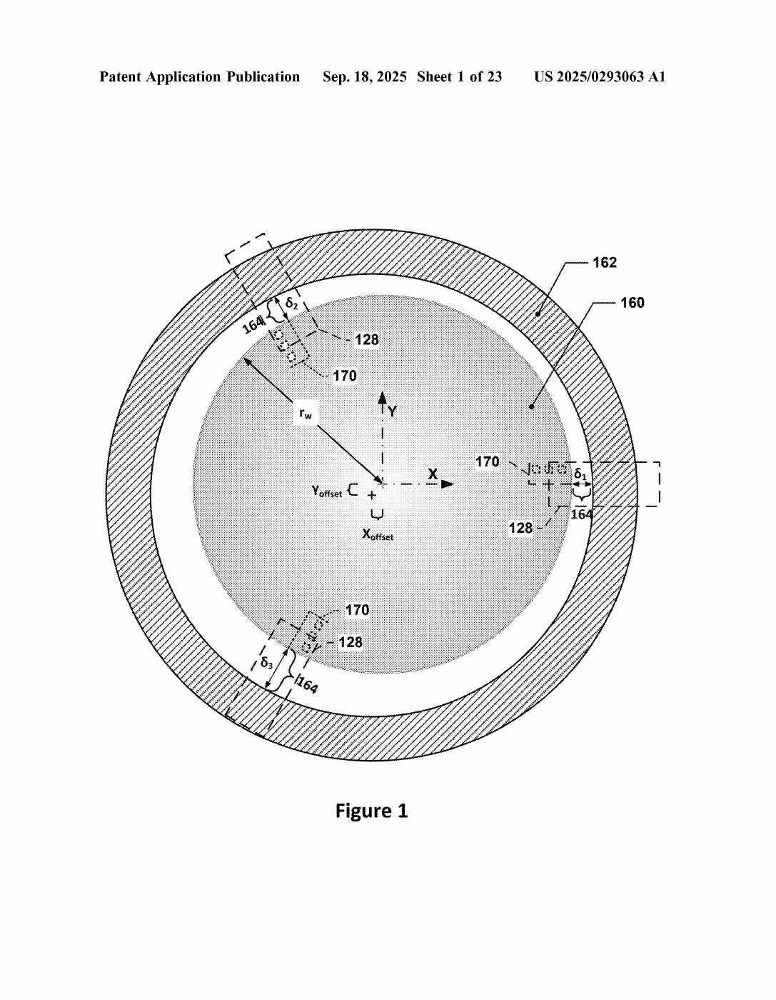
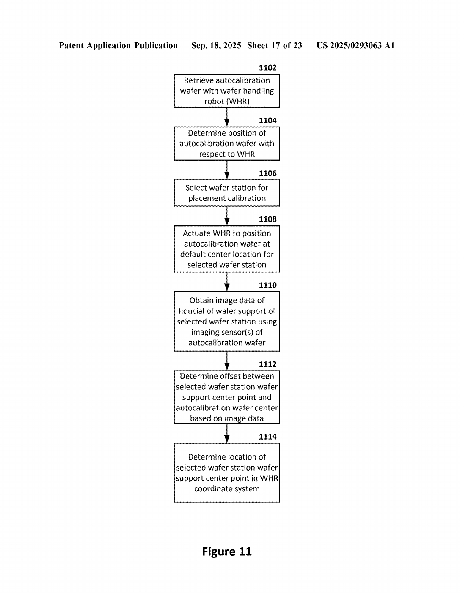
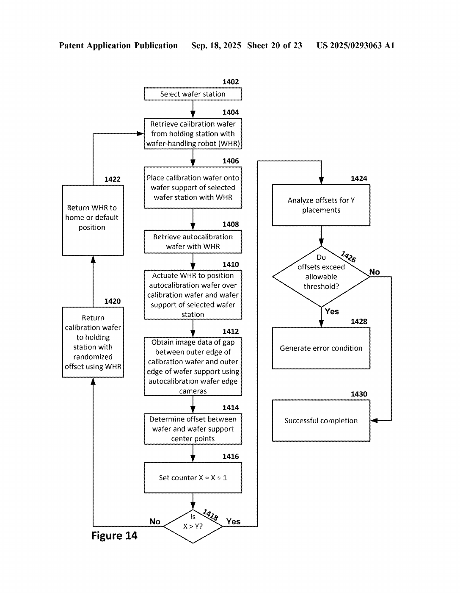

# US20250293063A1 번역: 웨이퍼 이송 로봇의 자동 티칭과 건강 점검을 위한 통합 적응형 위치 결정 시스템과 루틴

- 원제: Integrated adaptive positioning systems and routines for automated wafer-handling robot teach and health check
- 원문: 같은 폴더의 `US20250293063A1.pdf` (공개 공보, 47쪽, 도면 23장, 청구항 20)
- 번역 범위: 전문 (서지, 초록, 관련 출원, 배경, 요약, 도면의 간단한 설명, 상세한 설명 전체, 청구항 1~20). 인용 문헌 목록은 옮기지 않았다(공보 1쪽, Google Patents 페이지에 원문 그대로 있다).
- 번역 원본 텍스트: 공보 PDF는 USPTO 공식 내려받기(image-ppubs.uspto.gov)에서 받았다. 이 PDF는 쪽 전체가 이미지라 `pdftotext -layout`으로 글자가 나오지 않는다(0줄). 그래서 같은 공보의 Google Patents 공개 본문(https://patents.google.com/patent/US20250293063A1/en, 2026-11-04 확인)을 번역했다. 도면은 PDF에서 이미지로 뽑았다.
- 도면 번호(160, 222, 852a 등)와 블록 번호(902, 1102 등)는 원문 부호를 그대로 둔다.
- 약어: AWC는 능동 웨이퍼 센터링(active wafer centering), ESC는 정전 척(electrostatic chuck), WHR은 웨이퍼 이송 로봇(wafer-handling robot), CW는 교정 웨이퍼(calibration wafer), ER은 에지 링(edge ring)이다.
- 번역자 주는 [역주]로 표시한다.
- 번역 2026-11-04.

## 서지

| 항목 | 내용 |
|---|---|
| 공보 | US 2025/0293063 A1 (공개 2025-09-18) |
| 출원 | US 19/225,933, 2025-06-02 출원 |
| 출원인 | Lam Research Corp |
| 발명자 | Hossein Sadeghi, Richard M. Blank, Peter S. Thaulad, Mark E. Emerson, Arulselvam Simon Jeyapalan, Marco Piccigallo |
| 최초 우선일 | 2019-07-26 (미국 가출원 62/879,278) |
| 관련 출원 | US 17/629,752 (2022-01-24 국내 진입, 현 US 12,341,040 B2)의 계속출원. 17/629,752는 PCT/US2020/070300 (2020-07-21 출원)에서 나왔다 |
| 대응 출원 (Google Patents 가족 목록) | CN 202080066598.8 (CN114466728), CN 202510583963.7, JP 2022-505392, JP 2025-060202, KR 10-2022-7006602, TW 109124912, TW 114113147 |
| 분류 (Google Patents 표시 일부) | B25J 9/1692, B25J 11/0095, H01L 21/67259, H01L 21/68707 |
| 상태 | Pending (Google Patents 표시, 2026-11-04) |

[역주] 관련 출원과 대응 출원은 Google Patents 페이지의 가족 정보로 확인했다. 부모 특허 US 12,341,040 B2의 청구항은 보지 않았다.

## 초록

반도체 처리 장비의 웨이퍼 스테이션에 있는 웨이퍼 지지대에 웨이퍼를 놓을 때 쓰는 여러 종류의 오프셋을 정하고 쓰는 시스템과 기법을 개시한다.
이 기법과 시스템은 자동 보정 웨이퍼(autocalibration wafer)를 쓸 수 있다.
자동 보정 웨이퍼는 여러 센서를 가질 수 있다.
그중에는 가장자리에 놓인 여러 촬상 센서가 있으며, 이 센서로 선택한 웨이퍼 스테이션에 있는 서로 다른 두 구조물의 기준 표식(fiducial)을 찍을 수 있다.

## 관련 출원 자료

이 명세서와 함께 PCT 요청서를 이 출원의 일부로 제출한다.
그 PCT 요청서에 적힌, 이 출원이 이익이나 우선권을 주장하는 각 출원은 그 전체를 모든 목적으로 이 명세서에 참조로 포함한다.

## 배경

반도체 처리 장비는 웨이퍼 이송 로봇으로 반도체 웨이퍼를 여러 웨이퍼 스테이션 사이로 옮긴다.
웨이퍼 이송 로봇은 보통 칼날이나 주걱 모양의 엔드 이펙터로 웨이퍼를 아래에서 떠서 든다.
웨이퍼는 엔드 이펙터에 단단히 고정되지 않는다.
그래서 엔드 이펙터와 그 위에 놓인 웨이퍼 사이의 상대 위치에는 작은 변동이 자주 생긴다.
반도체 공정은 민감하므로, 로봇으로 웨이퍼를 놓을 때 이 변동을 보정하는 것이 보통이다.
그래야 웨이퍼가 각 처리 스테이션의 원하는 위치(예: 스테이션의 대략 가운데)에 허용 범위 안으로 놓인다.
현대 반도체 처리 장비는 이런 웨이퍼 배치를 돕기 위해 능동 웨이퍼 센터링(AWC) 시스템을 쓴다.

## 요약

이 명세서에서 설명하는 주제의 하나 이상의 구현을 첨부 도면과 아래 설명에 자세히 적는다.
다른 특징, 측면, 장점은 설명, 도면, 청구항에서 드러난다.
아래의 한정하지 않는 구현들도 이 개시의 일부로 본다.
다른 구현은 이 개시 전체와 첨부 도면에서 분명해질 것이다.

일부 구현에서, 반도체 처리 장비용 웨이퍼 이송 로봇의 교정을 돕는 시스템을 제공할 수 있다.
이 시스템은 예를 들어 다음을 갖춘 자동 보정 웨이퍼를 포함할 수 있다.

- 웨이퍼 이송 로봇이 들 수 있는 크기의 기판. 이 기판은 로봇이 들 때 로봇의 엔드 이펙터에 닿도록 된 제1 면을 가진다.
- 기판이 지지하며 기판의 공통점에서 벗어난 위치에 놓인 여러 제1 촬상 센서. 제1 면이 아래를 향할 때 각 제1 촬상 센서는 아래를 보는 시야를 가진다.
- 각 제1 촬상 센서와 통신으로 연결된 제1 제어기.

이 시스템의 일부 구현에서, 제1 촬상 센서들은 공통점 둘레에 원형으로 배열될 수 있다.

일부 구현에서, 기판은 명목상 원형이고 반도체 처리 장비가 처리하도록 된 반도체 웨이퍼와 같은 지름을 가질 수 있다.

일부 구현에서, 기판은 명목상 원형이고 반도체 처리 장비가 쓰도록 된 에지 링과 같은 지름을 가질 수 있다.

일부 구현에서, 기판은 명목상 원형이고 반도체 처리 장비가 쓰도록 된 에지 링의 바깥 지름과 안쪽 지름 사이의 지름을 가질 수 있다.

일부 구현에서, 기판은 명목상 원형이고 그 지름은 반도체 처리 장비가 쓰도록 된 에지 링의 바깥 지름과 안쪽 지름 평균의 ±10% 안에 있을 수 있다.

일부 구현에서, 기판은 명목상 원형 원판이고 지름은 200 mm, 300 mm, 450 mm 중에서 고를 수 있다.

일부 구현에서, 자동 보정 웨이퍼는 적어도 제1 제어기와 제1 촬상 센서에 전원을 주는 전원을 더 포함할 수 있다.

일부 구현에서, 전원은 충전식 전지일 수 있다. 자동 보정 웨이퍼는 전자기장과 맞닿을 때 충전식 전지를 충전하는 무선 충전 기능을 더 포함할 수 있다.

일부 구현에서, 자동 보정 웨이퍼는 제1 무선 통신 인터페이스를 더 포함할 수 있다. 제1 무선 통신 인터페이스는 제1 제어기와 통신으로 연결될 수 있다.

일부 구현에서, 제1 무선 통신 인터페이스는 블루투스 송수신기나 WiFi 송수신기 같은 하나 이상의 무선 통신 인터페이스를 포함할 수 있다.

일부 구현에서, 자동 보정 웨이퍼는 하나 이상의 방향 센서를 더 포함할 수 있다. 방향 센서는 제1 제어기와 통신으로 연결될 수 있다.

일부 구현에서, 각 방향 센서는 경사계나 가속도계일 수 있다.

일부 구현에서, 자동 보정 웨이퍼는 하나 이상의 진동 센서를 더 포함할 수 있다. 진동 센서는 제1 제어기와 통신으로 연결될 수 있다.

일부 구현에서, 각 진동 센서는 가속도계, 레이저 마이크, 광학 거리 측정 센서일 수 있다.

일부 구현에서, 자동 보정 웨이퍼는 하나 이상의 근접 센서를 더 포함할 수 있다. 각 근접 센서는 제1 면이 아래를 향할 때 제1 면과 그 근접 센서 아래에 있는 물체 사이 거리를 잰다. 근접 센서는 제1 제어기와 통신으로 연결될 수 있다.

일부 구현에서, 각 근접 센서는 광학 근접 센서, 유도형 근접 센서, 정전 용량형 근접 센서일 수 있다.

일부 구현에서, 다음을 모두 갖출 수 있다.

- 제1 촬상 센서들은 공통점 둘레에 원형으로 배열된다.
- 기판은 명목상 원형이고 장비가 처리하는 웨이퍼와 지름이 같다.
- 기판은 지름 200 mm, 300 mm, 450 mm 중 하나인 명목상 원형 원판이다.
- 자동 보정 웨이퍼는 다음을 더 포함한다. 적어도 제1 제어기와 제1 촬상 센서에 전원을 주는 충전식 전지, 전자기장과 맞닿을 때 전지를 충전하는 무선 충전 기능, 제1 제어기와 연결되며 블루투스나 WiFi 송수신기 같은 인터페이스를 포함하는 제1 무선 통신 인터페이스, 제1 제어기와 연결된 하나 이상의 진동 센서, 하나 이상의 근접 센서. 각 근접 센서는 제1 제어기와 연결되고, 제1 면이 아래를 향할 때 제1 면과 그 아래 물체 사이 거리를 잰다.

일부 구현에서, 시스템은 반도체 처리 장비를 더 포함할 수 있다.
장비는 웨이퍼 이송 로봇, 하나 이상의 웨이퍼 스테이션, 제2 제어기를 포함할 수 있다.
이 구현에서 각 웨이퍼 스테이션은 하나 이상의 웨이퍼 지지대를 가질 수 있다.
웨이퍼 이송 로봇과 제2 제어기는 통신으로 연결될 수 있다.
제2 제어기와 제1 제어기는 함께 다음을 하도록 구성될 수 있다.

- a) 하나 이상의 웨이퍼 스테이션 중 제1 웨이퍼 스테이션의 웨이퍼 지지대 가운데 제1 웨이퍼 지지대를 고른다.
- b) 웨이퍼 이송 로봇이 자동 보정 웨이퍼를 제1 웨이퍼 스테이션 위에 놓게 한다.
- c) 자동 보정 웨이퍼가 제1 웨이퍼 지지대 위에 있는 동안, 각 제1 촬상 센서가 제1 웨이퍼 지지대의 기준 표식의 제1 영상을 얻게 한다.

일부 구현에서, 두 제어기는 함께 제1 영상들을 바탕으로 제1 웨이퍼 지지대 중심점의 위치 정보를 정하도록 더 구성될 수 있다.

일부 구현에서, 두 제어기는 함께 다음을 하도록 더 구성될 수 있다.

- d) 웨이퍼 이송 로봇이 교정 웨이퍼를 가져오게 한다.
- e) 수직축을 따라 볼 때 교정 웨이퍼의 중심점이 제1 웨이퍼 지지대 중심점에 명목상 맞도록, 로봇이 교정 웨이퍼를 제1 웨이퍼 지지대로 옮기게 한다.

일부 구현에서, 두 제어기는 함께 다음을 하도록 더 구성될 수 있다.

- f) 로봇이 자동 보정 웨이퍼를 제1 웨이퍼 지지대와 교정 웨이퍼 위에 놓게 한다.
- g) 자동 보정 웨이퍼가 그 위에 있는 동안, 각 제1 촬상 센서가 제1 웨이퍼 지지대의 기준 표식과 교정 웨이퍼의 기준 표식을 담은 제2 영상을 얻게 한다.
- h) 제2 영상에서 두 기준 표식 사이 간극 크기를 바탕으로, 교정 웨이퍼 중심점과 제1 웨이퍼 지지대 중심점 사이의 웨이퍼/웨이퍼 지지대 수평 오프셋을 정한다.

일부 구현에서, 두 제어기는 함께 다음을 하도록 더 구성될 수 있다.

- i) 웨이퍼/웨이퍼 지지대 수평 오프셋을 그 임계값과 비교한다.
- j) 오프셋이 임계값보다 크다고 판단하면, 로봇이 교정 웨이퍼를 제1 웨이퍼 지지대에 대해 다시 놓아 오프셋을 줄이게 한다.

일부 구현에서, 두 제어기는 함께 (f)부터 (j)까지를 N번 반복하거나, 오프셋이 임계값 이하가 될 때까지 반복하도록 더 구성될 수 있다. 둘 중 먼저 오는 쪽에서 멈춘다.

일부 구현에서, 두 제어기는 함께 다음을 하도록 더 구성될 수 있다.

- d) 로봇이 제1 에지 링을 가져오게 한다.
- e) 수직축을 따라 볼 때 제1 에지 링 중심점이 제1 웨이퍼 지지대 중심점에 명목상 맞도록, 로봇이 제1 에지 링을 제1 웨이퍼 지지대로 옮기게 한다.

일부 구현에서, 두 제어기는 함께 다음을 하도록 더 구성될 수 있다.

- f) 로봇이 자동 보정 웨이퍼를 제1 웨이퍼 지지대와 제1 에지 링 위에 놓게 한다.
- g) 그 위에 있는 동안, 각 제1 촬상 센서가 제1 웨이퍼 지지대의 기준 표식과 제1 에지 링의 기준 표식을 담은 제2 영상을 얻게 한다.
- h) 제2 영상에서 두 기준 표식 사이 간극 크기를 바탕으로, 제1 에지 링 중심점과 제1 웨이퍼 지지대 중심점 사이의 에지 링/웨이퍼 지지대 수평 오프셋을 정한다.

일부 구현에서, 두 제어기는 함께 다음을 하도록 더 구성될 수 있다.

- i) 에지 링/웨이퍼 지지대 수평 오프셋을 그 임계값과 비교한다.
- j) 임계값보다 크면, 로봇이 제1 에지 링을 제1 웨이퍼 지지대에 대해 다시 놓아 오프셋을 줄이게 한다.

일부 구현에서, 두 제어기는 함께 (f)부터 (j)까지를 N번 반복하거나 오프셋이 임계값 이하가 될 때까지 반복하도록 더 구성될 수 있다. 둘 중 먼저 오는 쪽에서 멈춘다.

일부 구현에서, 두 제어기는 함께 다음을 하도록 더 구성될 수 있다.

- f) 로봇이 교정 웨이퍼를 가져오게 한다.
- g) 수직축을 따라 볼 때 교정 웨이퍼 중심점이 제1 에지 링 중심점에 명목상 맞도록, 로봇이 교정 웨이퍼를 제1 웨이퍼 지지대로 옮기게 한다.

일부 구현에서, 두 제어기는 함께 다음을 하도록 더 구성될 수 있다.

- h) 로봇이 자동 보정 웨이퍼를 제1 웨이퍼 지지대, 제1 에지 링, 교정 웨이퍼 위에 놓게 한다.
- i) 그 위에 있는 동안, 각 제1 촬상 센서가 교정 웨이퍼의 기준 표식과 제1 에지 링의 기준 표식을 담은 제2 영상을 얻게 한다.
- j) 제2 영상에서 두 기준 표식 사이 간극 크기를 바탕으로, 제1 에지 링 중심점과 교정 웨이퍼 중심점 사이의 에지 링/웨이퍼 수평 오프셋을 정한다.

일부 구현에서, 두 제어기는 함께 다음을 하도록 더 구성될 수 있다.

- k) 에지 링/웨이퍼 수평 오프셋을 그 임계값과 비교한다.
- l) 임계값보다 크면, 로봇이 교정 웨이퍼를 제1 에지 링에 대해 다시 놓아 오프셋을 줄이게 한다.

일부 구현에서, 두 제어기는 함께 (h)부터 (l)까지를 M번 반복하거나 오프셋이 임계값 이하가 될 때까지 반복하도록 더 구성될 수 있다. 둘 중 먼저 오는 쪽에서 멈춘다.

일부 구현에서, 두 제어기는 함께 다음을 하도록 더 구성될 수 있다.
로봇이 자동 보정 웨이퍼를 제1 웨이퍼 지지대, 제1 에지 링, 교정 웨이퍼 위에 다시 놓게 한다.
그 위에 있는 동안 각 제1 촬상 센서가 교정 웨이퍼의 기준 표식과 제1 웨이퍼 지지대의 기준 표식을 담은 제3 영상을 얻게 한다.
제3 영상에서 두 기준 표식 사이 간극 크기를 바탕으로, 제1 웨이퍼 지지대 중심점과 교정 웨이퍼 중심점 사이의 웨이퍼 지지대/웨이퍼 수평 오프셋을 정한다.

일부 구현에서, 두 제어기는 함께 다음을 하도록 더 구성될 수 있다.
웨이퍼 지지대/웨이퍼 수평 오프셋을 그 임계값과 비교한다.
임계값보다 크면, 로봇이 교정 웨이퍼와 에지 링 중 적어도 하나를 제1 웨이퍼 지지대에 대해 다시 놓게 한다.

일부 구현에서, 반도체 처리 장비는 반도체 처리 챔버를 포함할 수 있다. 제1 웨이퍼 스테이션은 그 챔버 안에 있고, 제1 웨이퍼 지지대는 챔버 안의 받침대(pedestal)를 포함할 수 있다.

일부 구현에서, 장비는 서로 다른 압력 환경 사이로 웨이퍼를 옮기는 로드락을 포함할 수 있다. 제1 웨이퍼 스테이션은 로드락 안에 있고, 제1 웨이퍼 지지대는 로드락 안의 구조물일 수 있다.

일부 구현에서, 장비는 처리 전, 후, 처리 사이에 웨이퍼를 보관하는 버퍼를 포함할 수 있다. 제1 웨이퍼 스테이션은 버퍼 안에 있고, 제1 웨이퍼 지지대는 버퍼 안의 여러 웨이퍼 받침 선반 중 하나일 수 있다.

일부 구현에서, 장비는 서로 다른 압력 환경 사이로 웨이퍼를 옮기는 로드락을 포함할 수 있다. 제1 웨이퍼 스테이션은 로드락 안에 있고, 제1 웨이퍼 지지대는 로드락 안의 구조물일 수 있다.

[역주] 위 단락은 원문에서 두 번 반복된다. 원문 그대로 두었다.

일부 구현에서, 시스템은 반도체 처리 장비를 더 포함할 수 있다.
장비는 웨이퍼 이송 로봇, 하나 이상의 웨이퍼 스테이션, 제2 제어기를 포함할 수 있다.
각 웨이퍼 스테이션은 하나 이상의 웨이퍼 지지대를 가지며, 로봇과 제2 제어기는 통신으로 연결될 수 있다.
두 제어기는 함께 다음을 하도록 구성될 수 있다.

- a) 제1 웨이퍼 스테이션의 제1 웨이퍼 지지대를 고른다.
- b) 로봇이 자동 보정 웨이퍼를 제1 웨이퍼 스테이션으로 옮기게 한다.
- c) 하나 이상의 방향 센서가 기판의 기울기 측정값을 얻게 한다.

일부 구현에서, 제2 제어기는 (b)를 하기 전에 제1 웨이퍼 지지대에서 에지 링을 치우도록 구성될 수 있다.

일부 구현에서, 시스템은 반도체 처리 장비를 더 포함할 수 있다.
장비는 웨이퍼 이송 로봇, 하나 이상의 웨이퍼 스테이션, 제2 제어기를 포함할 수 있다.
각 웨이퍼 스테이션은 하나 이상의 웨이퍼 지지대를 가지며, 로봇과 제2 제어기는 통신으로 연결될 수 있다.
두 제어기는 함께 다음을 하도록 구성될 수 있다.

- a) 제1 웨이퍼 스테이션의 제1 웨이퍼 지지대를 고른다.
- b) 제1 웨이퍼 지지대의 여러 리프트 핀과 제1 웨이퍼 지지대 사이에 상대 이동이 일어나 리프트 핀이 지지대 위로 나오게 한다.
- c) 로봇이 자동 보정 웨이퍼를 리프트 핀 위로 옮기게 한다.
- d) 자동 보정 웨이퍼가 리프트 핀에 얹힌 동안, 리프트 핀과 지지대 사이에 상대 이동이 더 일어나게 한다.
- e) (d) 동안 하나 이상의 진동 센서에서 진동 자료를 얻는다.
- f) 진동 자료가 정해진 임계값을 넘는 진동을 나타내는지 평가한다.
- g) 진동 자료가 임계값을 넘으면 알림을 준다.

일부 구현에서, 제2 제어기는 (d)의 일부로, 리프트 핀이 더는 지지대 위로 나오지 않고 자동 보정 웨이퍼가 지지대 윗면에 얹히도록 상대 이동을 일으키게 구성될 수 있다.

일부 구현에서, 시스템은 반도체 처리 장비를 포함할 수 있다.
장비는 웨이퍼 이송 로봇, 하나 이상의 웨이퍼 스테이션, 제2 제어기를 포함할 수 있다.
로봇과 제2 제어기는 통신으로 연결될 수 있다.
두 제어기는 함께 다음을 하도록 구성될 수 있다.

- a) 제1 웨이퍼 지지대에 에지 링이 얹혀 있다는 표시를 적어도 일부 근거로, 제1 웨이퍼 스테이션의 제1 웨이퍼 지지대를 고른다.
- b) 자동 보정 웨이퍼를 에지 링 위에 놓게 한다.
- c) 각 근접 센서가 제1 웨이퍼 지지대와 자동 보정 웨이퍼 사이 거리를 재게 한다.
- d) 하나 이상의 거리를 바탕으로 에지 링과 관련된 하나 이상의 높이 측정값을 정한다.
- e) 높이 측정값을 평가해 에지 링 높이가 정해진 임계값을 넘는지 정한다.
- f) 에지 링 높이가 임계값을 넘으면 알림을 준다.

## 도면의 간단한 설명

여기 개시한 여러 구현은 첨부 도면의 그림으로 예를 들어 보이며, 한정하려는 것이 아니다. 같은 참조 번호는 비슷한 요소를 가리킨다.

- 도 1: 에지 링에 대해 놓인 교정 웨이퍼의 예.
- 도 2: 자동 보정 웨이퍼 예의 개략도.
- 도 3: 리프트 핀이 있는 웨이퍼 지지대의 도해.
- 도 4: 에지 링 높이를 정하는 데 쓸 수 있는 근접 센서 한 묶음을 가진 자동 보정 웨이퍼의 옆모습.
- 도 5: 근접 센서 두 묶음을 가진 다른 자동 보정 웨이퍼의 옆모습. 각 묶음은 지름이 다른 원 위에 있다.
- 도 6: 자동 보정 웨이퍼 예의 사진.
- 도 7: 다른 자동 보정 웨이퍼 예의 평면도.
- 도 8a~8i: 여러 동작 단계에서 반도체 처리 장비의 개략도.
- 도 9: 자동 보정 웨이퍼로 웨이퍼 스테이션에 있는 구조물의 기준점 위치를 정하는 기법의 흐름도.
- 도 10: 자동 보정 웨이퍼로 웨이퍼 스테이션에 있는 두 구조물의 상대 위치를 정하는 기법의 흐름도.
- 도 11: 자동 보정 웨이퍼로 웨이퍼 지지대 중심점의 위치를 정하는 기법의 흐름도.
- 도 12: 웨이퍼 지지대 위 에지 링 배치를 교정하는 기법의 흐름도.
- 도 13: 웨이퍼 지지대 위 에지 링에 대해 웨이퍼 배치를 교정하는 기법의 흐름도.
- 도 14: 웨이퍼 배치의 반복 정밀도를 검증하는 기법의 흐름도.
- 도 15: 에지 링 높이를 평가하는 기법의 흐름도.
- 도 16: 리프트 핀 진동을 평가하는 기법의 흐름도.
- 도 17: 받침대 수평을 평가하는 기법의 흐름도.

여기 도면은 대체로 축척대로 그리지 않았다. 다만 아래에서 다루는 것처럼 도면의 일부 측면은 축척대로 그렸을 수 있다.

## 상세한 설명

### 기존 티칭과 AWC

일반적인 반도체 처리 시스템에서, 여러 반도체 공정이나 웨이퍼 이송 작업을 준비하며 웨이퍼를 정확히 놓는 일은 수동이나 반자동 티칭으로 이룬다.
이 티칭에는 보통 기술자나 사람의 감독이 필요하며, 목적은 다음 세 가지다.

1. 웨이퍼 이송 로봇에게 반도체 웨이퍼, 에지 링, 웨이퍼 지지대(예: 정전 척, ESC)의 원하는 위치를 서로에 대해, 또는 로봇 엔드 이펙터에 대해 "가르친다".
2. 능동 웨이퍼 센터링(AWC) 시스템을 "가르친다".
3. 웨이퍼 배치의 반복 정밀도를 검증한다.

로봇이 이런 위치를 배우고 나면, 어떤 웨이퍼든 그 위치에서 벗어나는 배치 편차는 AWC로 보정해 없앨 수 있다.
이런 편차는 예를 들어 웨이퍼를 엔드 이펙터로 옮기는 동안 웨이퍼와 엔드 이펙터 사이에 생기는 작은 어긋남에서 온다.
수동이나 반자동 티칭은 시간이 많이 들고 하기 번거롭다.

이런 티칭은 보통 장비 운전 중 웨이퍼를 집거나 놓을 여러 위치를 로봇에게 훈련시키는 것으로 시작한다.
로봇은 처음부터 장비 안 각 위치를 대략 알도록 설정될 수 있다.
그래도 로봇은 설치된 장비의 고유한 특성(예: 조립 공차나 부품 공차의 차이)에 맞추려면 어느 정도 맞춤이 필요하다.
이를 위해 로봇을 티칭 모드에 둘 수 있다.
티칭 모드에서는 "가르칠" 위치마다, 그 위치의 "이상적" 조건에서 로봇이 취할 자세나 구성으로 로봇을 이끈다.
예를 들어 이상적 자세는, 웨이퍼 중심이 엔드 이펙터의 기준점에서 알려진 거리(대체로 줄이거나 0으로 만드는 것이 좋다) 안에 있고, 동시에 그 위치의 웨이퍼 지지대 중심에서도 알려진 거리(역시 줄이거나 0으로 만드는 것이 좋다) 안에 있을 때의 로봇 자세다.

일반적인 로봇 훈련에서 각 위치의 "이상적" 자세는, 예를 들어 하나 이상의 고정구(fixture)나 다른 구조물로 이룰 수 있다.
고정구는 엔드 이펙터에서 기준점 역할을 하는 특징과, 목표 위치에 대해 고정된 다른 특징에 맞물린다.
예를 들어 어떤 티칭에서는 웨이퍼와 지름이 비슷한 원판 모양 고정구를 엔드 이펙터에 핀으로 고정한다.
축이나 핀이 원판 가운데와 엔드 이펙터의 기준 특징(예: 구멍)을 함께 꿰뚫는다.
이 구멍은 로봇이 엔드 이펙터로 웨이퍼를 들 때 웨이퍼가 가운데 놓이기로 한 자리에 중심이 맞춰져 있다.
웨이퍼 지지대의 특징에도 비슷한 핀을 꽂을 수 있다.
엔드 이펙터와 원판을 이 핀 쪽으로 밀면 핀이 원판 가장자리에 닿아, 원판과 엔드 이펙터가 특정 자세(예: 가운데 맞춘 자세)로 이끌린다.
이렇게 움직이는 동안 로봇은 전원이 끊긴 상태에 둘 수 있다. 그러면 작업자가 손으로 로봇의 관절과 팔 마디를 쉽게 움직일 수 있다.
로봇이 제자리에 오면, 로봇 제어기는 여러 연결 마디의 위치를 잰다.
예를 들어 로봇 회전 관절들의 상대 또는 절대 각 변위를 재서, 원하는 자세일 때 로봇의 운동학적 상태를 정한다.
로봇이 이 위치 정보를 얻어 그 위치와 짝지으면, 그 위치를 로봇에게 가르친 것으로 본다.

로봇이 웨이퍼를 놓을(또는 가져올) 여러 위치를 배우고 나면, 이후 그 위치와 관련된 이송 작업에서 로봇은 그 위치에 대해 배운 운동학적 상태로 들어가도록 제어된다.
엔드 이펙터 위 웨이퍼가 엔드 이펙터 기준점에 정확히 가운데 놓였다면, 로봇이 배운 상태로 돌아가 웨이퍼를 놓을 때 웨이퍼도 목적지에 충분히 가운데 놓인다.
그러나 여러 이유로 엔드 이펙터 위 웨이퍼가 기준점에 정확히 가운데 놓이지 않을 수 있다.
이런 어긋남은 수십 마이크로미터 정도로 작아 보일 수 있다.
그래도 이렇게 작은 어긋남조차 웨이퍼 공정에 해로울 수 있다.
엔드 이펙터와 웨이퍼의 어긋남을 보정하려고 능동 웨이퍼 센터링(AWC) 시스템을 쓰는 것이 업계에서 흔해졌다.

일반적인 AWC 구성에서는 광학 AWC 센서와 광선 발광기를 반도체 처리 챔버 밖 고정 위치에 둔다.
로봇이 웨이퍼를 챔버 안으로 넣을 때 웨이퍼는 발광기가 쏘는 광선 둘 이상을 지나간다.
AWC 센서는 각 광선이 웨이퍼 가장자리를 만나는 순간을 감지한다(광센서로 향한 광선이 가려지거나 다시 이어지는 것으로 알 수 있다).
웨이퍼 가장자리가 AWC 광센서 하나를 건드리는 순간마다, AWC 시스템은 로봇의 센서에서 엔드 이펙터 위 기준점의 좌표를 얻는다.
이 기준점은 예를 들어 웨이퍼의 명목 중심이다(웨이퍼가 엔드 이펙터에 놓인 정확한 위치를 모를 수 있으므로, 이것은 추정이나 바라는 중심일 뿐이다).
원형 웨이퍼와 AWC 광선 센서 둘 이상이 있으면, 이렇게 얻은 좌표 넷 이상으로 챔버에 대한 웨이퍼 중심점 위치를 충분히 정할 수 있다(좌표 셋만으로도 된다).
AWC 센서와 로봇 바탕은 둘 다 챔버에 고정되어 있다.
이렇게 웨이퍼 중심 정보를 얻으면, 이후 웨이퍼 배치의 기준 위치로 쓰거나, 보정이 필요할 수 있는 현재 웨이퍼 위치의 측정값으로 쓸 수 있다.

예를 들어 AWC 시스템을 훈련하려면, 어떤 기준 웨이퍼를 원하는 목적지(예: 처리 챔버의 받침대)에 손으로 가운데 맞출 수 있다.
이 수동 센터링은 예를 들어 기준 웨이퍼를 받침대에 대해 바르게 가운데로 이끄는 고정구나 지그로 할 수 있다.
기준 웨이퍼가 받침대에 충분히 가운데 놓였다고 보면, 로봇이 기준 웨이퍼를 집어 챔버 밖으로 꺼내도록 제어한다.
기준 웨이퍼를 꺼내는 동안 AWC 시스템으로 기준 웨이퍼 중심을 재고 정한다.
이 정보에, 받침대 중심 위치에서 AWC가 정한 중심 위치로 옮기는 동안 기준 웨이퍼가 겪은 변위를 담은 로봇 정보를 더하면, 이후 웨이퍼 배치를 조정해 비슷한 웨이퍼와 받침대의 중심 맞춤을 이룰 수 있다.
예를 들어 새 웨이퍼를 로봇에 얹고 기준 웨이퍼와 같은 방식으로 AWC 센서를 지나게 하면, 새 웨이퍼 중심이 앞서 정한 기준 웨이퍼 중심에서 X 방향 0.5 mm, Y 방향 0.25 mm만큼 벗어나 있음을 알 수 있다.
이 변동을 보정하려면, 새 웨이퍼를 받침대에 놓을 때 보정 변위를 더하도록 로봇을 제어한다.
예를 들어 기준 웨이퍼를 받침대에서 AWC 센서까지 옮긴 변위의 역을 새 웨이퍼에 적용하는 동안이나 그 전후에, X 방향 −0.5 mm, Y 방향 −0.25 mm를 더 움직인다.

AWC 시스템을 쓰는 비슷한 기법으로 웨이퍼 지지대 위 에지 링 배치도 조정할 수 있다.
예를 들어 에지 링이 AWC 광선을 지날 때 AWC로 에지 링 중심점을 정하고, 그 중심점과 기준 위치(예: AWC 시스템이 웨이퍼나 에지 링의 "이상적" 중심 배치로 쓰는 위치) 사이 오프셋을 정할 수 있다.
AWC를 에지 링 배치에 쓰는 구현에서는 웨이퍼보다 가장자리와 광선의 교차가 많을 수 있다.
에지 링은 안쪽 가장자리와 바깥 가장자리를 함께 가지기 때문이다.
그래서 웨이퍼가 지날 때는 각 광센서가 교차 2번을 감지하지만, 에지 링이 지날 때는 4번을 감지할 수 있다.
이런 구현에서는 일부 교차(예: 광선과 에지 링 바깥 가장자리의 교차)에서 나온 자료를 버리고, 나머지 교차(예: 광선과 에지 링 안쪽 가장자리의 교차)로 에지 링 중심을 정할 수 있다.
AWC가 에지 링이 엔드 이펙터 위 원하는 배치에서 얼마나 벗어났는지 평가할 때 쓰는 기준점은, 일부 구현에서 웨이퍼 AWC 보정에 쓰는 기준점과 같을 수 있다. 즉 AWC로 웨이퍼를 재서 정한 기준점이다.
다른 구현에서는 에지 링 AWC 보정용 기준점을 AWC로 에지 링을 재서 얻을 수 있다. 예를 들어 이후 에지 링 배치를 위한 기준점을 얻으려고 AWC를 에지 링으로 훈련할 수 있다.
여기서 다룬 배치 기법과 AWC 훈련, 보정 기법은 대체로 웨이퍼 배치와 에지 링 배치 모두에 적용할 수 있다.

AWC 시스템은 반도체 업계에서 널리 쓰이며 대체로 좋은 웨이퍼 센터링 성능을 내 왔다.
그러나 훈련 과정은 손이 많이 가고, 시간이 꽤 걸리며, 사용자 실수가 끼기 쉽다.
이 훈련은 장비 첫 설치 때 할 수 있지만, 장비 수명 동안 주기적으로 다시 해야 할 수 있다.
예를 들어 처리 챔버, AWC 센서, 로봇 사이 상대 위치가 바뀌었을 때, 공정 결과에 불균일이 나타나 받침대 위 웨이퍼 배치가 중심에서 흘러갔다고 보일 때, 습식 세정을 포함해 챔버를 정비했을 때 다시 해야 할 수 있다.
로봇이 웨이퍼나 에지 링을 웨이퍼 지지대, 받침대, 다른 장비에 놓는다고 할 때, 여러 구현에서 이는 간접적으로 놓는 것도 암묵적으로 포함한다.
예를 들어 많은 반도체 처리 기계에서는 웨이퍼 지지대 안의 수직으로 움직이는 리프트 핀이 엔드 이펙터에서 웨이퍼를 들어 올린다.
그러면 웨이퍼를 움직이지 않고 엔드 이펙터를 웨이퍼 아래에서 빼낼 수 있다.
그다음 리프트 핀을 내려 웨이퍼를 지지대에 놓는다.
지지대에서 웨이퍼나 다른 구조물을 꺼낼 때는 같은 과정을 거꾸로 한다.
여기서 "웨이퍼 지지대"는 반도체 처리 장비 안에서 웨이퍼를 받치도록 된 여러 구조물(로봇 엔드 이펙터는 제외)을 가리킬 수 있다.
웨이퍼 지지대에는 예를 들어 받침대, ESC, 처리 챔버(또는 다른 챔버) 안의 대체로 둥근 받침판 모양 구조물이 들어간다. 이들은 웨이퍼와 넓게 닿는다(예: 웨이퍼 뒷면과 지지대 윗면이 면으로 닿는다).
또 웨이퍼와 더 제한적으로 닿는 구조물도 들어간다. 예를 들어 웨이퍼 바깥 둘레의 점들에서만 닿는 원호 모양 받침 선반이다.
웨이퍼 지지대는 웨이퍼에 직접 닿는 부품뿐 아니라 웨이퍼 바깥 둘레 밖으로 뻗은 부품이나 부분(예: 받침대나 ESC의 고리 모양 부분)도 포함할 수 있다.
웨이퍼 지지대는 경우에 따라 받친 웨이퍼를 움직일 수 있다(예: 수직 이동, 회전).
웨이퍼 지지대는 위에서 말한 리프트 핀처럼, 지지대의 나머지보다 위로 뻗어 웨이퍼를 들어 올리는 기구를 포함할 수도 있다.
경우에 따라 웨이퍼 지지대는 에지 링 같은 떼어 낼 수 있는 부품을 포함할 수 있다.
예를 들어 어떤 웨이퍼 지지대는 떼어 낼 수 있는 에지 링(장비의 로봇이 떼어 낼 수 있게 설계된 에지 링)과 함께 쓰도록 되어 있다.
이 에지 링은 떼어 낼 수 없는 에지 링(로봇이 떼어 내도록 설계되지 않은 에지 링)과 맞물릴 수 있다.
떼어 낼 수 없는 에지 링도 물론 기술자는 떼어 낼 수 있으며, 이 개시에서는 웨이퍼 지지대의 일부로 본다.

### 자동 보정 시스템과 자동 보정 웨이퍼

이 개시는 자동 보정 시스템(예: 적응형 위치 결정 시스템)을 제안한다.
이 시스템은 AWC 시스템(또는 비슷한 장치)이나 웨이퍼 이송 로봇과 함께 쓰여, 무엇보다 장비의 AWC 시스템과 로봇을 자동으로 가르칠 수 있다.
티칭이 일어나는 챔버는 정상 공정 때처럼 밀폐될 수 있으므로, 이 시스템으로 진공이나 대기압 어느 쪽에서도 로봇을 자동 티칭할 수 있다.
이 시스템은 공정 요구 조건을 맞추도록 부품이나 웨이퍼 배치의 여러 측면을 필요에 따라 평가하고 보정할 수도 있다.
이 시스템은 에지 링 배치를 이끄는 데에도 쓸 수 있다.
에지 링은 명목상 고리 모양 구조물이다. 안쪽 지름은 보통 웨이퍼 바깥 지름보다 아주 조금 크게(경우에 따라 작게) 만든다.
그래서 공정 중 웨이퍼 지름을 사실상 "넓혀" 준다.
에지 링 덕분에, 웨이퍼 위 공정 결과의 균일성을 해칠 수 있는 "가장자리 효과"가 웨이퍼 자체가 아니라 에지 링 바깥 가장자리(웨이퍼 균일성에 거의 영향이 없는 곳)에서 일어난다.

자동 보정 시스템의 중심은 자동 보정 웨이퍼다. 적응형 위치 결정 시스템(APS) 웨이퍼라고도 부를 수 있다.
이 웨이퍼는 여러 탑재 센서로 많은 정보를 모은다. 그래서 완전히 자동화된 티칭 과정의 일부로 쓸 수 있다.
이 웨이퍼는 예를 들어 장비 부품을 진단하는 데 쓸 수 있고, 장비 운전을 조정해 웨이퍼 공정 성능을 높일 정보를 얻는 데에도 쓸 수 있다.

일반적으로 특정 장비용 자동 보정 웨이퍼는 그 장비가 처리하는 웨이퍼나 에지 링과 비슷한 크기와 모양을 가질 수 있다.
그래서 장비의 로봇이 공정 중 웨이퍼를 옮기는 것과 대체로 같은 방식으로 이 웨이퍼를 옮길 수 있다.
따라서 이 웨이퍼의 최대 높이와 지름은, 로봇이 웨이퍼를 옮기는 통로의 가장 작은 수직, 수평 여유보다 작게 만들 수 있다.

위에서 말했듯 자동 보정 웨이퍼는 여러 센서를 가질 수 있다. 다만 센서의 수와 종류는 웨이퍼가 제공하는 기능에 따라 달라진다.
이 개시에 따른 자동 보정 웨이퍼는 여기서 다루는 센서와 기능 가운데 하나, 일부, 또는 전부를 갖추도록 구성될 수 있다.

자동 보정 웨이퍼는 센서 외에도 센서를 제어하고 자료를 얻는 부품, 다른 부품(예: 장비 제어기)과 통신하는 부품, 센서 자료를 저장하거나 처리하는 부품을 가질 수 있다.
따라서 이 웨이퍼를 장비 제어기와 연결하고 장비 안에 넣은 뒤, 웨이퍼의 제어기와 장비의 제어기 가운데 하나나 둘 다의 동작으로, 장비가 수행하는 교정 루틴이나 배치 루틴의 여러 단계에서 여러 감지와 자료 수집을 하게 할 수 있다.
아래에서 자세히 다루는 예에서 보듯, 이런 교정 루틴이나 배치 루틴은 사람의 감독이 거의 또는 전혀 없이 장비가 수행할 수 있다.

일반적으로 자동 보정 웨이퍼의 기판은 반도체 웨이퍼와 비슷한 전체 모양(예: 대체로 원형)을 가질 수 있다.
다만 경우에 따라 다른 모양일 수 있다.
예를 들어 센서나 다른 부품을 받치지 않거나, 엔드 이펙터의 접촉 패드나 받침대의 리프트 핀에 닿지 않는 기판 부분은 없앨 수 있다. 그러면 웨이퍼에 구멍이나 홈이 생길 수 있다.
또 일부 구현에서는 명목상 원형인 바깥 가장자리를 따라 반도 모양이나 다른 돌출부를 둘 수 있다. 예를 들어 해당 웨이퍼의 명목 바깥 지름 밖 위치에 센서를 받치기 위해서다.
자동 보정 웨이퍼는 방향을 알 수 있도록 바깥 경계를 따라 하나 이상의 색인 특징(예: 평평한 가장자리, 노치)을 가질 수도 있다.
여기서 자동 보정 웨이퍼의 "중심"은, 웨이퍼나 에지 링을 보통 옮기거나 놓는 방식과 비슷하게 자동 보정 웨이퍼를 장비 안에서 옮기거나 놓을 때, 웨이퍼나 에지 링의 중심이 오는 자리와 같은 자리에 놓이기로 한 자동 보정 웨이퍼의 점을 말한다.
자동 보정 웨이퍼의 중심은 기판의 기하 중심이나 웨이퍼의 질량 중심과 겹칠 수 있지만, 그것이 필요조건은 아니다.

대부분의 구현에서 자동 보정 웨이퍼는 아래를 보는 촬상 센서 여럿(예: CCD 센서, CMOS 센서)을 웨이퍼 중심에서 반지름 방향으로 떨어진 여러 위치에 가질 수 있다.
이 거리는 예를 들어 자동 보정 웨이퍼가 장비의 웨이퍼 지지대 위에 놓인 웨이퍼 위에 있을 때, 각 촬상 센서의 시야가 웨이퍼 가장자리 일부와 웨이퍼 지지대 일부를 함께 담을 만큼 넓도록 고를 수 있다.
장비가 공정 중 보통 에지 링을 쓴다면, 촬상 센서 시야가 (지지대에 놓인) 에지 링 일부도 담을 만큼 넓도록 센서를 중심에서 떨어뜨릴 수 있다.
일부 구현에서는 아래를 보는 촬상 센서를, 장비가 처리하는 웨이퍼와 명목상 같은 크기(예: ±10%나 ±20% 안)의 지름을 가진 원 위에 둘 수 있다.
또 다른 구현에서는, 장비가 처리하는 웨이퍼의 지름과 장비가 쓰는 에지 링의 지름 사이 지름을 가진 원 위에 둘 수 있다.
일부 구현에서는, 에지 링의 명목 바깥 지름과 에지 링의 명목 안쪽 지름(또는 웨이퍼의 명목 바깥 지름)의 평균이거나 그 평균의 예컨대 ±10% 안인 지름 위에 둘 수 있다.
이렇게 두면, 자동 보정 웨이퍼가 대체로 웨이퍼 지지대 위 가운데에 있을 때(그리고 웨이퍼나 에지 링이 지지대 가운데 있을 때), 아래를 보는 촬상 센서가 지지대 바깥 가장자리(또는 지지대 위 특징, 예: ESC의 가장자리), 에지 링의 바깥이나 안쪽 가장자리, 웨이퍼 바깥 가장자리를 시야 안에 동시에 담을 수 있다.

이런 촬상 센서 배치 덕분에 자동 보정 웨이퍼는 웨이퍼 지지대와, 그 위에 놓인 웨이퍼나 에지 링에 관련된 여러 기준 표식의 영상을 동시에 얻을 수 있다.
여기서 기준 표식(fiducial)은 특정 구조물에 대해 대체로 고정되어 있다고 가정하는 특징을 말한다.
예를 들어 부품의 원형 가장자리는 그 구조물 중심점의 기준 표식이 될 수 있다.
이런 기준 표식은 시간이 지나며 웨이퍼 공정에서 생기는 침식이나 증착 때문에 크기나 모양이 바뀔 수 있다. 이 개시에서는 이런 점진적 변화가 기준 표식의 "고정" 성질을 바꾼다고 보지 않는다.
여기서 다루는 예에서 쓰는 기준 표식은 다음과 같은 특징이다.
웨이퍼 바깥 가장자리, 에지 링의 바깥이나 안쪽 가장자리, 웨이퍼 지지대 바깥 가장자리나 지지대 위 특징의 가장자리, 웨이퍼 지지대의 면 불연속(예: 지지대 윗면에 둥근 돌출부가 있고 그 둘레를 아래로 꺼진 고리 면이 둘러쌀 때, 돌출부와 고리 면 사이 경계), 그 밖에 여기서 다루는 기법에 알맞은 특징.

### 간극으로 중심 오프셋 정하기

웨이퍼, 에지 링, 다른 구조물에 대해 얻은 기준 표식 영상을 분석해, 그 기준 표식에 관련된 두 구조물의 기준점 사이 오프셋(하나 또는 여럿)을 정할 수 있다.
예를 들어 기준 표식이 웨이퍼의 바깥 원 가장자리와 그 웨이퍼를 둘러싼 에지 링의 안쪽 원 가장자리라면, 각 영상에서 웨이퍼 바깥 가장자리와 에지 링 안쪽 가장자리 사이 반지름 방향 간극의 상대 크기를 정한다.
이것으로 웨이퍼 중심이 에지 링 중심에서 얼마나 벗어났는지 추정할 수 있다.
일반적으로 이 판단에는 적어도 촬상 센서 셋의 영상이 있어야 한다.
촬상 센서 둘의 영상으로도 비슷한 기법을 쓸 수 있지만, 기준 표식의 상대 크기에 대한 가정이 필요해 대체로 덜 정확하다.

경우에 따라 어떤 기준 표식은 늘 보이지 않을 수 있다. 그러면 중간 기준 표식이 필요할 수 있다.
예를 들어 웨이퍼를 웨이퍼보다 바깥 지름이 작은 ESC 가운데 놓아야 하고, ESC 바깥 가장자리를 배치의 기준 표식으로 삼는다고 하자.
이때는 ESC 바깥 가장자리와 웨이퍼 바깥 가장자리가 동시에 보이는 영상을 자동 보정 웨이퍼의 촬상 센서로 얻을 수 없다.
그래서 두 가장자리 사이 간극을 찾을 수 없고, ESC 위 웨이퍼의 중심 맞춤을 직접 정할 수 없다.
이 경우에도 중간 기준 표식(예: 에지 링 안쪽 가장자리)을 써서 ESC 위 웨이퍼 중심 맞춤을 추정할 수 있다.
예를 들어 에지 링이 ESC를 둘러싸도록 지지대에 놓였다면, 자동 보정 웨이퍼로 에지 링 안쪽 가장자리와 ESC 바깥 가장자리 사이 반지름 방향 간극을 정할 수 있다.
그 간극으로 에지 링 안쪽 가장자리와 ESC 바깥 가장자리의 중심 간 오프셋을 정하고, 필요하면 에지 링이 ESC 위에 허용 수준으로 가운데 놓일 때까지 에지 링을 다시 놓는다.
에지 링을 가운데 맞춘 뒤에는 에지 링 안쪽 가장자리가 ESC 바깥 가장자리의 "대리"가 될 수 있다.
그 뒤 웨이퍼를 지지대 위 에지 링 안에 놓으면, 자동 보정 웨이퍼 촬상 센서로 웨이퍼 바깥 가장자리와 에지 링 안쪽 가장자리 사이 반지름 방향 간극의 영상을 얻을 수 있다.
에지 링 안쪽 가장자리가 ESC 바깥 가장자리에 가운데 맞춰져 있으므로, 웨이퍼 바깥 가장자리와 에지 링 안쪽 가장자리의 중심 간 오프셋은 웨이퍼 바깥 가장자리와 ESC 바깥 가장자리의 중심 간 오프셋의 대리가 될 수 있다.
이 경우 웨이퍼와 에지 링 사이, 에지 링과 ESC 사이에서 실제로 잰 중심 간 오프셋을 바탕으로 웨이퍼와 에지 링 사이 중심 간 오프셋을 더 다듬을 수 있다.
예를 들어 에지 링 안쪽 가장자리 중심이 ESC 바깥 가장자리 중심에서 XY 오프셋 (15 μm, 10 μm)에 놓였다고 하자. 이는 허용 중심 맞춤 범위 안으로 볼 수 있다.
그 뒤 웨이퍼 바깥 가장자리 중심이 (같은 좌표계에서) 에지 링 안쪽 가장자리 중심에서 XY 오프셋 (−5 μm, 12 μm)에 놓였다고 하자.
그러면 웨이퍼 중심과 ESC 바깥 가장자리 중심 사이 XY 오프셋은 두 오프셋 쌍을 더해 (15 μm − 5 μm, 10 μm + 12 μm) = (10 μm, 22 μm)로 정할 수 있다. 전체 오프셋은 약 24 μm다.

자동 보정 웨이퍼로 두 구조물의 기준 표식을 찍고 두 구조물 사이 오프셋을 정하면, 그 오프셋을 임계 오프셋과 비교할 수 있다.
임계 오프셋은 장비가 바르게 동작하는 데 허용되는 두 구조물 사이 최대 오프셋을 나타낼 수 있다.
오프셋이 임계 오프셋을 넘으면 장비가 보정 조치를 하게 할 수 있다.

두 구조물 사이 중심 간 오프셋을 정하는 데는 여러 기법을 쓸 수 있으며 모두 이 개시의 범위에 든다.
그중 한 예를 도 1로 설명한다.

*도 1. 에지 링(162) 안에 놓인 교정 웨이퍼(160). 세 시야(128) 안에서 간극(164) δ1, δ2, δ3와 교정 마커(170)를 본다. 교정 웨이퍼 반지름 r_w, 중심 오프셋 X_offset, Y_offset. (공보 도면 1장, 2쪽)*

도 1은 에지 링에 대해 놓인 교정 웨이퍼의 예를 보인다.
도 1에서 에지 링(162)이 있고, 교정 웨이퍼(160)가 에지 링(162)의 안쪽 지름 안에 놓여 있다.
분명히 하자면, 여기서 교정 웨이퍼나 기준 웨이퍼는 장비가 처리하는 보통 웨이퍼와 같거나 비슷한 크기의 웨이퍼를 말한다.
교정 웨이퍼는 이런 보통 웨이퍼(예: 장비가 처리하는 웨이퍼)를 대신하는 역할이다.
교정 웨이퍼나 기준 웨이퍼는 경우에 따라 센터링과 교정을 돕도록 머신 비전 알고리즘이 알아볼 수 있는 교정 마커나 다른 특징을 가질 수 있다.
여기서 자동 보정 웨이퍼는 "스마트"하거나 센서와 다른 전자 부품을 갖춰, 장비 성능에 관련된 여러 변수를 재고 자료를 얻을 수 있는 웨이퍼를 말한다.

도 1에서 교정 웨이퍼(160)와 에지 링(162)은 축척대로 그리지 않았다.
에지 링(162)과 교정 웨이퍼(160)의 중심(십자선으로 표시)이 어긋난 모습과, 교정 웨이퍼(160) 바깥 가장자리와 에지 링(162) 안쪽 가장자리 사이 간극을 잘 보이게 하려는 것이다.
교정 웨이퍼(160)는 교정 마커(170) 한 묶음을 가질 수 있다.
마커는 교정 웨이퍼 바깥 둘레를 따라 놓이고, 알려진 간격(이 예에서는 120°)으로 떨어져 있다.
자동 보정 웨이퍼의 아래를 보는 제1 촬상 센서들은, 교정 마커(170)와 에지 링(162)과 교정 웨이퍼(160) 사이 간극(164)이 제1 촬상 센서의 시야(128) 안에 들도록 놓인다.

이 기법에서는 여러 요인에 대해 어떤 가정을 할 수 있다.
예를 들어 교정 웨이퍼 지름을 알려진 양(예: 300 mm)으로 가정할 수 있다.
따라서 교정 웨이퍼(160) 중심점에서 가장자리까지 반지름 r_w를 일정하다고 가정할 수 있다.
가장자리를 따라 반지름이 짧은 부분(예: 색인용 평평한 면이나 노치)이 있을 수 있지만, 제1 촬상 센서 시야 안에서는 교정 웨이퍼 반지름이 일정할 수 있다.
위에서 말했듯 교정 웨이퍼는 위치를 높은 확실성으로 아는 교정 마커(170)를 가질 수도 있다.
이 예에서 교정 마커(170)는 교정 웨이퍼 둘레를 따라 120° 간격으로 놓였다고 알고 있다.
교정 마커는 예를 들어 반지름 방향 선(영상 자료에서 찾아 각 영상에서 간극(164)을 평가할 방향 벡터를 세우는 데 쓴다)과, 알려진 크기(예: 2 mm)의 정사각형(그림처럼)이나 원을 포함할 수 있다. 이 정사각형이나 원으로 영상 속 특징의 축척을 정한다.
예를 들어 영상에서 찾은 간극(164)의 크기가 같은 영상 안 2 mm 교정 마커 정사각형 한 변의 0.23배라면, 간극 크기는 0.23 × 2 mm = 0.46 mm로 정할 수 있다.
일부 구현에서 이 계산은 렌즈 효과로 생긴 영상 왜곡을 (예: 체커보드 패턴을 써서) 머신 비전이나 광학 영상 보정 기법으로 고려할 수 있다. 그리고 예를 들어 자동 보정 웨이퍼에 딸린 교정 자료로 그 왜곡을 보정할 수 있다.

위의 교정 마커는 일부 구현에서 없앨 수 있다. 대신 여러 부품의 원형 가장자리 같은 기준 표식으로 그 부품들의 중심 위치를 정할 수 있다.

교정 웨이퍼(160)의 중심을, 에지 링(162)과 교정 웨이퍼(160) 사이 중심 간 오프셋을 정할 좌표계의 원점으로 둔다고 하자.
그러면 에지 링(162) 안쪽(또는 바깥) 가장자리 위 세 점의 위치를 정하고, 그 세 점이 정하는 원의 중심 위치를 정해 에지 링 중심 위치를 풀 수 있다.
교정 웨이퍼 좌표계에서 에지 링(162) 중심 위치를 알면, 두 부품 사이 중심 간 오프셋을 뽑는 일은 간단하다.

간극(164)과 교정 웨이퍼(160) 반지름 r_w, 각 간극을 잰 각도를 함께 써서 에지 링(162) 안쪽 가장자리 위 세 점의 위치를 정할 수 있다.
예를 들어 간극 δ1에 대해, δ1을 반지름 r_w에 더하면 교정 웨이퍼 원점(중심)에서 에지 링(162) 안쪽 가장자리까지 반지름 방향 거리가 나온다.
간극이 에지 링 안쪽 가장자리에서 끝나는 점의 XY 좌표는, 교정 웨이퍼 중심에서 그 점까지 뻗은 반지름의 각 위치를 바탕으로 삼각 관계로 정할 수 있다.
이 예에서 그 반지름의 각 위치는 0도다.
따라서 그 점의 XY 좌표는 다음과 같이 정할 수 있다.

$$X = (r_w + \delta_x)\sin\theta,\qquad Y = (r_w + \delta_x)\cos\theta$$

여기서 δx는 해당 간극 거리, r_w는 교정 웨이퍼 반지름, θ는 교정 웨이퍼 원점에서 간극까지 뻗은 반지름과 원점에서 뻗은 극축 사이 각이다.

따라서 예를 들어 r_w = 150 mm, δ1 = 17.338 mm, δ2 = 22.823 mm, δ3 = 37.69 mm이면 다음과 같다.

| 간극 | δ | r_w | θ | X | Y |
|---|---|---|---|---|---|
| 1 | 17.338 mm | 150 mm | 0° | 0 mm | 167.34 mm |
| 2 | 22.823 mm | 150 mm | 120° | 149.67 mm | −86.41 mm |
| 3 | 37.69 mm | 150 mm | 240° | −162.5 mm | −93.85 mm |

위 치수는 도 1의 비율에 맞춰 키운 값이다. 이런 δ 값은 일반적인 장비와 로봇에서는 비현실적으로 크다.
실제로 얻는 δ 값은 흔히 1 mm보다 작은 수준(예: 800 μm 미만)일 수 있다.

에지 링 안쪽 가장자리 위 세 XY 좌표 쌍을 알면, 좌표계 원점(교정 웨이퍼 중심)에 대한 에지 링(162) 중심 위치를 다음 식으로 정할 수 있다.

$$x_c = \frac{(y_2-y_3)(x_1^2+y_1^2) + (y_3-y_1)(x_2^2+y_2^2) + (y_1-y_2)(x_3^2+y_3^2)}{2\left[x_1(y_2-y_3) - y_1(x_2-x_3) + x_2y_3 - x_3y_2\right]}$$

$$y_c = \frac{(x_3-x_2)(x_1^2+y_1^2) + (x_1-x_3)(x_2^2+y_2^2) + (x_2-x_1)(x_3^2+y_3^2)}{2\left[x_1(y_2-y_3) - y_1(x_2-x_3) + x_2y_3 - x_3y_2\right]}$$

여기서 (x1, y1), (x2, y2), (x3, y3)는 각 좌표 쌍이고 (xc, yc)는 에지 링 중심의 좌표 쌍이다.
따라서 이 예에서 (xc, yc) = (−8.378 mm, −8.618 mm)다.

[역주] 표의 세 점을 위 식에 넣어 다시 계산하면 (−8.358 mm, −8.605 mm)가 나온다(2026-11-04 번역자 계산). 원문 값과 약 0.02 mm 다르다. 표의 좌표를 반올림한 탓으로 보이지만 확인하지 않았다.

에지 링과 교정 웨이퍼 사이 중심 오프셋을 정한 뒤에는, 두 부품 사이 중심 오프셋을 줄이는 알맞은 조치를 할 수 있다.
예를 들어 이 상황에서는 로봇으로 에지 링을 집어 오프셋의 반대(예: (+8.378 mm, +8.618 mm))만큼 옮겨, 에지 링을 교정 웨이퍼에 가운데 맞출 수 있다.
또는 교정 웨이퍼를 오프셋 (−8.378 mm, −8.618 mm)만큼 옮겨 교정 웨이퍼를 에지 링에 가운데 맞출 수 있다.
자동 보정 웨이퍼 좌표계가 로봇이 쓰는 좌표계와 맞지 않으면, 로봇으로 (예를 들어 에지 링의) 배치를 보정하기 전에, 자동 보정 웨이퍼로 얻은 중심 간 오프셋을 로봇 좌표계의 같은 오프셋으로 바꿀 수 있다.
교정 웨이퍼가 허용 수준으로 가운데 놓이면, 그 교정 웨이퍼로 장비의 AWC를 훈련할 수 있다.
자동 보정 웨이퍼로 장비의 센터링을 개선하는 여러 기법은 아래에서 더 자세히 다룬다. 그 앞에 자동 보정 웨이퍼의 여러 특징을 전체적으로 설명한다.

### 자동 보정 웨이퍼의 구성 (도 2~7)

도 2는 자동 보정 웨이퍼 예의 개략도다. 점선과 음영 영역은 그 아래 놓인 웨이퍼 지지대, 에지 링, 교정 웨이퍼를 보인다.
도 2에서 자동 보정 웨이퍼(200)는 기판(202)을 가지며, 기판에 여러 센서와 다른 전기 부품이 달려 있다.
도 2에는 자동 보정 웨이퍼(200)의 일부는 아니지만 교정 웨이퍼(260), 고리 모양 에지 링(262), 웨이퍼 지지대(252)도 보인다.
이들은 자동 보정 웨이퍼(200)와 같은 중심으로 그려져 있다. 정상 사용의 어떤 단계에서 네 부품이 모두 서로 가운데 맞춰져 있을 때의 모습이다.
그림에서는 자동 보정 웨이퍼(200)가 지지대(252), 에지 링(262), 교정 웨이퍼(260)보다 지름이 크게 그려졌다. 실제로는 자동 보정 웨이퍼(200)가 교정 웨이퍼(260)와 크기가 비슷할 수 있다.
앞서 말했듯 웨이퍼 지지대(252)는 여러 부품을 포함할 수 있다. 예를 들어 교정 웨이퍼(260)보다 지름이 조금 작은 ESC와, ESC 밖으로 뻗어 에지 링(262)을 받치는 지지 구조다.
간단히 하려고 도 2에는 이런 별도 구조를 그리지 않았다.

도 2의 예에서 자동 보정 웨이퍼의 센서는 예를 들어 여러 제1 촬상 센서(222)를 포함할 수 있다. 이들은 예를 들어 CCD나 CMOS 소자일 수 있다.
제1 촬상 센서(222)는 광학계나 다른 초점 장치를 갖추고 아래를 보는 시야를 갖도록 배치될 수 있다.
도 2에서 제1 촬상 센서(222)의 시야(228)는 길쭉한 직사각형 영역으로 그려져 있다.
자동 보정 웨이퍼(200)가 교정 웨이퍼(260), 에지 링(262), 지지대(252) 위로 정해진 높이(또는 높이 범위)에 있을 때, 이 시야는 교정 웨이퍼(260) 바깥 가장자리, 에지 링(262)의 안쪽과 바깥 가장자리, 지지대(252) 바깥 가장자리를 가로지른다.
정해진 높이는 예를 들어 로봇 엔드 이펙터가 지지대(252)에 웨이퍼를 내려놓을 때 보통 있는 높이다.
각 제1 촬상 센서(222)의 시야(228)는 원이나 타원 같은 다른 모양일 수도 있고, 그림보다 반지름 방향 바깥으로 덜 뻗을 수도 있다.
예를 들어 일부 구현에서는 시야(228)가 에지 링(262) 안쪽 가장자리까지만 담고 바깥 가장자리는 담지 않을 수 있다.
제1 촬상 센서(222)를 교정 웨이퍼(260) 바깥 가장자리와 (쓴다면) 에지 링(262) 안쪽 가장자리 바로 위쯤에 두면, 영상 속 여러 기준 표식(예: 부품 가장자리) 사이 간극의 크기를 더 정확히 반영하는 영상 자료를 얻을 수 있다.
특히 이런 배치는 높이 차이가 간극 크기 판단에 주는 영향을 줄여, 간극 크기를 더 정확히 추정하게 한다.
예를 들어 자동 보정 웨이퍼 중심 가까이 달린 촬상 센서처럼, 자동 보정 웨이퍼에 대해 아주 얕은 각도의 시선으로 간극을 찍는다고 하자.
그러면 에지 링이나 교정 웨이퍼의 작은 높이 변동도 커져서 간극 크기가 예측할 수 없게 흔들릴 수 있다.
촬상 센서를 자동 보정 웨이퍼 둘레 가까이 두면 이런 영향을 크게 줄일 수 있다.

자동 보정 웨이퍼(200)는 경우에 따라 제1 촬상 센서(222) 외에 다른 촬상 센서도 가질 수 있다.
예를 들어 가운데 달려 아래를 보는 제2 촬상 센서(224)다. 이 센서는 자동 보정 웨이퍼 중심 바로 아래 영상을 얻도록 구성될 수 있다.
이런 센서는 찍을 기준 표식이 보통 웨이퍼 중심이 놓이는 자리 근처에 있는 교정 루틴에 쓸 수 있다.
예를 들어 웨이퍼를 받는 웨이퍼 지지대의 중심에 십자선 기준 표식이 있을 수 있다. 제2 촬상 센서로 이것을 찍어, 자동 보정 웨이퍼에 대한 지지대 중심 위치를 찾는 데 도울 수 있다.
예를 들어 로봇 엔드 이펙터가 자동 보정 웨이퍼(200)를 지지대 위에 놓았을 때 제2 촬상 센서(224)가 지지대 가운데 기준 표식을 찍게 해, 로봇에게 지지대 위치를 가르치는 일을 쉽게 할 수 있다.
이 센서는 자동 보정 웨이퍼를 로봇 엔드 이펙터 위에 가운데 맞추는 데에도 쓸 수 있다.
예를 들어 엔드 이펙터에 기준 표식을 둘 수 있다. 이 표식은 자동 보정 웨이퍼(200)가 엔드 이펙터 위 대략 가운데 있을 때 제2 촬상 센서(224)가 볼 수 있는 자리에 있다.
로봇이 자동 보정 웨이퍼를 가지러 갈 때, 엔드 이펙터를 자동 보정 웨이퍼 아래로 넣어 기준 표식이 제2 촬상 센서(224) 시야에 들게 할 수 있다.
그다음 제2 촬상 센서(224)가 기준 표식 영상을 얻게 하고, 그 영상을 분석해 기준 표식이 자동 보정 웨이퍼(200) 중심에서 얼마나 벗어났는지 정한다.
그 뒤 로봇이 엔드 이펙터 위치를 다시 잡아, 자동 보정 웨이퍼(200)에 대한 기준 표식의 중심 어긋남을 허용 한계까지 줄이게 할 수 있다.
여기서 다룬 자동 보정 웨이퍼(200)의 다른 구현은 반지름 방향 간극 자료나 중심 맞춤 자료를 얻는 데 촬상 센서가 아닌 센서를 쓸 수 있다.
예를 들어 초음파 센서로 3차원 기준 표식을 보이는 등고선 지도를 얻고, 영상 자료에서 하듯 그 지도에서 위의 거리와 간극을 정할 수 있다.
따라서 위의 기준 표식 사이 간극이나 지지대에 대한 자동 보정 웨이퍼(200)의 중심 맞춤을 평가할 수 있는 센서라면 무엇이든 위 촬상 센서 대신 쓸 수 있다.

자동 보정 웨이퍼(200)의 일부 구현은 영상이 아닌 여러 센서도 가질 수 있다. 예를 들어 하나 이상의 진동 센서(230), 방향 및 기울기 센서(232), 하나 이상의 근접 센서(234)다.

진동 센서(230)는 여러 동작 중(예: 로봇 동작 중, 리프트 핀을 내리거나 올리는 중) 자동 보정 웨이퍼가 겪는 진동을 감시하는 데 쓸 수 있다.
예를 들어 일부 웨이퍼 스테이션에서 웨이퍼 지지대는 받침대나 비슷한 구조이며 여러(예: 3개) 리프트 핀을 가질 수 있다.
리프트 핀은 가는 핀으로, 정전 척(ESC)이나 다른 웨이퍼 받침 구조에 대해 수직으로 움직일 수 있다.
리프트 핀은 보통 지지대 가운데 놓인 웨이퍼가 정하는 원 경계 안에 정삼각형으로 배치된다.
따라서 리프트 핀이 지지대 면 위로 나와 있으면, 그 스테이션에 있는 웨이퍼를 리프트 핀이 받친다.
리프트 핀이 지지대 안으로 들어가면, 핀이 받치던 웨이퍼가 지지대 윗면에 닿는다.
리프트 핀이 들어가는 동안 웨이퍼는 작은 진동을 겪을 수 있다. 예를 들어 장비 마모 때문이다.
진동 센서로 이 진동의 성질을 평가해 리프트 핀 기구의 건강 상태를 알려 줄 수 있다.
진동 센서는 예를 들어 가속도계, 압전 진동 센서, 광학 거리 측정 센서나 광학 마이크(이런 센서는 지지대에 대한 자동 보정 웨이퍼 기판의 변위를 재서 진동을 감지할 수 있고, 그래서 겪은 진동 수준을 알려 준다), 그 밖의 센서를 포함할 수 있다.

방향 및 기울기 센서(232)는 웨이퍼 지지대나 다른 부품이 자동 보정 웨이퍼(그리고 다른 웨이퍼)를 수평으로 받치는지 평가하는 데 쓸 수 있다.
예를 들어 지지대의 리프트 핀 하나가 다른 핀보다 짧거나 길어지면, 그 핀이 받치는 웨이퍼가 조금 기운다.
이 기울어짐 때문에 웨이퍼 한쪽이 다른 쪽보다 먼저 지지대에 닿을 수 있다.
그러면 웨이퍼가 지지대에 놓이는 방식에 작은 변동이 생길 수 있고, 경우에 따라 지지대에 놓는 동안 일부 리프트 핀과 웨이퍼 사이에 미끄러짐이 생길 수 있다(웨이퍼가 손상되거나 입자 오염이 생길 수 있다).
또 자동 보정 웨이퍼를 지지대 위에 놓은 뒤 이런 센서로 지지대 자체의 수평을 평가할 수도 있다.
따라서 방향 센서를 가진 자동 보정 웨이퍼로 지지대와 다른 장비의 수평을 모두 평가할 수 있다.
방향 센서는 예를 들어 가속도계, 기울기 센서, 경사계를 포함할 수 있다.

도 3은 리프트 핀(372)이 나와 있는 웨이퍼 지지대(352)를 보인다. 리프트 핀이 자동 보정 웨이퍼(300)를 받치고 있다.
리프트 핀(372)을 아래로 넣거나(또는 지지대(352)를 위로 올려) 자동 보정 웨이퍼(300)를 지지대(352) 위에 놓을 수 있다.

근접 센서(234)는 웨이퍼 스테이션에 있는 여러 구조물의 높이를 평가하는 데 쓸 수 있다.
예를 들어 웨이퍼 지지대 위(예: ESC 위) 에지 링이나 그 일부의 높이를 둘레를 따라 평가하고 싶을 수 있다(에지 링 높이가 둘레를 따라 고르지 않으면 공정 불균일이 생기거나 커질 수 있다).
자동 보정 웨이퍼에 근접 센서를 두고, 자동 보정 웨이퍼와 에지 링(또는 다른 구조물) 사이 거리를 직접이나 간접으로 잴 수 있는 위치에 두면, 얻은 자료로 에지 링이나 그 일부의 높이가 둘레를 따라 얼마나 고른지 정할 수 있다.

자동 보정 웨이퍼의 다른 구현에서는 자동 보정 웨이퍼를 에지 링 위에 놓아 에지 링이 받치게 할 수 있다.
그런 일부 구현에서 자동 보정 웨이퍼는 에지 링 안쪽 지름 너머로 뻗어 에지 링 맨 윗면에 얹히는 부분을 가질 수 있다(반면 에지 링과 함께 쓰는 웨이퍼는 보통 에지 링 안쪽 지름 안에 완전히 들어간다).
그러나 다른 구현에서는 자동 보정 웨이퍼 지름을 에지 링과 함께 쓰는 웨이퍼 지름과 비슷하게 만들 수 있다.
그런 일부 구현에서 에지 링은 계단진 안쪽 지름을 가질 수 있다. 예를 들어 에지 링 윗면 지름은 웨이퍼보다 조금 크고, 아랫면 지름은 웨이퍼보다 조금 작다.
그 결과 에지 링에 오목한 고리 면이 생기고, 공정 중 이 면이 웨이퍼를 받친다.
따라서 이런 에지 링이 받치는 자동 보정 웨이퍼는 그 아래 지지대와의 사이에 작은 간극을 가질 수 있다.
근접 센서로 자동 보정 웨이퍼와 에지 링 둘레의 여러 위치에서 이 간극 크기를 정할 수 있다.
그 측정값을 분석해, 지지대와 자동 보정 웨이퍼 사이 에지 링 부분의 수평 정도나 두께 변동을 정할 수 있다.

도 4는 에지 링 높이를 정하는 데 쓸 수 있는 근접 센서 한 묶음을 가진 자동 보정 웨이퍼의 옆모습이다.
도 4에서 에지 링(462)은 웨이퍼 지지대(452) 위에 있다.
자동 보정 웨이퍼(400)는 에지 링(462)의 둘레 턱에 얹혀 있어 지지대(452) 위로 조금 떠 있다.
보다시피 에지 링 턱의 높이가 고르지 않다. 턱 오른쪽이 왼쪽보다 높아 자동 보정 웨이퍼(400)가 지지대(452)와 에지 링(462)에 대해 조금 기울어 있다.
자동 보정 웨이퍼(400)의 근접 센서(434)는 각 센서와 가장 가까이 마주한 면(예: 지지대(452) 윗면) 사이 거리를 재도록 구성될 수 있다.
이 경우 왼쪽 근접 센서(434)는 거리 Δ1을, 오른쪽 근접 센서(434)는 거리 Δ2를 쟀다.
이 거리들을 하나 이상의 조건과 비교해 에지 링 높이가 허용값을 넘었는지 정할 수 있다.
예를 들어 일부 구현에서 |Δ1 − Δ2| > x 이거나 max(Δ1, Δ2) > y 이면, 에지 링 높이가 한계를 벗어났다고 보고 보정 조치(예: 새 에지 링 설치 요구)를 할 수 있다.

그런 일부 구현에서는 자동 보정 웨이퍼에 근접 센서 두 묶음을 둘 수 있다.
한 묶음은 자동 보정 웨이퍼와 에지 링 사이 거리를 재는 위치에 두고, 다른 묶음은 자동 보정 웨이퍼와 에지 링이 아닌 구조물(예: 에지 링 가운데 놓인 교정 웨이퍼나 지지대 면) 사이 거리를 재는 위치에 둔다.
이런 구현에서는 자동 보정 웨이퍼를 에지 링 바로 위 위치(예: 리프트 핀이나 로봇이 받친 상태)에 두고, 근접 센서로 자동 보정 웨이퍼와 에지 링 사이, 자동 보정 웨이퍼와 다른 구조물 사이 거리를 잴 수 있다.
이런 구현에서 자동 보정 웨이퍼는 장비에서 쓰는 보통 웨이퍼보다 크게(또는 그 지름 밖으로 튀어나온 부분을 갖게) 만들 수 있다.
그러면 에지 링과 반지름 방향으로 충분히 겹쳐, 일부 근접 센서가 에지 링과 겹치고 에지 링의 위를 향한 면과 그 센서 사이 거리를 정할 수 있다.
다른 근접 센서는 에지 링 가운데 구멍과 반지름 방향으로 겹치는 자리에 둘 수 있다. 그러면 자동 보정 웨이퍼와, 예를 들어 에지 링 가운데 놓인 교정 웨이퍼(또는 그런 웨이퍼가 없으면 드러난 지지대 면) 사이 거리를 잴 수 있다.

두 묶음 근접 센서로 동시에 재고, 예를 들어 자동 보정 웨이퍼와 에지 링 사이 거리를 그에 대응하는 자동 보정 웨이퍼와 지지대(또는 교정 웨이퍼) 사이 거리에서 빼면, 각 근접 센서 위치에서 에지 링 높이를 추정할 수 있다.

도 5는 근접 센서 두 묶음을 가진 다른 자동 보정 웨이퍼의 옆모습이다. 각 묶음은 지름이 다른 원 위에 있다.
도 5에서 자동 보정 웨이퍼(500)는 로봇의 엔드 이펙터(558)에 받쳐 지지대(552)와 에지 링(562) 위에 있다.
바깥쪽 근접 센서(534)는, 자동 보정 웨이퍼(500)가 에지 링(562) 위에 명목상 가운데 있을 때 에지 링(562)과 반지름 방향으로 겹치는 위치에 있다.
안쪽 근접 센서(534)는 에지 링(562) 안쪽과 반지름 방향으로 겹치는 위치에 있다.
근접 센서(534)를 제어해 각 센서와 그 바로 아래 면 사이 거리(예: Δ1a, Δ2a, Δ1b, Δ2b)를 동시에 정하고, 이 값을 평가해 에지 링 높이가 허용 범위를 넘어 달라지는지 정할 수 있다.
예를 들어 |Δ2a − Δ2b| > x 이거나 max(Δ2a, Δ2b) > y 이면, 또는 |(Δ1a − Δ1b) − (Δ2a − Δ2b)| > x 이거나 max((Δ1a − Δ1b), (Δ2a − Δ2b)) > y 이면, 에지 링 높이가 허용 임계값을 넘었다고 볼 수 있다.
그런 일부 구현에서는 이 측정으로 폐루프 시스템을 만들 수 있다. 에지 링 리프트 핀을 움직여 지지대(예: ESC) 위 에지 링 높이를 조정하고, 그 높이를 최적값으로 유지한다.
비슷한 기법을 에지 링 리프트 핀의 초기 교정에도 쓸 수 있다. 예를 들어 에지 링이 지지대에 대해 수평이 되려면 각 에지 링 리프트 핀이 어느 높이에 있어야 하는지 정한다.
분명히 하자면 웨이퍼 지지대는 리프트 핀을 여러 묶음 가질 수 있다.
예를 들어 한 묶음은 웨이퍼가 놓일 지지대 영역 안에 있고, 다른 묶음은 그 영역 밖이지만 에지 링이 차지하는 지지대 구역 안에 있을 수 있다.
각 묶음은 따로 움직여 웨이퍼를 들고 내리거나 에지 링을 들고 내릴 수 있다.

근접 센서는 여러 종류를 쓸 수 있다. 예를 들어 정전 용량형 거리 센서, 유도형 거리 센서, 광학 거리 센서 등이다.
경우에 따라 자동 보정 웨이퍼는 다른 종류의 센서도 하나 이상 가질 수 있다. 예를 들어 온도 센서, 압력 센서, 습도 센서, 광센서 등이다.

자동 보정 웨이퍼의 여러 센서는 제1 제어기(208)와 통신으로 연결될 수 있다. 제1 제어기는 하나 이상의 제1 프로세서(210)와 하나 이상의 제1 메모리(212)를 포함할 수 있다.
제1 제어기(208)는 전원(214)(예: 전지, 커패터리(capattery), 다른 전원)과 전기로 연결될 수도 있다.
일부 구현에서 전원(214)은 충전 기능과 이어질 수 있다. 예를 들어 자동 보정 웨이퍼(200)를 보관하는 도킹 스테이션에 넣을 때, 도킹 스테이션의 충전 기능과 맞닿는 자리에 놓인 전기 접촉 핀이다.
도 2의 구현에는 무선 충전 기능(216)이 보인다. 이는 예를 들어 Qi 호환 유도 충전 코일이나 다른 알맞은 무선 충전 인터페이스일 수 있다.
이 경우 자동 보정 웨이퍼(200)를 보관하는 도킹 스테이션은 웨이퍼를 넣으면 충전하도록 비슷한 무선 충전 인터페이스를 가질 수 있다.

제1 제어기(208)는 제1 무선 통신 인터페이스(예: WiFi, 블루투스, 다른 무선 통신 인터페이스)와도 통신으로 연결될 수 있다. 그래서 명령과 자료를 제1 제어기(208), 즉 자동 보정 웨이퍼(200)와 주고받을 수 있다.
예를 들어 자동 보정 웨이퍼(200)와 연동하는 장비는 하나 이상의 제2 프로세서와 하나 이상의 제2 메모리를 가진 제2 제어기를 포함할 수 있다.
제2 제어기는 제2 무선 통신 인터페이스와 연결되고, 이 인터페이스는 자동 보정 웨이퍼의 제1 무선 통신 인터페이스와 연동하도록 구성될 수 있다.
따라서 자동 보정 웨이퍼(200)는 장비와 무선으로 통신해 정보, 명령, 다른 자료를 주고받을 수 있다.

도 6은 자동 보정 웨이퍼 예의 사진이다.
자동 보정 웨이퍼(600)는 인쇄 회로 배선을 가진 기판(602)을 포함한다. 배선은 여러 부품을 전기로 잇는다.
부품에는 전원(614)(이 예에서는 충전식 전지), 프로세서(610), 메모리 소자(612), 무선 충전 기능(616)이 있다. 무선 충전 기능은 무선 충전 중 유도로 전지에 전력을 보낸다.
도 6에는 기판(602) 둘레에 같은 간격으로 달린 제1 촬상 센서(622) 셋과, 가운데 달린 제2 촬상 센서(224)도 보인다.
각 제1 촬상 센서(622) 근처에는 대응하는 근접 센서(634)가 있다. 이 예에서는 정전 용량형 근접 센서다.

도 7은 다른 자동 보정 웨이퍼(700) 예의 평면 선도다.
이 예에서 자동 보정 웨이퍼(700)는 대체로 원형인 기판(702)을 가지며, 바깥 둘레에 돌출부(lobe) 셋이 있다. 각 돌출부에 제1 촬상 센서(722)가 하나씩 들어 있다.
이 예에서 기판(702)의 지름은 대체로 보통 반도체 웨이퍼와 같다. 돌출부는 이 지름 밖으로 뻗는다.
그래서 제1 촬상 센서(722)의 감광 영역을, 예를 들어 자동 보정 웨이퍼(700) 아래 가운데 놓인 웨이퍼의 바깥 가장자리 위에 중심이 오도록 둘 수 있다.
이 예의 자동 보정 웨이퍼(700)는 전원(714) 둘(예: 충전식 전지)도 가진다. 전원은 무선 충전 기능(716)(예: 유도 충전 코일)으로 충전할 수 있다.
전지는 자동 보정 웨이퍼(700)의 여러 전기 부품에 전력을 줄 수 있다. 예를 들어 프로세서(710), 메모리(712), 무선 통신 인터페이스(718), 제1 촬상 센서(722), 제2 촬상 센서(724), 근접 센서(734), 가속도계(736)다. 가속도계는 방향이나 기울기 센서로 쓸 수 있다.

### 장비 안에서의 사용 순서 (도 8a~8i)

도 8a~8i는 자동 보정 웨이퍼를 쓰는 여러 단계에서 반도체 처리 장비의 개략도다.
도 8a에 장비의 일부가 보인다.
그려진 부분은 웨이퍼 스테이션 844a와 844b 둘을 포함한다. 장비는 웨이퍼 스테이션을 더 가질 수 있다.
각 웨이퍼 스테이션은 장비가 하는 여러 작업 중 웨이퍼 하나 이상을 놓을 수 있는 위치에 대응한다.
웨이퍼 스테이션은 예를 들어(한정하지 않음) 장비의 처리 챔버 안, 처리 전후 웨이퍼를 보관하는 버퍼 안, 압력이 다른 환경 사이로 웨이퍼를 옮기는 에어락이나 로드락 안, 로드 포트, 로드 포트에 도킹할 수 있는 FOUP(front-opening unified pod) 등에 있을 수 있다.
도 8a에서 웨이퍼 스테이션 844a는 반도체 처리 챔버(850)에 있다. 반면 웨이퍼 스테이션 844b는 자동 보정 웨이퍼(800)를 보관하는 전용 도킹 스테이션(868)에 있다(일부 구현에는 이런 전용 도킹 스테이션이 없을 수 있다).
도킹 스테이션(868)은 자동 보정 웨이퍼(800)를 충전하는 특징(그림에 없음)을 갖거나, 자동 보정 웨이퍼(800)의 여러 측면과 연동하도록 구성될 수 있다.
일부 구현에서 도킹 스테이션은 진공 이송 모듈(VTM) 안에 있거나 거기에 붙어 있을 수 있다. 그러면 VTM 안의 로봇이 접근할 수 있고, 그 로봇을 자동 보정 웨이퍼로 훈련할 수 있다.
다른 구현에서 도킹 스테이션은 장비 전단 모듈(EFEM)이나 다른 대기압 또는 대기압에 가까운 위치에 있을 수 있다. 이 경우 먼저 EFEM의 로봇으로 자동 보정 웨이퍼를 가져온 뒤 VTM의 다른 로봇에 넘길 수 있다.

각 웨이퍼 스테이션(844)은 웨이퍼 지지대(852)를 가질 수 있다. 예를 들어 웨이퍼 스테이션 844a의 웨이퍼 지지대 852a/받침대(854)다(웨이퍼 스테이션 844b에는 지지대를 그리지 않았지만, 자동 보정 웨이퍼(800)를 놓을 때 받는 지지대가 있을 수 있다).
경우에 따라 웨이퍼 스테이션은 능동 웨이퍼 센터링(AWC) 시스템(866)과 짝지어질 수 있다. 이 시스템으로 웨이퍼를 스테이션(844)에 넣거나 꺼낼 때 웨이퍼 중심 위치를 잴 수 있다.
이 예에서 AWC 시스템(866)은 웨이퍼 스테이션 844a와 짝지어지며, 수직 방향 광선 센서 둘(AWC 시스템(866) 안의 점으로 표시)을 포함한다. 웨이퍼 가장자리가 어느 광선을 지나는지 감지할 수 있다.
앞서 다뤘듯 AWC 시스템(866)은 장비 로봇(856)의 엔드 이펙터(858)가 받친 웨이퍼의 중심 위치를 특정한 알려진 기준 틀에 대해 정할 수 있다. 그래서 원하는 위치에 웨이퍼를 놓기 전에 필요한 위치 보정을 정할 수 있다.

도 8a에서 로봇(856)은 에지 링(862)을 웨이퍼 지지대 852a/받침대(854)에 놓으려고 엔드 이펙터(858) 위에 에지 링(862)을 받치고 있다.
그동안 자동 보정 웨이퍼(800)는 웨이퍼 스테이션 844b/도킹 스테이션(868)에 잠시 보관되어 있다.

도 8b에서 로봇(856)은 에지 링(862)을 지지대 852a/받침대(854) 위 명목상 가운데에 놓고, 이어서 웨이퍼 스테이션 844b/도킹 스테이션(868)에서 자동 보정 웨이퍼(800)를 가져왔다.

도 8c에서 로봇(856)은 웨이퍼 스테이션 844b/도킹 스테이션(868)에서 자동 보정 웨이퍼(800)를 가져와, 그것을 지지대 852a/받침대(854)와 에지 링(862) 위에 놓을 준비를 하고 있다.

도 8d에서 로봇(856)은 엔드 이펙터(858)를 뻗어 자동 보정 웨이퍼(800)를 지지대 852a/받침대(854)와 에지 링(862) 위에 놓았다.
그래서 자동 보정 웨이퍼(800)의 아래를 보는 제1 촬상 센서들의 시야(자동 보정 웨이퍼(800) 바깥 가장자리를 따라 놓인 점선 직사각형 셋)가 에지 링(862)과 지지대 852a/받침대(854)의 하나 이상의 특징을 담는다.
그다음 제2 제어기(842)가 자동 보정 웨이퍼(800)의 제1 제어기에 제1 촬상 센서들로 영상 자료를 얻게 할 수 있다. 예를 들어 에지 링(862) 안쪽 가장자리와 지지대 852a/받침대(854)의 기준 표식(예: 지지대 852a의 ESC 바깥 가장자리) 사이 간극의 영상이다.
앞서 다뤘듯 이 간극으로 에지 링(862) 중심이 지지대 852a/받침대(854) 중심에서 얼마나 벗어났는지 정할 수 있다. 이 오프셋이 허용 임계값을 넘으면 에지 링을 다시 놓아 오프셋을 줄일 수 있다.
이 예에서는 에지 링(862)이 허용 수준으로 놓였다. 로봇(856)은 도 8e처럼 자동 보정 웨이퍼(800)를 웨이퍼 스테이션 844a에서 꺼내 웨이퍼 스테이션 844b로 돌려놓을 수 있다.

도 8f에서 로봇은 교정 웨이퍼(860)를 가져왔다. 교정 웨이퍼는 도킹 스테이션(868)에(예: 자동 보정 웨이퍼(800) 아래나 위에) 함께 보관하거나, 완전히 다른 위치(예: 로드락이나 에어락)에서 가져올 수 있다.
그다음 교정 웨이퍼(860)를 웨이퍼 스테이션 844a/반도체 처리 스테이션(850)에 넣어, 도 8g처럼 에지 링(862) 중심에 명목상 가운데 맞도록 지지대 852a/받침대(854)로 옮길 수 있다.

도 8h에서 로봇은 다시 웨이퍼 스테이션 844b/도킹 스테이션(868)에서 자동 보정 웨이퍼(800)를 가져왔다. 도 8i에서 로봇은 자동 보정 웨이퍼(800)를 지지대 852a/받침대(854), 교정 웨이퍼(860), 에지 링(862) 위에 놓았다.
도 8d와 비슷하게, 자동 보정 웨이퍼(800)가 에지 링(862)과 교정 웨이퍼(860) 사이 간극(예: 간극 864)의 영상 자료를 얻게 할 수 있다. 그래서 교정 웨이퍼(860) 중심과 에지 링(862) 중심 사이 오프셋을 정할 수 있다.

위에서 다룬 것과 같은 자동 보정 웨이퍼로 할 수 있는 여러 기법을 아래에서 도 9~14로 더 자세히 살핀다.

### 도 9: 스테이션 구조물의 기준점 위치 정하기

도 9는 자동 보정 웨이퍼로 웨이퍼 스테이션에 있는 구조물의 기준점 위치를 정하는 기법의 흐름도다.
이 기법은 예를 들어 웨이퍼를 놓을(또는 가져올) 여러 위치를 로봇에게 가르치는 데 쓸 수 있다.
블록 902에서 로봇 엔드 이펙터로 자동 보정 웨이퍼를 가져올 수 있다. 블록 904에서 자동 보정 웨이퍼를 엔드 이펙터 위에 가운데 맞출 수 있다(일부 구현에서는 블록 902와 904를 동시에 할 수 있다).
예를 들어 자동 보정 웨이퍼의 중심(또는 자동 보정 웨이퍼 위 다른 알려진 기준점)이 엔드 이펙터의 알려진 기준점에 맞도록 엔드 이펙터 위에 놓을 수 있다.
그러면 두 기준점 사이 공간 관계가 세워지고, 자동 보정 웨이퍼로 얻은 측정값을 로봇이 쓰는 좌표계로 옮기거나 바꿀 수 있다.

엔드 이펙터 위 자동 보정 웨이퍼 배치는 알맞은 어떤 기구로든 할 수 있다. 예를 들어 물리적 색인 특징이나 다른 접촉 방식으로 자동 보정 웨이퍼가 엔드 이펙터 위 바른 자리에 오게 할 수 있다.
그러나 경우에 따라 자동 보정 웨이퍼 자체의 촬상 기능으로 엔드 이펙터 위 센터링을 할 수도 있다.
예를 들어 자동 보정 웨이퍼를 엔드 이펙터에 싣기 직전, 자동 보정 웨이퍼를 엔드 이펙터 위에 두고 촬상 센서 하나 이상을 켜서 엔드 이펙터(또는 그 일부 영역)의 영상을 얻을 수 있다.
찍힌 엔드 이펙터 부분은 예를 들어 엔드 이펙터 위 기준점을 정하는 기준 표식을 포함할 수 있다. 예를 들어 엔드 이펙터에 완벽하게 놓인 가상 웨이퍼의 XY 중심점과 겹치는 위치다.
이 영상 자료를 분석해, 자동 보정 웨이퍼 기준점(예: 자동 보정 웨이퍼 중심)이 엔드 이펙터의 기준점이나 기준 표식에서 얼마나 벗어났는지 정할 수 있다.
그다음 자동 보정 웨이퍼를 엔드 이펙터에 놓기 전에, 로봇이 이 오프셋을 줄이거나 없애도록 엔드 이펙터를 움직일 수 있다. 그래서 자동 보정 웨이퍼를 엔드 이펙터 위에 가운데 맞춘다.

블록 906에서 교정할 웨이퍼 스테이션을 고를 수 있다. 예를 들어 그 스테이션으로 보낸 웨이퍼의 중심이 놓이기로 한 스테이션 구조물(예: 웨이퍼 지지대) 위 기준점을 정한다.
블록 908에서 로봇이 엔드 이펙터와 자동 보정 웨이퍼를 고른 스테이션 위에 놓게 해, 자동 보정 웨이퍼가 예를 들어 고른 스테이션 지지대의 기준점 위에 대체로 가운데 오게 할 수 있다.
이 첫 위치는 예를 들어 시스템 여러 부품의 설계상 위치로 정한 지지대 기준점 위치의 추정값을 바탕으로 할 수 있다. 이는 대부분의 경우 1 mm나 몇 mm 안의 배치 정확도를 준다.

블록 910에서 자동 보정 웨이퍼가 고른 스테이션에 있는 목표 구조물의 기준 표식 영상 자료를 얻게 할 수 있다.
기준 표식은 예를 들어 그 스테이션으로 보낸 웨이퍼의 중심이 놓이기로 한 스테이션 기준점과 관련될 수 있다.
예를 들어 고른 스테이션 지지대의 ESC 바깥 가장자리가 기준 표식이 될 수 있다. 이런 기준 표식은 스테이션 기준점을 직접 가리키지 않을 수 있지만, 그래도 모호함 없이 정의한다. 예를 들어 ESC의 원이나 원호 가장자리는 기준점이 되는 중심점을 정의한다.
다른 예로, 웨이퍼 지지대가 기준점을 직접 표시하는 어떤 기준 표식(예: 식각한 "+" 같은 표시)을 가질 수 있다. 예를 들어 지지대 중심이 기준점이고 "+"의 두 선이 만나는 점이 기준점을 가리킨다.

블록 912에서 기준 표식 영상 자료를 바탕으로, 자동 보정 웨이퍼에 대한 고른 스테이션 구조물(예: 지지대) 기준점의 위치를 정할 수 있다.
예를 들어 영상 자료는 구조물 기준점이 자동 보정 웨이퍼 기준점(예: 자동 보정 웨이퍼 중심)에서 자동 보정 웨이퍼 좌표계로 XY 오프셋 (0.3 mm, 0.5 mm)에 있음을 보일 수 있다.

블록 914에서 로봇 좌표계에 대한 구조물 기준점의 위치를 정할 수 있다.
예를 들어 블록 912에서 자동 보정 웨이퍼 좌표계로 정한 XY 오프셋에 좌표계 변환을 적용해 로봇 좌표계의 같은 좌표로 옮길 수 있다. 예를 들어 자동 보정 웨이퍼 좌표계와 로봇 좌표계 사이에 있을 수 있는 각도 어긋남을 고려한다.

도 9의 교정 기법을 쓴다면, 경우에 따라 기법을 하기 전에 자동 보정 웨이퍼를 먼저 교정하는 것이 좋을 수 있다.
예를 들어 영상 자료를 얻는 촬상 센서의 위치를 자동 보정 웨이퍼의 기준점(예: 중심점)에 대해 세워 두면, 센서에서 정한 위치 정보를 알맞게 처리할 수 있다.
각 촬상 센서는 예를 들어 (각 센서가 가진 직사각형이나 선형 픽셀 배열에 따라) 그 센서 고유의 좌표계로 XY 위치 자료를 준다고 볼 수 있다. 이 좌표계는 자동 보정 웨이퍼 기준점에서 특정 XY 거리와 회전각만큼 벗어나 있다.
자동 보정 웨이퍼를 교정하면 각 촬상 센서 좌표계의 이런 XY 오프셋과 각도 오프셋을 정할 수 있다.
그 뒤 촬상 센서 자료로 정한 위치는 자동 보정 웨이퍼 기준점의 좌표계에서 정확한 위치가 되도록 알맞게 변환할 수 있다.

이런 교정의 한 예로, 자동 보정 웨이퍼를 색인 핀이나 다른 정렬 특징을 가진 고정구에 놓을 수 있다.
이 특징이 자동 보정 웨이퍼 바깥 가장자리에 닿아, 자동 보정 웨이퍼가 고정구의 기준 표식 위 가운데 오도록 물리적으로 묶는다. 이 기준 표식은 묶인 바깥 가장자리에 대해 가운데 있다고 알려져 있다.
자동 보정 웨이퍼를 고정구에 달아 기준 표식 위 가운데 두면, 가운데 달린 촬상 센서가 기준 표식 영상을 얻게 한다.
그다음 예를 들어 어느 픽셀이 기준 표식이 가리키는 중심점과 겹치는지 정한다. 이 정보로 나중에 가운데 촬상 센서 영상에서 얻은 위치 자료를 기준점에 딸린 좌표계로 바꿀 수 있다.
다른 촬상 센서의 시야와 겹치는 위치에도 고정구에 비슷한 기준 표식을 둘 수 있다. 그래서 사용 전에 모든 촬상 센서를 교정할 수 있다.

### 도 10: 두 구조물의 상대 위치 정하기

도 10은 자동 보정 웨이퍼로 웨이퍼 스테이션에 있는 두 구조물의 상대 위치를 정하는 기법의 흐름도다.
도 10의 기법은 블록 1002에서 시작한다. 장비 로봇으로 자동 보정 웨이퍼를 (예: 도킹 스테이션이나 다른 보관 장소에서) 가져온다.
블록 1004에서 교정할 장비 웨이퍼 스테이션을 고를 수 있다.
상대 위치를 정할 구조물들은 이미 고른 스테이션에 있다고 가정한다. 예를 들어 고른 스테이션에 웨이퍼 지지대(제2 구조물) 위에 놓인 에지 링(제1 구조물)이 있을 수 있다.

블록 1006에서 로봇이 자동 보정 웨이퍼를 고른 스테이션의 지지대 위에 놓게 할 수 있다.
예를 들어 자동 보정 웨이퍼가 고른 스테이션의 지지대와 에지 링 위 명목상 가운데 오도록 로봇을 둘 수 있다.
그러면 자동 보정 웨이퍼 바깥 둘레를 따라 놓인 제1 촬상 센서가 에지 링과 지지대 위에 놓여, 두 구조물의 기준 표식(예: 에지 링 안쪽 가장자리와 지지대 특징의 가장자리, 예컨대 지지대 ESC의 바깥 가장자리) 영상을 얻을 수 있다.
블록 1008에서 자동 보정 웨이퍼가 이런 영상을 얻게 할 수 있다.
블록 1010에서 영상을 분석해, 예를 들어 각 영상에서 기준 표식 사이 간극 크기를 정할 수 있다.
예를 들어 가장자리 찾기 알고리즘으로 각 영상에서 에지 링 안쪽 가장자리와 지지대 가장자리를 찾고, 각 가장자리 쌍 사이 간극의 상대 거리를 정할 수 있다.
각 가장자리 쌍 사이 간극은 제1 촬상 센서와 찍힌 구조물 사이의 가정한 수직 거리를 바탕으로 추정할 수 있다. 이 추정은 다소 부정확할 수 있지만, 대체로 각 영상에서 비슷한 비율로 틀린다.
각 구조물의 기준 표식이 공통 기준 원 위에 있는 경우를 보자. 예를 들어 모두 같은 반지름을 가진 에지 링의 바깥이나 안쪽 원호 가장자리(또는 그 하나의 원형 가장자리)가 에지 링의 기준 표식이 되고, 모두 같은 반지름을 가진 지지대의 원호 가장자리(또는 그 하나의 원형 가장자리)가 지지대의 기준 표식이 될 수 있다.
다른 기준 표식도 비슷한 효과로 쓸 수 있다. 여기서 다룬 기법은 대체로 알맞은 어떤 기준 표식에도, 그리고 고른 기준 표식으로 두 구조물 사이 상대 오프셋을 정하는 알맞은 알고리즘에도 적용할 수 있다.

블록 1010에서 찍힌 두 구조물 기준 표식 사이 간극의 상대 크기를 바탕으로 두 구조물 기준점(예: 중심) 사이 오프셋을 정할 수 있다.
[역주] 원문에서 블록 1010이 두 번 나온다. 원문 그대로 두었다.
이 오프셋을 임계 오프셋과 비교해 두 구조물의 중심 어긋남이 허용 한계 안인지 볼 수 있다.
임계 오프셋은 특정 반도체 공정의 불균일 요구 조건에 따라 정할 수 있다.
중심 어긋남 측정이 허용 한계 밖이면 알맞은 조치를 할 수 있다. 예를 들어 잰 중심 오프셋을 바탕으로 구조물 하나를 다시 놓고, 중심 어긋남 측정이 허용 한계 안에 들 때까지 절차를 반복할 수 있다.

### 도 11: 웨이퍼 지지대 중심점의 위치 정하기

*도 11. 자동 보정 웨이퍼로 웨이퍼 지지대 중심점의 위치를 정하는 흐름. 1102 로봇으로 자동 보정 웨이퍼 가져오기, 1104 로봇에 대한 자동 보정 웨이퍼 위치 정하기, 1106 배치 교정할 스테이션 고르기, 1108 기본 중심 위치로 자동 보정 웨이퍼 옮기기, 1110 지지대 기준 표식 영상 얻기, 1112 지지대 중심점과 자동 보정 웨이퍼 중심 사이 오프셋 정하기, 1114 로봇 좌표계에서 지지대 중심점 위치 정하기. (공보 도면 17장, 18쪽)*

도 11은 자동 보정 웨이퍼로 웨이퍼 지지대 중심점의 위치를 정하는 기법의 흐름도다.
블록 1102에서 로봇 엔드 이펙터로 자동 보정 웨이퍼를 가져올 수 있다.
블록 1104에서 로봇 엔드 이펙터에 대한 자동 보정 웨이퍼의 위치를 정할 수 있다.
경우에 따라 블록 1102와 1104는 함께 할 수 있다. 예를 들어 (앞서 다룬 것처럼) 자동 보정 웨이퍼가 엔드 이펙터 기준점에 가운데 맞도록 엔드 이펙터가 집게 해, 엔드 이펙터에 대한 자동 보정 웨이퍼 위치를 세운다.

블록 1106에서 지지대 중심점을 정할 웨이퍼 스테이션을 고를 수 있다.
블록 1108에서 로봇이 자동 보정 웨이퍼를 고른 스테이션의 지지대 위, 예를 들어 그 스테이션에 딸린 기본(default) 중심 위치에 놓게 할 수 있다.

블록 1110에서 예를 들어 자동 보정 웨이퍼의 촬상 센서 하나 이상으로 지지대 기준 표식의 영상 자료를 얻을 수 있다.
이 기준 표식은 예를 들어 지지대 중심에 식각한 무늬일 수 있다.
또는 지지대 일부(예: 지지대의 일부인 ESC)의 원형 가장자리일 수 있다. 이 가장자리가 지지대 중심점을 정의한다.
앞의 경우에는 자동 보정 웨이퍼 중심이나 그 근처의 촬상 센서로 기준 표식을 찍을 수 있다.
뒤의 경우에는 자동 보정 웨이퍼 바깥 가장자리 근처의 촬상 센서로 기준 표식을 찍을 수 있다.

블록 1112에서 영상 자료를 분석해 자동 보정 웨이퍼 기준점(예: 중심점)과, 기준 표식이 정의하는 고른 스테이션의 기준점 사이 오프셋을 정할 수 있다.
블록 1114에서 블록 1112에서 정한 오프셋을 로봇 좌표계로 변환할 수 있다.
원하면 고른 지지대 중심에 대응하는 "기본" 위치를 블록 1114에서 정한 오프셋만큼 갱신할 수 있다(또는 기본 위치는 그대로 두고, 그 스테이션에 웨이퍼를 놓을 때마다 오프셋으로 조정할 수 있다).
일부 구현에서는 그다음 로봇이 자동 보정 웨이퍼를 옮겨, 자동 보정 웨이퍼 중심이 지지대의 갱신된 중심 위치에 오게 할 수 있다(블록 1108과 비슷하다).
이런 구현에서는 원하면 블록 1110~1114를 반복해, 갱신된 중심 위치가 충분히 가운데인지 검증할 수 있다.
갱신된 기본 위치(또는 기본 위치 보정)가 여전히 허용 한계 밖의 중심 간 오프셋을 낸다면, 과정을 한 번 이상 반복할 수 있다.

위 논의는 자동 보정 웨이퍼로 로봇 좌표계에 대한 웨이퍼 지지대나 다른 구조물 중심의 절대 위치를 정하는 데 초점을 두었다.
아래에서 더 다루듯, 자동 보정 웨이퍼로 두 부품 사이 상대 위치도 정할 수 있다.

### 도 12: 에지 링 배치 교정

도 12는 웨이퍼 지지대 위 에지 링 배치를 교정하는 기법의 흐름도다.
블록 1202에서 장비 로봇이 웨이퍼 스테이션에서 에지 링을 가져오게 할 수 있다.
블록 1204에서 로봇이 에지 링을 장비의 고른 웨이퍼 스테이션의 웨이퍼 지지대(예: 받침대)에 놓게 할 수 있다.
블록 1202와 1204는 선택 사항이다. 에지 링은 손으로 지지대에 놓거나 설치했을 수 있고, (예: 다른 운전 단계에서) 이미 놓거나 설치했을 수도 있다.

블록 1206에서 로봇이 도킹 스테이션이나 다른 위치에서 자동 보정 웨이퍼를 가져오게 할 수 있다.
블록 1208에서 로봇이 자동 보정 웨이퍼를 고른 스테이션의 지지대(그리고 그 위의 에지 링) 위 위치에 놓게 할 수 있다.

고른 스테이션의 지지대 위에 놓이면, 블록 1210에서 자동 보정 웨이퍼가 가장자리 카메라(예: 제1 촬상 센서)로 에지 링 안쪽 가장자리와 지지대 특징의 바깥 가장자리(또는 다른 기준 표식), 예를 들어 지지대의 일부인 ESC의 바깥 가장자리 사이 간극의 영상 자료를 얻게 할 수 있다.

블록 1212에서 영상 속 기준 표식 사이 간극의 상대 크기를 바탕으로 에지 링 중심과 지지대 중심 사이 오프셋을 추정할 수 있다.
블록 1214에서 추정한 에지 링/지지대 오프셋이 정해진 임계 오프셋을 넘는지 정할 수 있다.
넘으면 블록 1216으로 간다. 로봇이 자동 보정 웨이퍼를 지지대 위에서 빼내 예를 들어 도킹 스테이션(또는 다른 임시 보관 장소)으로 돌려놓는다.
그다음 블록 1218에서 로봇이 고른 스테이션의 지지대에서 에지 링을 가져올 수 있다.
예를 들어 리프트 핀으로 에지 링을 지지대에서 들어 올려 로봇 엔드 이펙터를 에지 링 아래로 넣고, 리프트 핀을 지지대 안으로 내려 에지 링을 엔드 이펙터 위에 내린다.

블록 1218에서 지지대의 에지 링을 가져온 뒤, 로봇은 에지 링 오프셋을 반영한 새 위치에 에지 링 중심이 오도록 에지 링을 지지대에 다시 놓을 수 있다. 그러면 에지 링과 지지대가 서로 더 정확히 가운데 맞는다.
블록 1218 뒤에 기법은 블록 1206으로 돌아가 에지 링/지지대 중심 오프셋을 다시 평가할 수 있다.
필요하면 이 부분을 정해진 횟수만큼, 또는 에지 링과 지지대 사이 추정 중심 오프셋이 정해진 임계 오프셋 안에 들 때까지 반복할 수 있다.
블록 1214에서 추정한 오프셋이 정해진 임계 오프셋 안이면 블록 1222로 가서 에지 링 배치 교정을 완료로 볼 수 있다.

자동 보정 웨이퍼로 두 구조물 사이 상대 오프셋을 평가하는 일은, 로봇 엔드 이펙터에 대한 자동 보정 웨이퍼의 정확한 위치나 그 위치에 대한 지식 없이도 할 수 있다.
특히 여기서 다룬 기법은 자동 보정 웨이퍼가 엔드 이펙터 위에 충분히 가운데 있어, 제1 촬상 센서 시야가 두 구조물 기준 표식 사이 여러 간극을 찍을 수 있을 때 쓸 수 있다.
비슷한 기법으로 다른 부품을 지지대에 대해 가운데 맞출 수도 있다. 예를 들어 교정 웨이퍼를 지지대에 대해 가운데 맞춘다.

에지 링은 지지대에 바르게 놓이면 대체로 많은 웨이퍼 공정 동안 그 자리에 머문다.
그러나 교정 웨이퍼는 앞으로 놓일 웨이퍼의 대역이나 대표일 뿐이다.
따라서 여기서 다룬 자동 보정 웨이퍼 기법으로 교정 웨이퍼를 원하는 구조물(예: 지지대나 에지 링)에 가운데 맞추면, 로봇으로 교정 웨이퍼를 그 자리에서 꺼내 능동 웨이퍼 센터링(AWC) 시스템을 가르칠 수 있다.
그러면 AWC 시스템은 주어진 로봇 운동 경로에 대해 엔드 이펙터에 대한 교정 웨이퍼의 원하는 중심점을 "배운다".
이후 로봇 엔드 이펙터에 놓이는 웨이퍼는 AWC 시스템으로 평가해, 그 웨이퍼 중심점과 배운 중심점 사이 오프셋을 정할 수 있다.
그다음 로봇이 이 오프셋을 반영해 웨이퍼를 지지대에 놓을 수 있다.
에지 링은 대체로 많은 공정 동안 자리에 머물지만 가끔 교체될 수 있다. 앞서 다룬 것처럼 이후 에지 링을 놓을 때에도 비슷한 AWC 기법으로 에지 링과 엔드 이펙터 사이 어긋남을 보정할 수 있다.

### 도 13: 에지 링에 대한 웨이퍼 배치 교정

여기서 다룬 기법은 움직일 수 있는 두 부품(예: 에지 링과 웨이퍼) 사이 상대 오프셋을 정하는 데에도 쓸 수 있다.
예로, 도 13은 지지대 위 에지 링에 대해 웨이퍼 배치를 교정하는 기법의 흐름도다.

블록 1302에서 장비의 웨이퍼 스테이션을 고를 수 있다.
도 12의 기법과 비슷하게, 블록 1304에서 고른 스테이션의 지지대에 에지 링을 놓고, 블록 1306에서 예를 들어 도 12에서 다룬 센터링 기법으로 에지 링을 지지대에 가운데 맞출 수 있다.
블록 1304와 1306은 선택 사항이다. 에지 링은 다른 방법(예: 손으로 놓기)으로 고른 스테이션의 지지대에 놓였거나, 스테이션을 고르기 전에 이미 지지대에 있었을 수 있다.

블록 1308에서 로봇이 보관 장소에서 교정 웨이퍼를 가져오게 할 수 있다. 교정 웨이퍼는 예를 들어 처리할 웨이퍼와 크기, 두께가 같은 처리 안 된 웨이퍼나 더미 웨이퍼다.
블록 1310에서 로봇이 교정 웨이퍼 중심이 에지 링 중심에 명목상 가운데 맞도록 교정 웨이퍼를 고른 스테이션의 지지대로 옮기게 할 수 있다.

블록 1312에서 로봇이 도킹 스테이션이나 로봇이 접근할 수 있는 다른 보관 장소에서 자동 보정 웨이퍼를 가져오게 할 수 있다.
블록 1314에서 로봇이 자동 보정 웨이퍼를 고른 스테이션의 지지대 위, 교정 웨이퍼나 에지 링 중심점 위 대체로 가운데에 놓게 할 수 있다.
블록 1316에서 자동 보정 웨이퍼의 가장자리 카메라(예: 제1 촬상 센서)가 에지 링과 교정 웨이퍼 사이 간극의 영상 자료를 얻게 할 수 있다.

블록 1318에서 영상 속 간극의 상대 크기를 바탕으로 에지 링 안쪽 지름과 교정 웨이퍼 바깥 지름 사이 웨이퍼/에지 링 오프셋을 정할 수 있다.
블록 1320에서 웨이퍼/에지 링 오프셋이 정해진 임계 오프셋을 넘는지 정할 수 있다.
넘으면 블록 1322로 간다. 로봇이 자동 보정 웨이퍼를 도킹 스테이션(또는 다른 임시 보관 장소)으로 돌려놓는다.
그다음 블록 1324에서 로봇이 고른 스테이션의 지지대에서 교정 웨이퍼를 가져온다.
예를 들어 지지대 리프트 핀이 교정 웨이퍼를 에지 링에서 들어 올려 로봇 엔드 이펙터가 교정 웨이퍼 아래로 들어가게 한다. 그렇게 자리 잡으면 리프트 핀을 더 내려 교정 웨이퍼를 엔드 이펙터 위에 내린다.

블록 1326에서 로봇이 블록 1318에서 정한 웨이퍼/에지 링 오프셋을 반영한 새 위치에 교정 웨이퍼 중심이 오도록 교정 웨이퍼를 고른 스테이션의 지지대에 다시 놓게 할 수 있다.
그다음 블록 1312로 돌아가 교정 웨이퍼와 에지 링 사이 간극 크기를 자동 보정 웨이퍼로 다시 찍는다.
이렇게 다시 놓고 교정 웨이퍼와 에지 링의 중심 맞춤을 다시 분석하는 일을 여러 번 할 수 있다. 예를 들어 정한 웨이퍼/에지 링 오프셋이 정해진 임계값 아래로 떨어지거나, 정해진 반복 횟수에 이를 때까지다.
블록 1320에서 웨이퍼와 에지 링이 서로 충분히 가운데 맞았다고, 즉 정한 웨이퍼/에지 링 오프셋이 정해진 임계값 안이라고 정하면, 블록 1328로 가서 웨이퍼/에지 링 배치 교정을 완료로 볼 수 있다.
이 시점에서 로봇으로 교정 웨이퍼를 스테이션에서 꺼내, 예를 들어 능동 웨이퍼 센터링 시스템을 훈련하는 데 쓸 수 있다.
이는 (예: 고정구나 다른 기계식 센터링 장치로) 지지대에 대해 손으로 가운데 맞춘 교정 웨이퍼를 쓰는 방식과 거의 같다.
가운데 맞춘 웨이퍼, 또는 교정된 방식으로 로봇 엔드 이펙터에 놓인 웨이퍼로 능동 웨이퍼 센터링 시스템을 훈련하는 일은 업계에 잘 알려져 있으므로, 간결하게 하려고 이 개시에서는 깊이 설명하지 않는다.

위 기법은 비슷한 결과를 얻도록 여러 다른 방식으로 할 수 있다.
예를 들어 로봇이 여럿이거나 팔과 엔드 이펙터가 둘인 로봇을 가진 장비에서는, 한 팔(엔드 이펙터)로 교정 웨이퍼나 에지 링 같은 물체를 지지대에 놓거나 다시 놓고, 다른 팔(엔드 이펙터)로 자동 보정 웨이퍼를 들 수 있다.
예를 들어 첫째 팔로 에지 링을 지지대에 놓고 뺀다. 둘째 팔이 자동 보정 웨이퍼를 놓인 에지 링 위로 옮겨 에지 링과 지지대 사이 중심 간 오프셋을 잰다.
둘째 팔을 뺀 뒤 필요하면 (예: 리프트 핀으로) 에지 링을 지지대에서 띄우고, 첫째 팔로 에지 링을 다시 놓아 에지 링과 지지대 사이 중심 간 오프셋을 보정한다.
첫째 팔을 빼고, 둘째 팔이 자동 보정 웨이퍼를 다시 에지 링과 지지대 위로 옮겨 중심 간 오프셋을 다시 잰다.
원하는 에지 링/지지대 중심 간 오프셋에 이를 때까지 이 과정을 필요한 만큼 반복할 수 있다.

### 세 쌍 오프셋과 임계값 선택

자동 보정 웨이퍼가 이끄는 웨이퍼나 에지 링의 지지대 위 배치는 반복 과정일 수 있다.
자동 보정 웨이퍼로 두 구조물(예: 웨이퍼와 지지대, 에지 링과 지지대, 에지 링과 웨이퍼) 사이 상대 오프셋을 추정하고, 그 값으로 두 구조물 중 하나를 다른 하나(가만히 있을 수 있다)에 대해 다시 놓도록 이끈다.
이런 자동 보정 웨이퍼 보조 배치와 평가는, 잰 오프셋이 주어진 장비의 주어진 부품 묶음에 대해 정해진 최대 허용 오프셋 안에 들 때까지 반복할 수 있다.
에지 링과 교정 웨이퍼를 모두 자동 보정 웨이퍼로 센터링하는 경우에는, 세 부품(에지 링, 지지대, 교정 웨이퍼) 가운데 서로 직접 가운데 맞추지 않은 쌍의 상대 중심 오프셋을 추가로 평가할 수 있다.
예를 들어 에지 링을 지지대에 대해 가운데 맞추고 교정 웨이퍼를 에지 링에 대해 가운데 맞췄다면, 교정 웨이퍼는 지지대에 대해 직접 가운데 맞춘 것이 아니다(에지 링 센터링을 거쳐 간접으로만 맞췄다).
이런 구현에서는 자동 보정 웨이퍼로 지지대에 대한 교정 웨이퍼의 중심 맞춤을 추가로 평가할 수 있다.
그런 일부 구현에서는 각 쌍의 정해진 임계 오프셋을, 세 중심 간 오프셋 가운데 둘은 각자의 임계값 안에 있고 셋째는 실제로 제 임계값을 넘을 수 있도록 고를 수 있다.
물론 이런 상황이 생길 수 없도록 임계값을 고를 수도 있다. 다만 그러면 경우에 따라 허용할 수 없는 공정 균일성을 허용하거나, 일부 임계값을 대체로 필요한 것보다 낮게 잡아야 해서 센터링 반복 횟수가 늘 수 있다.
일반적으로 이런 구현에서 임계 오프셋은 대부분의 경우 "셋 중 둘 성공, 하나 실패" 상황을 피하도록 고를 수 있다.
그러나 예를 들어 에지 링이 지지대에 대해 어떤 방향으로 정해진 에지 링/지지대 오프셋의 한계에 놓이고, 교정 웨이퍼가 에지 링에 대해 같은 방향으로 정해진 웨이퍼/에지 링 오프셋의 한계에 놓였다고 하자.
그러면 교정 웨이퍼는 지지대에서 최대 중심 간 오프셋에 있게 되며, 이 값은 교정 웨이퍼/지지대에 정한 최대 중심 간 오프셋을 넘을 수 있다.

이런 구현에서 "셋 중 둘 성공, 하나 실패" 상황이 생기면 장비가 여러 보정 조치를 할 수 있다.
예를 들어 일부 구현에서 장비 제어기는 로봇이 교정 웨이퍼와 에지 링 중 하나나 둘을 꺼내고, 위와 비슷한 기법으로 다시 놓게 할 수 있다. 다만 이때는 예를 들어 더 엄격한 임계 오프셋으로 놓는다.

어떤 장비는 에지 링을 지지대에, 교정 웨이퍼를 에지 링에(또는 그 반대로) 가운데 맞추는 대신, 두 부품을 모두 지지대에 대해 가운데 맞추는 방식으로 자동 보정 웨이퍼를 써서 교정 웨이퍼와 에지 링의 배치와 센터링을 할 수도 있다.

### 도 14: 웨이퍼 배치 반복 정밀도 검증

*도 14. 웨이퍼 배치 반복 정밀도를 검증하는 흐름. 1402 스테이션 고르기, 1404 보관 스테이션에서 교정 웨이퍼 가져오기, 1406 지지대에 놓기, 1408 자동 보정 웨이퍼 가져오기, 1410 그 위에 놓기, 1412 두 가장자리 사이 간극 영상 얻기, 1414 웨이퍼와 지지대 중심 사이 오프셋 정하기, 1416 X = X + 1, 1418 X > Y 인가, 아니면 1420 교정 웨이퍼를 무작위 오프셋으로 보관 스테이션에 돌려놓기, 1422 로봇을 홈 위치로, 맞으면 1424 Y번 배치의 오프셋 분석, 1426 허용 임계값을 넘는가, 1428 오류 상태 생성 또는 1430 성공 완료. (공보 도면 20장, 21쪽)*

교정 웨이퍼를 지지대(또는 지지대에 가운데 맞춘 에지 링)에 가운데 맞추고 그것으로 능동 웨이퍼 센터링 시스템을 훈련한 뒤에는, 원하면 자동 보정 웨이퍼로 훈련된 시스템을 시험해 웨이퍼 배치가 믿을 만하게 가운데 맞는지 확인할 수 있다.
도 14는 웨이퍼 배치의 반복 정밀도를 검증하는 이런 기법의 흐름도다(도 14의 기법은 능동 웨이퍼 센터링 시스템을 이미 가르친 뒤에 하는 것이다).
이 기법은 지지대에 대해 가운데 맞춘 웨이퍼로 능동 웨이퍼 센터링 시스템을 훈련했다고 가정한다. 다만 알맞게 고치면, 예를 들어 에지 링에 대해 가운데 맞춘 웨이퍼로 훈련한 시스템에도 쓸 수 있다.

블록 1402에서 장비의 웨이퍼 스테이션을 고를 수 있다.
고른 스테이션의 지지대에는 (예: 위 기법으로) 앞서 교정 웨이퍼를 가운데 맞춘 적이 있고, 그 스테이션의 능동 웨이퍼 센터링 시스템은 그 교정 웨이퍼의 가운데 위치로 훈련되어 있다.
블록 1404에서 장비 제어기가 장비 로봇이 장비의 보관 스테이션(예: 버퍼, FOUP, 다른 위치)에서 교정 웨이퍼를 가져오게 할 수 있다.
블록 1406에서 로봇이 교정 웨이퍼를 고른 스테이션의 지지대에 놓게 할 수 있다.

교정 웨이퍼를 지지대에 놓은 뒤, 블록 1408에서 로봇이 예를 들어 도킹 스테이션이나 다른 보관 장소에서 자동 보정 웨이퍼를 가져오게 할 수 있다.
블록 1410에서 로봇이 자동 보정 웨이퍼를 고른 스테이션의 교정 웨이퍼와 지지대 위에 놓아, 자동 보정 웨이퍼의 각 제1 촬상 센서 시야에 교정 웨이퍼 가장자리와 지지대 가장자리가 들게 할 수 있다.

블록 1412에서 자동 보정 웨이퍼가 교정 웨이퍼 가장자리와 지지대 가장자리 사이 간극의 영상 자료를 얻게 할 수 있다. 블록 1414에서 지지대 중심과 교정 웨이퍼 중심 사이 오프셋을 정할 수 있다. 이 오프셋은 나중에 참고하려고 저장할 수 있다.
블록 1416에서 계수기 X를 X + 1로 늘리고, 블록 1418에서 X가 주어진 임계값 Y를 넘는지 정할 수 있다.
X는 이 기법에서 한 시험 배치 횟수를, Y는 이 기법에서 할 전체 시험 배치 횟수를 나타낼 수 있다.

블록 1418에서 X가 Y보다 크지 않으면, 블록 1420을 거쳐 블록 1404로 돌아갈 수 있다.
블록 1420에서는 교정 웨이퍼를 보관 스테이션이나 다른 위치의 원래 자리에 무작위 오프셋을 주어 돌려놓는다. 그 뒤 블록 1422에서 로봇을 기본 위치나 "홈" 위치로 돌린다.
무작위 오프셋은 정상 운전에서 웨이퍼에 흔히 예상되는 오프셋 안에서 고를 수 있다. 예를 들어 0.8 mm보다 작은 오프셋이다.
따라서 블록 1404에서 로봇이 교정 웨이퍼를 다시 가져올 때(로봇은 대체로 매번 같은 위치로 돌아가 교정 웨이퍼를 가져온다), 교정 웨이퍼는 로봇 엔드 이펙터에 대해 그만큼 무작위로 벗어난 위치에 있다.
배치의 무작위화는 다른 때에 할 수도 있다. 예를 들어 보관 스테이션이나 다른 위치에서 교정 웨이퍼를 가져오기 직전에 로봇이 무작위 변위를 하게 해, 엔드 이펙터에 대한 교정 웨이퍼 위치를 비슷하게 무작위로 만들 수 있다.
이 무작위화는 정상 운전 중 보관 스테이션에 놓인 웨이퍼의 작은 어긋남을 대표하는 역할을 할 수 있다.

블록 1418에서 시험 배치를 충분히 했다고 정하면, 블록 1424로 가서 Y번의 웨이퍼 배치에 대한 중심 오프셋을 평가하거나 분석할 수 있다.
이 분석은 여러 분석 기법이나 시험을 포함할 수 있다. 예를 들어 모은 시험 웨이퍼 중심 오프셋 모집단의 통계 변수를 정해 해당 임계값과 비교할 수 있다.
예를 들어 오프셋의 평균, 중앙값, 표준편차를 정하고, 그 값들의 임계값과 비교해 시험 기법에서 허용할 만한 배치 일관성이 나왔는지 정할 수 있다.
블록 1426에서 오프셋을 그 임계값과 비교해(더 정확히는, 오프셋에서 얻은 통계 변수를 해당 임계값과 비교해) 시험이 성공했는지 정할 수 있다.
블록 1426의 비교에서 허용 변수 하나 이상을 넘었다면 블록 1428로 가서 오류 상태를 만들 수 있다.
블록 1426의 비교에서 변수가 모두 허용 한계 안이면 블록 1430으로 가서 기법을 성공으로 마칠 수 있다.

에지 링으로도 비슷한 기법을 할 수 있다. 예를 들어 에지 링 배치를 되풀이하며 매번 엔드 이펙터와 에지 링 사이 오프셋을 무작위로 바꿔, 에지 링 배치의 반복 정밀도를 평가할 수 있다.

### 도 15: 에지 링 높이 평가

도 15는 에지 링 높이를 평가하는 기법의 흐름도다.
블록 1502에서 장비의 웨이퍼 스테이션을 고를 수 있다. 고른 스테이션의 지지대에는 이미 에지 링이 놓여 있어야 한다.
예를 들어 도 15의 기법은 지지대에 에지 링을 둔 채로 하는 공정 동안 정기적으로 할 수 있다. 반복된 웨이퍼 공정 주기에 노출된 결과로 에지 링이 고르지 않게(또는 고른지와 상관없이 허용할 수 없을 만큼) 닳았는지 정하려는 것이다.

블록 1504에서 로봇으로 자동 보정 웨이퍼를 가져와 고른 스테이션의 지지대로 보낼 수 있다.
자동 보정 웨이퍼를 지지대로 보내는 일은 자동 보정 웨이퍼를 에지 링 바로 위에 놓는 것을 포함할 수 있다. 예를 들어 리프트 핀으로 교정 웨이퍼를 로봇에서 들어 올리고, 리프트 핀을 내려 자동 보정 웨이퍼를 에지 링 위에 내린다.
[역주] 원문은 이 문장에서 "교정 웨이퍼(calibration wafer)를 들어 올리고"라고 쓰고 이어서 "자동 보정 웨이퍼를 내린다"고 쓴다. 문맥상 자동 보정 웨이퍼를 뜻하는 것으로 보이나 원문대로 옮겼다.

블록 1508에서 자동 보정 웨이퍼가 근접 센서로 자동 보정 웨이퍼와 지지대 사이 거리 측정값을 얻게 할 수 있다.
일부 구현에서 이런 거리 측정값은 대체로 자동 보정 웨이퍼 둘레의 적어도 세 위치에 있는 근접 센서로 얻을 수 있다.
그러면 지지대 윗면이 정하는 평면에 대해 자동 보정 웨이퍼가 정하는 평면의 방향을 정할 수 있다.
에지 링에 중심을 두고 에지 링 안쪽 지름이나 그 근처 지름을 가진 원을 따라 어느 점에서든 두 평면 사이 거리가 특정 임계값을 넘으면, 에지 링 두께가 공차를 벗어나 에지 링을 바꿔야 한다는 뜻일 수 있다.

블록 1510에서 로봇으로 자동 보정 웨이퍼를 지지대에서 꺼낼 수 있다. 블록 1512에서 얻은 거리 측정값을 평가해, 잰 거리가 에지 링이 허용 높이 한계 안에 있음을 나타내는지 정할 수 있다.
예를 들어 어느 근접 거리든 정해진 임계값 아래(또는 위)로 떨어지면 에지 링 높이가 너무 낮다(또는 너무 높다)는 뜻일 수 있다.
에지 링 높이를 평가하는 다른 지표는 거리 측정값들 사이 변동이다.
예를 들어 자동 보정 웨이퍼를 쓴 한 측정 주기에서 한 에지 링의 가장 큰 거리 측정값과 가장 작은 거리 측정값의 차이를 다른 정해진 임계값과 비교해, 에지 링 높이가 둘레를 따라 허용할 수 없을 만큼 달라지는지 정할 수 있다.
블록 1512에서 거리 측정값이 허용 한계 안이면 블록 1516으로 가서 성공 상태를 정할 수 있다.
허용 한계 밖이면 블록 1514로 가서 실패나 고장 상태를 만들 수 있다.
이 상태는 새 에지 링을 설치하고, 가운데 맞추고, 높이 측정을 할 때까지 장비가 그 스테이션에서 공정을 멈추게 할 수 있다.

### 도 16: 리프트 핀 진동 평가

앞서 말했듯 일부 구현에서 자동 보정 웨이퍼로 장비의 동적 특성(예: 리프트 핀 진동과 기울기)도 정할 수 있다.
도 16은 리프트 핀 진동을 평가하는 기법의 흐름도다.

도 16의 기법은 블록 1602에서 리프트 핀 진동을 평가할 웨이퍼 스테이션을 고르는 것으로 시작할 수 있다.
블록 1604에서 로봇이 예를 들어 도킹 스테이션 같은 보관 장소에서 자동 보정 웨이퍼를 가져오게 할 수 있다.
블록 1606에서 자동 보정 웨이퍼를 고른 스테이션의 지지대 위에 놓고, 지지대의 리프트 핀이 자동 보정 웨이퍼를 로봇 엔드 이펙터에서 들어 올리게 할 수 있다.
블록 1608에서 자동 보정 웨이퍼가 진동 센서로 진동 자료를 얻기 시작하게 할 수 있다. 일부 구현에서는 이 자료를 더 일찍부터, 또는 계속 얻을 수도 있다.
블록 1610에서 리프트 핀을 움직여 예를 들어 자동 보정 웨이퍼를 지지대에 대해 수직으로 움직이게 할 수 있다.
일부 구현에서 이 움직임은 정상 웨이퍼 배치 때 웨이퍼가 겪는 것처럼 자동 보정 웨이퍼를 지지대에 내렸다가 다시 들어 올리는 것을 포함할 수 있다.
다른 구현에서는 정상 배치 움직임과 다르게, 특정 진동 반응을 일으키기 더 쉽도록 설계한 방식으로 리프트 핀을 움직일 수 있다.
어느 경우든 자동 보정 웨이퍼는 리프트 핀 동작으로 움직이고, 그동안 진동 센서가 진동 자료를 모을 수 있다.

블록 1612에서 로봇이 리프트 핀에서 자동 보정 웨이퍼를 가져오게 하고, 블록 1614에서 진동 자료를 분석해 허용 한계 안인지 정할 수 있다.
예를 들어 진동 크기가 정해진 임계값을 넘거나, 진동의 특정 주파수 성분 크기가 정해진 임계값을 넘으면, 진동 측정이 허용 한계를 넘었다고 정하고 블록 1618로 가서 고장 상태를 만들 수 있다.
리프트 핀 움직임의 각 단계에서 걸린 시간도 재서 허용 범위와 비교해, 리프트 핀 기구에 고장 상태가 있는지 정할 수 있다.
이 경우 장비는 예를 들어 리프트 핀 기구를 정비하고 문제를 해결할 때까지 그 처리 스테이션의 웨이퍼 공정을 멈출 수 있다.
리프트 핀 기구를 구동기로 제어한다면, 진동 자료로 리프트 핀 기구를 자동 교정하는 폐루프 시스템을 만들 수 있다.
일부 구현에서 장비는 리프트 핀 기구가 정비나 수리가 필요하다는 경고를 내되, 이후 리프트 핀 진동 평가에서 진동이 둘째 허용 한계를 넘을 때까지는 그 스테이션에서 공정을 계속할(그리고 리프트 핀 기구를 쓸) 수 있다.
그런 일부 구현에서 장비는 고장 상태를 만난 뒤 리프트 핀 기구를 낮은 성능(예: 정상보다 느린 속도)으로 돌려 진동 크기를 줄여 볼 수 있다.
이 낮은 처리량 운전은 리프트 핀 기구를 정비해 문제를 해결하거나, 리프트 핀 기구 동작으로 생기는 진동이 더 나빠져 허용할 수 없는 수준이 될 때까지 이어질 수 있다. 후자의 경우 정비할 때까지 그 스테이션과 리프트 핀 기구 사용을 멈출 수 있다.
리프트 핀 기구의 진동 자료는 장비 밖 자료 센터로 보낼 수 있다. 자료 센터는 빅데이터와 기계 학습 능력을 갖고, 비슷한 많은 장비에서 진동 자료를 받아 건강한 리프트 핀 진동 특성과 건강하지 않은 특성을 세울 수 있다.
이 경우 가공 안 한 진동 자료나 (기계 학습 특징 추출 뒤의) 진동 특성을 자료 센터로 보낼 수 있다.
자료 센터는 장비 무리 전체에서 받은 진동 자료로 기계 학습 모델(예: 신경망, tensor flow 등)을 훈련해 리프트 핀 기구를 건강함과 건강하지 않음으로 분류할 수 있다.

### 도 17: 웨이퍼 지지대 수평 평가

자동 보정 웨이퍼로 할 수 있는 다른 시험 기법은 웨이퍼 지지대(또는 다른 장비, 예: 로봇 엔드 이펙터, 리프트 핀 기구, 로드 포트 모듈(LPM), 웨이퍼 지지대, ESC 등)의 수평을 평가하는 것이다.
도 17은 웨이퍼 지지대 수평을 평가하는 기법의 흐름도다. 다만 이 기법은 여러 웨이퍼 이송 부품에 할 수 있다.

블록 1702에서 지지대 수평을 잴 장비의 웨이퍼 스테이션을 고를 수 있다.

블록 1704에서 장비 로봇이 도킹 스테이션이나 다른 보관 장소에서 자동 보정 웨이퍼를 가져오게 하고, 블록 1706에서 로봇이 자동 보정 웨이퍼를 지지대 위에 바로 놓게 할 수 있다.
지지대에 에지 링이 있어 자동 보정 웨이퍼를 지지대 위에 바로 놓는 데 방해가 되면, 자동 보정 웨이퍼를 놓기 전에 (예: 장비 로봇으로) 에지 링을 치울 수 있다.

자동 보정 웨이퍼를 지지대에 놓으면, 블록 1708에서 예를 들어 가속도계나 기울기 센서 같은 방향 센서로 수평 측정값을 얻게 할 수 있다.
일부 구현에서는 수평 센서 여럿을 써서 이런 측정값을 얻을 수 있다.

블록 1710에서 로봇으로 지지대에서 자동 보정 웨이퍼를 가져오고, 블록 1712에서 지지대 수평 측정값이 허용 한계 안인지 정할 수 있다.
아니면 블록 1714로 가서 고장 상태를 만들 수 있다. 맞으면 블록 1716으로 가서 성공 상태를 만들 수 있다.

### 전체 자동화: 초기 설정 모드와 주기 건강 점검

여기서 다룬 여러 기법은 다양한 방식으로 결합해 반도체 처리 장비를 완전히 자동으로 구성하는 시스템을 만들 수 있다.
예를 들어 장비가 "초기 설정" 모드를 갖도록 구성할 수 있다.
이 모드에서 장비는 자동 보정 웨이퍼로 처리 챔버 안 각 지지대에 에지 링을 가져와 가운데 맞출 수 있다.
그다음 각 지지대마다 자동 보정 웨이퍼로 교정 웨이퍼를 해당 에지 링에 가운데 맞추고, 가운데 맞춘 교정 웨이퍼로 능동 웨이퍼 센터링 시스템과 로봇을 훈련하고, 훈련된 능동 웨이퍼 센터링 시스템이 믿을 만한 웨이퍼 배치를 내는지 검증할 수 있다.
장비는 여러 건강 점검을 주기적으로 할 수도 있다. 예를 들어 다음을 확인한다.

- 에지 링과 교정 웨이퍼의 중심 간 오프셋이 허용할 수 없는 거리로 흘러갔는지.
- 정해진 기간이나 정해진 웨이퍼 공정 횟수가 지난 뒤에도 에지 링 높이가 허용 범위 안인지.
- 지지대가 수평인지, 리프트 핀 진동이 허용 범위 안인지.

### 제어기와 장비 일반

위에서 말했듯 제어기는 반도체 처리 장비를 포함하는 시스템의 일부일 수 있다. 장비에는 처리 장비 하나 이상, 챔버 하나 이상, 처리용 플랫폼 하나 이상, 특정 처리 부품(웨이퍼 받침대, 가스 흐름 시스템 등)이 들어간다.
이런 시스템은 반도체 웨이퍼나 기판의 처리 전, 중, 후에 동작을 제어하는 전자 장치와 통합될 수 있다.
이 전자 장치를 "제어기"라 부를 수 있으며, 시스템의 여러 부품이나 하위 부분을 제어할 수 있다.
제어기는 처리 요구 조건과 시스템 종류에 따라, 여기 개시한 어떤 과정이든 제어하도록 프로그래밍될 수 있다. 또 반도체 처리에 영향을 주는 여러 변수도 제어할 수 있다. 예를 들어 처리 가스 공급, 온도 설정(예: 가열이나 냉각), 압력 설정, 진공 설정, 전력 설정, 고주파(RF) 발생기 설정, RF 정합 회로 설정, 주파수 설정, 유량 설정, 유체 공급 설정, 위치와 동작 설정, 장비와 특정 시스템에 연결되거나 연동된 다른 이송 장비나 로드락으로 웨이퍼를 넣고 빼는 일이다.

넓게 말해 제어기는 여러 집적 회로, 논리, 메모리, 소프트웨어를 가진 전자 장치로 정의할 수 있다. 이 장치는 명령을 받고, 명령을 내리고, 동작을 제어하고, 세정 작업을 가능하게 하고, 종점 측정을 가능하게 하는 등의 일을 한다.
집적 회로는 프로그램 명령을 저장하는 펌웨어 형태의 칩, 디지털 신호 처리기(DSP), 주문형 집적 회로(ASIC)로 정의된 칩, 프로그램 명령(예: 소프트웨어)을 실행하는 하나 이상의 마이크로프로세서나 마이크로컨트롤러를 포함할 수 있다.
프로그램 명령은 여러 개별 설정(또는 프로그램 파일) 형태로 제어기에 전달되는 명령일 수 있다. 이 명령은 반도체 웨이퍼에 대해, 또는 시스템에 대해 특정 공정을 하기 위한 동작 변수를 정한다.
일부 실시예에서 동작 변수는 웨이퍼의 층, 재료, 금속, 산화물, 실리콘, 이산화규소, 표면, 회로, 다이를 하나 이상 만드는 동안 처리 단계를 이루려고 공정 기술자가 정한 레시피의 일부일 수 있다.

일부 구현에서 제어기는 시스템과 통합되거나, 시스템에 연결되거나, 시스템과 네트워크로 이어지거나, 이들이 결합된 컴퓨터의 일부이거나 그 컴퓨터에 연결될 수 있다.
예를 들어 제어기는 "클라우드"에 있거나 팹 호스트 컴퓨터 시스템의 전부나 일부일 수 있다. 그러면 웨이퍼 처리에 원격 접근할 수 있다.
컴퓨터는 시스템에 원격 접근해 제조 작업의 현재 진행을 감시하고, 지난 제조 작업 이력을 보고, 여러 제조 작업의 추세나 성능 지표를 보고, 현재 처리의 변수를 바꾸고, 현재 처리 뒤에 이어질 처리 단계를 정하고, 새 공정을 시작하게 할 수 있다.
일부 예에서 원격 컴퓨터(예: 서버)는 네트워크로 시스템에 공정 레시피를 줄 수 있다. 네트워크는 근거리 망이나 인터넷을 포함할 수 있다.
원격 컴퓨터는 변수나 설정을 입력하거나 프로그래밍하는 사용자 인터페이스를 가질 수 있고, 그 값은 원격 컴퓨터에서 시스템으로 전달된다.
일부 예에서 제어기는 하나 이상의 작업 동안 할 각 처리 단계의 변수를 정하는 자료 형태로 명령을 받는다.
변수는 할 공정의 종류와, 제어기가 연동하거나 제어하도록 구성된 장비의 종류에 따라 다를 수 있다.
따라서 위에서 말했듯 제어기는 분산될 수 있다. 예를 들어 네트워크로 이어져 공통 목적(여기서 다룬 공정과 제어 등)을 향해 함께 일하는 하나 이상의 개별 제어기로 이뤄질 수 있다.
이런 목적의 분산 제어기 예로는, 챔버 위의 하나 이상의 집적 회로가 (예: 플랫폼 수준이나 원격 컴퓨터의 일부로) 멀리 있는 하나 이상의 집적 회로와 통신하며 함께 챔버의 공정을 제어하는 경우가 있다.

예시 시스템은 한정하지 않고 다음을 포함할 수 있다. 플라스마 식각 챔버나 모듈, 증착 챔버나 모듈, 스핀 헹굼 챔버나 모듈, 금속 도금 챔버나 모듈, 세정 챔버나 모듈, 베벨 가장자리 식각 챔버나 모듈, 물리 기상 증착(PVD) 챔버나 모듈, 화학 기상 증착(CVD) 챔버나 모듈, 원자층 증착(ALD) 챔버나 모듈, 원자층 식각(ALE) 챔버나 모듈, 이온 주입 챔버나 모듈, 트랙 챔버나 모듈, 그 밖에 반도체 웨이퍼 제작이나 제조와 관련되거나 거기에 쓰일 수 있는 반도체 처리 시스템.

위에서 말했듯, 장비가 할 처리 단계에 따라 제어기는 다른 장비 회로나 모듈, 다른 장비 부품, 클러스터 장비, 다른 장비 인터페이스, 인접 장비, 이웃 장비, 공장 곳곳의 장비, 주 컴퓨터, 다른 제어기, 또는 반도체 공장에서 웨이퍼 용기를 장비 위치나 로드 포트로 나르는 물류 장비와 통신할 수 있다.

### 그 밖의 구현과 용어

위 논의는 대체로 촬상 센서 여럿과, 여러 추가 구현에서 하나 이상의 추가 센서를 가진 자동 보정 웨이퍼 시스템에 초점을 두었다.
그러나 일부 구현은 가운데 달린 촬상 센서 하나만 있고 가장자리 촬상 센서가 없거나, 가장자리 촬상 센서만 있고 가운데 촬상 센서가 없을 수 있다.
이런 구현은 경우에 따라 가운데와 가장자리 촬상 센서를 모두 가진 구현보다 기능이 그만큼 적을 수 있다. 반드시 그런 것은 아니다.
이 개시는 이런 대안 구현도 포함하는 것으로 이해해야 한다.

여기서 "웨이퍼"는 반도체 웨이퍼나 기판, 또는 비슷한 다른 종류의 웨이퍼나 기판을 가리킬 수 있다.
여기서 웨이퍼 스테이션은 여러 웨이퍼 처리 작업이나 웨이퍼 이송 작업 중 웨이퍼를 놓을 수 있는 반도체 처리 장비 안의 모든 위치를 가리킬 수 있다.
웨이퍼 지지대는 웨이퍼 스테이션 안에서 웨이퍼를 받고 받치도록 된 모든 구조물(예: 받침대, 정전 척, 웨이퍼 받침 선반 등)을 가리킨다.

여기서 "명목상 가운데(nominally centered)"는 둘 이상의 물체가 특정 위치(예: 중심점이나 비슷한 위치)가 XY 평면에서 대체로 서로 맞도록 놓인 상대 배치를 가리킨다.
이 맞춤은 여러 이유(예: 물체 하나의 미끄러짐, 센서 드리프트 등)로 완벽하지 않을 수 있다. 그러나 대부분의 경우 명목상 가운데 놓인 물체는 완벽하게 가운데 놓인 물체에서 1~2 mm 안에 있을 수 있다.

여기서 (a), (b), (c) 같은 순서 표시는 정리를 위한 것일 뿐이며, 각 표시가 붙은 항목에 특정 순서나 중요도를 주려는 것이 아니다.
예를 들어 "(a) 속도 정보를 얻고 (b) 위치 정보를 얻는다"는 속도 정보보다 위치 정보를 먼저 얻는 것, 위치 정보보다 속도 정보를 먼저 얻는 것, 둘을 동시에 얻는 것을 모두 포함한다.
그래도 순서 표시가 붙은 일부 항목은 본래 특정 순서가 필요할 수 있다. 예를 들어 "(a) 속도 정보를 얻고, (b) 속도 정보로 첫째 가속도를 정하고, (c) 위치 정보를 얻는다"에서는 (b)가 (a)에서 얻은 정보에 기대므로 (a)를 (b) 전에 해야 한다. 그러나 (c)는 (a)나 (b) 앞이나 뒤 어디서든 할 수 있다.
[역주] 원문의 이 문장은 "(a) would need to be performed (b) since (b) relies on information obtained in (a)-(c), however, ..."로 단어가 빠져 있다. 문맥대로 옮겼다.

여기서 "각(each)"이라는 말, 예를 들어 "하나 이상의 <항목> 가운데 각 <항목>에 대해"나 "각 <항목>의"라는 구절은 항목이 하나인 묶음과 여럿인 묶음을 모두 포함하는 것으로 이해해야 한다.
즉 "각"은 프로그래밍 언어에서 가리키는 항목 모집단의 각 항목을 뜻하는 것과 같은 뜻으로 쓴다.
예를 들어 가리키는 모집단이 항목 하나라면, "각"은 그 하나만 가리킨다(사전에서 "각"을 흔히 "둘 이상 가운데 하나하나"로 정의하더라도 그렇다). 그 항목이 적어도 둘 있어야 한다는 뜻이 아니다.
마찬가지로 고른 항목이 하위 항목을 하나 이상 가질 수 있고 그중 하나를 고를 때, 고른 항목에 하위 항목이 딱 하나뿐이라면 그 하나를 고르는 일은 그 항목을 고르는 일에 이미 들어 있다.

여러 제어기가 "함께(in aggregate)" 여러 기능을 하도록 구성된다는 말은, 제어기 하나만이 개시한 기능을 모두 하도록 구성된 경우와, 여러 제어기가 각자 기능의 일부를 하는 경우를 모두 포함한다.
예를 들어 자동 보정 웨이퍼는 그 위의 여러 센서 동작을 제어하고 그 자료를 장비에 딸린 다른 제어기로 보내는 제어기를 가질 수 있다. 장비 제어기는 그 자료를 분석해 장비에 쓸 여러 동작 변수를 정할 수 있다.

이 개시에서 설명한 구현에 대한 여러 수정은 이 분야 기술자에게 쉽게 드러날 수 있다. 여기서 정의한 일반 원리는 이 개시의 정신이나 범위를 벗어나지 않고 다른 구현에 적용할 수 있다.
따라서 청구항은 여기서 보인 구현으로 한정되지 않으며, 이 개시와 여기 개시한 원리와 새로운 특징에 맞는 가장 넓은 범위를 가져야 한다.

이 명세서에서 별개 구현의 맥락으로 설명한 어떤 특징은 하나의 구현에서 결합해 구현할 수도 있다.
반대로 하나의 구현 맥락에서 설명한 여러 특징은 여러 구현에서 따로, 또는 알맞은 하위 결합으로 구현할 수 있다.
또 특징이 위에서 어떤 결합으로 작용한다고 설명되거나 처음에 그렇게 청구되었더라도, 청구한 결합에서 하나 이상의 특징을 경우에 따라 빼낼 수 있고, 청구한 결합은 하위 결합이나 그 변형을 대상으로 할 수 있다.

마찬가지로 도면에 동작을 특정 순서로 그렸더라도, 바라는 결과를 얻으려면 그 동작을 보인 특정 순서나 차례대로 해야 한다거나, 그린 동작을 모두 해야 한다고 이해해서는 안 된다.
또 도면은 하나 이상의 예시 과정을 흐름도 형태로 개략적으로 그렸을 수 있다. 그러나 그리지 않은 다른 동작을 개략적으로 그린 예시 과정에 넣을 수 있다.
예를 들어 그린 동작의 앞, 뒤, 동시, 사이에 하나 이상의 추가 동작을 할 수 있다.
어떤 상황에서는 다중 작업과 병렬 처리가 유리할 수 있다.
또 위 구현에서 여러 시스템 부품을 나눈 것을 모든 구현에서 그렇게 나눠야 한다고 이해해서는 안 된다. 설명한 프로그램 부품과 시스템은 대체로 하나의 소프트웨어 제품으로 통합하거나 여러 소프트웨어 제품으로 묶을 수 있다.
또 다른 구현도 아래 청구항의 범위 안에 있다.
어떤 경우에는 청구항에 적은 동작을 다른 순서로 해도 바라는 결과를 얻을 수 있다.

## 청구항 (20개)

청구하는 것은 다음과 같다.

1. 반도체 처리 장비용 웨이퍼 이송 로봇의 교정을 돕는 자동 보정 웨이퍼로서, 다음을 포함한다.
   - 웨이퍼 이송 로봇의 엔드 이펙터에 닿도록 된 제1 면을 가진 기판. 여기서
     - 기판의 바깥 둘레는 서로 같은 중심을 갖고 공통 반지름을 가진 여러 원호 구간으로 정해지고,
     - 바깥 둘레는 돌출부(lobe)의 가장자리로도 정해지며, 각 돌출부는 두 원호 구간 사이에 끼어 있고 원호 구간 밖으로 뻗는다.
   - 기판이 지지하는 여러 제1 촬상 센서. 각 제1 촬상 센서는 적어도 일부가 대응하는 돌출부 하나 안에 있고, 기판의 제1 면이 아래를 향할 때 아래를 보는 시야를 가진다.

2. 청구항 1의 자동 보정 웨이퍼로서,
   - 각 제1 촬상 센서는 대응하는 감광 영역을 가지고,
   - 제1 촬상 센서들의 감광 영역은 기판의 바깥 둘레 안에 놓인다.

3. 청구항 1의 자동 보정 웨이퍼로서,
   - 각 제1 촬상 센서는 대응하는 감광 영역을 가지고,
   - 제1 촬상 센서들의 감광 영역은 모두, 원호 구간과 같은 중심을 갖고 원호 구간의 공통 반지름과 같은 반지름을 가진 원 경로 위에 놓인다.

4. 청구항 2의 자동 보정 웨이퍼로서, 제1 촬상 센서들의 각 감광 영역은 원 경로에 중심을 둔다.

[역주] 청구항 4는 원문에서 청구항 2를 인용하지만, "원 경로"는 청구항 3에서 처음 나온다. 원문 그대로 옮겼다.

5. 청구항 1의 자동 보정 웨이퍼로서, 돌출부의 가장자리는 원호 모양이다.

6. 청구항 1의 자동 보정 웨이퍼로서, 기판은 적어도 세 돌출부를 가진다.

7. 청구항 6의 자동 보정 웨이퍼로서, 돌출부들은 바깥 둘레를 따라 같은 간격으로 놓인다.

8. 청구항 1의 자동 보정 웨이퍼로서, 기판은 돌출부를 정확히 셋 가진다.

9. 청구항 1의 자동 보정 웨이퍼로서, 공통 반지름은 150 mm다.

10. 청구항 1의 자동 보정 웨이퍼로서, 기판의 바깥 둘레를 따라 색인 특징이 있다.

11. 청구항 10의 자동 보정 웨이퍼로서, 색인 특징은 기판 바깥 둘레의 노치나 평평한 가장자리다.

12. 청구항 1의 자동 보정 웨이퍼로서,
    - 자동 보정 웨이퍼는 여러 근접 센서를 더 포함하고,
    - 각 근접 센서는 대응하는 제1 촬상 센서보다 반지름 방향 안쪽, 그 제1 촬상 센서와 자동 보정 웨이퍼 중심 사이에 놓이며,
    - 각 근접 센서는 제1 면이 아래를 향할 때 제1 면과 그 근접 센서 아래에 있는 물체 사이 거리를 재도록 구성된다.

13. 청구항 12의 자동 보정 웨이퍼로서, 각 근접 센서는 광학 근접 센서, 유도형 근접 센서, 정전 용량형 근접 센서다.

14. 청구항 1의 자동 보정 웨이퍼로서,
    - 자동 보정 웨이퍼는 원호 구간의 공통 중심에 놓인 제2 촬상 센서를 더 포함하고,
    - 제2 촬상 센서는 기판의 제1 면이 아래를 향할 때 아래를 보는 시야를 갖도록 구성된다.

15. 청구항 1의 자동 보정 웨이퍼로서, 제1 제어기를 더 포함하며, 제1 제어기는 각 제1 촬상 센서와 통신으로 연결된다.

16. 청구항 15의 자동 보정 웨이퍼로서, 통신 인터페이스를 더 포함하며, 제1 제어기는 그 통신 인터페이스로 반도체 처리 장비 안의 제2 제어기와 통신하도록 구성된다.

17. 청구항 15의 자동 보정 웨이퍼로서,
    - 자동 보정 웨이퍼는 적어도 제1 제어기와 제1 촬상 센서에 전원을 주는 충전식 전지를 더 포함하고,
    - 전자기장과 맞닿을 때 충전식 전지를 충전하는 무선 충전 기능을 더 포함한다.

18. 청구항 15의 자동 보정 웨이퍼로서,
    - 자동 보정 웨이퍼는 제1 무선 통신 인터페이스를 더 포함하고,
    - 제1 무선 통신 인터페이스는 블루투스 송수신기, WiFi 송수신기, 또는 둘 다를 포함하며,
    - 제1 무선 통신 인터페이스는 제1 제어기와 통신으로 연결된다.

19. 청구항 15의 자동 보정 웨이퍼로서,
    - 자동 보정 웨이퍼는 하나 이상의 방향 센서를 더 포함하고,
    - 각 방향 센서는 경사계나 가속도계이며,
    - 방향 센서는 제1 제어기와 통신으로 연결된다.

20. 청구항 15의 자동 보정 웨이퍼로서,
    - 자동 보정 웨이퍼는 하나 이상의 진동 센서를 더 포함하고,
    - 각 진동 센서는 가속도계, 레이저 마이크, 광학 거리 측정 센서이며,
    - 진동 센서는 제1 제어기와 통신으로 연결된다.

## 인용 문헌

공보 1쪽과 Google Patents 페이지(https://patents.google.com/patent/US20250293063A1/en)의 "Patent Citations", "Cited By" 목록을 원문 그대로 본다. 이 번역에는 옮기지 않았다.
