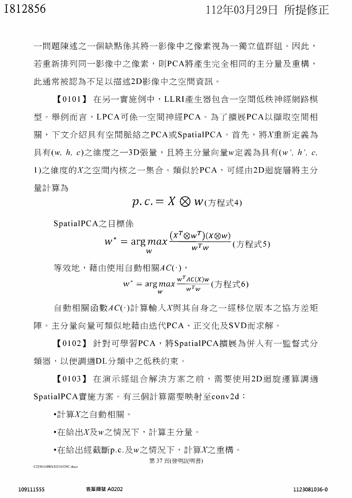
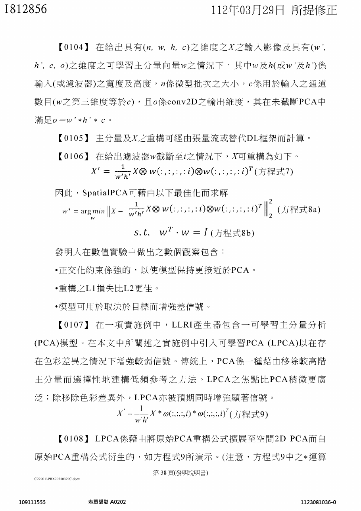
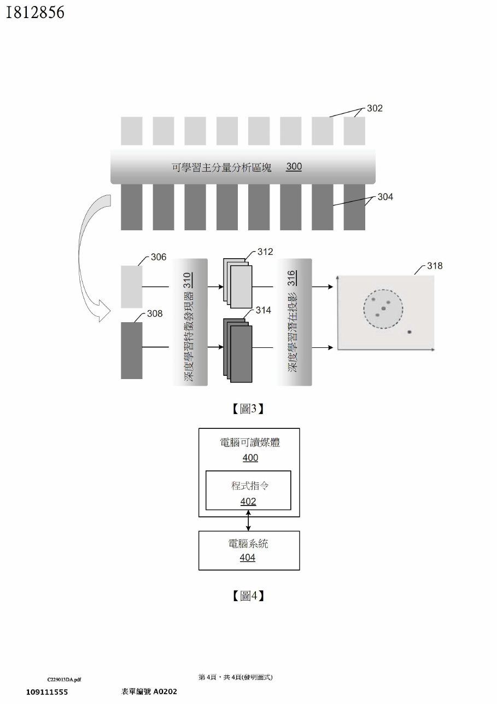

# TWI812856B 번역: 결함 검출용 시스템과 컴퓨터 구현 방법, 비일시적 컴퓨터 판독 매체, 기준 영상 생성 시스템

번역 범위: 전문 (요약, 발명의 설명, 도면 부호, 도면 설명, 청구항 67항). 인용 문헌 서지는 원문 그대로 둔다.

원천과 한계
- 원문 공보: 같은 폴더의 `TWI812856B.pdf` (중국어 번체, 77쪽, 스캔본이라 글자 층이 없다. `pdftotext -layout` 결과가 비어 있다).
- 그래서 본문은 Google Patents 페이지(https://patents.google.com/patent/TWI812856B/en)의 중국어 원문과 기계 영어 번역을 함께 보고 한국어로 옮겼다. 수식은 PDF 원문 40~43쪽에서 직접 옮겼다. 그중 41, 42쪽을 도면 폴더에 넣었다.
- 기계 영어 번역이 어색하거나 문장이 끊긴 곳은 중국어 원문의 뜻을 따랐다. 뜻이 분명하지 않은 곳은 [불명확]으로 표시했다.
- PDF 머리에 "112年03月29日 所提修正"(2023-03-29 제출 보정본)이라고 적혀 있다. 단락 번호 【0098】 등은 PDF 원문 번호다(확인한 쪽만 적었다).

서지
- 공보 번호: TWI812856B (공개 TW202105264A, 2021-02-01). 출원 번호 TW109111555A.
- 출원인: 美商科磊股份有限公司 (KLA Corp.)
- 발명자: 張晶, 袁周寧, 董宇杰, 克里斯 畢海斯卡 (Google Patents 표기 그대로)
- 우선일 2019-04-09 (US 62/831,532), 출원일 2020-04-06, 등록 공보일 2023-08-21
- 같은 패밀리 (Google Patents 패밀리 목록에서 확인): US11551348B2 (US16/838,037, 2020-04-02 출원, "Learnable defect detection for semiconductor applications"), CN113678236B, CN120637254A(심사 중), WO2020210178A1, KR20250130864A 등.

---

## 요약 (Abstract)

반도체 응용을 위한 학습 가능한 결함 검출 방법과 시스템을 제공한다. 한 시스템은 심층 거리 학습(DML) 결함 검출 모델을 포함한다. 이 모델은 시료의 시험 영상과 대응하는 기준 영상을 잠재 공간으로 투영한다. 그리고 시험 영상의 하나 이상의 서로 다른 부분과, 대응 기준 영상의 해당 부분 사이의 잠재 공간 거리를 구한다. 그 거리를 바탕으로 시험 영상의 각 부분에서 결함을 검출한다. 다른 시스템은 학습 가능한 저차원(low-rank) 기준 영상 생성기를 포함한다. 이 생성기는 시료의 하나 이상의 시험 영상에서 잡음을 지워, 그 시험 영상들에 대응하는 하나 이상의 기준 영상을 만든다.

---

## 발명의 설명

### 기술 분야

이 발명은 대체로 반도체 응용을 위한 학습 가능한 결함 검출 방법과 시스템에 관한 것이다. 일부 실시예는 심층 거리 학습 결함 검출 모델, 그리고/또는 학습 가능한 저차원 기준 영상 생성기를 써서 시료의 결함을 검출하는 시스템과 방법에 관한 것이다.

### 배경 기술

아래 설명과 예는 이 절에 들어 있다는 이유로 선행 기술로 인정되지 않는다.

로직, 메모리 같은 반도체 소자를 만들 때는 보통 반도체 웨이퍼 같은 기판을 여러 반도체 제조 공정으로 처리한다. 그래서 소자의 여러 특징과 여러 층을 만든다. 예를 들어 리소그래피는 포토마스크의 패턴을 웨이퍼 위 레지스트로 옮기는 공정이다. 다른 예로는 화학 기계 연마(CMP), 식각, 증착, 이온 주입이 있다. 한 웨이퍼 위에 여러 소자를 배열해 만든 뒤 하나씩 잘라 낸다.

검사 공정은 제조 중 여러 단계에서 웨이퍼의 결함을 찾는다. 수율을 높이고 이익을 늘리기 위해서다. 검사는 늘 반도체 제조의 중요한 부분이었다. 소자가 작아질수록 더 작은 결함도 소자를 불량으로 만들 수 있다. 그래서 검사는 더 중요해진다.

대부분의 검사 방법은 두 단계로 이루어진다. 먼저 기준 영상을 만들고, 그다음 결함을 검출한다. 각 단계를 하는 방법은 여러 가지다. 예를 들어 기준 영상은 여러 영상의 중앙값이나 평균으로 만들 수 있다. 다른 예로, 기준 영상은 저차원 근사를 바탕으로 한 구성 기준(constructed reference)과 대체 영상일 수 있다. 결함 검출도 여러 방식이 있다. 비지도 방식은 빼기 기반 검출 알고리즘(MDAT, LCAT 등)을 쓴다. 지도 방식은 화소 단위 검출 알고리즘(심층 학습 모델과 전자빔 영상을 쓰는 단일 영상 검출 등)을 쓴다.

그러나 지금 쓰는 여러 결함 검출 방법에는 몇 가지 약점이 있다. 중앙값이나 평균으로 기준 영상을 만들면 다이 사이 공정 차이를 다루기에 보통 부족하다. 저차원 근사 기반 구성 기준과 대체 영상은 이 문제를 일부 풀지만, 웨이퍼의 일부 영역에서는 맞지 않을 수 있고 결함 신호를 지워 버릴 수 있다. 지금의 비지도 결함 검출은 검출 성능이 기준 영상과 시험 영상의 품질에 달려 있다는 약점이 있다. 또 목표 결함 유형이나 작은 결함에 대해 골라서 민감도를 높이지 못한다. 지도 방식은 학습용으로 표지를 붙인 결함 후보가 많이 필요해서, 실제 레시피 설정에 시간이 오래 걸린다.

따라서 위 약점이 없는, 반도체 응용용 학습 가능한 결함 검출 시스템과 방법을 만드는 것이 유리하다.

### 발명의 내용

아래 여러 실시예의 설명은 첨부 청구항을 어떤 식으로도 제한하지 않는다.

한 실시예는 시료의 결함을 검출하도록 구성된 시스템이다. 시스템은 하나 이상의 컴퓨터 시스템과, 그 컴퓨터 시스템이 실행하는 하나 이상의 구성 요소를 포함한다. 구성 요소는 심층 거리 학습(DML) 결함 검출 모델을 포함한다. 이 모델은 시료에 대해 만든 시험 영상과 대응하는 기준 영상을 잠재 공간으로 투영한다. 시험 영상의 하나 이상의 서로 다른 부분마다, 그 부분과 대응 기준 영상의 해당 부분 사이의 잠재 공간 거리를 구한다. 그리고 각 부분에 대해 구한 거리를 바탕으로 그 부분의 결함을 검출한다. 시스템은 이 문서에서 설명하는 대로 더 구성할 수 있다.

다른 실시예는 시료의 결함을 검출하는 컴퓨터 구현 방법이다. 방법은 시료의 시험 영상과 대응 기준 영상을 잠재 공간으로 투영하는 단계, 시험 영상의 서로 다른 부분마다 대응 기준 영상의 해당 부분과의 잠재 공간 거리를 구하는 단계, 그 거리로 각 부분의 결함을 검출하는 단계를 포함한다. 투영, 거리 결정, 검출 단계는 하나 이상의 컴퓨터 시스템이 실행하는 구성 요소 안의 DML 결함 검출 모델이 수행한다.

위 방법의 각 단계는 이 문서에서 더 설명하는 대로 수행할 수 있다. 위 방법의 실시예는 이 문서의 다른 방법의 다른 단계를 포함할 수 있다. 위 방법은 이 문서의 어느 시스템으로도 수행할 수 있다.

추가 실시예는 시료의 결함을 검출하는 컴퓨터 구현 방법을 수행하도록, 하나 이상의 컴퓨터 시스템에서 실행할 수 있는 프로그램 명령을 저장한 비일시적 컴퓨터 판독 매체다. 이 방법은 위 방법의 단계를 포함한다. 매체는 이 문서에서 설명하는 대로 더 구성할 수 있고, 방법의 단계도 더 설명하는 대로 수행할 수 있다. 이 방법은 이 문서의 다른 방법의 다른 단계를 더 포함할 수 있다.

또 다른 실시예는 시료의 기준 영상을 만들도록 구성된 시스템이다. 시스템은 하나 이상의 컴퓨터 시스템과, 그것이 실행하는 하나 이상의 구성 요소를 포함한다. 구성 요소는 학습 가능한 저차원 기준 영상 생성기를 포함한다. 컴퓨터 시스템은 시료의 하나 이상의 시험 영상을 이 생성기에 넣는다. 그 시험 영상들은 **시료 위의 서로 다른 위치에서 만든 것이고, 그 위치들은 시료 설계의 같은 위치에 해당한다.** 생성기는 시험 영상들에서 잡음을 지워, 시험 영상에 대응하는 하나 이상의 기준 영상을 만든다. 결함 검출 구성 요소는 시험 영상과 대응 기준 영상을 바탕으로 시료의 결함을 검출한다. 시스템은 이 문서에서 설명하는 대로 더 구성할 수 있다.

다른 실시예는 시료의 기준 영상을 만드는 컴퓨터 구현 방법이다. 방법은 시료의 하나 이상의 시험 영상을 학습 가능한 저차원 기준 영상 생성기에 넣는 단계를 포함한다. 생성기는 하나 이상의 컴퓨터 시스템이 실행하는 구성 요소 안에 있다. 시험 영상들은 시료 위의 서로 다른 위치에서 만들었고, 그 위치들은 설계의 같은 위치에 해당한다. 생성기는 시험 영상에서 잡음을 지워 대응 기준 영상을 만든다. 결함 검출 구성 요소는 시험 영상과 대응 기준 영상으로 시료의 결함을 검출한다.

위 방법의 각 단계는 더 설명하는 대로 수행할 수 있고, 다른 방법의 단계를 포함할 수 있으며, 이 문서의 어느 시스템으로도 수행할 수 있다.

추가 실시예는 시료의 기준 영상을 만드는 컴퓨터 구현 방법을 수행하는 프로그램 명령을 저장한 비일시적 컴퓨터 판독 매체다. 방법은 위 방법의 단계를 포함하며, 매체와 단계는 이 문서에서 설명하는 대로 더 구성하거나 수행할 수 있다.

### 도면 부호

| 부호 | 이름 |
|---|---|
| 10 | 영상 시스템 |
| 14 | 시료 |
| 16 | 광원 |
| 18 | 광학 요소 |
| 20 | 렌즈 |
| 22 | 스테이지(받침대) |
| 24 | 집광기 |
| 26 | 요소 |
| 28 | 검출기 |
| 30 | 집광기 |
| 32 | 요소 |
| 34 | 검출기 |
| 36 | 컴퓨터 하위 시스템 |
| 102 | 컴퓨터 하위 시스템 |
| 122 | 전자 컬럼 |
| 124 | 컴퓨터 하위 시스템 |
| 126 | 전자빔 원 |
| 128 | 시료 |
| 130 | 요소 |
| 132 | 요소 |
| 134 | 검출기 |
| 200 | 설계 영상 |
| 202 | 광대역 플라스마 영상(광학 영상) |
| 204 | 광대역 플라스마 영상(광학 영상) |
| 206 | 합성곱 신경망 |
| 208 | 블록 A |
| 210 | 합성곱 신경망 |
| 212 | 합성곱 신경망 |
| 214 | 자르기 층 |
| 216 | 자르기 층 |
| 218 | 배치 정규화 층 |
| 220 | 배치 정규화 층 |
| 222 | 배치 정규화 층 |
| 224 | 이어 붙이기(concatenation) 층 |
| 226 | 이어 붙이기 층 |
| 228 | 망 |
| 230 | 망 |
| 232 | 블록 B |
| 234 | 완전 연결 층과 소프트맥스 층의 조합 |
| 236 | 블록 C |
| 238 | 출력 |
| 300 | 학습 가능한 주성분 분석(LPCA) 블록 |
| 302 | 다이 영상 |
| 304 | 기준 영상 |
| 306 | 시험 영상 |
| 308 | 학습 가능한 주성분 분석으로 만든 대응 기준 영상 |
| 310 | 심층 학습 특징 추출기 |
| 312 | 특징 |
| 314 | 특징 |
| 316 | 심층 학습 잠재 투영 |
| 318 | 잠재 공간 |
| 400 | 비일시적 컴퓨터 판독 매체 |
| 402 | 프로그램 명령 |
| 404 | 컴퓨터 시스템 |

### 도면의 간단한 설명

바람직한 실시예의 아래 상세 설명과 첨부 도면을 보면, 당업자는 이 발명의 다른 이점을 알 수 있다.

- 도 1과 도 1a는 이 문서에서 설명하는 대로 구성한 시스템 실시예의 측면도를 개략적으로 보인다.
- 도 2와 도 3은 이 문서의 하나 이상의 구성 요소에 쓸 수 있는 망 구조의 실시예를 보이는 개략도다.
- 도 4는 컴퓨터 시스템이 이 문서의 컴퓨터 구현 방법을 수행하게 하는 프로그램 명령을 저장한 비일시적 컴퓨터 판독 매체의 실시예를 보이는 블록도다.

이 발명은 여러 변형과 다른 형태가 가능하지만, 특정 실시예를 도면의 예로 보이고 자세히 설명한다. 도면은 축척대로 그리지 않았을 수 있다. 도면과 상세 설명은 이 발명을 개시한 형태로 한정하려는 것이 아니다. 오히려 첨부 청구항이 정한 정신과 범위 안의 모든 변형, 균등물, 대안을 포괄하려는 것이다.

### 실시를 위한 구체적인 내용

도면은 축척대로 그리지 않았다. 특히 일부 요소는 특징을 강조하려고 크게 그렸다. 도면끼리도 같은 축척이 아니다. 둘 이상의 도면에 나오는 같은 부호는 비슷하게 구성할 수 있는 요소다. 따로 말하지 않으면 도면의 요소는 시판되는 적절한 요소일 수 있다.

한 실시예는 시료의 결함을 검출하도록 구성된 시스템이다. 이 문서의 실시예는 대체로 광학 검사 도구 같은 도구를 위한 심층 학습(DL)과 기계 학습(ML) 기반 결함 검출 방법에 관한 것이다. 일부 실시예는 반도체 검사와 계측 응용을 위한 학습 가능한 저차원 결함 검출용으로 구성된다.

#### 영상 시스템 (도 1, 도 1a)

이 시스템은 적어도 하나의 에너지원과 검출기를 포함하는 영상 시스템을 포함할 수 있다. 에너지원은 시료로 향하는 에너지를 만든다. 검출기는 시료에서 오는 에너지를 검출하고, 검출한 에너지에 따라 영상을 만든다. 한 실시예에서 영상 시스템은 광학 영상 시스템이다. 그런 시스템의 한 실시예를 도 1에 보인다.

한 실시예에서 시료는 웨이퍼다. 웨이퍼는 반도체 분야에서 알려진 어떤 웨이퍼든 될 수 있다. 일부 내용을 웨이퍼 기준으로 설명하지만, 실시예가 쓰일 시료는 웨이퍼로 한정되지 않는다. 예를 들어 포토마스크, 평판, PC 기판, 다른 반도체 시료에도 쓸 수 있다. 다른 실시예에서 시료는 포토마스크다.

도 1의 영상 시스템은 빛을 시료에 비추거나 시료 위로 훑고, 시료에서 오는 빛을 검출해 광학 영상을 만든다. 도 1의 실시예에서 영상 시스템 10은 시료 14로 빛을 보내는 조명 하위 시스템을 포함한다. 조명 하위 시스템은 적어도 하나의 광원을 포함한다. 예를 들어 도 1처럼 광원 16을 포함한다. 조명 하위 시스템은 하나 이상의 입사각으로 시료에 빛을 보낼 수 있다. 입사각은 하나 이상의 비스듬한 각, 그리고/또는 하나 이상의 수직 각일 수 있다. 예를 들어 도 1에서 광원 16의 빛은 광학 요소 18과 렌즈 20을 거쳐 비스듬한 입사각으로 시료 14에 닿는다. 비스듬한 입사각은 시료 특성 등에 따라 정할 수 있다.

(도 1, 광학 영상 시스템 개략도는 원문 PDF 74쪽에 있다. 핵심 그림이 아니라서 도면 폴더에는 넣지 않았다.)

영상 시스템은 시점에 따라 다른 입사각으로 빛을 보낼 수 있다. 예를 들어 조명 하위 시스템의 하나 이상의 요소 특성을 바꿔, 도 1과 다른 입사각으로 빛을 보낼 수 있다. 한 예로 광원 16, 광학 요소 18, 렌즈 20을 움직여 다른 비스듬한 입사각이나 수직(또는 거의 수직) 입사각으로 빛을 보낼 수 있다.

어떤 경우에는 동시에 둘 이상의 입사각으로 빛을 보낼 수 있다. 예를 들어 조명 하위 시스템은 둘 이상의 조명 채널을 가질 수 있다. 한 채널은 도 1의 광원 16, 광학 요소 18, 렌즈 20을 포함하고, 다른 채널(도시 안 함)은 비슷한 요소를 다르게 또는 같게 구성하거나, 적어도 하나의 광원과 다른 요소를 포함할 수 있다. 이 빛을 다른 빛과 동시에 보내는 경우, 입사각마다 빛의 특성(파장, 편광 등)을 다르게 해서 검출기에서 서로 구별할 수 있게 한다.

다른 예로 조명 하위 시스템은 광원 하나(도 1의 광원 16)만 가지고, 그 빛을 조명 하위 시스템의 광학 요소(도시 안 함)로 파장, 편광 등에 따라 여러 경로로 나눌 수 있다. 각 경로의 빛을 시료로 보낸다. 여러 조명 채널은 동시에 또는 차례로 시료를 비출 수 있다. 같은 채널이 시점마다 다른 특성의 빛을 보낼 수도 있다. 예를 들어 광학 요소 18을 분광 필터로 두고, 필터를 바꾸는 식으로 시점마다 다른 파장의 빛을 보낸다. 조명 하위 시스템은 같거나 다른 특성의 빛을 같거나 다른 입사각으로 차례로 또는 동시에 보내는, 알려진 어떤 구성도 가질 수 있다.

한 실시예에서 광원 16은 광대역 플라스마(BBP) 광원이다. 그래서 광원이 만들어 시료로 보내는 빛은 광대역 빛일 수 있다. 그러나 광원은 레이저 같은, 알려진 다른 적절한 광원일 수도 있다. 레이저는 단색이나 거의 단색인 빛을 낼 수 있어 협대역 레이저일 수 있다. 광원은 여러 이산 파장이나 대역의 빛을 내는 다색 광원일 수도 있다.

광학 요소 18의 빛은 렌즈 20으로 시료 14에 모은다. 도 1에서 렌즈 20은 굴절 요소 하나로 그렸지만, 실제로는 여러 굴절, 반사 요소가 함께 빛을 시료에 모을 수 있다. 조명 하위 시스템은 다른 광학 요소(도시 안 함)를 포함할 수 있다. 예로 편광 요소, 분광 필터, 공간 필터, 반사 요소, 아포다이저, 빔 분할기, 조리개 등이 있다. 영상 시스템은 영상에 쓸 조명 종류에 따라 조명 하위 시스템의 요소를 바꿀 수 있다.

영상 시스템은 빛을 시료 위로 훑는 주사 하위 시스템도 포함할 수 있다. 예를 들어 영상을 찍는 동안 시료 14를 올려 두는 스테이지 22를 포함할 수 있다. 주사 하위 시스템은 시료를 움직여 빛이 시료 위를 훑게 하는 기계, 로봇 조립체(스테이지 22 포함)를 포함할 수 있다. 또는 영상 시스템의 광학 요소가 빛을 시료 위로 훑게 할 수도 있다. 빛은 뱀 모양 경로나 나선 경로 등 적절한 방식으로 훑을 수 있다.

영상 시스템은 하나 이상의 검출 채널을 더 포함한다. 적어도 하나의 채널은 조명으로 시료에서 나온 빛을 검출하고 그에 따라 출력을 내는 검출기를 포함한다. 예를 들어 도 1의 영상 시스템은 두 검출 채널을 가진다. 하나는 집광기 24, 요소 26, 검출기 28로, 다른 하나는 집광기 30, 요소 32, 검출기 34로 이루어진다. 두 채널은 다른 수집 각도에서 빛을 모은다. 어떤 예에서는 두 채널 모두 산란광을 검출하며, 시료에서 다른 각도로 산란한 빛을 검출한다. 그러나 하나 이상의 채널은 다른 종류의 빛(예: 반사광)을 검출할 수도 있다.

도 1에서 두 검출 채널과 조명 하위 시스템은 모두 종이 면 안에 있다. 따라서 이 실시예에서는 두 채널이 입사면 안(예: 중심)에 있다. 그러나 하나 이상의 채널은 입사면 밖에 있을 수 있다. 예를 들어 집광기 30, 요소 32, 검출기 34로 된 채널은 입사면 밖으로 산란한 빛을 모을 수 있다. 이런 채널은 흔히 "측면" 채널이라 하며, 입사면에 거의 수직인 면의 중심에 있을 수 있다.

도 1은 두 검출 채널을 가진 실시예이지만, 채널 수는 달라도 된다(하나만, 또는 둘 이상). 한 예로 집광기 30, 요소 32, 검출기 34의 채널을 위에서 말한 측면 채널로 두고, 입사면 반대쪽에 다른 측면 채널(도시 안 함)을 더 둘 수 있다. 그러면 영상 시스템은 집광기 24, 요소 26, 검출기 28로 된 채널을 입사면 중심에 두고, 시료 면에 수직이거나 거의 수직인 산란각의 빛을 모으게 할 수 있다. 이 채널은 흔히 "윗면" 채널이라 한다. 이렇게 하면 적어도 세 채널(윗면 하나, 측면 둘)을 가지며, 각 채널은 다른 산란각의 빛을 모으는 집광기를 갖는다.

위에서 말했듯 각 검출 채널은 산란광을 검출할 수 있다. 따라서 도 1의 영상 시스템은 시료의 암시야(DF) 영상용으로 구성할 수 있다. 그러나 명시야(BF) 영상용 검출 채널을 함께 또는 대신 가질 수도 있다. 다시 말해 시료에서 정반사한 빛을 검출하는 채널을 가질 수 있다. 그래서 이 문서의 영상 시스템은 DF만, BF만, 또는 둘 다 하도록 구성할 수 있다. 도 1에서 각 집광기를 굴절 요소 하나로 그렸지만, 하나 이상의 굴절, 반사 요소를 포함할 수 있다.

검출기는 광전자 증배관(PMT), 전하 결합 소자(CCD), 시간 지연 적분(TDI) 카메라, 다른 알려진 검출기를 포함할 수 있다. 검출기는 비영상 검출기일 수도, 영상 검출기일 수도 있다. 비영상 검출기라면 산란광의 세기 같은 특성은 재지만, 그 특성의 영상 안 위치는 재지 못한다. 그러면 검출기 출력은 영상 신호가 아니라 신호나 데이터다. 이 경우 컴퓨터 하위 시스템(예: 36)이 비영상 출력에서 시료 영상을 만들 수 있다. 다른 예에서는 검출기가 영상 신호나 영상 데이터를 내는 영상 검출기다. 그래서 영상 시스템은 여러 방식으로 이 문서의 영상을 만들 수 있다.

도 1은 이 문서의 시스템 실시예에 들어가거나 그 영상을 만드는 광학 영상 시스템 구성을 대체로 보이려는 것이다. 상용 영상 시스템을 설계할 때처럼, 이 구성은 성능을 높이도록 바꿀 수 있다. 또 이 문서의 시스템은 KLA(캘리포니아 밀피타스)의 29xx/39xx 계열 도구 같은 기존 시스템에 이 문서의 기능을 더해 구현할 수 있다. 그런 시스템에서는 이 실시예를 선택 기능(다른 기능의 보완)으로 제공할 수 있다. 또는 완전히 새 광학 영상 시스템으로 "처음부터" 설계할 수 있다.

컴퓨터 하위 시스템 36은 적절한 방식(유선, 무선 전송 매체 등)으로 영상 시스템의 검출기와 연결되어, 검출기가 시료에 대해 낸 출력을 받는다. 컴퓨터 하위 시스템 36은 검출기 출력으로 이 문서의 여러 기능을 수행할 수 있다.

시스템은 둘 이상의 컴퓨터 하위 시스템(예: 도 1의 36과 102)을 포함할 수 있으며, 같게 또는 다르게 구성할 수 있다. 도 1의 컴퓨터 하위 시스템(과 이 문서의 다른 컴퓨터 하위 시스템)은 컴퓨터 시스템이라고도 한다. 각각은 개인용 컴퓨터, 영상 컴퓨터, 메인프레임, 워크스테이션, 네트워크 장비, 인터넷 장비 등 여러 형태일 수 있다. 일반적으로 "컴퓨터 시스템"은 메모리 매체의 명령을 실행하는 하나 이상의 프로세서를 가진 모든 장치로 넓게 정의할 수 있다. 병렬 프로세서 같은 알려진 프로세서를 포함할 수 있다. 또 독립 도구나 네트워크 연결 도구로서 고속 처리와 소프트웨어를 갖춘 컴퓨터 플랫폼을 포함할 수 있다.

시스템이 둘 이상의 컴퓨터 하위 시스템을 포함하면, 서로 연결해 영상, 데이터, 정보, 명령 등을 주고받을 수 있다. 예를 들어 컴퓨터 하위 시스템 36은 도 1의 점선처럼 유선, 무선 전송 매체로 102와 연결될 수 있다. 둘 이상의 컴퓨터 하위 시스템은 공유 컴퓨터 판독 저장 매체(도시 안 함)로도 사실상 연결될 수 있다.

위에서는 영상 시스템을 광학(빛 기반) 시스템으로 설명했지만, 다른 실시예에서는 전자빔 영상 시스템이다. 시스템은 시료의 전자빔 영상을 만드는 전자빔 영상 시스템을 함께 또는 대신 포함할 수 있다. 전자빔 영상 시스템은 전자를 시료로 보내거나 시료 위로 훑고, 시료에서 오는 전자를 검출한다. 도 1a의 실시예에서 전자빔 영상 시스템은 컴퓨터 하위 시스템 124에 연결된 전자 컬럼 122를 포함한다.

도 1a처럼 전자 컬럼은 전자를 만들어 하나 이상의 요소 130으로 시료 128에 모으는 전자빔 원 126을 포함한다. 전자빔 원은 음극원이나 방출 팁을 포함할 수 있다. 요소 130은 건 렌즈, 양극, 빔 제한 조리개, 게이트 밸브, 빔 전류 선택 조리개, 대물 렌즈, 주사 하위 시스템 등을 포함할 수 있으며, 모두 알려진 적절한 요소일 수 있다.

시료에서 돌아오는 전자(예: 2차 전자)는 하나 이상의 요소 132로 검출기 134에 모을 수 있다. 요소 132는 요소 130에 든 것과 같은 주사 하위 시스템을 포함할 수 있다.

전자 컬럼은 알려진 다른 적절한 요소를 포함할 수 있다. 또 다음 미국 특허처럼 더 구성할 수 있다. 이 특허들은 전부 적은 것처럼 참조로 포함한다: 8,664,594 (Jiang et al., 2014-04-04), 8,692,204 (Kojima et al., 2014-04-08), 8,698,093 (Gubbens et al., 2014-04-15), 8,716,662 (MacDonald et al., 2014-05-06).

도 1a의 전자 컬럼은 전자가 한 비스듬한 입사각으로 시료에 닿고 다른 비스듬한 각으로 산란하도록 그렸다. 그러나 전자빔은 적절한 어떤 각도로도 시료에 닿고 산란할 수 있다. 또 전자빔 영상 시스템은 여러 모드(다른 조명각, 수집각 등)로 시료 영상을 만들 수 있다. 여러 모드는 영상 생성 매개변수 중 어느 것이든 다를 수 있다.

컴퓨터 하위 시스템 124는 위에서 말한 대로 검출기 134에 연결될 수 있다. 검출기는 시료 표면에서 돌아오는 전자를 검출해 시료의 전자빔 영상을 만든다. 전자빔 영상은 적절한 어떤 전자빔 영상이든 될 수 있다. 컴퓨터 하위 시스템 124는 검출기 134 출력으로 이 문서의 하나 이상의 기능을 시료에 수행할 수 있고, 다른 단계도 수행할 수 있다. 도 1a의 전자빔 영상 시스템을 포함한 시스템은 이 문서에서 설명하는 대로 더 구성할 수 있다.

도 1a는 이 문서의 실시예에 들어갈 수 있는 전자빔 영상 시스템 구성을 대체로 보이려는 것이다. 광학 시스템처럼, 상용 시스템 설계 때 하듯 성능을 높이도록 바꿀 수 있다. KLA의 시판 도구 같은 기존 시스템에 이 기능을 더해 구현하거나(선택 기능으로), 완전히 새 시스템으로 처음부터 설계할 수 있다.

위에서는 영상 시스템을 광빔이나 전자빔 시스템으로 설명했지만, 이온빔 영상 시스템일 수도 있다. 이 경우 도 1a처럼 구성하되 전자빔 원을 알려진 이온빔 원으로 바꾼다. 또 시판 집속 이온빔(FIB), 헬륨 이온 현미경(HIM), 2차 이온 질량 분석(SIMS) 시스템 같은 다른 이온빔 영상 시스템일 수 있다.

위에서 말했듯 영상 시스템은 실제 시료에 에너지(빛, 전자)를 보내거나 훑어서, 실제 시료의 실제 영상을 만든다. 그래서 영상 시스템은 "가상" 시스템이 아니라 "실제" 영상 시스템이다. 그러나 저장 매체(도시 안 함)와 도 1의 컴퓨터 하위 시스템 102는 "가상" 시스템으로 구성할 수 있다. 저장 매체와 컴퓨터 하위 시스템은 영상 시스템 10의 일부가 아니고 실제 시료를 다룰 수 없지만, 저장된 검출기 출력으로 검사 비슷한 기능을 하는 가상 검사기로 구성할 수 있다. "가상" 검사 시스템으로 구성한 시스템과 방법은 공동 양수된 다음 미국 특허에 있으며, 전부 적은 것처럼 참조로 포함한다: 8,126,255 (Bhaskar et al., 2012-02-28), 9,222,895 (Duffy et al., 2015-12-29), 9,816,939 (Duffy et al., 2017-11-14). 이 문서의 실시예와 컴퓨터 하위 시스템은 이 특허들처럼 더 구성할 수 있다.

위에서 말했듯 영상 시스템은 여러 모드로 시료 영상을 만들 수 있다. 넓게 보면 "모드"는 시료 영상을 만드는 데 쓰는 영상 시스템의 매개변수 값, 또는 시료 영상을 만드는 데 쓰는 출력으로 정한다. 그래서 모드끼리는 적어도 한 영상 매개변수 값이 다르다. 예를 들어 광학 시스템에서는 모드마다 조명 파장이 다를 수 있다(다른 광원, 다른 분광 필터 등). 다른 실시예에서는 모드마다 영상 시스템의 다른 조명 채널을 쓴다. 영상 시스템이 둘 이상의 조명 채널을 가지면, 모드마다 다른 채널을 쓸 수 있다.

이 문서의 영상 시스템은 검사 하위 시스템으로 구성할 수 있다. 그러면 컴퓨터 하위 시스템은 위에서 말한 대로 검사 하위 시스템(영상 시스템의 검출기)의 출력을 받아, 그 출력으로 시료의 결함을 검출하도록 구성할 수 있다.

이 문서의 영상 시스템은 결함 재검사 시스템, 계측 시스템 같은 다른 반도체 공정, 품질 관리 시스템으로 구성할 수도 있다. 예를 들어 도 1과 도 1a의 실시예는 쓰임새에 따라 하나 이상의 매개변수를 바꿔 다른 영상 능력을 줄 수 있다. 한 실시예에서 영상 시스템은 전자빔 결함 재검사 시스템이다. 예를 들어 도 1a의 시스템을 검사가 아니라 결함 재검사나 계측에 쓰려면 해상도를 높이도록 구성할 수 있다. 다시 말해 도 1과 1a의 실시예는 영상 시스템의 일반적인 여러 구성을 보이며, 당업자가 알 수 있는 여러 방식으로 바꿔 쓰임새에 더 맞는 영상 능력을 갖게 할 수 있다.

#### 심층 거리 학습(DML) 결함 검출 모델

시료의 결함을 검출하는 시스템은 하나 이상의 컴퓨터 시스템과, 그것이 실행하는 하나 이상의 구성 요소를 포함한다. 컴퓨터 시스템은 위에서 말한 대로 구성할 수 있다. 구성 요소는 심층 거리 학습(DML) 결함 검출 모델을 포함한다. DML 결함 검출 모델은 이 문서에서 더 설명하는 여러 구조를 가질 수 있다. 구성 요소는 알려진 적절한 방식으로 컴퓨터 시스템이 실행할 수 있다.

DML 결함 검출 모델은 시료에 대해 만든 시험 영상과 대응 기준 영상을 잠재 공간으로 투영한다. 이렇게 두 영상(시험과 기준)이 주어지면 모델은 두 영상을 잠재 공간으로 투영한다. 예를 들어 아래에서 설명하듯 모델은 입력 영상마다 다른 CNN을 가질 수 있고, 각 CNN이 자기 입력 영상을 잠재 공간으로 투영한다. 이 문서의 "잠재 공간"은 DML 결함 검출 모델 안에서 입력의 숨은 표현을 담는 은닉층을 말한다. 이 분야에서 흔히 쓰는 잠재 공간의 추가 설명은 Chang, "Latent Variable Modeling for Generative Concept Representations and Deep Generative Models", arXiv, 2018년 12월, 18쪽에 있으며 전부 적은 것처럼 참조로 포함한다. 이런 CNN은 도 2의 블록 A로 더 설명한다. 투영 단계(와 다른 단계)를 "한 시험 영상"으로 설명할 수 있지만, 시료에 대해 만든 여러 시험 영상에 대해서도 수행할 수 있다. 예를 들어 투영 단계는 시료의 각 시험 영상(또는 적어도 하나 이상)에 따로따로 수행할 수 있다. 시험 영상은 시험(검사, 재검사, 계측)에 알맞은 시료의 어느 영역에서든 만들 수 있다. 시험 영상은 크기가 여러 가지일 수 있다(조각 영상, 다이 영상, 작업 프레임 등). 크기는 화소(예: 조각 영상 32 x 32 화소)나 다른 적절한 방식으로 잴 수 있다. 이 문서의 다른 단계도 시험 영상마다 따로 수행할 수 있다.

DML 결함 검출 모델로 시료의 서로 다른 위치에서 만든 시험 영상의 결함을 찾는다면, 투영 단계에서 서로 다른 기준 영상을 쓸 수 있다(예: 시험 영상마다 다른 패턴 특징, 또는 특성이 다른 같은 패턴 특징에 해당하는 경우). 다시 말해 기준 영상은 시험 영상마다 다를 수 있고, 어떤 시험 영상에 대해 잠재 공간으로 투영할 기준 영상은 시험 영상, 그리고/또는 시험 영상과 기준 영상을 만든 시료 설계의 위치를 바탕으로 정할 수 있다. 기준 영상은 이 문서에서 설명하는 여러 종류일 수 있고, 여러 방식으로 만들 수 있다.

한 실시예에서 시험 영상과 대응 기준 영상은 시료의 서로 다른 다이 안 대응 위치의 영상이다. 다른 실시예에서는 시료의 서로 다른 셀 안 대응 위치의 영상이다. 예를 들어 이 DML은 다이 대 다이 검사나 셀 대 셀 검사에 쓸 수 있다. 전통적인 다이 대 다이 검사에는 도구에서 모으고 처리한 기준 영상이 필요하다. 이 실시예는 다이 영상을 시험 영상과 대응 기준 영상으로 쓰거나, 셀 영상을 시험과 기준 영상으로 써서 수행할 수 있다. 서로 다른 다이와 셀의 대응 영상은 이 문서처럼 만들거나 얻을 수 있다. 이렇게 시료 하나로 시험 영상과 기준 영상을 모두 만들 수 있다.

어떤 실시예에서는 시료의 설계 데이터를 쓰지 않고 시험 영상과 대응 기준 영상을 만든다. 예를 들어 이 결함 검출은 설계 정보 없이 할 수 있고, 검출에 쓰는 영상은 전부 시료를 찍어서 만들 수 있다. 이 경우 결함 검출도 시료의 설계 데이터와 무관하게 한다. 다시 말해 결함 검출을 위해 영상에 하는 어떤 단계도 설계 데이터를 쓰거나 바탕으로 하지 않을 수 있다. 예를 들어 시료의 설계 정보와 상관없이, 시료의 모든 시험 영상(과 그 안의 모든 화소)에서 같은 방식(같은 매개변수)으로 결함을 검출할 수 있다.

추가 실시예에서는 에너지를 시료로 보내고 시료의 에너지를 검출하는 영상 시스템으로 시험 영상을 만들고, 대응 기준 영상은 시료를 쓰지 않고 만든다. 한 실시예에서 대응 기준 영상은 시료의 설계 데이터를 담은 데이터베이스에서 얻는다. 예를 들어 이 DML은 다이 대 데이터베이스 결함 검출에 쓸 수 있다. 이 경우 시료에서 얻은 기준 영상 대신 데이터베이스 영상을 기준 영상으로 쓴다. 시료를 쓰지 않고 기준 영상을 만드는 일은 시료의 설계나 설계 정보로 기준 영상을 모의하거나, 알려진 다른 방식으로 할 수 있다. 기준 영상은 시험 영상을 만든 시료 부분에 결함이 없다면 시험 영상이 어떻게 보일지를 더 잘 모의하는 것이 좋다. 설계, 설계 데이터, 설계 정보는 알려진 어떤 것이든 될 수 있고, 이 문서에서는 같은 뜻으로 쓴다. 기준 영상은 적절한 방식으로 데이터베이스에서 얻을 수 있고, 데이터베이스는 적절한 어떤 구성이든 될 수 있다.

다른 실시예에서 컴퓨터 시스템은 시료의 설계 데이터를 DML 결함 검출 모델에 넣고, 모델은 설계 데이터를 써서 검출을 수행한다. 이렇게 렌더링한 설계를 DML 결함 검출 모델 입력의 일부로 묶을 수 있다. 모델은 설계 데이터를 추가 영상 채널로 다룰 수 있고, 렌더링한 설계를 써서 결함 검출을 할 수 있다. 쓰는 방식은 여러 가지다. 예를 들어 렌더링한 설계로 서로 다른 영상을 정렬할 수 있다(여러 영상을 설계에 정렬해 공통 기준에 맞춘다). 렌더링한 설계는 기준 영상으로 쓰거나, 이 문서의 기준 영상 하나를 만드는 데 쓸 수 있다. 모델은 렌더링한 설계로 결함 검출 매개변수를 정하거나 고치고, 검출 단계에서 결함을 분류할 수도 있다. 결함 검출 분야에서 알려진 다른 방식으로 설계 데이터를 쓸 수도 있다.

추가 실시예에서는 시료의 관심 영역에서 정한 하나 이상의 매개변수로 검출을 수행한다. 이런 실시예에서 컴퓨터 시스템은 관심 영역 정보를 DML 결함 검출 모델에 넣는다. 그러면 모델은 관심 영역을 추가 영상 채널로 다룰 수 있다. 관심 영역은 시료의 설계 데이터를 바탕으로 적절한 방식으로 정할 수 있다. 또 시험 영상과 기준 영상을 설계 데이터에 매우 정확하고 정밀하게 정렬하는 능력을 갖춘 KLA 등의 시판 시스템으로 만들 수 있다. 관심 영역은 시료에서 검출할 영역을 정하고, 그래서 검출하지 않을 영역도 정한다. 또 시료의 어느 영역에 다른 매개변수(예: 다른 검출 민감도)를 쓸지 나타낼 수 있다. 컴퓨터 시스템은 설계를 바탕으로 관심 영역을 정한 뒤 DML 모델에 넣어, 모델이 시험 영상과 기준 영상에서 관심 영역을 알아보게 한다. 검출에 쓸 매개변수도 컴퓨터 시스템이 정해 모델에 넣을 수 있다. 그러면 모델은 입력된 관심 영역 정보로 시험 영상의 관심 영역을 알아보고, 컴퓨터 시스템이 준 입력으로 그 영역의 결함 검출 매개변수를 정해 검출을 수행한다.

다른 실시예에서는 시료의 관심 영역 정보 없이 검출을 수행한다. 이 문서의 많은 검사가 관심 영역을 쓰지만, 이 결함 검출은 관심 영역 없이도 할 수 있다. 이 경우 시료의 모든 시험 영상에 대해 검출을 수행하고, 모든 시험 영상의 모든 화소에 같은 매개변수를 쓸 수 있다. 예를 들어 모든 화소의 검출 민감도가 같을 수 있다.

어떤 실시예에서 시험 영상은 시료의 로직 영역에서 만든다. 다른 실시예에서는 시료의 배열(array) 영역에서 만든다. 이 실시예는 시료의 로직 영역과 배열 영역 모두의 결함 검출에 쓸 수 있다.

DML 결함 검출 모델은 시험 영상의 하나 이상의 서로 다른 부분마다, 그 부분과 대응 기준 영상의 해당 부분 사이의 잠재 공간 거리를 구한다. 예를 들어 시험 특징과 기준 특징을 아래에서 설명하는 블록 B에 함께 통과시키고, 블록 B의 출력으로 잠재 공간에서 둘 사이 거리를 잰다. 다시 말해 모델은 시험 영상과 기준 영상 특징 사이 차이의 크기(잠재 공간 거리)로 두 영상의 닮은 정도를 정한다. 그 닮은 정도로 어느 부분이 결함(또는 결함 후보)을 담는지, 결함인지(또는 결함일 수 있는지)를 정한다.

DML 결함 검출 모델이 구하는 잠재 공간 거리는 여러 가지일 수 있다. 예를 들어 유클리드 거리, L1 거리, L-무한대 거리, [불명확: 기계 번역 "human distance", 상호 상관이라고 부연함], 맨해튼 거리, 일반 Lp 노름, 코사인 거리 등이다. 이런 거리는 알려진 적절한 방식으로 구할 수 있다.

한 실시예에서 시험 영상의 서로 다른 부분은 시험 영상의 서로 다른 화소다. 예를 들어 서로 다른 부분은 개별 화소나 작은 화소 배열(예: 9 x 9 화소 이웃) 같은 적절한 부분일 수 있다. 부분의 크기는 화소나 다른 적절한 단위로 잴 수 있다. 이렇게 모델은 시험 영상 부분마다 잠재 공간 거리를 구한다. 다시 말해 부분마다 따로 거리를 구하고, 그 거리로 각 부분의 결함을 검출한다.

DML 결함 검출 모델은 또 시험 영상의 각 부분에 대해 구한 거리를 바탕으로 그 부분의 결함을 검출한다. 예를 들어 잠재 공간 거리로 시험 영상의 각 부분(예: 각 화소)이 기준 영상에 비해 결함인지를 정한다. 그래서 모델은 화소마다 결함인지 아닌지 이진 결정을 할 수 있다. 또 결함 화소마다 결함 유형도 정할 수 있다. 그래서 검출(예, 아니오)과 분류(어떤 결함 유형)를 모두 할 수 있다. 이 분야에서는 이런 응용을 결함 검출이라 하고 방법을 분류라고 한다 [불명확: 원문 문장 그대로]. 잠재 공간 거리에 따른 결함 검출은 이 문서에서 더 설명하는 대로 수행할 수 있다.

한 실시예에서 DML 결함 검출 모델은 쌍둥이(siamese) 망 구조를 가진다. 다른 실시예에서는 세 쌍(triplet) 망 구조를, 추가 실시예에서는 네 쌍(quadruplet) 망 구조를 가진다. 예를 들어 DML은 쌍둥이 망, 세 쌍 망, 네 쌍 망 등으로 만들 수 있다.

고전적인 쌍둥이 분류 모델을 다이 대 다이 검출과 이 문서의 다른 경우에 맞게 넓힐 수 있다. 쌍둥이 망은 이 분야에서 흔히 같은 하위 망 둘을 가진 신경망으로 정의한다. 발명자들은 이 개념을 이 문서의 실시예에 쓴다. 쌍둥이 모델은 같은 종류인 두 대상 사이의 닮음이나 관계를 찾는 일에 유용하고, 이는 KLA 시판 검사 시스템의 다중 다이 자동 문턱(MDAT) 결함 검출 알고리즘이 쓰는 다이 대 다이 비교 방식에 자연스럽게 맞기 때문이다. 비선형 모델(예: CNN)을 쓰면 시험 영상과 기준(조각) 영상을 모두 잠재 공간으로 바꿀 수 있다. 그리고 이 문서에서 더 설명하듯 둘 사이 거리(닮음의 척도)를 결함 정도의 지표로 삼는다.

도 2처럼, 이 실시예에 쓸 수 있는 쌍둥이 검출 모델의 한 구성에서 시험 영상은 N개 이웃 다이의 BBP 영상 202, 204와 설계 영상 200을 포함할 수 있다. 영상들은 같은 다이 좌표에서 같은 시야(FOV)로 고를 수 있다(여러 다이 안 같은 다이 좌표). 블록 A, B, C는 깊이가 다른 세 CNN이다. 블록 B의 두 망은 같은 구조를 가진다. 같은 구조에 더해 두 망은 가중치를 공유해야 쌍둥이 구조가 된다. 먼저 시험 영상을 블록 A에 통과시키고, **블록 A의 N개 출력의 평균을 기준 특징으로 계산한다.** 둘째, 시험 특징과 기준 특징을 블록 B에 통과시키고, 블록 B 출력으로 둘 사이 거리를 잰다. 셋째, 블록 C로 영상 화소 위치마다 최종 표지(결함, 비결함)를 만든다.

예를 들어 도 2처럼 설계 영상 200은 블록 A 208의 첫 CNN 206에, 광학 영상 202는 블록 A의 CNN 210에, 광학 영상 204는 블록 A의 CNN 212에 들어간다. CNN 206, 210, 212는 각 입력 영상의 기준 특징을 만든다. 이 CNN은 알려진 적절한 구성일 수 있다.

CNN 206과 210의 출력은 자르기 층 214로, CNN 210과 212의 출력은 자르기 층 216으로 들어갈 수 있다. 자르기 층은 알려진 적절한 구성일 수 있다. 자르기 층 214, 216의 출력은 각각 배치 정규화(BN) 층 218, 222로, CNN 210의 출력은 BN 층 220으로 들어갈 수 있다. 배치 정규화는 Ioffe et al., "Batch Normalization: Accelerating Deep Network Training by Reducing Internal Covariate Shift", arXiv: 1502.03167, 2015-03-02, 11쪽처럼 할 수 있으며, 전부 적은 것처럼 참조로 포함한다. BN 층 218과 220의 출력은 이어 붙이기 층 224로, BN 층 220과 222의 출력은 이어 붙이기 층 226으로 들어갈 수 있다.

이어 붙이기 층 224, 226의 출력은 각각 블록 B 232의 망 228, 230으로 들어간다. 도 2에서 망 228, 230은 잔차 신경망(ResNet, 일부 층 사이에 지름길이 있어 중간 층을 건너뛰는 망)으로 그렸지만, 지름길 없는 일반 망이나 지름길 있는 여러 망(하이웨이 망, DenseNet 등) 같은 알려진 구성일 수 있다. 예는 Huang et al., "Densely Connected Convolutional Networks", arXiv: 1608.06993, 2018-01-28, 9쪽과 He et al., "Deep Residual Learning for Image Recognition", arXiv: 1512.03385, 2015-12-10, 12쪽에 있으며 참조로 포함한다. 위에서 말했듯 망 228, 230이 쌍둥이 구성이 되려면 구성이 같고 가중치를 공유해야 한다.

위에서 말했듯 블록 B의 망은 세 쌍 또는 네 쌍 망 구성일 수 있다. 블록 B에 쓸 세 쌍 망 구조의 예는 Hoffer et al., "Deep Metric Learning Using Triplet Network", arXiv: 1412.6622, 2018-12-04, 8쪽에, 네 쌍 망 구조의 예는 Dong et al., "Quadruplet Network with One-Shot Learning for Fast Visual Object Tracking"에 있으며 참조로 포함한다.

망 228, 230의 출력은 블록 C 236의 완전 연결 층과 소프트맥스 층의 조합 234로 들어가, 위에서 말한 최종 표지(결함 또는 비결함)를 담은 출력 238을 만든다. 완전 연결 층과 소프트맥스 층은 He et al., 미국 특허 출원 공개 2019/0073568 (2019-03-07)처럼 구성할 수 있으며 참조로 포함한다.

다른 실시예에서 DML 결함 검출 모델은 하나 이상의 DL 합성곱 필터를 포함하고, 컴퓨터 시스템은 시험 영상을 만드는 데 관련된 물리 현상을 바탕으로 DL 합성곱 필터의 구성을 정한다. DL 합성곱 필터(도시 안 함)는 신경망 처음이나 다른 층에 둘 수 있다. 예를 들어 도 2의 블록 A 앞에 둘 수 있다. 영상 생성에 관련된 물리 현상은 시험 영상을 만드는 영상 과정에 관련된 알려진, 모의한, 측정한, 추정한, 계산한 매개변수 등과, 시료의 알려진 또는 모의한 특성(재료, 치수 등)의 조합을 포함할 수 있다. 예를 들어 시험 영상 생성에 관련된 물리 현상은 시험 영상을 만든 영상 도구의 하드웨어 구성과 각 구성 요소의 하드웨어 설정을 포함할 수 있다. 시료의 알려진 또는 모의한 특성은 알려진 적절한 방식으로 얻거나 정할 수 있다.

또 다른 실시예에서 DML 결함 검출 모델은 하나 이상의 DL 합성곱 필터를 포함하고, 컴퓨터 시스템은 시험 영상을 만든 영상 하드웨어를 바탕으로 필터 구성을 정한다. 예를 들어 광학(또는 전자빔, 이온빔) 하드웨어와 그 매개변수(조리개, 파장, 개구수 NA 등)를 바탕으로 DL 합성곱 필터를 설계할 수 있다.

이런 한 실시예에서 필터 구성을 정하는 일은 영상 하드웨어의 점 퍼짐 함수(PSF)를 바탕으로 필터의 매개변수를 정하는 일을 포함한다. 예를 들어 도구의 측정 또는 모의 PSF로 필터 매개변수를 정할 수 있다. 그래서 이 실시예는 PSF 기반 결함 검출로 구성할 수 있다. 화소 단위 정보에 기대는 검출 알고리즘(예: MDAT)과 달리, 이 실시예는 PSF 수준의 특징으로 결함을 검출할 수 있다. 기본 가정은 결함 신호(정보)가 PSF로 대략 정해지는 광학 상호작용의 국소 이웃 안에 모여 있다는 것이다. 발명자들은 CNN의 필터 크기로 시야를 조절하며, PSF의 차단 반경에 대한 검출 정확도를 조사했다. **시야를 계산한 PSF 넓이와 같아질 때까지 넓히면 검출 정확도가 오른다는 것을 발견했다.** 넓이는 화소나 다른 적절한 단위로 정할 수 있다.

이런 한 실시예에서 필터 매개변수는 필터 크기, 필터 대칭, 필터 깊이 중 하나 이상을 포함한다. 예를 들어 영상 하드웨어 정보(도구의 측정 또는 모의 PSF)로 필터 크기, 대칭, 깊이를 정할 수 있다. 한 예로 필터 크기를 영상 도구의 PSF와 같거나 거의 같게 둔다.

다른 실시예에서 필터 매개변수를 정하는 일은 손실 함수를 최적화해 매개변수를 학습하는 일을 포함한다. 위 정보를 바탕으로 손실 함수를 최적화해 매개변수를 학습할 수 있다. 최적화와 손실 함수는 알려진 적절한 것이면 된다.

어떤 실시예에서 구성을 정하는 일은 영상 하드웨어의 PSF를 바탕으로 미리 정한 DL 합성곱 필터 집합에서 필터를 고르는 일을 포함한다. 예를 들어 도구의 측정 또는 모의 PSF로 필터 자체를 정한다. 미리 정한 집합은 알려진 적절한 필터의 전부나 일부를 포함할 수 있다. 한 실시예에서 집합 안 필터의 매개변수는 고정이다. 다시 말해 미리 정한 매개변수를 고치지 않고 쓴다. 다른 실시예에서는 손실 함수를 최적화해 필터의 초기 매개변수를 미세 조정한다. 최적화할 필터 매개변수는 위에서 말한 것을 포함해 적절한 어떤 것이든 될 수 있다.

또 다른 실시예에서 구성 요소는 대응 기준 영상을 만드는 학습 가능한 저차원 기준 영상 생성기를 포함한다. 컴퓨터 시스템은 시료에 대해 만든 하나 이상의 시험 영상을 생성기에 넣는다. 시험 영상들은 시료 위의 서로 다른 위치에서 만들고, 그 위치들은 시료 설계의 같은 위치에 해당한다. 생성기는 시험 영상들에서 잡음을 지워 대응 기준 영상을 만든다. 생성기는 이 문서에서 더 설명하는 대로 구성할 수 있다.

다른 실시예에서 DML 결함 검출 모델은 추가 대응 기준 영상도 잠재 공간으로 투영하고, **대응 기준 영상과 추가 대응 기준 영상의 잠재 공간 평균과 기준 영역**을 정한다. 거리를 구하는 데 쓰는 대응 기준 영상의 부분은 이 기준 영역을 포함한다. 예를 들어 시험 영상 하나와 기준 영상 여러 장(1+N장)이 주어지면, 모델은 모든 영상을 잠재 공간으로 투영하고, 잠재 공간의 N개 기준 점으로 "평균" 기준 점과 가능한 기준 영역을 추정한다. 그리고 시험 영상의 각 부분이 기준 영역에 비해 결함인지를 정하는 데 쓴다. 여러 기준 영상은 이 문서의 기준 영상(예: 시험 다이나 셀에 이웃한 여러 다이나 셀의 영상)의 조합, 그리고/또는 알려진 다른 적절한 기준 영상일 수 있다.

또 다른 실시예에서 대응 기준 영상은 시료의 결함 없는 시험 영상을 포함한다. 대응 기준 영상을 투영하는 일은 잠재 공간에서 기준 영역을 학습하는 일을 포함하고, 거리를 구하는 데 쓰는 부분은 이 기준 영역을 포함한다. 예를 들어 시험 영상이 하나만 주어지면, 모델은 "결함 있는" 시험 영상과 "결함 없는" 시험 영상을 모두 잠재 공간으로 투영하고 잠재 공간의 기준 영역을 학습한다. 그리고 그것으로 시험 영상의 부분이 기준 영역에 비해 결함인지를 정한다. "결함 없는" 시험 영상은 시료의 결함이 없다고 알려진 부분을 찍어 만들 수 있다. 또는 결함 여부를 모르는 시험 영상에서 기준 영상을 만드는 망이나 모델로 만들 수 있다. 그런 망이나 모델의 예는 Bhaskar et al., 미국 특허 10,360,477 (2019-07-23)에 있으며 참조로 포함한다.

어떤 실시예에서는 영상 시스템의 서로 다른 모드로 시료의 시험 영상과 추가 시험 영상을 만든다. DML 결함 검출 모델은 시험 영상과 대응 기준 영상을 첫째 잠재 공간으로, 추가 시험 영상과 추가 대응 기준 영상을 둘째 잠재 공간으로 투영하고, 두 잠재 공간을 결합 잠재 공간으로 합친다. 거리를 구하는 잠재 공간은 결합 잠재 공간이다. 예를 들어 이 실시예는 다중 모드 DML로 구성할 수 있다. 구체적으로 여러 모드 영상을 추가 채널로 넣을 수 있다. 또 모드 영상마다 독립 DML을 적용해 독립 잠재 공간 여럿을 만들고, 거리 계산용 결합 잠재 공간으로 합칠 수 있다. 모드는 이 문서의 어느 모드든(BF와 DF, 윗면 채널과 측면 채널 하나나 둘 같은 다른 검출 채널 등) 될 수 있다.

다른 실시예에서 컴퓨터 시스템은 시료의 설계 데이터를 DML 모델에 넣고, 영상 시스템의 다른 모드로 시험 영상과 추가 시험 영상을 만든다. 모델은 시험 영상과 대응 기준 영상을 첫째 잠재 공간으로, 추가 시험 영상과 추가 대응 기준 영상을 둘째 잠재 공간으로, 설계 데이터를 셋째 잠재 공간으로 투영하고, 셋을 결합 잠재 공간으로 합친다. 거리를 구하는 잠재 공간은 결합 잠재 공간이다. 예를 들어 설계 데이터, 관심 영역 등을 자기 잠재 공간으로 투영해 추가 영상 "모드"처럼 다루고, 둘 이상 모드의 시험 영상(과 기준 영상) 잠재 공간과 합쳐 결함 검출용 결합 잠재 공간을 만든다. 구체적으로 모드 영상마다, 그리고 다른 입력(설계 데이터, 관심 영역 등)마다 독립 DML을 따로 적용해 독립 잠재 공간 여럿을 만들고, 거리 계산용 결합 잠재 공간으로 합친다.

추가 실시예에서 컴퓨터 시스템은 시료의 설계 데이터를 DML 모델에 넣는다. 모델은 시험 영상과 대응 기준 영상을 첫째 잠재 공간으로, 설계 데이터를 둘째 잠재 공간으로 투영하고, 둘을 결합 잠재 공간으로 합친다. 거리를 구하는 잠재 공간은 결합 잠재 공간이다. 예를 들어 결함 검출에 한 모드만 쓰더라도 설계 데이터를 투영할 수 있다. 그래서 설계 데이터를 별도 잠재 공간으로 투영하고 시험 영상의 잠재 공간과 합쳐 결합 잠재 공간을 만드는 단일 모드 검출로 구성할 수 있다.

또 다른 실시예에서 컴퓨터 시스템은 설계 데이터를 DML 모델에 넣고, 영상 시스템의 다른 모드로 시험 영상과 추가 시험 영상을 만든다. 모델은 시험 영상과 대응 기준 영상, 추가 시험 영상과 추가 대응 기준 영상, 설계 데이터 중 하나 이상을 담은 첫째 묶음을 첫째 잠재 공간으로, 같은 후보 중 하나 이상을 담은 둘째 묶음을 둘째 잠재 공간으로 투영하고, 둘을 결합 잠재 공간으로 합친다. 예를 들어 첫째 모드의 영상과 설계 데이터를 첫째 잠재 공간으로, 둘째 모드의 영상과 설계 데이터를 둘째 잠재 공간으로 투영하고, 둘을 합쳐 결함 검출에 쓴다. 두 묶음은 같은 입력을 일부 공유할 수도 있고, 서로 겹치지 않을 수도 있다. 예를 들어 첫째 묶음은 둘 이상 모드의 영상, 둘째 묶음은 설계 데이터만 담을 수 있다.

정리하면, DML 결함 검출 모델이 여러 입력을 쓰는 방식은 여러 가지다. 설계 데이터, 관심 영역 같은 시료 영상 아닌 입력을 추가 영상 채널로 다룰 수 있다. 단일 모드 검사에서 이렇게 하면 단일 채널 영상과 설계, 관심 영역을 합친 뒤 한 잠재 공간으로 투영한다. 다중 모드 검사에서 이렇게 하면 여러 채널 영상과 설계 데이터, 관심 영역을 다중 채널 텐서 하나로 합친 뒤 한 잠재 공간으로 투영한다. 이렇게 여러 채널 데이터를 잠재 공간 투영 전에 합칠 수 있다.

다른 방식으로, 데이터의 채널을 각자 별도 잠재 공간으로 투영해 채널을 서로 다른 모드처럼 다룰 수 있다. 설계, 관심 영역이 없으면 모드별 영상을 각자 잠재 공간으로 투영해 합치고 거리를 계산한다. 설계, 관심 영역이 있으면 영상 모드마다 잠재 공간으로 투영하고, 설계를 또 다른 잠재 공간으로 투영한 뒤, 모든 영상 잠재 공간과 설계 잠재 공간을 합쳐 거리를 계산한다.

위 실시예에서는 모든 채널을 잠재 공간 하나로 투영하거나, 채널마다 따로 투영해 잠재 공간 수가 입력 채널 수와 같다(결합 잠재 공간으로 합치는 잠재 공간 수 = 검출에 쓰는 모드 수 + 설계 관련 입력 수). 그러나 위에서 말했듯 어떤 실시예에서는 입력 묶음(영상, 설계, 관심 영역 등)을 다중 채널 입력으로 정하고 묶음마다 잠재 공간 하나로 투영할 수 있다. 그러면 결합 잠재 공간으로 합치는 잠재 공간 수는 1보다 크고 전체 입력 수와도 다를 수 있다.

DML 결함 검출 모델을 쓸 때는 설정과 실행의 두 단계가 있다. 설정 때는 결함 후보를 한 화소 표지로 줄 수 있다. 주어진 학습 영상마다 화소별로 결함을 미리 정한다. 이 화소 단위 학습 데이터로 DML 모델을 화소 단위로 학습한다. 실행 때는 DML 모델로 검출 영역의 작업 프레임마다 각 화소가 결함인지, 가능하면 결함 유형까지 정한다. 이 문서의 단계는 화소, 작업 프레임, 또는 이 문서의 다른 시험 영상 부분에 대해서도 수행할 수 있다.

이 실시예는 DML 결함 검출 모델을 학습하도록 구성할 수 있다. 그러나 다른 시스템이나 방법이 학습을 맡을 수도 있다. 그래서 이 실시예가 학습을 할 수도, 안 할 수도 있다.

한 실시예에서 컴퓨터 시스템은 하나 이상의 학습 영상과 그 화소 단위 실측(ground truth) 정보로 DML 결함 검출 모델을 학습한다. 이런 한 실시예에서 학습 영상과 화소 단위 실측 정보는 공정 창 검증(PWQ) 웨이퍼에서 만든다. 예를 들어 PWQ 웨이퍼의 여러 소자 영역은 리소그래피 공정의 노광, 선량 같은 매개변수를 다르게 해서 만든다. 다르게 한 매개변수는 이 웨이퍼에서 얻은 결함 검출 관련 데이터로 **공정 변동과 드리프트를 모의하도록** 고를 수 있다. 그런 다음 PWQ 웨이퍼에서 모은 데이터를 학습 데이터로 써서, 공정 변동에 대해 모델이 안정하도록 학습한다. 다시 말해 가능한 공정 차이와 드리프트를 담은 학습 데이터로 학습하면, PWQ 유형 데이터 없이 학습한 경우보다 모델이 그런 공정 차이에 더 안정하다. 이 데이터로 하는 학습은 이 문서에서 설명하는 다른 방식으로도 할 수 있다.

PWQ 방법은 다음 미국 특허처럼 수행할 수 있으며 전부 적은 것처럼 참조로 포함한다: 6,902,855 (Peterson et al., 2005-06-07), 7,418,124 (Peterson et al., 2008-08-26), 7,729,529 (Wu et al., 2010-06-01), 7,769,225 (Kekare et al., 2010-08-03), 8,041,106 (Pak et al., 2011-10-18), 8,111,900 (Wu et al., 2012-02-07), 8,213,704 (Peterson et al., 2012-07-03). 이 실시예는 이 특허들의 어느 방법 단계도 포함할 수 있고, PWQ 웨이퍼는 이 특허들처럼 인쇄할 수 있다.

다른 실시예에서 컴퓨터 시스템은 능동 학습(active learning)으로 DML 결함 검출 모델을 학습한다. 예를 들어 결함 후보가 적은 경우나 반도체 공장 안 온라인 학습 경우에 능동 학습과 결합할 수 있다. 능동 학습은 Zhang et al., 미국 특허 출원 공개 2019/0370955 (2019-12-05)처럼 할 수 있으며 참조로 포함한다.

DML 모델 학습 데이터는 전자빔 시스템, 빛 기반 시스템, 사용자, 물리 모의가 만든 정보 등 다른 실측 데이터와 그 조합을 포함할 수 있다.

학습한 DML 모델의 입력은 여러 가지일 수 있다. 예를 들어 모드가 하나든 여럿이든, 모드마다 시험 프레임 영상 1장과 기준 프레임 영상 1장을 넣을 수 있다. 다른 예로 모드마다 시험 프레임 1장과 **기준 프레임 N장**을 넣을 수 있다. 또 다른 예로 모드마다 시험 프레임 1장만(기준 없이) 넣을 수 있다. 선택 입력으로 관심 영역(검사나 다른 시험 기능을 할 영역)과 시료의 설계 정보를 넣을 수 있다. DML 모델에 기준이 없으면 [불명확: "If the DML is missing" 다음 문장이 끊김], DML 모델을 학습 가능한 주성분 분석(LPCA) 기준 영상 생성(아래에서 설명)과 함께 쓴다. 시험 영상과 기준 영상으로 LPCA 기준 영상을 만들고, 이를 DML 모델에 넣는다. DML 모델의 출력은 시험 프레임(또는 시험 영상의 다른 적절한 부분)의 화소마다 결함인지, 결함이면 어떤 유형인지에 대한 결정일 수 있다. 출력은 알려진 적절한 파일이나 형식이면 된다.

#### 학습 가능한 저차원 기준 영상(LLRI) 생성기

다른 실시예는 시료의 기준 영상을 만들도록 구성된 시스템이다. 시스템은 하나 이상의 컴퓨터 시스템과, 그것이 실행하는 하나 이상의 구성 요소를 포함한다. 컴퓨터 시스템은 이 문서에서 더 설명하는 대로 구성할 수 있고, 구성 요소는 적절한 방식으로 실행할 수 있다. 이 시스템에서 구성 요소는 학습 가능한 저차원 기준 영상(LLRI) 생성기를 포함한다.

컴퓨터 시스템은 시료의 하나 이상의 시험 영상을 LLRI 생성기에 넣는다. 시험 영상들은 시료 위의 서로 다른 위치에서 만들고, 그 위치들은 시료 설계의 같은 위치에 해당한다. 예를 들어 시료의 서로 다른 다이, 서로 다른 셀 안 대응 위치에서 시험 영상을 만들 수 있다. 그래서 대응 위치는 같은 시야(시료나 영상 위 같은 영역)에 더해 같은 다이 좌표, 같은 셀 좌표 등을 가질 수 있다. 컴퓨터 시스템은 적절한 방식으로 시험 영상을 생성기에 넣는다.

LLRI 생성기는 시험 영상들에서 잡음을 지워, 시험 영상에 대응하는 기준 영상을 만든다. 예를 들어 시험 영상에서 결함에 해당하는 부분은 다른 부분보다 잡음이 많아 보일 수 있다(예: 영상의 다른 부분에 비해 이상치인 신호를 가질 수 있다. 이상치는 알려진 여러 방식으로 정의할 수 있다). 따라서 시험 영상에서 잡음을 찾아 지우면, 결과 영상은 결함 검출(과 다른) 목적의 기준으로 쓰기에 알맞을 수 있다. 그 기준 영상으로 이 문서처럼 결함을 검출한다. LLRI 생성기는 이 문서의 여러 구성 중 하나를 가질 수 있고, 이 문서처럼 잡음을 지울 수 있다.

【0098】 이 분야에서 "저차원 제약(low-rank constraint)"이라고 부르는 기법은 계산 기준(CR)과 텐서 분해(TD) 같은 이상치 검출 알고리즘에 쓸 수 있다. 이 실시예는 저차원 제약 기법을 공간 문맥으로 넓히고, 이 개념을 DL 분류에 활용한다.

【0099】 주성분 분석(PCA)은 발명자들이 CR의 저차원 제약에 쓰려고 개발한 도구다. PCA를 다중 영상 재구성 문제에 적용하면 문제는 다음처럼 정리된다. 차원이 $(w \cdot h, c)$인 2차원 행렬 $X$가 주어진다(보통 직류 DC 성분을 뺀다). 여기서 $w, h$는 영상의 폭과 높이(화소), $c$는 영상 수다. 분산 추정을 최대로 하는 차원 $(c, 1)$의 주성분 벡터 $w$를 찾는다.

$$w^* = \arg\max_w \frac{w^T X^T X w}{w^T w} \quad (\text{식 } 1)$$

여기서 $T$는 행렬 전치 연산자다. 주성분은 다음처럼 정의한다.

$$p.c. = X w \quad (\text{식 } 2)$$

여러 주성분 벡터는 반복 PCA, 행렬 직교화, 특이값 분해(SVD) 등으로 구할 수 있다. 저차원 근사는 보통 고윳값으로 주성분을 걸러서 적용한다. 큰 고윳값은 영상 데이터의 분산이 큰 방향에 해당한다. 저차원 근사에 따르면 $X$의 재구성은 다음 식으로 얻는다.

$$X' = (X W) W^T \quad (\text{식 } 3)$$

여기서 $W$는 고른 주성분 벡터들을 열로 모은(원문 표기는 '행 형식'이다) 2차원 행렬이다(즉 $\{w_1, w_2, \ldots\}$).

【0100】 위 문제 설정은 이 분야에서 아주 고전적이고 잘 알려져 있다. 이 설정의 한 약점은 영상의 화소를 서로 독립인 값의 묶음으로 다룬다는 것이다. 그래서 같은 영상 안 화소의 순서를 바꿔도 PCA는 똑같은 주성분과 재구성을 낸다. 이는 2차원 영상의 공간 정보를 설명하기에 보통 부족하다고 여긴다.

【0101】 다른 실시예에서 LLRI 생성기는 공간 저차원 신경망 모델을 포함한다. 예를 들어 LPCA는 공간 신경 PCA일 수 있다. PCA를 공간 상관까지 잡도록 넓히기 위해, 아래에서 공간 문맥을 넣은 PCA, 곧 SpatialPCA를 소개한다. 먼저 $X$를 차원 $(w, h, c)$인 3차원 텐서로 다시 정의하고, 주성분 벡터 $w$를 차원 $(w', h', c, 1)$인 공간 커널의 모음으로 정의한다. PCA와 비슷하게 주성분은 2차원 합성곱 층으로 다음처럼 계산할 수 있다.

$$p.c. = X \otimes w \quad (\text{식 } 4)$$

SpatialPCA의 목적 함수는

$$w^* = \arg\max_w \frac{(X^T \otimes w^T)(X \otimes w)}{w^T w} \quad (\text{식 } 5)$$

같은 뜻으로, 자기 상관 함수 $AC(\cdot)$를 쓰면

$$w^* = \arg\max_w \frac{w^T AC(X) w}{w^T w} \quad (\text{식 } 6)$$

자기 상관 함수 $AC(\cdot)$는 입력 $X$와 그것을 이동한 판의 공분산 행렬을 계산한다. 주성분 벡터는 마찬가지로 반복 PCA, 직교화, SVD로 풀 수 있다.

【0102】 학습 가능한 PCA를 위해, SpatialPCA를 지도 분류기와 결합하도록 넓혀 DL 분류의 저차원 제약에 맞춘다.

【0103】 결합한 풀이를 보이기 전에, SpatialPCA 구현을 2차원 합성곱 연산으로 바꿔야 한다. conv2d로 옮겨야 할 계산은 셋이다.
- $X$의 자기 상관을 계산한다.
- $X$와 $w$가 주어졌을 때 주성분을 계산한다.
- 자른(truncated) 주성분과 $w$가 주어졌을 때 $X$의 재구성을 계산한다.

【0104】 입력 영상 $X$의 차원이 $(n, w, h, c)$이고 학습 가능한 주성분 벡터 $w$의 차원이 $(w', h', c, o)$라고 하자. 여기서 $w$와 $h$(또는 $w'$와 $h'$)는 입력(또는 필터)의 폭과 높이, $n$은 미니 배치 크기, $c$는 입력의 채널 수($w$의 셋째 차원은 $c$와 같다), $o$는 conv2D의 출력 차원이다. 자르지 않은 PCA에서는 $o = w' \cdot h' \cdot c$를 만족한다.

【0105】 주성분과 $X$의 재구성은 텐서플로나 다른 DL 프레임워크로 계산할 수 있다.

【0106】 필터 $w$를 $i$까지 잘랐을 때 $X$는 다음처럼 재구성된다.

$$X' = \frac{1}{w'h'} X \otimes w(:,:,:,:i) \otimes w(:,:,:,:i)^T \quad (\text{식 } 7)$$

따라서 SpatialPCA는 다음 최적화로 풀 수 있다.

$$w^* = \arg\min_w \left\lVert X - \frac{1}{w'h'} X \otimes w(:,:,:,:i) \otimes w(:,:,:,:i)^T \right\rVert_2^2 \quad (\text{식 } 8a)$$

$$s.t.\ \ w^T \cdot w = I \quad (\text{식 } 8b)$$

발명자들이 수치 실험에서 관찰한 점은 다음과 같다.
- 직교화 제약이 강해야 모델이 PCA에 더 가깝게 머문다.
- 재구성 손실은 L1이 L2보다 낫다.
- 목표에 따라 모델로 약한 신호를 키울 수 있다.

【0107】 한 실시예에서 LLRI 생성기는 학습 가능한 주성분 분석(PCA) 모델을 포함한다. 이 실시예에서는 색 차이(color variation)가 있을 때 약한 신호를 키우려고 학습 가능한 PCA(LPCA)를 도입한다. 전통적으로 PCA는 높은 차수의 주성분을 지워 저주파 기준을 골라 만드는 방법이다. LPCA의 초점은 PCA보다 조금 넓다. 색 차이를 지우는 것에 더해, 뚜렷한 신호도 동시에 키우기를 기대한다.

$$X' = \frac{1}{w'h'} X * \omega(:,:,:,i) * \omega(:,:,:,i)^T \quad (\text{식 } 9)$$

【0108】 LPCA는 식 9에서 보이듯 원래 PCA 재구성식을 공간 2차원 PCA로 넓혀서 얻는다. (식 9의 $*$ 연산자는 합성곱 연산자다.) $T$는 행렬 전치 연산자다. 따라서 PCA 재구성은 합성곱 층 두 개를 가진 얕은 CNN으로 표현할 수 있다.

$$\omega^* = \arg\min_\omega \left\lVert X - \frac{1}{w'h'} X * \omega * \omega^T \right\rVert \quad s.t.\ \ \omega^T \cdot \omega = 1 \quad (\text{식 } 10)$$

【0109】 LPCA는 대각화가 아니라 최적화(식 10 참조)로 저차원 필터를 푼다. 이 방법은 LPCA 망에, 그리고 이어서 어떤 검출망이나 분류망에도 바로 연결할 수 있는 자유를 준다.

【0110】 다른 실시예에서 LLRI 생성기는 학습 가능한 독립 성분 분석(ICA) 모델이나 학습 가능한 정준 상관 분석(CCA) 모델을 포함한다. 이렇게 LLRI 생성기는 PCA, ICA, CCA 같은 유형의 모델일 수 있다. 또 텐서 분해 모델일 수 있다. 이 실시예에 쓸 ICA 모델 구성의 예는 Hyvärinen et al., "Independent Component Analysis: Algorithms and Applications" (Neural Networks, 13(4-5): 411-430, 2000)에 있다. CCA 모델의 예는 Uurtio et al., "A Tutorial on Canonical Correlation Methods" (arXiv: 1711.02391, 2017-11-07, 33쪽)에 있다. 텐서 분해 모델의 예는 Rabanser et al., "Introduction to Tensor Decompositions and their Applications in Machine Learning" (arXiv: 1711.10781, 2017-11-29, 13쪽)에 있다. 모두 전부 적은 것처럼 참조로 포함한다.

【0111】 어떤 실시예에서 LLRI 생성기는 선형 또는 비선형 회귀 모델을 포함한다. 알려진 적절한 선형, 비선형 회귀 모델을 LLRI 생성기로 바꿔 쓸 수 있다.

또 다른 실시예에서 LLRI 생성기는 공간 저차원 확률 모델을 포함한다. 예를 들어 LLRI 생성기는 베이즈 CNN일 수 있다. 베이즈 CNN의 예는 Shridhar et al., "A Comprehensive guide to Bayesian Convolutional Neural Network with Variational Inference" (arXiv: 1901.02731, 2019-01-08, 38쪽)에 있다. 공간 저차원 확률 모델은 확률 PCA 모델일 수도 있다. 예는 Tipping and Bishop, "Probabilistic Principal Component Analysis" (Journal of the Royal Statistical Society, Series B, 61, Part 3, pp. 611-622, 1999-09-27)와 Zhao et al., "Probabilistic Principal Component Analysis for 2D data" (Institute for Statistics: 58th World Statistical Congress, Dublin, 2011-08, pp. 4416-4421)에 있다. 모두 참조로 포함한다.

한 실시예에서 서로 다른 위치는 시료의 서로 다른 다이 안의 위치다. 다른 실시예에서 서로 다른 위치는 시료의 다이 하나 안의 여러 위치다. 예를 들어 시험 영상은 서로 다른 다이 안 대응 위치, 서로 다른 셀 안 대응 위치 등에서 만들 수 있다. 각 다이 안에는 여러 셀이 있을 수 있다. 그래서 시험 영상은 다이 하나 안 하나 이상 셀의 하나 이상 위치에서만 만들 수도 있다.

또 다른 실시예에서 시험 영상은 영상 시스템이 시료에 대해 만든 작업 프레임에 해당하고, 컴퓨터 시스템은 영상 시스템이 시료에 대해 만든, 다른 시험 영상에 해당하는 다른 작업 프레임에 대해 입력을 되풀이한다. 그래서 LLRI 생성기는 작업 프레임마다 따로 기준 영상을 만든다. 예를 들어 LLRI 생성기를 쓸 때는 설정과 실행의 두 단계가 있을 수 있다. 설정 때는 결함 후보로 다이마다 LLRI 생성을 학습할 수 있다. **결함 후보가 없으면 LPCA는 보통 PCA로 줄어든다.** 실행 때는 검사 영역의 작업 프레임마다 LLRI를 만든다. 다시 말해 작업 프레임마다 다른 기준 영상을 따로 만들 수 있다. 기준 영상을 만드는 작업 프레임은 시험(검사, 재검사, 계측 등)을 하는 모든 작업 프레임을 포함할 수 있다. 이렇게 학습한 LLRI 생성기의 입력은 다이 대 다이 검출이면 서로 다른 다이의 같은 상대 다이 위치 프레임 영상 N장, 셀 대 셀 검출이면 서로 다른 셀의 셀 영상 N장이고, 생성기는 기준 영상 N장을 내도록 학습한다.

어떤 실시예에서 시험 영상은 영상 시스템의 한 모드만 써서 만든다. 예를 들어 기준 영상을 만드는 시험 영상은 같은 모드로 만든 것만 포함할 수 있다.

다른 실시예에서 시험 영상은 영상 시스템의 한 모드만 써서 만들고, 컴퓨터 시스템은 다른 모드로 만든 다른 시험 영상에 대해 입력을 되풀이해, LLRI 생성기가 그 시험 영상들에 대한 기준 영상을 만들게 한다. 이렇게 모드마다 다른 기준 영상을 만들 수 있다. **시험 영상과 그 잡음은 모드마다 크게 다를 수 있으므로**, 모드별로 기준 영상을 따로 만드는 것은 다중 모드 검사와 다른 시험에서 중요하다. 따라서 한 모드에 맞게 만든 기준 영상은 다른 모드에는 맞지 않을 수 있다.

결함 검출 구성 요소는 시험 영상과 대응 기준 영상을 바탕으로 시료의 결함을 검출한다. 그래서 LLRI 생성기가 만든 기준 영상으로 시료의 결함을 검출할 수 있다. 이 검출은 이 문서의 결함 검출이나 알려진 다른 결함 검출일 수 있다. 다시 말해 LLRI 생성기의 기준 영상은 다른 기준 영상과 똑같이 어떤 결함 검출 방법에도 쓸 수 있다.

한 실시예에서 결함 검출 구성 요소는 컴퓨터 시스템이 실행하는 구성 요소 안에 있다. 그래서 실시예는 LLRI 생성기와, 이 문서의 지도 또는 비지도 검출기, 분류기 중 하나인 결함 검출 구성 요소의 조합을 포함할 수 있다. 다시 말해 이 시스템은 만든 기준 영상으로 결함 검출을 수행할 수 있다. 또는 결함 검출 구성 요소가 결함 검출을 하는 다른 시스템 안에 있을 수 있다. 예를 들어 이 문서처럼 만든 기준 영상을 다른 시스템이 접근할 수 있는 컴퓨터 판독 매체에 저장하거나, 다른 시스템에 보내 그 시스템이 결함 검출에 쓰게 할 수 있다.

이런 한 실시예에서 컴퓨터 시스템은 하나 이상의 학습 영상과 그 화소 단위 실측 정보로 **LLRI 생성기와 결함 검출 구성 요소를 함께 학습**한다. 화소 단위 실측 정보는 수동 분류, 전자빔 검출 모델, 혼합 검출기가 만든 표지를 포함할 수 있다. 혼합 검출은 Bhaskar et al., 미국 특허 출원 공개 2017/0194126 (2017-07-06)처럼 할 수 있으며 참조로 포함한다. 그런 다음 결합한 LLRI 생성기와 결함 검출 구성 요소를 영상(예: 광학 영상)과 화소 단위 실측 정보로 학습한다. 학습은 알려진 적절한 방식으로 할 수 있다(예: 생성기, 그리고/또는 검출 구성 요소가 낸 검출, 분류 결과가 입력한 실측 정보와 맞을 때까지 매개변수를 고친다).

이런 어떤 실시예에서 학습 영상은 사용자가 고른 하나 이상의 결함 부류의 영상을 포함한다. 예를 들어 사용자는 주어진 시료 층에서 중요한 결함 유형을 정할 수 있다. 정하지 않으면 기본으로 모든 결함 유형을 똑같이 중요하게 본다. 고른 중요 결함 유형의 후보 결함 표본은 BBP 결함 발견이나 전자빔 검사 결함 발견 등으로 사용자에게서 얻을 수 있다. 이렇게 일부 또는 모든 결함 유형을 모델 학습에 배정해, 목표에 맞춘 민감도 향상을 얻을 수 있다. 같은 방식으로 일부 또는 모든 결함 유형을 배정해 목표에 맞춘 방해 신호(nuisance) 감소를 얻을 수 있다.

다른 실시예에서 학습 영상은 사용자가 고른 시료의 하나 이상의 핫스팟 영상을 포함한다. "핫스팟"은 이 분야에서 흔히 시료 설계에서 결함이 더 잘 생긴다고 알려진(또는 의심되는) 위치로 정의한다. 핫스팟은 사용자가 적절한 방식으로 고를 수 있다. 또 Zafar et al., 미국 특허 7,570,796 (2009-08-04)과 Kulkarni et al., 미국 특허 7,676,077 (2010-03-09)처럼 정의하고 찾을 수 있으며 참조로 포함한다.

추가 실시예에서 학습 영상은 사용자가 고른, 시료 설계의 하나 이상의 약한 패턴 영상을 포함한다. "약한 패턴"은 흔히 설계의 다른 패턴보다 결함이 더 잘 생긴다고 알려진(또는 의심되는) 패턴으로 정의한다. 사용자가 적절한 방식으로 고르거나, 위 Zafar, Kulkarni 특허처럼 정의하고 찾을 수 있다. 어떤 경우에는 약한 패턴을 핫스팟으로도 지정하지만(그 반대도), 늘 그렇지는 않다.

한 실시예에서 화소 단위 실측 정보는 전자빔 영상 시스템이 만든다. 예를 들어 학습 실측 데이터는 전자빔 검사 시스템, 전자빔 결함 재검사 시스템, SEM, 투과 전자 현미경(TEM) 같은 전자빔 시스템에서 올 수 있다. 전자빔 영상 시스템은 이 문서처럼 더 구성할 수 있고, 시스템의 일부일 수도 아닐 수도 있다. 이 시스템이 전자빔 영상으로 실측 정보를 만들 수도, 다른 시스템이나 방법이 만든 것을 얻을 수도 있다.

다른 실시예에서 화소 단위 실측 정보는 빛 기반 시스템이 만든다. 예를 들어 실측 데이터는 빛 기반 검사 시스템(아주 높은 해상도나 고해상도 모드로 구성한 것일 수 있다), 빛 기반 결함 재검사 시스템 등에서 올 수 있다. 이 시스템이 만들 수도, 다른 시스템에서 얻을 수도 있다. 어떤 실시예에서 화소 단위 실측 정보는 사용자에게서 받은 정보를 포함한다. 예를 들어 학습 시료의 전자빔 영상을 사용자에게 보여 주고, 영상에 결함이 있는지와 어떤 유형인지를 입력받을 수 있다.

또 다른 실시예에서 화소 단위 실측 정보는 학습 영상으로 수행한 물리 모의 결과로 만든 학습 영상 정보를 포함한다. 물리 모의는 알려진 어떤 모의든 될 수 있다. 예를 들어 학습 영상에 보이는 결함이, 그 결함이 있는 시료로 만든 소자의 물리 특성에 어떤 영향을 줄지를 모의한다. 그 결과(예: 단락, 단선 같은 문제를 일으킨다)로 결함에 그 문제 유형의 분류를 붙여 화소 단위 실측 정보로 쓸 수 있다. 이 모의는 이 실시예가 하거나 다른 시스템에서 얻을 수 있다.

또 다른 실시예에서 화소 단위 실측 정보는 첫째 형식과 다른 둘째 형식의 알려진 결함 위치를 첫째 형식으로 바꾼 정보를 포함한다. 예를 들어 알려진 결함 위치를 화소 단위 실측 데이터로 바꿀 수 있다. 결함 정보는 KLARF 파일(KLA 시판 도구가 쓰는 독자 형식), KLA의 Klarity 도구가 만든 결과 파일, 배치 결과 등의 형식에서 화소 단위 실측 데이터로 바꿀 수 있다. 바꾼 형식은 사용 중 DML 모델에 넣을 영상과 모델이 그 영상에서 낼 출력(입력 영상과 모델이 그 영상에 붙일 표지)의 형식일 수 있다.

알려진 결함 위치는 검사와 재검사, 프로그램 결함이나 합성 결함, 모의 등 여러 방식으로 "알려질" 수 있다. 이를 화소 단위 실측 데이터로 바꾸는 일은 이 실시예의 컴퓨터 시스템이 하거나, 다른 시스템에서 얻을 수 있다. 예는 Bhaskar et al., 미국 특허 출원 공개 2019/0303717 (2019-10-03)에 있으며 참조로 포함한다.

한 실시예에서 결함 검출 구성 요소는 DL 결함 검출 구성 요소를 포함한다. 이 DL 검출 구성 요소는 이 문서의 DML 모델일 수도 아닐 수도 있다. 그래서 LLRI 기반 검출의 한 실시예에서 LLRI 생성기와 DL CNN을 묶어 끝에서 끝까지 학습하는 시스템을 만들고, 사용자가 고른 결함 부류에 대한 "가장 좋은" 근사 저차원 변환과 화소 단위 검출기, 분류기를 동시에 학습할 수 있다. 이 실시예는 **저차원의 안정성과 DL 검출기, 분류기의 능력**을 합친다. DL 결함 검출 구성 요소는 결정 나무, 랜덤 포레스트, 서포트 벡터 머신(SVM) 같은 ML 특징 기반 검출 모델일 수도 있고, CNN, 베이즈 CNN, 거리 CNN, 기억 CNN 같은 DL 기반 검출 모델일 수도 있다. 기억 CNN의 예는 Braman et al., "Disease Detection in Weakly Annotated Volumetric Medical Images using a Convolutional LSTM Network" (arXiv: 1812.01087, 2018-12-03, 4쪽)와 Luo et al., "LSTM Pose Machines" (arXiv: 1712.06316, 2018-03-09, 9쪽)에 있다. 거리 CNN은 닮음 척도(거리)로 두 대상(예: 영상)이 같은 종류인지를 정하는 CNN이다. 예는 Bell et al., "Learning visual similarity for product design with convolutional neural networks" (ACM Transactions on Graphics (TOG), Vol. 34, Issue 4, July 2015, Article No. 98, pp. 1-10)와 Wang et al., "DARI: Distance Metric and Representation Integration for Person Verification" (Proceedings of the 30th AAAI Conference on Artificial Intelligence, pp. 3611-3617, February 2016, AAAI Press, Palo Alto, California)에 있다. 모두 참조로 포함한다.

어떤 실시예에서 결함 검출 구성 요소는 결함 분류기로 구성하지 않는다. 다시 말해 시료의 사건은 검출하지만 어떤 유형의 결함인지는 정하지 않는다. 검출한 사건의 방해 신호 거르기는 할 수도 안 할 수도 있다. 그러나 결함 분류와 방해 신호 거르기도 할 수 있다. 또는 별도 결함 분류 구성 요소(시스템의 구성 요소일 수도 아닐 수도 있다)가 검출된 결함을 분류할 수 있다. 결함 분류도 하는 ML 기반 결함 검출 구성 요소의 예는 He et al., 미국 특허 출원 공개 2019/0073568 (2019-03-07)에, ML 기반 결함 검출기의 예는 Karsenti et al., 미국 특허 10,186,026 (2019-01-22)에 있으며 참조로 포함한다.

또 다른 실시예에서 결함 검출 구성 요소는 DL이 아닌 결함 검출 구성 요소를 포함한다. 예를 들어 고전적인 결함 검출, 곧 **대응 시험 영상에서 LLRI를 빼 차 영상을 만들고, 그 차 영상으로 시료의 결함을 검출**하는 방식을 쓸 수 있다. 한 예로 문턱값 기반 검출에서는 이 문서처럼 만든 기준 영상을 대응 시험 영상에서 빼고, 차 영상을 문턱값과 비교한다. 가장 단순한 문턱 알고리즘에서는 문턱값보다 큰 신호나 출력을 잠재 결함(결함 후보)으로, 그렇지 않은 것을 결함 후보가 아닌 것으로 정한다. 그러나 문턱 알고리즘은 KLA 시판 시스템이 쓰는 MDAT, 그리고/또는 LCAT 알고리즘처럼 이보다 복잡할 수 있다.

다른 실시예에서 결함 검출 구성 요소는 DML 결함 검출 모델을 포함한다. 그래서 LLRI 생성기와 DML 검출을 합칠 수 있다. 이런 한 실시예에서 LLRI 생성기는 도 3의 LPCA 블록 300으로 보이며, 수학적으로 합성곱 층 두 개를 가진다. LPCA 블록의 입력은 **같은 상대 다이 위치이지만 서로 다른 다이의**(또는 결함 검출 방식에 따라 셀의) 다이 영상 N장이다. 예를 들어 도 3처럼 LPCA 블록 300의 입력은 다이 영상 N장 302이며, 각각 같은 상대 다이 위치에서 서로 다른 다이를 찍은 것이다. LPCA 블록의 출력은 **저주파 잡음과 고주파 잡음을 모두 지운 뒤의 기준 영상 N장**이다. 예를 들어 도 3처럼 LPCA 블록의 출력은 입력 다이 영상마다 하나씩, 기준 영상 N장 304다.

이 구성(다른 구성도 가능하다)에서는 원래 다이 영상과 LPCA를 거친 기준 영상을 모두 DML 검출 모델에 넣는다. 예를 들어 도 3처럼 시험 영상과 LPCA가 만든 대응 기준 영상의 쌍(예: 시험 영상 306과 LPCA 기준 영상 308)을 DL 특징 추출기 310에 넣을 수 있다. 추출기 310은 시험 영상의 특징 312와 기준 영상의 특징 314를 낼 수 있다. 잠재 공간 거리로 시험 영상의 각 화소가 결함인지를 정한다. 예를 들어 도 3처럼 특징 312, 314를 DL 잠재 투영 316에 넣어 잠재 공간 318로 투영할 수 있다. 그다음 이 문서에서 더 설명하듯 잠재 공간의 특징 사이 거리로 결함 검출을 한다. 검출 블록의 층은 LPCA 블록의 층과 다르다. **손실 함수는 LPCA 손실과 DML 손실(예: 쌍둥이 손실)의 조합이다.** LPCA 기준 영상과 DML 검출을 함께 쓰면 다른 검출 방법, 시스템보다 민감도가 비교적 높다. 그러나 LPCA 기준 영상은 이 문서에서 설명하는 것 같은 다른 결함 검출 알고리즘과도 함께 쓸 수 있다.

한 실시예에서 LLRI 생성기와 결함 검출 구성 요소는 인라인(in-line) 결함 검출용으로 구성한다. 예를 들어 영상 시스템이 시료를 훑는 동안(시험 영상이 만들어지는 즉시) 기준 영상을 만들고, 그것으로 결함 검출을 할 수 있다. 이렇게 하면 시료를 훑기 전에 기준 영상을 만들지 않는다.

다른 실시예에서 LLRI 생성기와 결함 검출 구성 요소는 오프라인 결함 검출용으로 구성한다. 예를 들어 영상 시스템이 시료를 훑은 뒤(시험 영상을 만든 뒤) 기준 영상을 만들고, 그것으로 결함 검출을 할 수 있다. 한 예로 시험 영상을 만든 영상 시스템을 포함한 시스템이 시험 영상을 컴퓨터 판독 저장 매체에 저장하고, 이 실시예가 나중에 그 저장 매체의 시험 영상을 읽어 이 문서처럼 쓴다.

어떤 실시예에서 구성 요소는 검출한 결함을 둘 이상의 유형으로 분류하는 결함 분류 구성 요소를 포함하고, 이 구성 요소는 DL 결함 분류 구성 요소다. DL 결함 분류 구성 요소는 Bhaskar et al., 미국 특허 10,043,261 (2018-08-07), Bhaskar et al., 미국 특허 10,360,477 (2019-07-23), He et al., 미국 특허 출원 공개 2019/0073568 (2019-03-07)처럼 구성할 수 있으며 참조로 포함한다.

한 실시예에서 시료는 여러 리소그래피 노광 단계로 패턴 특징 층을 만든 웨이퍼다. 예를 들어 이중 패턴 웨이퍼 등으로, 한 노광 단계에서 웨이퍼 한 층에 패턴 특징 한 묶음을 만들고, 다른 노광 단계에서 같은 층에 다른 묶음을 만든다. 여러 노광 단계는 알려진 적절한 방식으로 할 수 있다. 다른 실시예에서 시료는 극자외선(EUV) 리소그래피로 패턴 특징 층을 만든 웨이퍼다. 예를 들어 이 실시예는 광학 등 검사 도구에서 목표 결함, 특히 이중, 사중 패턴과 EUV 리소그래피의 작은 결함에 대한 민감도를 높인, 근사 저차원 지도형, 준지도형 결함 검출 알고리즘을 제공한다. 이 실시예의 구성은 전부 GPU 가속으로 구현할 수 있다. 예를 들어 **LPCA 블록은 합성곱 층 두 개로 구현할 수 있어 비교적 작은 신경망**이 된다. 학습(설정)과 추론을 모두 GPU에서 바로 돌릴 수 있다. CPU나 다른 가속 칩에서도 돌릴 수 있다.

위 각 시스템의 각 실시예는 하나의 실시예로 합칠 수 있다. 또 이 실시예는 Bhaskar et al., 미국 특허 출원 공개 2017/0194126 (2017-07-06)과 Sezginer et al., 2018/0342051 (2018-11-29)처럼 더 구성할 수 있으며, 참조로 포함한다.

이 실시예는 다른 결함 검출 방법, 시스템보다 여러 이점이 있다. 예를 들어 **웨이퍼 안, 그리고 아마도 웨이퍼 사이의 공정 변동을 다룰 수 있다**(이 문서처럼 만든 기준 영상은 웨이퍼 안 공정 변동과 웨이퍼 사이 공정 차이의 영향을 크게 받지 않기 때문이다). 다른 이점은 이 실시예가 만든 기준 영상을, 사용자가 지정한 결함, 핫스팟, 약한 패턴에 대해 가장 좋은 결함 검출을 얻도록 학습할 수 있다는 것이다. 이 방법은 예측할 수 없는 민감도 저하를 막는다. 또 목표 결함 유형의 민감도를 높여 BBP 결함 민감도의 한계를 넓힐 수 있다. 또 연구 개발과 대량 생산에서 목표 민감도의 쓰임새를 높여 BBP 민감도를 크게 높이고 BBP 도구 구매 비용을 줄일 수 있다. 또 결함 분류기 학습과 기준 생성을 합쳐 선택적 민감도를 높일 수 있다. 또 근사 저차원 제약을 쓸 때 표지를 붙인 결함 후보가 훨씬 적게 필요하다. 추가 이점은 여러 검출 유형에 쓸 수 있다는 것이다. 예를 들어 이 시스템은 다이 대 다이 검사, 셀 대 셀 검사, 표준 기준 검사에 쓸 수 있고, 각각을 한 광학 모드나 여러 광학 모드로 수행할 수 있다.

다른 실시예는 시료의 결함을 검출하는 컴퓨터 구현 방법이다. 방법은 시료에 대해 만든 시험 영상과 대응 기준 영상을 잠재 공간으로 투영하는 단계를 포함한다. 시험 영상의 하나 이상의 서로 다른 부분마다, 그 부분과 대응 기준 영상의 해당 부분 사이의 잠재 공간 거리를 구하는 단계도 포함한다. 또 각 부분에 대해 구한 거리로 그 부분의 결함을 검출하는 단계를 포함한다. 투영, 거리 결정, 검출 단계는 하나 이상의 컴퓨터 시스템이 실행하는 구성 요소 안의 DML 결함 검출 모델이 수행한다.

이 방법의 각 단계는 이 문서에서 더 설명하는 대로 수행할 수 있다. 다른 단계도 포함할 수 있다. 컴퓨터 시스템은 컴퓨터 하위 시스템 102 같은 이 문서의 어느 실시예대로도 구성할 수 있다. 위 방법은 이 문서의 어느 시스템 실시예로도 수행할 수 있다.

또 다른 실시예는 시료의 기준 영상을 만드는 방법이다. 방법은 시료의 하나 이상의 시험 영상을 LLRI 생성기에 넣어 그 영상들에서 잡음을 지우고, 시험 영상에 대응하는 하나 이상의 기준 영상을 만드는 단계를 포함한다. 시험 영상들은 시료 위의 서로 다른 위치에서 만들고, 그 위치들은 시료 설계의 같은 위치에 해당한다. LLRI 생성기는 하나 이상의 컴퓨터 시스템이 실행하는 구성 요소 안에 있다. 방법은 시험 영상과 대응 기준 영상으로 시료의 결함을 검출하는 단계도 포함할 수 있다. 검출은 그 구성 요소 안에 있을 수도 없을 수도 있는 결함 검출 구성 요소가 수행한다.

이 방법의 각 단계는 이 문서에서 더 설명하는 대로 수행할 수 있다. 다른 단계도 포함할 수 있다. 컴퓨터 시스템은 컴퓨터 하위 시스템 102 같은 이 문서의 어느 실시예대로도 구성할 수 있다. 위 방법은 이 문서의 어느 시스템 실시예로도 수행할 수 있다.

추가 실시예는 시료의 결함을 검출하는, 그리고/또는 시료의 기준 영상을 만드는 컴퓨터 구현 방법을 수행하도록, 하나 이상의 컴퓨터 시스템에서 실행할 수 있는 프로그램 명령을 저장한 비일시적 컴퓨터 판독 매체다. 그런 한 실시예를 도 4에 보인다. 구체적으로 도 4처럼 비일시적 컴퓨터 판독 매체 400은 컴퓨터 시스템 404에서 실행할 수 있는 프로그램 명령 402를 담는다. 컴퓨터 구현 방법은 위 어느 방법의 어느 단계도 포함할 수 있다.

이 문서의 방법을 구현하는 프로그램 명령 402는 컴퓨터 판독 매체 400에 저장할 수 있다. 매체는 자기 디스크, 광 디스크, 자기 테이프, 알려진 다른 적절한 비일시적 컴퓨터 판독 매체 같은 저장 매체일 수 있다.

프로그램 명령은 절차 기반 기법, 구성 요소 기반 기법, 객체 지향 기법 등 여러 방식으로 구현할 수 있다. 예를 들어 필요에 따라 ActiveX 컨트롤, C++ 객체, JavaBeans, Microsoft Foundation Classes("MFC"), SSE(Streaming SIMD Extensions) 등의 기술이나 방법으로 구현할 수 있다.

컴퓨터 시스템 404는 이 문서의 어느 실시예대로도 구성할 수 있다.

이 설명을 보면 당업자는 이 발명의 여러 측면의 다른 변형과 대안 실시예를 알 수 있다. 예를 들어 반도체 응용을 위한 학습 가능한 결함 검출 방법과 시스템을 제공한다. 따라서 이 설명은 예시일 뿐이며, 이 발명을 실시하는 일반적인 방식을 당업자에게 가르치려는 것이다. 여기서 보이고 설명한 발명의 형태는 현재 바람직한 실시예로 보아야 한다. 이 설명의 도움을 받은 당업자에게 분명하듯, 여기서 보이고 설명한 요소와 재료는 바꿀 수 있고, 부분과 과정은 순서를 뒤집을 수 있으며, 발명의 일부 특징은 따로 쓸 수 있다. 다음 청구항에 적힌 발명의 정신과 범위를 벗어나지 않고 여기 적은 요소를 바꿀 수 있다.

---

## 청구항 (67항)

1. 시료의 결함을 검출하도록 구성된 시스템으로서, 하나 이상의 컴퓨터 시스템과, 그 컴퓨터 시스템이 실행하는 하나 이상의 구성 요소를 포함하고, 구성 요소는 심층 거리 학습 결함 검출 모델을 포함하며, 이 모델은 시료에 대해 만든 시험 영상과 대응 기준 영상을 잠재 공간으로 투영하고, 시험 영상의 하나 이상의 서로 다른 부분마다 그 부분과 대응 기준 영상의 해당 부분 사이의 잠재 공간 거리를 구하고, 각 부분에 대해 구한 거리를 바탕으로 시험 영상의 그 부분에서 결함을 검출하도록 구성된, 시스템.
2. 청구항 1에서, 시험 영상과 대응 기준 영상은 시료의 서로 다른 다이 안 대응 위치의 영상이다.
3. 청구항 1에서, 시험 영상과 대응 기준 영상은 시료의 서로 다른 셀 안 대응 위치의 영상이다.
4. 청구항 1에서, 시험 영상과 대응 기준 영상은 시료의 설계 데이터를 쓰지 않고 만든다.
5. 청구항 1에서, 시험 영상은 에너지를 시료로 보내고 시료의 에너지를 검출하는 영상 시스템으로 만들고, 대응 기준 영상은 시료를 쓰지 않고 만든다.
6. 청구항 5에서, 대응 기준 영상은 시료의 설계 데이터를 담은 데이터베이스에서 얻는다.
7. 청구항 1에서, 컴퓨터 시스템은 시료의 설계 데이터를 심층 거리 학습 결함 검출 모델에 넣고, 모델은 설계 데이터로 검출을 수행한다.
8. 청구항 1에서, 검출은 시료의 관심 영역에서 정한 하나 이상의 매개변수로 수행한다.
9. 청구항 8에서, 컴퓨터 시스템은 관심 영역 정보를 모델에 넣는다.
10. 청구항 1에서, 검출은 시료의 관심 영역 정보 없이 수행한다.
11. 청구항 1에서, 시험 영상은 시료의 로직 영역에서 만든다.
12. 청구항 1에서, 시험 영상은 시료의 배열 영역에서 만든다.
13. 청구항 1에서, 시험 영상의 서로 다른 부분은 시험 영상의 서로 다른 화소를 포함한다.
14. 청구항 1에서, 모델은 추가 대응 기준 영상도 잠재 공간으로 투영하고, 대응 기준 영상과 추가 대응 기준 영상의 잠재 공간 평균과 기준 영역을 정하며, 거리를 구하는 데 쓰는 대응 기준 영상의 부분은 그 기준 영역을 포함한다.
15. 청구항 1에서, 대응 기준 영상은 시료의 결함 없는 시험 영상을 포함하고, 대응 기준 영상을 투영하는 일은 잠재 공간에서 기준 영역을 학습하는 일을 포함하며, 거리를 구하는 데 쓰는 부분은 그 기준 영역을 포함한다.
16. 청구항 1에서, 모델은 쌍둥이 망 구조를 가진다.
17. 청구항 1에서, 모델은 세 쌍 망 구조를 가진다.
18. 청구항 1에서, 모델은 네 쌍 망 구조를 가진다.
19. 청구항 1에서, 모델은 하나 이상의 심층 학습 합성곱 필터를 포함하고, 컴퓨터 시스템은 시험 영상 생성에 관련된 물리 현상을 바탕으로 필터 구성을 정한다.
20. 청구항 1에서, 모델은 하나 이상의 심층 학습 합성곱 필터를 포함하고, 컴퓨터 시스템은 시험 영상을 만든 영상 하드웨어를 바탕으로 필터 구성을 정한다.
21. 청구항 20에서, 구성을 정하는 일은 영상 하드웨어의 점 퍼짐 함수를 바탕으로 필터의 하나 이상의 매개변수를 정하는 일을 포함한다.
22. 청구항 21에서, 필터 매개변수는 필터 크기, 필터 대칭, 필터 깊이 중 하나 이상을 포함한다.
23. 청구항 21에서, 필터 매개변수를 정하는 일은 손실 함수를 최적화해 매개변수를 학습하는 일을 포함한다.
24. 청구항 20에서, 구성을 정하는 일은 영상 하드웨어의 점 퍼짐 함수를 바탕으로 미리 정한 심층 학습 합성곱 필터 집합에서 필터를 고르는 일을 포함한다.
25. 청구항 24에서, 미리 정한 집합 안 필터의 하나 이상의 매개변수는 고정이다.
26. 청구항 24에서, 구성을 정하는 일은 손실 함수를 최적화해 필터의 하나 이상의 초기 매개변수를 미세 조정하는 일을 더 포함한다.
27. 청구항 1에서, 구성 요소는 대응 기준 영상을 만드는 학습 가능한 저차원 기준 영상 생성기를 더 포함하고, 컴퓨터 시스템은 시료에 대해 만든 하나 이상의 시험 영상을 생성기에 넣으며, 그 시험 영상들은 시료 위의 서로 다른 위치에서 만들고 그 위치들은 시료 설계의 같은 위치에 해당하며, 생성기는 시험 영상들에서 잡음을 지워 대응 기준 영상을 만든다.
28. 청구항 1에서, 영상 시스템의 다른 모드로 시험 영상과 추가 시험 영상을 만들고, 모델은 시험 영상과 대응 기준 영상을 첫째 잠재 공간으로, 추가 시험 영상과 추가 대응 기준 영상을 둘째 잠재 공간으로 투영해 결합 잠재 공간으로 합치며, 거리를 구하는 잠재 공간은 결합 잠재 공간이다.
29. 청구항 1에서, 컴퓨터 시스템은 설계 데이터를 모델에 넣고, 영상 시스템의 다른 모드로 시험 영상과 추가 시험 영상을 만들며, 모델은 시험 영상과 대응 기준 영상을 첫째 잠재 공간으로, 추가 시험 영상과 추가 대응 기준 영상을 둘째 잠재 공간으로, 설계 데이터를 셋째 잠재 공간으로 투영해 결합 잠재 공간으로 합치고, 거리를 구하는 잠재 공간은 결합 잠재 공간이다.
30. 청구항 1에서, 컴퓨터 시스템은 설계 데이터를 모델에 넣고, 모델은 시험 영상과 대응 기준 영상을 첫째 잠재 공간으로, 설계 데이터를 둘째 잠재 공간으로 투영해 결합 잠재 공간으로 합치며, 거리를 구하는 잠재 공간은 결합 잠재 공간이다.
31. 청구항 1에서, 컴퓨터 시스템은 설계 데이터를 모델에 넣고, 영상 시스템의 다른 모드로 시험 영상과 추가 시험 영상을 만들며, 모델은 시험 영상과 대응 기준 영상, 추가 시험 영상과 추가 대응 기준 영상, 설계 데이터 중 하나 이상을 담은 첫째 묶음을 첫째 잠재 공간으로, 같은 후보 중 하나 이상을 담은 둘째 묶음을 둘째 잠재 공간으로 투영해 결합 잠재 공간으로 합치고, 거리를 구하는 잠재 공간은 결합 잠재 공간이다.
32. 청구항 1에서, 컴퓨터 시스템은 하나 이상의 학습 영상과 그 화소 단위 실측 정보로 모델을 학습한다.
33. 청구항 32에서, 학습 영상과 화소 단위 실측 정보는 공정 창 검증 웨이퍼에서 만든다.
34. 청구항 1에서, 컴퓨터 시스템은 능동 학습으로 모델을 학습한다.
35. 청구항 1에서, 시료는 웨이퍼다.
36. 청구항 1에서, 시료는 포토마스크다.
37. 시료의 결함을 검출하는 컴퓨터 구현 방법으로서, 시료에 대해 만든 시험 영상과 대응 기준 영상을 잠재 공간으로 투영하는 단계, 시험 영상의 하나 이상의 서로 다른 부분마다 그 부분과 대응 기준 영상의 해당 부분 사이의 잠재 공간 거리를 구하는 단계, 각 부분에 대해 구한 거리로 그 부분의 결함을 검출하는 단계를 포함하고, 투영, 결정, 검출 단계는 하나 이상의 컴퓨터 시스템이 실행하는 구성 요소 안의 심층 거리 학습 결함 검출 모델이 수행하는, 방법.
38. 시료의 결함을 검출하는 컴퓨터 구현 방법을 수행하도록 하나 이상의 컴퓨터 시스템에서 실행할 수 있는 프로그램 명령을 저장한 비일시적 컴퓨터 판독 매체로서, 그 방법은 청구항 37과 같은 투영, 거리 결정, 검출 단계를 포함하고, 이 단계들은 컴퓨터 시스템이 실행하는 구성 요소 안의 심층 거리 학습 결함 검출 모델이 수행하는, 매체.
39. 시료의 기준 영상을 만들도록 구성된 시스템으로서, 하나 이상의 컴퓨터 시스템과, 그것이 실행하는 하나 이상의 구성 요소를 포함하고, 구성 요소는 학습 가능한 저차원 기준 영상 생성기를 포함하며, 컴퓨터 시스템은 시료의 하나 이상의 시험 영상을 생성기에 넣고, 그 시험 영상들은 시료 위의 서로 다른 위치에서 만들며 그 위치들은 시료 설계의 같은 위치에 해당하고, 생성기는 시험 영상들에서 잡음을 지워 시험 영상에 대응하는 하나 이상의 기준 영상을 만들며, 결함 검출 구성 요소가 시험 영상과 대응 기준 영상을 바탕으로 시료의 결함을 검출하는, 시스템.
40. 청구항 39에서, 결함 검출 구성 요소는 심층 학습 결함 검출 구성 요소를 포함한다.
41. 청구항 39에서, 결함 검출 구성 요소는 심층 거리 학습 결함 검출 모델을 포함한다.
42. 청구항 39에서, 결함 검출 구성 요소는 심층 학습이 아닌 결함 검출 구성 요소를 포함한다.
43. 청구항 39에서, 시료는 여러 리소그래피 노광 단계로 패턴 특징 층을 만든 웨이퍼다.
44. 청구항 39에서, 시료는 극자외선 리소그래피로 패턴 특징 층을 만든 웨이퍼다.
45. 청구항 39에서, 생성기는 학습 가능한 주성분 분석 모델을 포함한다.
46. 청구항 39에서, 생성기는 학습 가능한 독립 성분 분석 모델이나 학습 가능한 정준 상관 분석 모델을 포함한다.
47. 청구항 39에서, 생성기는 선형 또는 비선형 회귀 모델을 포함한다.
48. 청구항 39에서, 생성기는 공간 저차원 신경망 모델을 포함한다.
49. 청구항 39에서, 생성기는 공간 저차원 확률 모델을 포함한다.
50. 청구항 39에서, 결함 검출 구성 요소는 컴퓨터 시스템이 실행하는 구성 요소 안에 있다.
51. 청구항 50에서, 컴퓨터 시스템은 하나 이상의 학습 영상과 그 화소 단위 실측 정보로 생성기와 결함 검출 구성 요소를 함께 학습한다.
52. 청구항 51에서, 학습 영상은 사용자가 고른 하나 이상의 결함 부류의 영상을 포함한다.
53. 청구항 51에서, 학습 영상은 사용자가 고른 시료의 하나 이상의 핫스팟 영상을 포함한다.
54. 청구항 51에서, 학습 영상은 사용자가 고른 시료 설계의 하나 이상의 약한 패턴 영상을 포함한다.
55. 청구항 51에서, 화소 단위 실측 정보는 전자빔 영상 시스템이 만든다.
56. 청구항 51에서, 화소 단위 실측 정보는 빛 기반 시스템이 만든다.
57. 청구항 51에서, 화소 단위 실측 정보는 사용자에게서 받은 정보를 포함한다.
58. 청구항 51에서, 화소 단위 실측 정보는 학습 영상으로 수행한 물리 모의 결과로 만든 학습 영상 정보를 포함한다.
59. 청구항 51에서, 화소 단위 실측 정보는 첫째 형식과 다른 둘째 형식의 알려진 결함 위치를 첫째 형식으로 바꾼 정보를 포함한다.
60. 청구항 39에서, 생성기와 결함 검출 구성 요소는 온라인(인라인) 결함 검출용으로 구성한다.
61. 청구항 39에서, 생성기와 결함 검출 구성 요소는 오프라인 결함 검출용으로 구성한다.
62. 청구항 39에서, 구성 요소는 검출한 결함을 둘 이상의 유형으로 분류하는 결함 분류 구성 요소를 더 포함하고, 그것은 심층 학습 결함 분류 구성 요소다.
63. 청구항 39에서, 서로 다른 위치는 시료의 서로 다른 다이 안의 위치를 포함한다.
64. 청구항 39에서, 서로 다른 위치는 시료의 다이 하나 안의 여러 위치를 포함한다.
65. 청구항 39에서, 시험 영상은 영상 시스템이 시료에 대해 만든 작업 프레임에 해당하고, 컴퓨터 시스템은 영상 시스템이 시료에 대해 만든, 다른 시험 영상에 해당하는 다른 작업 프레임에 대해 입력을 되풀이해, 생성기가 작업 프레임과 다른 작업 프레임마다 따로 기준 영상을 만들게 한다.
66. 청구항 39에서, 시험 영상은 영상 시스템의 한 모드만 써서 만든다.
67. 청구항 39에서, 시험 영상은 영상 시스템의 한 모드만 써서 만들고, 컴퓨터 시스템은 영상 시스템의 다른 모드로 만든 다른 시험 영상에 대해 입력을 되풀이해, 생성기가 그 다른 시험 영상에 대한 기준 영상을 만들게 한다.
