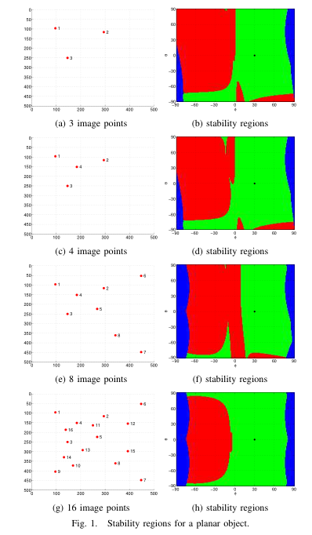
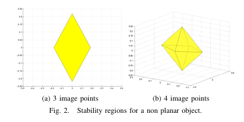
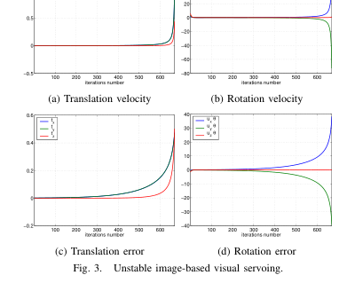

# 깊이 분포 오차에 대한 영상 기반 시각 서보의 강건성 (전문 번역)

- 원제: Robustness of Image-Based Visual Servoing with Respect to Depth Distribution Errors
- 저자: Ezio Malis, Patrick Rives (I.N.R.I.A. Sophia Antipolis, 2004 route des Lucioles, France)
- 출처: IEEE International Conference on Robotics and Automation (ICRA 2003), Taipei, Taiwan, pp. 1056-1061
- DOI: 10.1109/ROBOT.2003.1241732, HAL hal-04647494
- 원문 파일: 같은 폴더의 `MalisRives2003_ICRA_robustness_depth_distribution.pdf`
- 번역 범위: 전문 (초록, 본문 1절~5절, 그림 캡션). 참고문헌은 원문 그대로 둔다.

---

## 초록

이 논문은 관측하는 물체의 깊이에 불확실성이 있을 때 영상 기반 시각 서보 방법의 안정성을 분석한다.
최근 영상 기반 시각 서보 연구는 안정성 문제와 카메라 보정 오차에 대한 강건성에 집중해 왔다.
깊이 추정 오차에 대한 강건성은 거의 다루지 않았다.
깊이 분포를 대충만 근사해도 제어 법칙의 안정성이 보장된다고 흔히들 믿는다.
이 논문에서 우리는 강건성 영역이 그렇게 넓지 않으며, 깊이 분포를 근사할 때 아주 조심해야 함을 증명한다.

## I. 서론

시각 서보는 모르는 환경에서 움직이는, 보정되지 않은 동적 시스템을 제어하는 매우 유연한 방법이다.
대표적인 용도는 손에 쥔 카메라의 정보로 로봇의 위치를 잡고 물체를 따라가는 일이다.
문헌에는 여러 비전 기반 제어 법칙이 제안되었다 [1].
모델 기반 시각 서보와 달리 영상 기반 시각 서보는 대상의 전체 모델을 알 필요가 없다 [2].
그 대신 카메라 좌표계에서 물체의 깊이에 대한 어떤 정보는 주어야 한다.
깊이 분포를 대충 근사해도 제어 법칙의 안정성에는 충분하다고 흔히 믿는다.
그러나 환경을 전혀 모르고 로봇이 보정되어 있지 않다면, 깊이 추정 오차가 있을 때 시각 서보의 안정성은 심각한 문제가 될 수 있다.

최근 영상 기반 시각 서보의 안정성 연구는 수렴 문제를 푸는 데 집중했다 [3].
영상 기반 방법은 국소적인 방법이어서, 보정 오차가 전혀 없어도 처음 카메라 변위가 너무 크면 실패할 수 있다 [3].
이런 수렴 문제를 피하려고 여러 접근이 제안되었다.
하이브리드 접근에서는 현재 영상과 기준 영상 사이의 카메라 변위를 추정해 전역 정보를 넣는다 [4] [5] [6].
카메라의 회전은 직교 공간에서 바로 제어하고, 평행이동은 영상 기반 정보로 제어한다.
[4]에서 쓰는 영상 기반 정보는 영상점 하나뿐이다.
그래서 이 방법은 나머지 모든 점의 깊이를 추정할 필요가 없고, 그 한 점의 깊이를 양수로만 근사하면 안정하다 [7].
반대로 다른 하이브리드 접근 [6], [5]는 영상의 모든 정보를 쓰므로 깊이 분포 추정이 필요하다.
더 최근에는 카메라 변위 복원을 피하려고 분할(partitioned) 접근 [8]이 제안되었지만, 이 역시 깊이 분포 추정에 크게 의존한다.
이런 이유로 하이브리드 접근([7]은 예외)과 분할 접근의 안정성 분석은 표준 영상 기반 시각 서보만큼이나 어렵다.

영상 기반 접근의 잠재적 안정성 문제를 푸는 또 다른 해법은 보간 접근이다.
이 방법들은 처음 영상 특징과 기준 영상 특징을 보간해 영상 안에 경로를 정의한다 [9] [10].
그래서 제어 법칙의 매 반복에서 영상 오차가 작게 유지된다.
보간 접근이 표준 영상 기반 시각 서보의 수렴 문제에 대한 우아한 해법이기는 하지만, 근본적인 이론 질문이 남는다.
영상 기반 시각 서보는 보정 오차에 대해 얼마나 강건한가?
문제가 복잡해서 보정 오차가 있을 때의 안정성 분석에 대한 이론 결과는 몇 개 되지 않는다.
이론 분석은 아주 단순한 경우에서만 이루어졌고 [11] [12] [13], 카메라 내부 파라미터를 단순한 모형으로 두는 경우가 많았으며, 깊이 분포는 늘 완벽하게 추정되었다고 가정했다.
이 논문에서 우리는 깊이 분포 오차에 대한 영상 기반 시각 서보의 강건성을 조사한다.
여기서 제안하는 분석은 순수 영상 기반 시각 서보에만 한정되지 않고, 영상 기반 특징을 여럿 쓰는 최근의 하이브리드 접근과 분할 접근 [6], [5], [8]으로도 확장할 수 있다.

## II. 이론 배경

### A. 투시 투영

F0를 물체에 붙인 좌표계라 하고, 물체는 3차원 점 n개의 동차 좌표 X_i = (X_i, Y_i, Z_i, 1), i = {1, 2, ..., n}로 나타낸다.
F를 현재 카메라 좌표계라 하고, 그 원점이 투영 중심과 겹친다고 하자.
투영 평면은 (x, y) 평면과 평행하다고 하자.
일반성을 잃지 않고 두 평면 사이 거리를 1로 둘 수 있다.
3차원 점 X_i (P3 안의 점)는 정규화 동차 좌표를 가진 점 m_i (P2 안의 점)로 투영된다.

> (1) m_i = (1/Z_i) [R0 t0] X_i = (x_i, y_i, 1)

여기서 R0와 t0는 각각 좌표계 F0와 F 사이의 회전과 평행이동이다.
핀홀 카메라는 3차원 점을 투시 투영한다.
카메라가 재는 정보는 영상점이다.

> (2) p_i = K m_i = (u_i, v_i, 1)

여기서 상삼각 행렬 K는 카메라 내부 파라미터를 담는다.
카메라 내부 파라미터 K의 근사 K^와 측정한 영상점 p_i가 있으면 식 (2)에서 대응하는 정규화 점을 계산할 수 있다: m^_i = K^^(-1) p_i.
당연히 카메라 내부 파라미터를 완전히 알면 (K^ = K) 정규 좌표도 완벽히 추정된다 (m^_i = m_i).

### B. 영상 기반 시각 서보

(2n x 1) 벡터 s = (s_1, s_2, ..., s_n)을 보자. 여기서 s_i = (x_i, y_i)는 m_i에서 뽑은 정규화 좌표를 담은 (2 x 1) 벡터다.
s_i의 시간 미분은 다음과 같다.

> s_i' = L_i(Z_i, s_i) v

여기서 v는 카메라의 속도이고 L_i는 (2 x 6) 상호작용 행렬 [2]이며, 두 개의 (2 x 3) 부분행렬 L_i = [A_i  B_i]로 나눌 수 있다.

> (3) A_i(Z_i, s_i) = (1/Z_i) [ -1  0  x_i ; 0  -1  y_i ]
>
> (4) B_i(s_i) = [ x_i y_i  -(1 + x_i^2)  y_i ; (1 + y_i^2)  -x_i y_i  -x_i ]

벡터 s의 미분을 보면

> s' = L(z, s) v

이고, L = (L_1, L_2, ..., L_n)은 (2n x 6) 상호작용 행렬이다.
L 역시 두 개의 (2n x 3) 부분행렬로 나눌 수 있다.

> L(z, s) = [ A(z, s)  B(s) ]

여기서 A = (A_1, A_2, ..., A_n), B = (B_1, B_2, ..., B_n)이다.
행렬 A(z, s)의 형태 때문에 다음도 성립한다.

> A(z, s) = D(z) C(s)

여기서

> D(z) = diag(1/Z_1, 1/Z_1, 1/Z_2, 1/Z_2, ..., 1/Z_n, 1/Z_n)

는 깊이 분포 z를 담은 (2n x 2n) 대각행렬이다.
다음 과제 함수를 생각하자 [2].

> e = L^+ (s - s*)

여기서 L^+는 참 (2n x 6) 상호작용 행렬의 근사의 유사역행렬이다.
[2]에서는 행렬 L^+를 상수로 두지만, 이 논문에서는 행렬이 상수가 아닌 가장 일반적인 경우를 다룬다.
그 경우 과제 함수의 미분은 다음과 같다.

> (5) e' = (dL^+/dt)(s - s*) + L^+ s' = ( O(s - s*) + L^+ L ) v

여기서 O(s - s*)는 (6 x 6) 행렬이고 s = s*일 때 O(s - s*) = 0이다.
다음 제어 법칙을 생각하자.

> (6) v = -λ e

제어 법칙을 계산하려면 근사한 상호작용 행렬 L^을 주어야 한다.

## III. 안정성 분석

식 (6)을 식 (5)에 넣으면 다음 닫힌 루프 식을 얻는다.

> (7) e' = -λ ( O(s - s*) + L^+ L ) e

제어 이론에서 잘 알려진 대로, 비선형 시스템 (7)은 선형화한 시스템이 안정할 때에만 s = s* 근방에서 국소 점근 안정이다.

> (8) e' = λ Q e

여기서 Q = -L^+ L 를 s = s*에서 평가한 것이다.
선형 시스템 (8)은 Q의 고윳값 실수부가 모두 음수일 때에만 점근 안정이다.

> real(eig(Q)) = real(eig(-L^+ L)) < 0

행렬 Q = Q(K, K^, z, z^)는 두 묶음의 모르는 파라미터에 의존한다.
당연히 K^ = K이고 z^ = z이면 Q = -I이고 시스템은 안정하다.
강건성 분석의 목표는 피할 수 없는 보정 오차가 있을 때에도 시스템이 안정한지 아는 것이다.
깊이 분포의 적응 추정은 로봇이 보정되어 있고 영상에 시차가 충분할 때에만 가능하다는 점을 적어 둔다.

### A. 카메라 내부 파라미터를 아는 경우

카메라 파라미터를 완벽히 안다고 하자 (즉 K^ = K).
그러면 정규화 점이 완벽히 추정되고 (s^ = s), 추정한 상호작용 행렬의 불확실성은 깊이 분포 z^에만 의존한다.

> L^(z^, s) = [ A^(z^, s)  B(s) ]

추정 부분행렬 A^(z^, s)는 참 부분행렬 A(z, s)의 함수로 쓸 수 있음을 쉽게 확인할 수 있다.

> (9) A^(z^, s) = D(z^) C(s) = Γ^(-1)(z, z^) A(z, s)

여기서 γ_i = Z^_i / Z_i 를 추정 깊이와 참 깊이의 비라고 두면 대각행렬 Γ는 다음과 같다.

> Γ = D(z) D^(-1)(z^) = diag(γ_1, γ_1, γ_2, γ_2, ..., γ_n, γ_n)

식 (9)에서 다음을 얻는다.

> L^(z^, s) = [ Γ^(-1) A(z, s)   B(s) ]

Δ = Γ^(-1) - I 로 두면 다음을 얻는다.

> L^ = L + [ Δ A(z, s)   0 ]

A = A(z, s)로 두면 행렬 Q는

> Q = -L^+ L = -I - L^+ [ Δ A   0 ]

L^이 full rank이면 유사역행렬은 다음처럼 쓸 수 있다.

> L^+ = [ A^- ; B^- ]

여기서 A^-는 A^의 일반화 역행렬이고 (A^- A^ = I), B^-는 B의 일반화 역행렬이다 (B^- B = I).
또한 A^- B = 0, B^- A^ = 0임도 적어 둔다. 행렬 Q는 다시 다음처럼 쓸 수 있다.

> Q = -I - [ A^- ; B^- ] [ Δ A   0 ] = -[ I + A^- Δ A   0 ; B^- Δ A   I ]

다시 Δ = Γ^(-1) - I 로 두면

> Q = [ Q11  Q12 ; Q21  Q22 ] = [ -A^- Γ^(-1) A   0 ; -B^- Δ A   -I ]

따라서 닫힌 루프 행렬은 블록 하삼각이다.
이 경우 Q의 고윳값은 두 개의 (3 x 3) 행렬 Q11과 Q22의 고윳값이라는 사실이 잘 알려져 있다.
Q22 = -I이므로 깊이 분포를 어떻게 고르든 그 고윳값은 음수다.
그래서 분석은 다음 행렬의 고윳값으로 좁혀진다.

> Q11 = -A^- Γ^(-1) A = - Σ(i=1..n) γ_i A^-_i A_i

여기서 A_i는 행렬 A의 부분행렬이다. 다음을 적어 둔다.

> A^- A = Σ(i=1..n) A^-_i A_i = I

분석의 첫 번째 중요한 결과는, 깊이 분포를 양의 상수배까지만 맞게 추정해도 된다는 것이다.
그 상수배는 서보의 성능에만 영향을 줄 뿐 안정성에는 영향을 주지 않는다. 고윳값의 부호를 바꾸지 않기 때문이다.
그래서 일반성을 잃지 않고 합에서 γ_j > 0을 밖으로 뺄 수 있다.

> Q11 = -γ_j Σ(i=1..n) δ_i A^-_i A_i = γ_j F

여기서 δ_i = γ_i / γ_j 이고 당연히 δ_j = 1이다.
가장 좋은 j를 어떻게 고를지는 III-A.2 절에서 본다.
γ_j > 0이므로 Q11이 안정한 것은 F가 안정한 것과 같다. 그래서 F의 안정성에 집중할 수 있다.

#### 1) 필요충분조건

F의 고윳값은 특성 다항식의 근이다.

> λ^3 - tr(F) λ^2 + (1/2)( tr(F)^2 - tr(F^2) ) λ - det(F) = 0

여기서 tr과 det는 각각 행렬의 대각합과 행렬식이다.
다항식의 근이 음의 실수부를 가질 필요충분조건은 Routh-Hurwitz 정리에서 얻는다.

> tr(F) < 0
>
> tr(F^2) - tr(F)^2 < 0
>
> det(F) < 0
>
> tr(F)( tr(F)^2 - tr(F^2) ) - 2 det(F) < 0

이 필요충분조건으로 서보의 안정성을 시험하고 강건성 영역을 얻을 수 있다 (예: IV-A 절의 시뮬레이션).
그러나 파라미터 수가 많으면 계산 시간이 길어질 수 있다.
어떤 경우에는 깊이 추정 정밀도에 한계 |δ_i| ≤ ε_i 가 주어졌을 때 고윳값이 음수인지 아는 간단한 시험이 더 낫다.
다음 절에서 강건성 영역의 근사를 얻기 위한 간단한 충분조건을 제시한다.

#### 2) 충분조건

δ_j = 1이므로 (3 x 3) 행렬 F를 다음처럼 다시 쓸 수 있다.

> F = -A^-_j A_j - Σ(i=1..n, i≠j) δ_i A^-_i A_i

식 A^-_j A_j = I - Σ(i=1..n, i≠j) A^-_i A_i 로부터

> F = -I - Σ(i=1..n, i≠j) δ~_i A^-_i A_i = -I + E(δ~)

여기서 δ~ = (δ~_1, δ~_2, ..., δ~_m)이고 δ~_i = δ_i - 1이다.
행렬 F는 행렬 -I의 섭동으로 볼 수 있고, E(δ~)가 섭동 행렬이다.
행렬 M~의 행렬 M에 대한 스펙트럼 변동(SPECTRAL VARIATION)을 다음처럼 정의하자 [14].

> sv_M(M~) = max_i min_j | λ~_i - λ_j |

Bauer-Fike 정리 [14]에 따르면

> sv_M(M~) ≤ || M~ - M ||

우리 경우에 F의 -I에 대한 스펙트럼 변동에 Bauer-Fike 정리를 적용하면

> sv(F) = max_i | λ~_i + 1 | ≤ || E(δ~) ||

따라서 F의 안정성에 대한 간단한 충분조건은 || E(δ~) || < 1이다.
실제로 || E(δ~) || < 1이면

> (10) max_i | λ~_i + 1 | < 1

이고 이는 λ~_i < 0을 뜻한다.
스펙트럼 변동의 정의에서 다른 모든 고윳값 λ~_k는 | λ~_k + 1 | ≤ | λ~_i + 1 |을 만족한다.
따라서 모든 k에 대해 | λ~_k + 1 | < 1이고, 이는 λ~_k < 0을 뜻한다.
이제 E(δ~) = -Σ(i=1..n, i≠j) δ~_i A^-_i A_i 이므로

> || E || ≤ Σ(i=1..n, i≠j) | δ~_i | || A^-_i A_i ||

μ_i = || A^-_i A_i || > 0 으로 두면 조건 (10)은 위 부등식을 눌러서 만들 수 있다.

> (11) Σ(i=1..n, i≠j) μ_i | δ~_i | < 1

이 부등식에서 각 오차 | δ~_i |는 스칼라 μ_i로 가중된다.
μ_i가 작을수록 | δ~_i |는 커질 수 있다.
따라서 점 j의 가장 좋은 선택은 μ_j = max_k μ_k 이다.
부등식 (11)은 축이 스칼라 μ_i로 가중된 다각형 영역을 정의한다.
이 영역의 부피 V = Π(i=1..n, i≠j) μ_i 가 강건성 영역의 크기를 재는 척도가 된다.
모든 점에서 측정 정밀도가 같다고 하면 (| δ~_i | ≤ ε)

> (12) ε < 1 / Σ(i=1..n, i≠j) μ_i

이것이 국소 안정성에 대한 아주 간단한 시험이다.

### B. 카메라 내부 파라미터를 모르는 경우

카메라 내부 파라미터를 모르면 분석은 앞 절처럼 단순해지지 않는다.
행렬 Q는 더 이상 삼각이 아니고 추정한 카메라 내부 파라미터 K^에도 의존한다 [11].
따라서 시스템의 안정성을 시험하려면 행렬의 고윳값 여섯 개를 모두 봐야 한다.
그 결과 안정 영역은 줄어들고, 깊이 추정에 더 높은 정밀도가 필요하다.

## IV. 시뮬레이션 결과

앞 절에서 얻은 안정성 결과를 시뮬레이션으로 시험했다. 시험은 세 묶음이다.
첫째 묶음에서는 대상이 평면이다.
이 경우 평면 위의 점이 몇 개든 안정성 분석은 추정한 평면 법선에만 의존한다.
따라서 필요충분조건에서 정확한 강건성 영역을 얻는다.
둘째 묶음에서는 3차원 물체를 본다. 이 경우 충분조건이 근사 강건성 영역을 준다.
마지막 시뮬레이션에서는 깊이 분포 오차가 시각 서보에 주는 영향을 보인다.

### A. 평면 물체

> 그림 1. 평면 물체의 안정 영역.
> (a) 영상점 3개, (b) 안정 영역, (c) 영상점 4개, (d) 안정 영역,
> (e) 영상점 8개, (f) 안정 영역, (g) 영상점 16개, (h) 안정 영역.

물체가 평면이면 깊이는 평면의 법선 n과 관계가 있고, 투영 중심에서 평면까지의 거리 d에 비례한다.

> Z_i = d / (n^T m_i)

여기서 n은 두 파라미터의 함수인 단위 벡터다: n(α, β) = ( cos(α) sin(β), sin(α) sin(β), cos(β) ).
추정 깊이 Z^_i는 n(α, β)와 d의 근사를 써서 얻는다.

> Z^_i = d^ / (n^^T m_i)

그러면

> γ_i = Z^_i / Z_i = (d^ / d) ( n^T m_i / n^^T m_i )
>
> δ_i = γ_i / γ_j = ( n^T m_i / n^^T m_i ) ( n^^T m_j / n^T m_j )

예상대로 시각 서보의 안정성은 d에 의존하지 않고 n에만 의존한다.
그림 1은 같은 평면 위의 점 개수를 늘려 가며 (α, β)에 대한 안정 영역을 보여 준다.
참 법선은 n = (0.5, 0, 0.866), 즉 α = 0이고 β = π/6이다.
초록 영역에서는 고윳값이 모두 음수이고 시스템은 국소 점근 안정이다.
빨강 영역에서는 고윳값이 적어도 하나 양수이고 시스템은 국소 불안정이다.
파랑 영역에서 나오는 법선은 깊이가 적어도 하나 음수가 되므로 버린다. 음의 깊이는 불가능하다.
영상점 3개를 쓰면 (그림 1(a)) 대응하는 안정 영역이 그리 넓지 않다.
다른 점들이 만드는 삼각형 안에 점 하나를 더해도 (그림 1(c)) 안정 영역은 조금만 바뀐다 (그림 1(b)와 (d)를 비교하라).
그래서 기준 영상을 배울 때 영상 안에 퍼진 점을 고르는 편이 아마 더 낫겠다고 생각할 수 있다.
그런데 안정성 분석은 그 생각이 늘 맞지는 않음을 보여 준다.
실제로 그림 1(e)처럼 점 4개를 더 넣으면 초록 안정 영역은 오히려 줄어든다 (그림 1(f)).
평면의 3차원 위치를 전혀 모를 때 n^ = (0, 0, 1)로 단순히 찍으면 시각 서보가 불안정해진다는 점도 적어 둔다.
반대로 그림 1(g)처럼 많은 점이 영상 전체에 잘 퍼져 있으면 안정 영역은 상당히 커진다 (그림 1(h)).
그러나 이렇게 아주 유리한 경우에도 큰 빨강 불안정 영역이 남는다.

### B. 비평면 물체

> 그림 2. 비평면 물체의 안정 영역. (a) 영상점 3개, (b) 영상점 4개.

대상이 평면이 아니면 충분조건을 쓰는 편이 쉽다.
시뮬레이션에서는 그림으로 나타낼 수 있는 점 3개와 4개의 안정 영역을 보인다.
첫 경우에 μ_1 = 0.1861, μ_2 = 0.2188을 얻었다 (그림 2(a)).
평면 밖의 점을 하나 더하면 μ_1 = 0.1861, μ_2 = 0.2188, μ_3 = 0.2235를 얻는다 (그림 2(b)).
차원이 더 높은 문제에서는 볼록 다면체의 부피가 깊이 분포 측정에 필요한 정밀도의 감을 준다.

### C. 시각 서보

> 그림 3. 불안정한 영상 기반 시각 서보.
> (a) 평행이동 속도, (b) 회전 속도, (c) 평행이동 오차, (d) 회전 오차. 가로축은 반복 횟수.

논문에서 제안한 이론 분석이 쓸모 있음을 보이려고 여러 예를 모의했다.
모든 예에서 처음 카메라 변위는 아주 작다.
평행이동 t = (-0.001, 0.001, 0.001) 미터, 회전 r = (0.48, 0.96, 1.44) 도다.

먼저 충분조건이 만족될 때 시각 서보가 국소 안정함을 확인했다.
식 (12)에서 | δ~_i | < ε = 0.06 이면 시각 서보가 안정함을 얻는다.
참 깊이는 z = (0.91, 0.83, 0.87, 0.86, 0.91, 0.89) m이고, 추정 깊이는 참 깊이의 평균인 z^ = (0.88, 0.88, 0.88, 0.88, 0.88, 0.88) m이다.
최대 오차는 참 깊이의 6 %다.
위 자료에서 δ~_1 = 0.047, δ~_2 = 0.052, δ~_4 = 0.017, δ~_5 = 0.039, δ~_6 = 0.021을 얻는다.
따라서 충분조건이 만족되고 시각 서보는 안정하다.
그런데 내부 파라미터에 10 % 오차를 더하면 시각 서보는 더 이상 안정하지 않다는 점을 눈여겨봐야 한다.
이는 카메라 보정 오차가 있으면 안정 영역이 줄어든다는 것을 보여 준다.

첫 시뮬레이션에서는 필요충분조건이 만족되지 않으면 시각 서보가 불안정함을 보인다.
참 깊이 분포는 z = (0.94, 0.85, 0.94, 0.85, 0.95, 0.94) m이고, 추정 깊이 분포는 z^ = (0.91, 0.91, 0.91, 0.91, 0.91, 0.91) m이다.
추정 깊이의 최대 오차가 참 깊이의 8 %밖에 되지 않는데도 고윳값 하나가 양수다.
그래서 기준 자리에 아주 가까이에서 시작해도 반복 200회 뒤부터 평행이동 오차와 회전 오차가 커지기 시작한다 (그림 3(c), 3(d)).
처음에는 나머지 지배 고윳값들의 실수부가 음수라서 제어 법칙이 안정해 보인다.
이 경우 충분조건도 만족되지 않으므로 서보가 불안정할 것임을 미리 알 수 있다.
따라서 서보를 시작하기 전에 깊이 분포의 정밀도가 충분한지 아는 일이 유용하다.

> 그림 4. 잡음이 있는 불안정한 영상 기반 시각 서보.
> (a) 평행이동 속도, (b) 회전 속도, (c) 평행이동 오차, (d) 회전 오차. 가로축은 반복 횟수.
> (그림 4는 원문 7쪽에 있고 배치는 그림 3과 같다. 별도 이미지는 넣지 않았다.)

둘째 시뮬레이션은 첫째와 같지만 영상에 가우스 잡음 (σ = 1 화소)을 더한 것이다.
영상 잡음은 서보의 발산을 더 빠르게 만든다 (그림 4).

## V. 결론

이 논문에서 우리는 영상 기반 시각 서보에서 대상의 깊이 분포를 근사할 때 아주 조심해야 함을 보였다.
실제로 깊이 분포에 오차가 있을 때 안정 영역은 그리 넓지 않다.
그 결과 대상의 기하를 전혀 모른다면 깊이를 정확히 추정해야 한다.
앞으로는 이 논문이 제안한 충분조건에서 얻는 한계 안으로 정밀도를 묶어 깊이 분포를 오프라인으로 추정하는 일을 연구할 것이다.

## 감사의 글

이 연구는 ROBEA의 AEROB 과제 "Robotique et Entites Artificielles"의 지원을 받았다.

## VI. REFERENCES (원문 그대로)

[1] S. Hutchinson, G. D. Hager, and P. I. Corke, "A tutorial on visual servo control," IEEE Transaction on Robotics and Automation, vol. 12, no. 5, pp. 651-670, October 1996.

[2] B. Espiau, F. Chaumette, and P. Rives, "A new approach to visual servoing in robotics," IEEE Transaction on Robotics and Automation, vol. 8, no. 3, pp. 313-326, June 1992.

[3] F. Chaumette, "Potential problems of stability and convergence in image-based and position-based visual servoing," in The confluence of vision and control, D. Kriegman, G. Hager and A. Morse Editors, vol. 237 of LNCIS Series, pp. 66-78. Springer Verlag, 1998.

[4] E. Malis, F. Chaumette, and S. Boudet, "2 1/2 d visual servoing," IEEE Transaction on Robotics and Automation, vol. 15, no. 2, pp. 234-246, April 1999.

[5] G. Morel, J. Szewczyk, S. Boudet, and J. Pot, "Explicit incorporation of 2d constraints in vision based control of robot manipulators," in Proc. ISER99 : Experimental Robotics IV, Sidney, Australia, April 1999, pp. 99-108.

[6] K. Deguchi, "Optimal motion control for image-based visual servoing by decoupling translation and rotation," in IEEE International Conference on Intelligent Robots and Systems, October 1998, vol. 2, pp. 705-711.

[7] E. Malis and F. Chaumette, "Theoretical improvements in the stability analysis of a new class of model-free visual servoing methods," IEEE Transaction on Robotics and Automation, vol. 18, no. 2, pp. 176-186, April 2002.

[8] P. Corke and S. Hutchinson, "A new partitioned approach to image-based visual servo control," IEEE Transaction on Robotics and Automation, vol. 14, no. 4, pp. 507-515, Aug. 2001.

[9] K. Hashimoto and T. Noritsugu, "Enlargement of stable region in visual servo," in IEEE Conference on Decision and Control, Sydney, Australia, December 2000, pp. 3927-3932.

[10] Y. Mezouar and F. Chaumette, "Design and tracking of desirable trajectories in the image space by integrating mechanical and visibility constraints," in IEEE International Conference on Robotics and Automation, Seoul, South Korea, May 2001.

[11] B. Espiau, "Effect of camera calibration errors on visual servoing in robotics," in 3rd International Symposium on Experimental Robotics, Kyoto, Japan, October 1993.

[12] C. C. Cheah, S. Kawamura, and S. Arimoto, "Feedback control for robotic manipulator with uncertain kinematics and dynamics," in IEEE International Conference on Robotics and Automation, Belgium, May 1998, vol. 4, pp. 3607-3612.

[13] L. Deng, F. Janabi-Sharifi, and W. J. Wilson, "Stability and robustness of visual servoing methods," in IEEE International Conference on Robotics and Automation, Washington D.C., May 2002, vol. 2, pp. 1605-1609.

[14] G. W. Stewart and Ji-guang Sun, Matrix perturbation theory, Computer Science and Science Computing. Harcourt Brace Jovanovich, 1990.
