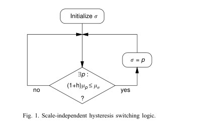
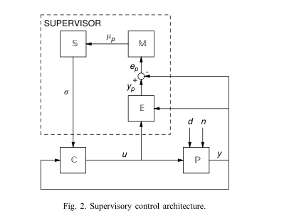

# 불확실 시스템의 감독 제어를 위한 히스테리시스 기반 전환 알고리즘 (전문 번역)

- 원제: Hysteresis-based switching algorithms for supervisory control of uncertain systems
- 저자: João P. Hespanha (UC Santa Barbara), Daniel Liberzon (Univ. of Illinois at Urbana-Champaign), A. Stephen Morse (Yale)
- 출처: Automatica 39 (2003) 263-272, Brief Paper
- DOI: 10.1016/S0005-1098(02)00241-8
- 접수 2001-01-13, 수정 2002-07-04, 채택 2002-09-04
- 원문 파일: 같은 폴더의 `Hespanha2003_Automatica_hysteresis_switching.pdf`
- 번역 범위: 전문 (초록, 1절~6절, 부록, 그림 캡션). 참고문헌은 원문 그대로 둔다.
- 표기: 원문의 수식 기호는 그대로 둔다. μ_p 는 감시 신호, σ 는 전환 신호, h 는 히스테리시스 상수다.

---

## 초록

우리는 연속체 위에 퍼져 있는 미지의 파라미터를 가진 선형 시스템을, 유한한 후보 제어기 집합 사이의 전환으로 제어하는 문제를 다룬다.
이 목적에 맞게 설계한 새로운 히스테리시스 기반 전환 논리를 제시하고, 임의의 시간 구간에서 이 논리가 만드는 전환 횟수의 상한을 끌어낸다.
그 결과로 얻은 전환 제어 알고리즘은 임의의 유계 잡음과 외란, 그리고 충분히 작은 미모형화 동역학에 대해 안정성과 강건성을 준다는 것을 보인다.

키워드: 선형 시스템, 모형 불확실성, 전환 논리, 감독 제어

## 1. 서론

어떤 공정이 미지의 파라미터를 가진 모형으로 표현된다고 하자.
목표는 잡음, 외란, 미모형화 동역학이 있어도 원하는 거동을 내는 되먹임 제어기를 설계하는 것이다.
우리가 생각하는 제어 알고리즘은, 후보 제어기들의 집합 사이에서 전환하고, 제어기 선택을 확실성 등가(certainty equivalence)에 근거해 하는 방식이다.
이 틀에서는 미지 파라미터가 가질 수 있는 각 값마다 감시 신호(monitoring signal)를 하나씩 붙인다.
이 신호가 작다는 것은 그 파라미터 값이 실제 미지 값에 가까울 가능성이 높다는 뜻이 되도록 설계한다.
그러면 전환 알고리즘은 때때로, 감시 신호가 가장 작은 파라미터 값에 맞춰 설계된 제어기를 고른다.

이 맥락에서 중요한 질문은 다음과 같다.
개별 제어기를 어떻게 고르는가?
감시 신호를 어떻게 설계하는가?
어느 제어기로 전환하는가?
언제 전환하는가?

첫 질문에 대해, 여기서 다루는 방법은 선형 강건 제어 이론의 통상적인 기법에 기댈 수 있게 해 준다.
둘째 질문의 답은 뒤에서 다시 볼 감독 제어 구조에서 나온다 (Morse, 1996; Hocherman-Frommer, Kulkarni, & Ramadge, 1998; Mosca, Capecchi, & Casavola, 2001; Pait & Kassab, 1997).
셋째 질문은 확실성 등가 원리가 한 가지 답을 준다.
마지막 질문을 다루려면 전환 논리를 지정해야 한다.
이 논문에서 주로 다루는 것이 바로 이 마지막 질문이다.

전환을 조율하는 한 가지 방법은 체류 시간(dwell-time) 전환 논리다.
이 논리에서는 연이은 전환 시각 사이를 미리 정한 시간 구간, 즉 체류 시간만큼 (적어도) 떨어뜨린다.
이 시간은 전환이 시스템을 불안정하게 만들지 않을 만큼 충분히 길게 잡는다.
체류 시간 전환은 Morse (1996, 1997)에서, 파라미터 불확실성이 연속체이고 잡음, 외란, 미모형화 동역학이 있는 선형 시스템의 설정점 감독 제어 알고리즘을 설계하는 데 쓰였다.

그러나 체류 시간 전환에는 뚜렷한 단점이 있다.
체류 시간을 미리 못 박아 두면, 다음 전환이 허용되기 전에 지금 작동 중인 제어기의 성능이 받아들일 수 없는 수준까지 나빠질 수 있다.
불확실 공정이 비선형이면 궤적이 유한 시간 안에 무한대로 발산할 수도 있다.
이런 점 때문에, 고정된 체류 시간에 기대지 않는 전환 알고리즘을 연구하게 된다.

그런 전환 논리의 예가 Middleton, Goodwin, Hill, and Mayne (1988)과 Morse, Mayne, and Goodwin (1992)에 나온 히스테리시스 전환 논리다.
이 논리에서는, 현재 되먹임 루프에 들어 있는 제어기에 대응하는 감시 신호가 가장 작은 감시 신호를 미리 정한 양수만큼 넘어설 때 전환이 일어난다.
이 양수를 히스테리시스 상수라고 부른다.
덧셈꼴 히스테리시스 상수 대신 곱셈꼴 히스테리시스 상수를 쓰면 척도 독립(scale-independent) 히스테리시스 전환 논리가 된다.
이것은 Hespanha (1998) 등에서 연구되었고 불확실 비선형 시스템 제어에 적용되었다.
적절한 가정을 만족하는 유한한 감시 신호 집합에 대해, 이 논리들은 전환이 유한 시간 안에 멈춘다는 것을 보장한다.
이 덕분에, 미지 파라미터가 유한 집합의 값을 가지고 잡음, 외란, 미모형화 동역학이 없을 때 쓸 수 있는 감독 제어 알고리즘을 설계할 수 있다.

이 논문에서 우리는 척도 독립 히스테리시스 전환 논리를 계속 연구한다.
임의의 유한 구간에서 전환 횟수의 상한을 세우는 것이 그 내용이다.
이것을 평균 체류 시간(average dwell time)을 가진 전환 시스템의 안정성에 관한 Hespanha and Morse (1999)의 결과와 합치면, 미지 파라미터가 유한 집합에 속할 때 감독 제어 알고리즘의 정당성을, 전환이 멈추는 것에 기대지 않고 분석할 수 있다.
이 분석의 자세한 내용은 Hespanha et al. (2001)에 있다.

이 연구의 주된 기여는 미지 파라미터가 연속체에 속하는 경우를 다룬 것이다.
그러려면 새 전환 논리가 필요하고, 우리는 그것을 여기서 만들어 계층적 히스테리시스 전환(hierarchical hysteresis switching)이라 부른다.
이 논리는 파라미터 불확실성 집합을 유한한 개수의 부분집합으로 분할하는 것에 기댄다.
이름이 계층적인 이유는, 감시 신호의 최소화를 두 층에서 하기 때문이다.
먼저 분할을 이루는 각 부분집합마다 가장 작은 값을 취하고, 그 다음 그중 가장 작은 신호를 고른다.
우리는 척도 독립 히스테리시스 전환에 대한 해당 결과를 써서, 계층적 히스테리시스 전환 논리가 만드는 전환 횟수의 상한을 끌어낸다.

계층적 히스테리시스 전환을 쓰는 감독 제어의 맥락에서, (이 논문의 나머지 구성은 다음과 같다.)
척도 독립 히스테리시스 전환 논리와 그 성질은 3절에 나온다.
감독 제어 시스템은 4절에서 설명한다.
그 분석은 5절에 있다.

## 2. 척도 독립 히스테리시스 전환 논리

Hespanha (1998)에서 도입한 척도 독립 히스테리시스 전환 논리는 다음과 같이 작동한다 (그림 1 참고).
이 논리의 입력은 연속 신호 μ_p : [0, ∞) → R, p ∈ P 이다.
지표 집합 P 는 이 논문 내내 유한 차원 노름 선형 벡터 공간의 콤팩트 부분집합으로 둔다.
이 논리의 출력은 P 안의 값을 갖는 전환 신호 σ 다.

h > 0 인 수를 하나 고르고 이것을 히스테리시스 상수라 하자.
먼저 σ(0) = arg min_{p∈P} { μ_p(0) } 으로 둔다.
어느 시각 t_i 에 σ 가 방금 어떤 q ∈ P 로 전환했다고 하자.
그러면 다음 조건을 만족하는 시각 t_{i+1} > t_i 까지 σ 를 그대로 고정한다.

(1 + h) min_{p∈P} { μ_p(t_{i+1}) } ≤ μ_q(t_{i+1})

그 시점에 σ(t_{i+1}) = arg min_{p∈P} { μ_p(t_{i+1}) } 로 둔다.

위 단계를 되풀이하면 어디서나 우연속인 조각별 상수 신호 σ 를 만들게 된다.
만약 μ_p, p ∈ P 가 0에서 균일하게 떨어져 있으면, 즉 어떤 ε > 0 에 대해 모든 p ∈ P 와 모든 t ≥ 0 에서 μ_p(t) ≥ ε 이면, 무한히 빠른 전환(채터링)은 생기지 않는다.
실제로 σ 가 존재하는 최대 길이 구간 [0, T_max) 가 있어야 하고, [0, T_max) 의 모든 진부분구간에서 전환은 유한 번만 일어날 수 있다.
자세한 내용은 Hespanha (1998)를 보라.

위에서 쓴 arg min 이 유일하지 않을 때는, 최솟값을 내는 값들 가운데 σ 의 값을 아무렇게나 골라도 된다.
P 가 유한 집합이면 P 위의 최소화는 쉬운 일이다.
P 가 연속체이면, 관심 있는 많은 경우에 (미지 파라미터가 공정 모형에 선형으로 들어가는 경우를 포함해) 문제는 p 에 대한 다항 방정식을 온라인으로 푸는 일로 줄어든다.
감독 제어 맥락에서 위 최소화 절차의 계산 가능성 문제는 Morse (1996)에서 더 다룬다.

위 전환 논리의 정의에서 쉽게 알 수 있듯, 신호 μ_p, p ∈ P 를 다음처럼 척도를 바꾼 것으로 바꾸어도 출력은 달라지지 않는다.

μ̄_p(t) := γ(t) μ_p(t),  p ∈ P   (1)

여기서 γ 는 시간의 어떤 양의 함수다.
"척도 독립"이라는 말은 여기서 나왔다.
γ 를 골라서 척도를 바꾼 신호 μ̄_p, p ∈ P 가 단조성 같은 추가 성질을 갖게 한 다음, 그 신호를 분석에 쓸 수도 있다 (아래 참고).

> 그림 1. 척도 독립 히스테리시스 전환 논리.
> (초기화 → σ = p 로 설정 → "μ_p ≤ ... (1+h)μ_σ ... ?" 판정에서 yes 면 다시 σ = p 로 갱신하고, no 면 유지하는 순환 흐름도.)

0 ≤ t_0 < t < T_max 에 대해, 구간 (t_0, t) 에서 σ 의 불연속 횟수를 N_σ(t, t_0) 로 쓴다.
P 가 유한한 경우에 대해 다음 결과가 성립한다.

### 보조정리 1 (척도 독립 히스테리시스 전환 보조정리)

P = {1, 2, ..., m} 이고 m 은 양의 정수라 하자.
신호 μ_p, p ∈ P 가 연속이고 단조 증가하며, 모든 p ∈ P 에서 μ_p(0) ≥ ε 인 수 ε > 0 가 있다고 하자.
그러면 임의의 지표 l ∈ P 와 0 ≤ t_0 < t < T_max 를 만족하는 임의의 수 t_0, t 에 대해 다음이 성립한다.

N_σ(t, t_0) ≤ 1 + m + (m / log(1+h)) * log [ μ_l(t) / min_{p∈P} μ_p(t_0) ]   (2)

그리고

Σ_{k=0}^{N_σ(t,t_0)} [ μ_{σ(t_k)}(t_{k+1}) − μ_{σ(t_k)}(t_k) ] ≤ m [ (1+h) μ_l(t) − min_{p∈P} μ_p(t_0) ]   (3)

여기서 t_1 < t_2 < ... < t_{N_σ(t,t_0)} 는 (t_0, t) 에서 σ 의 불연속점이고 t_{N_σ(t,t_0)+1} := t 이다.

### 비고 1

부등식 (3)의 좌변은 구간 [t_0, t] 에서 μ_σ 의 변동량으로 볼 수 있다.
신호 μ_p, p ∈ P 가 (조각별) 미분 가능하면, (3)의 좌변은 적분 ∫_{t_0}^{t} μ̇_{σ(τ)}(τ) dτ 와 같다.
이 적분은 σ 가 상수인 구간들에서의 적분의 합으로 해석한다.

### 증명

각 k ∈ {0, 1, ..., N_σ(t, t_0)} 에 대해, σ 의 값은 [t_k, t_{k+1}) 에서 σ(t_k) 로 상수다.
따라서

μ_{σ(t_k)}(τ) ≤ (1+h) μ_p(τ),  τ ∈ [t_k, t_{k+1}], k ∈ {0, 1, ..., N_σ(t,t_0)}, p ∈ P   (4)

σ 가 시각 t_k 에 σ(t_k) 로 전환했으므로 (k ∈ {1, 2, ..., N_σ(t,t_0)}), 다음도 성립한다.

μ_{σ(t_k)}(t_k) ≤ μ_p(t_k),  k ∈ {1, 2, ..., N_σ(t,t_0)}, p ∈ P   (5)

또한 σ 는 시각 t_{k+1} 에 σ(t_k) 에서 σ(t_{k+1}) 로 전환했다 (k < N_σ(t,t_0)).
그러므로 μ_{σ(t_k)} 의 연속성에 의해

μ_{σ(t_k)}(t_{k+1}) = (1+h) μ_{σ(t_{k+1})}(t_{k+1}),  k ∈ {0, 1, ..., N_σ(t,t_0) − 1}   (6)

부등식 (4)~(6)은 이 증명에 필요한 전환 논리의 성질을 모두 담고 있다.

P 가 m 개의 원소를 가지므로, 아래 구간들 가운데 적어도 N := ⌈(N_σ(t,t_0) − 1)/m⌉ 개에서 σ = q 가 되는 q ∈ P 가 있어야 한다.

[t_1, t_2), [t_2, t_3), ..., [t_{N_σ(t,t_0)−1}, t_{N_σ(t,t_0)})   (7)

(주: 스칼라 a 에 대해 ⌈a⌉ 는 a 보다 크거나 같은 가장 작은 정수를 뜻한다.)

N ≤ 1 이면 N_σ(t,t_0) ≤ 1 + m 이므로 (2)는 저절로 성립한다.
이제 N ≥ 2 라 하고, σ = q 인 N 개의 구간을 [t_{k_1}, t_{k_1+1}), [t_{k_2}, t_{k_2+1}), ..., [t_{k_N}, t_{k_N+1}) 라 하자.
아무 i ∈ {1, 2, ..., N−1} 을 고르면, (6)과 μ_{σ(t_{k_i+1})} 의 가정된 단조성, 그리고 (5)에 의해 다음을 얻는다.

μ_q(t_{k_i+1}) = (1+h) μ_{σ(t_{k_i+1})}(t_{k_i+1}) ≥ (1+h) μ_{σ(t_{k_i+1})}(t_{k_i}) ≥ (1+h) μ_q(t_{k_i})   (8)

게다가 구간들이 겹치지 않으므로 t_{k_{i+1}} ≥ t_{k_i+1} 이고, 따라서 μ_q(t_{k_{i+1}}) ≥ μ_q(t_{k_i+1}) 이다.
여기서와 (8)에서 i ∈ {1, 2, ..., N−1} 에 대해 (1+h) μ_q(t_{k_i}) ≤ μ_q(t_{k_{i+1}}) 를 얻는다.
이 마지막 부등식을 i = 1 부터 N−1 까지 되풀이하면 (1+h)^{N−1} μ_q(t_{k_1}) ≤ μ_q(t_{k_N}) 이 되고, (5)에 의해 모든 l ∈ P 에 대해 (1+h)^{N−1} μ_q(t_{k_1}) ≤ μ_l(t_{k_N}) 이다.
μ_p 의 단조성을 쓰면 모든 l ∈ P 에 대해 (1+h)^{N−1} μ_q(t_0) ≤ μ_l(t) 를 얻는다.
이로부터 모든 l ∈ P 에 대해 (1+h)^{N−1} min_{p∈P} μ_p(t_0) ≤ μ_l(t) 여야 하고, N ≥ (N_σ(t,t_0) − 1)/m 이라는 사실에서 부등식 (2)가 따라 나온다.

이제 부등식 (3)이 성립함을 보이면 된다.
(3)의 좌변 합에서 σ(t_k) 가 같은 항들을 모으면 다음을 얻는다.

Σ_{k=0}^{N_σ(t,t_0)} [ μ_{σ(t_k)}(t_{k+1}) − μ_{σ(t_k)}(t_k) ] = Σ_{q∈P} Σ_{k: σ(t_k)=q} [ μ_q(t_{k+1}) − μ_q(t_k) ]   (9)

(t_0, t) 에서 σ 가 취하는 어떤 값 q ∈ P 를 잡자.
구간 (7)이 겹치지 않으므로 μ_q 의 단조성에서 다음이 따른다.

Σ_{k: σ(t_k)=q} [ μ_q(t_{k+1}) − μ_q(t_k) ] ≤ μ_q(t_{k_q+1}) − μ_q(t_0)   (10)

여기서 k_q 는 σ(t_k) = q 인 가장 큰 지표 k ∈ {0, 1, ..., N_σ(t,t_0)} 를 뜻한다.
이제 (4)에 의해 모든 l ∈ P 에 대해 μ_q(t_{k_q+1}) ≤ (1+h) μ_l(t_{k_q+1}) 이다.
여기서와 (10), 그리고 μ_p 의 단조성에서 모든 l ∈ P 에 대해 다음을 얻는다.

Σ_{k: σ(t_k)=q} [ μ_q(t_{k+1}) − μ_q(t_k) ] ≤ (1+h) μ_l(t) − min_{p∈P} μ_p(t_0)

부등식 (3)은 이것과 (9), 그리고 P 가 m 개의 원소를 가진다는 사실에서 따라 나온다. ∎

## 3. 계층적 히스테리시스 전환

이제 계층적 히스테리시스 전환 논리를 설명한다.
입력은 연속 신호 μ_p, p ∈ P 이고, P 는 앞처럼 콤팩트 지표 집합이다.
양의 정수 m 을 고정하고 집합 {1, 2, ..., m} 을 M 이라 쓴다.
P 의 닫힌 부분집합족 D_i, i ∈ M 이 주어졌다고 하고, 이들의 합집합은 P 전체다.
전환 논리의 출력은 M 안의 값을 갖는 전환 신호 σ 다.

히스테리시스 상수라 부르는 수 h > 0 을 고른다.
먼저 D_{j_0} 가 arg min_{p∈P} { μ_p(0) } 을 포함하는 j_0 ∈ M 을 골라 σ(0) = j_0 으로 둔다.
어느 시각 t_i 에 σ 의 값이 방금 어떤 j_i ∈ M 으로 전환했다고 하자.
그러면 다음 부등식이 만족되는 시각 t_{i+1} > t_i 까지 σ 를 고정한다.

(1 + h) min_{p∈P} { μ_p(t_{i+1}) } ≤ min_{p∈D_{j_i}} { μ_p(t_{i+1}) }

이 시점에 arg min_{p∈P} { μ_p(t_{i+1}) } 을 포함하는 j_{i+1} ∈ M 을 골라 σ(t_{i+1}) = j_{i+1} 로 둔다.

위 절차는 어디서나 우연속인 조각별 상수 신호 σ 를 만든다.
Hespanha (1998)와 같은 논증으로, μ_p, p ∈ P 가 0에서 균일하게 떨어져 있으면 채터링이 생기지 않음을 보일 수 있다.
실제로 σ 가 정의되는 최대 구간 [0, T_max) 가 있고, [0, T_max) 의 모든 진부분구간에서 전환은 유한 번만 일어난다.
아래에서 다루는 감독 제어 적용에서는 항상 T_max = ∞ 가 된다.
위에서 쓴 arg min 이 유일하지 않을 때는 최솟값을 내는 지표 가운데 아무거나 고를 수 있다.
여기서 전제하는 바는, D_i 들이 충분히 작으면 D_i 위의 최소화가 계산 가능하다는 것이다.

위 전환 논리도 척도 독립이다.
즉, 신호 μ_p, p ∈ P 를 (1)의 척도 변환판으로 바꾸어도 출력은 달라지지 않는다 (γ 는 시간의 어떤 양의 함수).

### 정의

P 안의 값을 갖는 조각별 상수 신호 σ̄ 가, 구간 [t_0, t] 에서 주어진 전환 신호 σ 에 대해 {D_i}-정합(consistent)이라 함은 다음을 뜻한다.

1. 모든 s ∈ [t_0, t] 에 대해 σ̄(s) ∈ D_{σ(s)} 이다.
2. [t_0, t] 에서 σ̄ 의 불연속점 집합은 σ 의 불연속점 집합의 부분집합이다.

### 비고 2

이 절과 앞 절에서 다룬 전환 논리의 정의에서 바로 따라 나오는 사실을 적어 둔다.
계층적 히스테리시스 전환 논리가 만드는 신호 σ 는, 입력을 min_{p∈D_i} { μ_p(t) }, i ∈ M 으로 두었을 때 척도 독립 히스테리시스 전환 논리가 만들었을 신호와 일치한다.

아래 결과는 이 관찰의 결과다.
앞처럼 0 ≤ t_0 < t < T_max 에 대해 구간 (t_0, t) 에서 σ 의 불연속 횟수를 N_σ(t, t_0) 로 쓴다.

### 보조정리 2 (계층적 히스테리시스 전환 보조정리)

신호 μ_p, p ∈ P 가 연속이고 단조 증가하며, 모든 p ∈ P 에서 μ_p(0) ≥ ε 인 수 ε > 0 가 있다고 하자.
그러면 임의의 지표 l ∈ P 와 0 ≤ t_0 < t < T_max 를 만족하는 임의의 수 t_0, t 에 대해 다음이 성립한다.

N_σ(t, t_0) ≤ 1 + m + (m / log(1+h)) * log [ μ_l(t) / min_{p∈P} μ_p(t_0) ]   (11)

또한 [t_0, t] 에서 σ 에 대해 {D_i}-정합인 신호 σ̄ 가 존재해 다음이 성립한다.

Σ_{k=0}^{N_σ(t,t_0)} [ μ_{σ̄(t_k)}(t_{k+1}) − μ_{σ̄(t_k)}(t_k) ] ≤ m [ (1+h) μ_l(t) − min_{p∈P} μ_p(t_0) ]   (12)

여기서 t_1 < t_2 < ... < t_{N_σ(t,t_0)} 는 (t_0, t) 에서 σ 의 불연속점이고 t_{N_σ(t,t_0)+1} := t 이다.

### 증명

부등식 (11)은 척도 독립 히스테리시스 전환 보조정리(보조정리 1)와 비고 2에서 바로 따라 나온다.
보조정리의 둘째 주장을 만족하는 신호 σ̄ 는 다음처럼 정의할 수 있다.
각 s ∈ [t_0, t] 에 대해 σ̄(s) := arg min_{p∈D_{σ(s)}} { μ_p(t_{k+1}) } 로 둔다.
여기서 k 는 t_k ≤ s 인 가장 큰 지표다.
바꿔 말하면 σ̄(s) = arg min_{p∈D_{σ(s)}} { μ_p(τ) } 이고, τ 는 σ 가 σ(s) 와 같은 [t_0, t] 의 마지막 부분구간의 오른쪽 끝점이다.
그러면 구성에 의해 σ̄ 는 [t_0, t] 에서 σ 에 대해 {D_i}-정합이다.
(12)의 좌변 합에서 σ̄ 가 같은 항들을 모으고, 보조정리 1의 증명과 똑같이 따지면 (12)에 이른다. ∎

### 비고 3

신호 σ̄ 는 시각 t 를 어떻게 고르느냐에 따라 달라진다.
앞처럼 신호 μ_p, p ∈ P 가 (조각별) 미분 가능하면, 부등식 (12)의 좌변은 적분 ∫_{t_0}^{t} μ̇_{σ̄(τ)}(τ) dτ 와 같다.
이 적분은 σ̄ 가 상수인 구간들에서의 적분의 합으로 해석한다.

## 4. 감독 제어 시스템

제어 대상인 불확실 공정 P 가, 제어 입력 u 와 측정 출력 y 를 갖는 SISO 유한 차원 안정화 가능하고 검출 가능한 선형 시스템 모형을 따른다고 하자.
이 시스템은 유계 외란 입력 d 와 유계 출력 잡음 n 으로 교란된다.
u 에서 y 로 가는 P 의 전달 함수가 허용 공정 모형 전달 함수들의 족 ∪_{p∈P} F(p) 에 속한다는 것은 안다고 가정한다.
여기서 p 는 콤팩트 지표 집합 P 안의 값을 갖는 파라미터다.
각 F(p) 는 알려진 공칭 공정 모형 전달 함수 ν_p 를 "중심"으로 하는 전달 함수들의 족을 가리킨다.

관심 문제는 출력 조절(output regulation)을 이루는 되먹임 제어기를 설계하는 것이다.
즉 잡음과 외란 신호가 0일 때 P 의 출력 y 를 0으로 몰고 가야 한다.
또한 임의의 유계 잡음과 외란 입력에 대해 모든 시스템 신호가 유계로 남아야 한다.
뒤에 나오는 모든 내용은, Morse (1996, 1997)처럼 되먹임 루프에 적분기를 하나 더해 설정점 제어라는 더 일반적인 문제로 바로 확장할 수 있다.
MIMO 시스템으로의 확장도 가능하다.

여기서 다루는 종류의 불확실성은 작동 환경의 예측 못 한 변화, 부품 고장, 여러 외부 영향과 결부될 수 있다.
집합 P 는 파라미터 불확실성의 범위를 나타내고, 고정된 각 p ∈ P 에 대해 부분족 F(p) 는 미모형화 동역학을 담당한다.
공칭 공정 모형 전달 함수 ν_p 주변의 허용 미모형화 동역학을 지정하는 방법은 여럿이다 (Hespanha et al. (2001) 참고).
예를 들어 임의의 두 수 ε > 0 와 λ_u > 0 를 잡자. 그러면 각 p ∈ P 에 대해 다음처럼 정의할 수 있다.

F(p) := { ν_p (1 + δ^m_p) + δ^a_p : ‖δ^m_p‖_{∞, λ_u} ≤ ε, ‖δ^a_p‖_{∞, λ_u} ≤ ε }

여기서 ‖δ‖_{∞, λ_u} 는 전달 함수의 e^{λ_u t}-가중 H∞ 노름을 뜻한다.
즉 ‖δ‖_{∞, λ_u} = sup_{ω∈R} |δ(jω − λ_u)| 이다.
이것은 Morse (1996, 1997)에서 다룬 허용 공정 모형 부류를 준다.
이어지는 글에서는 구체성을 위해 미모형화 동역학이 이 방식으로 지정된다고 가정한다.
파라미터 ε 을 미모형화 동역학 한계라 부르겠다.
아래 결과는 Hespanha et al. (2001)에서 연구한 것 같은 다른 허용 공정 모형 부류로도 확장할 수 있다.

보통은 허용 공정 모형 전체 족에 대해 조절 문제를 풀 수 있는 제어기가 하나도 없다.
그래서 실시간으로 얻는 자료에 근거해 동역학을 바꿀 수 있는 제어기를 만들어야 한다.
여기서 다루는 감독 제어의 틀 안에서, 이 일은 감독자(supervisor)라 부르는 "상위" 제어기가 한다.
감독자의 목적은 매개화된 후보 제어기족 {C_q : q ∈ Q} 사이의 전환을 조율하는 것이다. Q 는 지표 집합이다.
이로부터 다중 제어기(multi-controller)라 부르고 C 로 쓰는 전환 제어기가 나온다.
위 제어기족은, 어떤 지표 q ∈ Q 에 대한 제어기 C_q 를 되먹임 루프에 넣으면 모든 허용 공정 모형을 안정화할 수 있을 만큼 풍부해야 한다.
이 논문에서는 Q 가 유한 집합인 경우에 집중한다.
일반성을 잃지 않고 Q = M = {1, 2, ..., m} 으로 둔다. m 은 양의 정수다.

> 그림 2. 감독 제어 구조.
> (감독자 안에 다중 추정기 E, 감시 신호 생성기 M, 전환 논리 S 가 있고, 전환 신호 σ 가 다중 제어기 C 를 고른다. 공정 P 는 외란 d 와 잡음 n 을 받아 출력 y 를 낸다. 추정 오차 e_p = y_p − y 가 M 으로 들어간다.)

감독자는 세 하위 시스템으로 이루어진다 (그림 2).

다중 추정기 E: 공정 P 의 출력 y 와 입력 u 를 입력으로 받고, 신호 y_p, p ∈ P 를 출력하는 동적 시스템이다.
P 의 전달 함수가 공칭 공정 모형 전달 함수 ν_p 와 같고 잡음이나 외란이 없다면, 각 y_p 는 y 로 점근 수렴할 것이다.

감시 신호 생성기 M: 추정 오차

e_p := y_p − y,  p ∈ P

를 입력으로 받고, 추정 오차의 적절히 정의된 적분 노름인 μ_p, p ∈ P 를 출력하는 동적 시스템이다.
이 출력을 감시 신호라 부른다.

전환 논리 S: 감시 신호 μ_p, p ∈ P 를 입력으로 받고, M 안의 값을 갖는 전환 신호 σ 를 출력하는 전환 시스템이다.
σ 는 제어 법칙 u 를 정하는 데 쓰인다.

이제 그림 2에 나오는 각 하위 시스템의 핵심 상태 공간 방정식을 Morse (1996)에서 간단히 가져온다.
i 가 M 위를 훑을 때, 다음을 후보 제어기 전달 함수들의 실현이라 하자. 모두 같은 상태 x_C 를 공유한다.

ẋ_C = A_i x_C + b_i y
u = k_i x_C + r_i y

그런 실현을 만드는 자세한 방법은 Morse (1996)에 있다.
그러면 다중 제어기 C 를 다음 방정식으로 쓴다.

ẋ_C = A_σ x_C + b_σ y
u = k_σ x_C + r_σ y

다중 추정기도 상태 공유 방식으로 실현된다고 가정한다.

ẋ_E = A_E x_E + b_E y + d_E u
y_p = c_p x_E,  p ∈ P

여기서 A_E 는 안정 행렬이다.
이런 구조는 적응 제어에서 흔하다.
다중 추정기와 다중 제어기의 합성 상태 (x_E, x_C) 를 x 로 쓴다.
P 의 전달 함수가 F(p*) 에 속하는 (미지의) 원소 p* ∈ P 를 p* 로 쓴다. 즉 "참" 파라미터 값이다.
(미모형화 동역학 집합이 겹칠 수 있으므로 p* 는 유일하지 않을 수 있다.)
모든 l ∈ P 에 대해 x 의 변화는 다음 꼴의 시스템으로 쓸 수 있다.

ẋ = A_{σ l} x + d_σ e_l   (13)
y = (c_{p*} 0) x − e_{p*}   (14)
u = f_σ x + g_σ e_{p*}   (15)

분할 P = ∪_{i∈M} D_i 가 주어졌고, 행렬 A_{ip}, i ∈ M, p ∈ P 가 다음 안정 여유 성질을 갖는다고 가정한다.
모든 i ∈ M 과 모든 p ∈ D_i 에 대해 행렬 A_{ip} + λ_0 I 가 안정하다. λ_0 는 고정된 양수다.
Morse (1996)의 전개에서, 집합 D_i, i ∈ M 이 충분히 작고 p ∈ D_i 일 때마다 각 C_i 가 p 번째 공칭 공정 모형을 안정화한다면 그런 분할이 존재한다는 것이 따라 나온다.
집합 D_i 는 닫힌 집합으로 둔다.

λ ∈ (0, min{λ_u, λ_0}) 인 수 λ 를 고정한다.
Morse (1996, 1997)에서 보인 대로, 다음과 같은 상수들이 존재한다.
미모형화 동역학 한계 ε 에만 의존하고 ε 이 0으로 갈 때 0으로 가는 양의 상수 ε_1, ε_2.
잡음과 외란 한계에만 의존하고 그 한계가 0으로 갈 때 0으로 가는 양의 상수 B_1, B_2.
시스템 파라미터와 초기 조건에만 의존하는 양의 상수 C_1, C_2.
그러면 폐루프 시스템의 모든 해를 따라 다음이 성립한다.

∫_0^t e^{2λτ} e_{p*}^2(τ) dτ ≤ B_1 e^{2λt} + C_1 + ε_1 ∫_0^t e^{2λτ} u^2(τ) dτ   (16)

그리고

|e_{p*}(t)| ≤ B_2 + C_2 e^{−λt} + ε_2 e^{−λt} √( ∫_0^t e^{2λτ} u^2(τ) dτ )   (17)

위 부등식들은 다중 제어기와 다중 추정기에 거는 기본 요구 조건이며, 이어지는 분석은 이에 의존한다.

상수 λ 는 감시 신호 정의에서 "가중" 설계 파라미터 구실을 한다.
임의의 상수 ε > 0 를 고정한다 (그 역할은 뒤에 분명해진다).
감시 신호 μ_p, p ∈ P 를 다음 식으로 만든다.

Ẇ = −2λ W + (x_E; y)(x_E; y)^T,  W(0) ≥ 0
μ_p := (c_p − 1) W (c_p − 1)^T + ε,  p ∈ P   (18)

여기서 W(t) 는 대칭 비음정 k × k 행렬이고 k := dim(x_E) + 1 이다.
c_p x_E − y = e_p, p ∈ P 이므로 다음을 얻는다.

μ_p(t) = e^{−2λt} μ̃_p(0) + ∫_0^t e^{−2λ(t−τ)} e_p^2(τ) dτ + ε,  p ∈ P

여기서 μ̃_p(0) := (c_p − 1) W(0) (c_p − 1)^T 이다.
감시 신호 생성기의 동역학도, 다중 추정기의 동역학도, P 가 무한 집합이어도 유한 차원임에 유의한다.

마지막으로, 3절에서 설명한 계층적 히스테리시스 전환 논리로 전환 신호 σ 를 정의한다.
집합 D_i, i ∈ M 은 앞서 설명한 대로 고른다.
(1)에서 γ(t) := e^{2λt} 로 두면, 신호 μ̄_p, p ∈ P 는 단조 증가함을 알 수 있다.
다음을 만족하기 때문이다.

μ̄_p(t) = μ̃_p(0) + ∫_0^t e^{2λτ} e_p^2(τ) dτ + ε e^{2λt},  p ∈ P   (19)

게다가 ε > 0 로 두거나 W(0) 을 양정으로 요구하면 μ̄_p, p ∈ P 가 0에서 균일하게 떨어져 있도록 쉽게 보장할 수 있다.
그러므로 보조정리 2를 적용해 부등식 (11)과 (12)가 성립한다고 결론지을 수 있다.
이 경우 신호 μ̄_p, p ∈ P 는 미분 가능하므로, 부등식 (12)의 좌변은 ∫_{t_0}^{t} μ̄̇_{σ̄(τ)}(τ) dτ 와 같다 (비고 3 참고).
(19)에서 다음 공식을 얻는다.

μ̄̇_p(t) = e^{2λt} e_p^2(t) + 2λ ε e^{2λt},  p ∈ P   (20)

## 5. 분석

이제 (13)~(15), (18)과 계층적 히스테리시스 전환 논리로 정의된 감독 제어 시스템을 분석한다.
가끔 불확실 공정 P 의 상태를 가져다 쓰며, 이를 x_P 로 쓴다.
그러나 분석의 중심은 시스템 (13)과 앞서 설명한 안정 여유 성질이다.
(13)에서 l 자리에 σ̄ 를 넣어 얻는 시스템을 생각하자. σ̄ 는 σ 에 대해 {D_i}-정합인 어떤 신호다.

ẋ = A_{σ σ̄} x + d_σ e_{σ̄}   (21)

안정 여유 성질은, 고정된 모든 시각 s ≥ 0 에 대해 행렬 A_{σ(s) σ̄(s)} 가 안정 여유 λ_0 로 안정함을 뜻한다.
제어기 C_{σ(s)} 가 공정을 안정화하지 못하더라도 이것이 참임에 유의한다.
(그 경우 추정 오차 e_{σ̄(s)} 가 클 수 있다. 밑에 깔린 폐루프 시스템의 성질은 추정 오차에 대한 검출 가능성이다. Morse (1996) 참고.)

Hespanha and Morse (1999b)를 따라, 전환 신호 σ 가 평균 체류 시간 τ_AD > 0 를 가진다 함은 다음을 뜻한다.
임의의 구간 (t_0, t) 에서 σ 의 불연속 횟수 N_σ(t, t_0) 가 어떤 비음수 N_0 에 대해 다음을 만족하는 것이다.

N_σ(t, t_0) ≤ N_0 + (t − t_0)/τ_AD   (22)

다음 결과가 필요하다. 지금 가정 아래에서 이것은 Hespanha and Morse (1999b)의 정리 1의 바로 따라 나오는 따름정리다.
이 결과는 전환 시스템

ẋ = A_{σ σ̄} x   (23)

이, 평균 체류 시간이 충분히 큰 모든 σ 와 σ 에 대해 {D_i}-정합인 모든 σ̄ 에 대해 균일하게, 안정 여유 λ 로 지수 안정임을 말한다.

### 보조정리 3

양의 상수 τ 와 c 가 존재해, 평균 체류 시간이 τ_AD ≥ τ 인 모든 전환 신호 σ 와 주어진 구간 [t_0, t] 에서 σ 에 대해 {D_i}-정합인 모든 신호 σ̄ 에 대해, (23)의 모든 해가 다음을 만족한다.

|x(t)| ≤ c e^{−λ(t−t_0)} |x(t_0)|

이 보조정리가 지정하는 수를 τ 라 하자. 이것은 (Hespanha and Morse, 1999b, 정리 1)의 증명에서 명시적으로 계산할 수 있다.
보조정리 3의 바로 따라 나오는 따름정리는, 시스템 (21)이 유한한 e^{λt}-가중 L2-대-L∞ 유도 노름을 가진다는 것이다.
이는 평균 체류 시간이 τ 보다 작지 않은 모든 σ 와 σ 에 대해 {D_i}-정합인 모든 σ̄ 에 대해 균일하다.

### 따름정리 4

양의 상수 g 와 g_0 가 존재해, 모든 t ≥ 0, 평균 체류 시간이 τ_AD ≥ τ 인 모든 전환 신호 σ, 그리고 [0, t] 에서 σ 에 대해 {D_i}-정합인 모든 신호 σ̄ 에 대해, (21)의 모든 해가 다음을 만족한다.

e^{2λt} |x(t)|^2 ≤ g ∫_0^t e^{2λτ} e_{σ̄(τ)}^2(τ) dτ + g_0 |x(0)|^2   (24)

이 결과들이 갖추어지면, 분석은 Hespanha et al. (2001)의 분석과 비슷해진다.
그 글에서는 척도 독립 히스테리시스 전환 논리를 쓰는 감독 제어 시스템을 보조정리 1의 도움으로 연구했다. 일부 세부는 생략한다.

### 5.1. 잡음, 외란, 미모형화 동역학이 없는 경우

먼저 잡음과 외란 신호가 0이고 (n = d ≡ 0) 미모형화 동역학이 없는 (ε = 0) 간단한 상황을 본다.
즉 공정 P 가 공칭 공정 모형 가운데 하나와 정확히 일치한다.
이 경우 (16)과 (17)의 상수 B_1, B_2, ε_1, ε_2 는 모두 0이다.
감시 신호 정의의 ε 도 0으로 잡자 (그러면 W(0) 을 양정으로 잡아야 한다).

부등식 (16)은 ∫_0^t e^{2λτ} e_{p*}^2(τ) dτ ≤ C_1 을 주고, 이것과 (19)에서 μ̄_{p*} ≤ μ̃_{p*}(0) + C_1 이 따라 나온다.
l = p* 로 (11)을 적용하면, 임의의 t > t_0 ≥ 0 에 대해 N_σ(t, t_0) 가 고정 상수로 유계임이 따라 나온다.
이는 전환이 유한 시간 안에 멈춘다는 뜻이다.
즉 어떤 시각 T* 와 지표 i ∈ M 이 있어 t ≥ T* 에서 σ(t) = i 이다.
그러므로 N_0 이 충분히 크면 모든 τ_AD 에 대해 (22)가 성립한다.

임의의 t ≥ 0 를 고정하자.
보조정리 2, 비고 3, 공식 (20)에 의해, [0, t] 에서 σ 에 대해 {D_i}-정합이고 ∫_0^t e^{2λτ} e_{σ̄(τ)}^2(τ) dτ ≤ m(1+h)(μ̃_{p*}(0) + C_1) 을 만족하는 신호 σ̄ 가 존재한다.
(24)를 쓰면 e^{2λt} |x(t)|^2 ≤ g m (1+h)(μ̃_{p*}(0) + C_1) + g_0 |x(0)|^2 이고, 따라서 x → 0 이다.
(17)에 의해 e_{p*} → 0 이므로, (14)에서 y → 0 이라고 결론짓는다.
그러므로 출력 조절 문제가 풀린다.
또한 t ≥ T* 에서 x_P 와 x 의 변화가 선형 시불변 시스템으로 기술되므로, 수렴 속도는 실제로 지수적이다.
(15), (18), 그리고 P 의 검출 가능성에 비추어, 다른 모든 신호도 모든 t ≥ 0 에서 유계로 남는다.
(사실 여기서는 상태가 0으로 수렴하지만, 설정점 제어의 경우에는 더 이상 그렇지 않다.)
이를 다음처럼 정리한다.

### 명제 5

잡음과 외란 신호가 0이고 미모형화 동역학이 없으며 ε = 0 이라고 하자.
그러면 W(0) > 0 인 모든 초기 조건 집합에 대해 감독 제어 시스템의 모든 신호가 유계로 남는다.
또한 전환이 유한 시간 안에 멈추고, 그 뒤 y(t) 가 지수적으로 빠르게 0으로 수렴한다.

### 5.2. 잡음과 외란이 있고 미모형화 동역학은 없는 경우

이제 유계 잡음 n 과 외란 d 가 있지만 미모형화 동역학은 없다고 가정한다.
이 경우 보통 전환은 유한 시간 안에 멈추지 않는다.
부등식 (16)과 (17)은 알 수 없지만 유한한 어떤 상수 B_1, B_2 와 함께 성립한다.
파라미터 ε_1 과 ε_2 는 여전히 0이고, C_1 과 C_2 는 앞처럼 양의 상수다.
ε 은 양수로 잡는다. (16)과 (19)에서 다음을 얻는다.

μ̄_{p*}(t) ≤ μ̃_{p*}(0) + B_1 e^{2λt} + C_1 + ε e^{2λt}   (25)

l = p* 로 (11)을 적용하고 (19)가 주는 하한 μ̄_{p*}(t_0) ≥ ε e^{2λt_0} 를 쓰면 다음을 얻는다.

N_σ(t, t_0) ≤ N_0 + (t − t_0)/τ_AD

여기서

τ_AD = log(1+h) / (2 λ m)

이고

N_0 = 1 + m + (m / log(1+h)) * log [ (μ̃_{p*}(0) + B_1 + C_1 + ε) / ε ]

이다.
필요하면 히스테리시스 상수 h 를 키우거나 가중 상수 λ 를 줄여서 τ_AD ≥ τ 를 보장할 수 있다.
이어지는 글에서는 h 와 λ 가 이렇게 선택되었다고 가정한다.

l = p*, t_0 = 0 으로 (12)를 쓰고, (20)과 (25)를 쓰면 다음을 얻는다.

∫_0^t e^{2λτ} e_{σ̄(τ)}^2(τ) dτ ≤ m [ (1+h)(μ̃_{p*}(0) + B_1 e^{2λt} + C_1 + ε e^{2λt}) − ε e^{2λt_0} ]

여기서 t ≥ 0 는 임의이고 σ̄ 는 보조정리 2가 주는 신호다.
이것을 (24)와 합치면 다음이 따라 나온다.

|x(t)|^2 ≤ ( g m (1+h)(μ̃_{p*}(0) + C_1) + g_0 |x(0)|^2 ) e^{−2λt} + g m (1+h)(B_1 + ε)

마지막 식에서 두 가지 결론을 끌어낼 수 있다.
첫째, x 는 유계이고, 앞 소절처럼 (15), (17), (18), P 의 검출 가능성에서 모든 시스템 신호가 유계로 남음을 쉽게 끌어낼 수 있다.
설계 파라미터 λ, h, ε 의 선택이 잡음이나 외란 한계에 의존하지 않았음에 유의한다.
바꿔 말하면 그 한계를 명시적으로 알 필요가 없다 (그런 한계가 존재한다고만 요구한다).
둘째, n 과 d 가 0이거나 0으로 수렴하면, x 는 크기가 g ε 에 비례하는 원점 근방에 다가간다.
이 양을 자세히 보면 ε 이 0으로 갈 때 0으로 줄어든다.
즉 ε 을 충분히 작게 골라 이 근방을 원하는 만큼 작게 만들 수 있다.
또한 (17)에 의해 e_{p*} 가 0으로 수렴하므로, (14)에 비추어 y 도 임의로 작아진다.
다음 결과에 이른다.

### 명제 6

잡음과 외란 신호가 유계이고 미모형화 동역학이 없다고 하자.
그러면 임의의 ε > 0 에 대해 모든 초기 조건 집합에서 감독 제어 시스템의 모든 신호가 유계로 남는다.
또한 모든 수 ε_y > 0 에 대해, 잡음과 외란 신호가 0으로 수렴하면 각 해마다 t ≥ T 에서 |y(t)| ≤ ε_y 가 되는 시각 T 가 존재하게 만드는 ε 값이 있다.

ε = 0 으로 그냥 둘 수는 없음에 유의한다. W(0) > 0 이어도 위 분석이 무효가 되기 때문이다.
그러나 ε 을 온라인으로 (예를 들어 조각별 상수 방식으로) 줄이면, 잡음과 외란 신호가 0으로 수렴할 때 y 의 0으로의 점근 수렴을 되찾을 수 있다.

### 비고 4

위 분석은 평균 체류 시간이 충분히 크다는 성질에 기댄다.
그러나 (Morse (1996), VIII절)에 설명된 기법을 쓰면, 임의의 평균 체류 시간에 대해 같은 결과를 세울 수 있고, 따라서 설계 파라미터 h 와 λ 에 걸린 제약을 없앨 수 있다.
지면이 모자라 여기서는 더 다루지 않는다.

### 5.3. 잡음, 외란, 미모형화 동역학이 모두 있는 경우

미모형화 동역학이 있으면, 즉 파라미터 ε 이 양수이면, (16)과 (17)의 ε_1 과 ε_2 도 양수다.
이 경우 분석이 더 복잡해진다. (16)에서 전환 시스템이 평균 체류 시간을 가져야 한다고 더 이상 끌어낼 수 없기 때문이다.
그러나 위 제어 알고리즘이 아무 수정 없이도 다음과 같은 "준전역(semi-global)" 의미에서 미모형화 동역학에 강건함을 증명할 수 있다.
증명은 소이득(small-gain) 논증을 쓰며, Hespanha et al. (2001)의 정리 4의 증명과 거의 같다.

### 정리 7

잡음과 외란 신호에 대한 임의의 한계에 대해, 감독 제어 시스템은 다음 성질을 가진다.

1. ε 의 모든 양의 값과 모든 수 E > 0 에 대해, 미모형화 동역학 한계가 δ 보다 작으면 |x_P(0)|, |x(0)| ≤ E 인 모든 초기 조건 집합에서 모든 신호가 유계로 남게 하는 수 δ > 0 가 존재한다.
2. 임의의 양수 E 와 ε_y 에 대해, 잡음과 외란 신호가 0으로 수렴하고 미모형화 동역학 한계가 δ 보다 작으면, |x_P(0)|, |x(0)| ≤ E 인 각 해마다 t ≥ T 에서 |y(t)| ≤ ε_y 가 되는 시각 T 가 존재하게 하는 ε 값과 수 δ > 0 가 존재한다.

## 6. 맺음말

이 논문의 주된 기여는, 새 히스테리시스 기반 전환 논리와 그에 맞는 분석 도구를 만든 것이다.
이것은 (연속체 위에 퍼진) 무한 파라미터 불확실성이 있을 때 정당성이 증명되는 감독 제어 알고리즘을 설계하는 데 쓸 수 있다.
잡음, 외란, 미모형화 동역학이 있는 선형 시스템에 대해 여기서 얻은 결과는, 미지 파라미터가 유한 집합의 값을 갖는 시스템에 대해 전에 나와 있던 결과를 확장한 것이다.

선형 시스템에 대해서는 다른 종류의 전환 논리, 특히 체류 시간에 기반한 논리도 비슷한 상황에 적용할 수 있다.
그러나 (서론에서) 설명한 대로,
체류 시간 전환 논리는 비선형 맥락에서 쓰려 할 때 본질적인 한계가 있다.
반면 히스테리시스 기반 전환 논리는, 파라미터 불확실성이 유한 집합으로 기술되는 비선형 시스템을 다루는 데 성공적임이 드러났다 (Hespanha & Morse, 1999a; Hespanha, Liberzon, & Morse, 2002).
여기 보고한 연구는 이 결과들에서 출발했고, 파라미터가 연속체의 값을 갖는 비선형 시스템으로 감독 제어 기법을 넓히는 중요한 한 걸음이 된다.
실제로 위에서 제시한 계층적 히스테리시스 전환 논리는 아무 변경 없이 비선형 시스템에 적용할 수 있다.
어려움은 다른 데 있다. 특히 4절에서 정의하고 5절에서 활용한 안정 여유 성질의 적절한 비선형 대응물을 이루는 후보 제어기를 설계하는 일이다.

또 다른 향후 연구 방향은, 여기 제시한 알고리즘과 선형 시스템을 위한 기존 방식의 상대적 장단점을, 구현과 성능 관점에서 이해하는 것이다.
이 문제는 이 논문의 범위 밖이었다.
여기서 다룬 종류의 감독 제어 방법을 구체적인 문제에 적용한 예와, 더 전통적인 적응 제어 기법과의 비교는 Hespanha, Liberzon, and Morse (게재 예정)를 보라.

## References (원문 그대로)

Hespanha, J. P. (1998). Logic-based switching algorithms in control. Ph.D. thesis, Department of Electrical Engineering, Yale University, New Haven, CT.

Hespanha, J. P., Liberzon, D., & Morse, A. S. (2002). Supervision of integral-input-to-state stabilizing controllers. Automatica, 38, 1327-1335.

Hespanha, J. P., Liberzon, D., & Morse, A. S. Overcoming the limitations of adaptive control by means of logic-based switching. Systems Control Lett., in press.

Hespanha, J. P., Liberzon, D., Morse, A. S., Anderson, B. D. O., Brinsmead, T. S., & De Bruyne, F. (2001). Multiple model adaptive control, part 2: Switching. International Journal of Robust Nonlinear Control, 11, 479-496.

Hespanha, J. P., & Morse, A. S. (1999a). Certainty equivalence implies detectability. Systems Control Letters, 36, 1-13.

Hespanha, J. P., & Morse, A. S. (1999b). Stability of switched systems with average dwell-time. In Proceedings of the 38th IEEE Conference on Decision and Control, Phoenix, AZ, (pp. 2655-2660).

Hocherman-Frommer, J., Kulkarni, S. R., & Ramadge, P. J. (1998). Controller switching based on output prediction errors. IEEE Transactions on Automatic Control, 43, 596-607.

Middleton, R. H., Goodwin, G. C., Hill, D. J., & Mayne, D. Q. (1988). Design issues in adaptive control. IEEE Transactions on Automatic Control, 33, 50-58.

Morse, A. S. (1996). Supervisory control of families of linear set-point controllers, part 1: Exact matching. IEEE Transactions on Automatic Control, 41, 1413-1431.

Morse, A. S. (1997). Supervisory control of families of linear set-point controllers, part 2: Robustness. IEEE Transactions on Automatic Control, 42, 1500-1515.

Morse, A. S., Mayne, D. Q., & Goodwin, G. C. (1992). Applications of hysteresis switching in parameter adaptive control. IEEE Transactions on Automatic Control, 37, 1343-1354.

Mosca, E., Capecchi, F., & Casavola, A. (2001). Designing predictors for MIMO switching supervisory control. International Journal of Adaptive Control and Signal Processing, 15, 265-286.

Pait, F. M., & Kassab, F., Jr. (1997). Parallel algorithms for adaptive control: robust stability. In A. S. Morse, (Ed.), Control using logic-based switching (pp. 262-276). London: Springer.

(저자 약력은 번역을 생략한다.)
