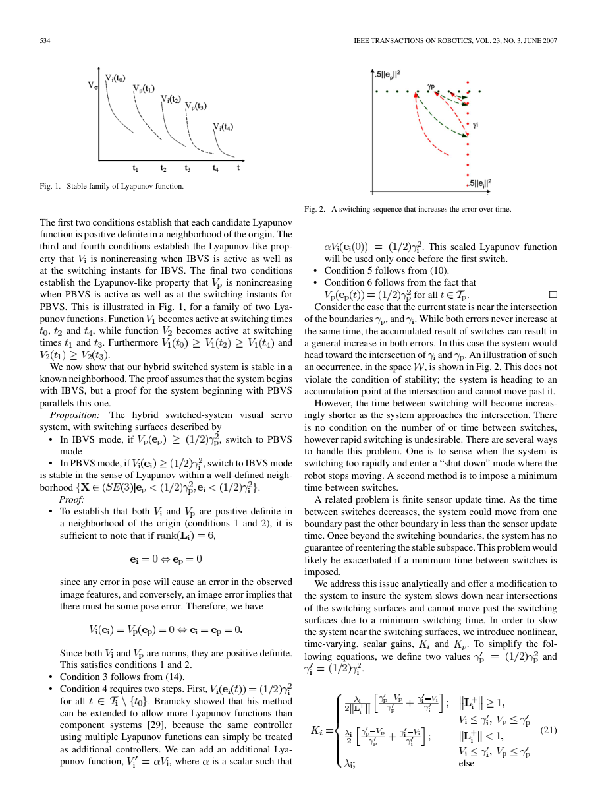
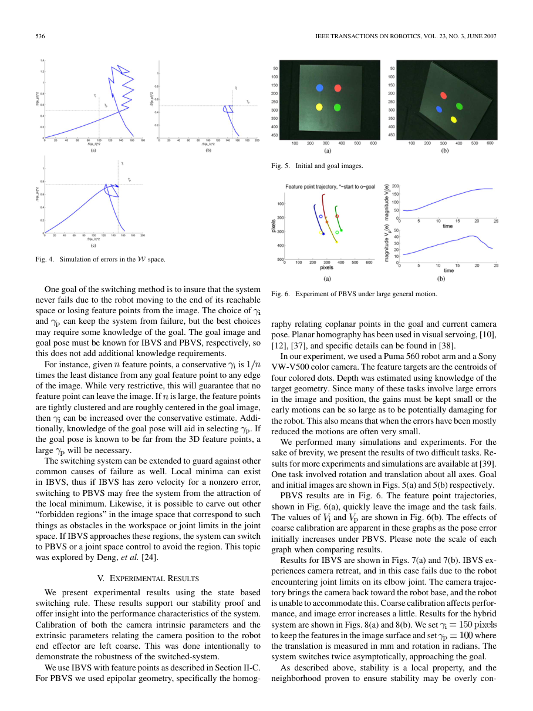
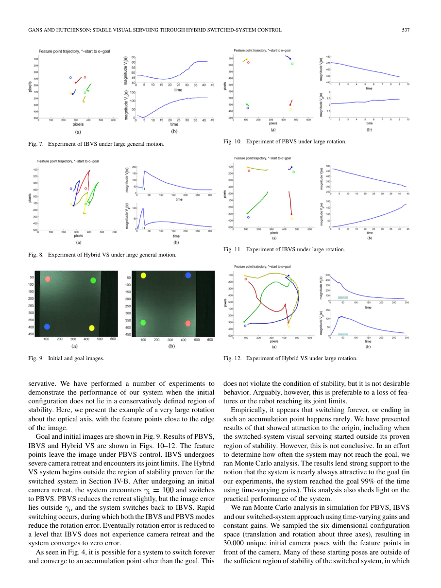
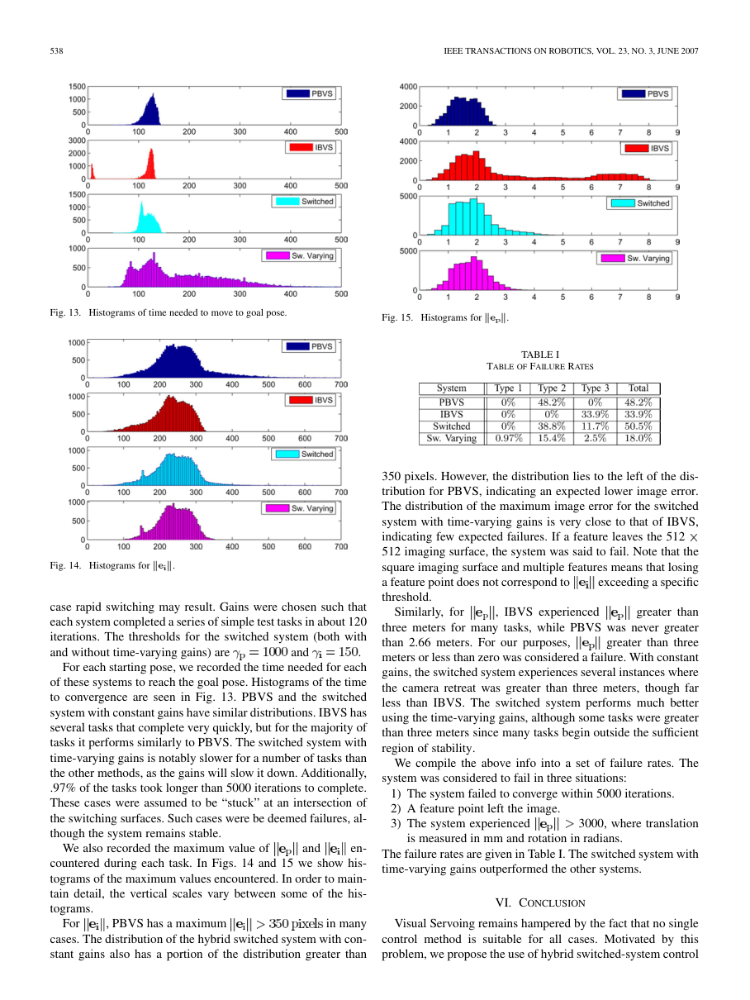

# 하이브리드 전환 시스템 제어를 통한 안정적 시각 서보 (전문 번역)

- 원제: Stable Visual Servoing Through Hybrid Switched-System Control
- 저자: Nicholas R. Gans (University of Florida), Seth A. Hutchinson (University of Illinois at Urbana-Champaign)
- 출처: IEEE Transactions on Robotics, Vol. 23, No. 3, June 2007, pp. 530-540
- DOI: 10.1109/TRO.2007.895067
- 원문 파일: 같은 폴더의 `Gans2007_TRO_hybrid_switched_system_visual_servo.pdf`
- 번역 범위: 전문 (초록, 본문 1절~6절, 그림과 표 캡션). 참고문헌은 원문 그대로 둔다.
- 수식 기호는 PDF 본문 추출에서 많이 빠졌다. 빠진 기호는 빈칸으로 두고, 글의 뜻은 그대로 옮겼다.

---

## 초록

시각 서보 방법은 보통 영상 기반과 위치 기반으로 나눈다.
제어 법칙의 되먹임 고리에서 오차 신호를 영상 특징으로 정하느냐, 카메라 위치로 정하느냐의 차이다.
둘 중 하나를 고르면 고른 쪽 오차는 점근 안정이 되지만, 다른 쪽에 대한 제어력은 잃는다.
그래서 특징점을 놓치거나 로봇이 닿을 수 있는 공간의 끝으로 가면 시스템이 실패할 수 있다.

우리는 영상 기반 제어 법칙과 위치 기반 제어 법칙을 둘 다 쓰는 하이브리드 전환 시스템 시각 서보 방법을 제시한다.
상태에 따라 전환하는 특정 방식의 안정성을 증명하고, 모의실험과 실제 실험 결과를 보인다.

색인어: 전환 시스템 제어, 비전 기반 제어, 시각 서보.

## I. 서론

시각 서보 제어는 영상 자료를 써서 로봇 끝단을 닫힌 고리로 제어한다.
간단한 카메라 장치만으로도 높은 정확도를 내고, 신호 오차와 시스템 변수의 불확실성 앞에서도 튼튼하다.

고전적으로 시각 서보 제어에는 두 갈래가 있었다.
영상 기반 시각 서보(IBVS)와 위치 기반 시각 서보(PBVS)다.
IBVS는 오차 신호를 영상에서 재고, 그것을 바로 구동 명령으로 보낸다.
PBVS는 영상에서 특징을 찾아 그것으로 현재 카메라 위치를 추정한다.
그런 다음 데카르트 작업 공간에서 위치 오차를 계산하고, 제어 시스템이 그 오차를 쓴다.
두 방법 각각에 대해 연구가 아주 많았다 [1]-[8].

Chaumette은 시각 서보 제어의 전통적인 국소 선형화 방법으로는 풀 수 없는 여러 문제를 정리했다 [9].
그 문제들 가운데 많은 것이 제어 법칙 자체에 뿌리가 있다.
예를 들어 IBVS는 영상 공간의 오차를 0으로 만들 뿐, 카메라의 구체적인 위치나 속도는 제어하지 못한다.
그래서 쓸데없는 움직임을 만들어 시스템을 실패로 끌고 갈 수 있다.
반대로 PBVS는 영상 특징에 대한 제어를 포기한다.
그래서 특징이 화면 밖으로 나갈 수 있고, 그러면 자세 복원 자체가 불가능해진다.
실패하는 작업도 처음에는 잘 정의된 상태일 수 있어서, 다가오는 실패를 미리 알아채기는 흔히 불가능하다.

이 문제들을 다루려고 여러 분할 방법이 나왔다 [10]-[13].
이 방법들은 시스템의 자유도를 서로 겹치지 않는 묶음으로 나누고, 묶음마다 다른 제어 방식을 쓴다.
시각 서보 시스템을 특정 운동 자유도를 따라 나누면, 시스템이 쓸 수 있는 새롭고 더 나을 수 있는 궤적이 열린다.

이 문제들 중 하나 이상을 다루는 다른 방법들도 나왔다.
Taylor와 Ostrowski [14]는 카메라 시점들을 잇는 기본 행렬에 바탕을 둔, PBVS를 닮은 독특한 제어기를 내놓았다.
이 시스템은 보정 오차가 커도 점근 안정임을 보였다.
Cowan 등 [15]은 인공 전위 함수와 비슷한 항법 함수에 바탕을 둔 시각 서보 방법을 제시했다.
이 시스템은 특징점을 놓치지 않게 하고, 카메라에서 특징까지의 거리로 로봇 자세의 경계를 넣을 수 있다.
Mezouar와 Chaumette [16]은 특징을 시야 안에 두면서 자세 오차를 작게 유지하는 IBVS 경로 계획기를 만들었다.
Kyrki 등 [17]은 데카르트 공간에서 최단 거리 경로를 따라가면서도 목표가 계속 보이게 하는 PBVS 제어기를 만들었다.
방향에 자유를 주어 물체를 시야 안에 두는 방식이다.
Garcia-Aracil 등 [18]은 제어 법칙을 매끄럽게 유지하면서 특징점이 시야 밖으로 나갔다 들어오는 것을 허용한다.

우리는 새로운 하이브리드 전환 시스템 방법을 제안했다 [19], [20].
여기서는 시스템 제어를 상태 공간의 특정 차원이 아니라 시간 축을 따라 나눈다.
하이브리드 전환 시스템은 연속 하위 시스템 여러 개와, 그 사이를 오가게 하는 이산 전환 제어기로 이루어진다 [21], [22].
하이브리드 전환 시스템을 쓰면 안정 영역을 넓히고, 수렴 속도를 높이고,
불안정한 시스템들 사이를 전체 시스템이 안정이 되는 방식으로 오갈 수도 있다.
성능을 단순하게 보면, PBVS가 나쁠 때 IBVS가 좋고, 그 반대도 그렇다.
그래서 우리는 (분할 방법처럼) 특정 자유도에서 나쁜 성능을 줄이려 하는 대신, 시간에 걸쳐 성능을 높이려 한다.

우리는 자세 공간과 영상 공간에서 동시에 안정을 이루는 전환 전략을 제시한다.
더 중요한 것은, 상태가 결코 벗어날 수 없는 영상 오차의 이웃과 자세 오차의 이웃을 정해 줄 수 있다는 점이다.
이것은 어떤 특징도 화면을 벗어나지 않고, 로봇이 목표 자세에서 정해진 거리 밖으로 결코 나가지 않음을 보장한다.
이는 강한 결과이며, 우리가 아는 한 이런 이유로 실패하지 않음을 보장하는 다른 시각 서보 제어기는 없다.

최근에 전환을 쓰는 다른 방법도 몇 가지 나왔다.
Chesi와 Vicino [23]는 특징이 영상 가장자리에 다가가면 다른 PBVS 제어기로 전환해 특징을 시야 안에 두는 전환 시스템 PBVS 제어기를 내놓았다.
Deng 등 [24]은 IBVS 제어 법칙의 특이점과 국소 최솟값을 피하려고 PBVS로 전환하는 시스템을 제시했다.
같은 논문에서 그들은 영상, 데카르트, 관절 공간 제약을 함께 넣고 IBVS 제어 법칙의 특이점과 국소 최솟값을 피하는 오프라인 경로 계획기를 만들었다.

우리는 시스템 분석을 쉽게 하려고 간단한 전환 규칙 묶음을 제시한다.
다만 우리 전환 시스템은 규칙을 더 넣을 수 있게 열려 있다.
예를 들어 알려진 작업 공간에서 충돌을 피하려고 다른 전환 면이나 추가 전환 면을 넣을 수 있다.
전환 시스템은 [24]의 방법을 넣어 영상 자코비안의 국소 최솟값과 특이점을 벗어날 수도 있고,
[25], [26] 같은 제어기로 전환해 관절 한계와 관절 공간 특이점을 피할 수도 있다.

논문의 나머지는 다음과 같다.
II절은 하이브리드 전환 시스템과 IBVS, PBVS 방법을 짧게 돌아본다.
III절은 IBVS 제어기와 PBVS 제어기를 함께 담은 새 하이브리드 전환 시스템 제어기를 설명한다.
IV절은 상태 기반 전환 방법의 안정성 증명을 담는다.
V절에 실험 결과를 싣는다.

## II. 배경

이 절에서는 하이브리드 시스템과 시각 서보의 배경을 설명한다.
이 주제들은 문헌에 잘 정리되어 있다.
여기서는 표기를 소개하고 관련 결과를 빠르게 요약하는 것이 목적이다.

### A. 하이브리드 전환 시스템 제어

하이브리드 전환 제어 시스템의 이론, 곧 연속 동역학과 이산 전환이 함께 있는 시스템의 이론은 다음과 같이 본다.
전환 신호를 이산 신호로 보고, 그것이 정해진 값들 사이를 오간다고 생각하면 이해하기 쉽다.
어느 시점의 그 값이 그 시점에 시스템 거동을 지배할 함수를 정한다.
전환 신호는 흔히 상태 의존 또는 시간 의존으로 나눈다.
전환이 상태 때문에 일어나는지 시간 때문에 일어나는지에 따른 구분이지만, 이 구분이 딱 떨어지지는 않고 겹칠 수 있다.

전환 시스템의 안정성은 개별 제어기가 안정하다고 해서 보장되지 않는다.
실제로 안정한 시스템들을 모아 두어도 전환을 잘못하면 불안정해질 수 있다 [27], [29].

게다가 전환 시스템의 안정성 증명은 매우 어려울 수 있다.
전환 규칙이 특정되어 있으면 리아푸노프 함수의 유한한 모임으로 안정성을 세울 수 있다 [29], [30].
이는 IV-B절에서 더 다룬다.
임의의 전환 아래 안정성을 증명하는 것은 일반적으로 더 어렵다.
그러려면 보통 모든 하위 시스템에 공통인 리아푸노프 함수를 찾아야 한다 [27], [31].
이는 IV-A절에서 더 자세히 다룬다.

### B. 위치 기반 시각 서보

PBVS의 과제는 현재 카메라 자세와 목표 자세 사이의 오차를 0으로 만드는 것이다.
현재 카메라 자세와 목표 자세가 주어지면(이 논문에서 위첨자는 목표 자세에서의 값을 뜻한다),
둘을 잇는 변환은 카메라 좌표계의 평행이동과 회전으로 기술된다.
국소적으로 이 회전은 세 쌍의 값으로 매개화할 수 있는데,
여기서 각은 단위 벡터가 정하는 축 둘레의 회전각이다.
영상에서 특징점 묶음이 주어지면 그 변환을, 따라서 각과 축을 뽑아내는 방법은 여러 가지가 있다 [32]-[34].

PBVS 시스템에서는 둘을 잇는 강체 운동으로 오차를 정의한다. (3)

카메라가 (트위스트 좌표로) 어떤 속도로 움직일 때, 오차의 미분과 그 속도의 관계는 다음과 같다.

연속 하위 시스템 여러 개와 그 사이를 전환하는 이산 시스템으로 이루어진 하이브리드 전환 제어 시스템 이론은
제어 이론 분야에서 큰 관심을 받았다 [21], [22], [27], [28].
일반적으로 하이브리드 전환 시스템은 미분방정식으로 나타낼 수 있다. (1)

여기서 함수들은 서로 다른 함수의 모임이다.
(1)의 해는 시간에 따른 상태 값과 전환 변수 값의 쌍이다.
이 함수들은 오른쪽에서 연속이어서 둘 다 국소 립시츠가 되게 한다.

우리 목적에는 전환 거동이 제어 입력의 선택에 바로 영향을 준다는 점을 분명히 적어 두는 것이 편하다. (2)

식 (4)에서 오차의 미분과 카메라 속도의 관계가 주어진다.
여기서 (5)의 행렬이 쓰이고 [10], 비대칭 행렬이 회전축에 대응한다.
정의상 그 곱은 회전축 자체가 된다.

회전각이 정해진 범위 안일 때 그 행렬은 비특이하므로 [10],
간단한 되먹임 제어 법칙 (6)으로 원하는 오차 동역학을 얻을 수 있다.
여기서 이득은 양의 스칼라다.

우리는 이차 형식의 리아푸노프 후보 함수를 쓴다. (7), (8)
여기서 3x3 단위행렬과 모든 성분이 0인 3x3 행렬이 들어간다.
값을 달리하면 회전에 대한 평행이동의 효과를 조절할 수 있다.
우리는 보통 큰 값을 써서, 후보 함수의 양정치성을 깨지 않으면서 위치 오차의 효과에 초점을 둔다.
어떤 경우에는 이 함수가 2-노름을 단순히 비례 조정한 것이 된다.

행렬이 완전 계수이고 조건이 맞으면 (7)과 (6)에서 (9)와 (10)이 따라 나온다.
반대 경우에도 비슷한 식 묶음이 성립한다.
따라서 이 제어기는 카메라 좌표계의 모든 평행이동과, 조건을 만족하는 회전에 대해 점근 안정이다.
안정성과 강건성의 더 자세한 증명은 [35]를 보라.

위치 오차는 단조롭게 0으로 가지만, 모든 영상 점의 위치를 제어할 수는 없다.
회전이 조금이라도 있으면, 카메라가 회전하고 평행이동하는 동안 영상 특징점은 영상 평면에서 곡선을 따라 움직인다.
촬상면이 유한한 실제 장치에서는 특징점이 화면 밖으로 나갈 수 있다.
그러면 시스템은 과제를 끝내지 못한다.

### C. 영상 기반 시각 서보

영상 기반 시각 서보 제어에서 제어 법칙은 영상에서 측정한 오차의 함수다.
컴퓨터 비전 자료에서 뽑은 영상 특징 벡터를 쓰면 오차는 영상 특징 공간에서 정의된다.
카메라 속도와 측정된 특징 값의 관계는 (11)로 주어진다.
여기서 쓰이는 행렬이 영상 자코비안(상호작용 행렬이라고도 한다)이다 [1]-[3], [7].

간단한 되먹임 제어 법칙 (12)를 쓸 수 있다.
여기서 쓰는 것은 영상 자코비안의 일반 역행렬이고, 이득은 양의 스칼라다.

리아푸노프 후보 함수 (13)을 쓰면 (14)를 얻고,
괄호 안 행렬이 양정치일 때 점근 안정을 얻는다.

안타깝게도 이 조건은 좀처럼 만족되지 않는다.
영상 자코비안이 과결정일 때는 영공간이 비어 있지 않고 국소 최솟값이 생긴다 [9].
다만 목표에서 영상 자코비안이 완전 계수이면, 목표 주위에 그 행렬 곱이 양반정치인 이웃이 있다.
그래서 IBVS는 리아푸노프 뜻에서 전역 안정이지만, 전역 점근 안정은 아니다.
원점의 충분히 작은 어떤 이웃에서 IBVS가 국소 점근 안정임은 보일 수 있다.
다만 우리가 아는 한 수렴 영역이 확실하게 정해진 적은 없다.
안정성과 강건성의 더 자세한 논의는 [3], [35], [36]을 보라.

특이점과 국소 최솟값 문제 말고도, Chaumette은 IBVS가 만든 궤적을 따르려면 때때로 요구되는
큰 물리적 카메라 운동 때문에 생기는 문제들을 설명했다 [9].
이처럼 IBVS 시스템 앞에는 심각한 성능 문제가 여럿 놓여 있다.

## III. 하이브리드 전환 시스템 시각 서보 제어기

우리는 IBVS 제어기와 PBVS 제어기를 하나의 전환 시스템 제어기로 합친다.
해석 결과를 끌어내려면 먼저 두 시스템을 함께 기술할 수 있는 공통 상태 공간을 세워야 한다.
이를 위해 영상 오차와 자세 오차가 둘 다 자세 오차 공간의 국소 좌표 지도임을 보인다.

카메라가 움직이지 않는 특징점 묶음에 대해 어떤 자세에 있다면,
특징 벡터는 잘 알려진 원근 투영 함수를 써서 카메라 자세를 영상 점으로 보내는 사상으로 정의할 수 있다.
마찬가지로 자세 오차는 영상 오차로 보낼 수 있고,
II-B절에서 설명한 국소 사상을 거쳐 한쪽에서 다른 쪽으로 가는 함수가 있다.

이 두 사상의 관계는 쉽게 볼 수 있다.
그 행렬은 한쪽의 접공간을 다른 쪽의 접공간으로 보낸다.
목표에서 조건이 성립하면 그 행렬은 열 완전 계수이고, 사상은 목표 주위 이웃에서 국소 단사다.
이런 뜻에서 영상 오차와 자세 오차는 둘 다 자세 오차 공간의 국소 좌표로 볼 수 있다.
그 역함수는 특징점에 대한 많은 자세 복원 절차 가운데 어느 것으로도 계산할 수 있다.

영상 오차와 자세 오차가 둘 다 자세 오차의 국소 좌표이기는 하지만,
보통은 서로 의존하는 별개의 측정값으로 보는 쪽이 더 직관적이다.
이 관점에서 우리는 한쪽의 어떤 오차든 다른 쪽의 한 점으로 보낼 수 있다.
이 사상은 함수 (15)로 기술된다.
용어를 조금 느슨하게 써서, "그 공간에서의 분석"이란 두 오차를 그 공간으로 보낸 상을 분석한다는 뜻으로 쓴다.

우리는 (7)과 (13)의 두 리아푸노프 함수 값에 따라 제어기를 바꾸는 상태 기반 전환 시각 서보 제어기를 설계했다.
한쪽에서 다른 쪽으로 가는 국소 단사 사상이 있으므로, (13)은 (16)처럼 다시 쓸 수 있다.
다만 이 의존 관계를 매번 드러내 적지는 않겠다.

제어기를 설계할 때 우리는 이 리아푸노프 함수들의 준위 집합으로 전환 면을 정의한다.
시스템이 이 면에 닿으면 알맞은 쪽 시스템으로 전환한다.
이 준위 집합은 상수들로 정의된다.
하나는 받아들일 수 있는 최대 자세 오차를 정하고, 다른 하나는 최대 특징점 오차를 정한다.
구체적인 전환 규칙은 다음과 같다.

- IBVS 모드에서 자세 오차가 정해진 한계에 닿으면 PBVS 모드로 전환한다.
- PBVS 모드에서 영상 특징 오차가 정해진 한계에 닿으면 IBVS 모드로 전환한다.

이 사상은 두 리아푸노프 함수의 준위 집합을 공통 공간의 직선으로 보내고,
두 준위 집합이 겹치는 안쪽은 직사각형으로 보낸다.

이 제어 방식에서 IBVS를 쓰는 동안 영상 오차는 줄지만 자세 오차는 커질 수 있다.
자세 오차가 너무 커지면 제어가 PBVS 제어기로 전환한다.
반대로 PBVS를 쓰는 동안 자세 오차는 줄지만 특징점 오차가 커질 수 있다.
특징 오차가 너무 커지면 제어가 IBVS 제어기로 전환한다.

우리 시스템의 안정성 증명은 IV절에 있다.
우리는 자세 오차와 특징 오차가 0인 점의 충분히 작은 어떤 이웃 안에서 점근 안정을 증명할 수 있다.
알려진, 명시적으로 정해진 이웃 안에서는 안정성을 증명할 수 있지만, 점근 안정이라는 더 강한 조건까지는 아니다.
V절에서는 전환 시스템이 넓은 영역에 걸쳐 그 상태로 끌려간다는 실험적 증거를 보인다.

## IV. 국소 안정성 분석

우리는 전환 시스템의 안정성을 살핀다.
원점의 어떤 이웃 안에서 점근 안정을 증명할 수 있지만, 그 이웃이 어디까지인지는 알지 못한다.
한편 영상 오차 공간과 자세 오차 공간 양쪽에서 0의 이웃 안에서의 국소 안정성은 증명할 수 있다.
더 중요한 것은 이 이웃을 사용자가 명시적으로 정한다는 점이다.

### A. 임의 전환 아래의 국소 점근 안정성

먼저 원점의 충분히 작은 이웃에서는 IBVS와 PBVS 사이를 임의로 전환해도 점근 안정임을 보인다.
한 모임의 모든 시스템이 공통 리아푸노프 함수를 가지면, 그 전환 시스템은 임의 전환 아래 안정임이 알려져 있다.
우리는 충분히 작은 이웃에서 그 함수가 IBVS와 PBVS의 공통 리아푸노프 함수임을 보인다.

우리는 다음을 가정한다.
특징점이 세계 좌표계에 대해 정지해 있다.
영상 특징이 잘 놓여 있어서 카메라가 목표 자세에 있을 때 영상 자코비안이 완전 계수다.
그리고 관련 조건들이 성립한다.
이 가정들은 시각 서보 문헌에서 흔한 것이다(예: [35], [36]).

증명과 모의실험에서 우리는 카메라 보정이 완벽하고 신호 잡음이 없다고 가정한다.
그러면 자세 추정과 특징점 깊이 추정이 완벽해진다.
V절에서는 이 가정을 풀었을 때도 시스템이 안정함을 보이려고 실제 로봇 시스템 실험을 제시한다.

명제: 하이브리드 전환 시스템 시각 서보 시스템은 원점의 충분히 작은 이웃 안에서
임의 전환 아래 리아푸노프 뜻으로 점근 안정이다.

증명: III절에서 말했듯이 한쪽에서 다른 쪽으로 가는 사상이 있고, 그 사상이 단사인 영역에서 자코비안은 열 완전 계수다.
원점 둘레 테일러 전개는 (17)을 준다. 여기서 나머지는 2차 이상 항이다.
(13)과 (17)을 합치면 (18)을 얻는데, 이는 원점의 작은 이웃 안에서 양정치다.
(6)과 (18)의 미분을 보면 PBVS 아래에서 (19), (20)이 나오고, 이는 원점 이웃에서 음정치다.

II-C절은 그 함수가 올바른 리아푸노프 함수이며 IBVS 아래 전역 안정을 증명함을 보였고,
원점의 충분히 작은 이웃 안에서 IBVS 아래 국소 점근 안정임도 보였다.
식 (20)은 원점의 충분히 작은 이웃에서 그 함수가 PBVS 아래 국소 점근 안정을 보이는 올바른 리아푸노프 함수이기도 함을 보인다.
두 이웃의 교집합은, 그 함수가 IBVS와 PBVS의 공통 리아푸노프 함수가 되는 원점의 이웃이다 [27].

### B. 상태 기반 전환을 통한 국소 안정성

[29]에서 Branicky는 전환 제어 시스템의 안정성을 세우는 기법을 준다.
우리 시스템에서는 (7)과 (13)에서 정의한 두 리아푸노프 함수를 쓴다.
전환 시각들의 집합을 적는다.
제어기가 정확히 둘이므로, IBVS에서 PBVS로 전환하는 시각들의 집합과
PBVS에서 IBVS로 전환하는 시각들의 집합이 있다.

우리 시스템에서 [29]가 주는 안정성 조건은 다음과 같다.

1. 두 후보 함수가 원점에서 0이다.
2. 한 함수는 해당 구간에서, 다른 함수도 해당 구간에서 양이다.
3. IBVS가 켜져 있는 동안 한 함수가 비증가다.
4. IBVS 전환 시각들에서 그 함수가 비증가다.
5. PBVS가 켜져 있는 동안 다른 함수가 비증가다.
6. PBVS 전환 시각들에서 그 함수가 비증가다.

그림 1. 리아푸노프 함수의 안정한 모임.

그림 2. 시간이 지나며 오차를 키우는 전환 열.

앞의 두 조건은 각 후보 리아푸노프 함수가 원점 이웃에서 양정치임을 세운다.
셋째와 넷째 조건은 IBVS가 켜져 있는 동안과 IBVS 전환 순간에 해당 함수가 비증가라는 리아푸노프 비슷한 성질을 세운다.
마지막 두 조건은 PBVS가 켜져 있는 동안과 PBVS 전환 순간에 다른 함수가 비증가라는 성질을 세운다.
이것을 두 리아푸노프 함수의 모임에 대해 그림 1에 그렸다.
한 함수는 어떤 전환 시각들에서 켜지고, 다른 함수는 나머지 전환 시각들에서 켜진다.

이제 우리 하이브리드 전환 시스템이 알려진 이웃 안에서 안정임을 보인다.
증명은 시스템이 IBVS로 시작한다고 가정하지만, PBVS로 시작하는 증명도 똑같은 방식이다.

명제: 다음 전환 면을 가진 하이브리드 전환 시스템 시각 서보 시스템은

- IBVS 모드에서 자세 오차가 한계에 닿으면 PBVS 모드로 전환한다.
- PBVS 모드에서 영상 오차가 한계에 닿으면 IBVS 모드로 전환한다.

잘 정의된 이웃 안에서 리아푸노프 뜻으로 안정이다.

증명:

- 두 함수가 원점 이웃에서 양정치임을 세우려면(조건 1, 2), 다음을 적어 두면 충분하다.
  자세에 오차가 있으면 관측된 영상 특징에도 오차가 생기고, 반대로 영상 오차가 있으면 자세 오차도 있어야 한다.
  둘 다 노름이므로 양정치다. 이로써 조건 1, 2가 만족된다.
- 조건 3은 (14)에서 따라 나온다.
- 조건 4는 두 단계가 필요하다. 먼저 비례 조정한 리아푸노프 함수를 쓴다.
  이 조정한 함수는 첫 전환 전에 한 번만 쓰인다.
- 조건 5는 (10)에서 따라 나온다.
- 조건 6은 모든 경우에 성립하는 사실에서 따라 나온다.

현재 상태가 두 경계가 만나는 곳 가까이에 있는 경우를 생각해 보자.
두 오차가 동시에 커지는 일은 결코 없지만, 전환이 쌓인 결과로 두 오차가 전반적으로 커질 수는 있다.
이 경우 시스템은 두 경계의 교점 쪽으로 간다.
그런 일이 일어나는 모습을 공통 공간에서 그림 2에 그렸다.
이것은 안정성 조건을 깨지 않는다.
시스템은 교점이라는 집적점으로 향할 뿐이고 그 너머로 갈 수 없다.

그러나 시스템이 교점에 가까워질수록 전환 사이의 시간이 점점 짧아진다.
전환 횟수나 전환 사이 시간에 대한 조건은 없지만, 빠른 전환은 바람직하지 않다.
이 문제를 다루는 방법은 여럿 있다.
하나는 시스템이 너무 빨리 전환하는 것을 감지해 로봇이 멈추는 "정지" 모드로 들어가는 것이다.
둘째 방법은 전환 사이에 최소 시간을 두는 것이다.

이와 관련된 문제로 센서 갱신 시간이 유한하다는 점이 있다.
전환 사이 시간이 줄면, 시스템이 한 경계에서 다른 경계를 지나쳐 버리는 데 걸리는 시간이
센서 갱신 시간보다 짧아질 수 있다.
전환 경계 밖으로 나가 버리면 안정 부분 공간으로 다시 들어온다는 보장이 없다.
전환 사이 최소 시간을 두면 이 문제는 더 심해질 수 있다.

우리는 이 쟁점을 해석적으로 다루고, 시스템이 전환 면들의 교점 근처에서 느려지도록,
또 최소 전환 시간 때문에 전환 면을 지나쳐 버리지 않도록 시스템을 고치는 방법을 제시한다.
전환 면 근처에서 시스템을 느리게 하려고 우리는 비선형이고 시간에 따라 변하는 스칼라 이득을 들여온다.
다음 식들을 간단히 쓰려고 두 값을 정의한다.

식 (21)과 (22)가 그 시간 가변 이득을 정의한다.
여기서 벡터의 노름은 표준 2-노름(유클리드 노름)이고, 행렬의 노름은 2-노름, 곧 가장 큰 특잇값이다.
조건이 맞으면 두 이득은 매끄럽다.
증명의 가정 아래 처음 조건에서 참이고, 증명을 마치면 모든 시각에 대해 참으로 남는다.

IBVS를 쓸 때 그 값은 두 오차의 함수다.
(21)에서 정의한 이득과 (6), (9), (12), 그리고 관련 사실을 쓰면 (23), (24), (25)를 얻는다.

IBVS가 켜진 모드인 동안 시간 가변 이득은 다른 함수에도 영향을 준다.
(21)과 (14)에서 (26), (27), (28)을 얻는다.
조건을 가정하면, 예상대로 IBVS 모드에 있는 동안 한 함수는 음반정치로 남지만 다른 함수는 그렇지 않다.

그 값이 어떤 값으로 아래에서 유계임은 보일 수 있다.
그러나 그 하한은 특징점 개수, 특징점들의 상대 위치, 카메라 변수 등에 따라 달라진다.
하한이 불확실하므로 우리는 그것을 1로 잡아 둔다.
이는 꼭 필요하지 않아 보인다.
목표 자세 둘레에서 오차 자세 30,000개를 뽑아 모의실험한 결과,
특징점 4개에 대한 두 값의 히스토그램을 얻었다. 그림 3에 보인다. 둘 다 분명히 아래에서 유계다.

그림 3. 특징점 4개에 대한 두 행렬 노름의 히스토그램.

어떤 시각에 시스템이 막 IBVS 모드로 전환했다고 하자.
최소 갱신 시간을 정의한다.
우리는 (29)를 만족하는 값을 고르려 한다.

특징점이 셋보다 많고 어떤 벡터가 영공간에 있는 경우에는 특징점 셋의 부분 집합을 잠시 쓸 수 있다.
이제 그 행렬이 양정치이면 (29)가 만족됨을 증명하면 된다. (30), (31), (32)

그러므로 (29)의 조건은 그 값이 충분히 작으면 만족된다.
예상대로 전환 사이 최소 시간이 길어질수록 그 값은 작아져 속도를 더 느리게 만든다.

우리는 전환 사이 최소 체류 시간의 증명을 찾아보았으나 증명하지 못했다.
시각 서보 시스템 분석에서 되풀이되는 문제 하나는 영상 자코비안의 역행렬을 닫힌 형태로 구할 수 없다는 점이다.
그래서 IBVS가 자세 오차에 주는 효과에 대해 확정적으로 말할 수 없고,
수치 결과에 기대거나 그 값에 상한을 두는 수밖에 없다.

그림 4는 공통 공간에서 오차 궤적을 모의실험한 결과다.
과제는 미터 단위의 평행이동과 라디안 단위의 회전을 포함한다.
그림 4(a)는 시간 가변이 아닌 고정 이득에서의 결과다.
센서 시간 지연 때문에 경계를 지나친 뒤에야 알아채므로 시스템이 경계 밖으로 멀리 나간다.
그림 4(b)는 시간 가변 이득을 쓴 결과다.
시스템이 교점으로 가서 거기 갇힌다.
이것이 시스템의 안정성을 깨지는 않지만(특징을 잃거나 작업 공간 제약 때문에 실패하지는 않는다),
수렴하지 못하는 것은 바람직하지 않다.
그림 4(c)는 시간 가변 이득을 쓰되 경계를 0.75로 키운 결과다.
이제 시스템은 결국 오차 0으로 간다.
이는 상태가 갇혔고 경계가 보수적임을 안다면, 경계를 잠시 넓혀 주는 것이 상태를 풀어 줄 수 있음을 시사한다.
다만 상태를 먼저 꼼꼼히 살펴야 한다.
시간 가변 이득에 대한 추가 결과는 V절에서 준다.

이 안정성 증명이 국소 결과라는 점은 꼭 강조해야 한다.
IBVS와 PBVS 제어기의 국소 안정성과, 두 오차 공간 사이 국소 미분동형의 존재에 기대고 있으므로
충분 조건을 만족하는 안정 영역은 작을 수 있다.
그러나 이것은 충분 조건일 뿐이고, V절에서 안정 영역이 꽤 넓어 보인다는 것을 실험으로 보인다.
또 이 증명이 안정성만 다루고 점근 안정은 다루지 않지만,
실험은 전환 시스템이 넓은 영역에 걸쳐 원점으로 끌린다고 시사한다.

그림 4. 공통 공간에서 오차의 모의실험.

전환 방법의 한 가지 목표는 로봇이 닿을 수 있는 공간의 끝으로 가거나
영상에서 특징점을 놓쳐서 시스템이 실패하는 일이 결코 없게 하는 것이다.
두 경계 상수를 잘 고르면 시스템을 실패에서 지킬 수 있지만,
가장 좋은 선택을 하려면 목표에 대한 지식이 조금 필요할 수 있다.
IBVS에는 목표 영상이, PBVS에는 목표 자세가 어차피 필요하므로, 이것이 추가 지식 요구는 아니다.

예를 들어 특징점이 주어졌을 때, 보수적인 경계는
어떤 목표 특징점에서 영상의 어떤 가장자리까지의 최소 거리에 특징점 수를 곱한 값이다.
매우 빡빡하지만, 이렇게 하면 어떤 특징점도 영상을 벗어날 수 없음을 보장한다.
특징점 수가 많고, 특징점들이 빽빽이 모여 있으며 목표 영상에서 대체로 가운데에 있으면,
이 보수적 추정보다 경계를 키울 수 있다.
또 목표 자세를 알면 다른 경계를 고르는 데 도움이 된다.
목표 자세가 3차원 특징점에서 멀다고 알려져 있으면 큰 값이 필요하다.

전환 시스템은 다른 흔한 실패 원인을 막는 데까지 넓힐 수 있다.
IBVS에는 국소 최솟값이 있을 수 있으므로, 오차가 0이 아닌데 IBVS 속도가 0이면
PBVS로 전환해 국소 최솟값의 끌림에서 시스템을 풀어 줄 수 있다.
마찬가지로 작업 공간의 장애물이나 관절 공간의 관절 한계에 대응하는
다른 "금지 영역"을 영상 공간에 파 둘 수도 있다.
IBVS가 이 영역에 다가가면 시스템은 PBVS나 관절 공간 제어로 전환해 그 영역을 피할 수 있다.
이 주제는 Deng 등이 살폈다 [24].

## V. 실험 결과

우리는 상태 기반 전환 규칙을 쓴 실험 결과를 제시한다.
이 결과들은 우리 안정성 증명을 뒷받침하고 시스템의 성능 특성에 대한 통찰을 준다.
카메라 내부 변수와, 카메라 위치를 로봇 끝단에 잇는 외부 변수의 보정은 거칠게 두었다.
전환 시스템의 강건성을 보이려고 일부러 그렇게 했다.

IBVS는 II-C절에서 설명한 대로 특징점을 쓴다.
PBVS에는 에피폴라 기하, 구체적으로는 목표 자세와 현재 카메라 자세의 동일 평면 점들을 잇는 호모그래피를 썼다.
평면 호모그래피는 시각 서보에서 쓰여 왔고 [10], [12], [37], 자세한 내용은 [38]에 있다.

실험에는 Puma 560 로봇 팔과 Sony VW-V500 컬러 카메라를 썼다.
특징 표적은 색점 네 개의 무게중심이다.
깊이는 표적 기하를 아는 것으로 추정했다.
이런 과제 중 상당수가 영상과 위치에서 큰 오차를 갖기 때문에, 이득을 작게 유지해야 한다.
그러지 않으면 초기 운동이 너무 커서 로봇에 손상을 줄 수 있다.
이는 오차가 거의 줄어든 뒤에는 운동이 아주 작아진다는 뜻이기도 하다.

우리는 모의실험과 실험을 많이 했다.
짧게 쓰려고 어려운 과제 두 가지의 결과를 제시한다.
더 많은 실험과 모의실험 결과는 [39]에 있다.

한 과제는 모든 축에 대한 회전과 평행이동을 포함한다.
목표 영상과 초기 영상을 각각 그림 5(a)와 5(b)에 보인다.

그림 5. 초기 영상과 목표 영상.

PBVS 결과는 그림 6에 있다.
그림 6(a)의 특징점 궤적은 금세 영상을 벗어나고 과제는 실패한다.
두 오차 값은 그림 6(b)에 있다.
PBVS에서 자세 오차가 처음에 커지는 데서 거친 보정의 영향이 드러난다.
결과를 비교할 때 각 그래프의 눈금에 주의하기 바란다.

그림 6. 큰 일반 운동에서의 PBVS 실험.

IBVS 결과는 그림 7(a)와 7(b)에 있다.
IBVS는 카메라 후퇴를 겪고, 이 경우 로봇이 팔꿈치 관절 한계에 부딪혀 실패한다.
카메라 궤적이 카메라를 로봇 밑동 쪽으로 끌고 가는데 로봇이 이를 받아 주지 못한다.
거친 보정이 성능에 영향을 주어 영상 오차가 조금 커진다.

그림 7. 큰 일반 운동에서의 IBVS 실험.

하이브리드 시스템 결과는 그림 8(a)와 8(b)에 있다.
특징을 촬상면 안에 두려고 영상 경계를 정했고, 자세 경계도 정했다.
평행이동은 mm, 회전은 라디안으로 쟀다.
시스템은 두 번 전환하며 점근적으로 목표에 다가간다.

그림 8. 큰 일반 운동에서의 하이브리드 시각 서보 실험.

앞에서 말했듯 안정성은 국소 성질이고, 안정을 보장한다고 증명한 이웃은 지나치게 보수적일 수 있다.
우리는 초기 자세가 보수적으로 정한 안정 영역 안에 있지 않을 때 시스템 성능을 보이려고 실험을 여럿 했다.
여기서는 특징점이 영상 가장자리 가까이 있는 상태에서 광축 둘레로 아주 큰 회전을 하는 예를 든다.

그림 9. 초기 영상과 목표 영상.

목표 영상과 초기 영상은 그림 9에 있다.
PBVS, IBVS, 하이브리드 시각 서보의 결과는 그림 10에서 12에 있다.
PBVS 제어에서는 특징점이 영상을 벗어난다.
IBVS는 심한 카메라 후퇴를 겪고 관절 한계에 부딪힌다.

그림 10. 큰 회전에서의 PBVS 실험.

그림 11. 큰 회전에서의 IBVS 실험.

그림 12. 큰 회전에서의 하이브리드 시각 서보 실험.

하이브리드 시각 서보 시스템은 IV-B절에서 증명한 안정 영역 밖에서 시작한다.
처음에 카메라 후퇴를 겪은 뒤 시스템은 자세 경계에 닿아 PBVS로 전환한다.
PBVS가 후퇴를 조금 줄이지만 영상 오차가 경계 밖에 놓여 시스템은 다시 IBVS로 돌아간다.
빠른 전환이 일어나고, 그동안 IBVS 모드와 PBVS 모드 둘 다 회전 오차를 줄인다.
결국 회전 오차가 줄어 IBVS가 카메라 후퇴를 겪지 않는 수준이 되고, 시스템은 오차 0으로 수렴한다.

그림 4에서 보았듯이 시스템이 영원히 전환하며 목표가 아닌 집적점으로 수렴하는 일도 가능하다.
이것은 안정성 조건을 깨지는 않지만 바람직한 거동은 아니다.
다만 특징을 잃거나 로봇이 관절 한계에 닿는 것보다는 나을 것이다.

경험적으로는 영원히 전환하거나 그런 집적점에서 끝나는 일은 드물어 보인다.
우리는 전환 시스템 시각 서보가 증명된 안정 영역 밖에서 시작한 경우를 포함해 원점으로 끌리는 결과를 제시했다.
그러나 이것이 결정적이지는 않다.
시스템이 목표에 닿지 못하는 일이 얼마나 자주 일어나는지 알아보려고 몬테카를로 분석을 돌렸다.
결과는 시스템이 거의 언제나 목표로 끌린다는 생각을 강하게 뒷받침한다
(우리 실험에서 시간 가변 이득을 쓰면 시스템이 99%의 경우에 목표에 닿았다).
이 분석은 시스템의 실제 성능에 대해서도 알려 준다.

우리는 PBVS, IBVS, 그리고 시간 가변 이득과 고정 이득을 쓴 우리 전환 시스템에 대해 모의실험으로 몬테카를로 분석을 돌렸다.
6차원 자세 공간(세 축의 평행이동과 회전)을 뽑아, 특징점이 카메라 앞에 있는 서로 다른 초기 카메라 자세 30,000개를 얻었다.
이 시작 자세 중 많은 수가 전환 시스템의 충분 안정 영역 밖이며, 그런 경우 빠른 전환이 일어날 수 있다.
이득은 각 시스템이 간단한 시험 과제 묶음을 약 120번 되풀이로 끝내도록 골랐다.
전환 시스템(시간 가변 이득을 쓰든 안 쓰든)의 문턱값은 정해진 값으로 두었다.

각 시작 자세마다 각 시스템이 목표 자세에 닿기까지 걸린 시간을 기록했다.
수렴 시간의 히스토그램은 그림 13에 있다.
PBVS와 고정 이득 전환 시스템은 분포가 비슷하다.
IBVS는 아주 빨리 끝나는 과제가 몇 있지만, 대부분의 과제에서는 PBVS와 비슷하다.
시간 가변 이득을 쓴 전환 시스템은 이득이 속도를 늦추므로 여러 과제에서 다른 방법보다 눈에 띄게 느리다.
또 과제의 0.97%는 끝내는 데 5000번 넘는 되풀이가 걸렸다.
이 경우들은 전환 면들의 교점에 "갇힌" 것으로 보았다.
그런 경우는 시스템이 안정하더라도 실패로 보았다.

그림 13. 목표 자세로 가는 데 걸린 시간의 히스토그램.

각 과제 동안 만난 두 오차의 최댓값도 기록했다.
그림 14와 15에 만난 최댓값의 히스토그램을 보인다.
자세한 모습을 살리려고 히스토그램마다 세로 눈금을 다르게 했다.

그림 14. 영상 오차 최댓값의 히스토그램.

그림 15. 자세 오차 최댓값의 히스토그램.

영상 오차의 경우 PBVS는 여러 경우에 최댓값이 매우 크다.
고정 이득 하이브리드 전환 시스템의 분포도 일부가 350 픽셀보다 크다.
다만 그 분포는 PBVS의 분포보다 왼쪽에 있어, 기대 영상 오차가 더 작음을 뜻한다.
시간 가변 이득을 쓴 전환 시스템의 최대 영상 오차 분포는 IBVS의 분포와 아주 가까워, 실패가 적을 것으로 보인다.
특징이 512x512 촬상면을 벗어나면 시스템이 실패한 것으로 보았다.
촬상면이 정사각형이고 특징이 여러 개이므로, 특징점 하나를 잃는 것이 특정 문턱값을 넘는 것과 일치하지는 않는다.

마찬가지로 자세 오차의 경우, IBVS는 여러 과제에서 3미터보다 큰 값을 겪었고,
PBVS는 2.66미터를 넘은 적이 없었다.
우리 목적상 3미터보다 크거나 0보다 작은 값은 실패로 보았다.
고정 이득에서는 전환 시스템이 카메라 후퇴가 3미터보다 큰 경우를 몇 번 겪었지만 IBVS보다는 훨씬 적었다.
시간 가변 이득을 쓰면 전환 시스템이 훨씬 잘 했다.
다만 많은 과제가 충분 안정 영역 밖에서 시작하므로 3미터를 넘은 과제도 일부 있었다.

위 정보를 실패율로 모았다. 시스템은 세 경우에 실패로 보았다.

1. 5000번 되풀이 안에 수렴하지 못함.
2. 특징점이 영상을 벗어남.
3. 자세 오차가 3000을 넘음(평행이동은 mm, 회전은 라디안).

표 I. 실패율 표.

실패율은 표 I에 있다.
시간 가변 이득을 쓴 전환 시스템이 다른 시스템들보다 좋았다.

## VI. 결론

시각 서보는 모든 경우에 들어맞는 단일 제어 방법이 없다는 사실에 여전히 발목이 잡혀 있다.
이 문제에서 출발해 우리는 하이브리드 전환 시스템 제어 방법을 쓸 것을 제안한다.
이렇게 하면 지금 조건에서 어느 제어기가 유리한지 알 때 시스템이 여러 후보 제어기 사이를 오갈 수 있다.

우리는 영상 기반과 위치 기반 시각 서보를 함께 담은 그런 방법 하나를 제시한다.
이는 가능한 전환 시스템 시각 서보 제어기 가운데 가장 단순한 축에 들지만, 그래도 이 생각의 힘을 보여 준다.
우리는 목표의 충분한 이웃 안에서 우리 제어기가 특징이 영상을 벗어나거나
카메라가 목표 자세에서 너무 멀어져서 실패하는 일은 결코 없음을 증명했다.
더구나 안정 영역을 사용자가 정하므로, 시스템 성능을 크게 좌우할 수 있다.

그러나 이 시스템은 안정 영역의 일부에서 안정일 뿐 점근 안정은 아니다.
그래서 목표가 아닌 점으로 수렴할 가능성이 생기고, 이는 실패로 볼 수 있다.
이 시스템은 IBVS 제어 법칙의 국소 최솟값과 특이점에도 여전히 취약하다.
앞으로는 더 복잡한 전환 시스템 제어기를 다루고,
순수 IBVS와 PBVS 말고 다른 제어기를 넣어 이 문제들을 줄이는 쪽으로 연구할 것이다.

## 감사의 글

저자들은 이 논문을 다듬는 데 도움을 준 익명 심사자들에게 고마움을 전한다.
특히 국소 점근 안정성 증명을 이끌어 낸 제안을 해 준 세 번째 심사자에게 깊이 감사한다.

## REFERENCES (원문 그대로)

[1] L. E. Weiss, A. C. Sanderson, and C. P. Neuman, "Dynamic sensor-based control of robots with visual feedback," IEEE Trans. Robot. Automat., vol. RA-3, pp. 404-417, Oct. 1987.
[2] J. Feddema and O. Mitchell, "Vision-guided servoing with feature-based trajectory generation," IEEE Trans. Robot. Automat., vol. 5, pp. 691-700, Oct. 1989.
[3] B. Espiau, F. Chaumette, and P. Rives, "A new approach to visual servoing in robotics," IEEE Trans. Robot. Automat., vol. 8, pp. 313-326, Jun. 1992.
[4] K. Hashimoto, Ed., Visual Control of Robots: High Performance Visual Servoing. Hong Kong: World Scientific, 1993.
[5] N. P. Papanikolopoulos, P. K. Khosla, and T. Kanade, "Visual tracking of a moving target by a camera mounted on a robot: A combination of vision and control," IEEE Trans. Robot. Automat., vol. 9, no. 1, pp. 14-35, 1993.
[6] P. Martinet, J. Gallice, and D. Khadraoui, "Vision based control law using 3d visual features," in Proc. WAC 96, 1996, vol. 3, pp. 497-502.
[7] S. Hutchinson, G. Hager, and P. Corke, "A tutorial on visual servo control," IEEE Trans. Robot. Automat., vol. 12, pp. 651-670, Oct. 1996.
[8] G. S. B. W. J. Wilson and C. C. W. Hulls, "Relative end-effector control using cartesian position based visual servoing," IEEE Trans. Robot. Automat., vol. 12, no. 5, pp. 684-696, 1996.
[9] F. Chaumette, "Potential problems of stability and convergence in imagebased and position-based visual servoing," in The Confluence of Vision and Control, D. Kriegman, G. Hager, and S. Morse, Eds.: Springer-Verlag, 1998, vol. 237, Lecture Notes in Control and Information Sciences, pp. 66-78.
[10] E. Malis, F. Chaumette, and S. Boudet, "2-1/2d visual servoing," IEEE Trans. Robot. Automat., vol. 15, pp. 238-250, Apr. 1999.
[11] G. Morel, T. Liebezeit, J. Szewczyk, S. Boudet, and J. Pot, "Explicit incorporation of 2d constraints in vision based control of robot manipulators," in Experimental Robotics VI, P. Corke and J. Trevelyan, Eds.: Springer-Verlag, 2000, vol. 250, Lecture Notes in Control and Information Sciences, pp. 99-108.
[12] K. Deguchi, "Optimal motion control for image-based visual servoing by decoupling translation and rotation," in Proc. Int. Conf. Intelligent Robots and Systems, Oct. 1998, pp. 705-711.
[13] P. Corke and S. Hutchinson, "A new partitioned approach to image-based visual servo control," IEEE Trans. Robot. Automat., vol. 17, no. 4, pp. 507-515, 2001.
[14] C. Taylor and J. Ostrowski, "Robust vision-based pose control," in Proc. Int. Conf. Robot. Automat., 2000, pp. 2734-2740.
[15] N. Cowan, J. Weingarten, and D. Koditschek, "Visual servoing via navigation functions," IEEE Trans. Robot. Automat., vol. 18, no. 4, pp. 521-533, 2002.
[16] Y. Mezouar and F. Chaumette, "Path planning in image space for robust visual servoing," in Proc. Int. Conf. Robot. Automat., 2000, pp. 2759-2764.
[17] V. Kyrki, D. Kragic, and H. Christensen, "Path planning in image space for robust visual servoing," in Proc. Int. Conf. Intelligent Robots and Systems, 2004, pp. 349-354.
[18] N. Garcia-Aracil, E. Malis, R. Aracil-Santonja, and C. Perez-Vidal, "Continuous visual servoing despite the changes of visibility in image features," IEEE Trans. Robotics, vol. 21, no. 6, pp. 1214-1220, 2005.
[19] N. R. Gans and S. A. Hutchinson, "A switching approach to visual servo control," in Proc. IEEE Int. Symp. Intell. Control, 2002.
[20] N. Gans and S. Huthcinson, "An experimental study of hybrid switched system approaches to visual servoing," in Proc. Int. Conf. Robot. Automat., May 2003.
[21] M. Branicky, V. Borkar, and S. Mitter, "A unified framework for hybrid control," in Proc. 33rd IEEE Conf. Decision and Control, 1994.
[22] R. W. Brockett, Hybrid Models for Motion Control Systems, H. L. Trentelman and J. C. Willems, Eds.: Birkhauser, 1993.
[23] G. Chesi and A. Vicino, "Visual servoing for large camera displacements," IEEE Trans. Robot. Automat., vol. 20, no. 4, pp. 724-735, 2004.
[24] L. Deng, F. Janabi-Sharifi, and W. Wilson, "Hybrid motion control and planning strategies for visual servoing," IEEE Trans. Ind. Electron., vol. 52, no. 4, pp. 1024-1040, 2005.
[25] B. Nelson and P. Khosla, "Strategies for increasing the tracking region of an eye-in-hand system by singularity and joint limit avoidance," Int. J. Robot. Res. vol. 14, Jun. 1995.
[26] F. Chaumette and T. Marchand, "A redundancy-based iterative approach for avoiding joint limits: Application to visual servoing," IEEE Trans. Robot. Automat., vol. 17, no. 5, pp. 719-730, 2001.
[27] D. Liberzon and A. Morse, "Basic problems in stability and design of switched systems," IEEE Control Syst. Mag., vol. 19, no. 5, pp. 59-70, Oct. 1999.
[28] D. Liberzon, Switching in Systems and Control. New York: Birkhauser, 2003.
[29] M. Branicky, "Stability of hybrid systems: State of the art," in Proc. IEEE Conf. Decision and Control, 1997, pp. 120-125.
[30] M. Wicks, P. Peleties, and R. DeCarlo, "Construction of piecewise lyapunov functions for stabilizing switched systems," in Proc. Conf. Decision and Control, 1994, pp. 3492-3497.
[31] M. Branicky, "Multiple Lyapunov functions and other analysis tools for switched and hybrid systems," IEEE Trans. Automat. Contr., vol. 43, pp. 475-482, 1998.
[32] O. Faugeras and F. Lustman, "Motion and structure from motion in a piecewise planar environment," Int. J. Pattern Recognit. Artificial Intell., vol. 2, no. 3, pp. 485-508, 1988.
[33] Z. Zhang and A. R. Hanson, "3d reconstruction based on homography mapping," in ARPA Image Understanding Workshop, Palm Springs, CA, 1996.
[34] D. DeMenthon and L. S. Davis, "Model-based object pose in 25 lines of code," in Proc. Eur. Conf. Computer Vision, 1992, pp. 335-343.
[35] L. Deng, F. Janabi-Sharifi, and W. Wilson, "Stability and robustness of visual servoing methods," in Proc. IEEE Conf. Robot. Automat., 2002.
[36] R. Kelly, R. Carelli, O. Nasisi, B. Kuchen, and F. Reyes, "Stable visual servoing of camera-in-hand robotic systems," IEEE/ASME Trans. Mechatronics, vol. 5, no. 1, pp. 39-48, Mar. 2000.
[37] Y. Fang, W. Dixon, D. Dawson, and P. Chawda, "Homography-based visual servo regulation of mobile robots," IEEE Trans. Syst., Man Cybern., vol. 35, no. 5, pp. 1041-1050, 2005.
[38] O. Faugeras and F. Lustman, "Motion and structure from motion in a piecewise planar environment," Int. J. Pattern Recognit. Artificial Intell., vol. 2, no. 3, pp. 485-508, 1988.
[39] F. Chaumette, "Switched system visual servo control," Ph.D. dissertation, Univ. Illinois, Urbana-Champaign, 2005.
