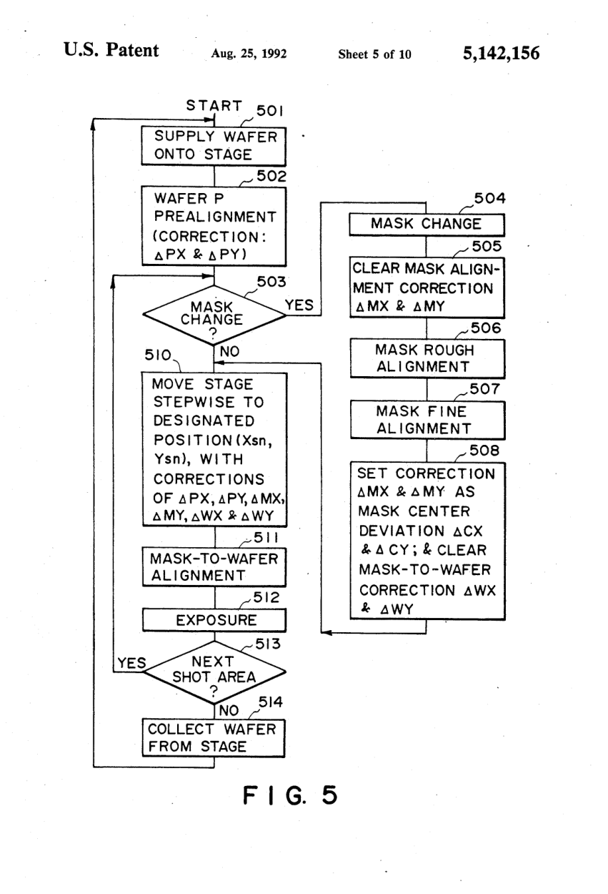
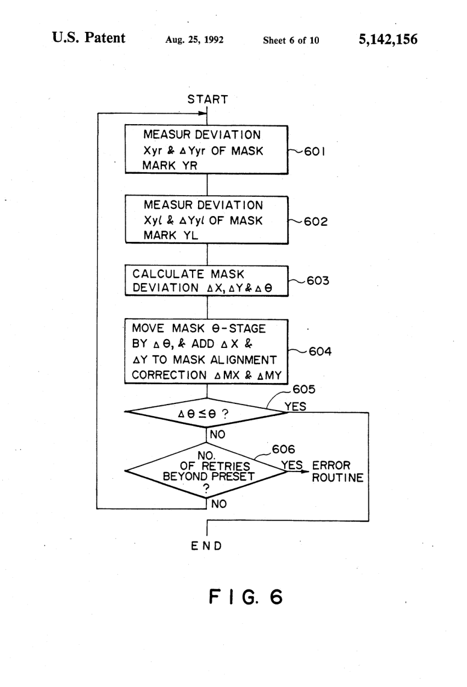
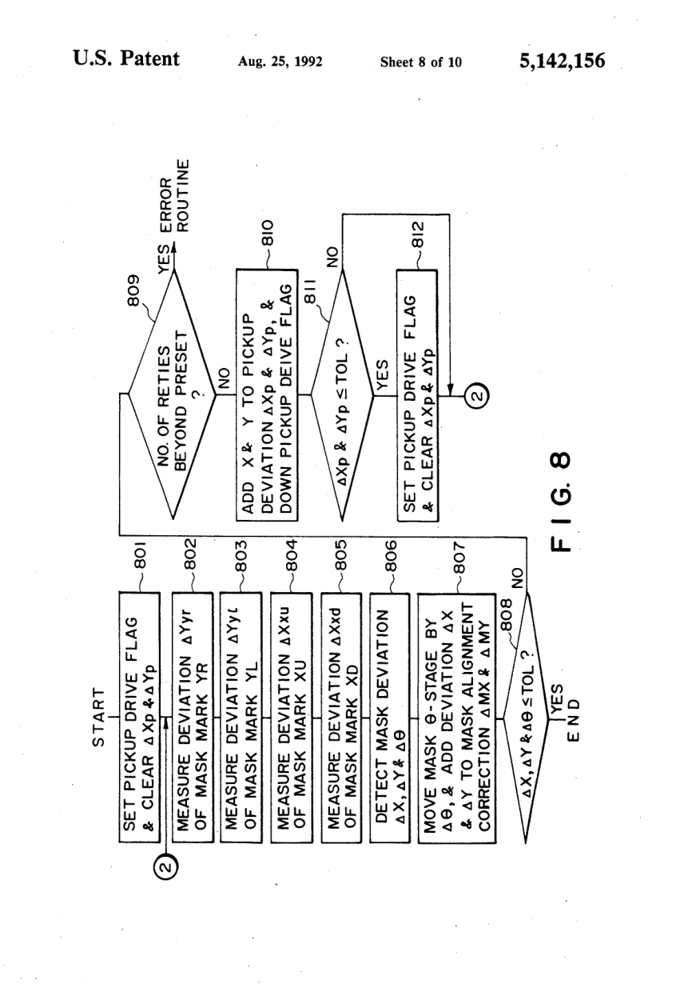

# US5142156A 전문 번역

원제: Alignment method for printing a pattern of an original onto different surface areas of a substrate
출원인: Canon Kabushiki Kaisha (일본 도쿄)
발명자: Kunitaka Ozawa, Shunichi Uzawa, Hirohisa Ohta, Makiko Mori, Noriyuki Nose
출원 1990-09-27 (출원번호 588,947), 우선일 1989-09-29 (JP 평1-252348), 등록 1992-08-25
원문 파일: `US5142156A.pdf`, 추출 본문 `_full.txt`
청구항 6개, 도면 10장

번역 범위: 전문 (표지 서지, 초록, 배경, 요약, 도면 간단한 설명, 실시예 상세 설명, 청구항).
참고문헌은 원문 그대로 둔다.
원문 PDF는 1992년 공보를 OCR 한 것이라 두 단 조판이 섞여 나온다. 번역은 뜻이 통하도록 단 순서를 바로잡아 옮겼다.

---

## 초록 (ABSTRACT)

원판(original)의 패턴을 기판(substrate)의 서로 다른 표면 영역에 전사하는 노광 장치에서 쓰는 정렬 방법이다. 다음 단계로 이루어진다.

- 원판의 패턴 둘레에 정렬 표식(alignment mark)을 두고, 원판을 원판 지지 스테이지에 올린다.
- 기판을 받치며 X 방향과 Y 방향으로 움직이는 X-Y 스테이지에 기준 표식(reference mark)을 둔다. X-Y 스테이지를 움직여, 기준 표식을 원판의 정렬 표식에 대응하며 스테이지 좌표계에 미리 정해 둔 위치들에 차례로 가져다 놓는다.
- 기준 표식과 X-Y 스테이지의 이동을 써서, 원판 정렬 표식이 대응하는 설정 위치에서 벗어난 위치 오차를 차례로 검출한다. 위치 오차는 원판의 각 정렬 표식에 짝지어 둔 위치 오차 검출기로 검출한다.
- 그 위치 오차들을 써서, 스테이지 좌표계에 대한 원판의 θ 방향 회전 오차를 계산한다.
- 회전 오차를 보정하도록 원판 지지 테이블을 θ 방향으로 회전시킨다.

---

## 서지와 인용

- 미국 특허번호 5,142,156, 등록일 1992년 8월 25일
- 국제특허분류 Int. Cl.5 G01N 21/86
- 미국분류 US Cl. 250/548, 356/401
- 조사 분야 250/548, 557, 561, 356/399, 400, 401
- 심사관 David C. Nelms, 보조심사관 K. Shami
- 대리인 Fitzpatrick, Cella, Harper & Scinto

인용 문헌 (원문 그대로)

```
U.S. PATENT DOCUMENTS
4,662,753  5/1987  Yabu ................ 250/548
4,677,301  6/1987  Tanimoto et al. ..... 250/548
4,766,309  8/1988  Kudo ............... 250/548
4,780,615 10/1988  Suzuki ............. 250/548
```

---

## 발명의 분야와 관련 기술

이 발명은 기판(예: 반도체 웨이퍼)을 원판(예: 마스크)으로 노광하는 장치에 관한 것이다. 원판과 기판은 서로 마주 보게 놓인다.

반도체 집적회로를 만드는 노광 장치에서는, 노광하기 전에 집적회로 패턴이 그려진 마스크와 그 패턴을 옮겨 받을 반도체 웨이퍼 사이를 아주 정밀하게 맞추어야 한다(정렬). 예를 들어 256 메가비트 DRAM 집적회로의 경우 패턴 선폭이 0.25 마이크론 수준이므로, 정렬 정밀도는 0.06 마이크론보다 높아야 한다.

---

## 발명의 요약 (SUMMARY OF THE INVENTION)

종래 노광 장치에서는 위에 적은 수준의 높은 정렬 정밀도를 얻기가 쉽지 않다.

또 종래 노광 장치에서는 웨이퍼 스테이지의 좌표계와 마스크 스테이지의 좌표계를 모두 노광 장치 본체의 좌표계를 기준으로 맞추어야 한다. 그래서 본체 좌표계를 기준으로 두 스테이지 좌표계를 조립하고 조정하는 일이 복잡해진다는 단점이 생긴다.

따라서 이 발명의 목적은, 더 높은 정밀도의 정렬을 얻을 수 있으면서 조립과 조정이 더 쉬운 노광 장치를 제공하는 것이다.

이 목적을 이루기 위한 이 발명의 한 측면에서는, 노광할 기판을 움직이는 X-Y 스테이지에 원판 정렬용 표식을 둔다. X-Y 스테이지의 이 표식과 원판에 있는 여러 정렬 표식 사이의 위치 어긋남을 측정한다. 그리고 원판 정렬 표식의 X-Y 스테이지 좌표 기준 위치 좌표를 써서, X-Y 스테이지의 좌표계를 기준으로 원판의 위치를 조정한다.

이 발명의 한 바람직한 실시예에서는, X-Y 스테이지 위의 원판 정렬용 표식을 특정 위치에 만든다. X-Y 스테이지를 차례로 움직여, 이 표식이 원판의 각 정렬 표식 바로 아래에 차례로 오게 한다. X-Y 스테이지의 표식과 원판의 각 표식 사이의 어긋남 양을 측정해, 원판의 각 정렬 표식의 X-Y 좌표를 구한다. 또 X-Y 스테이지 좌표계를 기준으로 한 원판의 위치 어긋남 가운데 θ 성분은 원판용 스테이지를 움직여 보정한다. X 성분과 Y 성분의 보정량은, 원판의 패턴을 기판의 어떤 샷 영역에 찍을 때 그 샷 영역의 위치 좌표에 대한 보정량으로 되먹임(feed back)한다.

이 발명의 또 다른 바람직한 형태에서는, 원판의 정렬 동작이 다음 두 단계로 이루어진다.
- 원판에 있는 표식 두 개를 써서 θ 성분만 거친 정렬(rough alignment)을 하는 단계
- 표식 두 개 이상을 써서 X, Y, θ 성분에 대해 최종 정렬(final alignment, 정밀 정렬)을 하는 단계

종래 노광 장치에서는 원판의 정렬을 노광 장치 본체의 좌표계를 기준으로 했다. 그래서 기판 스테이지의 좌표계와 장치 본체의 좌표계 사이에 오차가 있으면, 기판 스테이지가 실제로 움직이는 방향과 원판-기판 어긋남에서 계산한 보정 구동 방향 사이에 오차가 생긴다. 이런 오차는 정렬 정밀도를 나쁘게 만든다.

이 발명의 한 측면에 따르면 원판을 스테이지의 좌표계를 기준으로 정렬한다. 그래서 노광할 원판과 기판의 상대 위치 정밀도가 좋아진다.

또 원판을 스테이지 좌표계를 기준으로 정렬하므로, 기판 스테이지 좌표계와 장치 본체 좌표계 사이의 오차가 정렬 정밀도에 미치는 영향이 줄어든다. 따라서 장치 본체와 스테이지 좌표의 조립과 조정이 쉬워진다.

또 원판의 정렬을 θ 성분에 대한 거친 정렬과 X, Y, θ 성분에 대한 최종 정렬(정밀 정렬)의 두 단계로 수행한다. 이는 탐색(searching) 동작 횟수를 줄이는 데 효과가 있고, 따라서 장치의 처리량(throughput)을 높이는 데 효과가 있다.

이 발명의 목적, 특징, 이점은 첨부 도면과 함께 아래 바람직한 실시예 설명을 보면 더 분명해진다.

---

## 도면의 간단한 설명

- 도 1: 이 발명의 한 실시예에 따른 스텝 앤드 리피트(step-and-repeat) 방식 노광 장치의 주요부 개략도
- 도 2A, 도 2B: 각각 웨이퍼 정렬 표식과 마스크 정렬 표식을 설명하는 개략도
- 도 3: 도 1 노광 장치의 제어계 하드웨어 블록도
- 도 4: 스텝 앤드 리피트 노광 방법을 설명하는 개략도
- 도 5: 스텝 앤드 리피트 노광 순서의 한 묶음(patch)에 해당하는 흐름도
- 도 6: 도 5의 단계 506에서 하는 마스크 거친 정렬 동작의 상세 흐름도
- 도 7: 도 6의 단계 601에서 하는 마스크 거친 정렬 표식 측정 동작의 상세 흐름도
- 도 8: 도 5의 단계 507에서 하는 마스크 정밀 정렬 동작의 상세 흐름도
- 도 9: 도 8의 단계 802에서 하는 마스크 정밀 정렬 표식 측정 동작의 상세 흐름도
- 도 10A, 도 10B: 각각 마스크 정렬 동작을 설명하는 개략도

---

## 바람직한 실시예의 설명

### 장치 구성 (도 1)

도 1은 마스크-웨이퍼 정렬에 관련된, 노광 스테이지 둘레의 스텝 앤드 리피트 방식 노광 장치(스테퍼) 일부의 구조를 보여 준다.

도 1에서 1은 노광용 빛이다. 대체로 Z축 방향으로 투사되며, 예를 들어 싱크로트론 궤도 방사(SOR)에 들어 있는 X선이다. 2는 반도체 웨이퍼 3으로 옮길 패턴이 그려진 마스크다. 4는 마스크 2를 그 면과 나란한 평면(X-Y 평면) 안에서 회전시키는 마스크 θ 스테이지다. 5는 웨이퍼 3을 그 면과 나란한 평면 안에서 회전시키는 θ 거친 이동 스테이지다.

6은 Z 틸트 스테이지다. 웨이퍼 3을 Z축 방향으로 마스크 2와 정해진 근접 간격만큼 떨어뜨려 마주 보게 할 때, 웨이퍼를 Z 방향(노광 빛 1 쪽으로 이동), wx 방향(X축 둘레 회전), wy 방향(Y축 둘레 회전)으로 움직인다.

7은 웨이퍼 3을 X-Y 평면 안에서 미세하게 회전시키는 θ 미세 이동 스테이지, 8은 X 방향 미세 이동 스테이지, 9는 Y 방향 미세 이동 스테이지, 10은 X 거친 이동 스테이지, 11은 Y 거친 이동 스테이지다. θ 거친 이동 스테이지 5, Z 틸트 스테이지 6, θ 미세 이동 스테이지 7, X 미세 이동 스테이지 8, Y 미세 이동 스테이지 9, X 거친 이동 스테이지 10, Y 거친 이동 스테이지 11이 함께 움직여 웨이퍼 스테이지 24를 이룬다.

12는 픽업이다. 마스크 2와 웨이퍼 3에 만든 정렬 표식에 빛을 쏘고, 그 표식에서 산란된 빛을 검출한다.

### 정렬 표식 (도 2A, 도 2B)

이 실시예에서는 도 2A에 가장 잘 나오듯이, 웨이퍼 3의 각 샷 영역의 스크라이브 선 위에 정렬 표식 XU, XD, YL, YR 네 개를 만든다. 각 표식은 그 샷 영역의 대응하는 변의 끝 가까이에 둔다.

각 정렬 표식은 도 2B처럼 회절 격자로 이루어진다. 회절 격자는 그 정렬 표식이 놓인 변과 나란한 방향으로 마스크-웨이퍼 정합 오차를 검출하는 자동 정렬(AA) 표식 201과, 마스크 2와 웨이퍼 3 사이 간격을 검출하는 자동 초점(AF) 표식 202를 만든다. 웨이퍼의 정렬 표식은 앞 공정에서 반도체 회로 패턴과 함께 만들어 둔 것이다. 마스크 2에도 웨이퍼의 정렬 표식에 각각 짝지어지는 정렬 표식 네 개(203, 204)가 있다. 이 마스크 정렬 표식은 예를 들어 금으로, 웨이퍼로 옮길 반도체 회로 패턴과 함께 만든다(도 10A 참조).

도 2B에서 205는 반도체 레이저(발광 소자), 206은 반도체 레이저 205가 낸 빛을 평행광으로 바꾸는 콜리메이터 렌즈, 207은 반도체 레이저 205가 내고 콜리메이터 렌즈 206이 평행광으로 바꾼 광선이다. 208은 받아 들이는 자동 정렬(AA) 광선으로, 웨이퍼의 AA 표식 201과 마스크의 AA 표식 203이 이루는 광학계가 주는 위치 어긋남 정보(AA 정보)를 담고 있다. 209는 받아 들이는 자동 초점(AF) 광선으로, 웨이퍼의 AF 표식 202와 마스크의 AF 표식 204가 이루는 광학계가 주는 간격 정보(AF 정보)를 담고 있다.

210은 AA 광선 208이 만드는 AA 광점 211의 위치를 전기 신호(AA 정보)로 바꾸는 자동 정렬 센서다. 예를 들어 CCD 배열 같은 라인 센서로 이루어진다. 212는 AF 광선 209가 만드는 AF 광점 213의 위치를 전기 신호(AF 정보)로 바꾸는 자동 초점 센서다. 이것도 예를 들어 CCD 배열 같은 라인 센서다.

도 1로 돌아와서, 14는 마스크 2와 웨이퍼 스테이지 24 사이를 정렬하려고 웨이퍼 스테이지 24에 둔 마스크 정렬용 기준 표식이다. 이 기준 표식 14는 마스크 2에 있는 정렬 표식 네 개에 대응하는 표식 요소 네 개로 이루어진다.

16은 초평면 거울이다. 17은 거울 16에 쏘여 반사되는 Y 측정 광선과 θ 측정 광선이다. 웨이퍼 스테이지 24의 Y 방향 변위량과 Z축 둘레 기울기 θ를 재는 데 쓴다. 이 광선들과 (그림에 없는) X 측정 광선을 써서, 스테이지 좌표계를 기준으로 한 웨이퍼 스테이지 24의 위치 (X, Y, θ)를 간섭계로 잴 수 있다.

100은 본체 프레임이다. 마스크 θ 스테이지 4, 웨이퍼 스테이지 24, 픽업 12가 여기에 붙는다.

### 제어계 (도 3)

도 3은 도 1 노광 장치의 제어계 구조다. 그림에는 없지만 도 1의 노광 장치에는 다음이 갖추어져 있다. SOR에서 수평 판 모양 빔으로 나온 X선 다발을 수직 방향으로 넓혀 면 빔으로 만드는 거울 유닛, 마스크와 웨이퍼를 정렬하는 정렬 유닛과 정렬된 마스크와 웨이퍼를 면 X선 빔으로 노광하는 노광 유닛을 포함하는 본체부 유닛, 거울 유닛과 본체부 유닛 각각의 자세를 제어하는 자세 제어 유닛, 거울 유닛과 본체부 유닛 둘레 환경을 제어하는 챔버와 공조 유닛이다.

도 3에서 301은 장치 전체 동작을 제어하는 주 프로세서 유닛, 302는 주 프로세서 유닛 301과 본체부 유닛을 잇는 통신선, 303은 본체부 쪽 통신 인터페이스, 304는 본체부 제어 유닛, 305는 픽업 스테이지 제어 수단이다. 306과 308은 통신 인터페이스, 307은 통신선이다. 이들은 본체부 안에서 본체부 제어 유닛 304와, 마스크 정렬 및 마스크-웨이퍼 정렬을 위해 표식 위치 어긋남을 재는 정밀 AA/AF 제어 수단 309a, 309b, 309c, 309d 사이를 잇는다. 310과 312는 통신 인터페이스, 311은 통신선이다. 이들은 본체부 안에서 본체부 제어 유닛 304와, 정렬 보정 구동과 스텝 이동을 제어하는 스테이지 제어 수단 313 사이를 잇는다.

### 스텝 앤드 리피트 노광 (도 4)

도 4는 스텝 앤드 리피트 노광 방법을 보여 준다. 그림을 간단히 하려고, 도 1과 달리 마스크 2의 구동 수단인 마스크 θ 스테이지 4, 웨이퍼 3의 구동 수단인 웨이퍼 스테이지 24, 픽업 12의 구동 수단인 픽업 스테이지 13은 도 4에서 생략했다.

도 4에서 12(12a~12d)는 마스크 2와 웨이퍼 3을 정렬하는 픽업이다. 418은 마스크에 만든 (옮길) 패턴, 419는 앞 공정에서 웨이퍼에 만들어 이미 옮겨진 패턴이다. 420은 마스크 2를 웨이퍼 스테이지 24에 있는 기준 표식 14(도 1)에 맞추는 데 쓰는 마스크 정렬용 표식이다. 421은 마스크 패턴 418을 이미 옮겨진 패턴 419에 맞추려고 마스크에 만든 정렬 표식이고, 422는 같은 목적으로 웨이퍼에 만든 정렬 표식이다. 423은 같은 목적으로 픽업 12에서 쏘는 광선이다. 401은 샷 영역 사이에 정한 스크라이브 선이다. 마스크와 웨이퍼의 정렬 표식 421과 422는 이 스크라이브 선 위에 만든다.

마스크 위 정렬 표식 420은, 이웃한 샷 영역 사이에 정한 웨이퍼의 스크라이브 선 401에 대응해, 마스크 패턴 418의 네 변 한가운데에 네 개를 둔다. 정렬 전용 마스크 표식 420은 생략해도 되며, 그 경우 마스크-웨이퍼 정렬용 마스크 정렬 표식 421을 마스크 정렬에도 같이 쓸 수 있다.

### 마스크를 스테이지 좌표계에 맞추는 방법

도 1의 장치에서 마스크 2는 다음과 같이 웨이퍼 스테이지 24의 좌표계(스테이지 좌표계)에 맞출 수 있다.

먼저 웨이퍼 스테이지 24를 차례로 움직여, 웨이퍼 스테이지 24의 정렬 기준 표식 14를 각 마스크 표식 420(또는 421)과 맞추어지는 위치(측정 위치)에 차례로 놓는다. 웨이퍼 스테이지 24가 자리를 잡을 때마다, 대응하는 마스크 표식으로 옮겨 둔 해당 픽업 12(12a~12d)에서 광선 423을 쏘아, 기준 표식 14와 대응하는 마스크 표식 사이의 X 방향과 Y 방향 상대 위치 어긋남을 잰다.

이렇게 얻은 마스크 표식 네 개의 각 측정 위치에서의 위치 어긋남 정보와 (스테이지의) 이동량을 써서, 마스크 표식의 X, Y, θ 오차 ΔX, ΔY, Δθ를 구한다. θ 성분(Δθ)은 마스크 θ 스테이지 4를 돌려 보정한다. X 성분(ΔX)과 Y 성분(ΔY)은, 계산한 값을 각 샷 영역의 위치 좌표(즉 웨이퍼의 이동량)에 대한 보정량으로 되먹인다.

이어서 픽업 12~12'가 다시 광선 423을 쏘아, 마스크와 웨이퍼의 짝지어진 정렬 표식 421과 422 사이의, 마스크면 또는 웨이퍼면과 나란한 평면에서의 어긋남을 잰다. 픽업 네 개에서 얻은 정보를 바탕으로 그 샷 영역 전체의 보정 구동량을 계산하고, 마스크 θ 스테이지 4와 웨이퍼 스테이지 24를 구동해 마스크 패턴 418과 웨이퍼 패턴 419를 서로 맞춘다. 정렬이 끝나면 노광을 하여 마스크 패턴 418을 웨이퍼 3으로 옮긴다. 그다음 웨이퍼 스테이지 24를 움직여 다음 샷 영역이 마스크 아래로 오게 한다. 같은 방식으로 정렬과 노광을 되풀이해 모든 샷 영역을 노광한다. (Z축 방향으로 마스크와 웨이퍼 사이 간격은 노광용 간격과 같게 맞춘다.)

### 전체 노광 순서 (도 5)

도 5는 스텝 앤드 리피트 노광 순서의 흐름도다.



- 단계 501: 웨이퍼를 웨이퍼 스테이지 24에 공급하고 척으로 잡는다.
- 단계 502: 웨이퍼 스테이지 24를 움직여 (그림에 없는) 사전 정렬 광학계로 웨이퍼의 정렬 표식 두 개를 재고, 웨이퍼 사전 정렬을 한다. 여기서 사전 정렬 보정량 ΔPx, ΔPy를 기억한다.
- 단계 503: 마스크 교체가 필요한지 판정한다. 지금 척에 물려 있는 마스크로 노광하면 단계 510으로 간다. 다른 마스크로 바꿔야 하면 단계 504로 간다.
- 단계 504: (그림에 없는) 마스크 트래버서로 현재 마스크를 마스크 스테이지 4에서 떼어 마스크 카세트에 넣는다. 그리고 노광에 쓸 마스크를 카세트에서 꺼내 마스크 스테이지 4에 척으로 물린다.
- 단계 505: 메모리에 기억해 둔 마스크 정렬 보정량 ΔMX, ΔMY를 지운다.
- 단계 506: 마스크 2에 만든 정렬 표식 421 네 개 가운데 두 개(YR, YL)를 써서 마스크 거친 정렬을 한다.
- 단계 507: 웨이퍼 스테이지 24의 기준 표식 14와 마스크 2의 정렬 표식 421 네 개(XU, XD, YL, YR)를 써서 마스크 정밀 정렬을 한다.
- 단계 508: 보정량 ΔMX, ΔMY를 마스크 중심 편차 ΔCX, ΔCY로 설정하고, 마스크-웨이퍼 보정량 ΔWX, ΔWY를 지운다.
- 단계 510: 사전 정렬 보정 ΔPX, ΔPY, 마스크 정렬 보정 ΔMX, ΔMY, 마스크-웨이퍼 보정 ΔWX, ΔWY를 반영해, 지정 위치 (Xsn, Ysn)로 스테이지를 한 칸씩 이동한다.
- 단계 511: 마스크-웨이퍼 정렬
- 단계 512: 노광
- 단계 513: 다음 샷 영역이 있으면 단계 510으로 되돌아간다.
- 단계 514: 없으면 스테이지에서 웨이퍼를 회수한다.

### 마스크 거친 정렬 (도 6): θ만 맞추고 재시도 횟수를 센다

도 6은 마스크 거친 정렬 동작의 상세다.



- 단계 601: 웨이퍼 스테이지 24의 정렬 표식(기준 표식 14)을 써서, 마스크 정렬 표식 421 가운데 YR 표식의 기준 표식 14 대비 위치 어긋남 ΔXyr, ΔYyr을 잰다.
- 단계 602: 같은 방식으로 마스크 YL 표식의 위치 어긋남 ΔXyl, ΔYyl을 잰다. 마스크 표식 421로 YL을 쓰고, 대응 픽업으로 YL 픽업 12를 쓰는 점만 다르다.
- 단계 603: 검출한 YR 표식의 ΔXyr, ΔYyr과 YL 표식의 ΔXyl, ΔYyl을 바탕으로 마스크 2의 위치 어긋남 ΔX, ΔY, Δθ를 계산한다.
- 단계 604: 마스크 θ 스테이지 4를 Δθ에 해당하는 양만큼 구동한다. 한편 구한 위치 어긋남 ΔX, ΔY는 마스크 정렬 보정량 ΔMX, ΔMY에 더한다. (즉 X, Y는 이 단계에서 기구로 움직이지 않고 보정량으로만 쌓아 둔다.)
- 단계 605: 마스크 위치 어긋남 Δθ가 거친 정렬의 허용 범위 안에 들었는지 판정한다.
  - 들지 못했으면 단계 606으로 간다.
  - 들었으면 마스크 거친 정렬을 끝내고 도 5의 단계 507로 간다.
- 단계 606: 마스크 거친 정렬 동작 계수기를 1 올리고, 센 횟수가 미리 정해 둔 재시도 횟수를 넘었는지 판정한다.
  - 센 횟수가 정해 둔 횟수보다 크면, 정해진 횟수만큼 재시도했는데도 마스크 θ 거친 정렬에 실패한 것이므로, 오류 루틴으로 가서 노광 처리를 멈추거나 경보 또는 오류 표시를 낸다.
  - 센 횟수가 정해 둔 재시도 횟수보다 작으면, 흐름은 단계 601로 돌아가 단계 601부터의 θ 거친 정렬 동작을 다시 한다.

### 거친 정렬 표식 측정 (도 7): 탐색 이동과 측정 실패 처리

도 7은 도 6 단계 601에서 하는 마스크 거친 정렬 표식 측정 동작의 상세다.

- 단계 701: 메모리에 기억해 둔 탐색 이동량 ΔXm, ΔYm을 지운다.
- 단계 702: YR 표식을 재는 픽업 12(이하 "YR 픽업")를, 마스크 YR 표식 421의 스테이지 좌표 (Xyr, Yyr)와 마스크 정렬 보정량 (ΔMX, ΔMY)과 탐색 이동량 (ΔXm, ΔYm)을 모두 더한 위치로 옮긴다. 여기서 스테이지 좌표는 설계 위치 좌표이거나, 예를 들어 마스크 YR 표식 421에 대해 시료로 실제 측정한 스테이지 좌표계 위치 좌표를 말한다. 각 표식과 각 샷 영역의 스테이지 좌표는 노광 단계 전에 미리 정해 둔다.
- 단계 703: 웨이퍼 스테이지 24를 움직여, 그 정렬 표식(기준 표식) 14를 마스크 YR 표식 421의 스테이지 좌표 (Xyr, Yyr)와 마스크 정렬 보정량 (ΔMX, ΔMY)과 탐색 이동량 (ΔXm, ΔYm)을 더한 위치에 놓는다.
- 단계 704: YR 픽업 12로 마스크 YR 표식 421과 스테이지 정렬 표식 14 사이의 상대 어긋남 Δy를 잰다. 단계 705로 간다.
- 단계 705: 어긋남 Δy 측정에 성공했는지 판정한다.
  - 못 했으면 단계 706으로 간다.
  - 했으면 단계 708로 간다.
- 단계 706: 탐색 위치의 모든 점에 대한 측정이 끝났는지 판정한다.
  - 안 끝났으면 단계 707로 간다.
  - 끝났으면 YR 표식 측정 실패를 뜻하므로 오류 루틴으로 가서 노광 처리를 멈추거나 경보 또는 오류 표시를 낸다.
- 단계 707: 다음 탐색 이동량 ΔXm, ΔYm을 설정한다. 그 뒤 흐름은 단계 702로 돌아가 단계 702와 그 뒤 동작을 되풀이한다.
- 단계 708: ΔXm과 Δy + ΔYm을 마스크 YR 표식 421의 위치 어긋남 ΔXyr, ΔYyr로 기억한다. 그 뒤 마스크 거친 정렬 표식 측정 동작을 마치고 도 6의 단계 602로 간다.

### 마스크 정밀 정렬 (도 8): X, Y, θ를 함께 보고 재시도 횟수를 센다

도 8은 마스크 정밀 정렬 동작의 상세다.



- 단계 801: 픽업 구동 지정 플래그를 세우고, 픽업 편차량 ΔXp, ΔYp를 지운다.
- 단계 802: 웨이퍼 스테이지 24의 정렬 표식 14를 써서, 마스크 정렬 표식 421 가운데 하나인 YR 표식의 위치 어긋남 ΔYyr을 잰다.
- 단계 803: 같은 방식으로 마스크 YL 표식의 위치 어긋남 ΔYyl을 잰다. 마스크 정렬 표식 421로 YL을 쓰고 픽업 12로 YL 픽업을 쓰는 점만 다르다.
- 단계 804, 805: 단계 802, 803과 같은 방식으로 마스크 XU 표식의 위치 어긋남 ΔXxu와 마스크 XD 표식의 위치 어긋남 ΔXxd를 잰다.
- 단계 806: 각 표식에서 검출한 ΔYyr, ΔYyl, ΔXxu, ΔXxd를 바탕으로, 스테이지 24의 X-Y 좌표계를 기준으로 한 마스크 2의 위치 어긋남 ΔX, ΔY, Δθ를 계산한다.
- 단계 807: 마스크 θ 스테이지 4를 위치 어긋남 Δθ에 해당하는 양만큼 구동한다. 한편 ΔX, ΔY는 마스크 정렬 보정량 ΔMX, ΔMY에 더한다.
- 단계 808: 마스크 위치 어긋남 (ΔX, ΔY, Δθ)이 마스크 정렬 허용 범위 안에 들었는지 판정한다. 들지 못했으면 단계 809로 간다.
- 단계 809: 마스크 정밀 정렬 동작을 한 횟수가 미리 정해 둔 재시도 횟수보다 큰지 판정한다.
  - 크면, 정해진 횟수만큼 재시도했는데도 마스크 정밀 정렬에 실패한 것이므로 오류 루틴으로 가서 노광 처리를 멈추거나 경보 또는 오류 표시를 낸다.
  - 크지 않으면 정밀 정렬을 다시 한다.
- 단계 808의 판정이 긍정이면 정밀 정렬을 마치고 도 5의 단계 508로 간다.

### 정밀 정렬 표식 측정 (도 9)

도 9는 도 8의 단계 802에서 하는 마스크 정밀 정렬 표식 측정 동작의 상세다.

- 단계 901: 픽업 구동 지정 플래그를 확인한다.
  - 세워져 있으면 단계 902로 간다.
  - 세워져 있지 않으면 단계 902를 건너뛰고 바로 단계 903으로 간다.
- 단계 902: YR 픽업 12를, 마스크 YR 표식 421의 스테이지 좌표 (Xyr, Yyr)와 앞 동작에서 기억해 둔 마스크 정렬 보정량 ΔMX, ΔMY를 더한 위치로 옮긴다. 그리고 단계 903으로 간다.
- 단계 903: 웨이퍼 스테이지를 움직여, 그 정렬 표식 14를 마스크 YR 표식 421의 스테이지 좌표 (Xyr, Yyr)와 마스크 정렬 보정량 ΔMX, ΔMY를 더한 위치에 놓는다.
- 단계 904: YR 픽업 12로 마스크 YR 표식 421과 스테이지 정렬 표식 14 사이의 위치 어긋남 Δy를 잰다.
- 단계 905: 어긋남 Δy 측정에 성공했는지 판정한다.
  - 못 했으면, 이는 YR 표식 거친 정렬 동작(도 5의 단계 506)을 제대로 수행하지 못했다는 뜻이므로, 오류 루틴으로 가서 노광 처리를 멈추거나 경보 또는 오류 표시를 낸다. (정밀 정렬 단계에서는 도 7 같은 탐색 재시도를 하지 않는다.)
  - 했으면 단계 906으로 간다.
- 단계 906: Δy를 YR 표식 421의 위치 어긋남 ΔYyr로 설정한다. 그 뒤 마스크 정밀 정렬 표식 측정을 마치고 도 8의 단계 803으로 간다.

### 마스크 정렬 결과 (도 10A, 도 10B)

도 10A와 도 10B는 마스크 정렬 동작을 설명하는 개략도다. 도 10A처럼 놓여 있던 마스크를, 도 10B처럼 스테이지 좌표계에 맞출 수 있다.

### 정밀 정렬의 픽업 편차 되먹임 (도 8의 단계 810~812)

단계 809에서 센 횟수가 정해 둔 재시도 횟수보다 크지 않으면 단계 810으로 간다.

- 단계 810: 위치 어긋남 ΔX, ΔY를 픽업 편차량 ΔXp, ΔYp에 더하고, 픽업 구동 지정 플래그를 내린다. 그 뒤 단계 811로 간다.
- 단계 811: 픽업 편차 (ΔXp, ΔYp)가 허용 범위 안에 들었는지 판정한다.
  - 들지 않았으면 단계 812로 간다.
  - 들었으면 단계 812를 건너뛰고 단계 811에서 바로 단계 802로 돌아간다.
- 단계 812: 픽업 구동 지정 플래그를 세우고, 픽업 편차량 ΔXp, ΔYp를 지운다. 그 뒤 흐름은 단계 802로 돌아가 단계 802와 그 뒤 동작을 되풀이한다.

이렇게 하면 다음에 단계 802, 803, 804, 805의 마스크 정밀 정렬 표식 측정(상세는 도 9)을 할 때, 픽업 12가 마스크 표식 421의 중심을 잡도록 옮겨진다. 그래서 마스크 정밀 정렬 동작의 정밀도를 높일 수 있다.

단계 808의 판정이 긍정이면 마스크 정밀 정렬 동작을 마치고 도 5의 단계 508로 간다.

### 노광과 반복 (도 5의 단계 508 이후)

도 5의 단계 508에서는 마스크 정렬 보정량 ΔMX, ΔMY를 마스크 중심 편차량 ΔCX, ΔCY로 설정하고, 마스크-웨이퍼 정렬 보정량 ΔWX, ΔWY를 지운다. 그 뒤 단계 510으로 간다.

위에 설명한 마스크 정렬 동작을 거치면, 도 10A처럼 스테이지 좌표계 1001을 기준으로 어긋나게 놓여 있던 마스크 2를 도 10B처럼 스테이지 좌표계에 맞출 수 있다.

단계 510에서는, 샷 영역의 미리 정해 둔 좌표 (Xsn, Ysn)를 사전 정렬 보정량 ΔPX, ΔPY와 마스크 정렬 보정량 ΔMX, ΔMY와 마스크-웨이퍼 정렬 보정량 ΔWX, ΔWY로 보정해 얻은 좌표 위치로 웨이퍼 스테이지 24를 한 칸씩 움직인다.

단계 511에서는 웨이퍼 정렬 표식 422(YR, YL, XU, XD)와 마스크 정렬 표식 421(YR, YL, XU, XD)을 써서 마스크-웨이퍼 정렬을 한다. 마스크-웨이퍼 정렬을 할 때 쓰는 X 방향과 Y 방향 보정량이 바로 ΔWX, ΔWY이며, 이 값은 샷 영역마다의 정렬 동작에 따라 바뀐다. 이어서 단계 512에서 그 샷 영역을 노광한 뒤 단계 513으로 간다.

단계 513에서는 같은 웨이퍼에 아직 노광하지 않은 샷 영역이 남아 있는지 판정한다. 남아 있으면 단계 503으로 돌아가 단계 503과 그 뒤 동작을 되풀이한다. 남아 있지 않으면 단계 501로 돌아가, 웨이퍼를 바꾼 뒤 단계 502와 그 뒤 동작을 되풀이한다.

여기 밝힌 구조를 들어 발명을 설명했으나, 발명은 적어 놓은 세부에 한정되지 않는다. 이 출원은 개량의 목적이나 아래 청구항의 범위에 드는 변형이나 변경을 포함하려는 것이다.

---

## 청구항 (6개)

### 청구항 1

원판의 패턴을 기판의 서로 다른 표면 영역에 찍는 노광 장치에서 쓰는 정렬 방법으로서, 다음 단계로 이루어진다.

- 원판의 패턴 둘레에 정렬 표식들을 두고, 원판을 원판 지지 스테이지에 올리는 단계
- 기판을 받치는 X-Y 스테이지에 기준 표식을 두고, X-Y 스테이지를 움직여 기준 표식을, 정렬 표식들 가운데 고른 것들에 대응해 미리 정해 둔 위치들에 차례로 놓아, 고른 정렬 표식들의 각 대응 설정 위치 대비 위치 오차를 차례로 검출하는 **1차 검출**을 수행하는 단계
- 그 위치 오차들을 써서 스테이지 좌표계 기준 원판의 θ 방향 회전 오차를 계산하고, 계산한 회전 오차를 보정하도록 원판 지지 스테이지를 θ 방향으로 회전시키는 **1차 보정**을 수행하는 단계
- 1차 보정을 마친 뒤, 원판의 정렬 표식들 가운데 **1차 검출에서 고른 표식 수보다 더 많은 수**의 정렬 표식을 고르고, X-Y 스테이지를 움직여 기준 표식을 다시 고른 정렬 표식들에 대응해 미리 정해 둔 위치들에 차례로 놓아, 다시 고른 정렬 표식들의 각 대응 설정 위치 대비 위치 오차를 검출하는 **2차 검출**을 수행하는 단계
- 2차 검출로 얻은 위치 오차들을 써서 스테이지 좌표계 기준 원판의 θ 방향 회전 오차를 계산하고, 계산한 회전 오차를 보정하도록 원판 지지 스테이지를 θ 방향으로 회전시키는 **2차 보정**을 수행하는 단계
- 2차 검출에서 얻은 위치 오차들로 계산한 원판의 X 방향과 Y 방향 위치 어긋남을 바탕으로, 원판의 패턴을 기판에 찍기 위한 X-Y 스테이지의 이동을 제어하는 단계

### 청구항 2

원판의 패턴을 기판의 서로 다른 구역에 차례로 찍는 노광 장치에서 쓰는 정렬 방법으로서, 다음 단계로 이루어진다.

- 패턴 둘레에 정렬 표식이 만들어진 원판을 원판 운반 스테이지에 올리는 단계
- 기준 표식 수단을, 스테이지 좌표계에 따라 그리고 정렬 표식들에 대응해 미리 정해 둔 위치들에 차례로 놓는 단계. 기준 표식 수단의 이동은, 스테이지 좌표계에 따라 기판을 X 방향과 Y 방향 가운데 적어도 하나로 움직이는 기판 운반 스테이지로 한다. 기준 표식 수단은 기판 운반 스테이지에 둔다.
- 기준 표식 수단을 미리 정해 둔 위치들에 차례로 놓으면서, 정렬 표식들에 각각 짝지어 둔 위치 오차 검출기 가운데 해당하는 것을 써서, 각 정렬 표식의 기준 표식 수단 대비 위치 오차를 검출하는 단계
- 검출한 위치 오차들을 써서 스테이지 좌표계 기준 원판의 θ 방향 회전 오차를 계산하고, 회전 오차를 보정하도록 원판 운반 스테이지를 θ 방향으로 회전시키는 단계
- 스테이지 좌표계에 따라 기판 운반 스테이지로 기판을 X 방향과 Y 방향 가운데 적어도 하나로 움직여, 원판의 패턴을 기판의 서로 다른 구역에 차례로 찍는 단계

### 청구항 3 (청구항 2 종속)

청구항 2의 방법으로서 다음 단계를 더 포함한다. 위치 오차들을 써서 스테이지 좌표계 기준 원판의 X 방향과 Y 방향 가운데 적어도 하나의 위치 어긋남 양을 계산하는 단계. 그리고 원판의 패턴을 기판에 찍으려고 기판 운반 스테이지를 움직일 때, 계산한 원판의 위치 어긋남 양을 써서 기판 운반 스테이지의 X 방향과 Y 방향 가운데 적어도 하나의 이동을 제어하는 단계.

### 청구항 4 (청구항 2 종속)

청구항 2의 방법으로서, 상기 회전 이동 단계는, 검출한 회전 오차가 **미리 정해 둔 허용값보다 클 때** 회전 오차를 보정하도록 원판 운반 스테이지를 θ 방향으로 회전시키는 단계를 포함한다. 그리고 검출한 회전 오차가 미리 정해 둔 허용값보다 클 때 회전 이동 단계를 수행한 뒤, 상기 검출 단계, 계산 단계, 회전 이동 단계, 기판 이동 단계를 **되풀이하는** 단계를 더 포함한다.

### 청구항 5 (청구항 4 종속)

청구항 4의 방법으로서, 회전 이동 단계를 되풀이해도 계산한 회전 오차가 미리 정해 둔 허용값 아래로 내려가지 않을 때, 회전 이동 단계를 **오류로 보고 중단하는** 단계를 더 포함한다.

### 청구항 6

원판의 패턴을 기판의 서로 다른 구역에 차례로 찍는 노광 장치에서 쓰는 정렬 방법으로서, 다음으로 이루어진다.

- 설정 단계: 패턴 둘레에 표식이 만들어진 원판을 원판 운반 스테이지에 올린다.
- 1차 검출 단계: 표식들 가운데 특정한 것들(1차 선택 표식)을 고르고, 기준 표식 수단을 스테이지 좌표계에 따라 1차 선택 표식들에 대응해 미리 정해 둔 위치들에 차례로 놓아, 각 1차 선택 표식의 기준 표식 수단 대비 위치 오차를 검출한다.
- 1차 보정 단계: 1차 검출 단계에서 얻은 위치 오차들로 원판의 회전 오차를 계산하고, 회전 오차를 보정하도록 원판 운반 스테이지를 회전시킨다.
- 2차 검출 단계: 1차 보정 단계 뒤에, 1차 선택 표식보다 **많은 수**의 2차 선택 표식을 고르고, 기준 표식 수단을 스테이지 좌표계에 따라 2차 선택 표식들에 대응해 미리 정해 둔 위치들에 차례로 놓아, 각 2차 선택 표식의 기준 표식 수단 대비 위치 오차를 검출한다.
- 2차 보정 단계: 2차 검출 단계에서 얻은 위치 오차들로 원판의 회전 오차를 계산하고, 계산한 회전 오차를 보정하도록 원판 운반 스테이지를 회전시킨다.
- 스테이지 좌표계에 따라 기판 운반 스테이지로 기판을 움직여, 원판의 패턴을 기판의 서로 다른 구역에 차례로 찍는다.

---

## 정정 증명서 (CERTIFICATE OF CORRECTION, 1993-10-26)

특허번호 5,142,156 (1992-08-25 등록, Kunitaka Ozawa 외)에 오기가 있어 아래와 같이 정정한다.

- 도면 6장(SHEET 6): 도 6의 "MEASUR"는 "MEASURE"로 읽는다 (두 곳 모두).
- 도면 8장(SHEET 8): 도 8의 "DEIVE"는 "DRIVE"로 읽는다.
- 칼럼 3: 13행 "mask 0"는 "mask θ"로, 21행 "wy"는 "wy direction"으로, 31행 "rough-"는 "fine-"으로, 32행 "stage 10"은 "stage 8,"로 읽는다.
- 칼럼 5: 17행 "pattern 18"은 "pattern 418"로, 37행 "sage"는 "stage"로 읽는다.
- 칼럼 7: 9행 "Aby"는 "Δy"로, 36행 "for"는 삭제, 64행 "step"은 "steps"로, 65행 "is"는 "are"로 읽는다.
- 칼럼 8: 63행 "MX"는 "ΔMX"로, 64행 "MY."는 "ΔMY."로 읽는다.
- 칼럼 9: 51행 "mark"는 "marks"로 읽는다.
- 칼럼 12: 11행 "masks"는 "marks"로, 21행 "rotational"은 "rotationally"로 읽는다.

서명과 날인: 1993년 10월 26일, 특허상표청장 Bruce Lehman
