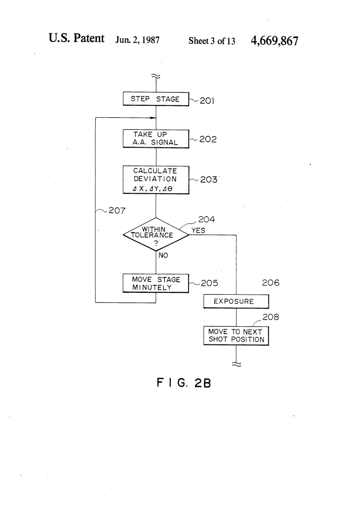
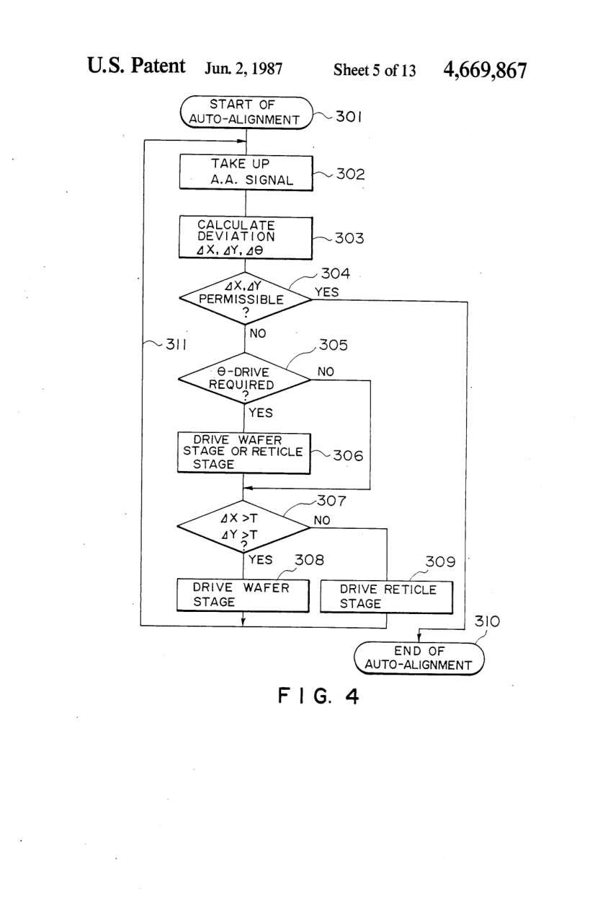
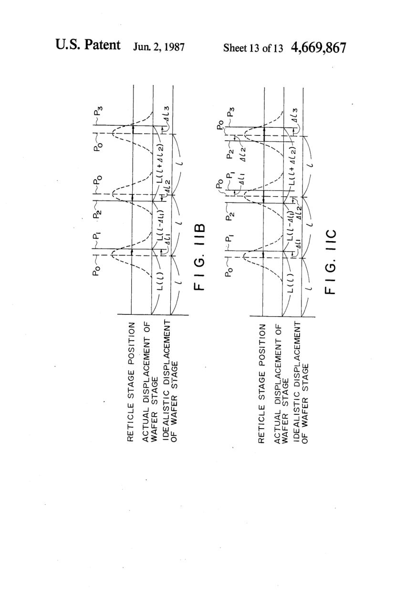

# US4669867A 전문 번역

원제: Alignment and exposure apparatus
(정렬 및 노광 장치)

원문 파일: `US4669867A.pdf` (Google Patents 사본, 23쪽, 텍스트 PDF)
번역 범위: 표지 서지, 초록, 배경기술, 발명의 요약, 도면의 간단한 설명, 바람직한 실시예의 설명 전문, 청구항 1~10 전문.
인용문헌 목록은 원문 그대로 둔다.

---

## 표지 서지

- 특허번호: US 4,669,867
- 등록일: 1987년 6월 2일
- 발명자: Koji Uda (요코하마), Kazuyuki Oda (요코하마), Naoki Ayata (마치다), 모두 일본
- 양수인: Canon Kabushiki Kaisha (일본 도쿄)
- 출원번호: 701,623
- 출원일: 1985년 2월 14일
- 외국 우선권
  - 1984년 2월 20일 JP 59-28794
  - 1984년 2월 21일 JP
  - 1984년 4월 23일 JP 59-29511
  - JP 59-80064
- 국제특허분류: G03B 27/42
- 미국특허분류: 355/53, 355/77, 356/400
- 조사 분야: 355/53, 43, 45, 54, 77, 86, 95, 356/400, 401, 352/349
- 분량: 청구항 10개, 도면 16개 (도면 시트 13장)
- 주심사관: L. T. Hix. 보조심사관: D. Rutledge
- 대리인: Fitzpatrick, Cella, Harper & Scinto

### 인용문헌 (원문 그대로)

U.S. PATENT DOCUMENTS: 4,057,347 11/1977 Moriyama et al.; 4,110,762 8/1978 Tigreat 355/53 X; 4,153,371 5/1979 Koizumi et al. 356/400; 4,362,385 12/1982 Lobach 355/53 X; 4,553,834 11/1985 Ayata et al. 355/53.

---

## 초록

첫째 물체의 패턴을 광학계를 통해 축소 비율로 둘째 물체에 투영하는 패턴 투영,
둘째 물체를 첫째 물체에 대해 단계 이동시키는 스텝 이동,
둘째 물체의 스텝 이동이 끝난 자리에서 첫째 물체와 둘째 물체 사이의 위치 편차를 검출하는 검출,
검출한 위치 편차를 근거로 두 물체의 위치 관계를 고치는 보정,
이 네 동작을 둘째 물체에 대해 차례로 되풀이해 패턴을 둘째 물체에 축소 인쇄하는 정렬 및 노광 장치이다.
두 물체의 위치 관계를 보정할 때, 검출한 위치 편차의 크기에 따라 첫째 물체와 둘째 물체 중 적어도 하나를 변위시킨다.
또는, 둘째 물체를 스텝 이동시킬 때, 앞선 스텝 이동이 끝난 자리에서 검출한 위치 편차에 따라 이번에 할 스텝 이동량을 고친다.
이로써 노광을 되풀이하는 데 드는 시간을 줄인다.

---

## 배경기술

본 발명은 노광 장치에 관한 것이다.
이 장치는 첫째 물체의 패턴을 광학계를 통해 둘째 물체에 투영하는 일과, 이어서 둘째 물체를 첫째 물체에 대해 스텝 이동시키는 일을 되풀이해, 패턴을 둘째 물체에 거듭 인쇄한다.
더 자세히는, IC, LSI, VLSI 같은 반도체 소자를 만들 때 쓰는 노광 장치에 관한 것이다.

위와 같은 반도체 소자 제조 분야에서는, 레티클의 회로 패턴을 광학계를 통해 축소 배율로 웨이퍼에 투영해 인쇄하는 노광 장치가 알려져 있다.
한 예가 스텝 앤드 리피트 방식의 노광 장치, 즉 스테퍼다.

이런 노광 장치에서 한 번 노광으로 웨이퍼에 인쇄되는 회로 패턴은 보통 웨이퍼 위의 작은 영역, 즉 칩 하나나 몇 개에 해당하는 영역만 차지한다.
그래서 레티클의 회로 패턴을 웨이퍼 전면에 인쇄하려면, 투영 광학계의 광축에 직교하는 평면을 따라 웨이퍼를 레티클에 대해 스텝 이동시키면서 노광을 되풀이해야 한다.
레티클 한 장마다 노광을 열 번 넘게 되풀이하는 일이 잦다.

첫째 레티클로 웨이퍼에 노광을 되풀이한 뒤, 같은 웨이퍼에 둘째 레티클로 둘째 노광 공정을 하려면, 둘째 레티클의 회로 패턴을 이미 웨이퍼에 인쇄된 회로 패턴 하나하나에 정확히 겹쳐 투영해야 한다.
이를 위해 노광마다 이미 인쇄된 회로 패턴과 지금 투영할 회로 패턴을 맞추는 정렬, 즉 둘째 레티클과 웨이퍼의 정렬이 필요하다.
그런 정렬 기술의 한 예로 TTL(through-the-lens) 방식의 다이 바이 다이 정렬이 알려져 있다.
이 정렬 방식에서는 웨이퍼를 레티클에 대해 스텝 이동시킬 때마다 투영 광학계를 통해 레티클과 웨이퍼의 상대 위치 편차를 검출한다.
상대 위치 편차를 검출하면 그 편차에 따라 레티클과 웨이퍼의 위치 관계를 고치고, 그 뒤 노광한다.
이런 정렬 공정은 노광마다 아주 정밀한 정렬을 보장한다.
그래서 서로 다른 레티클의 회로 패턴 사이의 겹침 정확도를 웨이퍼 전면에서 높게 얻을 수 있다.

그러나 이 정렬 공정에는 다음 같은 불편이 있다.
이 정렬 공정에서는 레티클 하나의 회로 패턴에 대해 웨이퍼 전면을 노광하는 동안 여러 번의 정렬 동작이 필요하다.
그 결과 장치의 처리량(throughput)이 그만큼 줄어든다.
특히 다이 바이 다이 정렬에서는 노광 횟수만큼의 정렬 동작이 필요하다.
따라서 위와 같은 정렬 공정을 쓰는 노광 장치에서 처리량을 높이는 것이 중요한 문제다.

---

## 발명의 요약

본 발명의 첫째 목적은 처리량을 높인 노광 장치를 내놓는 것이다.
둘째 목적은 정렬 동작에 드는 시간을 줄인 노광 장치를 내놓는 것이다.
셋째 목적은 반도체 소자 제조에 알맞은 노광 장치를 내놓는 것이다.

간단히 말해, 본 발명은 다음과 같은 정렬 및 노광 장치를 준다.
첫째 물체의 패턴을 광학계를 통해 축소 비율로 둘째 물체에 투영하는 패턴 투영,
둘째 물체를 첫째 물체에 대해 스텝 이동시키는 이동,
스텝 이동이 끝난 자리에서 두 물체 사이의 위치 편차를 검출하는 검출,
검출한 편차를 근거로 두 물체의 위치 관계를 고치는 보정,
이 동작들을 둘째 물체에 대해 되풀이해 패턴을 축소 인쇄한다.
위치 관계를 보정할 때는 검출한 위치 편차의 크기에 따라 첫째 물체와 둘째 물체 중 적어도 하나를 변위시킨다.
또는, 둘째 물체를 스텝 이동시킬 때, 앞선 스텝 이동이 끝난 자리에서 검출한 위치 편차에 따라 이번 스텝 이동량을 고친다.
이로써 노광을 되풀이하는 데 드는 시간을 줄인다.

이 밖의 목적, 특징, 이점은 첨부 도면과 함께 아래 바람직한 실시예의 설명을 보면 더 분명해진다.

---

## 도면의 간단한 설명

- 도 1: 본 발명을 적용할 수 있는 반도체 소자 제조용 노광 장치의 사시도.
- 도 2A, 2B: 도 1 노광 장치의 전반 동작을 보이는 흐름도.
- 도 3: 본 발명의 첫째 실시예에 따른 노광 장치의 개략도.
- 도 4: 도 3 노광 장치의 동작 흐름도.
- 도 5: 본 발명의 다른 실시예에 따른 노광 장치의 개략도.
- 도 6: 도 6A와 6B를 어떻게 이어 붙여 도 5 노광 장치의 동작 흐름도를 만드는지 보이는 그림.
- 도 7: 주사 광학계의 주요 요소 하나를 보이는 사시도.
- 도 8: 웨이퍼의 스텝 이동을 개략적으로 보이는 평면도.
- 도 9: 본 발명의 또 다른 실시예에 따른 노광 장치의 개략도.
- 도 10: 도 9 노광 장치의 동작 흐름도.
- 도 11A~11C: 도 9 실시예에 따른 동작과 그렇지 않은 동작의 중요한 차이를 보이는 그림.

---

## 바람직한 실시예의 설명

아래에서는 반도체 소자 제조용 노광 장치를 들어 본 발명을 설명한다. 다만 본 발명이 거기에 한정되지는 않는다.
또 아래 설명에서, 축소 투영 렌즈의 광축에 직교하는 평면 안의 서로 직교하는 두 방향을 각각 X와 Y라 하고,
축소 투영 렌즈의 광축 방향을 Z라 하며,
Z 둘레의 회전 방향을 θ라 한다.

### 도 1: 장치 전체

도 1의 반도체 소자 제조용 노광 장치를 보면, 레티클 1이 레티클 스테이지 2에 실려 있고 이 스테이지는 X, Y, θ 방향으로 움직인다.
레티클 스테이지 2 아래에는 웨이퍼 4가 있고, 레티클 1의 회로 패턴이 축소 투영 렌즈 3으로 축소 투영된다.
웨이퍼 4는 X, Y, θ 방향으로 움직이는 웨이퍼 스테이지 5에 실린다.
하우징 6은 TTL 정렬용과 관찰용 정렬 스코프들을 담는다.
TV 정렬용 대물 렌즈 7이 있어 촬상관 8이 TV 사전 정렬용 영상을 받는다.
장치는 또 축소 투영 렌즈 3을 통해 웨이퍼 4를 관찰하는 촬상관 9,
레티클 1을 비추는 노광광 광원 10,
웨이퍼 공급 캐리어 11a, 11b,
웨이퍼 회수 캐리어 12a, 12b,
촬상관 8과 9의 영상을 골라 보여 주는 모니터 TV 13,
조이스틱과 스위치가 있는 조작 패널 14,
장치 전체를 제어하는 음극선관과 연동된 콘솔 15를 포함한다.

조작 패널 14의 조이스틱은 여러 기능을 한다.
예를 들어 레티클 스테이지 2와 웨이퍼 스테이지 5의 X, Y, θ 방향 이동,
정렬 스코프 6a와 6b의 X, Y 방향 이동, 초점 이동(Z 방향), 줌 이동을 제어한다.

### 도 2A, 2B: 일반 동작과 정렬 루프

*도 2B, 종래의 정렬 루프. 편차 검출(203), 허용 공차 판정(204), 미세 이동(205)을 루프 207로 되풀이한다.*

도 2A와 2B는 도 1 같은 노광 장치에 공통인 흐름도다.
도 2A는 정렬과 노광 동작의 전체 흐름이고, 도 2B는 도 2A의 단계 103을 자세히 보인 것이다.

도 2A에서 보듯 이런 노광 장치에서는 단계 104의 노광 동작(이하 "샷")마다 정렬 동작(단계 103)과 스텝 이동(단계 106)을 한다.
한편 제조 장치의 중요한 성질인 처리량의 관점에서 보면, 정렬 동작에 드는 시간을 줄이는 일이 중요한 문제다.
집적회로가 더 미세해지고 웨이퍼가 커지면서 웨이퍼 한 장당 샷 수가 늘고 있기 때문이다.

도 2B에서 보듯 정렬 동작(단계 103)은 보통 다음 과정을 거친다.
먼저 웨이퍼 스테이지 5를 스텝 이동시킨다(단계 201).
이어서 레티클과 웨이퍼의 상대 위치 편차를 검출한다(단계 202, 203).
그다음 검출한 위치 편차가 허용 공차 안인지 판정하고(단계 204), 공차 안이 아니면 웨이퍼 스테이지를 미세하게 움직인다(단계 205).
이 단계들을 루프 207을 통해, 레티클과 웨이퍼의 상대 위치 편차가 공차 안에 들어올 때까지 되풀이한다.

도 2A의 전체 흐름은 다음과 같다.
웨이퍼 설치 또는 교체(단계 101),
스테이지를 첫째 샷 자리로 이동(단계 102),
TTL 정렬(단계 103),
노광(단계 104),
마지막 노광이 끝났는지 판정(단계 105),
아니면 다음 샷 자리로 이동(단계 106, 107) 후 단계 103으로 복귀,
끝났으면 스테이지를 웨이퍼 로드, 언로드 자리로 이동(단계 109).

### 도 3: 첫째 실시예의 광학계와 처리부

도 3에서, 회로 패턴(도시 생략)과 정렬 마크 20, 20'이 새겨진 레티클 1을 레티클 스테이지 2가 진공 흡착으로 잡는다.
3은 레티클의 회로 패턴을 감광층과 정렬 마크 21, 21'을 가진 웨이퍼 4에 축소 투영하는 축소 투영 렌즈다.
웨이퍼 4는 진공 흡착으로 웨이퍼 스테이지 5에 잡힌다.
레티클 스테이지 2와 웨이퍼 스테이지 5는 각각 레티클 스테이지 구동부 61과 웨이퍼 스테이지 구동부 62가 X, Y, θ 방향으로 움직인다.
웨이퍼 스테이지 5는 무거운 웨이퍼 척을 싣고 스텝 이동 기구도 갖춰야 하므로 반드시 무겁다.
그에 비해 레티클 스테이지 2는 가볍고 관성이 작게 만들 수 있다. 따라서 레티클 스테이지 2의 정밀 위치 결정이 쉽다.

편의상 웨이퍼 4에는 정렬 마크 21, 21' 한 벌만 그렸다.
다이 바이 다이 정렬에서는 웨이퍼 4의 칩 영역마다 정렬 동작을 하므로, 실제로는 샷 수만큼의 정렬 마크가 웨이퍼 위, 특히 스크라이브 라인 위에 만들어진다.

본 실시예에서 레티클 1의 정렬 마크 20, 20'과 웨이퍼 4의 정렬 마크 21, 21' 사이의 치수 관계는,
레티클 마크 크기를 웨이퍼 마크 크기로 나눈 값이 투영 렌즈 3의 축소 비율과 같아지도록 정한다.

28은 회전축 29 둘레로 도는 폴리곤 미러다.
레이저 광원 22가 레이저빔 30을 내고, 렌즈 23이 이를 폴리곤 미러 28 표면의 점 31에 모은다.

장치는 또 릴레이 렌즈 32, 33, 34와, 렌즈 32, 33의 공통 광축에 꼭짓점을 맞춘 삼각 프리즘 35를 갖는다.
프리즘 35는 폴리곤 미러 28이 편향시킨 레이저빔 30의 주사 하나하나를 전반과 후반, 즉 오른쪽 절반과 왼쪽 절반으로 나눈다.
프리즘 블록 39는 레이저빔 30의 X 방향 주사를 Y 방향 주사로 바꾸며, 그 구조는 도 7과 같다.
하프 미러 42는 미러 43, 렌즈 44, 공간 필터 45, 집광 렌즈 46, 광검출기 47로 이루어진 광전 검출계를 이룬다.
광검출기 47의 출력은 처리부 60에 들어가 뒤에 설명할 정해진 연산을 받는다.

**이 처리부 60에는 정렬에 드는 시간을 최소로 하도록 정한 임계값 T가 저장되어 있다.**
**임계값 T는 투영 렌즈 3의 축소 비율과 스테이지 2, 5 자체의 고유 특성을 고려해 정한다.**

프리즘 블록 39 뒤 광축을 따라 전반사 미러 48, 49, 50, 51, 프리즘 52, f-θ 대물 렌즈 53이 놓인다.

장치는 또 동기 신호 검출용 집광 렌즈 57과 광검출기 58을 갖는다.
하프 미러 42에 들어온 레이저빔의 일부가 투과해 집광 렌즈 57로 들어가고, 모여서 광검출기 58에 닿는다.
그래서 광검출기 58은 레이저 주사의 시작점과 끝점을 검출한다.

도면에서 보듯 본 실시예의 신호 검출 장치는 서로 완전히 대칭인 왼쪽 검출계와 오른쪽 검출계로 이루어진다.
이하 프라임(')이 붙은 부호의 검출계를 "오른쪽 신호 검출계", 프라임이 없는 쪽을 "왼쪽 신호 검출계"라 한다.

릴레이 렌즈 32~34는 폴리곤 미러 28의 편향 원점을 대물 렌즈 53용 조리개 55의 동공 56 자리에 맺는다.
그 결과 폴리곤 미러 28이 돌면서 레티클 1 면과 웨이퍼 4 면이 시트 모양 또는 스폿 모양 레이저빔으로 주사된다.

이 대물 렌즈계에서 대물 렌즈 53, 조리개 55, 미러 51, 프리즘 52는 도시하지 않은 구동 기구로 X, Y 방향으로 움직인다.
그래서 레티클 1과 웨이퍼 4 위의 측정점을 뜻대로 바꿀 수 있다.
예를 들어 X 방향 변위는 미러 51, 대물 렌즈 53, 조리개 55를 화살표 A 방향으로 움직이면서, 광로 길이를 일정하게 유지하도록 프리즘 52를 같은 A 방향으로 그 절반 거리만큼 움직여 얻는다.
Y 방향 변위는 위치 검출 광학계 전체를 Y 방향으로 옮겨 얻는다.
이로써 레티클마다 정렬 마크 위치가 다른 경우나, 어떤 레티클에 정렬 마크 말고 레티클 설치 마크가 더 있는 경우에도 마크 검출을 할 수 있다.

동작은 이렇다.
레이저 광원 22에서 나온 레이저빔 30이 도는 폴리곤 미러 28로 X 방향으로 편향 주사되고, 프리즘 35가 이를 전반과 후반 둘로 나눈다.
나뉜 각 빔은 프리즘 블록 39 또는 39'에 들어가 X 방향 주사가 Y 방향 주사로 바뀐다.
프리즘 블록 39, 39'에서 나온 빔은 레티클 1의 정렬 마크 20(또는 20')과 웨이퍼 4의 정렬 마크 21(또는 21')에 닿아 이들을 주사한다.
이 레이저 주사 전에 레티클 1과 웨이퍼 4는 사전 정렬되어, 마크 20과 21, 마크 20'과 21'이 각각 대략 맞아 있다.

정렬 마크 20과 21에서, 그리고 20'과 21'에서 산란 반사된 빛은 하프 미러 42, 42'를 지나 미러 43, 43'에 반사되어 광검출기 47, 47'에 들어간다.
처리부 60은 메모리를 갖고, 메모리에 저장한 광검출기 47, 47'의 출력을 근거로 정해진 연산을 한다.

### 종래 보정 방식의 문제

보통의 노광 장치에서는 도 2B의 단계 205에서 레티클 1과 웨이퍼 4의 상대 위치 편차 보정을, 레티클 스테이지 2와 웨이퍼 스테이지 5 중 하나만 움직여서 한다.
예를 들어 1977년 11월 8일 등록된 미국특허 4,057,347은 웨이퍼 스테이지의 스텝 이동이 끝난 뒤 마스크와 웨이퍼 사이의 위치 편차를 마스크 스테이지를 움직여 고친다고 밝힌다.
그런데 여기에는 다음 같은 큰 불편이 있다.

즉, 위치 편차의 크기가 레티클 스테이지나 웨이퍼 스테이지의 최소 변위 길이보다 작으면,
편차를 허용 범위 안으로 줄이기 위해 루프 107(도 2A)을 더 많이 되풀이해야 하고, 그만큼 정렬 시간이 길어진다.
반대로 각 스테이지의 최소 변위 길이를 작게 만들면, 비교적 큰 위치 편차를 고치려고 스테이지를 움직이는 데 시간이 더 걸려 역시 정렬 시간이 늘어난다.
두 경우 모두 장치의 처리량이 떨어진다.

### 도 3, 도 4: 임계값 T로 거친 보정과 정밀 보정을 고르기

*도 4, 첫째 실시예의 흐름도. ΔX, ΔY 허용 판정(304), Δθ 허용 판정(305)과 θ 보정(306), 임계값 T 비교(307), 웨이퍼 스테이지 거친 구동(308)과 레티클 스테이지 정밀 구동(309), 루프 311.*

위와 같은 불편을 도 3, 도 4 실시예의 노광 장치가 없앤다.
도 3 같은 축소 투영형 노광 장치에서는, 레티클 1 쪽에서 볼 수 있는 상대 위치 편차와 웨이퍼 4 쪽에서 볼 수 있는 상대 위치 편차가 투영 렌즈 3의 축소 비율만큼 크기가 다르다.
도 3 실시예의 본 발명은 이 성질을 정렬 동작에 끌어들이는 것을 노린다.
더 자세히, 도 3 실시예의 노광 장치는 다음과 같이 꾸민다.
**레티클 1과 웨이퍼 4의 상대 위치 편차가 미리 정한 양보다 크면 적어도 웨이퍼 스테이지 5를 움직여 편차를 고치고,**
**상대 위치 편차가 그 미리 정한 양보다 작으면 레티클 스테이지 2만 구동한다.**
이로써 정렬 정확도를 높게 유지하면서 정렬 시간을 줄인다.

도 3 실시예의 동작을 자세히 설명한다.

웨이퍼 4의 한 영역에 대한 한 샷이 끝나면, 웨이퍼 4에서 다음에 노광할 영역이 투영 렌즈 3의 투영 시야에 오도록 웨이퍼 스테이지 5를 스텝 이동시킨다.
이어서 자동 정렬 동작이 시작된다(단계 301).
그러면 레이저빔 30이 폴리곤 미러 28로 편향 주사되고, 레티클 1의 정렬 마크 20, 20'과 웨이퍼 4의 정렬 마크 21, 21'에서 나온 산란광을 광검출기 47, 47'이 받아 자동 정렬 신호(이하 "A.A. 신호")를 받아들인다(단계 302).
A.A. 신호에는 레티클 1 면 위에서 마크 20과 21 사이의 X, Y 방향 편차 ΔXL, ΔYL과,
마크 20'과 21' 사이의 X, Y 방향 편차 ΔXR, ΔYR에 대한 정보가 들어 있다.
이어서 레티클 1과 웨이퍼 4 사이의 X, Y, θ 방향 상대 위치 편차 ΔX, ΔY, Δθ를 계산한다(단계 303).
각 편차는 다음 식으로 얻는다.

    ΔX = (ΔXL + ΔXR) / 2            (1)
    ΔY = (ΔYL + ΔYR) / 2            (2)
    Δθ = (ΔYR - ΔYL) / (XR - XL)    (3)

여기서 XL과 XR은 레티클 1 중심에 대한 왼쪽 마크 20과 오른쪽 마크 20'의 위치이고, (XR - XL)은 두 마크 사이 거리다.

이어서 편차 ΔX와 ΔY가 모두 미리 정한 허용 범위 안인지 판정한다(단계 304).
허용 범위 안이 아니면 단계 305로 간다.
단계 305에서는 편차 Δθ가 미리 정한 허용 범위 안인지 판정한다.
**Δθ가 허용 범위 밖이면 레티클 스테이지 구동부 61 또는 웨이퍼 스테이지 구동부 62가 레티클 스테이지 2 또는 웨이퍼 스테이지 5를 구동한다(단계 306).**
그 뒤 단계 307로 간다.
**Δθ가 허용 범위 안이면 단계 306을 건너뛰고 곧장 단계 307로 간다.**

**단계 307에서는 편차 ΔX와 ΔY를 처리부 60에 미리 저장해 둔 임계값 T와 비교한다.**
앞서 말했듯 임계값 T는 레티클 스테이지 2와 웨이퍼 스테이지 5 자체의 이동 고유 특성
(예: 스테이지의 동적, 정적 특성, 구동계 특성, 이송 분해능 등)을 고려해 정렬에 드는 시간을 최소로 하도록 정한 값이다.
축소 투영형 노광 장치에서는 웨이퍼 4에 투영되는 패턴이 원본(레티클 1의 패턴)에 비해 X, Y 두 방향 모두 축소 비율만큼 줄어든다.
그래서 레티클 스테이지 2를 움직이는 방식은 웨이퍼 스테이지 5를 움직이는 방식보다 축소 비율만큼 미세한 조정을 가능하게 한다.
또 편차를 레티클 면 쪽에서 검출하고 그 편차를 웨이퍼 스테이지 5를 움직여 고치면 변위량이 줄어든다.
편차 Δθ는 축소 비율과 무관하므로, 단계 305와 306에서는 레티클 스테이지 2와 웨이퍼 스테이지 5 중 어느 쪽을 구동해도 된다.

**단계 307에서 편차 ΔX와 ΔY 중 어느 하나라도 임계값 T보다 크면 단계 308로 가서, 웨이퍼 스테이지 구동부 62가 웨이퍼 스테이지 5를 구동해 레티클 1과 웨이퍼 4 사이를 비교적 거칠게 조정한다.**
**반대로 ΔX와 ΔY가 각각 임계값 T보다 작으면 단계 309로 가서, 레티클 스테이지 구동부 61이 레티클 스테이지 2를 구동해 비교적 정밀한 조정을 한다.**
거친 조정이든 정밀 조정이든, 순서는 루프 311을 거쳐 단계 302와 303으로 돌아가 레티클 1과 웨이퍼 4의 상대 위치 편차를 다시 검출한다.
이런 식으로 단계 302에서 단계 309까지 가는 루프 311을, 상대 위치 편차가 허용 범위에 들어올 때까지 되풀이한다.
위치 편차가 허용 범위에 들어오면 단계 304에서 가지를 쳐 나가 정렬이 끝난다(단계 310).

본 실시예에서는 레티클 스테이지 2와 웨이퍼 스테이지 5 중 하나를 골라 구동해 위치 편차를 고쳤다.
그러나 임계값 T에 이를 때까지 두 스테이지를 동시에 구동해도 된다.
그 경우 위치 편차가 비교적 정밀한 조정 범위(임계값 이하 범위)에 들어온 뒤에는 레티클 스테이지만 구동한다.
이렇게 하면 정렬 시간을 더 줄일 수 있다.

본 실시예에 따르면 레티클 스테이지 2와 웨이퍼 스테이지 5를 가려 구동한다.
그래서 각 스테이지의 최소 변위 길이를 더 작게 만들지 않고도 높은 정확도를 유지하면서 정렬 시간을 줄이고, 장치의 처리량을 높인다.

### 도 5, 도 6: 앞 샷의 편차로 다음 스텝 이동량을 고치는 실시예

본 발명의 다른 실시예를 도 5, 도 6으로 설명한다.

요약하면, 본 실시예는 한 칩 영역의 편차량이 이웃 칩 영역들의 편차량과 거의 같다는 발견에 바탕을 둔다.
이 발견에 따라 본 실시예의 노광 장치는, 한 샷의 정렬 동작에서 검출한 편차량을 근거로 다음 샷의 스텝 이동량을 제어하도록 꾸민다.
그래서 다음 샷에서 처음 생기는 위치 편차를 최소로 만들고, 다음 샷의 정렬에 드는 시간을 최소로 한다.
도 5에서 앞 실시예와 같은 부호는 같은 요소다.

도 5에서 레티클 스테이지 2가 레티클 1을, 웨이퍼 스테이지 5가 웨이퍼 4를 진공 흡착으로 잡는다.
웨이퍼 스테이지 5는 웨이퍼 스테이지 구동부 61로 X, Y, θ 방향으로 움직인다.
샷이 끝날 때마다 웨이퍼 4의 다른 영역들이 차례로 등배 또는 축소 배율 투영 렌즈 3의 투영 시야에 오도록 웨이퍼 스테이지 5를 스텝 이동시킨다.
웨이퍼 스테이지 5는 또, 스텝 이동 뒤 레티클 1과 웨이퍼 4의 정렬 동작에서 처리부 60이 검출한 위치 편차량에 따라 X, Y, θ 방향으로 움직인다.
본 실시예에서 위치 보정 때 레티클 1은 처음 자리에 둔다.
다만 앞 실시예처럼 정렬 동작 중 레티클 스테이지 2로 레티클 1을 움직여도 된다.
나머지 구조는 앞 실시예와 본질적으로 같아 설명을 줄인다.

처리부 60의 출력에 따른 본 실시예의 동작을 도 6으로 설명한다.

웨이퍼 스테이지 5에 웨이퍼 4를 싣고(단계 501), 웨이퍼 4에서 처음 노광할 영역이 투영 렌즈 3의 투영 시야에 오도록 웨이퍼 스테이지 5를 옮긴다(단계 502).
이어서 광검출기 47, 47'로 자동 정렬용 A.A. 신호를 받고(단계 503),
그 신호를 근거로 처리부 60이 레티클 1과 웨이퍼 4의 위치 편차 ΔX, ΔY, Δθ를 계산한다(단계 504). 계산은 앞 실시예와 본질적으로 같다.

그다음 ΔX, ΔY, Δθ가 각각 허용 범위 안인지 판정하고(단계 505),
아니면 단계 506, 또는 단계 506과 507을 거쳐 단계 508로 간다.
단계 508에서 처리부 60은 웨이퍼 스테이지 구동부 61에 지령 신호를 보내 웨이퍼 스테이지 5를 미세하게 움직여 편차를 고친다.
이 미세 이동은 편차가 허용 범위에 들어올 때까지 루프 509를 거쳐 되풀이한다.

한편 단계 506은, 단계 504에서 검출한 편차 ΔX, ΔY가 그 영역에 대해 **처음 검출한 편차인지** 판정하기 위한 것이고,
처음 검출한 편차 ΔX0, ΔY0만 저장한다(단계 507).
즉 처음 값 ΔX0, ΔY0만 저장하고, 뒤이어 검출한 값 ΔX1, ΔY1, ΔX2, ΔY2, ..., ΔXn, ΔYn은 버린다.

단계 505에서 정렬 완료가 확인되면 노광한다(단계 510).
노광 뒤, 다음 샷 영역이 투영 렌즈 3의 투영 시야에 오도록 웨이퍼 스테이지 5를 스텝 이동시킨다. 이 스텝 이동량을 아래에서 자세히 설명한다.

레티클 1과 웨이퍼 4의 상대 위치 편차를 만드는 주된 요인은 다음과 같다.
1. 웨이퍼 스테이지 이동의 정확도
2. 앞 레티클을 쓴 앞 노광 공정에서 생긴 패턴 투영의 배율 오차와 왜곡
3. 웨이퍼와 레티클의 팽창 또는 수축

위치 편차는 같은 웨이퍼 안에서도 노광할 영역마다 일정하지 않다.
그런데 예를 들어 도 8의 화살표 순서로 웨이퍼 4를 노광하면, 영역 4b의 위치 편차가 이웃 영역 4a, 4c의 편차와 거의 같다는 것이 밝혀졌다.
이 발견에 따라 본 실시예의 노광 장치는, 예를 들어 영역 4b의 노광이 막 끝났으면, 다음 샷인 영역 4c를 위한 스테이지 5의 스텝 이동을
영역 4b 정렬 중 검출한 편차 ΔX, ΔY를 근거로 제어하도록 꾸민다.
특히 본 실시예에서는 **처음 검출한 값 ΔX0, ΔY0**를 골라 다음 스텝 이동량을 제어한다.
위 요인 (1)~(3) 때문에 이 처음 검출 값이 다음 노광에서 거의 그대로 나타나기 때문이다.

그래서 노광이 끝나면(단계 510), 앞 샷의 정렬 중 얻어 단계 507에서 저장한 처음 검출 위치 편차 ΔX0, ΔY0만 읽어 낸다(단계 511).
이어서 ΔX0, ΔY0를, 다음 샷으로 노광할 웨이퍼 4의 영역에 맞춰 미리 정해 둔 스텝 이동량 X0, Y0에 더해 다음 영역 샷의 스텝 이동량을 계산한다.
이 계산은 물론 지금 샷의 노광 중에 해도 된다.
계산한 이동량에 따라 웨이퍼 스테이지 5를 스텝 이동시키고(단계 514), 다음 샷의 정렬 동작을 한다(단계 503).
이 정렬 동작 중 처음 검출 편차를 저장한다(단계 507).
이런 식으로 노광할 영역마다 정렬, 노광, 보정된 스텝 이동을 한다.
그 결과 영역마다 정렬 동작을 시작할 때의 위치 편차가 크게 줄어 정렬 시간이 줄어든다.

웨이퍼 전면의 노광 완료가 확인되면(단계 513) 웨이퍼 4를 꺼내고(단계 515) 다른 웨이퍼를 공급한다. 동작은 단계 501부터 다시 시작한다.

본 실시예에 따르면 샷마다 스텝 이동량을 고치므로, 웨이퍼 4를 스텝 이동시킨 뒤 노광할 영역마다의 레티클 1과 웨이퍼 4 사이 위치 편차가 최소가 된다.
그 결과 정렬에 드는 시간이 줄고 장치의 처리량이 좋아진다.

### 도 9, 도 10, 도 11: 레티클을 기준 위치 Po로 되돌리는 실시예

*도 11B와 11C, 레티클 스테이지를 기준 위치 Po로 되돌리는 경우(11B)와 되돌리지 않는 경우(11C)의 차이. 되돌리지 않으면 오차 Δl1 + Δl2가 쌓인다.*

본 발명의 또 다른 실시예를 도 9, 도 10으로 설명한다.
간단히 말해 본 실시예는 앞 실시예들을 더 개선한 것이다.
즉 본 실시예는, 노광할 영역마다 레티클 스테이지 2와 웨이퍼 스테이지 5 중 적어도 하나를 필요에 따라 움직여 레티클 1과 웨이퍼 4를 맞춘다는 점,
그리고 앞 샷의 정렬 중 검출한 레티클 1과 웨이퍼 4 사이의 위치 편차에 따라 웨이퍼 스테이지 5의 스텝 이동량을 고친다는 점에서 앞 실시예들에 기댄다.

요약하면, 본 실시예의 발명은 다음 발견에 바탕을 둔다.

위와 같은 노광 장치에서 웨이퍼 스테이지를 스텝 이동시킬 때 레티클을 **앞 샷에서 웨이퍼와 맞아 있던 자리에 그대로 두면**,
웨이퍼 스테이지의 스텝 이동이 막 끝났을 때 레티클과 웨이퍼 사이의 처음 위치 편차가 아마 더 커진다.
이를 도 11C가 보인다.
이 그림에서 보듯, 웨이퍼 스테이지 5의 첫 스텝 이동에서 이상적인 변위 l에 대해 실제 변위가 L(l)이 되어 오차 Δl1이 생기면,
레티클 스테이지 2를 기준 위치 Po에서 위치 P1으로 옮겨 오차 Δl1을 고친다.
다음 스텝 이동에서는 웨이퍼 스테이지 5가 거리 (l - Δl1)만큼 움직이도록 구동부에 지령 신호를 준다.
그런데 이 지령에 대한 실제 변위가 L(l - Δl1)이 되어 오차 Δl2가 생기면,
레티클과 웨이퍼를 맞추려면 레티클 스테이지 2를 위치 P1에서 위치 P2로 옮겨야 한다.
다시 말해 오차 Δl1 + Δl2를 고쳐야 한다.
웨이퍼 스테이지 5의 스텝 이동 종착점이 기준 위치 Po를 중심으로 정규(가우스) 분포로 흔들리므로, 이는 피할 수 없는 문제다.

이 발견에 따라 본 실시예의 노광 장치는, **웨이퍼 스테이지 5를 스텝 이동시킬 때마다 레티클 1을 기준 위치 Po로 되돌리도록** 꾸민다.
그래서 정렬 시간을 더 줄이고 처리량을 더 높인다. 아래에서 자세히 설명한다.

도 9에서 웨이퍼 스테이지 5는 노광 샷마다 웨이퍼 스테이지 구동부 62로 미리 정한 자리로 스텝 이동한다.
웨이퍼 스테이지 5가 멈추면 그 위치를 레이저 간섭계 72a, 72b, 72c가 검출한다.
즉 레이저 간섭계 72a, 72b, 72c가, 서로 직각인 거울면을 가진 반사 미러 71과 함께 웨이퍼 스테이지 5의 X, Y 좌표 이동량과 θ 방향 회전 편차를 잰다.
74는 레이저빔을 내는 레이저 헤드다. 레이저 헤드 74에서 나온 빔은 빔 벤더 76에 꺾이고 빔 스플리터 75a, 75b로 나뉜다.

처리부 60의 출력에 따른 본 실시예의 동작을 도 10의 흐름도로 설명한다.
앞서 말했듯 반도체 소자 제조용 웨이퍼 노광은 레티클 여러 장으로 패턴을 열 번 넘게 겹쳐 찍는 일을 포함한다.
그래서 같은 웨이퍼의 샷마다, 지금 찍을 레티클 패턴을 앞 레티클로 그 자리에 이미 찍어 둔 패턴에 맞춰야 한다.

먼저 웨이퍼 4를 웨이퍼 스테이지 5에 공급하고(단계 601), 웨이퍼 스테이지 5를 첫째 샷 자리로 옮긴다(단계 602).
웨이퍼 스테이지 5가 첫째 샷 자리에 닿으면 도 9의 레이저 간섭계 72a~72c로 웨이퍼 스테이지 5의 위치 편차를 잰다(단계 603).
또는 앞 실시예들처럼 레티클 1과 웨이퍼 4의 정렬 마크로 재도 된다.

이어서 단계 603에서 잰 위치 편차를 고치도록 레티클 스테이지 구동부 61이 레티클 스테이지 2를 옮긴다(단계 604a). 이로써 첫째 샷의 자동 정렬이 끝난다.
동시에 이때의 레티클 스테이지 2 위치를 메모리에 저장한다(단계 604b).
이로써 레티클 스테이지 2의 **기준 위치 Po**가 정해진다.
그 뒤 노광하고(단계 605) 첫째 샷이 끝난다.

첫째 샷 노광 뒤 둘째 샷의 정렬과 노광이 이어진다.
단계 606a에서 웨이퍼 스테이지 5를 둘째 샷 자리로 스텝 이동시킨다.
둘째 샷의 스텝 이동에서는 단계 606a의 보정을 하지 않는다는 점에 주의한다.
또 둘째 샷을 위한 웨이퍼 스테이지 5의 스텝 이동 때 레티클 스테이지 2는 정렬 완료 위치, 즉 기준 위치 Po에 있으므로
단계 606b의 레티클 스테이지 2를 기준 위치 Po로 되돌리는 동작도 하지 않는다.
웨이퍼 스테이지 5가 둘째 샷 자리에 닿으면 레이저 간섭계 72a, 72b나 레티클 1과 웨이퍼 4의 정렬 마크로 둘째 샷 자리의 위치 편차를 잰다(단계 607).
이어서 레티클 스테이지 2를 옮겨 위치 편차를 고치고(단계 608) 둘째 샷의 정렬이 끝난다. 그 뒤 둘째 샷을 노광한다(단계 609).

이어서 미리 정한 수의 샷 노광이 끝났는지 판정하고(단계 610), 끝났으면 웨이퍼 4를 꺼내고(단계 611) 다른 웨이퍼 4를 공급한다(단계 601).
정해진 수의 샷이 아직 안 끝났으면 단계 606a, 606b로 돌아가 다음 샷들의 정렬과 노광을 이어 간다.
즉 웨이퍼 스테이지 4를, 앞 샷에 대해 단계 607에서 잰 위치 편차를 벌충하는 거리만큼 스텝 이동시킨다(단계 606a).
동시에 레티클 스테이지 2를 기준 위치 Po로 되돌린다(단계 606b). 뒤 동작은 위와 같다.

본 실시예의 정렬 동작 시간을 도 11A~11C로 자세히 설명한다.
도 11A는 첫째 샷에 대한 레티클 스테이지 2와 웨이퍼 스테이지 5의 이동을 보인다.
웨이퍼 4를 웨이퍼 스테이지 5에 실은 자리에서 첫째 샷 자리까지의 거리에 대해,
웨이퍼 스테이지 5의 실제 변위 D(d)는 뜻한 이상적 변위 d의 종착점을 가운데 두고 흔들린다.
그래서 도 11A에 점선으로 그린 정규 분포 N이 나온다.
본 실시예에서는 첫째 샷 정렬이 끝났을 때의 레티클 스테이지 2 위치 Po'를,
첫째 샷 뒤의 샷들, 특히 둘째 샷 뒤의 샷들에 대한 레티클 스테이지 2의 기준 위치 Po로 고른다.

도 11B는 첫째 샷 뒤의 샷마다의 레티클 스테이지 2와 웨이퍼 스테이지 5 이동을 보인다.
이 그림에서 l은 샷마다의 웨이퍼 스테이지 5의 이상적 변위이고,
L(l), L(l - Δl1), L(l - Δl2), ...는 웨이퍼 스테이지 5의 실제 변위이며,
Δl1, Δl2, Δl3, ...는 위치 편차량이다.

본 실시예에 따르면 웨이퍼 스테이지 5가 스텝 이동할 때마다 레티클 스테이지 2를 기준 위치 Po로 되돌린다.
그래서 도 11B에서 보듯, 웨이퍼 스테이지 5의 실제 변위가 기준 위치 Po에 대해 흔들려도
레티클 스테이지 2는 오차 Δl1, Δl2, Δl3, ... 또는 Δln을 고칠 만큼만 움직이면 된다.
오차 Δl1 + Δl2에 해당하는 거리만큼 레티클 스테이지 2를 움직일 필요가 더는 없다.
레티클 스테이지 2를 기준 위치 Po로 되돌리는 이동은 웨이퍼 스테이지 5의 스텝 이동과 동시에 하므로 정렬 시간에 나쁜 영향을 주지 않는다.

웨이퍼 스테이지 5의 스텝 이동으로 생긴 오차는 레이저 간섭계,
길이 정보를 자기 테이프에 기록한 자기 스케일,
슬릿이 만든 간섭 무늬를 읽는 광학 스케일로 잴 수 있다.
또 다른 대안으로 레티클 2와 웨이퍼 4의 정렬 마크로 위치 편차를 재도 된다. 이 경우 TTL 정렬계가 바람직하다.

위 실시예들에서 "레티클"은 레티클 또는 마스크를 두루 가리킨다.
또 본 발명은 1대1 배율 투영 노광 장치에도 쓸 수 있다.

본 발명을 여기 밝힌 구조로 설명했으나, 적은 세부에 한정되지 않으며,
이 출원은 개선의 목적이나 아래 청구항의 범위에 드는 변형과 변경을 덮는 것을 뜻한다.

---

## 청구항 (1~10 전문)

**1.** 첫째 물체의 패턴 이미지를 둘째 물체의 여러 다른 부분 각각에 인쇄하는 장치로서, 다음을 포함한다.
- 첫째 물체의 패턴 이미지를 둘째 물체에 투영하는 투영 수단
- 첫째 물체를 비추어, 투영 수단을 거쳐 첫째 물체의 패턴 이미지를 둘째 물체로 옮기는 노광빔 제공 수단
- 둘째 물체를 스텝 이동시켜, 비춤 수단으로 첫째 물체의 패턴 이미지를 둘째 물체의 여러 다른 부분 각각에 옮기도록, 그 여러 부분을 첫째 물체에 대해 차례로 자리잡게 하는 구동 수단
- 둘째 물체의 여러 다른 부분 중 하나의, 첫째 물체에 대한 위치 편차를 검출하는 검출 수단. 여기서 그 하나의 부분은 스텝 이동으로 막 자리잡아 첫째 물체의 패턴 이미지에 노광될 부분이다.
- 검출 수단이 검출한 위치 편차가 **미리 정한 양보다 큰지 아닌지를 판정하는 판정 수단**
- 판정 수단에 응답해, 둘째 물체의 그 하나의 부분의 첫째 물체에 대한 위치 편차를 고치는 편차 보정 수단

그리고 다음과 같이 동작한다.
- **편차 보정 수단은, 검출 수단이 검출한 위치 편차가 미리 정한 양보다 크면 적어도 둘째 물체를 움직이고,**
  **검출한 위치 편차가 미리 정한 양보다 크지 않으면 첫째 물체만 움직인다.** 이로써 둘째 물체의 그 하나의 부분이 첫째 물체에 대해 맞춰진다.
- 편차 보정 수단은, 둘째 물체의 여러 다른 부분 중 다음 부분의 노광을 위한 둘째 물체의 스텝 이동을 시작하기 전에, 둘째 물체의 그 하나의 부분의 위치 편차를 고친다.

**2.** 청구항 1의 장치로서, 검출 수단이 둘째 물체의 그 하나의 부분의 첫째 물체에 대한 위치 편차를 **투영 수단을 거쳐** 검출한다.

**3.** 청구항 1의 장치로서, 주사빔을 만드는 수단을 더 포함하고, 검출 수단은 투영 수단을 지나는 주사빔으로 위치 편차를 검출한다.

**4.** 청구항 1의 장치로서, 검출 수단은 **둘째 물체가 스텝 이동할 때마다 동작하여**, 구동 수단이 차례로 자리잡게 한 둘째 물체의 여러 다른 부분 각각의 첫째 물체에 대한 위치 편차를 검출한다.

**5.** 첫째 물체의 패턴 이미지를 둘째 물체의 여러 다른 부분 각각에 인쇄하는 장치로서, 다음을 포함한다.
- 첫째 물체의 패턴 이미지를 둘째 물체에 투영하는 투영 수단
- 첫째 물체를 비추어 그 패턴 이미지를 투영 수단을 거쳐 둘째 물체로 옮기는 노광빔 제공 수단
- 둘째 물체를 스텝 이동시켜 여러 다른 부분을 첫째 물체에 대해 차례로 자리잡게 하는 구동 수단
- 스텝 이동으로 막 자리잡아 노광될 부분의, 첫째 물체에 대한 위치 편차를 검출하는 검출 수단
- 검출에 응답해 첫째 물체와 둘째 물체 중 적어도 하나를 움직여 그 부분을 첫째 물체에 맞추는 **첫째 조정 수단**
- 검출에 응답해 구동 수단을 제어하여, **다음에 할 둘째 물체의 스텝 이동량을, 검출한 위치 편차에 해당하는 양만큼 바꾸는 둘째 조정 수단**

**6.** 청구항 5의 장치로서, 투영 수단이 첫째 물체의 패턴 이미지를 둘째 물체에 축소 비율로 투영한다.

**7.** 청구항 5의 장치로서, 검출 수단이 그 부분의 첫째 물체에 대한 위치 편차를 투영 수단을 거쳐 검출한다.

**8.** 청구항 5의 장치로서, **검출 수단의 검출과 첫째 조정 수단의 조정을, 검출한 위치 편차가 미리 정한 값보다 크지 않은 값에 이를 때까지 번갈아 되풀이한다.**

**9.** 청구항 8의 장치로서, 둘째 조정 수단은 구동 수단이 할 둘째 물체의 스텝 이동량을, 그 부분에 대해 **검출 수단이 처음 검출한 위치 편차**에 따라 바꾼다.

**10.** 첫째 물체의 패턴 이미지를 둘째 물체의 여러 다른 부분 각각에 인쇄하는 장치로서, 청구항 5와 같은 투영 수단, 노광빔 제공 수단, 구동 수단, 검출 수단, 첫째 조정 수단, 둘째 조정 수단을 포함하고, 다음을 더 갖는다.
- **첫째 조정 수단은, 둘째 물체의 그 부분을 첫째 물체에 맞추려고 첫째 물체를 움직일 때, 첫째 물체를 그 처음 위치에서 움직인다.**
- **첫째 조정 수단은, 다음 부분의 노광을 위해 구동 수단이 할 둘째 물체의 스텝 이동 동안, 첫째 물체를 그 처음 위치로 되돌린다.**

---

## 정정증명서 (Certificate of Correction, 1987-10-13, 원문 그대로)

COLUMN 1: Line 13, "large scaled" should read --large-scale--. Line 14, "large scaled" should read --large-scale--.
COLUMN 3: Line 15, "EMBODIMENT" should read --EMBODIMENTS--.
COLUMN 5: "f-8" should read --f-θ--. Line 24, "Spot like" should read --spot-like--. Line 52, "sytem" should read --system--.
COLUMN 6: "position," should read --positions,--.
COLUMN 7: "Of FIG. 3" should read --of the FIG. 3.--. "hot" should read --not--.
COLUMN 9: "aligment" should read --alignment--.
COLUMN 10: Line 35, "Inahner," should read --manner,--.
COLUMN 11: Line 33, "aligment" should read --alignment--.
COLUMN 13: Line 26, "is" should read --are--. Line 31, "are" should read --is--.
COLUMN 16: Line 9, "of portions" should read --of said portions--.
