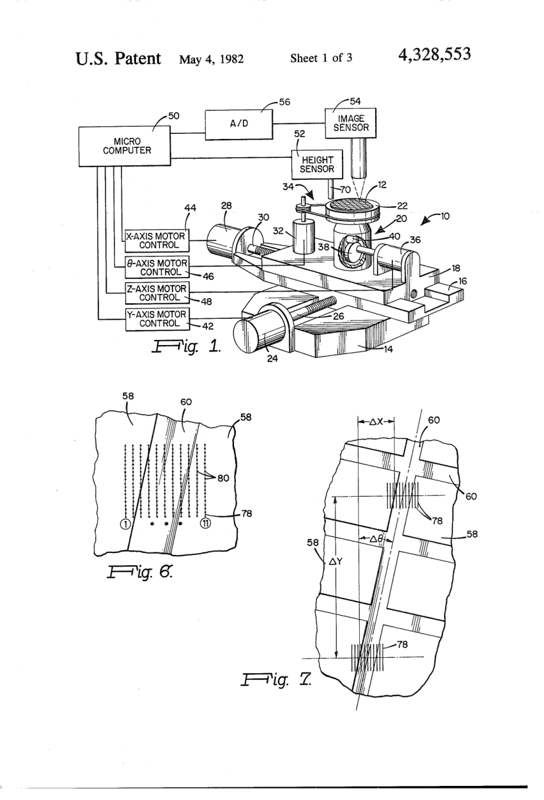
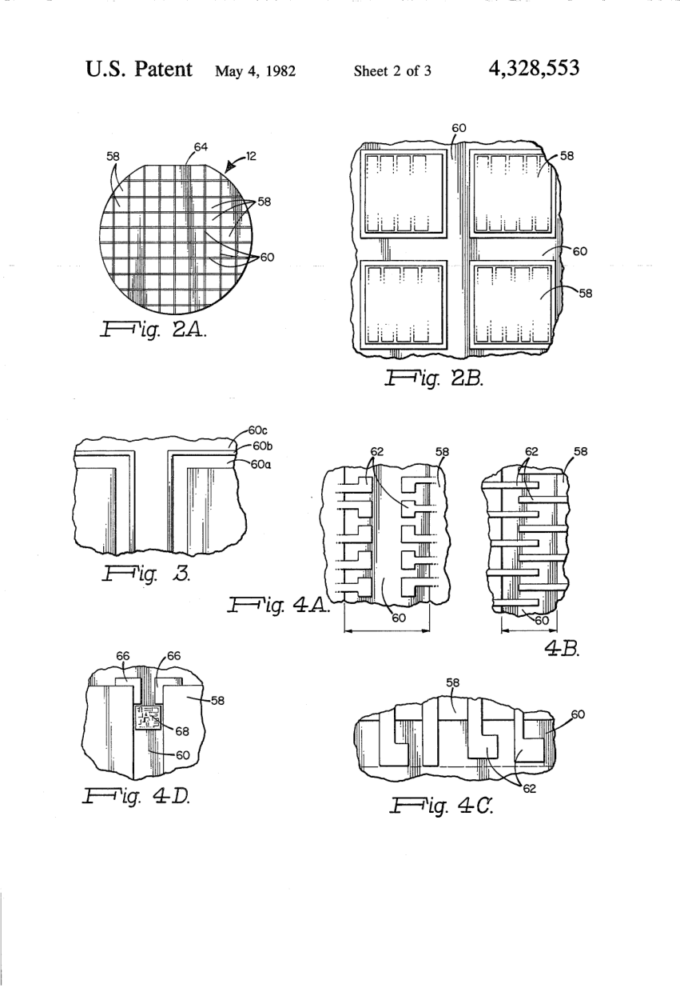
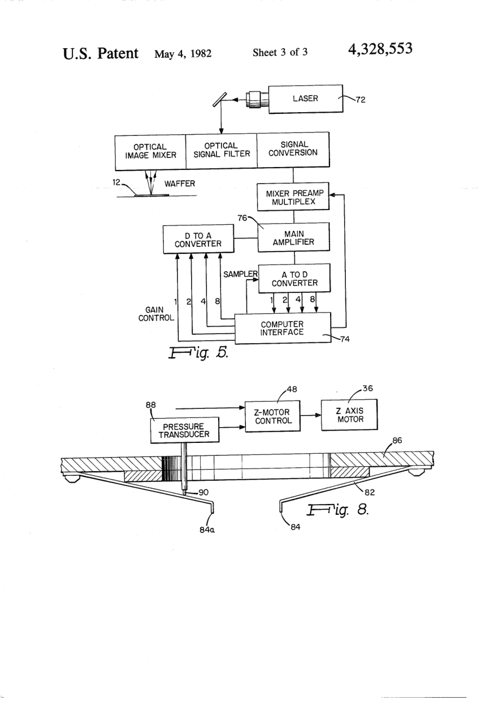

# 번역: 무표적 웨이퍼 정렬 방법과 장치

원제 Method and apparatus for targetless wafer alignment
공보 US 4,328,553 / 출원인 Computervision Corporation / 발명자 Fredriksen, Villers
출원 1980-09-08 (1976-12-07 출원 Ser. No. 748,310 의 계속), 등록 1982-05-04
원문 파일 [US4328553A.pdf](US4328553A.pdf)
번역 범위: 전문 (서지면, 명세서, 도면 설명, 청구항). 인용 문헌 목록은 원문 그대로 둔다.

## 서지면

미국 특허 (19) 번호 4,328,553
Fredriksen 외, (45) 1982년 5월 4일

(54) 무표적 웨이퍼 정렬 방법과 장치
(75) 발명자: Thorbjoern R. Fredriksen (캘리포니아 Santa Clara), Philippe Villers (매사추세츠 Concord)
(73) 양수인: Computervision Corporation (매사추세츠 Bedford)
(21) 출원번호: 184,690
(22) 출원일: 1980년 9월 8일
관련 미국 출원 자료
(63) 1976년 12월 7일 출원된 Ser. No. 748,310 의 계속출원, 그 출원은 포기됨
(51) 국제특허분류: G06F 15/46, H04N 7/18
(52) 미국분류: 364/559, 356/152, 356/400, 358/101, 364/167
(58) 조사 범위: 364/107, 117, 559, 475; 358/101; 318/626, 627, 678, 646; 33/174L, 7A; 356/152, 375-400

### (56) 인용 문헌 (원문 그대로)

U.S. PATENT DOCUMENTS
3,207,904 9/1965 Heinz 356/400
3,335,281 8/1967 Willits 356/400
3,551,052 12/1970
3,598,978 8/1971 Reiber 356/380
3,628,002 12/1971 Rempert 364/107
3,670,153 6/1972 Meese et al. 364/117
3,764,218 10/1973 Rempert et al. 364/107
3,809,488 5/1974 Schedewie 356/152
3,814,845 6/1974 Sonderegger 318/646
3,836,834 9/1974 Hurlbrink et al. 358/101
3,899,634 8/1975 Abbatiello et al. 364/475
3,907,439 9/1975 Montone et al. 358/101
Zanoni 356/375
3,988,535 10/1976 Hickman et al. 358/101

FOREIGN PATENT DOCUMENTS
61062 4/1968 German Democratic Rep. 364/559

OTHER PUBLICATIONS
Khoury: Analog Automatic Wafer Alignment for Fine Positioning, IBM Technical Disclosure Bulletin, p. 2895, vol. 17, No. 10, Mar. 1975.

주심사관 Felix D. Gruber, 대리인 Richard J. Birch

## (57) 초록

반도체 웨이퍼를 표적 없이 X, Y, θ로 정렬하는 방법과 장치다.
웨이퍼 위에는 같은 모양의 미세회로(다이)가 아주 많이 있고, 그것들은 스크라이브 선, 곧 "거리(street)"로 나뉜 행과 열을 이룬다.
웨이퍼의 방향은 웨이퍼 플랫의 위치로 정한다.
거리 하나하나는 웨이퍼 플랫과 이미 아는 각도 관계를 가진다.
이 방법과 장치는 웨이퍼에 따로 붙인 표적 대신 웨이퍼의 "거리" 무늬를 식별에 쓴다.
거친 정렬은 웨이퍼 플랫을 찾은 다음 웨이퍼를 대략 맞는 방향으로 돌려서 이룬다.
정밀 정렬은 "거리"의 모서리를 광전 방식으로 찾은 다음, 그 모서리가 X축이나 Y축과 나란해질 때까지 웨이퍼를 돌려서 한다.
바람직한 실시예에서는 웨이퍼 표면의 높이 차이를 보정하기 위해 독립된 Z축 보정을 둔다.

청구항 8개, 도면 12개.

## 도면 안 글자 (Fig. 1, 2A, 4C, 5, 8)

Fig. 1: 마이크로컴퓨터 50, A/D 56, 영상 센서 54, 렌즈계 52, 높이 센서, Z축 모터 제어.
Fig. 2A: 부호 58, 60, 62, 64 (웨이퍼 다이와 거리 무늬).
Fig. 4C: 60b, 62, 58.
Fig. 5: 광학 영상, 광학 혼합기, 신호 필터, 신호 변환, 이득 제어, A/D 변환기, 컴퓨터 인터페이스, Z 모터 제어, 웨이퍼 12.
Fig. 8: 압력 변환기 88, 90, 84, 84d.

## 배경

이것은 1976년 12월 7일에 출원되어 지금은 포기된 출원 Ser. No. 748,310 의 계속출원이다.

이 발명은 넓게는 무늬 인식 기술에 관한 것이고, 좁게는 얇고 평평한 원판이나 사각판을, 그 판 표면에 만들어진 반복 무늬를 기준으로 정렬하는 방법과 장치에 관한 것이다.
바람직한 실시예에서는 다이가 만드는 "거리" 무늬를 식별에 써서 반도체 웨이퍼를 표적 없이 정렬한다.

많은 반도체 공정에서 웨이퍼는 회로 무늬가 X, Y, 세타로 정확히 맞도록 놓여야 한다.

## 발명의 목적

- 무표적 3축 정렬과 Z축 보정을 함께 제공하는 것.
- 프로버 같은 반도체 장비에서 Z축 보정을 간단하고 싸게 하는 방법과 장치를 제공하는 것.
- 웨이퍼에 특별한 표적을 요구하지 않고 다이 무늬 자체를 방향 잡기에 쓰는 것이 이 발명의 특징이다.
- 필요한 정렬 정확도를 쉽게 구현되는 반복(interactive) 과정으로 이룬다는 것이 또 하나의 특징이다.

이 목적들과 다른 목적, 특징은 아래 바람직한 실시예의 자세한 설명과 첨부 도면에서 가장 잘 이해될 것이다.

## 종래 기술

많은 반도체 공정에서 웨이퍼는 회로 무늬가 미리 정한 대상(포토마스크, 앞 공정의 포토레지스트 무늬, 프로브 팁, 마커, 본더 등)에 대해 X, Y, 세타로 정확히 맞도록 놓여야 한다.

예전에는 사람이 현미경을 보며 손으로 장비를 조작해 정렬했다.
사람 방식은 취급 중 손상, 작업자 실수, 들쭉날쭉한 성능이라는 단점이 있다.

최근에는 포토마스크와 웨이퍼 정렬 분야에서 자동 정렬이 이루어졌다.
여기서는 기계가 자동으로 정렬하도록 웨이퍼의 특정 다이 자리에 일부러 설계한 표적 무늬를 넣었다.
이른바 "표적" 방식은 양산에 쓰이고 있다.
대표 장비로 Computervision Corporation 의 Cobilt 사업부가 AUTOLGN 상표로 파는 Cobilt AF-2800 자동 정렬기가 있다.

문헌에 나온 또 다른 정렬 방법은 웨이퍼 회로 무늬를 인공 경계형 표적과 함께 쓴다.
인공 표적을 웨이퍼의 TV 카메라 영상 위에 겹쳐 놓는다.
이 방식의 대표 예는 미국 특허 3,814,845 와 3,899,634 에 적혀 있다.

특별 표적형 자동 정렬기도, 인공 경계형 표적을 쓰는 자동 정렬기도, 회로 무늬의 하위 구조를 찾아내는 수단에 기댄다.
즉 그 정렬 기법들은 웨이퍼 중심이 아니라 주로 다이 중심이다.
특별 표적을 쓰는 정렬기에서는 표적이 아까운 웨이퍼 면적을 잡아먹고, 그런 표적이 없는 웨이퍼는 정렬할 수 없다.
인공 경계형 표적 정렬기는 웨이퍼 면적을 다 쓸 수 있지만, 전역 정렬 능력이 모자라고 해상도에 대한 무늬 치수 유연성이 모자라다.

그래서 이 발명의 일반 목적은 종래 정렬기의 문제를 없애는, 반도체 웨이퍼의 무표적 정렬 방법과 장치를 제공하는 것이다.
구체 목적은 특별 표적이 아니라 다이 무늬 자체를 쓰는 정렬 방법과 장치를 제공하는 것이다.
또 다른 목적은 방향이 틀어진 원판이나 웨이퍼를 무표적 방식으로 3축 정렬하는 방법과 장치를 제공하는 것이다.

## 도면 간단 설명

- 도 1: 이 발명에 따라 만든 무표적 웨이퍼 정렬기의 사시도 겸 부분 블록도.
- 도 2A: 미세회로가 여러 개 만들어진 반도체 웨이퍼의 평면도.
- 도 2B: 도 2A 웨이퍼 일부의 확대도.
- 도 3: 미세회로 사이의 "거리"들을 보여 주는 웨이퍼 일부의 또 다른 확대도.
- 도 4A, 4B: 미세회로 사이 "거리" 안의 서로 다른 두 패드 무늬를 보여 주는 확대도.
- 도 4C: 도 4A, 4B 와 비슷하되 패드 모서리가 고르지 않은 경우.
- 도 4D: 도 4A, 4B 와 비슷하되 미세회로 모서리의 코너 도형과 "거리" 안의 특수 회로를 보여 준다.
- 도 5: 정렬기의 간단 블록도.
- 도 6: 두 미세회로 사이 거리의 확대도. 거리와 미세회로를 가로지르는 선 주사(line scan)를 보여 준다.
- 도 7: 도 6 과 비슷하되, 같은 판 위의 다른 미세회로 쌍의 주사선과, 아래 쌍에 대한 위 쌍의 ΔX, ΔY, Δθ 변위를 보여 준다.
- 도 8: 무표적 정렬기용 저접촉력 Z 센서를 부분 단면도와 블록도로 보여 준다.

## 장치 구성 (도 1)

도 1 에는 이 발명에 따라 만든 무표적 정렬기 10 이 나온다.
정렬기 10 은 반도체 웨이퍼 또는 원판 12 같은 공작물에 4축 운동을 준다.
원판 12 의 4축 운동은 정렬기 베이스 14 같은 고정 "접지" 물체를 기준으로 한다.

정렬기 베이스 14 위에 Y축 이동 테이블 16 이 미끄러지게 얹힌다.
Y축 테이블은 X축 이동 테이블 18 을 미끄러지게 받치고, 그 위에 공작물 받침 20 이 얹힌다.
공작물 받침 20 에는 세타축으로 돌고 Z축으로 움직이는 회전판(척) 22 가 있다.

네 축 운동은 각각 별도 모터와 제어 회로로 따로 제어한다.
Y축 테이블 16 은 Y축 모터 24 와 리드 스크루 26 으로 움직인다.
X축 테이블은 X축 모터 28 과 리드 스크루 30 으로 움직인다.
받침판 22 의 세타축 회전은 세타축 모터 32 와 풀리 벨트 구동계 34 가 준다.
Z축 운동은 Z축 모터 36 에서 나오고, 캠 38 과 캠 종동절 40 으로 회전이 Z 운동으로 바뀐다.

네 모터 24, 28, 32, 36 은 DC 스테퍼 모터가 바람직하고, 각각 X, Y, 세타, Z 모터 제어 회로 42, 44, 46, 48 이 따로 제어한다.
웨이퍼 정렬에서 운동 분해능은 보통 X, Y, Z 에서 0.0001 인치, 회전(세타)에서 8 초각이다.

마이크로컴퓨터 50 이 모터 제어기 42~48 에 제어와 감지 명령 묶음을 보내 모든 운동을 시작한다.
마이크로컴퓨터 50 의 정보 입력은 높이 센서 52 와 영상 센서 54 에서 온다.
영상 센서 출력은 A/D 56 이 디지털로 바꾼다.

## 웨이퍼의 성질 (도 2~4)

반도체 웨이퍼 12 에는 같은 모양의 미세회로(다이) 58 이 아주 많이 있고, 스크라이브 선 곧 "거리" 60 으로 나뉜 행과 열로 배열된다.
각 다이 58 둘레에는 접촉 패드 62 가 있어 시험과 뒤의 패키징 리드를 위한 입출력 연결을 준다.
다이와 다이 사이 치수는 이미 아는 값이고 다이 위치는 대칭으로 놓인다.
따라서 거리의 모서리 하나만 정확히 찾으면, 이미 아는 변위만큼 웨이퍼를 옮겨 모든 회로에 닿을 수 있다.

이 발명의 정렬기 용도 하나가 자동 웨이퍼 프로버다.
프로버의 보통 절차는 한 행이나 한 열의 다이를 차례로 시험하는 것이다.
웨이퍼의 행과 열은 기계 운동의 주축 X, Y 와 나란히 맞춘다.
그래서 한 열의 다이들을 차례로 찍을 때 웨이퍼를 든 이동 스테이지는 Y 방향으로만 움직이면 된다.

웨이퍼 12 의 방향은 도 2A 의 웨이퍼 플랫 64 의 위치로 정한다.
웨이퍼의 둥근 윤곽이 직선으로 잘려 플랫 64 를 이룬다.
플랫이 둘 이상인 경우도 있지만 늘 하나가 더 크고, 그것이 웨이퍼의 스크라이브 선 60 과 정해진 각도 관계를 가진다.

도 3 에는 거리 60a, 60b, 60c 가 나온다.
거리 안쪽에는 도 4A, 4B 처럼 회로 패드 62 가 있을 수 있고, 그 패드 모서리는 도 4C 처럼 고르지 않을 수 있다.
또 다이 58 은 도 4D 처럼 코너 도형 66 을 가질 수 있고, 거리 60 안에 특수 회로 68 이 놓일 수 있다.
이 경우 코너 도형과 특수 회로는 거리 안의 "잡동사니(clutter)"로 볼 수 있다.
이 발명의 무표적 정렬 방법과 장치는 도 2~4 에 나온 웨이퍼 형상과 거리 상태를 모두 감당할 수 있다.

## 정렬 기법의 뼈대 (핵심 절차)

이 발명의 무표적 정렬 기법은 다음 개념에 바탕을 둔다.

(a) 웨이퍼 플랫 64 를 찾아 웨이퍼 12 를 알맞은 방향으로 돌린다 (예: 최대 세타 오차 ±5도).
(b) 중앙의 거리 60 하나를, 회로 무늬 58 과 다른 특유의 반사 성질로 알아내 찾는다.
(c) 다이 한 개 길이만큼 떨어진 곳에서 같은 거리를 찾고, 세타 오차를 계산해 보정한다.
(d) 주축을 따라 같은 거리를 찾는 일과 세타 보정을 번갈아 되풀이해(successive iteration), 세타를 최소 세타 증분 안의 최종 방향까지 맞춘다.
(e) 중앙의 교차 거리를 찾아 모든 다이 위치를 계산한다.

자동 웨이퍼 프로브에서 무표적 정렬계의 목적은 웨이퍼의 각 다이를 시험 프로브 묶음에 정확히 닿게 놓는 것이고, 이를 위해 X, Y, 세타, Z 네 가지 운동을 쓴다.
네 운동 기구는 앞서 말한 스테퍼 모터 24, 28, 32, 36 이 구동하고 마이크로스테핑 제어기 42~48 이 제어한다.
여기서 눈여겨볼 점은, 웨이퍼 12 는 X, Y 위치와 상관없이 Z 나 세타로 따로 움직일 수 있다는 것이다.

높이 센서 52 와 영상 센서 54 는 웨이퍼 12 의 면과 나란하되 떨어진 면에 있다.
웨이퍼 12 의 면 자체는 X, Y 주축을 담은 접지면과 나란하고 떨어져 있다. 또는 X, Y 축이 웨이퍼 면 안에 있다고 보아도 된다.

## Z축 보정

원판 12 의 Z축 위치를 X-Y 기준면에 대해 전기 신호로 얻는 데는 여러 보통 장비를 쓸 수 있다.
바람직한 실시예에서 높이 센서 52 는 정전용량 프로브 70 을 포함한다.
웨이퍼 면이 프로브 70 면에서 정해진 거리에 놓이면 높이 센서 52 는 이미 아는 특성(예: 이미 아는 전압 값)의 출력을 낸다.
이 기준 출력에서 벗어나면 마이크로컴퓨터 50 이 알아채고 Z축 모터 제어기 48 에 Z축 보정 신호를 낸다.
제어기는 Z축 모터 36 을 돌려 프로브 70 과 웨이퍼 12 면 사이 간격을 정해진 값으로 지킨다.

## 무늬 인식계 (도 5)

도 5 는 무표적 정렬기의 무늬 인식계를 간단히 보여 준다.
이 그림은 도 1 의 영상 센서와 A/D 블록을 펼친 것이다.
네온 헬륨 레이저 72 가 광원이다.
마이크로컴퓨터 50 은 컴퓨터 인터페이스 74 를 거쳐 영상 변환 매개변수와 디지털 자료 흐름을 제어한다.

자료 흐름은 순차 알고리즘으로 거른다.
알고리즘의 각 단계는 반복 단순화(iteration simplification)를 가진 다지선다 무늬 비교를 담는다.
하드웨어는 적응 제어를 걸어 웨이퍼마다 다른 차이와 보통의 회로 노화 효과를 없앤다.
도 5 의 간단한 계통은 순간 광학 영상에서 병렬 디지털 자료 출력까지의 변환을 보여 준다.

컴퓨터 인터페이스 74 는 주증폭기 76 의 이득을 제어하고, 표본 추출(영상의 순간 아날로그 값을 디지털 수로 바꾸는 일)을 시작하며, 표본을 디지털로 읽는다.
바람직한 실시예에서 웨이퍼 12 위 레이저 점 크기는 지름 약 0.5 mil 이고 최대 표본 속도는 25 kHz 다.
따라서 최대 속도 초당 5 인치에서 영상 수치를 0.2 mil 움직일 때마다 한 번 읽을 수 있다.
자료는 컴퓨터가 바로 제어하고 웨이퍼 위치와 정확히 짝지어진다.
여기서는 레이저를 설명했지만 비디오 카메라나 플라잉 스폿 스캐너와 검출기를 써도 된다.

## 선 주사와 점수 매기기 (도 6)

주사선은 Y축과 나란하고, X축을 따라 일정 간격으로 떨어져 놓인다.

설명을 위해, 점수(numerical score)는 주사선 위 모든 점의 값 합과 변화 횟수를 함께 써서 매긴다.
도 6 처럼 각 주사선은 같은 간격의 점 20 개 80 으로 나뉜다.
세기가 거리 "위(On)"와 "밖(Off)"에 대해 흑백이라고 하자. 즉 점수 1 은 거리 위, 0 은 거리 밖이다.
그러면 도 6 의 주사에서 1, 2, 10, 11 번 선은 합이 0 이고 5, 6, 7 번 선은 가득 찬 20 이 된다.
나머지 주사선은 10 과 20 사이가 되고, 거리의 모서리는 예를 들어 점수 10 으로 정의할 수 있다.

주사선 하나하나는 서로 다른 X 좌표에 해당한다(주사선이 Y 주축과 나란하다고 할 때).
도 6 을 보면 거리 60 의 왼쪽 모서리는 3 번과 4 번 선 사이에 있는 것으로 보인다.
주사를 도 7 처럼 정해진 다이 길이만큼 아래로 옮기면, 두 번째 왼쪽 모서리는 X 로 ΔX 만큼 어긋나 있다.
여기서 마이크로컴퓨터 50 이 보정각 Δθ 를 계산한다.
그러면 마이크로컴퓨터 50 이 세타축 모터 제어 46 에 세타 회전 보정 신호를 보내 웨이퍼 12 를 돌린다.
각 Δθ 가 작아질수록 거리와 비거리 사이의 변화가 더 또렷해진다.

## 반복 보정과 전환 (이 특허의 핵심 전환 규칙)

세타 보정 뒤에 주사 절차를 반복 과정으로 되풀이한다.
웨이퍼 한쪽 끝에서 다른 쪽 끝까지 거리 전체 길이를 주사할 수 있게 될 때까지 되풀이한다.
이 시점에서, 웨이퍼 지름의 양 끝에 가깝게 떨어진 두 점에서 거리를 주사하여, **중심 차이가 최소 세타 증분 하나보다 작아질 때까지**(예: 8 초각보다 작아질 때까지) 되풀이한다.

정밀 정렬 절차의 다음 동작은 X 방향의 교차 거리를 찾는 것이다.
웨이퍼를 먼저 중심으로 옮긴 다음, 거리를 찾을 때까지 X 로 주사한다.
**세타가 이미 완전히 맞아 있으므로 X 거리의 중심은 쉽게 정해진다.**

## 주사 방향: "거의 나란하게"

거친 정렬과 정밀 정렬을 설명했으니 이제 알 수 있듯, 반도체 웨이퍼의 정밀 정렬 주사는 주축 하나(X 또는 Y, Y 가 바람직함)와 나란하게, 그리고 스크라이브 선 곧 거리를 "거의 따라서" 한다.
처음 거친 정렬이 세타를 정해진 각 범위(예: ±5도) 안으로 맞춰 놓았으므로, 뒤따르는 정밀 정렬 주사는 주사되는 거리와 나란한 상태에서 5도 안에 있다.

이것은 주사를 거리에 가로질러 하는, 즉 거리를 가로질러 양쪽 모서리를 찾는 종래 방식과 뚜렷이 다르다.
이 발명에서 주사 방향은 거리를 "거의 따라서"다.
"거의 따라서"라는 말을 고른 까닭은, 이 발명이 세타 오차를 줄이는 데 **반복 과정**을 쓰기 때문이다.
스크라이브 선 주사 묶음 하나(예: 도 6 의 1~11 번 선)가 웨이퍼 세타 조정을 위한 세타 보정 신호 하나를 만든다.
그런 조정을 정해진 횟수 한 뒤에는 웨이퍼 스크라이브 선이 고른 주축에서 최소 세타 증분 하나 안에 놓인다. 즉 축과 "나란"해진다.

그러므로 여기서 "거의 따라서"는 스크라이브 선과 나란한 상태에서 5도 안에 드는 주사를 뜻한다.
다만 과정이 반복이고 처음 거친 세타 정렬 범위가 달라질 수 있으므로, 정밀 정렬 주사 묶음 하나 이상이 5도 범위를 벗어날 수 있다.
그러나 **적어도 한 묶음의 주사는 주사되는 스크라이브 선과 나란한 상태에서 5도 안에 든다.**

## 거친 정렬 (플랫 찾기)

정렬 과정은 두 큰 단계로 한다. 웨이퍼의 처음 거친 정렬, 그다음 정밀 정렬이다.
처음 설정 절차에서 첫 웨이퍼를 높이 기준으로 써서 웨이퍼의 바라는 Z축 위치를 정한다.
그 위치에서 높이 센서 52 의 출력은 앞서 말한 대로 이미 아는 특성을 가진다.
뒤따르는 웨이퍼들은 높이 센서 52, Z축 모터 제어 48, Z축 모터 36 의 작동으로 이 기준 위치에 맞춘다.

웨이퍼 12 의 사전 정렬은 웨이퍼 플랫 64 가 웨이퍼 위 미세회로 58 무늬에 대해 고정된 방향에 있다는 것을 전제로 한다.
바람직한 실시예에서는 높이 센서를 써서 웨이퍼 플랫을 찾는다.
웨이퍼 12 를 척 22 에 올린 뒤, 높이 센서 52 가 웨이퍼 가장자리를 지날 때 출력이 바뀌는 것을 잡아 가장자리를 정한다.
그다음 영상 센서와, 웨이퍼 회전과 X-Y 운동을 함께 써서 웨이퍼 가장자리를 따라간다.
웨이퍼 플랫 64 는 보통의 웨이퍼 곡률과 달리 직선에 가까운 가장자리 점들을 여럿 보여 준다.
여기서는 명시야(light field) 실시예를 보기로 들었지만, 개념상 암시야(dark field) 방식도 똑같이 쓸 수 있다. 그 경우 신호는 거리 "밖"에서 "위"로, 또 그 반대로 넘어가는 변화에서 나온다.

웨이퍼 플랫을 찾으면 컴퓨터 50 이 각을 계산하고, 세타축 모터 제어 46 에 신호를 보내 웨이퍼를 맞는 방향으로 돌린다.
회전 뒤에 영상 센서 54 를 웨이퍼에 가로질러 주사해 웨이퍼 지름을 잰다.
주 웨이퍼 플랫 64 의 위치를 알고 있으므로 웨이퍼 중심을 정확히 정할 수 있다.
이제 웨이퍼가 거칠게 맞았으니 무표적 정렬기는 정밀 정렬 절차를 한다.

정밀 정렬 동작은 영상 센서 54 의 각 주사선 78 에 매긴 점수에 바탕을 둔다.
도 6 처럼 주사선 11 개를 긋는데, 각각 주축 하나(X 또는 Y)와 나란하고 다른 축에 수직으로 일정 간격 떨어진다.
바람직한 실시예에서 주사선은 Y축과 나란하다.

## 프로버에서의 Z 제어 (도 8)

이 발명의 무표적 정렬 방법과 장치는 자동 반도체 웨이퍼 프로버에 특히 알맞다.
놓을 물건이 반도체 웨이퍼처럼 여리고 비싸면, 오염과 손상 위험이 따르는 쓸데없는 물리 접촉은 힘껏 피해야 한다.
다만 전기 시험을 하는 "프로빙" 작업에서는 웨이퍼와 전기 "손가락" 곧 "프로브 팁"의 물리 접촉이 꼭 필요하고, 그래서 업계에서 받아들여진 관행이다.
프로브 팁은 보통 웨이퍼 표면에 가볍게 닿는 가는 금속 선이다.

접촉 압력을 몇 그램이라는 좁은 범위 안에 지키려면, 웨이퍼와 프로브 팁 사이 "Z" 관계를 1000분의 몇 인치 안에서 제어해야 한다.
웨이퍼는 공정 때문에 대체로 평평하지도 않고 높이가 급히 바뀌지도 않는다(완만한 굴곡).
보통 뚜렷한 높이 변화는 웨이퍼 지름의 5~10% 이상에 해당하는 거리에서 일어난다.

앞서 말한 높이 센서 52 가 "Z"축 기준 위치를 주지만, 프로버에서는 Z축 감지 기구를 실제로 제어해야 할 변수와 똑같이 만드는 편이 낫다.
그 변수는 간격 자체가 아니라 프로브와 웨이퍼 사이 "접촉" 압력이다.
도 8 은 도 1 의 정렬 장치를 프로버로 쓸 때의 "Z"축 센서를 부분 단면도와 블록도로 보여 준다.
여러 반도체 프로브 82 가 각각 프로브 팁 84 를 가지고 보통의 프로브 카드 86 에 달려 있다.
프로브 팁과 웨이퍼 사이 접촉 압력은 편한 자리에 놓은 보조 프로브 팁 84, 또는 바람직하게는 실제 프로브 팁 84 하나에 걸리는 접촉 압력으로 감지한다.
프로브 팁 접촉력은 단단하고 전기가 안 통하는 부재 90 을 거쳐 변환기 88 에 전해진다.
변환기 88 은 보통 장치이며 스트레인 게이지나 힘 감응 반도체 같은 편한 센서면 된다.
그런 장치 하나로 매사추세츠 Hudson, Kane Industrial Drive 의 Stowe Laboratories 가 "Pitran" 이라는 이름으로 파는 것이 있다.

프로브 팁이 웨이퍼에 닿으면, 압력 센서 되먹임으로, 최소 "Z" 힘 수준을 정해진 양만큼 넘었을 때 운동을 처음 멈출 수 있다.
다른 경우로는 단일 트리거 점, 또는 상한/하한 트리거 점의 "뱅뱅(bang-bang)" 서보를 쓸 수 있다.
어느 경우든, 단순 위치 서보 또는 더 정확하게는 속도 되먹임을 갖춘 위치 서보라는 표준 서보 위치 결정 기법이 바라는 한계 안에서 "Z" 제어를 만든다.

다만 "Z" 높이 변화가 천천히 일어나는 프로버 실시예에서는 능동 서보 루프가 꼭 필요하지는 않다는 점을 눈여겨봐야 한다.
웨이퍼 시작에서 한 번 닿아 기억에 저장된 바라는 "Z" 값을 고치고, 그다음 각 다이에서 읽은 값으로 다음 다이를 보정할 수 있다. 즉 계단식 조정과 열린 루프다.
어느 쪽이든 제어하는 현상과 제어되는 현상이 하나가 된다. 곧 프로브 팁 84A 에서 감지한 힘이다.

## 변형 예

이 발명의 바람직한 실시예를 설명했으니, 이 분야 기술자는 첨부 청구항이 정한 범위를 벗어나지 않고 여러 변형을 할 수 있음을 알 것이다.
예를 들어 바람직한 실시예에서는 거리 곧 스크라이브 선의 "모서리"를 주축과 나란하게 찾는다.
그러나 "모서리" 개념은 다르게도 쓸 수 있다.
도 4A, 4B 처럼 패드의 줄이나 서로 맞물린 빔 리드도 똑같이 "모서리"가 될 수 있다.
이 경우 주사선 점수는 세 성분을 가진다. 크기, 펄스 폭, 주파수다.
**"가장 좋은 모서리"는 변화가 가장 또렷한 성분에서 고른다.**

## 청구항

우리가 청구하고 미국 특허로 보호받고자 하는 것은 다음과 같다.

**1.** 행과 열의 무늬로 배열되고 스크라이브 선으로 나뉜 미세회로 여럿을 가진 반도체 웨이퍼를 X, Y, θ 축으로 정렬하는 장치로서 다음을 포함한다.
A. 각 미세회로의 적어도 일부와, 그 미세회로에 맞닿은 스크라이브 선을, X 와 Y 주축 가운데 하나와 나란하고 스크라이브 선을 거의 따라가는 방향의 주사선 여러 개로 주사하여, 미세회로 무늬 안의 직선 모서리를 찾는 전자 광학 수단.
B. 그 직선 모서리의 위치에서, X 와 Y 주축 가운데 하나에 대한 그 모서리의 θ 축 오차를 정하는 수단.
C. 그 θ 축 오차를 줄이도록 웨이퍼를 θ 축으로 돌리는 수단.

**2.** 같은 전제의 장치로서 다음을 포함한다.
A. 앞과 같은 방식으로 주사하여, 한 미세회로를 따라 스크라이브 선의 한쪽 모서리를 찾는 전자 광학 수단.
B. 같은 방식으로 주사하여, **다른 미세회로를 따라 같은 모서리를** 찾는 전자 광학 수단.
C. 그 두 미세회로의 스크라이브 선 모서리 위치에서, X 와 Y 주축 가운데 하나에 대한 모서리들의 θ 축 오차를 정하는 수단.
D. 그 θ 축 오차를 줄이도록 웨이퍼를 θ 축으로 돌리는 수단.

**3.** 웨이퍼 플랫을 가지고, 스크라이브 선이 웨이퍼 플랫과 정해진 각도 관계를 가지는 반도체 웨이퍼를 X, Y, θ 축으로 정렬하는 장치로서 다음을 포함한다.
A. **웨이퍼 플랫이 X, Y 주축에 대해 정해진 방향 범위 안에 들 때까지 웨이퍼를 θ 축으로 돌리는 수단** (거친 정렬).
B. 한 미세회로를 따라 스크라이브 선의 한쪽 모서리를 찾는 전자 광학 주사 수단.
C. 다른 미세회로를 따라 같은 모서리를 찾는 전자 광학 주사 수단.
D. 두 모서리 위치에서 θ 축 오차를 정하는 수단.
E. θ 축 오차를 줄이도록 웨이퍼를 θ 축으로 돌리는 수단.

**4.** 반도체 웨이퍼를 X, Y, Z 축으로 정렬하는 장치로서 다음을 포함한다.
A. 미세회로 무늬 안의 직선 모서리를 찾는 수단.
B. 그 모서리의 θ 축 오차를 정하는 수단.
C. θ 축 오차를 줄이도록 웨이퍼를 θ 축으로 돌리는 수단.
D. 압력 센서.
E. 웨이퍼를 Z 축으로 움직여 그 압력 센서에 눌러 닿게 하는 수단.
F. **압력 센서가 정해진 접촉 압력을 감지하면 Z 축 이동을 멈추는 수단.**

**5.** 청구항 4 의 장치로서, 감지한 접촉 압력에 따라 웨이퍼를 한 방향으로 움직여 접촉 압력을 늘리고 반대 방향으로 움직여 줄여서, 정해진 접촉 압력을 지키는 수단을 더 포함한다. 이로써 웨이퍼 높이의 굴곡을 감당할 수 있다.

**6.** 청구항 4 의 장치로서, 압력 센서는 웨이퍼에 물리적으로 닿는 수단을 포함하고, 그 접촉 수단은 압력 센서와 전기적으로 절연된다.

**7.** 웨이퍼 플랫을 가지고, 스크라이브 선이 웨이퍼 플랫과 정해진 각도 관계를 가지며 미세회로와 다른 전자기 반사 특성을 가지는 반도체 웨이퍼를 X, Y, θ 축으로 정렬하는 방법으로서 다음 단계를 포함한다.
A. **거친 정렬**: 웨이퍼 플랫이 X, Y 주축에 대해 정해진 방향 범위 안에 들 때까지 웨이퍼를 θ 축으로 돌린다.
B. **정밀 정렬**:
 (i) 한 미세회로를 따라 스크라이브 선의 한쪽 모서리를 찾는다.
 (ii) 각 미세회로의 적어도 일부와 맞닿은 스크라이브 선을, X 와 Y 주축 가운데 하나와 나란하고 스크라이브 선을 거의 따라가는 방향의 주사선 여러 개로 광전 주사하여, 다른 미세회로를 따라 같은 모서리를 찾는다.
 (iii) 두 모서리 위치에서 X 와 Y 주축 가운데 하나에 대한 θ 축 오차를 정한다.
 (iv) θ 축 오차를 줄이도록 웨이퍼를 θ 축으로 돌린다.

**8.** 청구항 7 의 방법으로서, **단계 (B) 를 적어도 한 번 더 되풀이하는 단계**를 더 포함한다.
