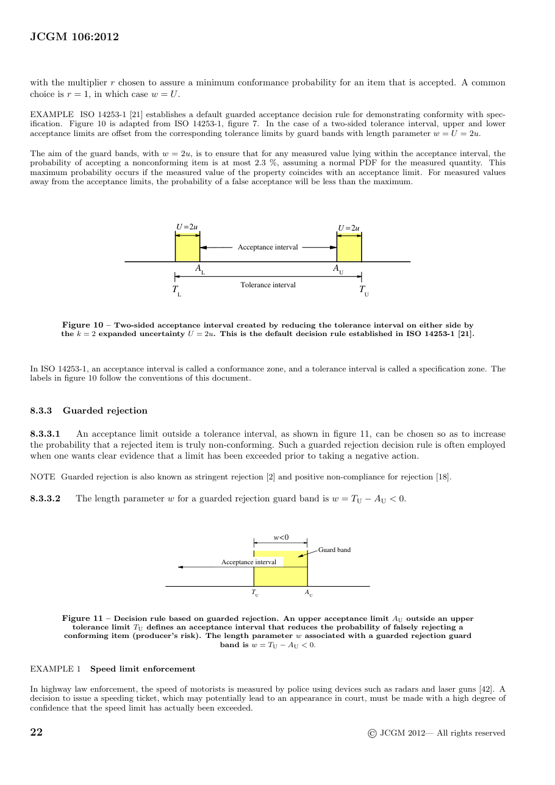
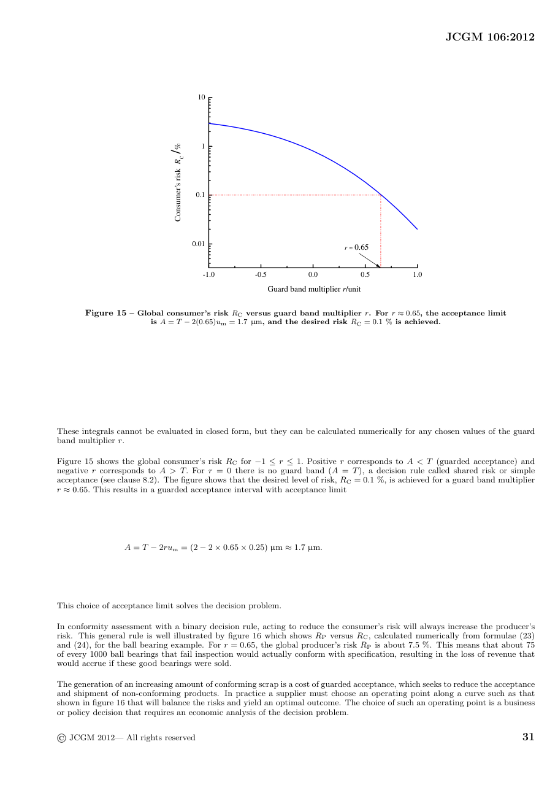
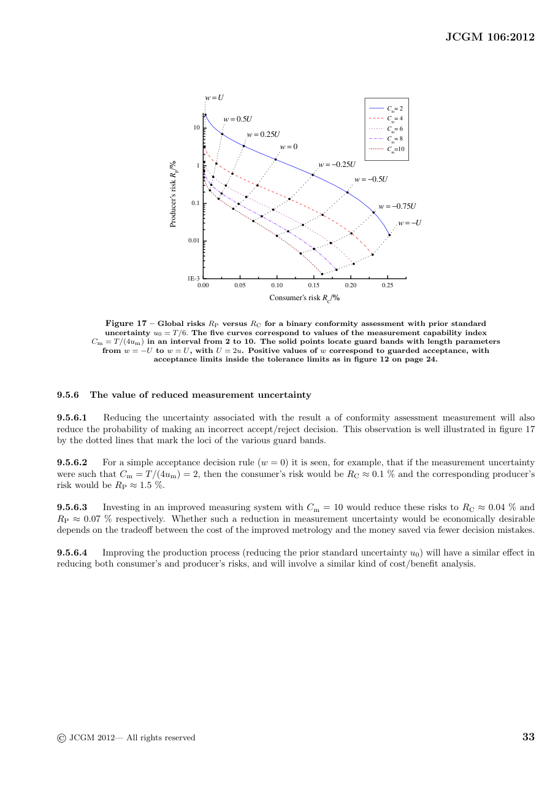

# JCGM 106:2012 전문 번역

- 원제: Evaluation of measurement data, The role of measurement uncertainty in conformity assessment
- 한국어 제목: 측정 자료의 평가, 적합성 판정에서 측정 불확도의 역할
- 발행: JCGM (BIPM, IEC, IFCC, ILAC, ISO, IUPAC, IUPAP, OIML 공동), 2012년 10월
- 원문 파일: 같은 폴더의 `JCGM_106_2012_E.pdf`
- 번역 범위: 전문 (머리말, 서론, 본문 1~9장, 부속서 A, B, C). 참고문헌은 원문 그대로 둔다.
- 번역 메모: 원문 PDF에서 수식의 그리스 문자와 적분 기호 일부가 텍스트 추출 과정에서 빠졌다. 그런 자리는 문맥으로 복원해 적었다. 원식 확인은 PDF 해당 쪽을 본다.

---

## 저작권 안내 (원문 요지)

이 JCGM 지침 문서의 저작권은 JCGM 회원 기관(BIPM, IEC, IFCC, ILAC, ISO, IUPAC, IUPAP, OIML)이 공동으로 가진다. 전자판을 무료로 받을 수 있어도 저작권은 국제적으로 보호된다. JCGM의 서면 허가 없이 제3자가 다시 쓰거나, 상표를 바꾸거나, 사본을 팔거나, 온라인으로 쓰는 것을 허락하지 않는다.

공식판은 JCGM이 원어로 펴낸 판뿐이다. 다른 언어로 번역하려면 JCGM의 허가를 받아야 하고, 수식과 단위의 원래 형식을 지켜야 하며, 정해진 문구를 넣어야 한다. 이 파일은 사내 연구 참고용 번역이며 공식 번역이 아니다. 공식 판단에는 원문을 쓴다.

---

## 머리말

1997년 국제도량형국(BIPM) 소장이 의장을 맡은 측정학 지침 합동위원회(JCGM)가 만들어졌다. 1993년에 측정 불확도 표현 지침(GUM)과 국제 측정학 용어집(VIM)을 준비했던 일곱 국제 기구가 만들었다. JCGM은 ISO 기술자문그룹 4(TAG4)로부터 이 두 문서의 책임을 넘겨받았다.

합동위원회는 BIPM과 IEC, IFCC, ISO, IUPAC, IUPAP, OIML로 이루어진다. 여기에 국제시험소인정협력체(ILAC)가 더해졌다.

JCGM에는 작업반 둘이 있다. 작업반 1 "측정 불확도의 표현"은 GUM의 사용을 넓히고 보충서와 관련 문서를 만든다. 작업반 2는 VIM을 고치고 사용을 넓힌다.

이 문서 같은 자료는 GUM이 명시적으로 다루지 않은 측정 불확도의 평가와 사용에 대한 지침을 주어 GUM의 값어치를 더한다. 이 지침은 GUM의 일반 확률 기반과 되도록 일치하게 쓴다.

이 문서는 JCGM 작업반 1이 준비했고, JCGM 회원 기관과 각국 국가측정표준기관의 상세 검토를 거쳤다.

---

## 서론

적합성 판정(3.3.1 참조)은 넓게 보면 제품, 공정, 시스템, 사람, 기관이 관련 표준을 만족하고 정해진 요구(3.3.3 참조)를 채우는지를 직접 또는 간접으로 정하는 모든 활동이다. ISO/IEC 17000:2004이 적합성 판정과 관련된 일반 용어와 정의를 준다.

적합성 판정 가운데 검사(inspection, 3.3.2 참조)라고 부르는 종류에서는, 제품이 정해진 요구를 채우는지를 정할 때 측정이 주된 정보원이 된다. ISO 10576-1:2003 [22]은 양(3.2.1 참조)을 재고 그 결과로 나온 포함 구간(3.2.7 참조, ISO 10576-1에서는 '불확도 구간'이라 부른다)을 허용 구간(3.3.5 참조)과 비교해 정해진 한계와의 적합을 확인하는 지침을 준다. 이 문서는 그 접근을 넓혀 위험을 명시적으로 넣고, 측정 결과(3.2.5 참조)에 바탕을 둔 적합 판정의 일반 절차를 만든다. 여기서 확률분포(3.1.1 참조)가 불확도와 불완전한 정보의 표현으로서 중심 역할을 한다.

측정 불확도의 평가는 기술 문제이며 GUM(JCGM 100:2008)과 그 보충서 JCGM 101:2008, JCGM 102:2011, JCGM 103 [3]이 다룬다. 이 문서는 관심 있는 양, 곧 측정량(3.2.4 참조)이 이미 측정되었고 그 결과가 GUM의 원칙에 맞게 표현되었다고 가정한다. 특히 알려진 유의한 계통 효과는 모두 보정되었다고 가정한다.

적합성 판정에서는 측정 결과로 대상이 정해진 요구에 맞는지를 판단한다. 대상은 예를 들어 ISO/IEC 17025:2005 [23]에 맞게 교정하거나 ISO 3650 [24]에 따라 검증할 게이지 블록이나 디지털 전압계일 수도 있고, 산업 폐수 시료일 수도 있다. 요구는 보통 허용 한계(3.3.4 참조) 하나나 둘의 모양을 띠며, 이 한계가 대상의 잴 수 있는 성질의 허용 값 구간, 곧 허용 구간(3.3.5 참조)을 정한다. 그런 성질의 예로는 게이지 블록의 길이, 전압계의 지시 오차, 폐수 시료 속 수은의 질량 농도가 있다. 성질의 참값이 허용 구간 안에 있으면 적합(conforming), 아니면 부적합(non-conforming)이라고 한다.

> 비고: 적합성 판정에서 쓰는 '허용 구간(tolerance interval)'은 통계학에서 같은 말로 쓰는 뜻과 다르다.

일반적으로 대상의 적합 여부는 여러 성질에 달려 있고 성질마다 허용 구간이 하나 이상 있을 수 있다. 측정 결과를 두고 내릴 수 있는 결정도 여럿일 수 있다. 어떤 양을 쟀을 때 (a) 대상을 받아들이기, (b) 물리기, (c) 한 번 더 재기 같은 선택이 있다. 이 문서는 스칼라 성질 하나를 가진 대상, 허용 한계 하나나 둘로 요구가 주어진 경우, 그리고 상태가 적합과 부적합 둘뿐이고 결정도 수용(accept)과 거부(reject) 둘뿐인 이진 결과만 다룬다. 여기 나온 개념은 더 일반적인 결정 문제로 넓힐 수 있다.

측정 자료를 평가할 때 측정량이 가질 수 있는 값에 대한 지식은 보통 확률밀도함수(3.1.3 참조)나 그 수치 근사로 담아 전한다. 이 지식은 흔히 최선 추정값(측정된 양값, 3.2.6 참조)과 그에 딸린 측정 불확도, 또는 정해진 포함 확률(3.2.8 참조)로 측정량의 값을 담는 포함 구간으로 요약한다. 그러므로 정해진 요구에 대한 적합성 판정은 측정을 마친 뒤 얻을 수 있는 정보에 바탕을 둔 확률의 문제다.

보통의 측정에서 관심 있는 측정량은 그 자체로는 관측되지 않는다. 강철 게이지 블록의 길이는 바로 볼 수 없지만, 마이크로미터의 앤빌을 블록 양 끝에 댔을 때의 지시는 볼 수 있다. 그런 지시는 열팽창과 마이크로미터 교정 같은 영향량의 효과를 담은 측정 모형을 통해 블록 길이에 대한 정보를 전한다. 적합성 판정에서 수용과 거부의 결정은 관측 가능한 자료(예를 들어 측정된 양값)에 바탕을 두며, 그 자료로부터 관측 불가능한 측정량의 가능한 값을 추론한다 [37].

측정 불확도가 있기 때문에, 대상의 성질을 잰 값으로 적합 여부를 판정할 때 늘 잘못 판정할 위험이 있다. 잘못된 판정은 두 가지다. 적합하다고 받아들인 대상이 사실은 부적합일 수 있고, 부적합하다고 물린 대상이 사실은 적합일 수 있다.

측정된 값의 허용 구간, 곧 수용 구간(3.3.9 참조)을 정하면 측정 불확도에 따른 잘못된 수용과 거부의 위험을 서로 저울질해 그 비용을 가장 작게 만들 수 있다. 이 문서는 측정량의 확률밀도함수(PDF), 허용 한계, 수용 구간의 한계가 주어졌을 때 적합 확률(3.3.7 참조)과 두 가지 오판 확률을 계산하는 기술 문제를 다룬다.

수용 구간 하나와 그에 대응하는 허용 구간의 관계를 그림 1에 보인다.

> 위 그림은 같은 개념을 쓴 본문 22쪽 그림 10이다. 원문 그림 1은 머리쪽 viii쪽에 있다.
>
> 그림 1, 측정된 양값으로 결정을 내리는 이진 적합성 판정. 대상의 잴 수 있는 성질(측정량)의 참값은 한계 (T_L, T_U)로 정의된 허용 구간 안에 있도록 규정된다. 그 성질의 측정값이 수용 한계(3.3.8 참조) (A_L, A_U)로 정의된 구간 안에 들면 대상을 적합으로 받아들이고, 아니면 부적합으로 물린다.

허용 한계와 수용 한계를 고르는 일은 의도한 제품 품질에서 벗어났을 때의 결과에 달린 사업 또는 정책 결정이다. 그런 결정의 성격을 일반적으로 다루는 일은 이 문서의 범위 밖이다. 예를 들어 참고문헌 [14, 15, 34, 35, 36, 44]를 보라.

---

## 1 적용 범위

이 문서는 대상(개체, 물체, 시스템)이 정해진 요구에 맞는지를 판정하는 지침과 절차를 준다. 대상은 예를 들어 게이지 블록, 식료품 저울, 혈액 시료일 수 있다. 다음 조건이 있을 때 이 절차를 쓸 수 있다.

- 대상이 하나의 스칼라 양(3.2.1 참조, 잴 수 있는 성질)으로 구별되며, 그 성질이 사실상 유일한 참값으로 나타낼 수 있을 만큼 자세히 정의되어 있다.

  > 비고: GUM은 '참(true)'이라는 말을 쓰지 않을 이유를 설명한다. 다만 이 문서에서는 헷갈릴 수 있는 자리에서 그 말을 쓴다.

- 그 성질의 허용 값 구간이 허용 한계 하나나 둘로 규정되어 있다.

- 그 성질을 잴 수 있고, 측정 결과(3.2.5 참조)를 GUM의 원칙에 맞게 표현할 수 있어서, 그 성질의 값에 대한 지식을 (a) 확률밀도함수(PDF, 3.1.3 참조), (b) 분포함수(3.1.2 참조), (c) 그런 함수의 수치 근사, (d) 최선 추정값과 포함 구간, 그리고 그에 딸린 포함 확률로 나타낼 수 있다.

이 문서가 만드는 절차로 관심 있는 성질의 측정값에 대한 허용 구간, 곧 수용 구간을 구현할 수 있다. 수용 한계는 부적합 대상을 받아들이는 위험(소비자 위험)과 적합 대상을 물리는 위험(생산자 위험)을 저울질하도록 고를 수 있다.

두 종류의 적합성 판정 문제를 다룬다. 첫째는 측정한 대상 하나에 대해 바라는 적합 확률을 보장하는 수용 한계를 정하는 일이다. 둘째는 (명목상 같은) 대상을 여러 개 잴 때 평균적으로 받아들일 만한 신뢰 수준을 보장하는 수용 한계를 정하는 일이다. 둘의 해법에 대한 지침을 준다.

이 문서에는 지침을 보여 주는 예가 들어 있다. 여기 나온 개념은 여러 스칼라 측정량의 측정에 바탕을 둔 더 일반적인 적합성 판정 문제로 넓힐 수 있다. 참고문헌 [19, 13] 같은 자료가 분야별 세부 사항을 다룬다.

이 문서의 독자는 품질 관리자, 표준 개발 기구 위원, 인정 기관, 시험소와 측정소의 직원, 검사 기관, 인증 기관, 규제 기관, 학계와 연구자다.

## 2 인용 표준

- JCGM 100:2008. 측정 자료의 평가, 측정 불확도 표현 지침 (GUM).
- JCGM 101:2008. 측정 자료의 평가, GUM 보충서 1, 몬테카를로 방법에 의한 분포의 전파.
- JCGM 102:2011. 측정 자료의 평가, GUM 보충서 2, 임의 개수의 출력량으로의 확장.
- JCGM 200:2012. 국제 측정학 용어집, 기본 및 일반 개념과 관련 용어 (VIM3).
- ISO/IEC 17000:2004. 적합성 판정, 용어와 일반 원칙.
- ISO 3534-1:2006. 통계, 용어와 기호, 1부: 확률과 일반 통계 용어.
- ISO 3534-2:2006. 통계, 용어와 기호, 2부: 응용 통계.

## 3 용어와 정의

이 문서에서는 따로 밝히지 않는 한 JCGM 100:2010, JCGM 101:2008, JCGM 200:2012의 정의를 쓴다. 가장 관련 있는 정의 몇을 아래에 짧게 적는다. 적합성 판정에서 특히 중요한, 다른 출처에서 가져오거나 고친 정의도 함께 적는다.

이 문서에서는 "지시(indication)"와 "최대허용오차(지시의)"를 JCGM 200:2012과 달리 값이 아니라 양으로 본다.

### 3.1 확률 관련 용어

**3.1.1 확률분포 (probability distribution)**
확률변수가 끌어내는 확률 측도.
비고: 분포함수(3.1.2), 확률밀도함수(존재할 때, 3.1.3), 특성함수 등 여러 동등한 수학 표현이 있다. [ISO 3534-1:2006 2.11 수정]

**3.1.2 분포함수 (distribution function)**
모든 값 ξ에 대해 확률변수 X가 ξ 이하일 확률을 주는 함수.

G_X(ξ) = Pr(X ≤ ξ)

[JCGM 101:2008 3.2]

**3.1.3 확률밀도함수 (PDF)**
분포함수의 도함수(존재할 때).

g_X(ξ) = dG_X(ξ)/dξ

비고: g_X(ξ) dξ는 '확률 요소'이며 g_X(ξ) dξ = Pr(ξ < X < ξ + dξ)다. [JCGM 101:2008 3.3 수정]

**3.1.4 정규분포 (normal distribution)**
연속 확률변수 X가 다음 확률밀도함수를 가질 때의 확률분포.

g_X(ξ) = (1 / (σ √(2π))) exp[ −(1/2) ((ξ − μ)/σ)² ],  −∞ < ξ < +∞

비고 1: μ는 X의 기댓값(3.1.5), σ는 표준편차(3.1.7)다.
비고 2: 정규분포는 가우스 분포라고도 한다. [JCGM 101:2008 3.4]

**3.1.5 기댓값 (expectation)**
PDF g_X(ξ)로 특징지어지는 연속 확률변수 X에 대해 E(X) = ∫ ξ g_X(ξ) dξ (적분 범위 −∞에서 +∞).
비고 1: 기댓값은 평균이라고도 한다.
비고 2: 모든 확률변수가 기댓값을 갖지는 않는다.
비고 3: 주어진 함수 F(X)에 대해 Z = F(X)의 기댓값은 E(Z) = ∫ F(ξ) g_X(ξ) dξ 다. [JCGM 101:2008 3.6]

**3.1.6 분산 (variance)**
V(X) = ∫ [ξ − E(X)]² g_X(ξ) dξ (적분 범위 −∞에서 +∞).
비고: 모든 확률변수가 분산을 갖지는 않는다. [JCGM 101:2008 3.7]

**3.1.7 표준편차 (standard deviation)**
분산의 양의 제곱근. [JCGM 101:2008 3.8]

### 3.2 측정학 관련 용어

**3.2.1 양 (quantity)**: 현상, 물체, 물질의 성질 가운데 수와 기준으로 크기를 나타낼 수 있는 것. [VIM3 1.1]

**3.2.2 양값 (quantity value)**: 양의 크기를 나타내는 수와 기준. [VIM3 1.19]

**3.2.3 참 양값 (true quantity value)**: 양의 정의와 일치하는 양값. [VIM3 2.11]

**3.2.4 측정량 (measurand)**: 재려고 하는 양. [VIM3 2.3]
비고: 이 문서에서 측정량은 관심 대상의 잴 수 있는 성질이다.

**3.2.5 측정 결과 (measurement result)**: 측정량에 부여되는 양값들과 함께 쓸 수 있는 관련 정보의 모음.
비고: (a) 측정된 양값과 그에 딸린 측정 불확도, (b) 측정량의 포함 구간과 포함 확률, (c) PDF, (d) PDF의 수치 근사 등 여러 방식으로 나타낼 수 있다. [VIM3 2.9]

**3.2.6 측정된 양값 (measured quantity value)**: 측정 결과를 나타내는 양값.
비고: 추정값, 최선 추정값이라고도 한다. [VIM3 2.10]

**3.2.7 포함 구간 (coverage interval)**: 쓸 수 있는 정보에 바탕을 두고, 정해진 확률로 측정량의 참 양값 집합을 담는 구간. [VIM3 2.36]

**3.2.8 포함 확률 (coverage probability)**: 측정량의 참 양값 집합이 정해진 포함 구간 안에 있을 확률. [VIM3 2.37]

**3.2.9 지시 (indication)**: 측정기나 측정 시스템이 주는 양.
비고: 읽음값이라고도 한다. [VIM3 4.1 수정]

### 3.3 적합성 판정 관련 용어

**3.3.1 적합성 판정 (conformity assessment)**: 제품, 공정, 시스템, 사람, 기관에 관한 정해진 요구가 채워졌는지를 정하는 활동. [ISO/IEC 17000:2004 2.1 수정]

**3.3.2 검사 (inspection)**: 관찰과 판단으로, 필요하면 측정, 시험, 게이징을 곁들여 하는 적합성 판정. [ISO 3534-2:2006 4.1.2 수정]
비고: 적합성 판정의 일부로 하는 측정을 검사 측정이라고 부르기도 한다.

**3.3.3 정해진 요구 (specified requirement)**: 밝혀 적은 필요나 기대.
비고: 규정, 표준, 기술 명세 같은 규범 문서에 적힌다.
- 예 1: 산업 폐수 시료(대상)의 용존 수은 질량 농도(성질)가 10 ng/L 이하여야 한다.
- 예 2: 식료품 저울(대상)이 표준 1 kg 분동을 잴 때 지시 R(성질)이 [999.5 g ≤ R ≤ 1000.5 g] 안에 들어야 한다.

**3.3.4 허용 한계 (tolerance limit), 규격 한계 (specification limit)**: 성질의 허용 값의 위 또는 아래 경계. [ISO 3534-2:2006 3.1.3 수정]

**3.3.5 허용 구간 (tolerance interval)**: 성질의 허용 값 구간. [ISO 10576-1:2003 3.5 수정]
비고 1: 따로 밝히지 않으면 허용 한계는 허용 구간에 포함된다.
비고 2: 통계학의 같은 용어와 뜻이 다르다.
비고 3: ASME B89.7.3.1:2001 [2]에서는 '규격 영역(specification zone)'이라 부른다.

**3.3.6 허용차 (tolerance)**: 위 허용 한계와 아래 허용 한계의 차.

**3.3.7 적합 확률 (conformance probability)**: 대상이 정해진 요구를 채울 확률.

**3.3.8 수용 한계 (acceptance limit)**: 측정된 양값의 허용 값의 위 또는 아래 경계. [ISO 3534-2:2006 3.1.6 수정]

**3.3.9 수용 구간 (acceptance interval)**: 측정된 양값의 허용 값 구간.
비고 1: 따로 밝히지 않으면 수용 한계는 수용 구간에 포함된다.
비고 2: ASME B89.7.3.1에서는 '수용 영역(acceptance zone)'이라 부른다.

**3.3.10 거부 구간 (rejection interval)**: 허용되지 않는 측정된 양값의 구간.

**3.3.11 보호대 (guard band)**: 허용 한계와 그에 대응하는 수용 한계 사이의 구간.
비고: 보호대는 그 한계를 포함한다.

**3.3.12 판정 규칙 (decision rule)**: 정해진 요구와 측정 결과가 주어졌을 때, 대상을 받아들이거나 물리는 데 측정 불확도를 어떻게 반영할지를 적어 둔 규칙. [ASME B89.7.3.1-2001 수정]

**3.3.13 개별 소비자 위험 (specific consumer's risk)**: 받아들인 특정 대상이 부적합일 확률.

**3.3.14 개별 생산자 위험 (specific producer's risk)**: 물린 특정 대상이 적합일 확률.

**3.3.15 전체 소비자 위험 (global consumer's risk)**: 앞으로의 측정 결과에 따라 부적합 대상이 받아들여질 확률.

**3.3.16 전체 생산자 위험 (global producer's risk)**: 앞으로의 측정 결과에 따라 적합 대상이 물릴 확률.

**3.3.17 측정 능력 지수 (measurement capability index)**: 허용차를, 대상 성질의 측정값에 딸린 표준 측정 불확도의 몇 배로 나눈 값.
비고: 이 문서에서 그 배수는 4다(7.6 참조).

**3.3.18 최대허용오차 (지시의), MPE**: 측정기에 대해, 명세나 규정이 허락하는 기기 지시와 재는 양 사이의 최대 차이.
비고 1: 최대 차이를 여럿 정하면 "최대허용오차들"이라고 쓴다.
비고 2: 지시 오차는 E = R − R0로 쓸 수 있다. R은 지시, R0는 같은 측정량 Y를 재는 이상적인 측정기의 지시다. 측정기의 시험과 검증에서 지시 오차는 보통 교정된 기준기를 재서 평가한다.

## 4 규약과 기호

**4.1** GUM에서는 측정량 Y의 추정값 y에 딸린 표준불확도를 u_c(y)로 쓴다. 아래 첨자 "c"(합성)는 군더더기로 보아 이 문서에서는 쓰지 않는다.

**4.2** A =: B는 B를 A로 정의한다는 뜻이다.

**4.3** 헷갈릴 일이 없으면 u(y) 대신 u를 쓴다. 확장불확도 U는 보통 포함 인자 k = 2로 U = ku로 둔다. 헷갈릴 수 있으면 k 값을 밝혀 적는다.

**4.4** 관심 있는 성질(측정량)은 가능한 값 η를 가지는 확률변수 Y로 본다. Y를 재면 측정 자료를 평가해 측정된 양값 η_m을 얻고, 이는 관측 가능한 확률변수 Y_m의 실현값이다. 보통 측정값 η_m은 임의 효과와 계통 효과에 달린 알 수 없는 오차 E만큼 Y와 다르다.

**4.5** 허용 구간은 측정량 Y의 허용 값을 정한다. 적합성 판정은 측정값 η_m과 그 값이 정해진 수용 구간과 갖는 관계로 내린다.

**4.6** 양 Y와 Y_m에 대한 지식은 조건부 PDF로 담고 전하며, 그 모양은 쓸 수 있는 정보에 달려 있다. 조건부 PDF는 세로 막대로 쓰고 막대 오른쪽을 주어진 정보로 본다. 측정 전 측정량 Y의 PDF는 g_{Y|I}(η|I)이고 I는 사전 정보다.

**4.7** 측정해서 측정값 η_m을 얻은 뒤의 Y의 PDF는 g_{Y|η_m,I}(η|η_m, I)다.

**4.8** 측정 시스템 출력량 Y_m의 가능한 값 η_m에 대한 PDF는 (a) 사전 정보 I만 주어졌을 때의 g_{Y_m|I}(η_m|I)와 (b) 사전 정보 I에 더해 측정량이 참값 Y = η를 가진다고 가정했을 때의 g_{Y_m|η,I}(η_m|η, I)다.

**4.9** 간결하게 적기 위해 고정된 사전 정보 I를 대체로 드러내지 않는다. Y와 Y_m의 PDF는 각각 g와 h로 쓴다.
- 측정 전 Y의 지식: g_{Y|I}(η|I) =: g₀(η)
- 측정 후 Y의 지식: g_{Y|η_m,I}(η|η_m, I) =: g(η|η_m)
- 사전 정보만 있을 때 가능한 측정값의 지식: g_{Y_m|I}(η_m|I) =: h₀(η_m)
- 정보 I에 더해 측정량 값 Y = η를 가정했을 때의 Y_m 지식: g_{Y_m|η,I}(η_m|η, I) =: h(η_m|η)

이 PDF들은 서로 독립이 아니며 베이즈 정리(6.2)로 이어진다.

**4.10** 2003년 제22차 CGPM 결의 10에 따라 소수점 기호는 온점이나 쉼표를 쓸 수 있다. JCGM은 영문 문서에서 온점을 쓰기로 했다.

## 5 허용 한계와 허용 구간

### 5.1 적합성 판정 측정

**5.1.1** 전압계의 지시 오차처럼 대상의 성질을 재어 그 대상이 정해진 요구에 맞는지를 정하는 상황을 생각하자. 그런 적합 시험은 세 가지 작업의 차례다.
- 관심 있는 성질을 잰다.
- 측정 결과를 정해진 요구와 견준다.
- 다음 조치를 정한다.

**5.1.2** 실무에서는 측정 결과를 얻고 나면, 측정 결과와 정해진 요구와 오판의 결과에 달린, 미리 정해 적어 둔 판정 규칙(3.3.12)으로 비교와 결정을 한다.

**5.1.3** 판정 규칙을 세우는 지침이 있다. ISO 14253-1 [21]과 ASME B89.7.3.1 [2]은 고른 판정 규칙을 문서로 남기는 법과, 수용 한계를 정할 때 측정 불확도가 하는 역할을 설명하는 법을 준다. 이 문서들은 결정이 둘 이상인 판정 규칙을 다루며, 이 문서가 다루는 이진 판정 규칙은 그 특별한 경우다.

**5.1.4** 적합성 판정의 일부로 하는 측정은 받아들일 만한 수준의 위험으로 결정을 내릴 수 있을 만큼의 정보를 얻도록 설계한다. 좋은 측정 전략은 측정 불확도를 줄이는 비용과 측정량의 참값을 더 확실히 아는 이득을 저울질한다.

**5.1.5** 검사 측정과 그에 딸린 판정 규칙은 비용과 위험 같은 문제와 밀접하다. 그래서 만족스러운 적합성 판정의 설계는 순수한 기술 작업이 아닌 때가 많다. 비용을 가장 작게 하는 것이 목표라면, 알맞은 경제 모형이 있을 때 문제를 직접 계산으로 줄일 수 있다.

### 5.2 허용되는 값과 허용되지 않는 값, 허용 구간

**5.2.1** 이 문서에서 측정량에 대한 정해진 요구는 허용 한계라는 한계값들로 이루어지며, 이 한계가 측정량의 허용 값 구간과 허용되지 않는 값 구간을 가른다 [22]. 허용 값 구간, 곧 허용 구간은 두 가지다.
- 한쪽 허용 구간: 위 또는 아래 허용 한계 하나만 있다.
- 양쪽 허용 구간: 위와 아래 허용 한계가 모두 있다.

어느 쪽이든 측정량의 참값이 허용 구간 안에 있으면 적합, 아니면 부적합이다.

**5.2.2** 한쪽 허용 구간처럼 보여도 물리적 또는 이론적 이유로 밝혀 적지 않은 한계가 숨어 있는 경우가 많다 [22]. 그런 허용 구간은 사실상 양쪽 구간이며, 한 한계는 밝혀 적었고 다른 한계는 숨어 있다. 아래 예 4와 5를 보라.

> 그림 2, 허용 구간. (a) 아래 허용 한계 T_L 하나만 있는 한쪽 구간, (b) 위 허용 한계 T_U 하나만 있는 한쪽 구간, (c) 아래와 위 허용 한계가 모두 있는 양쪽 구간. 차 T_U − T_L을 허용차 T라고 한다.

> 비고 1: 식품 안전이나 환경 보호처럼 적합성 판정 측정의 허용 한계를 정하는 일 자체에, 오판의 결과를 재기 어려워 생기는 불확도가 끼어들 수 있다 [29]. 신뢰도 분석에서 이와 비슷한 문제를 완전성 불확도(completeness uncertainty)라 부른다 [31].
> 비고 2: 완전성 불확도 같은 문제는 검사 측정으로 얻은 추정값에 딸린 측정 불확도와 아무 관계가 없다. 이 문서에서 허용 한계는 고정 상수로 본다.

### 5.3 허용 한계의 예

**예 1 (위 허용 한계 하나)**: 어떤 제너 다이오드의 항복 전압 V_b는 −5.4 V 이하여야 한다. 적합 다이오드의 V_b는 열린 구간 V_b ≤ −5.4 V 안에 있다.

**예 2 (아래 허용 한계 하나)**: 청량음료용 금속 용기의 파열 강도 B는 490 kPa 이상이어야 한다. 적합한 B 값은 열린 구간 B ≥ 490 kPa 안에 있다.

**예 3 (위아래 허용 한계를 모두 밝힌 경우)**: OIML Class E1 1 kg 분동 [25]은 최대허용오차(MPE)가 ±500 μg으로 규정된다. 곧 분동 질량 m이 0.999 999 5 kg 이상 1.000 000 5 kg 이하여야 한다. 적합한 1 kg 분동은 질량 오차 E = m − m₀ (m₀ = 1 kg)가 −500 μg ≤ E ≤ 500 μg 안에 드는 것이다.

**예 4 (위 한계는 밝히고 아래 한계는 숨은 경우)**: 어떤 환경 규정은 산업 폐수 속 수은 질량 농도 X가 10 ng/L 이하여야 한다고 정한다. 질량 농도는 0보다 작을 수 없으므로 아래 허용 한계 0 ng/L가 숨어 있다. 시료는 0 ng/L ≤ X ≤ 10 ng/L 안에 들면 규정에 맞는다.

**예 5 (아래 한계는 밝히고 위 한계는 숨은 경우)**: 식품 보존료로 쓰는 분말 벤조산나트륨은 건조 기준 질량 분율 순도 P가 99.0 % 이상이어야 한다. 순도는 100 %를 넘을 수 없으므로 위 허용 한계 100 %가 숨어 있다. 적합 시료는 99.0 % ≤ P ≤ 100 % 안에 든다.

## 6 측정량에 대한 지식

### 6.1 확률과 정보

**6.1.1** 적합성 판정의 일부로 하는 측정에서, 관심 있는 성질(측정량)에 대한 지식은 쓸 수 있는 정보에 따라 모양이 달라지는 조건부 PDF로 모형화한다. 그런 정보에는 늘 두 부분이 있다. 측정 전에 쓸 수 있는 정보(사전 정보)와 측정이 더해 주는 정보다 [38].

**6.1.2** 측정량의 PDF는 어떤 지식 상태에서 그 값들에 대한 믿음을 담고 전한다. 잘 모르는 측정량은 적합성 판정의 요구에 견주어 PDF가 넓고, 빈약한 정보와 들어맞는 넓은 값 구간을 뜻한다. 측정하면 새 정보가 들어와 PDF가 뾰족해지고 가능한 값 구간이 좁아진다.

**6.1.3** 그러므로 측정의 효과는 측정 전(사전) 지식 상태를 갱신해 측정 자료를 담은 측정 후(사후) 지식 상태를 얻는 것이다. 이 변환 규칙을 베이즈 정리라 하고 그 수학 틀을 베이즈 확률론이라 한다.

### 6.2 베이즈 정리

**6.2.1** 적합성 판정에서 대상의 잴 수 있는 성질 Y는 가능한 값 η를 가지는 확률변수로 본다. Y를 재기 전의 합리적인 믿음은 측정 시스템과 무관한 모양의 사전 PDF g₀(η)로 나타낸다.

**6.2.2** 사전 PDF g₀(η)는 흔히 비슷한 대상을 전에 재어 얻은 지식으로 정한다. 사전 PDF를 정하는 방법은 부속서 B에서 다룬다.

**6.2.3** 보통의 검사 측정에서 양 Y는 적합성을 판정하기에 충분한 정보를 주도록 설계된 절차로 잰다.

**6.2.4** 측정 시스템의 출력은 확률변수 Y_m으로 보며 가능한 값을 η_m이라 한다. Y를 재면 특정 실현값, 곧 측정된 양값 η_m을 얻고, 이 새 정보를 담은 Y의 사후 PDF를 g(η|Y_m = η_m) =: g(η|η_m)으로 쓴다.

**6.2.5** 사전 PDF와 사후 PDF는 베이즈 정리로 이어진다.

> g(η|η_m) = C g₀(η) h(η_m|η)   ... (1)

여기서 C는 ∫ g(η|η_m) dη = 1이 되도록 고른 상수다. h(η_m|η)는 측정량이 어떤 값 Y = η일 때 Y_m의 가능한 값에 대한 PDF다.

**6.2.6** 측정값 η_m을 두고 η의 함수로 본 h(η_m|η)를 η_m이 주어졌을 때 η의 가능도(likelihood)라 하고 L(η; η_m)으로 쓴다. 측정을 자극과 반응, 또는 입력과 출력으로 볼 때, 가능도 함수 L(η; η_m)은 관측된 반응(측정값 η_m)을 일으켰을 법한 자극(η 값)의 분포를 나타낸다.

**6.2.7** 가능도 함수의 모양은 구체적인 측정 문제와 측정 시스템, 수학 모형, 그리고 과거 자료, 기기 교정, 교정된 표준물의 측정 결과, 비슷한 시스템의 경험 같은 다른 관련 정보에 달려 있다. 실무에서 관심 있는 많은 경우 가능도 함수는 정규(가우스) 분포로 나타낼 수 있다.

**6.2.8** 베이즈 정리는 사후 지식 상태가 사전 분포에 담긴 사전 정보와 가능도 함수가 나타내는 측정 정보의 결합에서 어떻게 나오는지를 보여 준다.

**6.2.9** 많은 경우 측정 시스템은 비교적 빈약한 사전 지식을 정확한 측정 정보로 메우려고 쓴다. 그런 경우 사후 지식 PDF는 사실상 가능도 함수로 정해진다. 곧 g(η|η_m) ≈ C h(η_m|η)이며 C는 상수다.

### 6.3 요약 정보

#### 6.3.1 최선 추정값과 표준불확도

측정 결과는 흔히 측정량의 추정값과, 그 추정값 둘레에 있을 법한 값들이 퍼진 정도를 나타내는 모수로 요약한다. 이 문서에서 성질 Y의 추정값 y는 기댓값 E(Y|η_m)으로 둔다. 그에 딸린 퍼짐 모수 u(y) = u를 표준불확도라 하고, 분산 V(Y|η_m)의 양의 제곱근, 곧 Y의 표준편차로 둔다.

> E(Y|η_m) = y = ∫ η g(η|η_m) dη,  V(Y|η_m) = u² = ∫ (η − y)² g(η|η_m) dη

**6.3.1.1** 표준불확도 u는 추정값 y 둘레 Y의 퍼짐을 나타낸다. Y의 PDF가 봉우리가 하나이고 대칭이면 추정값 y는 Y의 최빈값이기도 하다.

**6.3.1.2** GUM에 따라 분석한 측정에서는 측정 자료를 평가해 측정량의 추정값(측정된 양값) η_m과 그에 딸린 표준불확도 u_m을 얻는다. 사전 정보가 매우 빈약하다고 가정하므로 사후 PDF g(η|η_m)은 추정값 y = η_m과 표준불확도 u = u_m으로 요약할 수 있다(7.6.1 참조).

#### 6.3.2 포함 구간

**6.3.2.1** 측정 뒤 Y가 주어진 값 a 이하일 확률은 Pr(Y ≤ a|η_m) = G(a) = ∫_{−∞}^{a} g(η|η_m) dη 다.

**6.3.2.2** 따라서 Y가 구간 [a, b] (a < b) 안에 있을 확률 p는

> p = Pr(a ≤ Y ≤ b|η_m) = ∫_a^b g(η|η_m) dη = G(b) − G(a)   ... (2)

**6.3.2.3** [a, b] 같은 구간을 Y의 포함 구간이라 하고 p를 그에 딸린 포함 확률이라 한다.

**6.3.2.4** Y의 PDF가 대칭이고 봉우리가 하나일 때 널리 쓰는 포함 구간은 최선 추정값 y를 중심으로 하고 길이가 표준불확도 u의 배수인 구간이다. GUM은 표준불확도 u에 포함 인자 k를 곱한 확장불확도 U를 정의한다.

> U = ku   ... (3)

**6.3.2.5** 포함 인자는 포함 구간 [y − U, y + U]에 대해 바라는 포함 확률이 나오도록 고른다. k와 포함 확률의 관계는 Y의 PDF에 달려 있다.

> 비고 1: [y − U, y + U] 꼴의 포함 구간을 불확도 구간이라 부르기도 한다(ISO 10576-1:2003 3.7).
> 비고 2: Y의 PDF가 비대칭이면 주어진 포함 확률에 대해 가장 짧은 포함 구간을 구하는 편이 알맞을 수 있다.

## 7 정해진 요구에 대한 적합 확률

### 7.1 적합 확률 계산의 일반 규칙

**7.1.1** 대상의 성질 Y의 참값이 허용 구간 안에 있으면 대상은 정해진 요구에 맞는다. Y에 대한 지식은 PDF g(η|η_m)으로 전해지므로, 적합하다는 말은 늘 참일 확률이 딸린 추론이다. Y의 허용(적합) 값 집합을 C라 하면 적합 확률 p_c는

> p_c = Pr(Y ∈ C|η_m) = ∫_C g(η|η_m) dη   ... (4)

**7.1.2** 식 (4)가 일반 규칙이다. 예를 들어 아래 한계 T_L과 위 한계 T_U의 양쪽 허용 구간이면 C = [T_L, T_U]이고 p_c = ∫_{T_L}^{T_U} g(η|η_m) dη 다.

**7.1.3** 대상은 맞거나 맞지 않거나 둘 중 하나이므로 부적합 확률은 p̄_c = 1 − p_c 다.

### 7.2 정규 PDF에서의 적합 확률

**7.2.1** 적합 확률은 PDF g(η|η_m)이 담고 전하는 측정량 Y의 지식 상태에 달려 있다. 많은 경우 Y의 지식을 정규분포로 나타내는 것이 합리적이며, 이때 이 확률을 계산할 수 있다. 사전 분포가 정규이고 측정 시스템(가능도 함수)도 정규이면 g(η|η_m)도 정규분포다.

**7.2.2** 더 일반적으로, 가능도 함수가 정규이고 사전 정보가 빈약하면 사후 PDF는 거의 정규가 된다. 이때 g(η|η_m)은 6.3.1에서 계산한 최선 추정값 y와 표준불확도 u를 기댓값과 표준편차로 가지는 정규분포로 충분히 근사할 수 있다.

**7.2.3** 익숙하고 널리 쓰이므로 이 문서의 여러 예에서 적합 확률 계산에 정규 PDF를 쓴다. 지시값이 적은 경우에 나오는 축척 이동 t 분포로도 같은 계산을 넓힐 수 있다.

**7.2.4** 측정량 Y의 PDF g(η|η_m)이 최선 추정값(기댓값) y와 표준불확도(표준편차) u로 정해지는 정규분포이면

> g(η|η_m) = (1/(u√(2π))) exp[ −(1/2)((η − y)/u)² ] =: φ(η; y, u²)   ... (5)

**7.2.5** 보통 추정값 y는 η_m에 달려 있다. 측정 전 Y에 대한 지식이 빈약하면 보통 y ≈ η_m 이다. 그렇지 않은 예는 A.4.4에 있다.

**7.2.6** 식 (2)로부터, PDF (5)에서 Y가 [a, b] 안에 있을 확률은

> Pr(a ≤ Y ≤ b|η_m) = Φ((b − y)/u) − Φ((a − y)/u)   ... (6)

여기서 Φ(z) = (1/√(2π)) ∫_{−∞}^{z} exp(−t²/2) dt 는 표준정규 분포함수다(부속서 A 참조).

### 7.3 정규 PDF에서 한쪽 허용 구간

#### 7.3.1 아래 허용 한계 하나

그림 3은 아래 허용 한계 T_L 하나만 있는 한쪽 허용 구간을 보여 준다. 적합한 Y 값은 η ≥ T_L 구간에 있다. 검사 측정 뒤 Y의 지식은 허용 구간 위에 겹쳐 그린 정규 PDF로 전해진다. 최선 추정값 y는 허용 구간 안에 있고, T_L 왼쪽의 음영 부분이 부적합 확률이다. 식 (6)에서 a = T_L, b → ∞로 두고 Φ(∞) = 1을 쓰면

> p_c = 1 − Φ((T_L − y)/u)   ... (7)

Φ(t) + Φ(−t) = 1 이므로 이는 다음과 같다.

> p_c = Φ((y − T_L)/u)   ... (8)

> 그림 3, 아래 허용 한계 T_L 하나만 있는 허용 구간. 측정 뒤 양 Y(관심 있는 잴 수 있는 성질)의 지식은 최선 추정값 y와 표준불확도 u를 가지는 정규 PDF로 나타낸다. 적합한 Y 값은 η ≥ T_L 구간에 있다.

#### 7.3.2 위 허용 한계 하나

그림 4는 위 허용 한계 T_U 하나만 있는 경우다. 적합한 Y 값은 η ≤ T_U 구간에 있다. T_U 오른쪽 음영 부분이 부적합 확률이다. 식 (6)에서 a → −∞, b = T_U로 두고 Φ(−∞) = 0을 쓰면

> p_c = Φ((T_U − y)/u)   ... (9)

#### 7.3.3 한쪽 허용 한계의 일반 처리

식 (8)과 (9)는 같은 꼴이며 다음처럼 쓸 수 있다.

> p_c = Φ(z)   ... (10)

아래 한계면 z = (y − T_L)/u, 위 한계면 z = (T_U − y)/u 다. 두 경우 모두 추정값 y가 허용 구간 안에 있으면(z ≥ 0) p_c는 1/2 이상이고, 아니면 1/2보다 작다.

> 표 1, 한쪽 허용 구간과 정규 PDF에서의 적합 확률 p_c와 부적합 확률 p̄_c. 아래 한계면 z = (y − T_L)/u, 위 한계면 z = (T_U − y)/u 다.

| p_c | p̄_c | z |
|---|---|---|
| 0.80 | 0.20 | 0.84 |
| 0.90 | 0.10 | 1.28 |
| 0.95 | 0.05 | 1.64 |
| 0.99 | 0.01 | 2.33 |
| 0.999 | 0.001 | 3.09 |

**예 1**: 제너 다이오드의 항복 전압 V_b를 재어 최선 추정값 v_b = −5.47 V, 표준불확도 u = 0.05 V를 얻었다. 규격은 V_b ≤ −5.40 V다. z = [−5.40 − (−5.47)]/0.05 = 1.40, p_c = Φ(1.40) = 0.92. 적합 확률은 92 %다.

**예 2**: 금속 용기를 가압수로 파괴 시험해 파열 강도 B의 최선 추정값 b = 509.7 kPa, u = 8.6 kPa를 얻었다. 규격은 B ≥ 490 kPa다. z = (509.7 − 490)/8.6 = 2.3, p_c = Φ(2.3) = 0.99. 파괴 시험 전 그 용기가 규격에 맞았을 확률은 99 %다.

### 7.4 정규 PDF에서 양쪽 허용 구간

그림 5는 허용 한계 T_L, T_U와 길이 T = T_U − T_L을 가지는 양쪽 허용 구간이다. 식 (6)에서 b = T_U, a = T_L로 두면 적합 확률은

> p_c = Φ((T_U − y)/u) − Φ((T_L − y)/u)   ... (11)

**예**: SAE Grade 40 엔진 오일 시료는 100 °C에서 동점도 Y가 12.5 mm²/s 이상 16.3 mm²/s 이하여야 한다. 측정 결과 y = 13.6 mm²/s, u = 1.8 mm²/s를 얻었다.

> (T_U − y)/u = (16.3 − 13.6)/1.8 = 1.5,  (T_L − y)/u = (12.5 − 13.6)/1.8 = −0.6
> p_c = Φ(1.5) − Φ(−0.6) = 0.93 − 0.27 = 0.66

적합 확률은 66 %다.

### 7.5 적합 확률과 포함 구간

**7.5.1** 측정 결과를 명시적인 PDF 대신 포함 구간과 포함 확률로 요약할 수도 있다. 그럴 때는 포함 구간을 허용 구간과 견주어 적합 확률을 말할 수 있다. 포함 확률 p의 포함 구간이 허용 구간 안에 통째로 들면 p_c는 p보다 작을 수 없다.

**7.5.2** 그림 6의 구간 (a)는 허용 한계를 넘어가므로 Y의 PDF 모양을 모르면 적합 확률을 말할 수 없다.

**7.5.3** 구간 (b)의 값은 모두 허용 한계보다 작고, 이 구간에 들지 않는 적합한 Y 값도 있으므로 p_c ≥ 95 %다.

**7.5.4** 일반적으로 [η_low, η_high]가 포함 확률 p의 Y 포함 구간이면
- 위 허용 한계 T_U 하나일 때, η_high ≤ T_U 이면 p_c ≥ p
- 아래 허용 한계 T_L 하나일 때, η_low ≥ T_L 이면 p_c ≥ p
- 양쪽일 때, η_low ≥ T_L 이고 η_high ≤ T_U 이면 p_c ≥ p

> 비고 1: 포함 구간을 허용 값 구간과 견주는 것이 ISO 10576-1 [22]의 적합 판정 바탕이다.
> 비고 2: Y의 PDF가 있으면 적합 확률은 언제나 계산할 수 있다. PDF는 포함 구간과 포함 확률보다 정보가 많다.
> 비고 3: 측정기의 적합성 판정을 할 때, 특히 특정 표준이 규제하는 경우, 측정량의 정의와 그에 따른 불확도 평가가 단순하지 않을 수 있어 따로 살펴야 한다.

### 7.6 측정 능력 지수 C_m

**7.6.1** 사전 정보가 너무 빈약해서 측정된 성질 Y의 가능한 값에 대한 지식이 전적으로 측정에서 온다고 볼 수 있는 경우를 생각하자. Y의 분포를 정규 PDF g(η|η_m) = φ(η; y, u²)로 보면 y ≈ η_m, u ≈ u_m 이다(A.4.4.3 참조). 아래에서는 이런 경우로 보고 측정 결과를 두 모수 (η_m, u_m)으로 요약한다.

**7.6.2** 허용차로 정해진 요구에 견준 측정의 질을 나타내는 모수를 측정 능력 지수(3.3.17)라 하고 다음처럼 정의한다.

> C_m = (T_U − T_L)/(4 u_m) = T/(4 u_m) = T/(2U)   ... (12)

여기서 U = 2 u_m 은 포함 인자 k = 2의 확장불확도다.

**7.6.3** 식 (12)의 인자 4는 임의로 고른 값이다. 측정 결과를 보고할 때 포함 구간 [η_m − 2u_m, η_m + 2u_m]을 널리 쓰기 때문에 이렇게 골랐다. g(η|η_m)이 정규이면 그 구간의 포함 확률은 약 95 %다.

**7.6.4** C_m은 측정의 질을 나타내는 다른 지표들과 가깝다. 게이징 비, 게이지 제작자 규칙, 시험 불확도 비(TUR) [32], 시험 정확도 비(TAR) [1] 등이 있다. 이들은 보통 10대 1 규칙, TUR 4:1 같은 비율로 적는다. 그런 규칙은 정의가 모호하거나 불완전할 때가 있어 조심해야 한다. 정의 (12)는 C_m ≥ 4 가 u_m ≤ T/16 을 뜻한다는 점을 분명히 한다.

**7.6.5** 측정기의 교정이나 검증에서 정해진 요구는 흔히 최대허용오차(3.3.18)로 적는다. 곧 그 기기로 양 Y를 잴 때 지시 오차가 정해진 위아래 한계 안에 들어야 한다. 대칭 구간 [−E_max, E_max]인 흔한 경우 허용차는 T = 2 E_max 이고 측정 능력 지수는

> C_m = 2 E_max / (2U) = E_max / U

여기서 U는 그 기기의 지시 오차 측정에 딸린 k = 2 확장불확도다.

### 7.7 측정 능력 지수와 적합 확률

**7.7.1** 정규 PDF에서 식 (11)은 허용 한계 쌍 (T_L, T_U)과 측정 결과 (y, u)로 적합 확률 p_c를 준다. y = η_m, u = u_m 으로 두면 다음 양을 정의해 일반 문제에 맞는 꼴로 다시 쓸 수 있다.

> ỹ = (η_m − T_L)/T   ... (13)

추정값 η_m이 허용 구간 안에 있으면 0 ≤ ỹ ≤ 1 이다.

**7.7.2** 정규 사후 PDF φ(η; η_m, u_m²)에 대해 식 (11)은 식 (12)와 (13)을 써서 다음처럼 쓸 수 있다.

> p_c = Φ[4 C_m (1 − ỹ)] − Φ(−4 C_m ỹ) = p_c(ỹ, C_m)   ... (14)

따라서 p_c는 ỹ와 C_m 두 양으로 완전히 정해진다.

**7.7.3** 추정값 η_m에 딸린 표준불확도 u_m이 측정 시스템 설계로 정해져 η_m과 무관하게 고정된 값인 경우가 흔하다. 예를 들어 여러 물 시료의 용존 수은 농도를 같은 절차로 재면 추정값은 달라도 표준불확도는 같다. 그런 경우 측정 능력 지수 C_m = T/(4u_m)이 고정이고, 어떤 측정 성질이 받아들일 만한 확률로 규격에 맞는지를 식 (13)과 (14)로 추정값 η_m만 보고 판정할 수 있다.

> 그림 7, 측정 능력 지수 C_m = T/(4u_m) 대 ỹ = (η_m − T_L)/T. 적합 확률 95 % 등고선을 보인다. 이 곡선이 신뢰 수준 95 %에서 적합과 부적합 영역을 가른다.

**7.7.4** 식 (14)로 같은 p_c를 주는 쌍 (ỹ, C_m)은 무수히 많다. 그림 7은 허용 구간 안 추정값(0 ≤ ỹ ≤ 1)에 대해 적합 확률 95 % 등고선을 따라 그린 C_m 대 ỹ다.

**7.7.5** 그림 7의 가로축은 C_m = 1, 곧 u_m = T/4에 해당한다. 이렇게 표준불확도가 비교적 크면 p_c ≥ 95 %가 되는 범위는 0.45 ≤ ỹ ≤ 0.55 뿐이다. 측정된 성질이 95 % 이상의 신뢰로 규격에 맞아야 한다면, 받아들일 만한 추정값 η_m은 허용 구간의 가운데 약 10 % 안에 있어야 한다.

## 8 수용 구간

### 8.1 수용 한계

**8.1.1** 대상을 적합으로 받아들일지 부적합으로 물릴지는, 그 대상 성질의 측정값 η_m과, 수용 기준을 세울 때 측정 불확도의 역할을 정한 판정 규칙의 관계로 정한다. 대상을 받아들이게 되는 측정값의 구간을 수용 구간(3.3.9)이라 하고, 수용 한계(3.3.8) 하나나 둘로 정의한다.

**8.1.2** 수용 한계와 그에 대응하는 판정 규칙은 오판의 바람직하지 않은 결과를 다스리도록 고른다. 널리 쓰이고 적용하기 쉬운 판정 규칙이 여럿 있다. 관심 있는 성질의 지식이 최선 추정값과 포함 구간으로 요약되어 있을 때 쓸 수 있다. 아래에 둘을 적는다.

### 8.2 단순 수용에 바탕을 둔 판정 규칙

**8.2.1** 널리 쓰이는 중요한 판정 규칙으로 단순 수용(simple acceptance) [2] 또는 위험 분담(shared risk) [20]이 있다. 이 규칙에서는 측정 결과의 생산자와 사용자(소비자)가, 성질의 측정값이 허용 구간 안에 들면 적합으로 받아들이고 아니면 물리기로 암묵적으로든 명시적으로든 합의한다. 이름 그대로 생산자와 사용자가 오판의 결과를 나눠 진다.

**8.2.2** 실무에서는 오판 가능성을 양쪽이 받아들일 만한 수준으로 묶기 위해, 측정 불확도를 살펴보고 목적에 맞는지를 판단하도록 요구하는 것이 보통이다.

**8.2.3** 그 한 가지 방법은, 측정된 양의 추정값이 주어졌을 때 포함 인자 k = 2의 확장불확도 U가 U ≤ U_max 를 만족하도록 요구하는 것이다. U_max는 서로 합의한 최대 허용 확장불확도다.

> **예 (법정 계량)**: 지시 오차가 [−E_max, E_max] 안에 들어야 하는 측정기를 검증할 때, 다음 두 조건을 만족하면 적합으로 받아들인다.
> (a) 교정된 표준기를 잴 때 지시 오차 E의 최선 추정값 e가 |e| ≤ E_max 를 만족한다.
> (b) 추정값 e에 딸린 k = 2 확장불확도가 U ≤ U_max = E_max/3 을 만족한다.
> 측정 능력 지수로 보면 조건 (b)는 C_m ≥ 3 과 같다(7.6 참조).

**8.2.4** 또 다른 실용 규칙은 IEC Guide 115 [19]의 "정확도 방법(accuracy method)"이다. 잘 특징지어진 시험 방법을 쓰고, (a) 최대허용오차가 정해진 한계 안에 드는 측정기를 쓰고, (b) 온도와 상대습도 같은 환경 영향을 정해진 한계 안으로 지키고, (c) 시험소 절차를 문서로 잘 관리하고, (d) 측정 인력의 역량을 문서로 보증해 불확도 원인을 최소화한다.

**8.2.5** 변동 원인을 정해진 한계 안으로 다스림으로써 최선 추정값에 딸린 측정 불확도를 무시할 만하다고 보고, 따로 평가하지 않으며, 수용 거부 결정에 넣지 않는다.

**8.2.6** 허용 구간과 포함 구간의 상대적 너비에 따라서는 단순 수용 규칙이나 비슷한 규칙으로도 적합성 판정에 필요한 품질 목표를 뒷받침할 수 있다.

### 8.3 보호대에 바탕을 둔 판정 규칙

#### 8.3.1 일반 고려 사항

**8.3.1.1** 관심 있는 성질의 측정값이 허용 한계에 가까울 때 받아들이거나 물리면 오판이 생기고 바람직하지 않은 결과로 이어질 수 있다. 위 허용 한계 하나인 경우 그런 오판은 보통 두 가지다(그림 8의 (b)와 (c)).

**8.3.1.2** 단순 수용 규칙에서 측정량의 PDF가 정규처럼 대칭이고 봉우리가 하나이면, 부적합 대상을 받아들일 확률(그림 8의 (b))이나 적합 대상을 물릴 확률(그림 8의 (c))이 50 %까지 커질 수 있다. 측정값이 허용 한계에 아주 가까이 있으면 PDF의 약 50 %가 한계 양쪽에 걸치므로, 받아들이든 물리든 오판 가능성이 50 %다.

**8.3.1.3** 수용 한계를 허용 한계에서 안쪽이나 바깥쪽으로 옮기면(보호대 설정, guardbanding) 두 확률 중 하나를 줄일 수 있다. 다만 다른 하나는 커진다 [6, 7, 8, 9, 12, 17, 44].

> 그림 8, 위 허용 한계 T_U 둘레의 단순 수용 판정 규칙과 95 % 포함 구간 네 개. 이 규칙에서 수용 한계 A_U는 허용 한계와 같다. 수용과 거부는 측정값(삼각형)으로 정하고 참값(원)은 알 수 없다. (b)와 (c)가 각각 거짓 수용, 거짓 거부라는 오판이다. (c)에서는 측정량의 참값이 알지 못한 채로 95 % 포함 구간 밖에 있다.

#### 8.3.2 보호 수용 (guarded acceptance)

**8.3.2.1** 수용 한계 A_U를 허용 구간 안쪽에 두면 부적합 대상을 받아들일 위험을 줄일 수 있다(그림 9). T_U와 A_U 사이 구간을 보호대(3.3.11)라 하고, 그 판정 규칙을 보호 수용이라 한다.

> 비고: 보호 수용은 엄격 수용(stringent acceptance) [2], 수용을 위한 적극적 준수(positive compliance for acceptance) [18]라고도 한다.

**8.3.2.2** 허용 한계와 수용 한계의 차가 보호대의 길이 모수 w다.

> w = T_U − A_U

보호 수용에서는 w > 0 이다.

**8.3.2.3** 많은 응용에서 길이 모수 w를 k = 2 확장불확도 U = 2u의 배수로 둔다.

> w = r U

배수 r은 받아들인 대상의 최소 적합 확률을 보장하도록 고른다. 흔한 선택은 r = 1, 곧 w = U 다.

> 그림 10 (본문 22쪽), 허용 구간을 양쪽에서 k = 2 확장불확도 U = 2u만큼 줄여 만든 양쪽 수용 구간. ISO 14253-1 [21]의 기본 판정 규칙이다. 같은 쪽 위의 그림 9는 보호 수용의 정의를 보인다.

> **예 (ISO 14253-1)**: ISO 14253-1 [21]은 규격 적합을 보일 때 쓰는 기본 보호 수용 판정 규칙을 정한다. 양쪽 허용 구간이면 위아래 수용 한계를 각 허용 한계에서 길이 모수 w = U = 2u 만큼 안쪽으로 옮긴다. 이 보호대의 목적은, 수용 구간 안에 드는 어떤 측정값에 대해서도 부적합 대상을 받아들일 확률이 많아야 2.3 %가 되게 하는 것이다(측정된 양에 정규 PDF를 가정). 이 최대 확률은 측정값이 수용 한계와 꼭 같을 때 나온다. 수용 한계에서 떨어진 측정값에서는 거짓 수용 확률이 그보다 작다. ISO 14253-1에서는 수용 구간을 적합 영역(conformance zone), 허용 구간을 규격 영역(specification zone)이라 부른다.

#### 8.3.3 보호 거부 (guarded rejection)

**8.3.3.1** 수용 한계를 허용 구간 바깥에 두면 물린 대상이 참으로 부적합일 확률을 높일 수 있다(그림 11). 이런 보호 거부 규칙은 부정적인 조치를 하기 전에 한계를 넘었다는 분명한 증거가 필요할 때 자주 쓴다.

> 비고: 보호 거부는 엄격 거부(stringent rejection) [2], 거부를 위한 적극적 비준수(positive non-compliance for rejection) [18]라고도 한다.

**8.3.3.2** 보호 거부 보호대의 길이 모수는 w = T_U − A_U < 0 이다.

> **예 1 (속도 제한 단속)**: 고속도로 단속에서 경찰은 레이더나 레이저 건으로 운전자의 속도를 잰다 [42]. 과속 딱지를 떼는 결정은 법정으로 갈 수도 있으므로 속도 제한을 실제로 넘었다는 높은 신뢰가 있어야 한다.
> 어떤 도플러 레이더로 50 km/h에서 150 km/h 구간을 잴 때 상대 표준불확도 u(v)/v 가 2 %다. 잰 속도 v의 지식은 기댓값 v, 표준편차 0.02v의 정규 PDF로 본다.
> 속도 제한 v₀ = 100 km/h 에서, 측정 속도가 v ≥ v_max 일 때 참 속도가 v ≥ v₀ 일 확률이 적어도 99.9 %가 되려면 임계 속도 v_max(수용 한계)를 얼마로 두어야 하는가?
> 이는 한쪽 허용 구간의 적합 확률 계산과 같다(7.3 참조). z = (v_max − v₀)/(0.02 v_max)가 99.9 %에 해당해야 하므로 표 1에서 z = 3.09 이고
> v_max = v₀ / (1 − 0.02 z) = 100 / (1 − 0.02 × 3.09) ≈ 107 km/h
> 구간 [100 km/h ≤ v ≤ 107 km/h]가 보호대이며, 측정 속도 107 km/h 이상이면 속도 제한을 넘었을 확률이 적어도 99.9 %다.

> **예 2 (가축과 축산물의 약물)**: 아나볼릭 스테로이드 난드롤론은 식용 동물의 성장 촉진제로 금지된 물질이다. 일부 동물에서 자연적으로 생기므로 임계(허용) 한계 T = 2.00 μg/L 가 정해져 있다.
> 난드롤론 선별 시험에서, 측정 농도가 95 % 이상의 확률로 임계값을 넘으면 의심 시료로 보고 확인 절차로 넘긴다.
> 시험소는 판정(수용) 한계 A = T + g 를 정하려 한다. g = |w| 는 보호대이며, 측정 농도 y ≥ A 이면 참 농도가 Y ≥ T 일 확률이 적어도 95 %가 되도록 한다.
> 시험소는 임계값 가까운 농도로 공시료 10개에 첨가해 측정 절차를 검증한다. 시험소 내 재현 조건에서 재어 재현성 표준편차 s = 0.20 μg/L 를 얻었다.
> 첨가 실험으로 측정에 유의한 계통 오차가 없다고 결론지었다. 측정 불확도는 재현성 효과가 지배하므로 난드롤론 농도 Y의 PDF를 자유도 ν = 9 의 축척 이동 t 분포로 본다.
> t 분포 표(한쪽, ν = 9, 95 %)에서 보호대는
> g = t_{0.95;9} × s = 1.83 × 0.20 μg/L = 0.37 μg/L
> 따라서 측정값이 A = (2.00 + 0.37) μg/L = 2.37 μg/L 이상인 시료를 의심 시료로 본다.

## 9 소비자 위험과 생산자 위험

### 9.1 개요

**9.1.1** 이진 판정 규칙을 쓰는 적합성 판정에서는 대상의 성질을 재어 그 측정값이 정해진 수용 구간 안에 들면 적합으로 받아들인다. 수용 구간 밖이면 부적합으로 물린다.

**9.1.2** 보호대를 쓰면 포함 구간으로 요약한 측정 정보로 내리는 적합 판정의 오판 확률을 제한할 수 있다. 이 장은 생산 공정에 대해 그 확률을 더 정확히 평가하는 일을 다룬다. 평가한 확률은 생산 공정과 측정 시스템이라는 두 요인에 달려 있다.

**9.1.3** 측정 시스템이 완전히 정확하다면 모든 적합 판정이 맞고 모든 위험이 0이다. 측정 불확도가 커지면 오판 확률이 커지며, 측정값이 허용 한계에 가까울 때 그 확률이 가장 크다.

**9.1.4** 위험은 생산 공정의 성질에도 달려 있다. 공정이 허용 한계 가까운 대상을 거의 만들지 않으면 오판의 여지가 적다. 반대로 허용 한계에 가까운 대상을 자주 만들면 측정 불확도가 작용한다.

> 그림 12, 측정된 양값으로 결정을 내리는 이진 적합성 판정(그림 1과 같다). 참값은 (T_L, T_U)의 허용 구간 안에 있어야 하고, 측정값이 (A_L, A_U)의 수용 구간 안에 들면 받아들인다.

### 9.2 생산 공정과 측정 시스템의 PDF

**9.2.1** 잴 수 있는 성질 Y를 가진 대상을 잇따라 만드는 공정을 생각하자. 공칭 저항 10 kΩ의 저항기를 만드는 기계일 수도 있고, 용존 수은이 든 바닷물을 담는 표본 추출 과정일 수도 있다. 그 공정에서 무작위로 고른 대상의 성질 Y는 재기 전에는 사전 PDF g₀(η)로 전해진다. g₀(η)는 생산 공정을 나타내며 공정 확률밀도라고도 부른다. 보통 만든 대상의 표본에서 관심 성질을 재어 얻은 지식으로 정한다.

**9.2.2** 적합성 판정은 관심 성질을 재어 한다. 측정 시스템의 출력은 관측 가능한 확률변수 Y_m이며, 입력값 Y = η 를 알 때 그 가능한 값 η_m은 PDF h(η_m|η)로 전해진다. h(η_m|η)의 모양은 측정 시스템 설계, 교정 정보, 환경 변수나 재료 성질 같은 관련 영향량의 지식으로 정한다.

### 9.3 이진 판정 규칙에서 검사 측정의 가능한 결과

**9.3.1** C와 C̄를 각각 Y의 적합 값 구간과 부적합 값 구간, A와 Ā를 각각 Y_m의 수용 값 구간과 비수용 값 구간이라 하자.

**9.3.2** 이진 판정 규칙에서 측정값 η_m이 나왔을 때 가능한 결과는 넷이다.

- **올바른 수용 (valid acceptance)**: 대상이 받아들여지고(η_m ∈ A) 규격에 맞는다(Y ∈ C). 바라는 결과다.

- **거짓 수용 (false acceptance)**: 대상이 받아들여졌으나(η_m ∈ A) 규격에 맞지 않는다(Y ∈ C̄). 오판이며 그 확률을 소비자 위험이라 한다. 그 비용을 보통 대상을 쓸 만하다고 받아들여 쓰는 소비자가 지기 때문이다.
  > 비고: 거짓 수용은 pass error, false positive라고도 한다.

  측정값 η_m ∈ A 로 적합 판정을 받은 특정 대상에 대해 거짓 수용 확률을 개별 소비자 위험(3.3.13) R_C* 라 한다. 적합 확률 정의 (4)에서 보면 수용 구간 안의 측정값 η_m에 대해

  > R_C* = 1 − p_c

  생산 공정에서 무작위로 고른 대상이 측정 뒤 거짓 수용될 확률을 전체 소비자 위험(3.3.15) R_C 라 한다. R_C 계산은 9.5에서 다룬다.

- **올바른 거부 (valid rejection)**: 대상이 물리고(η_m ∈ Ā) 규격에 맞지 않는다(Y ∈ C̄). 바라는 결과다.

- **거짓 거부 (false rejection)**: 대상이 물렸으나(η_m ∈ Ā) 실제로는 규격에 맞는다(Y ∈ C). 오판이며 그 확률을 생산자 위험이라 한다. 적합 시험에 떨어진 대상을 팔 수 없는 생산자가 그 비용을 지기 때문이다.
  > 비고: 거짓 거부는 fail error, false negative라고도 한다.

  측정값 η_m ∈ Ā 로 부적합 판정을 받은 특정 대상에 대해 거짓 거부 확률을 개별 생산자 위험(3.3.14) R_P* 라 한다. 수용 구간 밖의 측정값 η_m에 대해

  > R_P* = p_c

  무작위로 고른 대상이 측정 뒤 거짓 거부될 확률을 전체 생산자 위험(3.3.16) R_P 라 한다.

### 9.4 Y와 Y_m의 결합 PDF

**9.4.1** 개별 소비자 위험 R_C* 와 개별 생산자 위험 R_P* 는 특정 대상의 적합 확률과 단순한 관계로 이어진다. 성질 Y의 값이 허용 구간 밖이고 측정값 Y_m이 수용 구간 안이면 소비자 위험이 실현된 것이다. 이 두 사건이 함께 일어날 확률, 곧 전체 소비자 위험은 생산 공정과 측정 시스템에 달린 결합 확률분포로 정해진다.

**9.4.2** 결합 확률밀도는 이미 아는 밀도들의 곱으로 쓸 수 있다. 말로 하면, 측정량 Y가 허용 구간 밖이고 측정값 Y_m이 수용 구간 안일 확률은, 생산 공정이 Y의 참값이 허용 구간 밖인 대상을 만들 확률에, 그 조건에서 측정 시스템이 수용 구간 안의 측정값을 낼 확률을 곱한 것이다.

**9.4.3** 전체 생산자 위험도 같은 결합 분포로 정의된다. 허용 구간, 생산 공정, 측정 시스템을 고정으로 보면 전체 소비자 위험과 전체 생산자 위험은 수용 한계로 정해진다. 그러므로 수용 한계를 두 위험의 받아들일 만한 균형이 되도록 정할 수 있다. 일반적으로 두 위험을 동시에 가장 작게 만드는 수용 한계는 없다. 하나를 줄이면 다른 하나가 커진다.

**9.4.4** 품질 관리와 적합성 판정 문헌에서 '소비자 위험'과 '생산자 위험'은 대개 위의 전체 위험을 뜻한다.

**9.4.5** 주어진 생산 공정과 측정 시스템에 대해, 무작위로 고른 대상의 적합 시험 결과에 대한 지식은 결합 확률밀도함수로 나타낸다. 그런 대상에 대해 (a) 측정량 Y가 구간 η ≤ Y ≤ η + dη 안에 있고 (b) Y를 재면 측정값 Y_m이 η_m ≤ Y_m ≤ η_m + dη_m 안에 나올 확률은

> Pr(η ≤ Y ≤ η + dη 이고 η_m ≤ Y_m ≤ η_m + dη_m) = f(η, η_m) dη dη_m   ... (15)

**9.4.6** 확률의 곱 규칙으로 결합 밀도 f(η, η_m)은 두 방식으로 인수분해된다.

> f(η, η_m) = g₀(η) h(η_m|η)   ... (16a)
> f(η, η_m) = h₀(η_m) g(η|η_m)   ... (16b)

**9.4.7** (16a) 오른쪽의 두 PDF는 9.2에서 말한 두 확률밀도다. 이 모양이 주어지면 (16b) 오른쪽의 두 밀도를 계산할 수 있다(A.4.3, A.4.4 참조).

### 9.5 전체 위험의 계산

#### 9.5.1 역사적 배경

**9.5.1.1** 아래에서 오판의 전체 위험을 계산하는 식을 만든다. 전통적으로 이런 계산은 명목상 같은 대상을 많이 재어 얻은 결과의 도수분포로 했다. 그 방식에서 전체 소비자 위험은, 잰 표본 가운데 쓸 만하다고 받아들여졌지만 정해진 요구에 맞지 않는 대상의 비율이다. 특정 대상의 부적합은, 적합성 판정에 쓴 측정 시스템보다 훨씬 작은 불확도의 별도 측정으로 사후에 보여야 한다.

**9.5.1.2** 아래의 전체 위험은 도수분포가 아니라 확률분포로 계산한다. 그래서 실제로 있지도 않을 수 있는 측정 대상 모임을 생각할 필요가 없다. 수치로 보면 계산한 확률은 측정 도수와 평균적으로 언제나 일치한다.

#### 9.5.2 일반 공식

**9.5.2.1** 결합 PDF (16a)와 두 확률밀도 g₀(η), h(η_m|η)가 주어지면 위의 네 결과 각각의 확률을 계산할 수 있다. 이 확률들은 결합 확률밀도 f(η, η_m)을 네 영역에서 적분한 부피다.

**9.5.2.2** 특히 중요한 것은 전체 소비자 위험과 전체 생산자 위험이다.

- 측정값이 수용 구간 안이고 Y 값이 허용 구간 밖인 전체 소비자 위험

  > R_C = ∫_{C̄} ∫_{A} g₀(η) h(η_m|η) dη_m dη   ... (17)

- 측정값이 수용 구간 밖이고 Y 값이 허용 구간 안인 전체 생산자 위험

  > R_P = ∫_{C} ∫_{Ā} g₀(η) h(η_m|η) dη_m dη   ... (18)

**9.5.2.3** 식 (17)과 (18)이 일반 공식이다. g₀(η)와 h(η_m|η)의 모양에 따라 R_C와 R_P를 수치로 계산해야 할 수 있다.

#### 9.5.3 특별한 경우: 이진 판정 규칙

**9.5.3.1** 그림 12의 이진 적합성 판정에서 식 (17), (18)은 다음이 된다.

> R_C = [ ∫_{−∞}^{T_L} + ∫_{T_U}^{∞} ] ( ∫_{A_L}^{A_U} g₀(η) h(η_m|η) dη_m ) dη   ... (19)
> R_P = [ ∫_{−∞}^{A_L} + ∫_{A_U}^{∞} ] ( ∫_{T_L}^{T_U} g₀(η) h(η_m|η) dη ) dη_m   ... (20)

> **예 (정밀 저항기 제조)**
>
> 어떤 전자 부품 공급사가 공칭 저항 1 500 Ω 의 권선 정밀 저항기를 만든다. 저항기마다 저항 Y는 T_L = 1 499.8 Ω, T_U = 1 500.2 Ω 의 허용 구간 안에 들어야 한다.
>
> 생산 기계를 평가하려고 출력 표본을 측정 불확도가 무시할 만한 고정확도 저항계로 쟀다. 측정값 히스토그램은 공칭값을 중심으로 한 정규 모양이고 표준편차 σ = 0.12 Ω 다. 이로부터 공정을 나타내는 정규 PDF g₀(η) = φ(η; y₀, u₀²)를 둔다. y₀ = 1 500 Ω, u₀ = σ = 0.12 Ω 다.
>
> 이 기계가 만든 보통 저항기의 적합 확률은
> p_c = ∫_{1 499.8}^{1 500.2} φ(η; 1 500, 0.12²) dη ≈ 0.90 = 90 %   ... (21)
>
> 공급사가 만든 저항기를 모두 그대로 보내면 약 10 %가 부적합이 되어 경제적으로 받아들일 수 없다. 더 비싼 기계를 사면 공정 변동을 줄일 수 있지만, 비용을 견주어 기존 기계를 쓰고 대신 검사 공정으로 부적합 저항기를 골라내기로 했다.
>
> 생산 중에는 교정된 고속 저항계로 적합 검사를 한다. 측정 시스템은 u_m = 0.04 Ω 의 정규 PDF h(η_m|η) = φ(η_m; η, u_m²)로 나타낸다.
>
> 규격에 맞지 않는 저항기를 보낼 확률(소비자 위험)을 줄이려고 수용 한계를 허용 구간 안쪽인 A_L = 1 499.82 Ω, A_U = 1 500.18 Ω 로 두었다. 대칭 보호대의 길이는
> w = 1 500.2 − 1 500.18 = 0.02 Ω = 0.25 U
>
> 소비자 위험과 생산자 위험은 식 (A.15)~(A.17)로 계산한다. φ₀(z) = (1/√(2π)) exp(−z²/2) 이고
> F(z) = Φ((A_U − y₀ − u₀ z)/u_m) − Φ((A_L − y₀ − u₀ z)/u_m) = Φ(4.5 − 3z) − Φ(−4.5 − 3z)
>
> 수치 적분 결과
> R_C = ∫_{−∞}^{−1.667} F(z) φ₀(z) dz + ∫_{1.667}^{∞} F(z) φ₀(z) dz = 0.01 = 1 %
> R_P = ∫_{−1.667}^{1.667} [1 − F(z)] φ₀(z) dz = 0.07 = 7 %
>
> 이 절차의 뜻을 저항기 100개 평균 표본으로 보면
> - 공정 성질상 90개가 규격에 맞고 10개가 맞지 않는다(식 (21)).
> - 적합한 90개 가운데 83개가 받아들여지고 7개가 거짓 거부된다.
> - 부적합한 10개 가운데 9개가 물리고 1개가 거짓 수용된다.
> - 84개가 받아들여지고 그 가운데 83/84 ≈ 99 %가 적합, 약 1 %가 허용 밖이다. 받아들인 것 가운데 부적합 비율을 10 %에서 1 %로 줄이는 것이 검사 측정의 목표다.
> - 물린 16개 가운데 7/16 ≈ 44 %는 실제로는 규격에 맞는다. 부적합 수용 위험을 줄이려고 치르는 값이다.

#### 9.5.4 수용 한계 정하기

**9.5.4.1** 위 예에서는 수용 한계 A_L, A_U가 주어졌을 때 전체 위험 R_C, R_P를 계산했다. 실제 응용에서는 비용 분석으로 바라는 위험 수준을 정하고, 그 수준이 나오도록 수용 한계를 계산한다. 그 계산은 간단하지 않다. 실용적인 방법은 아래 예처럼 그래프로 푸는 것이다.

> **예 (볼 베어링 생산)**
>
> 어떤 제조사가 정밀 볼 베어링을 대량으로 만든다. 규격은 베어링마다 반경 방향 오차 운동(radial error motion)이 2 μm 미만일 것을 요구한다. 반경 방향 오차 운동은 회전축에 수직인 원하지 않는 운동이다. 완전한 베어링이면 0이고 실제 베어링은 모두 양수다.
>
> 공정을 특징짓기 위해 측정 불확도가 무시할 만한 고정확도 시험 장치로 많은 베어링 표본의 반경 방향 오차 운동을 쟀다. 표본 평균 ȳ = 1 μm, 표본 표준편차 s = 0.5 μm 였다.
>
> 출하 전에는 교정된 시험 장치로 적합 검사를 한다. 측정 시스템은 표준불확도 u_m = 0.25 μm 의 정규 PDF φ(η_m; η, u_m²)로 나타낸다.
>
> 경제적 이유로, 부적합 베어링을 적합으로 보아 고객에게 파는 비율(전체 소비자 위험)을 0.1 % 이하로 묶어야 한다. 수용 한계 A를 어떻게 고를 것인가?
>
> 반경 방향 오차 운동은 늘 양수이고 측정값이 0에 가까우므로 Y의 사전 PDF를 감마 확률밀도로 모형화한다(부속서 B.3 참조). 표본 측정에서 y₀ = ȳ = 1 μm, u₀ = s = 0.5 μm 로 두고 식 (B.14)로 모수를 구하면
> α = 1²/0.5² = 4,  λ = 1/0.5² = 4
>
> 따라서 사전 PDF는
> g₀(η) = gamma(η; 4, 4) = (128/3) η³ e^(−4η), η ≥ 0   ... (22)
>
> 무작위로 고른 베어링의 반경 방향 오차 운동이 2 μm 보다 클 확률(부적합 확률)은
> p̄_c = ∫_{2}^{∞} gamma(η; 4, 4) dη = 0.042
>
> 곧 재지 않고 모두 출하하면 약 4.2 %가 부적합이다. 소비자 위험 R_C를 0.1 % 이하로 줄이는 수용 한계를 찾는다. 허용 구간은 0 ≤ Y ≤ T, 수용 구간은 0 ≤ Y_m ≤ A 이고
> R_C = ∫_{T}^{∞} g₀(η) ∫_{0}^{A} h(η_m|η) dη_m dη,  R_P = ∫_{0}^{T} g₀(η) ∫_{A}^{∞} h(η_m|η) dη_m dη
>
> 측정 시스템이 정규 PDF이면 z = (η_m − η)/u_m 치환으로
> R_C = ∫_{T}^{∞} [ Φ((A − η)/u_m) − Φ(−η/u_m) ] g₀(η) dη
> R_P = ∫_{0}^{T} [ 1 − Φ((A − η)/u_m) ] g₀(η) dη
>
> 그림 13에서 A = T − 2 r u_m 이고 여기서 T = 2 μm, u_m = 0.25 μm 다. 식 (22)를 넣으면
> R_C(r) = (128/3) ∫_{2}^{∞} [ Φ(8 − 2r − 4η) − Φ(−4η) ] η³ e^(−4η) dη   ... (23)
> R_P(r) = (128/3) ∫_{0}^{2} [ 1 − Φ(8 − 2r − 4η) ] η³ e^(−4η) dη   ... (24)
>
> 이 적분은 닫힌 꼴로 풀리지 않지만 보호대 배수 r 값마다 수치로 계산할 수 있다.

> 그림 13, 볼 베어링 적합성 판정의 허용 구간과 수용 구간. 허용되는 반경 방향 오차 운동 Y는 0 ≤ η ≤ T 안에 있다. 수용 한계 A는 허용 한계 T에서 길이 모수 w = rU = 2r u_m 의 보호대만큼 떨어져 있다. 이 경우 판정 규칙은 w > 0 의 보호 수용이다.

> 그림 14, 베어링 표본의 측정 반경 방향 오차 운동 도수분포로 정한 감마 사전 PDF(식 (22)). 허용 구간은 0 ≤ η ≤ 2 μm 다. 분포의 기댓값은 사전 추정값 y₀ = 1 μm, 표준불확도는 u₀ = 0.5 μm 다. 분포가 대칭이 아니므로 최빈값(0.75 μm)은 y₀와 같지 않다. 허용 한계 밖 확률은 4.2 %다.

> 그림 15 (본문 31쪽), 보호대 배수 r에 따른 전체 소비자 위험 R_C. r ≈ 0.65 에서 수용 한계는 A = T − 2(0.65) u_m = 1.7 μm 이고 바라는 위험 R_C = 0.1 % 가 나온다.

> 그림 15는 −1 ≤ r ≤ 1 구간의 R_C를 보여 준다. 양의 r은 A < T(보호 수용), 음의 r은 A > T 다. r = 0 이면 보호대가 없고(A = T) 이를 위험 분담 또는 단순 수용이라 한다(8.2 참조). 바라는 위험 R_C = 0.1 % 는 보호대 배수 r ≈ 0.65 에서 나온다. 수용 한계는
> A = T − 2 r u_m = (2 − 2 × 0.65 × 0.25) μm ≈ 1.7 μm
>
> 이진 판정 규칙의 적합성 판정에서 소비자 위험을 줄이는 조치는 늘 생산자 위험을 키운다. 그림 16이 이를 잘 보여 준다. r = 0.65 에서 전체 생산자 위험 R_P 는 약 7.5 %다. 곧 검사에 떨어지는 베어링 1000개 가운데 약 75개가 실제로는 규격에 맞으며, 그 좋은 베어링을 팔았을 때의 매출을 잃는다.
>
> 적합한 제품을 폐기물로 늘리는 것이 보호 수용의 비용이다. 실무에서 공급사는 그림 16 같은 곡선 위에서 위험을 저울질해 최적 결과를 내는 작동점을 골라야 한다. 그 선택은 결정 문제의 경제 분석이 필요한 사업 또는 정책 결정이다.

> 그림 16, 볼 베어링 예의 전체 위험 R_P 대 R_C. 곡선 위 각 점이 보호대 배수 r 값에 해당한다. 수용 한계를 허용 구간 안쪽으로 더 옮겨(r을 키워) 소비자 위험을 줄이면 적합 베어링을 거짓 거부할 위험이 늘 커진다. 최적 판정 규칙을 고르려면 경제 분석이 필요하다.

#### 9.5.5 일반 그래프 접근

**9.5.5.1** 허용차 T가 주어지고 사전 PDF g₀(η) = φ(η; y₀, u₀²)와 측정 시스템 PDF h(η_m|η) = φ(η_m; η, u_m²)가 모두 정규인 공정에서는, 그림 17 같은 그래프를 만들어 수용 한계를 정하는 데 쓸 수 있다.

**9.5.5.2** 이 예에서는 사전 정보가 빈약하다고 보아 u_m² ≪ u₀² 이므로 y ≈ η_m, u ≈ u_m 이다(A.4.4.3 참조).

**9.5.5.3** 그림은 u₀ = T/6 인 경우의 R_P 대 R_C 다.

**9.5.5.4** 다섯 곡선은 측정 능력 지수 C_m = T/(4 u_m)이 2에서 10인 경우다. 각 곡선 위의 점은 w = −U 에서 w = U 까지의 보호대 길이 모수를 나타낸다. 확장불확도 U = 2u 다.

**9.5.5.5** 이 그래프를 쓸 때 다음을 유의한다.
- 공정이 중심에 있다고 가정한다. 곧 사전 추정값 y₀가 허용 구간의 한가운데 있다.
- 위아래 보호대의 길이 모수 절댓값이 같다고 가정한다(대칭 수용 구간).
- R_P와 R_C는 공정과 측정 시스템 PDF가 모두 정규라고 보고 계산했다.
- 그림에 없는 측정 능력 값은 보간할 수 있다.
- 곡선을 따라 보간해 보호대를 어림할 수도 있다.

> 그림 17 (본문 33쪽), 사전 표준불확도 u₀ = T/6 인 이진 적합성 판정의 전체 위험 R_P 대 R_C. 다섯 곡선은 측정 능력 지수 C_m = T/(4 u_m)이 2에서 10인 경우다. 점은 w = −U 에서 w = U 까지의 보호대 길이 모수를 나타내며 U = 2u 다. 양의 w는 보호 수용, 곧 허용 한계 안쪽의 수용 한계에 해당한다.

#### 9.5.6 측정 불확도를 줄이는 것의 값어치

**9.5.6.1** 적합성 판정 측정 결과의 불확도를 줄이면 수용 거부 오판 확률도 줄어든다. 그림 17에서 보호대 자리를 잇는 점선이 이를 잘 보여 준다.

**9.5.6.2** 단순 수용 규칙(w = 0)에서, 측정 불확도가 C_m = T/(4u_m) = 2 수준이면 소비자 위험은 R_C ≈ 0.1 %, 생산자 위험은 R_P ≈ 1.5 % 다.

**9.5.6.3** C_m = 10 인 더 좋은 측정 시스템에 투자하면 각각 R_C ≈ 0.04 %, R_P ≈ 0.07 % 로 줄어든다. 이런 불확도 감소가 경제적으로 바람직한지는, 더 나은 측정에 드는 비용과 오판을 줄여 아끼는 돈의 득실에 달려 있다.

**9.5.6.4** 생산 공정을 개선해 사전 표준불확도 u₀를 줄여도 두 위험이 비슷하게 줄며, 비슷한 비용 편익 분석이 필요하다.

---

## 부속서 A (참고) 정규분포

### A.1 정규 확률밀도함수

**A.1.1** 관심 있는 양 Y를 재어 최선 추정값 y와 표준불확도 u(y) = u 를 얻었다고 하자. 많은 경우 측정값 η_m이 주어졌을 때 추정값 y 둘레 Y의 퍼짐은 정규 PDF로 잘 나타난다.

> g(η|η_m) = (1/(u √(2π))) exp[ −(1/2)((η − y)/u)² ] =: φ(η; y, u²)   ... (A.1)

여기서 y = y(η_m)이다. 많은 적합성 판정 측정에서 y ≈ η_m 이지만 늘 그렇지는 않다(A.4.4 참조).

### A.2 정규 PDF의 적분

**A.2.1** 포함 확률, 적합 확률, 소비자와 생산자 위험을 계산할 때 유한 또는 반무한 구간에서 정규 PDF를 적분해야 할 때가 많다. 이 적분은 닫힌 꼴로 풀리지 않으므로 수치로 계산해 표로 만든다. 표기를 간단히 하려고 표준정규 PDF φ₀(t)를 쓴다.

> φ₀(t) = (1/√(2π)) exp(−t²/2) = φ(t; 0, 1)   ... (A.2)

**A.2.2** 정규 PDF의 적분을 적는 방법은 보통 둘이다.

(a) 표준정규 분포함수 Φ(t)

> Φ(z) = (1/√(2π)) ∫_{−∞}^{z} exp(−t²/2) dt = ∫_{−∞}^{z} φ₀(t) dt   ... (A.3)

(b) 오차 함수 erf(z)

> erf(z) = (2/√π) ∫_{0}^{z} exp(−t²) dt   ... (A.4)

둘은 다음 관계로 이어진다.

> Φ(z) = (1/2) [ 1 + erf(z/√2) ]   ... (A.5)

**A.2.3** 측정값 η_m이 주어졌을 때 Y가 a ≤ Y ≤ b 안에 있을 확률은, 식 (A.1)의 정규 PDF에 대해 z = (η − y)/u 치환으로

> Pr(a ≤ Y ≤ b|η_m) = ∫_{(a−y)/u}^{(b−y)/u} φ₀(z) dz = Φ((b − y)/u) − Φ((a − y)/u)   ... (A.6)

### A.3 정규 PDF의 포함 확률

**A.3.1** 흔한 특별한 경우로 a, b가 추정값 y 둘레 너비 2U의 포함 구간(또는 불확도 구간)을 정하고 U = ku 라 하자. a = y − ku, b = y + ku 이고 식 (A.6)은

> Pr(|Y − y| ≤ ku|η_m) = Φ(k) − Φ(−k) = erf(k/√2) = P(k)

k = 1, 2, 3 의 포함 확률(신뢰 수준)은
- P(1) = 0.683 = 68.3 %
- P(2) = 0.955 = 95.5 %
- P(3) = 0.997 = 99.7 %

### A.4 정규 공정 확률밀도와 측정 확률밀도

#### A.4.1 측정량 Y의 사전 PDF g₀(η)

**A.4.1.1** 측정 전 측정량 Y의 지식은 흔히 정규 사전 PDF로 잘 나타난다. 최선 추정값을 y₀, 표준불확도를 u₀라 하면

> g₀(η) = φ(η; y₀, u₀²) = (1/(u₀√(2π))) exp[ −(1/2)((η − y₀)/u₀)² ] = √(w₀/(2π)) exp[ −(w₀/2)(η − y₀)² ]   ... (A.7)

마지막 식에서 뒤 전개를 간단히 하려고 가중치 w₀ = 1/u₀² 를 넣었다.

#### A.4.2 값 Y = η 가 주어졌을 때 Y_m의 PDF h(η_m|η)

**A.4.2.1** 적합성 판정에 쓰는 측정 시스템이 가능도 함수를 통해 정규 PDF로 나타난다고 하자. 그 시스템으로 값 Y = η 인 성질을 재면 Y_m의 가능한 값에 대한 PDF는

> h(η_m|η) = φ(η_m; η, u_m²) = (1/(u_m√(2π))) exp[ −(1/2)((η_m − η)/u_m)² ] = √(w_m/(2π)) exp[ −(w_m/2)(η_m − η)² ]   ... (A.8)

여기서 w_m = 1/u_m² 다.

**A.4.2.2** 식 (A.8)의 정규 PDF는 중심극한정리가 성립할 조건에서 GUM 절차로 분석한 측정을 합리적으로 나타낸다. GUM은 측정량에 대한 사전 지식을 가정하지 않으므로, 측정 뒤 측정량에 합리적으로 돌릴 수 있는 값들의 퍼짐은 표준불확도 u_m으로 나타난다.

#### A.4.3 Y_m의 주변 PDF h₀(η_m)

**A.4.3.1** 생산 공정에서 무작위로 고른 대상의 성질 Y를 재면 어떤 측정값 η_m이 나올지를 아는 것은 실무에서 값어치가 있다. 식 (A.7)의 사전 PDF와 식 (A.8)의 측정 시스템 PDF에 대해, 식 (16a)로 주변 확률밀도를 계산하면

> h₀(η_m) = ∫ g₀(η) h(η_m|η) dη = (1/(ū_m √(2π))) exp[ −(1/2)((η_m − y₀)/ū_m)² ] = φ(η_m; y₀, ū_m²)   ... (A.9)

여기서

> ū_m = √( (w₀ + w_m)/(w₀ w_m) ) = √(u₀² + u_m²)   ... (A.10)

**A.4.3.2** h₀(η_m)은 기댓값 y₀와 표준불확도 ū_m 을 가지는 정규분포다.

**A.4.3.3** 기댓값 E(Y_m) = y₀ 는 측정 시스템이 알려진 유의한 계통 오차를 모두 보정해 치우침이 없다는 가정에서 나온다.

**A.4.3.4** 식 (A.10)의 ū_m 은 공정 PDF와 측정 시스템 PDF의 표준불확도를 제곱합한 값이다. 불확한 공정과 불완전한 측정 시스템이라는 두 원인이 자연스럽게 합쳐진다. 측정 시스템이 아주 정확해서 u_m ≪ u₀ 이면 ū_m ≈ u₀ 이고, 측정값의 불확도는 거의 다 생산 공정에 대한 정보 부족에서 온다.

#### A.4.4 측정 후 Y의 사후 PDF g(η|η_m)

**A.4.4.1** 식 (16a)와 (16b)의 오른쪽을 같다고 놓고 정리하면

> g(η|η_m) = g₀(η) h(η_m|η) / h₀(η_m)   ... (A.11)

이는 베이즈 정리(식 (1))이며 분모 h₀(η_m)은 식 (A.9)다. 식 (A.7)~(A.9)의 정규 PDF를 넣으면

> g(η|η_m) = (1/(u √(2π))) exp[ −(1/2)((η − y)/u)² ] = φ(η; y, u²)   ... (A.12)

여기서

> y = (w₀ y₀ + w_m η_m) / (w₀ + w_m)   ... (A.13)
> u = 1/√(w₀ + w_m) = u₀ u_m / √(u₀² + u_m²)   ... (A.14)

**A.4.4.2** 베이즈 정리는 측정값 η_m과 그에 딸린 표준불확도 u_m이 전하는 새 정보의 효과를 보여 준다. 사후 확률밀도 (A.12)는 정규분포이며, 그 기댓값(최선 추정값) y(식 (A.13))는 y₀와 η_m의 가중 평균이고 가중치는 각 분산의 역수다.

**A.4.4.3** 식 (A.14)에서 추정값 y에 딸린 표준불확도 u는 u₀와 u_m 모두보다 늘 작다. 실무에서 흔한 특별한 경우가 둘 있다.

- 사전 지식이 너무 빈약해 측정량 Y의 명시적 사전 PDF를 두지 않으면 u_m ≪ u₀ 이고 w_m ≫ w₀ 다. 식 (A.14)에서 **y ≈ η_m, u ≈ u_m** 이며, Y의 가능한 값에 대한 모든 관련 지식이 측정 자체에서 온다고 할 수 있다. GUM이 다루는 것이 이런 측정이다.

- 보통의 교정에서는, 측정기로 작은 표준불확도 u₀의 추정값 y₀를 구현하는 기준기를 잰다. 그런 교정에서는 기기의 계통 오차를 사전에 잘 모르므로 u₀ ≪ u_m, 곧 w₀ ≫ w_m 이다. 식 (A.14)에서 **y ≈ y₀, u ≈ u₀** 다. 상식대로 기준기에 대한 지식은 교정 측정으로 바뀌지 않는다. 다만 기기의 읽음값은 교정에서 관심 있는 양인 기기 지시 오차에 대한 정보를 전한다.

### A.5 정규 PDF와 이진 판정 규칙에서의 위험 계산

**A.5.1** 9.5에서 전체 소비자 위험과 전체 생산자 위험의 일반 공식을 만들었고, 9.5.3에서 이진 판정 규칙의 특별한 경우를 다루었다. 측정량의 사전 지식과 측정 시스템 출력이 모두 정규분포인 흔한 경우에 대한 식을 얻는 것은 쓸모가 있다.

**A.5.2** 식 (A.7), (A.8)의 정규분포가 주어지면 측정 결과의 결합 PDF (16a)는

> f(η, η_m) = g₀(η) h(η_m|η) = (1/(2π u₀ u_m)) exp{ −(1/2) [ ((η − y₀)/u₀)² + ((η_m − η)/u_m)² ] }

v = (η_m − η)/u_m, z = (η − y₀)/u₀ 로 치환해 식 (19), (20)에 넣고 정리하면 전체 소비자 위험과 전체 생산자 위험은

> R_C = ∫_{−∞}^{(T_L − y₀)/u₀} F(z) φ₀(z) dz + ∫_{(T_U − y₀)/u₀}^{∞} F(z) φ₀(z) dz   ... (A.15)
> R_P = ∫_{(T_L − y₀)/u₀}^{(T_U − y₀)/u₀} [1 − F(z)] φ₀(z) dz   ... (A.16)

여기서 φ₀(z) = (1/√(2π)) exp(−z²/2) 는 표준정규 PDF이고

> F(z) = Φ((A_U − y₀ − u₀ z)/u_m) − Φ((A_L − y₀ − u₀ z)/u_m)   ... (A.17)

Φ(t)는 표준정규 분포함수다.

---

## 부속서 B (참고) 측정량의 사전 지식

### B.1 통계적 공정 관리

**B.1.1** 많은 적합성 판정에서 측정 전 측정량 Y의 지식은 수용 거부 결정에 명시적으로 넣지 않는다. GUM 원칙으로 분석하는 측정이 그렇다. 사전 지식이 너무 빈약해 결정 결과에 미치는 영향이 무시할 만하다는 암묵적 가정이 깔려 있다.

**B.1.2** 명목상 같은 대상을 시간에 걸쳐 만드는 공정에서는, 출력 표본을 주기적으로 재어 공정의 성질을 살필 수 있다. 이동 표본 평균이나 표본 표준편차 같은 통계량이 공정의 안정성 정보를 주어 생산 품질 기준에 맞게 조정할 수 있게 한다. 이렇게 측정 정보를 만들어 쓰는 것이 통계적 공정 관리(SPC)의 바탕이다.

**B.1.3** SPC에서 공정의 거동은 보통, 품질 관리를 위해 잰 대상 표본이 안정된 도수분포의 실현값 집합이라고 가정해 요약한다. 그 분포의 평균 μ와 표준편차 σ를 표본 통계량으로 추정한다.

> 비고: 표본마다 평균과 표준편차가 정해진 한계에 견주어 받아들일 만한 변동을 보이는 공정을 안정 공정이라 한다.

**B.1.4** 측정량 Y의 사전 PDF g₀(η)는 측정된 양값의 히스토그램이 보여 주는 도수분포의 수학 꼴을 띤다. 공정에서 무작위로 고른 대상의 관심 성질에는 최선 추정값 y₀ = μ 와 표준불확도 u₀ = σ 를 둔다.

**B.1.5** 이 전형적인 SPC 절차에는 두 가지 큰 약점이 있다. (a) 히스토그램으로 공정을 믿을 만하게 모형화하려면 보통 큰 표본이 필요한데 그런 표본이 없을 수 있고, (b) 표본 측정에 딸린 불확도가 무시되어 g₀(η)를 정하는 데 아무 역할도 하지 못한다. 아래 방법은 두 문제를 모두 다루며 알맞은 극한에서 SPC 결과로 돌아간다.

### B.2 측정한 대상 표본에서 무작위로 고른 대상

**B.2.1** 적합성 판정에서 관심 있는 성질 Y를 가진 대상 n개의 표본을 생각하자. 표본은 안정하다고 가정한 생산 공정에서 알맞은 기간에 걸쳐 모은다. 예를 들어
- 길이 L로 특징지어지는 게이지 블록 n개의 표본
- 표준 기준 전압을 잴 때 지시 오차 E로 특징지어지는 디지털 전압계 n개의 표본
- 삽입 손실 α로 특징지어지는 광섬유 커넥터 n개의 표본

**B.2.2** n개 대상마다 관심 성질을 재어 추정값 집합 y₁, ..., y_n 과 그에 딸린 표준 측정 불확도 u를 얻는다. u는 표본을 재는 절차에 달리며 모든 측정에서 같다고 가정한다. 표본의 성질은 표본 평균 ȳ와 표본 분산 s²로 요약한다.

> ȳ = (1/n) Σ y_k   ... (B.1)
> s² = (1/n) Σ (y_k − ȳ)²   ... (B.2)

> 비고: 표본 분산은 흔히 n 대신 n − 1 로 나눠 정의한다. 그렇게 하면 자료를 뽑았다고 가정한 도수분포의 분산 σ²에 대한 불편 추정량이 된다. 식 (B.2)에서는 알려지지 않은 분산을 추정하는 것이 목적이 아니라 표본 값들이 평균 둘레에 퍼진 정도를 나타내는 것이 목적이다. 자료가 정규 도수분포 φ(η; μ, σ²)에서 뽑은 무작위 표본이라고 보면 (B.2)는 σ²의 최대가능도 추정량이다 [10].

**B.2.3** 측정한 대상 가운데 하나를 (확률 1/n로) 무작위로 골라 생산 공정을 대표한다고 하자. 그 대상의 관심 성질을 Y_r 이라 한다. Y_r의 가능한 값에 관련된 정보는 표본 통계량 (B.1), (B.2)뿐이며, 개별 추정값 y₁, ..., y_n 은 측정을 마친 뒤 버린다.

**B.2.4** Y_r의 PDF를 f_r(η), n개 표본 성질 Y₁, ..., Y_n 의 PDF를 f_k(η)라 하자. n개 대상이 모두 같은 확률로 뽑히므로 f_r(η)는 주변 PDF로

> f_r(η) = (1/n) Σ f_k(η)   ... (B.3)

이를 유한 혼합 분포(finite mixture distribution)라 한다 [41].

**B.2.5** 개별 PDF f_k(η)의 모양은 대개 알 수 없지만, 그것이 k번째 측정 대상의 성질 Y_k의 지식을 전하므로

> E(Y_k) = y_k = ∫ η f_k(η) dη   ... (B.4)
> V(Y_k) = u² = ∫ (η − y_k)² f_k(η) dη   ... (B.5)

**B.2.6** 추정값 y_r 은 정의에 따라

> y_r = ∫ η f_r(η) dη = (1/n) Σ ∫ η f_k(η) dη = (1/n) Σ y_k

식 (B.1)과 견주면 Y의 사전 추정값은 표본 평균과 같다.

> y_r = ȳ   ... (B.6)

**B.2.7, B.2.8** 그에 딸린 분산은

> u_r² = ∫ (η − ȳ)² f_r(η) dη = (1/n) Σ ∫ (η − ȳ)² f_k(η) dη   ... (B.7)

(η − ȳ)² = (η − y_k)² + (y_k − ȳ)² + 2(η − y_k)(y_k − ȳ) 로 풀고 식 (B.4), (B.5)를 쓰면

> u_r² = u² + (1/n) Σ (y_k − ȳ)²   ... (B.8)

오른쪽 합은 표본 분산 s²이므로

> u_r² = u² + s²   ... (B.9)
> u_r = √(u² + s²)   ... (B.10)

**B.2.9** 식 (B.10)의 u_r 은 표본 자료를 요약하는 두 모수의 제곱합(RSS) 결합이다. 표본 측정에 공통으로 딸린 표준불확도 항 u²와, 추정값 y₁, ..., y_n 의 변동을 나타내는 항 s²다.

> 비고: 공정 변동과 측정 반복성 부족에서 오는 변동이 관측 표본 분산 s²에 섞여 들어간다. 표준불확도 u에는 측정 변동의 효과를 담는 성분이 들어가야 한다.

**B.2.10** 계산한 추정값과 표본 분산은 안정하고 드리프트가 없다고 가정한 공정의 앞으로의 생산을 나타낸다고 본다. 논리 모형에서 측정자나 검사자는 이렇게 생각한다.

> "생산 공정에서 앞으로 나올 대상 하나를 골랐다. 재기 전에 이 대상의 성질 Y에 대해 무엇을 말할 수 있는가? 표본 측정 결과로 보아 Y의 최선 추정값은 식 (B.6)의 y₀ = y_r 이고 그에 딸린 분산은 식 (B.9)의 u₀² = u_r² 이라고 믿는다. 내 지식은 여기까지다. 이 정보와 최대 엔트로피 원리에 따라, 이 대상의 성질 Y에 대한 사전 지식을 담고 전하는 데 정규 PDF를 둔다."

**B.2.11** 따라서 성질 Y의 사전 지식을 담는 정규(가우스) 분포는

> g₀(η) = (1/(u₀√(2π))) exp[ −(1/2)((η − y₀)/u₀)² ] = φ(η; y₀, u₀²)

이고 y₀ = ȳ, u₀² = u² + s² 다.

**B.2.12** s² ≫ u² 인 흔한 경우, 공정에서 무작위로 고른 대상 성질의 불확도는 공정 변동이 지배한다. 그러면 u₀ ≈ s 이고 공정은 표본 표준편차 s로 추정한 표준편차를 가지는 도수분포로 모형화된다.

### B.3 물리적 한계 가까이 있는 양의 성질

**B.3.1** 정규 PDF는 범위가 무한하다. 측정량이 반드시 양수인 경우, 정규 PDF를 두면 확률의 일부가 있을 수 없는 음수 값에 퍼진다. 최선 추정값이 0에서 표준불확도의 몇 배 안에 있는 성질에서는 그 비율이 무시할 수 없다. 그런 경우 정규 PDF를 두는 것은 측정량의 지식을 담는 합리적인 방법이 아니다.

**B.3.2** 잘 알려진 PDF 가운데 인수가 양수인 것이 많다. 쓸 수 있는 정보에 따라 그런 PDF로 물리적 한계 가까이 있는 측정량의 지식을 모형화할 수 있다. Y ≥ 0 의 지식이 B.2처럼 추정값과 분산뿐이면, 최대 엔트로피 원리는 0에서 잘린 정규분포를 준다 [11]. 0 가까운 Y 값의 확률이 무시할 만하다고 믿으면, η → 0 에서 0으로 가는 사전 PDF g₀(η)를 두는 것이 알맞을 수 있다. 그런 분포의 하나가 감마 PDF다.

**B.3.3** 감마 PDF는 양의 모수 α, λ로 다음처럼 정의한다.

> gamma(η; α, λ) = (λ^α / Γ(α)) η^(α−1) e^(−λη), η ≥ 0   ... (B.11)

Γ(α) = ∫_{0}^{∞} x^(α−1) e^(−x) dx 는 감마 함수다.

> 비고 1: 감마 PDF의 특별한 경우로 gamma(η; 1, λ)(모수 λ의 지수 PDF)와 gamma(η; n/2, 1/2)(자유도 n의 카이제곱 PDF)가 있다.
> 비고 2: 식 (B.11)의 η를 (η − γ)로 바꾸면 3모수 감마분포가 되며, γ가 왼쪽 끝점이 되고 분포는 η ≥ γ 구간으로 제한된다.

> 그림 B.1, 모수 쌍 (α, λ) 몇 가지에 대한 감마 PDF.

**B.3.4** 감마 PDF의 기댓값과 분산은

> E(Y) = y₀ = α/λ,  V(Y) = u₀² = α/λ²   ... (B.12)

최빈값은 η = (α − 1)/λ 에서 나온다   ... (B.13)

**B.3.5** 사전 정보 상태가 주어지면 이 식으로 α, λ를 추정할 수 있다. 만든 대상 표본을 재어 측정량 Y의 지식을 얻은 경우 y₀ = ȳ, u₀² = s² 이고 식 (B.12)를 풀면

> α = ȳ²/s²,  λ = ȳ/s²   ... (B.14)

이는 이른바 적률법 추정이며 표본이 작으면 만족스럽지 않을 수 있다. 대안은 최대가능도 추정이지만 보통 수치 최적화나 비선형 연립방정식 풀이가 필요하다.

**B.3.6** 감마 PDF로 소비자와 생산자 위험을 계산하는 예는 9.5.4에 있다.

**B.3.7** 확률분포의 성질과 쓰임에 관한 유용한 정보는 Evans, Hastings, Peacock [30]과 Johnson, Kotz, Balakrishnan [28]의 책에 있다.

---

## 부속서 C (참고) 주요 기호 용어집

| 기호 | 뜻 |
|---|---|
| A | 수용 가능한 측정값 Y_m의 구간 |
| Ā | 수용 불가능한 측정값 Y_m의 구간 |
| A_L | 아래 수용 한계 |
| A_U | 위 수용 한계 |
| a | 확률변수가 있다고 아는 구간의 아래 한계 |
| b | 확률변수가 있다고 아는 구간의 위 한계 |
| C | 관심 성질(측정량) Y의 적합 값 구간 |
| C̄ | Y의 부적합 값 구간 |
| C_m | 측정 능력 지수 |
| E(X) | 확률변수 X의 기댓값 |
| E(Y\|η_m) | 측정값 η_m이 주어졌을 때 측정량 Y의 조건부 기댓값 |
| E_max | 측정기의 최대허용 지시 오차 |
| erf(z) | 오차 함수 |
| f(η, η_m) | Y와 Y_m의 결합 PDF |
| G_X(ξ) | 양 X의 분포함수 |
| gamma(η; α, λ) | 모수 α, λ의 감마 PDF |
| g(η\|η_m) | 측정값 η_m이 주어졌을 때 측정량 Y의 PDF |
| g₀(η) | 측정 전 측정량 Y의 PDF |
| g₀(η\|I) | 사전 정보 I를 드러낸 사전 PDF. g₀(η)와 같다 |
| g_X(ξ) | 양 X의 PDF |
| h(η_m\|η) | 측정량 Y의 참값 η를 가정했을 때 측정 시스템 출력량 Y_m의 PDF |
| h₀(η_m) | 측정 시스템 출력량 Y_m의 주변 PDF |
| k | 포함 인자 |
| L(η; η_m) | 측정값 η_m이 주어졌을 때 참값 η의 가능도 |
| p | 포함 확률 |
| p_c | 적합 확률 |
| p̄_c | 부적합 확률 |
| R_C | 전체 소비자 위험 |
| R_C* | 개별 소비자 위험 |
| R_P | 전체 생산자 위험 |
| R_P* | 개별 생산자 위험 |
| s² | 표본 분산 |
| T | 허용차 |
| T_L | 아래 허용 한계 |
| T_U | 위 허용 한계 |
| U | 확장불확도 |
| u | 표준불확도 |
| u₀ | 측정 전 측정량 Y의 추정값 y₀에 딸린 표준불확도 |
| u_m | 측정량의 사전 지식이 무시할 만할 때 측정값 η_m에 딸린 표준불확도 |
| V(X) | 확률변수 X의 분산 |
| V(Y\|η_m) | 측정값 η_m이 주어졌을 때 Y의 조건부 분산 |
| w | 보호대의 길이 모수 |
| Y | 대상의 잴 수 있는 성질(측정량). 확률변수로 본다 |
| Y_m | 측정 시스템의 출력. 확률변수로 본다 |
| ȳ | 표본 평균 |
| y₀ | 측정 전 Y의 기댓값 |
| ỹ | 축척한 측정된 양값 |
| α | 감마 PDF의 모수 |
| Γ(z) | 감마 함수 |
| η | 측정량 Y의 가능한 값을 나타내는 변수 |
| λ | 감마 PDF의 모수 |
| Φ(z) | 표준정규 분포함수 |
| φ₀(z) | 표준정규 PDF |
| φ(η; y, u²) | 변수 η, 기댓값 y, 분산 u²의 정규(가우스) PDF |

---

## 참고문헌 (원문 그대로)

[1] Agilent Technologies. Metrology Forum. 2001. http://metrologyforum.tm.agilent.com/terminology.shtml.
[2] American Society of Mechanical Engineers. ASME B89.7.3.1:2001 Guidelines for decision rules: Considering measurement uncertainty in determining conformance to specifications. New York, NY, 2001.
[3] BIPM, IEC, IFCC, ILAC, ISO, IUPAC, IUPAP, and OIML. Evaluation of measurement data - Supplement 3 to the "Guide to the expression of uncertainty in measurement" - Modelling. Joint Committee for Guides in Metrology, JCGM 103, in preparation.
[4] Box, G. E. P., and Tiao, G. C. Bayesian Inference in Statistical Analysis. Wiley Classics Library. John Wiley and Sons, 1992.
[5] D'Agostini, G. Bayesian Reasoning in Data Analysis. World Scientific Publishing, 2003.
[6] Deaver, D. How to maintain your confidence (in a world of declining test uncertainty ratios). 1993 NCSL Workshop and Symposium (1993), 133-53.
[7] Deaver, D. Guardbanding with confidence. 1994 NCSL Workshop and Symposium (1994), 383-94.
[8] Deaver, D. Managing calibration confidence in the real world. 1995 NCSL Workshop and Symposium (1995), 1-17.
[9] Deaver, D. Guardbanding and the world of ISO Guide 25: Is there only one way? 1998 NCSL Workshop and Symposium (1998), 319-32.
[10] DeGroot, M. H. Probability and Statistics. Addison-Wesley, 1975.
[11] Dowson, D. C., and Wragg, A. Maximum entropy distributions having prescribed first and second order moments. IEEE Trans. IT 19 (1973), 689-693.
[12] Eagle, A. R. A method for handling errors in testing and measuring. Ind. Qual. Control 10, 3 (1954), 10-15.
[13] EURACHEM/CITAC Guide. Use of uncertainty information in compliance assessment, 1st ed., 2007.
[14] Fearn, T., Fisher, S. A., Thompson, M., and Ellison, S. A decision theory approach to fitness for purpose in analytical measurement. The Analyst 127 (2002), 818-824.
[15] Forbes, A. B. Measurement uncertainty and optimized conformance assessment. Measurement 39 (2006), 808-814.
[16] Gregory, P. Bayesian Logical Data Analysis for the Physical Sciences. Cambridge University Press, 2005.
[17] Grubbs, F. A., and Coon, H. J. On setting test limits relative to specification limits. Ind. Qual. Control 10, 3 (1954), 15-20.
[18] Hibbert, D. B. Quality Assurance in the Analytical Chemistry Laboratory. Oxford University Press, 2007.
[19] International Electrotechnical Commission. IEC GUIDE 115 Application of uncertainty of measurement to conformity assessment activities in the electrotechnical sector. 2007. Edition 1.0.
[20] International Laboratory Accreditation Cooperation. ILAC-G8:1996 Guidelines on assessment and reporting of compliance with specification. Silverwater, Australia, 1996.
[21] International Organization for Standardization. ISO 14253-1:1998 Geometrical Product Specifications GPS - Inspection by measurement of workpieces and measuring equipment - Part 1: Decision rules for proving conformance or non-conformance with specifications. Geneva, 1998.
[22] International Organization for Standardization. ISO 10576-1:2003(E) Statistical methods - Guidelines for the evaluation of conformity with specified requirements - Part 1: General principles. Geneva, 2003.
[23] International Organization for Standardization. ISO/IEC 17025:2005 General requirements for the competence of testing and calibration laboratories. Geneva, 2005.
[24] International Organization for Standarization. ISO 3650 Geometrical Product Specifications (GPS) - Length standards - Gauge blocks, 2nd ed. Geneva, 1998.
[25] International Organization of Legal Metrology. OIML R 111-1 Edition 2004(E) Weights of classes E1, E2, F1, F2, M1, M1-2, M2, M2-3, M3 - Part 1: Metrological and technical requirements. Paris.
[26] Jaynes, E. T. Probability Theory: The Logic of Science. Cambridge University Press, 2003.
[27] Jeffreys, H. Theory of Probability, 3rd ed. Clarendon Press, Oxford, 1983.
[28] Johnson, N. L., Kotz, S., and Balakrishnan, N. Continuous Univariate Distributions, Volume 1, 2nd ed. John Wiley & Sons, New York, NY, 1994.
[29] Kallgren, H., Lauwaars, M., Magnusson, B., Pendrill, L., and Taylor, P. Role of measurement uncertainty in conformity assessment in legal metrology and trade. Accred. Qual. Assur. 8 (2003), 541-47.
[30] M. Evans, N. H., and Peacock, B. Statistical Distributions, 3rd ed. Wiley, 2000.
[31] Modarres, M., Kaminskiy, M., and Krivtsov, V. Reliability and Risk Analysis. Marcel Dekker, New York, 1999.
[32] NCSL International. ANSI/NCSL Z540-3:2006 Requirements for the Calibration of Measuring and Test Equipment. Boulder, Colorado USA, 2006.
[33] Oakland, J. S. Statistical Process Control, 6th ed. Butterworth-Heinemann, 2007.
[34] Pendrill, L. R. Optimised measurement uncertainty and decision-making when sampling by variables or by attribute. Measurement 39 (2006), 829-840.
[35] Pendrill, L. R. Optimised measurement uncertainty and decision-making in conformity assessment. NCSLI Measure 2, 2 (2007), 76-86.
[36] Pendrill, L. R., and Kallgren, H. Exhaust gas analysers and optimised sampling, uncertainties and costs. Accred. Qual. Assur. 11 (2006), 496-505.
[37] Possolo, A., and Toman, B. Assessment of measurement uncertainty via observation equations. Metrologia 44 (2007), 464-475.
[38] Rossi, G. B., and Crenna, F. A probabilistic approach to measurement-based decisions. Measurement 39 (2006), 101-19.
[39] Sivia, D. S. Data Analysis - A Bayesian Tutorial. Clarendon Press, Oxford, 1996.
[40] Sommer, K.-D., and Kochsiek, M. Role of measurement uncertainty in deciding conformance in legal metrology. OIML Bulletin XLIII, 2 (April 2002), 19-24.
[41] Titterington, D. M. Statistical analysis of finite mixture distributions. Wiley, 1985.
[42] van der Grinten, J. G. M. Confidence levels of measurement-based decisions. OIML Bulletin XLIV, 3 (July 2003), 5-11.
[43] Wheeler, D. J., and Chambers, D. S. Understanding Statistical Process Control, 2nd ed. SPC Press, 1992.
[44] Williams, E., and Hawkins, C. The economics of guardband placement. In Proceedings of the 24th IEEE International test Conference (Baltimore, 1993).
[45] Woger, W. Probability assignment to systematic deviations by the principle of maximum entropy. IEEE Trans. Inst.
