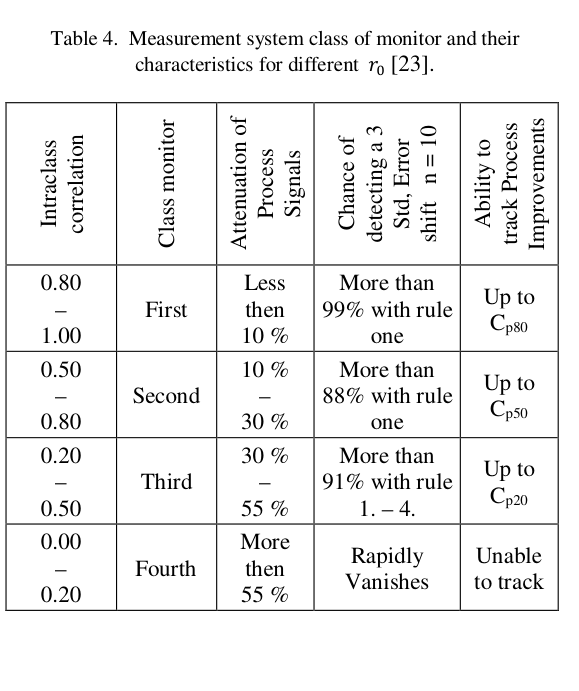
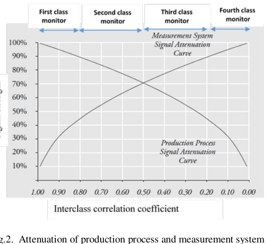
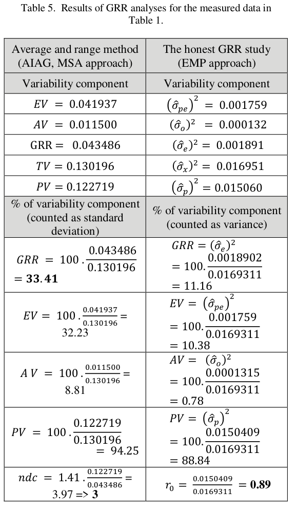

# 번역: 측정 시스템 분석, 게이지 반복성 및 재현성 방법

- 원제: Measurement System Analyses - Gauge Repeatability and Reproducibility Methods
- 저자: Lenka Cepova(1), Andrea Kovacikova(1), Robert Cep(1), Pavel Klaput(2), Ondrej Mizera(1)
  - (1) 가공, 조립, 공학계측 학과, 기계공학부, VSB 오스트라바 공과대학교, 체코
  - (2) 품질경영 학과, 야금재료공학부, VSB 오스트라바 공과대학교, 체코
- 서지: Measurement Science Review, 18(1), 2018, pp. 20-27. doi:10.1515/msr-2018-0004
- 투고 2017-10-10, 게재 확정 2018-02-14
- 번역 범위: 전문 (초록, 본문 1절~6절, 그림과 표 캡션, 감사의 글). 참고문헌은 원문 그대로 둔다.
- 원문 파일: 같은 폴더의 `Cepova2018_MSR_GaugeRR.pdf`

---

## 초록

이 논문은 평균과 범위법(자동차산업행동그룹 AIAG의 측정 시스템 분석 MSA 접근)과
정직한 게이지 반복성 재현성(honest GRR) 방법(측정 과정 평가 EMP 접근)을 자세히 설명한다.
측정 자료(플라스틱 부품 두께)를 두 방법으로 평가하고, 수치 결과를 근거로 비교했다.
두 방법을 비교하고 장단점을 논의했다.
두 방법의 한 가지 차이는 변동 성분을 계산하는 방식이다.
AIAG 방법은 변동 성분을 표준편차로 계산한다. 그래서 성분을 모두 더해도 100 %가 되지 않는다.
정직한 GRR 연구는 변동 성분을 분산으로 계산한다. 그래서 모든 변동 성분의 합(부품 간 변동, EV, AV)이
총 변동 100 %가 된다.
두 방법이 전문가 사회에서 얼마나 받아들여지는지, 앞으로 어떻게 쓰일지, 제조 산업이 어떻게 받아들이는지도 논의했다.
현재 산업에서 주도하는 방법은 AIAG이다.

핵심어: GRR 연구 접근, 평균과 범위법, 정직한 GRR 연구.

---

## 1. 서론

R. Hart와 M. Hart[1]가 말하듯, 제조 공정에서 관측되는 변동에는 두 가지가 섞여 있다.
하나는 참이지만 알 수 없는 제품 변동(부품 간 변동)이고, 다른 하나는 측정 시스템 변동이다.
제조 공정의 관측 변동이 너무 크면, 개선 노력을 측정 과정에 들여야 하는지 판단하기 위해
측정 시스템 연구가 필요하다.
올바른 생산 공정과 부품 평가는 알맞게 측정한 자료를 근거로 이뤄지며, 이는 기술적 필수 사항이다.
Knowles와 Vickers[2]는 측정 자료가 의사 결정의 주춧돌이며, 그 결정은 충분히 믿을 만한 조건에서 내려진다고 강조한다.
그래서 양산에는 이 문제를 다스리는 표준과 규정, 품질 도구가 많다.
예로 IATF 16949(자동차 산업)[3], ISO, QS-9000[4]이 있다.
특히 자동차 산업의 양산 요구는 매우 엄격하다.
제품 개발 단계의 품질 계획이 중요한 역할을 하며, APQP(선행 제품 품질 계획)[5]라는 기법 묶음을 따른다.
APQP 매뉴얼의 4.2항은 관리 계획에 있는 모든 공정에 대해,
지정한 측정기와 감시 게이지를 측정 시스템 분석으로 검증하라고 권한다.
Hermans와 Liu[6]는 측정 시스템 분석이 공정 FMEA(PFMEA), 관리 계획과 함께
신제품 개발(NPD)에서 가장 중요한 단계에 속한다고 말한다.

측정 시스템 분석은 주로 다음을 따라 수행한다.

- 크라이슬러, 포드, 제너럴모터스의 참조 지침서인 측정 시스템 분석(AIAG, MSA)[7]이 제시하는 방법
- 측정 과정 평가 방법(EMP 접근, Wheeler 박사)[8]
- VDA5 방법, 측정 과정 적격성 확인[9]

MSA와 VDA5 접근의 자세한 비교는 예를 들어 학위 논문[10]에 있다.
안정성, 치우침, 선형성, 반복성, 재현성 같은 변동 특성의 개관은
Dietrich와 Schulze의 책[11]이나 Kazerouni의 논문[12]에 있다.
이 논문에서는 측정 시스템 변동 분석 방법에 주목한다.
고른 방법은 범위와 평균법(MSA, AIAG)[7], 그리고 정직한 GRR 연구(EMP 접근, Wheeler)[8]이다.

제조 제품의 품질이 올라가면서, 제조 불량을 줄이는 데 성공적으로 쓰인 기법[30]에 대한 연구도 늘었다[31].

## 2. 측정 과제 정의

실험용으로 고른 측정 대상은 소형 휠로더의 앞 덮개이다(그림 1).
이 부품은 GEISS 장비에서 열성형 기술[13]로 만든다.
원재료는 두께 8 mm의 PMMA 판이다.
도면 문서에 따르면 열성형 뒤 재료 두께는 4 mm, 공차는 -1.5/+1.5 mm여야 한다.
이 요구는 정의된 표면 공차를 만족한다. 표면 공차와 별도로 최소 부품 두께 3.5 mm가 정해져 있다.

측정용 부품은 제조 공정에서 조금씩 모았다.
롤스로이스 지침[14]의 저자들이 강조하듯, 측정 시스템 분석을 할 때는
고른 부품이 제조 공차 전 범위를 덮는 것이 중요하다.
그래서 생산 교대마다 한 개씩 모아, 생산 공차를 모두 덮는 부품 10개를 갖췄다(GRR 연구 요구).
이어서 부품 안쪽 면에 1부터 10까지 번호를 매겼다.

측정은 교정된 측정기(두께 게이지)를 갖춘 계측 실험실에서,
이 부품을 평소에 측정하는 작업자 3명이 했다.
1단계로 첫 작업자가 모든 부품을 측정하고, 다음 두 번째 작업자, 마지막으로 세 번째 작업자가 측정했다.

모든 측정은 통계적 측정 독립성을 지키려고, 측정 대상 부품 번호를 가린 채 했다.
즉 작업자는 자기가 몇 번 부품을 재는지 몰랐다.
측정값은 측정 시스템 분석용 게이지 반복성 재현성 자료 수집 양식에 적지 않고,
엑셀 표에 적었다. 측정 자료 개요는 표 1에 있다.

**그림 1. 도면 발췌, 소형 휠로더 운전실 앞부분의 플라스틱 부품.**

**표 1. 측정 II 자료, 플라스틱 부품 [mm].**

작업자 1

| 측정 | 1 | 2 | 3 | 4 | 5 |
|---|---|---|---|---|---|
| 1차 시행 | 5.03 | 4.82 | 4.93 | 5.01 | 5.14 |
| 2차 시행 | 5.02 | 4.94 | 4.81 | 5.03 | 5.03 |
| 3차 시행 | 5.01 | 4.84 | 4.93 | 5.00 | 5.02 |

| 측정 | 6 | 7 | 8 | 9 | 10 |
|---|---|---|---|---|---|
| 1차 시행 | 5.23 | 4.89 | 5.13 | 4.93 | 4.97 |
| 2차 시행 | 5.21 | 4.87 | 5.02 | 4.91 | 4.98 |
| 3차 시행 | 5.23 | 4.92 | 5.03 | 5.01 | 4.95 |

작업자 2

| 측정 | 1 | 2 | 3 | 4 | 5 |
|---|---|---|---|---|---|
| 1차 시행 | 5.13 | 4.78 | 4.83 | 4.99 | 5.03 |
| 2차 시행 | 5.03 | 4.79 | 4.82 | 4.99 | 5.03 |
| 3차 시행 | 5.03 | 4.78 | 4.94 | 4.98 | 5.03 |

| 측정 | 6 | 7 | 8 | 9 | 10 |
|---|---|---|---|---|---|
| 1차 시행 | 5.22 | 4.88 | 5.00 | 5.02 | 5.00 |
| 2차 시행 | 5.11 | 4.89 | 5.00 | 4.94 | 5.03 |
| 3차 시행 | 5.22 | 4.78 | 4.98 | 4.92 | 5.02 |

작업자 3

| 측정 | 1 | 2 | 3 | 4 | 5 |
|---|---|---|---|---|---|
| 1차 시행 | 5.03 | 4.77 | 4.82 | 5.02 | 4.99 |
| 2차 시행 | 5.04 | 4.78 | 4.82 | 5.14 | 5.03 |
| 3차 시행 | 5.13 | 4.89 | 4.80 | 5.01 | 5.1 |

| 측정 | 6 | 7 | 8 | 9 | 10 |
|---|---|---|---|---|---|
| 1차 시행 | 5.22 | 4.92 | 5.02 | 4.94 | 5.03 |
| 2차 시행 | 5.22 | 4.94 | 5.14 | 4.92 | 5.01 |
| 3차 시행 | 5.24 | 4.94 | 5.02 | 4.91 | 5.14 |

## 3. 평균과 범위법

평균과 범위법(X bar, R)은 연속 눈금 측정 시스템을 평가하는 방법이다.
Klaput[9]이 강조하듯 이 방법의 결과는 그래프 결과와 수치 결과를 함께 보고 해석해야 한다.
이 방법의 장점은 변동 성분을 다음으로 쪼갤 수 있다는 점이다.

- 측정기 변동(반복성)
- 작업자 변동(재현성)

이 방법의 단점은 작업자와 부품, 또는 측정기 사이의 상호작용을 고려하지 않는다는 점이다.
이 지적은 Healy와 Wallace의 논문[15]에서도 확인된다.

방법은 논리 순서가 있는 몇 단계로 이뤄진다.
처음에는 반복 측정을 바탕으로, 평균 관리도와 범위 관리도로 반복성 관점의 통계적 공정 안정성을 평가한다.
두 그래프를 자세히 보는 것이 평균과 범위법의 그래프 산출물이며,
예를 들어 통계 소프트웨어 Minitab[16]에서 볼 수 있다.
통계적 공정 안정성이 확인되면, 측정 시스템 평가를 수치로 단계별로 이어 간다.

먼저 측정 반복성 EV를 식 (1)로 추정한다.

```
EV = sigma_pe = R(2중 평균) / d2                                  (1)
```

여기서

- R 2중 평균: 모든 부품에 대한 모든 작업자 반복 측정의 평균 변동 범위
- d2: 평균 변동 분포에 연결된 보정 계수(MSA, AIAG 지침 부록 C 참고)[7].
  이 계수는 표의 끝에서 둘째 줄에서 찾으며, m은 반복 측정 시행 수이다. m = 3 이면 d2 = 1.69257.

다음 단계로 측정 재현성 AV를 식 (2)로 계산한다.

```
AV = sigma_o = sqrt( (R_DIFF / d2)^2 - (o / (o * n * r)) * sigma_pe^2 )     (2)
```

여기서

- R_DIFF: 식 (3)으로 계산하는, 작업자별 전체 평균의 최대와 최소 차이
- r: 측정 부품 수
- n: 반복 측정 시행 수
- o: 작업자 수
- d2: 평균 변동 분포에 연결된 보정 계수(MSA, AIAG 지침 부록 C)[7].
  이 계수는 g(부분군 수) = 1(고정 인자), m(부분군 범위) = 작업자 수(가변)로 찾는다.
  이 측정 과제에서 m = 3 이므로 d2 = 1.91155.

```
R_DIFF = | X bar max - X bar min |                                (3)
```

여기서

- X bar max: 작업자 3명 중 한 명의 가장 큰 산술 평균
- X bar min: 작업자 3명 중 한 명의 가장 작은 산술 평균

다음 단계에서는 결합 게이지 반복성 재현성 GRR을 식 (4)로 평가할 수 있다.

```
GRR = sigma_e = sqrt( sigma_pe^2 + sigma_o^2 )                    (4)
```

계산한 GRR 값 자체는 아무 능력도 말해 주지 않는다.
측정 시스템 적합성(% GRR, 반복성과 재현성의 백분율)은,
반복성과 재현성(측정 시스템 변동)을 총 변동 TV(공정 변동)와 비교해야 평가할 수 있다.
TV는 식 (5)로 계산한다.

```
TV = sigma_x = sqrt( sigma_p^2 + sigma_e^2 )                      (5)
```

여기서 PV는 부품 변동이며 식 (6)으로 계산한다.

```
PV = sigma_p = Rp / d2                                            (6)
```

여기서

- Rp: 부품별 부분군에서, 개별 반복의 산술 평균이 가지는 변동 범위
- d2: 평균 변동 분포에 연결된 보정 계수(MSA, AIAG 지침 부록 C)[7].
  g(부분군 수) = 1(고정 인자), m(부분군 범위) = 측정 부품 수(가변)로 찾는다.
  m = 10(측정 부품 수)이면 d2 = 3.17905.

TV 값을 계산한 다음 단계는 측정 시스템 적합성 지표 계산이다.
% GRR(게이지 반복성 재현성), % AV(재현성), % PV(제품 변동)가 있다.
% GRR은 식 (7)로 계산한다. 결합 반복성 재현성을 총 변동으로 나누고 100을 곱한 값이다.
% GRR은 결합 반복성(EV)과 재현성(AV)에 돌아가는 총 변동의 백분율로 해석한다.

```
% GRR = 100 * GRR / TV                                            (7)
```

반복성의 백분율 % EV는 식 (8)로 계산한다.
% EV는 장비 변동에 돌아가는 총 변동의 백분율을 뜻한다.

```
% EV = 100 * EV / TV                                              (8)
```

(옮긴이 주: 원문 조판에서 식 (8)과 식 (18)의 좌변 기호가 % GRR로 잘못 찍혀 있다.
문맥과 표 5의 계산을 보면 (8)과 (18)은 % EV이다.)

둘째 변동 성분인 재현성의 백분율 % AV는 식 (9)로 계산한다.
% AV는 작업자 변동에 돌아가는 총 변동의 백분율을 뜻한다.

```
% AV = 100 * AV / TV                                              (9)
```

끝에서 둘째로 제품 변동의 백분율 % PV를 식 (10)으로 계산한다.
% PV는 부품 간 변동에 돌아가는 총 변동의 백분율을 뜻한다.

```
% PV = 100 * PV / TV                                             (10)
```

이 방법의 마지막 단계는 ndc(구별 가능 범주 수) 계산이다.
이 계산으로 측정 시스템이 구별할 수 있는 범주의 수가 정해진다.
AIAG[7]와 Minitab 지침[16]은 ndc를 식 (11)로 계산한다.

```
ndc = 1.41 * PV / GRR                                            (11)
```

평균과 범위법의 결론은, 측정 시스템이 받아들일 만한지, 조건부로 받아들일 만한지,
받아들일 수 없는지를 두 기준에 따른 판정표(AIAG 접근[7])로 결정하는 것이다.
첫째 기준은 % GRR이고(표 2), 둘째 기준은 ndc이다(표 3).
경계값(% GRR, ndc)에 대해서는 Dietrich와 Schulze[11]가 말하듯 보는 시각이 다르기도 하다.

**표 2. % GRR의 경계값 [7].**

| % GRR | 판정 |
|---|---|
| % GRR < 10 % | 받아들일 만한 측정 시스템. 공정 변화에 대해 믿을 만한 정보를 준다. |
| 10 % < % GRR < 30 % | 조건부로 받아들일 만한 측정 시스템. 일부 용도에는 쓸 수 있다. |
| % GRR > 30 % | 받아들일 수 없는 측정 시스템. 공정 변화에 대해 믿을 만한 정보를 주지 못한다. |

**표 3. ndc의 경계값 [7].**

| ndc | 판정 |
|---|---|
| ndc >= 5 | 받아들일 만한 측정 시스템. 공정 변화에 대해 믿을 만한 정보를 준다. |
| ndc < 5 | 받아들일 수 없는 측정 시스템. 공정 변화에 대해 믿을 만한 정보를 주지 못한다. |

## 4. 정직한 GRR 연구 (EMP)

정직한 GRR 연구는 EMP 방법[8], 곧 측정 과정 평가에 속하며, 측정 시스템을 평가하는 방법이다.
G. Knowles[17]가 강조하듯 변동 축소는 오늘날 제조 기업의 관심사이다.
EMP 방법의 바탕은 1980년대에 미국 통계학자이자 수상 경력이 있는 품질 전문가 Wheeler 박사[18]가 만들었다.
EMP 방법의 한 부분이 정직한 GRR 연구이다.
이 방법은 지금도 전문가 사이에서 논의 대상이고[19][20],
도입과 적용을 위한 자격 과정이 있으며(주로 미국),
SAS7QC 같은 일부 통계 소프트웨어에서 EMP 매크로를 쓸 수 있다[22].

일관성을 평가하려고 이 방법은 관리도를 쓴다.
관리도는 작업자 사이의 치우침(재현성)이나 작업자 사이의 비일관성을 잡아낼 수 있다.
측정 오차 평가에는 피셔의 급내 상관계수에 바탕을 둔 정직한 GRR 연구를 쓴다.
급내 상관계수 값으로 측정 시스템을 네 무리(등급 감시자, class monitor)로 나눈다.
1급, 2급, 3급, 4급이다[8].
각 등급은 관리도에서 생산 공정 신호를 얼마나 감쇠시키는지,
이동을 잡아낼 수 있는지, 생산 공정 개선을 잡아낼 수 있는지로 특징지어진다.
이 관점에서 각 등급은 다음 세 요인으로 설명된다[22].

- 공정 신호의 감쇠
- 이동을 잡아낼 가능성
- 측정 시스템이 공정 개선을 따라갈 수 있는 능력

여기에는 규칙이 있다. 등급 숫자가 클수록(최대 4급),
측정 시스템 변동 때문에 생기는 분산의 비율이 크다.
네 등급과 요인 특성의 전체 개관은 표 4에 있다.



**표 4. 서로 다른 r0에 대한 측정 시스템 등급 감시자와 그 특성 [23].**

| 급내 상관 | 등급 | 공정 신호 감쇠 | n = 10에서 3 표준오차 이동을 잡을 확률 | 공정 개선을 따라가는 능력 |
|---|---|---|---|---|
| 0.80 - 1.00 | 1급 | 10 % 미만 | 규칙 1로 99 % 초과 | Cp80 까지 |
| 0.50 - 0.80 | 2급 | 10 % - 30 % | 규칙 1로 88 % 초과 | Cp50 까지 |
| 0.20 - 0.50 | 3급 | 30 % - 55 % | 규칙 1~4로 91 % 초과 | Cp20 까지 |
| 0.00 - 0.20 | 4급 | 55 % 초과 | 빠르게 사라짐 | 따라갈 수 없음 |

첫째 요인은 공정 신호의 감쇠이다.
측정 시스템이 생산 공정 신호를 몇 퍼센트나 줄이는지(공정 변동이 주는 정보를 얼마나 깎는지) 정한다.
즉 실제 분산에 견주어 관측 분산을 줄이는 정도이다.
생산 공정 신호와 측정 시스템 신호의 상호작용은 그림 2에서 볼 수 있다.
가로축은 급내 상관계수 r0, 세로축은 신호 세기(백분율)이다.



**그림 2. 생산 공정과 측정 시스템 신호의 감쇠.**

둘째 요인은 부품 10개 부분군에서 웨스턴일렉트릭 규칙[24]에 따라
3 표준오차 이동을 잡아낼 가능성이다.
Wachs[24]에 따르면 생산 공정의 이동을 잡아내는 것은 매우 중요하다.
잡아내지 못하면 2종 오류를 마주할 위험이 있기 때문이다.
2종 오류는 부적합품을 적합품으로 평가하는 것을 뜻한다.
즉 관리도가 UCL(위 관리 한계선)이나 LCL(아래 관리 한계선)을 넘는 측정을 잡아내야 하는데
그러지 못한다는 뜻이다.

마지막 요인은 공정 개선을 잡아낼 가능성과 이어진다(표 2의 분류 경계 참고).
표 2의 마지막 열은, 공정이 한 등급에서 다른 등급으로 옮겨 가려면
공정 개선이나 악화가 얼마나 커야 하는지 보여 준다.

정직한 GRR의 분석 부분도 평균과 범위법처럼 체계적인 단계로 이뤄진다.
첫 단계는 반복성 분산 성분을 식 (12)로 계산하는 것이다.

```
sigma_pe^2 = EV^2 = ( R(2중 평균) / d2 )^2                        (12)
```

여기서

- R 2중 평균: 모든 부품에 대한 모든 작업자 반복 측정의 평균 변동 범위
- d2: 평균 변동 분포에 연결된 보정 계수(MSA, AIAG 지침 부록 C)[7].
  표의 끝에서 둘째 줄에서 찾으며 m은 반복 측정 시행 수이다. m = 3 이면 d2 = 1.69257.

둘째 단계는 재현성이라는 분산 성분을 식 (13)으로 세는 것이다.
R_DIFF는 평균과 범위법과 똑같이 계산하며, 이미 말한 식 (3)을 따른다.

```
sigma_o^2 = AV^2 = ( R_DIFF / d2 )^2 - ( o / (o * n * r) ) * sigma_pe^2    (13)
```

식 (13)에 적용되는 값

- r: 측정 부품 수
- n: 반복 측정 시행 수
- o: 작업자 수
- d2: 평균 변동 분포에 연결된 보정 계수(MSA, AIAG 지침 부록 C)[7].
  g(부분군 수) = 1(고정 인자), m(부분군 범위) = 작업자 수(가변)로 찾는다.
  이 측정 과제에서 m = 3 이므로 d2 = 1.91155.

다음 단계는 결합 반복성 재현성을 식 (14)로, 총 변동을 식 (15)로 계산하는 것이다.

```
sigma_e^2 = GRR^2 = sigma_pe^2 + sigma_o^2                        (14)

sigma_x^2 = TV^2  = sigma_p^2  + sigma_e^2                        (15)
```

부품 분산의 제곱은 알 수 없으므로 식 (16)으로 계산해야 한다.

```
sigma_p^2 = PV^2 = ( Rp / d2 )^2                                  (16)
```

여기서

- Rp: 부품별 부분군에서, 개별 반복의 산술 평균이 가지는 변동 범위
- d2: 평균 변동 분포에 연결된 보정 계수(MSA, AIAG 지침 부록 C)[7].
  g(부분군 수) = 1(고정 인자), m(부분군 범위) = 측정 부품 수(가변)로 찾는다.
  m = 10(측정 부품 수)이면 d2 = 3.17905.

다음 단계는 결합 반복성 재현성의 백분율 성분 % GRR(17),
반복성 분산 성분의 백분율 값(18), 재현성 성분(19)을 계산하는 것이다.

```
% GRR = 100 * sigma_e^2  / sigma_x^2                              (17)

% EV  = 100 * sigma_pe^2 / sigma_x^2                              (18)

% AV  = 100 * sigma_o^2  / sigma_x^2                              (19)
```

급내 상관계수는 식 (20)으로 계산하며, 이 값을 근거로 측정 시스템을 네 등급 중 하나로 분류한다.

```
r0 = sigma_p^2 / sigma_x^2                                        (20)
```

끝에서 둘째 단계는 공정 신호 감쇠 계산이다(21).

```
공정 신호의 감쇠 = 1 - sqrt(r0)                                    (21)
```

마지막 단계는 공정 개선 탐지 능력을 식 (22), (23), (24)로 계산하는 것이다.

```
Cp80 = ( (USL - LSL) / (6 * R(2중 평균) / d2) ) * sqrt(1 - 0.80)   (22)

Cp50 = ( (USL - LSL) / (6 * R(2중 평균) / d2) ) * sqrt(1 - 0.50)   (23)

Cp20 = ( (USL - LSL) / (6 * R(2중 평균) / d2) ) * sqrt(1 - 0.20)   (24)
```

## 5. 두 방법(평균과 범위법, 정직한 GRR 연구)으로 얻은 결과에 근거한 GRR 분석 비교

이 절에서는 두 방법으로 얻은 GRR 분석 결과를 비교한다(표 5 참고).

- 평균과 범위법
- 정직한 GRR 연구

평균과 범위법은 이 측정 시스템을 받아들일 수 없다고 평가한다.
% GRR = 33.41로 30 %보다 크고, ndc 값이 3이라 이 또한 받아들일 수 없는 값이기 때문이다.
반복성이라는 변동 성분은 32.23 %, 재현성 성분은 8.81 %, 부품 변동 성분은 94.25 %이다.
즉 각 변동 성분을 더하면 총 변동이 100 %를 넘는데, 이는 수학 규칙으로는 받아들이기 조금 어렵다.
그 까닭은 AV와 GRR의 변동 성분을 표준편차로 셈하기 때문이다.

정직한 GRR 연구에 따르면 이 측정 시스템은 1급 감시자로 평가된다.
급내 상관계수가 0.89에 이르기 때문이다.
평균과 범위법과 마찬가지로 각 변동 성분을 따로 정의할 수 있다.
변동 성분 반복성은 10.38 %, 변동 성분 재현성은 0.78 %,
결합 변동 성분 반복성 재현성은 11.16 %이다.
총 변동 값은 모든 부분 성분을 더해 얻으며 100 %가 된다.
공정 신호 감쇠는 5.74 %, 측정 시스템 감쇠는 94.26 %가 된다
(관측된 공정이 실제 공정과 매우 비슷하다는 뜻이다).
1급 감시자 측정 과정에서는, 부분군 수 10에서 웨스턴일렉트릭 규칙 1호에 따라
3 표준편차 이동을 잡아낼 확률이 99 %를 넘는다.
이 측정 시스템은 Cp80까지 공정 개선을 따라갈 능력이 있으며 그 값은 2.79이다.



**표 5. 표 1의 측정 자료에 대한 GRR 분석 결과.**

| 항목 | 평균과 범위법 (AIAG, MSA 접근) | 정직한 GRR 연구 (EMP 접근) |
|---|---|---|
| 변동 성분 | EV = 0.041937 | sigma_pe^2 = 0.001759 |
| | AV = 0.011500 | sigma_o^2 = 0.000132 |
| | GRR = 0.043486 | sigma_e^2 = 0.001891 |
| | TV = 0.130196 | sigma_x^2 = 0.016951 |
| | PV = 0.122719 | sigma_p^2 = 0.015060 |
| 백분율 성분 산출 기준 | 표준편차 | 분산 |
| % GRR | 100 * 0.043486 / 0.130196 = **33.41** | 100 * 0.0018902 / 0.0169311 = 11.16 |
| % EV | 100 * 0.041937 / 0.130196 = 32.23 | 100 * 0.001759 / 0.0169311 = 10.38 |
| % AV | 100 * 0.011500 / 0.130196 = 8.81 | 100 * 0.0001315 / 0.0169311 = 0.78 |
| % PV | 100 * 0.122719 / 0.130196 = 94.25 | 100 * 0.0150409 / 0.0169311 = 88.84 |
| 마지막 지표 | ndc = 1.41 * 0.122719 / 0.043486 = 3.97 => **3** | r0 = 0.0150409 / 0.0169311 = **0.89** |

## 6. 결론

이 연구에서 다음을 결론지을 수 있다.

- 평균과 범위법(AIAG, MSA 접근)의 총 변동은 100 %가 되지 않는다.
  여기서 혼란스러운 점은 부품 간 변동, EV, AV를 백분율로 나타낸다는 사실이다.
  그러면 총 변동이 100 %가 될 것이라는 기대가 생긴다.
- 정직한 GRR 연구(EMP 접근)는 백분율에 대한 기본 이해를 지키며,
  모든 변동 성분의 합이 100 %가 된다. 그 까닭은 변동 성분을 분산으로 세기 때문이다.

평균과 범위법이 변동의 백분율 성분을 어떻게 계산하는지는 Wheeler의 논문[26]에 설명되어 있다.
모든 변동 성분을 더해도 100 %가 되지 않는다는 점(MSA 접근)은
Ermer의 논문[28]이나 Pandiripalli의 학위 논문[20]도 지적한다.
일반적으로 정직한 GRR 연구는 측정 시스템에 대해 더 넓은 정보를 준다.
부분 변동 성분 정보 외에 다음 정보도 함께 얻을 수 있다.

- 공정 신호 감쇠
- 측정 시스템 감쇠
- n = 10 부분군으로 3 표준편차 이동을 잡아낼 능력
- 공정 개선이나 악화를 따라갈 능력

게이지 반복성 재현성 방법의 흥미롭고 권할 만한 비교는 Stamm의 학위 논문[19]에도 있다.
오늘날에는 MSA 접근이 지배적인 자리에 있다.
비슷한 논의가 예를 들어 MSA와 VDA5 접근 사이에도 있다.
이 논의는 Dietrich의 논문[28]에서 다뤄졌다.
MSA와 정직한 GRR 연구 사이에도 측정 시스템 연구의 시장 주도권을 둘러싼 다툼이 있다.
앞으로 측정 시스템 분석에서 어느 쪽이 주도할지는 시간만이 알려 줄 것이다.

## 감사의 글

이 논문은 체코 교육청소년체육부와 VSB-TUO 기계공학부가 지원한
학생 연구 경진 과제 SP2017/147, SP2017/149와 관련해 작성되었다.

---

## REFERENCES (원문 그대로)

[1] Hart, R.F., Hart, K.M. (1994). The evaluation of a measurement system. Production and Inventory Journal, Fourth Quarter, 22-26.

[2] Antony, G.V., Knowles, G. (2000). A practical methodology for analyzing and improving the measurement system. Quality Assurance, 3 (3), 59-75.

[3] International Automotive Task Force. (2016). Automotive quality management system standard. 4th Edition. IATF16949:2016.

[4] Chrysler Corporation, Ford Motor Company, General Motors Corporation (AIAG). (1998). Quality System Requirements. 3rd Edition. QS-9000.

[5] Chrysler Corporation, Ford Motor Company, General Motors Corporation (AIAG). (2008). Advanced Product Quality Planning and Control Plan (APQP), Second Edition. AIAG.

[6] Hermans, J.E., Liu, Y. (2013). Quality management in the new product development: A PPAP approach. Quality - Innovation - Prosperity, 17 (2).

[7] Chrysler Corporation, Ford Motor Company, General Motors Corporation (AIAG). (2010). MSA - Measurement Systems Analysis (MSA), Fourth Edition. AIAG.

[8] Wheeler, D.J. (2006). EMP III - Evaluating the Measurement Process & Using Imperfect Data. SPC PRESS (Statistical Process Control).

[9] Verband der Automobileindustrie e.V. (2011). VDA 5 - Vhodnost kontrolnych procesov, 2. vydanie. Praha, CR: Ceska spolecnost pro jakost.

[10] Klaput, P. (2014). Methodical approach to measurement system analyses. Dissertation Thesis, VSB - Technical University of Ostrava, Faculty of Metallurgy and Materials Engineering. (in Czech)

[11] Dietrich, E., Schulze, A. (2003). Eignungsnachweis von Prufprozessen. Carl Hanser Verlag.

[12] Kazerouni, A.M. (2009). Design and analyses of gauge R&R studies: Making decision based on ANOVA method. International Journal of Mechanical, Aerospace, Industrial, Mechatronic and Manufacturing Engineering, 3 (4).

[13] Throne, J.L. (2008). Understanding Thermoforming. Carl Hanser Verlag.

[14] Rolls-Royce (2013). Measurement System Analyses : How-to Guide. Version 6.1. Rolls-Royce plc., 53.

[15] Healy, S., Wallace, M. (2011). Gage repeatability and reproducibility methodologies suitable for complex test systems in semi-conductor manufacturing. In Six Sigma Project and Personal Experiences. InTech.

[16] Minitab. (2010). Minitab guideline of methods and formulas. Version 16.1.1.0. Minitab Inc.

[17] Knowles, G., Vickers, G., Anthony, J. (2003). Implementing evaluation of the measurement process in an automotive manufacturer: A case study. Quality and Reliability Engineering International, 19 (5), 397-410.

[18] Dusharme, D. (2011). An Interview with Donald J. Wheeler. Quality Digest, May 2011.

[19] Stamm, S. (2013). A comparison of gauge repeatability and reproducibility methods. Dissertation Thesis, Indiana State University, USA.

[20] Pandiripalli, B. (2010). Repeatability and reproducibility studies: A comparison of techniques. Thesis, Wichita State University, USA.

[21] SAS Institute. (2013). SAS/QC 13.1 : User`s Guide. Cary, NC, USA: SAS Institute Inc.

[22] BPI Consulting, LLC. (2014). Evaluating the Measurement Process - Part 1.

[23] Wheeler, D.J. (2009). An honest gauge R&R study (rev.). In ASQ/ASA Fall Technical Conference, Manuscript No. 189.

[24] Wikimedia Foundation, Inc. Western electric rules. https://commons.wikimedia.org/wiki/File:Western_electric_rules.svg.

[25] Wachs, S. How can an OC curve be used to manage the risk of undetected special causes? http://www.integral-concepts.com/docs/.

[26] Wheeler, D.J. (2016). Good data, bad data, and process behaviour charts. http://asq.org/statistics/2003/01/good-data-bad-data-and-process-behavior-charts.pdf.

[27] Ermer, S.D. (2016). Improved gage R&R measurement studies. Quality Progress, March 2006, 77-79.

[28] Dietrich, E. (2011). Wo liegen die Unterschiede? Vergleich von MSA and VDA Band 5. QZ, 56 (6), 30-34. http://vda-qmc.de/fileadmin/redakteur/presse/QZ6_11_Vergleich_von_MSA_und_VDA_Band_5.pdf.

[29] Standards Department VW. (2012). Capability of measuring processes (Consideration of measuring uncertainty in test processes). Standard VW 10119.

[30] Krolczyk, J., Krolczyk, G., Legutko, S., Napiorkowski, J., Hloch, S., Foltys, J., Tama, E. (2015). Material flow optimization - a case study in automotive industry. Tehnicki vjesnik - Technical Gazette, 22 (6), 1447-1456.

[31] Nieslony, P., Krolczyk, G.M., Wojciechowski, S., Chudy, R., Zak, K., Maruda, R.W. (2018). Surface quality and topographic inspection of variable compliance part after precise turning. Applied Surface Science, 434, 91-101.
