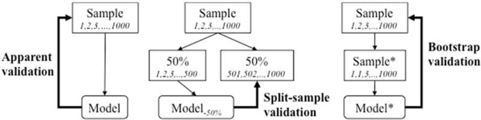
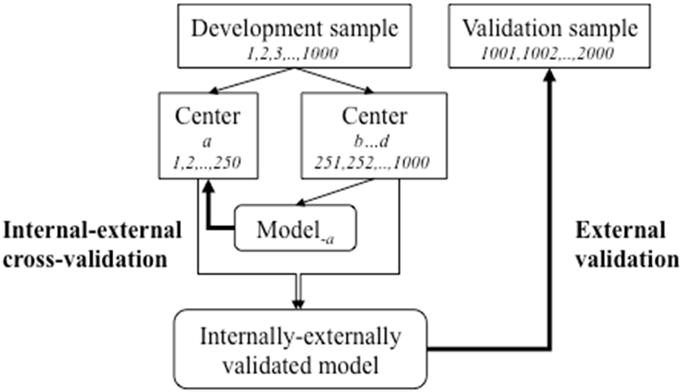

# 번역, 예측 모델에는 알맞은 내부 검증, 내부-외부 검증, 외부 검증이 필요하다

- 원제: Prediction models need appropriate internal, internal-external, and external validation
- 저자: Ewout W. Steyerberg (Erasmus MC 공중보건학과, 로테르담, 네덜란드), Frank E. Harrell Jr (밴더빌트대 의과대학 생물통계학과, 내슈빌, 미국)
- 서지: Journal of Clinical Epidemiology, 69권, 245-247쪽, 2016년 1월. 온라인 2015-04-18. doi:10.1016/j.jclinepi.2015.04.005. PMID 25981519. PMC5578404 (NIHMS895839)
- 번역 범위: 전문. 본문, 그림 캡션, 사사, 선언문까지 옮겼다. 참고문헌은 원문 그대로 둔다.
- 원문 파일: 같은 폴더의 `Steyerberg2016_JCE_PMC5578404_fulltext.xml` (NCBI E-utilities efetch로 받은 PMC 전문 XML). PDF는 받지 못했다. 아래 "원문 확보 기록"을 본다.
- 비고: PMC 표지에 "편집 전 원고(unedited manuscript)"라고 적혀 있다. 최종 게재본과 사소한 표현 차이가 있을 수 있다.

---

## 본문

이 학술지의 최근 사설들은 진단과 예후 연구[1], 특히 예측 모델[2]에 대해 시험-재시험(test-retest) 평가를 요구하는 임상역학의 고전적 틀을 강조했다. 실제로 앞선 연구 결과를 독립적으로 검증하는 일은 일반적인 과학 원칙이다.

최근의 또 다른 논쟁은 새로 발표된 예측 모델에 외부 검증 연구가 없다는 사실을 어떻게 해석할 것인가였다[3][4][5]. 쟁점 하나는 모델을 개발하는 시점에 검증이 어떤 역할을 해야 하는가다. 많은 연구자가 새 예측 모델을 제안하는 논문에서 외부 타당성의 증거, 즉 독립 표본에서의 변별력(discrimination)과 보정(calibration)을 함께 보고하고 싶어 한다. 주요 임상 학술지도 지금은 그런 보고를 좋게 보는 듯하다. 다른 쟁점은 외부 검증을 모델 개발에 참여한 저자가 아닌 다른 저자가 해야 하는가다[3][6]. 우리는 예측 모델링의 과학적 기초와 관련한 이 쟁점들에 의견을 적는다.

최근의 리뷰는 모델 개발 연구가 그 과제의 어려움에 비해 표본이 작은 경우가 많다는 것을 확인해 준다[3]. 어려움이란 예측 모델의 형태를 정하는 일(어떤 예측 변수를 넣을지)과 예측 변수 효과를 추정하는 일(표준 추정법에서 생기는 과적합)이다. 표본 크기의 중앙값은 445명이었다. 이런 연구에서 한계가 되는 것은 사건(event)의 수이고, 믿을 만한 모델링을 하기에는 너무 적을 수 있다[4]. 이렇게 표본이 작을 때는 내부 검증이 필수이며, 겉보기 성능(apparent performance) 추정값은 심하게 낙관적이다(그림 1). 예측 모델의 검증에는 부트스트랩이 가장 좋은 방법이다[7][8][9]. 성능을 정직하게 평가하려면 부트스트랩 절차가 모든 모델링 단계를 포함해야 한다[10]. 특히 변수 선택 같은 모델 선택 단계를 썼다면 그 단계를 부트스트랩 표본마다 다시 수행해야 한다.

우리는 최근에, 50%를 떼어 두는 분할 표본(split sample) 방식이 성능이 떨어지는 모델로 이어진다는 것을 다시 확인했다. 즉 불안정하고, 평균적으로는 절반 크기 표본으로 얻은 것과 같은 성능의 모델이 된다[11]. 그래서 우리는 작은 개발 표본에서 무작위 분할 표본 방식을 쓰지 말라고 강하게 권한다. 분할 표본 방식은 아주 큰 표본에서는 쓸 수 있지만, 그 경우에도 우리는 권하지 않는다. 분할 표본 절차를 할 수 있을 만큼 표본이 크면 과적합이 문제가 되지 않기 때문이다. 분할 표본 방식은 필요 없을 때만 통한다.

더 쓸모 있는 것은 외부 타당성의 인상을 얻으려는 시도다. 모델의 예측이 다른 환경에서도, 예를 들어 다른 센터의 대상자나 더 최근에 본 대상자에게도 들어맞는가? 여기서는 개발 표본 안에서 무작위가 아닌 분할을 할 때가 많다. 예를 들어 진단 연도로 나눌 수 있다. 가령 가장 최근 1/3을 모델 개발에서 빼 두고 그 자료로 검증할 수 있다. 시간으로 나눈 분할이므로 이것은 시간적 외부 검증(temporal external validation)에 해당한다[6]. 그러나 무작위 분할 표본 방식의 단점이 여기에도 똑같이 적용된다. 전체 개발 표본보다 작은 표본으로 만들기 때문에 더 나쁜 모델이 되고, 검증 결과도 표본이 작아 불안정하다[9].

우리는 예측 모델 개발 시점의 검증에 대해 두 가지를 제안한다(그림 2). 첫째, "내부-외부(internal-external)" 검증 절차를 권한다. 개별 환자 자료 메타분석(IPD-MA)에서 내부-외부 교차검증은 예측 모델의 외부 타당성을 보이는 데 쓰여 왔다[12][13]. 메타분석에서 나누는 자연스러운 단위는 연구다. 모든 연구를 한 번씩 빼고, 나머지 연구로 만든 모델을 그 빠진 연구로 검증한다. 최종 모델은 합친 자료 전체로 만들며, 이를 '내부-외부로 검증된 모델'이라 부른다. 더 넓게 보면, 다기관 연구에서 병원으로 나누거나 달력 시간으로 나누는 것이 예측 모델 개발에서 좋은 선택지이고, 최종 모델은 구할 수 있는 자료 전체로 만든다[14].

둘째, 장소나 시간에 따른 예측 변수 효과의 이질성(heterogeneity)을 더 직접 검정하는 방법을 생각할 수 있다. 연구 수가 많은 IPD-MA에서는 변량효과 모델로 연구 간 예측 변수 효과의 이질성을 정량화할 수 있다[15]. 합친 자료로 만든 모델의 예측이 일반화된다고 주장하려면 이질성의 크기가 핵심이다. 같은 취지로, 예측 모델을 개발한 다기관 연구에서 센터 간 이질성을 평가할 수 있다. 연구 수가 적을 때는 "예측 변수 x 연구" 같은 교호작용 항을 검정하는 것이 값진 정보를 주며, 외부 타당성을 뭉뚱그려 보는 것보다 더 직접적이다. 시간적 타당성에 대해서는 "예측 변수 x 달력 시간"의 교호작용이 더 직접적인 검정이다. 예측 변수 효과뿐 아니라, 이런 검정으로 기저 위험의 이질성(위험을 보정한 뒤의 "연구" 주효과)과 선형 예측자로 요약되는 전체 위험 연관의 이질성(예를 들어 "예후 지수 x 연구" 교호작용)도 평가할 수 있다. 그러므로 다시 말하지만, 모델링에는 가능한 최대 표본을 쓰는 것이 좋다.

끝으로, 예측 모델을 개발하던 시점에는 없던 자료로 하는 완전히 독립적인 외부 검증은 중요할 수 있다(그림 2). 그런 검증은 일반화 가능성(generalizability)의 시험이어야 한다. 외부 자료가 개발 자료와 아주 비슷하다면, 그 평가는 전이 가능성(transportability)이 아니라 재현성(reproducibility)의 평가다[6]. 따라서 검증 자료와 개발 자료가 얼마나 비슷한지는 외부 검증 연구를 해석하는 데 필수다. 기술 통계("표 1")를 비교하거나, 개발 자료와 검증 자료 중 어디에 속하는지 예측하는 간단한 통계 모델을 쓰면 된다[16].

요약하면, 제안되는 모든 예측 모델에 대해 내부 검증을 항상 시도해야 하며, 부트스트랩이 가장 좋다(그림 1). 실패한 외부 검증의 상당수는 철저한 내부 검증으로 미리 내다볼 수 있었고, 그랬다면 시간과 자원을 아꼈을 것이다[4]. 모델 개발 시점의 외부 검증에 대해서는, 자료의 일부를 떼어 두기보다 내부-외부 검증 절차와 예측 변수 효과의 이질성에 대한 직접 검정을 권한다(그림 2). 모델 개발 시점의 이런 평가는 독립 자료에서의 예측 모델 성능에 대한 지나친 기대를 가라앉혀 줄 수 있다. 모델이 발표된 뒤의 외부 검증에 대해서는, 분석을 다른 저자가 하느냐가 그렇게 큰 문제가 아닐 수 있다[5]. 실제로 저자가 겹치는 검증과 다른 저자의 검증 사이에 차이가 없었다[3]. 다만 선택적 보고와 출판 편향을 배제할 수는 없다. 더 중요한 것은 환경 사이의 유사성[6][16]과 검증 분석의 품질[7][8][17]이며, 품질은 최근에 제안된 예측 모델용 TRIPOD 보고 지침 같은 것으로 좋아질 수 있다[18][19].

## 그림 캡션

**그림 1.** 겉보기 검증, 분할 표본 검증, 부트스트랩 검증의 개념도. 1,000명(번호 1,2,3,..1000)의 개발 표본이 있다고 하자. 겉보기 검증(apparent validation)은 이 1000명으로 추정한 모델의 성능을 같은 표본에서 평가한다. 분할 표본 검증(split-sample validation)은 50%를 모델 개발에, 50%를 검증에 쓸 수 있다. 부트스트랩(bootstrapping)은 복원 추출로 표본을 뽑고(예를 들어 1번은 두 번 뽑히고 2번은 빠진다), 그 부트스트랩 표본(Sample*)에서 만든 모델을 원래 표본에서 검증한다.

**그림 2.** 내부-외부 교차검증과 외부 검증의 개념도. 개발 표본에 센터 4곳(a~d)이 있다고 하자. 한 번에 센터 1곳을 빼고, 나머지 센터로 만든 모델을 교차검증할 수 있다. 그림은 그런 검증 하나를 보여 준다. 센터 b, c, d의 750명으로 만든 모델을 센터 a의 250명에서 검증한다. 무작위 분할이 아니므로 이것은 외부 검증에 해당한다. 최종 모델은 모든 자료로 만들고, 그 뒤 모델이 발표된 다음 새 자료가 생기면 외부에서 검증할 수 있다. 이 방법은 작은 센터가 많이 있을 때 가장 좋다.

## 사사

Ewout Steyerberg의 연구는 U award (AA022802, 개인 맞춤 위험 정보의 가치)의 지원을 받았다.

## 출판사 고지

이것은 게재가 확정된 편집 전 원고의 PDF 파일이다. 독자에게 미리 제공하는 초기본이다. 원고는 최종 인용 가능한 형태로 발행되기 전에 교정, 조판, 교정쇄 검토를 거친다. 제작 과정에서 내용에 영향을 줄 수 있는 오류가 발견될 수 있으며, 학술지의 모든 법적 고지가 적용된다.

## 이해관계 선언

두 저자 모두 이해관계가 없다.

## 참고문헌 (원문 그대로)

1. Tugwell P, Knottnerus JA. Transferability/generalizability deserves more attention in 'retest' studies in Diagnosis and Prognosis. J Clin Epidemiol. 2015 Mar;68(3):235-6. doi:10.1016/j.jclinepi.2015.01.007. PMID 25726521.
2. Tugwell P, Knottnerus JA. Clinical prediction models are not being validated. J Clin Epidemiol. 2015 Jan;68(1):1-2. doi:10.1016/j.jclinepi.2014.11.020. PMID 25483238.
3. Siontis GC, Tzoulaki I, Castaldi PJ, Ioannidis JP. External validation of new risk prediction models is infrequent and reveals worse prognostic discrimination. J Clin Epidemiol. 2015 Jan;68(1):25-34. doi:10.1016/j.jclinepi.2014.09.007. PMID 25441703.
4. Martens FK, Kers JG, Janssens AC. External validation is only needed when prediction models are worth it. J Clin Epidemiol. 2015 Feb 3. doi:10.1016/j.jclinepi.2015.01.022. PMID 25726454.
5. Siontis GC, Ioannidis JP. Response to letter: more rigorous, not less, external validation is needed. J Clin Epidemiol. 2015 Jan 31. doi:10.1016/j.jclinepi.2015.01.021. PMID 25724895.
6. Justice AC, Covinsky KE, Berlin JA. Assessing the generalizability of prognostic information. Ann Intern Med. 1999 Mar 16;130(6):515-24. doi:10.7326/0003-4819-130-6-199903160-00016. PMID 10075620.
7. Harrell FE. Regression Modeling Strategies: With Applications to Linear Models, Logistic Regression, and Survival Analysis. Springer, NY, 2001.
8. Steyerberg EW. Clinical Prediction Models: A Practical Approach to Development, Validation, and Updating. Springer, NY, 2009.
9. Steyerberg EW, Harrell FE Jr, Borsboom GJ, Eijkemans MJ, Vergouwe Y, Habbema JD. Internal validation of predictive models: efficiency of some procedures for logistic regression analysis. J Clin Epidemiol. 2001 Aug;54(8):774-81. doi:10.1016/s0895-4356(01)00341-9. PMID 11470385.
10. Steyerberg EW, Bleeker SE, Moll HA, Grobbee DE, Moons KG. Internal and external validation of predictive models: a simulation study of bias and precision in small samples. J Clin Epidemiol. 2003 May;56(5):441-7. doi:10.1016/s0895-4356(03)00047-7. PMID 12812818.
11. Austin PC, Steyerberg EW. Events per variable (EPV) and the relative performance of different strategies for estimating the out-of-sample validity of logistic regression models. Stat Methods Med Res. 2014 Nov 19. doi:10.1177/0962280214558972. PMID 25411322. PMC5394463.
12. Royston P, Parmar MK, Sylvester R. Construction and validation of a prognostic model across several studies, with an application in superficial bladder cancer. Stat Med. 2004 Mar 30;23(6):907-26. doi:10.1002/sim.1691. PMID 15027080.
13. Steyerberg EW, Mushkudiani N, Perel P, Butcher I, Lu J, McHugh GS, Murray GD, Marmarou A, Roberts I, Habbema JD, Maas AI. Predicting outcome after traumatic brain injury: development and international validation of prognostic scores based on admission characteristics. PLoS Med. 2008 Aug 5;5(8):e165. doi:10.1371/journal.pmed.0050165. PMID 18684008. PMC2494563.
14. Balmana J, Stockwell DH, Steyerberg EW, Stoffel EM, Deffenbaugh AM, Reid JE, Ward B, Scholl T, Hendrickson B, Tazelaar J, Burbidge LA, Syngal S. Prediction of MLH1 and MSH2 mutations in Lynch syndrome. JAMA. 2006 Sep 27;296(12):1469-78. doi:10.1001/jama.296.12.1469. PMID 17003395.
15. Legrand C, Duchateau L, Janssen P, Ducrocq V, Sylvester R. Validation of prognostic indices using the frailty model. Lifetime Data Anal. 2009 Mar;15(1):59-78. doi:10.1007/s10985-008-9092-2. PMID 18618249.
16. Debray TP, Vergouwe Y, Koffijberg H, Nieboer D, Steyerberg EW, Moons KG. A new framework to enhance the interpretation of external validation studies of clinical prediction models. J Clin Epidemiol. 2015 Mar;68(3):279-89. doi:10.1016/j.jclinepi.2014.06.018. PMID 25179855.
17. Steyerberg EW, Vergouwe Y. Towards better clinical prediction models: seven steps for development and an ABCD for validation. Eur Heart J. 2014 Aug 1;35(29):1925-31. doi:10.1093/eurheartj/ehu207. PMID 24898551. PMC4155437.
18. Collins GS, Reitsma JB, Altman DG, Moons KG. Transparent reporting of a multivariable prediction model for Individual Prognosis or Diagnosis (TRIPOD): the TRIPOD statement. J Clin Epidemiol. 2015 Feb;68(2):134-43. doi:10.1016/j.jclinepi.2014.11.010. PMID 25579640.
19. Moons KG, Altman DG, Reitsma JB, Ioannidis JP, Macaskill P, Steyerberg EW, Vickers AJ, Ransohoff DF, Collins GS. Transparent Reporting of a multivariable prediction model for Individual Prognosis or Diagnosis (TRIPOD): explanation and elaboration. Ann Intern Med. 2015 Jan 6;162(1):W1-73. doi:10.7326/M14-0698. PMID 25560730.

---

## 원문 확보 기록

- 2026-11-04. PMC 본문 PDF(`https://pmc.ncbi.nlm.nih.gov/articles/PMC5578404/pdf/nihms899228.pdf`)는 자동 요청 확인 화면(작업 증명 쿠키를 요구하는 HTML)을 돌려주었다. 우회하지 않았다.
- Europe PMC의 PDF 렌더 주소(`https://europepmc.org/articles/PMC5578404?pdf=render`)는 403, 전문 XML REST는 500이었다. 이 논문은 NIH 저자 원고라 PMC 오픈액세스 묶음에 들어 있지 않다(`isOpenAccess` 아님).
- 대신 NCBI E-utilities efetch(`https://eutils.ncbi.nlm.nih.gov/entrez/eutils/efetch.fcgi?db=pmc&id=5578404`)로 전문 XML을 정상 응답(200)으로 받았다. 본문, 그림 캡션, 참고문헌이 모두 들어 있어 전문을 번역했다.
- 그림 2장은 `https://pmc.ncbi.nlm.nih.gov/articles/instance/5578404/bin/nihms895839f1.jpg`, `...f2.jpg`에서 정상 응답(200, image/jpeg)으로 받았다. 원문 그림 그대로이고 쪽 이미지로 다시 만들지 않았다.
- PDF 미확보는 [원문 받을 목록](../../../../원문_받을_목록.md)에도 적었다.
