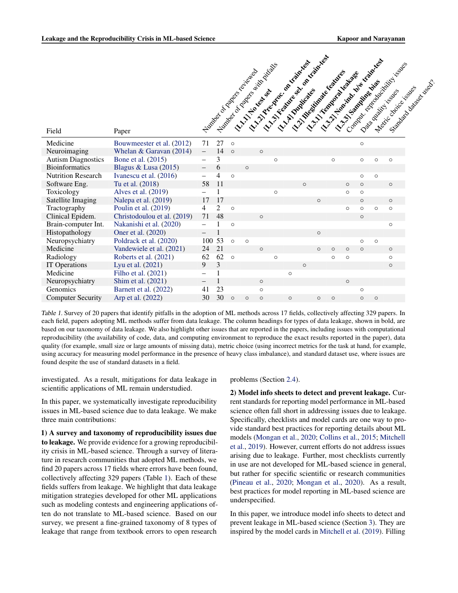
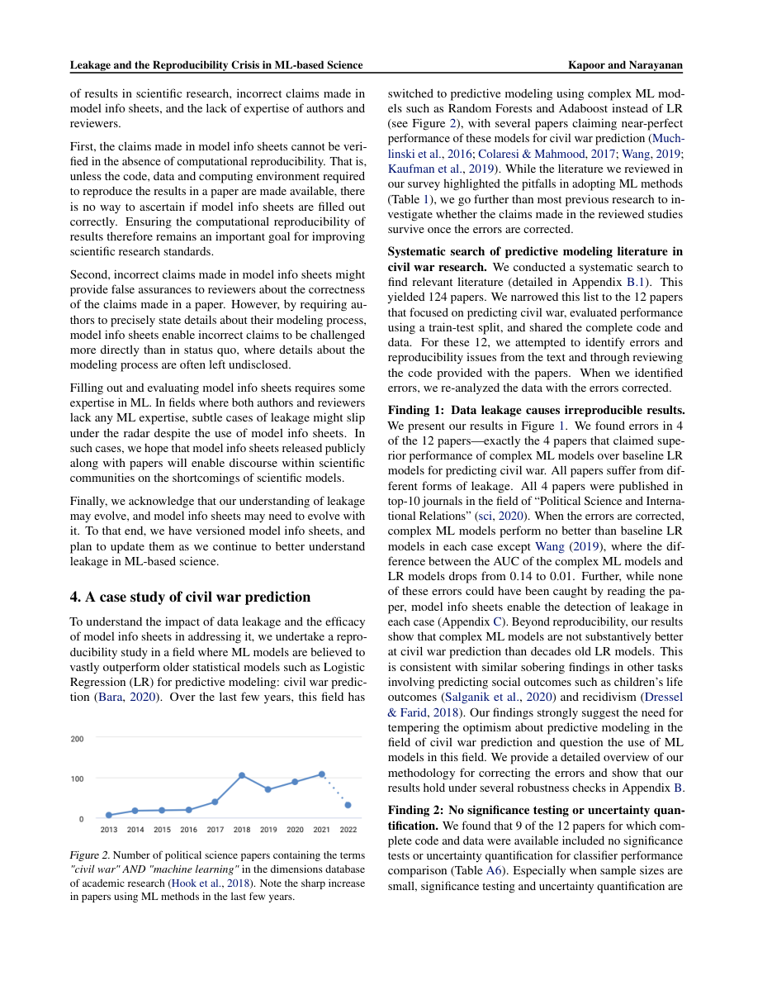
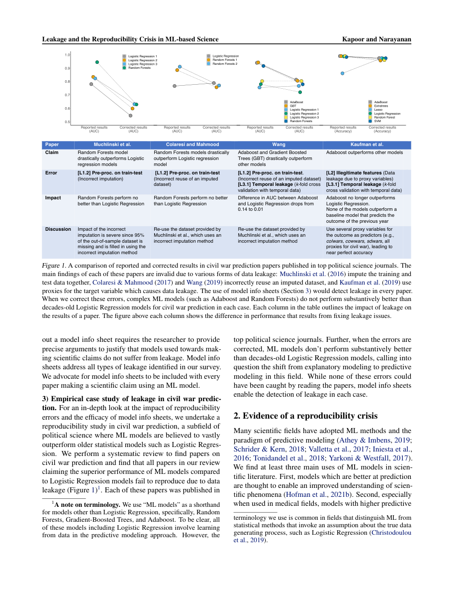

# 번역: 기계학습 기반 과학의 자료 누출과 재현성 위기

- 원제: Leakage and the Reproducibility Crisis in ML-based Science
- 저자: Sayash Kapoor, Arvind Narayanan (프린스턴대 컴퓨터과학과, 정보기술정책센터)
- 원문 파일: 같은 폴더의 `Kapoor2023_arXiv2207.07048_leakage_reproducibility.pdf`
- 번역 범위: 전문. 초록, 본문 1~6장, 그림과 표 캡션, 부록 A, B, C.
- 참고문헌 목록은 원문 그대로 두고 옮기지 않았다.
- 받은 원문은 arXiv v1 (2207.07048v1, 2022-07-14)이다. 학술지 판은 Patterns 4(9):100804 (2023)이다. 두 판의 구성과 일부 수치 표기는 다를 수 있다.

---

## 초록

예측과 예보에 기계학습(ML) 방법을 쓰는 일이 정량 과학 전반에서 널리 퍼졌다. 그런데 자료 누출을 비롯해 이미 알려진 방법론적 함정이 많다. 이 논문은 ML 기반 과학의 재현성 문제를 체계적으로 조사한다.

자료 누출이 실제로 널리 퍼진 문제이고, 심각한 재현 실패를 낳았음을 보인다. ML 방법을 받아들인 연구 공동체의 문헌을 조사한 결과, 오류가 발견된 분야 17개를 찾았다. 이 오류는 모두 329편의 논문에 영향을 준다. 어떤 경우에는 터무니없이 낙관적인 결론으로 이어졌다. 조사를 바탕으로 교과서 수준의 실수부터 열린 연구 문제까지 걸친 누출 8종의 세밀한 분류 체계를 제시한다.

우리는 누출 사례가 출판 전에 걸러지도록 ML 기반 과학의 방법론을 근본적으로 바꾸자고 주장한다. 그 수단으로 ML 모델에 근거한 과학적 주장을 보고할 때 쓰는 모델 정보표(model info sheet)를 제안한다. 이 정보표는 조사에서 찾은 모든 누출 유형을 다룬다.

재현성 오류의 영향과 모델 정보표의 효과를 알아보려고, 복잡한 ML 모델이 로지스틱 회귀(LR) 같은 오래된 통계 모델을 크게 앞선다고 믿어 온 분야인 내전 예측에서 재현 연구를 했다. 복잡한 ML 모델이 LR보다 성능이 뛰어나다고 주장한 논문은 모두 자료 누출 때문에 재현되지 않았다. 그리고 복잡한 ML 모델은 수십 년 된 LR 모델보다 실질적으로 더 낫지 않았다. 이 오류들은 논문을 읽는 것만으로는 하나도 잡아낼 수 없었지만, 모델 정보표를 쓰면 모든 사례에서 누출을 찾아낼 수 있었다.

---

## 1. 개요

정량 과학 분야 전반에서 예측 모델링 방식으로 뚜렷하게 옮겨 갔다. ML 방법이 널리 쓰이면서 이 흐름이 빨라졌다. 그런데 ML 방법을 쓸 때의 함정 때문에 성능에 대한 과장된 주장이 나왔다. 이런 오류는 예측이라는 방식 자체에 대한 과도한 낙관의 되먹임 고리를 만들 수 있다. 재현되지 않는 논문이 재현되는 논문보다 더 많이 인용되는 경향이 있기 때문이다(Serra-Garcia & Gneezy, 2021). 그래서 ML 방법을 받아들인 공동체에서 연구 결과의 재현성을 살피는 일이 중요하다.

**범위.** 우리는 ML 기반 과학의 재현성 문제에 집중한다. ML 기반 과학이란 ML 모델의 성능을 근거로 삼아 과학적 주장을 하는 일을 말한다. 전통 통계 방법을 쓰는 연구의 재현성 위기는 훨씬 더 잘 알려져 있다(Open Science Collaboration, 2015). 또 우리 연구는 다른 ML 영역, 곧 방법 연구(널리 쓸 수 있는 ML 방법을 만들고 개선), 윤리 연구, 공학적 응용(제품이나 서비스를 만들거나 개선), 모델링 경진대회(독립된 제3자가 만든 고정 자료에서 예측 성능을 겨룸)와 구별된다. 이 영역들의 주장도 타당성을 따지는 일이 중요하고, 그 작업은 이미 진행 중이다.

우리는 어떤 연구 결과가 **재현 가능**하다는 말을, 그 결과를 얻는 데 쓴 코드와 자료를 구할 수 있고 그 자료가 올바르게 분석되었다는 뜻으로 쓴다. 이것은 계산 재현성, 곧 저자가 제공한 바로 그 코드와 자료로 논문의 결과를 그대로 다시 얻을 수 있다는 뜻보다 더 넓은 정의다(부록 A 참조).

**누출.** 자료 누출은 ML 응용에서 오류의 주된 원인으로 오래 전부터 알려져 있다(Nisbet et al., 2009). 누출에 관한 초기 연구인 Kaufman et al. (2012)는 여러 오류 유형을 정리하고 완화 방법 여럿을 제시했다. 이후 ML 공동체는 공학 응용과 모델링 경진대회에서 누출을 다루어 왔다. 그러나 ML 기반 과학에서 일어나는 누출은 아직 포괄적으로 조사되지 않았다. 그래서 과학적 응용에서의 자료 누출 완화 방법은 연구가 부족한 상태다.

이 논문은 자료 누출로 인한 ML 기반 과학의 재현성 문제를 체계적으로 조사한다. 세 가지를 기여한다.

**1) 누출로 인한 재현성 문제의 조사와 분류 체계.** ML 기반 과학에 재현성 위기가 커지고 있다는 증거를 제시한다. ML 방법을 받아들인 연구 공동체의 문헌을 조사해, 자기 분야의 오류를 지적한 논문 20편을 17개 분야에서 찾았다. 이 논문들이 다루는 영향 범위는 모두 329편이다(표 1). 이 분야 모두가 누출 문제를 안고 있다. 모델링 경진대회나 공학 응용처럼 다른 ML 응용을 위해 만들어진 누출 완화 전략은 ML 기반 과학에 그대로 옮겨지지 않는다는 점을 강조한다. 조사를 바탕으로 교과서 수준의 실수부터 열린 연구 문제까지 걸친 누출 8종의 세밀한 분류 체계를 제시한다(2.4절).

**2) 누출을 찾고 막는 모델 정보표.** ML 기반 과학에서 모델 성능을 보고하는 현재 기준은 누출 문제를 제대로 다루지 못한다. 점검표와 모델 카드는 ML 모델의 세부 사항을 보고하는 표준 모범 사례를 주는 한 가지 방법이다(Mongan et al., 2020; Collins et al., 2015; Mitchell et al., 2019). 그러나 지금의 노력은 누출 문제를 다루지 않는다. 또 지금 쓰이는 점검표 대부분은 ML 기반 과학 일반이 아니라 특정 과학 공동체를 위해 만들어졌다. 그래서 ML 기반 과학의 모델 보고 모범 사례는 제대로 정해져 있지 않다.

이 논문은 ML 기반 과학에서 누출을 찾고 막는 **모델 정보표**를 소개한다(3장). Mitchell et al. (2019)의 모델 카드에서 착안했다. 모델 정보표를 채우려면 연구자가 자기 모델에 누출이 없다는 것을 정확한 논증으로 밝혀야 한다. 모델 정보표는 우리 조사에서 찾은 모든 누출 유형을 다룬다. 우리는 ML 모델로 과학적 주장을 하는 모든 논문에 모델 정보표를 함께 싣자고 주장한다.

**3) 내전 예측의 누출에 대한 실증 사례 연구.** 재현성 오류의 영향과 모델 정보표의 효과를 깊이 보려고, 정치학의 하위 분야인 내전 예측에서 재현 연구를 했다. 이 분야에서는 ML 모델이 LR 같은 오래된 통계 모델을 크게 앞선다고 믿어 왔다. 체계적 문헌 조사로 내전 예측 논문을 찾았고, 그중 ML 모델이 LR보다 낫다고 주장한 논문은 모두 자료 누출 때문에 재현되지 않았다(그림 1). 이 논문들은 모두 그 분야 상위 학술지에 실렸다. 오류를 바로잡으면 ML 모델은 수십 년 된 LR 모델보다 실질적으로 낫지 않았다. 이는 설명 모델링에서 예측 모델링으로 옮겨 간 흐름 자체에 의문을 던진다. 이 오류들은 논문을 읽는 것만으로는 잡아낼 수 없었지만, 모델 정보표로는 모든 사례에서 누출을 찾아낼 수 있었다.

> 용어 각주: 우리는 "ML 모델"을 로지스틱 회귀가 아닌 모델, 곧 랜덤 포레스트, 경사 부스팅 트리, 에이다부스트를 가리키는 줄임말로 쓴다. 분명히 해 두면, 로지스틱 회귀를 포함한 이 모든 모델이 예측 모델링 방식에서 자료로부터 학습한다. 다만 이 용어 구분은 참 자료 생성 과정에 대한 가정을 두는 통계 방법과 ML을 구별하는 분야에서 흔히 쓰인다.

---

## 2. 재현성 위기의 증거

많은 과학 분야가 ML 방법과 예측 모델링 방식을 받아들였다. 과학 문헌에서 ML 모델은 크게 세 가지로 쓰인다. 첫째, 예측을 더 잘하는 모델이 과학 현상에 대한 이해를 높여 준다고 본다. 둘째, 특히 의학 분야에서 예측 정확도가 높은 모델이 더 나은 진단 도구의 연구 개발을 돕는다. 셋째, 특히 사회적 결과를 예측할 때, 현상 자체가 본래 얼마나 예측 가능한지를 따지는 데 쓴다. ML 방법 채택이 늘어난 것이 재현성 문제 조사의 동기다.

### 2.1 자료 누출은 재현되지 않는 결과를 낳는다

**자료 누출**은 자료 수집, 표집, 전처리 전략의 부산물로 생기는, 독립 변수와 목표 변수 사이의 허위 관계다. 이 허위 관계는 과학적 주장을 하려는 그 분포에는 없기 때문에, 누출은 보통 모델 성능을 부풀려 추정하게 만든다.

여러 공동체의 연구자들이 이미 자기 분야에서 ML 기반 과학의 재현 실패를 기록해 왔다. 우리는 그 개별 리뷰 위에서 분야를 가로지르는 분석을 한다. 이렇게 하면 위기의 규모와 범위를 드러내고, 공통 양상을 찾고, 해법으로 나아갈 수 있다.

ML 기반 과학의 재현 실패를 기록한 과거 문헌을 찾을 때, 분야마다 함정과 오류를 가리키는 용어가 다르다는 것을 알았다. 그래서 체계적 검색이 어렵다. 따라서 우리 결과를 일관된 표본에서 뽑은 체계적 메타 리뷰로 제시하지 않고, ML 기반 과학 재현성 문제의 **하한**으로 제시한다. 또 대부분의 리뷰는 논문 본문만 보고 함께 제공된 코드와 자료는 확인하지 않는다. 코드에만 있고 본문으로는 드러나지 않는 오류가 있을 수 있으므로, 영향 받은 논문 수는 과소 집계된다.

우리가 찾은 것은 17개 분야의 논문 20편이고, 이들이 지적한 오류는 모두 329편에 영향을 준다. 두드러진 발견은 **모든 경우에 자료 누출이 함정이었다**는 점이다. 조사 결과는 표 1에 있다. 굵은 글씨 열은 누출 유형(2.4절)이고, 마지막 네 열은 그 밖의 공통 경향(2.5절)이다. 체계적 리뷰는 검토한 논문 수를 적었다. 조사 대상 논문 모두가 누출 문제를 지적했고, 그중 6편은 자기 분야에서 여러 유형의 누출이 동시에 나타난다고 밝혔다.

> **표 1.** ML 방법 채택의 함정을 지적한 17개 분야 논문 20편 조사. 이들은 모두 329편에 영향을 준다. 모든 분야에서 ML 방법을 쓴 논문들이 자료 누출을 겪는다. 굵은 글씨 열 제목은 우리 누출 분류 체계를 따른다. 논문들이 보고한 다른 문제도 함께 표시했다. 계산 재현성 문제(논문의 결과를 그대로 재현할 코드, 자료, 계산 환경을 구할 수 있는가), 자료 품질 문제(예: 표본이 너무 적거나 결측이 많음), 지표 선택 문제(과제에 맞지 않는 지표 사용, 예: 계급 불균형이 심한데 정확도로 성능 측정), 그리고 그 분야 표준 자료를 썼는데도 문제가 나온 경우다.
>
> 표에 실린 분야와 대표 리뷰 논문(일부): 의학 Bouwmeester et al. (2012) 검토 71편 중 27편, 신경영상 Whelan & Garavan (2014) 14편, 자폐 진단 Bone et al. (2015) 3편, 생물정보학 Blagus & Lusa (2015) 6편, 영양 연구 Ivanescu et al. (2016) 4편, 소프트웨어 공학 Tu et al. (2018) 검토 58편 중 11편, 독성학 Alves et al. (2019) 1편, 신경정신의학 Shim et al. (2021) 1편, 유전체학 Barnett et al. (2022) 검토 41편 중 23편, 컴퓨터 보안 Arp et al. (2022) 검토 30편 중 30편.

### 2.2 다른 ML 응용의 누출 완화책은 과학 연구에 맞지 않는다

자료 누출에 관한 기존 연구 대부분은 공학 환경이나 예측 모델링 경진대회의 누출 완화에 초점을 맞췄다(Kaufman et al., 2012). 그러나 그 분류 체계는 우리 조사에서 찾은 모든 누출을 다루지 못한다. 특히 **시험 집합의 분포와 과학적 관심 분포가 다를 때** 누출이 생긴다는 점을 우리는 발견했다(2.4절). 분포 이동에 대한 강건성은 ML 방법 연구에서 아직 열린 문제다.

**모델링 경진대회의 누출.** 경진대회에서는 자료 만들기와 모델 평가를 공정한 제3자가 맡는다. 이들은 오류를 피할 전문성과 유인을 가진다. 참가자 누구도 대회가 끝나기 전에는 보류된 평가 집합을 볼 수 없다. 반대로 ML 기반 과학에서는 연구자가 모델을 만드는 동안 자료 전체에 접근할 수 있다. 누출은 바로 이 전체 접근 때문에 자주 생긴다.

**공학 응용의 누출.** 누출을 찾고 줄이는 가장 흔한 권고는 모델을 소규모로 실제 운영에 올려 보라는 것이다. 이 조언은 공학 응용에만 맞는다. 공학 응용에서는 대략적인 성능만 알아도 제품에 넣을지 판단할 수 있다. 반면 ML 기반 과학은 모델 성능을 증거로 과학적 주장을 한다. 또 공학 응용은 빠르게 변하는 환경에서 큰 자료를 쓰므로 작은 성능 차이가 덜 중요하지만, 과학적 주장은 모델 사이의 작은 성능 차이에 민감하다.

### 2.3 왜 이것을 재현성 위기라 부르는가

두 가지 이유다. 첫째, ML 기반 과학의 재현 실패는 **구조적**이다. 재현성 문제를 체계적으로 조사한 거의 모든 분야에서 논문들이 공통 함정에 걸려 있다. 많은 체계적 리뷰에서 검토 논문의 과반수가 이 함정에 걸렸다. 따라서 ML 방법을 받아들이는 많은 분야에서 비슷한 문제가 생길 가능성이 크다. 둘째, 시급한데도 이 실패에 대해 **널리 쓰이는 체계적 해법이 없다**. 여러 분야가 같은 실패 양상을 따로따로 발견하고 있지만, 아직 모범 사례로 모이지 못했다.

이 널리 퍼진 실패를 드러내고 고치는 일은 ML 기반 과학에 대한 대중의 신뢰를 지키는 데 꼭 필요하다. 동시에 많은 과학 분야에서 ML 방법은 아직 초기 단계다. 그런 분야에서 재현 실패를 미리 바로잡으면 앞으로 나올 잘못된 연구를 많이 막을 수 있다.

### 2.4 해법으로 가는 길: 자료 누출 분류 체계

ML 기반 과학의 자료 누출 오류 분류 체계를 제시한다. 이 분류 체계는 자료 수집, 전처리, 모델링, 평가 단계에서 생기는 누출을 모두 다루며, 우리 조사에서 찾은 모든 사례를 포함한다(표 1).

**[L1] 학습 자료와 시험 자료가 깨끗하게 나뉘지 않음.** 모든 전처리, 모델링, 평가 단계에서 학습 자료가 시험 자료와 분리되지 않으면, 모델은 성능이 평가되기 전에 시험 집합의 정보를 얻는다. 그러면 모델은 관심 분포에서 새로 뽑은 자료에서는 얻을 수 없는 예측 변수와 결과 사이의 관계를 배운다. 이런 자료에서 잰 성능은 같은 분포에서 새로 뽑은 시험 집합에서의 성능을 나타내지 못한다.

- **[L1.1] 시험 집합이 없음.** 같은 자료로 학습하고 시험하는 것. 과적합의 교과서적 사례이고 과도하게 낙관적인 성능 추정으로 이어진다(Kuhn & Johnson, 2013).
- **[L1.2] 학습 자료와 시험 자료를 함께 전처리.** 결측 대체(imputation)나 과대, 과소 표집 같은 전처리 단계를 자료 전체에 적용하는 것. 예를 들어 학습과 시험으로 나누기 전에 과대 표집을 하면, 학습 집합에서 만들어진 자료가 시험 집합에도 들어가 분리가 깨진다.
- **[L1.3] 학습 자료와 시험 자료를 함께 쓴 변수 선택.** 자료 전체에서 변수를 고르면, 어떤 변수가 시험 집합에서 잘 작동하는지에 대한 정보를 써서 모델에 넣을 변수를 정하게 된다.
- **[L1.4] 자료의 중복.** 중복이 있는 자료로 학습과 평가를 하면 같은 자료가 학습 집합과 시험 집합에 함께 들어갈 수 있다.

**[L2] 정당하지 않은 변수를 쓰는 모델.** 모델링에 정당하게 쓸 수 없는 변수에 모델이 접근하면 누출이 생긴다. 한 예는 어떤 변수가 결과 변수의 대리 변수(proxy)인 경우다(Kaufman et al., 2012). 예를 들어 Filho et al. (2021)은 고혈압 예측 모델에 항고혈압제 복용 여부를 변수로 넣은 연구를 지적한다. 새 환자를 예측할 때 모델은 이 정보를 쓸 수 없으므로 누출이다. 게다가 환자가 항고혈압제를 쓰고 있다는 사실이 예측 시점에 이미 알려져 있다면, 고혈압 예측은 사소한 과제가 된다.

어떤 변수를 쓰는 것이 정당한지 판단하려면 도메인 지식이 필요하고 문제마다 크게 다르다. 그래서 이 누출에는 하위 분류를 두지 않는다. 대신 연구자가 어떤 변수가 그 과제에 적합한지 직접 정하고, 도메인 전문성으로 그 선택을 정당화하도록 한다.

**[L3] 시험 집합이 과학적 관심 분포에서 뽑히지 않음.** 모델 성능을 재는 자료의 분포가 과학적 주장을 하려는 자료의 분포와 다른 경우다. 시험 집합에서의 성능은 과학적 관심 분포에서의 성능과 대응하지 않는다.

- **[L3.1] 시간 누출.** ML 모델로 미래의 결과를 예측한다면, 시험 집합에 학습 집합보다 앞선 날짜의 자료가 들어 있으면 안 된다. 그런 자료가 있으면 모델은 학습 때 접근하면 안 되는 "미래에서 온" 자료로 만들어진 셈이고 누출이 생긴다.
- **[L3.2] 학습 표본과 시험 표본의 비독립.** 학습 표본과 시험 표본이 서로 독립이 아니면 누출이다. 과학적 주장이 같은 의존 구조를 가진 분포에 관한 것일 때만 예외다. 극단적이면서 안타깝게도 흔한 경우는 학습 표본과 시험 표본이 **같은 사람 또는 같은 개체**에서 나오는 것이다. 예를 들어 Oner et al. (2020)은 조직병리 연구에서 같은 환자의 서로 다른 관측을 학습과 시험에 나눠 쓴 사례를 지적한다. 이때 과학적 주장은 **새 환자**의 유전자 변이를 예측하는 능력에 관한 것인데, 평가는 옛 환자(학습 집합에 있던 환자)의 자료로 이루어진다. 그래서 시험 분포와 과학적 주장이 어긋난다. 학습과 시험 분할은 자료의 의존 구조를 반영해야 성능 평가가 올바르다. **블록 교차검증(block cross validation)** 같은 방법은 자료를 전략적으로 나누어 누출과 과도한 낙관을 피하게 해 준다(Roberts et al., 2017; Valavi et al., 2021). 다만 독립성에 대한 아무 가정 없이 일반적으로 비독립을 다루는 것은 어려운 문제다. 많은 경우 과제의 숨은 의존 구조를 모르기 때문이다(Malik, 2020).
- **[L3.3] 시험 분포의 표집 편향.** 시험 자료를 고르는 데 생긴 표집 편향도 누출을 낳는다. 한 예는 **공간 편향**이다. 한 지역에서 시험 자료를 뽑고 다른 지역에서의 성능도 주장하는 것이다. 다른 예는 **선택 편향**, 곧 자료의 대표성 없는 일부만 평가에 쓰는 것이다. 예를 들어 Bone et al. (2015)은 ML로 자폐를 예측하는 연구에서 경계 사례를 제외한 것이 누출이라고 지적한다. 시험 집합이 더 이상 주장 대상인 일반 인구를 대표하지 않기 때문이다. 게다가 경계 사례가 진단이 가장 어려우므로, 이를 빼면 결과가 과도하게 낙관적이 되기 쉽다. 표집 편향에 의한 누출은 미묘할 때가 많다. 예를 들어 Zech et al. (2018)은 한 병원 영상으로 학습한 폐렴 예측 모델이 다른 병원 영상에는 일반화되지 않는다는 것을 찾았다. 병원마다 영상이 만들어지는 방식에 미묘한 차이가 있기 때문이다.

과학적 주장의 대상 분포와 평가 집합의 분포가 맞지 않으면 모델에 누출이 있을 수 있다. 이와 관련되지만 구별되는 한계도 있다. 한 모집단에서 얻은 결과를 비슷하지만 다른 모집단에 적용할 때의 **일반화 실패**다. 적대적 예제에 대한 취약성(Szegedy et al., 2014), 영상 왜곡과 질감(Geirhos et al., 2018), 과잉 해석(Carter et al., 2021) 등이 ML 방법 연구에서 지적되었다. 목표 분포가 조금만 이동해도 성능 추정이 크게 달라질 수 있다(Recht et al., 2019). 분포 이동에 강건한 방법을 만드는 연구가 진행 중이지만, 지금의 모범 사례는 **주장하려는 그 분포에서 온 자료로 모델을 시험하는 것**이다(Geirhos et al., 2020). 일반화 가능한 지식을 만드는 것이 목표인 ML 기반 과학에서는, 평가한 모집단과 다른 모집단으로 일반화된다는 주장을 조심스럽게 받아들여야 한다.

### 2.5 조사에서 찾은 그 밖의 문제 (표 1)

**계산 재현성 문제.** 논문에 보고된 결과를 그대로 다시 만드는 데 필요한 코드와 자료 전부를 공유하는 것을 말한다. 외부 연구자가 결과를 재현하고 올바른지 확인하려면 꼭 필요하다. 조사 논문 중 5편이 자기 분야의 계산 재현성 부족을 지적했다.

**자료 품질 문제.** 좋은 자료는 ML 모델을 만드는 데 필수다. 조사 논문 중 10편이 자료 품질 문제를 지적했다. 결측값을 다루지 않음, 예측 변수 수에 비해 자료가 너무 적음, 결과 변수가 연구 대상 현상의 대리로 부적절함 등이다.

**지표 선택 문제.** 성능 평가 지표와 관심 과학 문제가 어긋나면 성능 주장에 문제가 생긴다. 예를 들어 계급 불균형이 심한 자료에서 정확도를 쓰면, 항상 다수 계급을 예측하기만 해도 높은 점수가 나오므로 결과가 과도하게 낙관적이 된다. 조사 논문 중 4편이 지표 선택 문제를 지적했다.

**표준 자료 사용.** 표준적이고 널리 쓰이는 자료를 썼는데도 재현성 문제가 생겼다. 자료에 대한 표준 모델링과 평가 절차, 곧 학습과 시험 분할 고정, 평가 지표 고정 같은 것이 없기 때문인 경우가 많다. 조사 논문 중 7편이 표준 자료를 썼음에도 문제가 생겼다고 밝혔다.

---

## 3. 누출을 찾고 막는 모델 정보표

우리 분류 체계는 ML 기반 과학에 널리 퍼진 실패 양상을 드러낸다. 누출 사례를 찾아내려고, 예측 모델링을 쓴 과학적 주장에 함께 붙이는 **모델 정보표** 서식을 제시한다. 이 서식은 누출이 없다는 것을 밝히는 데 필요한 정확한 논증들로 이루어진다. 모델 정보표는 우리 조사에서 찾은 모든 누출 유형을 다룬다.

> 각주: 모델 정보표 서식은 연구진 웹사이트 https://reproducible.cs.princeton.edu 에 있다.

### 3.1 모델 카드와 보고 기준에 관한 선행 연구

Mitchell et al. (2019)은 ML 모델의 세부 사항을 보고하는 **모델 카드**를 소개했다. 의도한 사용 사례를 정확히 적는 데 초점을 두었다. 공정성과 투명성도 다루어, 사용자 집단별(인종, 성별, 나이 등) 성능을 보고하고 투명하게 문서화하도록 했다. 이 모델 카드는 자료의 세부 사항을 표준 형식으로 적는 Gebru et al. (2021)의 데이터시트를 보완한다.

점검표도 그것을 받아들인 몇몇 분야에서 보고 관행을 크게 개선했다(Han et al., 2017). 점검표와 모델 카드는 구체적인 보고 모범 사례를 주지만, 지금의 노력은 누출로 생기는 함정을 다루지 않는다. 또 특히 의학과 관련된 여러 분야가 점검표를 채택했지만, 대부분은 ML 기반 과학 일반이 아니라 특정 공동체를 위해 만들어졌다.

### 3.2 누출을 드러내고 막는 과학적 논증

ML 모델로 과학적 주장을 할 때는 학습과 시험 집합을 나누고 시험 성능을 보고하는 것만으로 충분하지 않다. ML 방법 연구에서는 특정 과학적 주장과 이어지지 않은 가상의 과제에서의 성능도 그 자체로 관심 대상일 수 있지만, ML 기반 과학에서는 모델 성능에 대한 주장이 명시적인 논증으로 과학적 주장과 이어져야 한다. 그 논증이 옳다는 입증 책임은 주장을 하는 연구자에게 있다(Lundberg et al., 2021).

우리는 연구자에게 세 가지 논증을 요구한다. 대부분의 ML 기반 과학 논문은 셋 중 어느 것도 제시하지 않으며, 표본 밖 예측 성능을 보고하는 식으로 첫째 논증을 부분적으로만 다룰 때가 있다. 아래 논증은 2.4절의 분류 체계에 바탕을 두고, 모델 정보표의 주요 절을 이룬다.

**[L1] 깨끗한 학습과 시험 분리.** 전처리, 모델링, 평가의 어느 단계에서도 시험 집합이 학습 자료와 상호작용하지 않음을 연구자가 논증해야 한다.

**[L2] 모델의 모든 변수가 정당함.** 모델에 쓴 각 변수가 왜 정당한지, 곧 그 변수를 써서 한 주장이 과학적 관심사인지를 연구자가 논증해야 한다. 수백 개의 변수를 쓰는 모델도 있다. 그런 경우일수록 변수의 정당성을 따지는 일이 더 중요하다. 단 하나의 변수를 잘못 써도 누출이 생기기 때문이다. 다만 같은 논증이 변수 묶음 전체에 적용될 수 있다. 예를 들어 개인의 위치 이력을 변수 벡터로 쓰는 연구라면 그 벡터 전체를 한 번에 정당화할 수 있다. 우리는 쓴 변수를 하나하나 나열하라고 요구하지 않는다. 다만 제시한 정당화 논증이 쓴 모든 변수를 포괄해야 한다.

**[L3] 시험 집합이 과학적 관심 분포에서 뽑혔음.** 과학적 주장의 대상 분포와 모델을 시험한 분포가 다르면 평가 단계의 성능 주장은 성립하지 않는다. 연구자는 시험 집합이 과학적 관심 분포에서 뽑혔고 자료 수집 과정에 선택 편향이나 표집 편향이 없음을 논증해야 한다. 이 단계는 과학적 주장의 대상 분포를 분명히 하고 시간 누출을 찾아내는 데 도움이 된다.

### 3.3 모델 정보표와 변화 이론

모델 정보표는 두 가지 방식으로 연구 관행에 영향을 줄 수 있다. 첫째, 논문과 함께 과학적 모델을 내놓는 연구자가 스스로 누출을 찾고 막는 데 쓸 수 있다. 정보표를 보충 자료로 함께 실어 모델의 세부 사항을 투명하게 보고할 수 있다. ML 방법이 아직 널리 쓰이지 않는 분야에서 이른 단계에 투명한 보고 관행을 쓰면 ML 방법을 받아들이기 쉬워지고 신뢰도 높아진다. 재현성에 대한 심사자의 우려도 줄여 준다.

둘째, 학술지 투고 지침이 모델 생성 과정을 투명하게 보고하지 않은 논문에 모델 정보표를 요구하거나 권할 수 있다. 그러면 정보표가 저자와 심사자 사이의 대화를 여는 출발점이 된다. 지금의 동료 심사는 저자에게 코드나 자료 공개를 요구하지 않는 경우가 많다(Liu & Salganik, 2019). 코드와 자료가 있어도 결과를 재현하고 코드에서 오류를 찾는 일은 시간이 많이 들어 현재 심사 관행에서는 하기 어렵다. 모델 정보표는 중간 지점을 제공한다. 심사자에게 큰 부담을 지우지 않으면서 방법을 더 꼼꼼히 들여다보게 한다.

### 3.4 모델 정보표의 한계

모델 정보표는 우리가 찾은 모든 누출 유형을 잡아낼 수 있지만, 계산 재현성 부족, 정보표에 적힌 잘못된 주장, 저자와 심사자의 전문성 부족이라는 한계가 있다.

첫째, 계산 재현성이 없으면 정보표의 주장을 검증할 수 없다. 코드, 자료, 계산 환경이 공개되지 않으면 정보표가 제대로 채워졌는지 확인할 길이 없다. 따라서 계산 재현성 확보는 여전히 중요한 목표다.

둘째, 잘못 적힌 주장이 심사자에게 거짓 안심을 줄 수 있다. 그러나 모델링 과정을 정확히 밝히게 하면, 세부 사항이 공개되지 않는 지금보다는 잘못된 주장에 직접 이의를 제기하기 쉬워진다.

셋째, 정보표를 채우고 평가하려면 어느 정도 ML 전문성이 필요하다. 저자와 심사자 모두 ML 전문성이 없는 분야에서는 미묘한 누출이 정보표를 써도 지나칠 수 있다. 그런 경우에도 정보표를 공개하면 과학 공동체 안에서 모델의 약점에 대한 논의가 열리기를 기대한다.

끝으로, 누출에 대한 우리 이해도 바뀔 수 있으므로 모델 정보표도 함께 바뀌어야 한다. 그래서 정보표에 판 번호를 붙였고, 이해가 깊어지는 대로 갱신할 계획이다.

---

## 4. 사례 연구: 내전 예측

자료 누출의 영향과 모델 정보표의 효과를 보려고, ML 모델이 LR 같은 오래된 통계 모델을 크게 앞선다고 믿어 온 분야인 내전 예측에서 재현 연구를 했다(Bara, 2020). 최근 몇 년 사이 이 분야는 LR 대신 랜덤 포레스트, 에이다부스트 같은 복잡한 ML 모델을 쓰는 예측 모델링으로 옮겨 갔다(그림 2). 여러 논문이 내전 예측에서 거의 완벽에 가까운 성능을 주장했다. 우리는 기존 연구보다 한 걸음 더 나아가, 오류를 바로잡은 뒤에도 그 주장이 살아남는지 확인했다.

> **그림 2.** 학술 연구 자료(Hook et al., 2018)에서 "civil war"와 "machine learning"을 모두 포함하는 정치학 논문 수. 최근 몇 년 사이 ML 방법을 쓴 논문이 가파르게 늘었다.

**예측 모델링 문헌의 체계적 검색.** 관련 문헌을 체계적으로 검색했다(부록 B.1). 124편이 나왔다. 그중 내전 예측에 초점을 두고, 학습과 시험 분할로 성능을 평가했으며, 코드와 자료를 모두 공개한 12편으로 좁혔다. 이 12편에 대해 본문과 제공된 코드를 검토해 오류와 재현성 문제를 찾았다. 오류를 찾으면 그것을 고쳐서 자료를 다시 분석했다.

**발견 1: 자료 누출이 재현되지 않는 결과를 낳는다.** 결과는 그림 1에 있다. 12편 중 4편에서 오류를 찾았다. 이는 복잡한 ML 모델이 기준 LR 모델보다 뛰어나다고 주장한 바로 그 4편이다. 모두 서로 다른 형태의 누출을 겪는다. 4편 모두 "정치학 및 국제관계" 분야 상위 10위 학술지에 실렸다. 오류를 바로잡으면, Wang (2019)을 뺀 모든 경우에 복잡한 ML 모델이 기준 LR 모델보다 낫지 않았다. Wang (2019)에서는 복잡한 ML 모델과 LR 모델의 AUC 차이가 0.14에서 0.01로 줄었다. 또 이 오류들은 논문을 읽는 것만으로는 잡아낼 수 없었지만, 모델 정보표로는 모든 사례에서 누출을 찾아낼 수 있었다(부록 C). 재현성을 넘어, 우리 결과는 복잡한 ML 모델이 수십 년 된 LR 모델보다 내전 예측에서 실질적으로 낫지 않음을 보여 준다. 이는 아이의 생애 결과 예측(Salganik et al., 2020), 재범 예측(Dressel & Farid, 2018) 같은 다른 사회적 결과 예측 과제의 냉정한 결과와 일치한다.

> **그림 1.** 정치학 상위 학술지에 실린 내전 예측 논문의 보고된 결과와 수정된 결과 비교. 각 논문의 주요 결론은 여러 형태의 자료 누출 때문에 성립하지 않는다. Muchlinski et al. (2016)은 학습 자료와 시험 자료를 함께 결측 대체했고, Colaresi & Mahmood (2017)과 Wang (2019)은 이미 대체된 자료를 잘못 재사용했으며, Kaufman et al. (2019)은 목표 변수의 대리 변수를 써서 누출을 일으켰다. 모델 정보표(3장)를 쓰면 모든 논문에서 누출을 찾아낼 수 있다. 오류를 바로잡으면 복잡한 ML 모델(에이다부스트, 랜덤 포레스트 등)이 수십 년 된 LR 모델보다 실질적으로 낫지 않다. 표의 각 열은 누출이 그 논문의 결과에 미친 영향을 정리한다. 열 위의 그림은 누출을 고쳤을 때의 성능 차이를 보여 준다.
>
> 열 내용 요약
>
> - Muchlinski et al. 주장: 랜덤 포레스트가 로지스틱 회귀를 크게 앞선다. 오류: [L1.2] 학습과 시험을 함께 전처리(잘못된 결측 대체). 영향: 랜덤 포레스트가 로지스틱 회귀보다 전혀 낫지 않다. 논의: 표본 밖 자료의 95%가 결측이고 그것을 잘못된 방법으로 채웠으므로 영향이 심각하다.
> - Colaresi and Mahmood 주장: 랜덤 포레스트가 로지스틱 회귀를 크게 앞선다. 오류: [L1.2] 이미 대체된 자료의 잘못된 재사용. 영향: 랜덤 포레스트가 로지스틱 회귀보다 낫지 않다. 논의: 잘못된 대체 방법을 쓴 Muchlinski et al.의 자료를 그대로 재사용했다.
> - Wang 주장: 에이다부스트와 경사 부스팅 트리가 다른 모델을 크게 앞선다. 오류: [L1.2] 학습과 시험을 함께 전처리(이미 대체된 자료의 잘못된 재사용), [L3.1] 시간 누출(시간 자료에 k겹 교차검증). 영향: 에이다부스트와 로지스틱 회귀의 AUC 차이가 0.14에서 0.01로 줄었다.
> - Kaufman et al. 주장: 에이다부스트가 다른 모델을 앞선다. 오류: [L2] 정당하지 않은 변수(대리 변수로 인한 누출), [L3.1] 시간 누출(시간 자료에 k겹 교차검증). 영향: 에이다부스트가 더 이상 로지스틱 회귀를 앞서지 않는다. 어떤 모델도 전년도 결과를 그대로 예측하는 기준 모델을 이기지 못한다. 논의: 결과의 여러 대리 변수(colwars, cowwars, sdwars 등 모두 내전의 대리)를 예측 변수로 써서 거의 완벽한 정확도가 나왔다.

**발견 2: 유의성 검정이나 불확도 정량화가 없다.** 코드와 자료를 모두 구할 수 있는 12편 중 9편은 분류기 성능 비교에 유의성 검정이나 불확도 정량화를 전혀 넣지 않았다(표 A6). 특히 표본 수가 적을 때 유의성 검정과 불확도 정량화는 재현성을 위한 중요한 단계다(McDermott et al., 2021; Gorman & Bedrick, 2019). 예로 Blair & Sambanis (2020)를 자세히 살폈다. 그들의 시험 자료에는 내전 발발 사례가 11건뿐이다. 저자들은 이론에 근거한 변수를 쓴 모델이 표본 밖 자료의 AUC에서 다른 기준 모델보다 낫다고 보고했다. 우리는 그 모델의 성능이 다른 기준 모델보다 유의하게 낫지 않음을 찾았다. 게다가 모든 모델의 표본 밖 성능 신뢰구간이 넓다. 저자들이 보고한 평활 AUC는 0.85인데, 시험 집합 부트스트랩 재표집으로 계산한 95% 신뢰구간은 [0.66, 0.95]다.

> 각주: Z = 0.64, 1.09, 0.42, 0.67, p = 0.26, 0.14, 0.34, 0.25. 논문이 제안한 escalation 모델과 그 논문의 다른 기준 모델(quad, goldstein, cameo, average)을 단측 유의성 검정으로 비교한 값이다. 평활 ROC 곡선 비교 검정은 Robin et al. (2011)의 방법을 썼다. 다중 비교 보정은 하지 않았다. 보정하면 유의성은 더 낮아진다.

---

## 5. 누출을 넘어서: ML 기반 과학의 재현성 높이기

모델 정보표가 자료 누출을 다루는 방법을 설명했다. 누출 말고도 조사에서 여러 재현성 문제를 찾았다. 여기서는 ML 방법을 받아들인 분야의 재현 실패에 대한 다섯 가지 진단과 그에 맞는 권고를 제시한다.

**[D1] 예측의 한계에 대한 이해 부족.** 사회적 결과 예측 연구는 복잡한 모델과 큰 자료로도 예측 성능에 강한 한계가 있음을 보여 주었다(Salganik et al., 2020; Dressel & Farid, 2018). 그런데 영상 분류 같은 지각 과제에서 ML 모델이 사람보다 낫다는 결과(He et al., 2015)는 ML 모델이 모든 과제에서 사람을 넘어선다는 인상을 주고, 연구자가 현실적으로 기대할 성능을 헷갈리게 만든다.

**[R1] 예측의 한계를 이해하고 알린다.** 여러 과학 분야의 과제에서 ML 모델이 얼마나 효과적인지 따지는 연구 의제를 세우면 예측의 한계에 대한 이해가 깊어진다. 그러면 한 과제(영상 분류)의 진전을 다른 과제(사회적 결과 예측)의 진전으로 착각해 생기는 과도한 낙관이 줄어든다. 과제별 예측 정확도의 상한(곧 베이즈 오류율의 하한)을 알아낼 수 있다면, 달성 가능한 정확도에 이른 뒤에는 헛된 개선 노력을 피하고, 알려진 한계를 넘었다는 주장에 더 큰 의심을 둘 수 있다.

**[D2] 과대 포장, 과도한 낙관, 출판 편향.** 상업적 AI 응용에 대한 과대 포장이 ML 기반 과학으로 번져 성능에 대한 과도한 낙관을 낳는다. 재현되지 않는 결과가 재현되는 결과보다 더 많이 인용되고(Serra-Garcia & Gneezy, 2021), 이는 과도한 낙관의 되먹임 고리를 만든다. 여러 분야에서 기록된 출판 편향도 ML 기반 과학에 영향을 줄 수 있다.

**[R2] ML 기반 과학의 결과를 잠정적인 것으로 다룬다.** 한 분야에 과도한 낙관이 퍼져 있으면 그 분야의 결과를 비판적으로 대해야 한다. ML 기반 과학의 재현성 문제가 널리 다루어지고 해결될 때까지, 이 분야의 결과는 조심스럽게 받아들여야 한다.

**[D3] 전문성 부족.** 어느 과학 분야에 ML 방법이 빠르게 들어오면 오류가 생긴다. 도메인 전문가가 ML 방법에 익숙하지 않거나, 그 반대이기 때문이다.

**[R3] 학제 간 협업과 모범 사례의 전달.** ML 공동체의 문헌은 모델링 과정에서 생기는 여러 실패 양상을 다루어야 한다. ML 방법에 전문성이 있는 연구자가 과학 연구에 ML을 쓸 때의 모범 사례를 분명히 알려야 한다(Lones, 2021). 도메인 전문가와 ML 전문가가 함께하는 학제 간 팀을 꾸리면 오류를 피할 수 있다.

**[D4] 표준화 부족.** 공학 응용과 모델링 경진대회 같은 응용 ML 분야는 표준 학습/시험 분할, 평가 지표, 과제 정의 같은 관행을 받아들여 모델링과 평가의 타당성을 지킨다. 그러나 ML 기반 과학에서는 이런 관행이 아직 널리 쓰이지 않는다. 그래서 찾기 어려운 미묘한 오류가 생긴다.

**[R4] 가능하면 공통 과제 체계(common task framework)를 쓴다.** 공통 과제 체계는 합의된 학습 자료, 평가 지표, 비공개 홀드아웃 자료, 공개 순위표로 경쟁 모델의 성능을 비교하게 해 준다(Rocca & Yarkoni, 2021; Donoho, 2017). 자료 만들기와 모델 평가는 오류를 피할 전문성과 유인을 가진 공정한 제3자가 맡는다. 다만 이 체계를 받아들인 공동체에서 특정 정확도 지표만 좇고 모델의 다른 과학적, 규범적 바람직함을 외면하는 부작용이 관찰되었다.

**[D5] 계산 재현성 부족.** 계산 재현성이 없으면 독립 연구자가 결과를 검증하기 어렵다(2.5절). 계산 재현성이 코드에 오류가 없다는 뜻은 아니지만, 코드를 돌리는 데 시간을 쓰지 않아도 되므로 오류를 찾기가 쉬워진다.

**[R5] 계산 재현성을 확보한다.** 원래 결과를 만든 계산 환경을 그대로 복제하는 클라우드 플랫폼인 CodeOcean(Clyburne-Sherin et al., 2019) 같은 도구를 쓰면 결과의 장기 재현성을 확보할 수 있다. 우리는 ML 방법을 쓰는 분야의 앞으로의 연구가 비슷한 방법을 쓰기를 여러 학술지, 연구자와 함께 권한다.

---

## 6. 결론

과학 연구에서 ML 방법이 매력적인 이유 하나는, ML 전문성이 없어도 모델을 만들 수 있는 기성 도구가 널리 퍼졌다는 데 있다(Hutson, 2019). 그러나 이런 방임적 접근은 ML을 쓰는 모든 과학 분야로 공통 함정을 퍼뜨린다. 지금까지 각 연구 공동체는 이 함정들을 따로따로 다시 발견해 왔다. 연구와 보고 관행을 근본적으로 바꾸지 않으면, 분야를 가로지르는 재현성 위기의 심각성과 만연함 때문에 대중의 신뢰를 잃을 위험이 있다. 이 논문은 ML 기반 과학의 모범 사례를 만들고 퍼뜨려 이 위기를 다루자는 학제 간 노력의 요청이다. 누출을 찾고 막는 모델 정보표는 그 첫걸음이다.

**재료와 방법.** 내전 예측 사례 연구를 재현하는 데 필요한 코드와 자료는 연구진 웹사이트에 공개했다.

---

## 부록 A. 왜 이것을 재현성 문제라 부르는가

재현성이라는 말에 합의가 있는 것은 아니고, 용어를 정의하고 합의를 만들려는 시도가 여럿 있었다(National Academies of Sciences, 2019). 한 가지 정의는 **계산 재현성**, 곧 저자가 제공한 바로 그 코드와 자료로 논문의 결과를 그대로 다시 얻는 것이다(Liu & Salganik, 2019). 우리는 이 정의가 너무 좁다고 본다. 코드에 명백한 버그가 있어도 이 정의로는 재현 불가로 치지 않기 때문이다. 그래서 우리는 **논문의 결론을 바꾸거나 흔드는 자료 분석상의 버그와 오류를 재현 불가로 본다**는 기준을 주장한다.

예측 모델링의 목적은 현실 상황에서 할 수 있는 예측의 정확도를 추정하고 높이는 것이다. 어떤 연구 질문을 다루든 마찬가지다. 실무에서는 자료 분석이 그 현실 상황을 최대한 가깝게 흉내 내도록 짠다. 얼마나 잘 흉내 낼 수 있는지에는 한계가 있고 그래서 방법론 논쟁이 늘 있지만, 분명한 규칙도 있다. 어떤 분석 선택이 예측 정확도를 잘못 추정하게 만든다는 것을 보일 수 있으면, ML 공동체는 보통 그것을 오류로 합의한다. 예를 들어 학습과 시험 분할(또는 학습과 예측의 분리)을 어기는 것은 오류다. 시험 집합은 학습에 쓰지 않은 자료에서의 성능, 곧 표본 밖 성능을 정확히 추정하기 위한 것이기 때문이다(Kuhn & Johnson, 2013). 그래서 무엇이 오류인지는 ML 공동체의 이런 합의(예: 교과서)를 기준으로 삼고, 필요하면 우리 나름의 논증을 덧붙인다.

---

## 부록 B. 재료와 방법: 내전 예측의 재현성 문제

내전 예측 성능을 비교할 때 연구자의 목적은 다를 수 있다. 절대 성능을 알아내려는 것일 수도 있고, 여러 모델의 상대 성능을 비교하려는 것일 수도 있다. 어느 쪽이든, 오류가 있는 4편 각각에서 자료 누출은 상대 성능과 절대 성능 모두를 부정확하게 추정하게 만드는 더 깊은 문제를 일으킨다.

오류가 있는 논문(Muchlinski et al., 2016; Colaresi & Mahmood, 2017; Wang, 2019; Kaufman et al., 2019)을 바로잡을 때, 우리 목적은 자료 누출을 고친 뒤의 표본 밖 성능을 보고하되 다른 요소는 원래 구현에 최대한 가깝게 두는 것이다.

동시에, 우리가 고친 결과가 표본 밖 성능을 더 정확히 추정한다고 해서 그 논문들의 다른 방법론적 선택까지 지지한다는 뜻은 아니라고 밝혀 둔다. 예를 들어 Muchlinski et al. (2016)의 결과를 고칠 때 우리는 결측이 95%인 표본 밖 자료에 대체를 적용한다. 학습 자료만으로 만든 대체 모델은 누출을 피하지만, 결측이 95%인 자료로 표본 밖 성능을 재는 것이 바람직하다는 뜻은 아니다.

### B.1 검토 대상 논문 선정

학술 문헌 자료(Hook et al., 2018)에서 제목이나 초록에 `civil` AND `war` AND (`prediction` OR `predicting` OR `forecast`)를 포함하는 논문과, 최근 리뷰(Bara, 2020)에 인용된 논문을 검색했다. 다룰 수 있는 수로 줄이려고 최근 5년, 곧 2016년 1월 1일부터 2021년 5월 14일 사이 출판물로 한정했다. 124편이 나왔다. 그중 내전 예측에 초점을 두고 학습과 시험 분할로 성능을 평가한 15편으로 좁혔다. 이 15편 중 12편이 코드와 자료를 모두 공개했다. 이 12편에 대해 본문과 코드를 검토해 오류와 재현성 문제를 찾았고, 오류를 찾으면 고쳐서 다시 분석했다.

### B.2 Muchlinski et al. (2016)

결측 대체는 자료의 빠진 값을 채우는 데 흔히 쓰인다. 학습 자료와 시험 자료를 **함께** 대체한다는 것은, 둘 다의 자료로 대체 모델을 만들어 전체의 결측을 채운다는 뜻이다. 예측 모델링 방식에서 이것은 잘못된 방법이다. 자료 누출을 일으켜 과도하게 낙관적인 성능 주장을 낳기 때문이다. 이 함정은 예측 모델링 공동체에서 잘 알려져 있고 교과서(Kuhn & Johnson, 2013), 블로그, 온라인 포럼에서 다뤄진다.

Muchlinski et al. (2016)은 랜덤 포레스트 모델이 AUC 기준 표본 밖 성능에서 로지스틱 회귀를 크게 앞선다고 주장한다. 그러나 학습과 시험 자료를 함께 대체했으므로 결과에 자료 누출이 있다. 영향이 특히 심각한 이유는 표본 밖 시험 자료의 결측 수준 때문이다. 값의 95% 이상이 결측이며(논문에는 보고되지 않았다), 모델에 쓴 변수 90개 중 70개는 표본 밖 시험 자료의 모든 사례에서 결측이다. 대체 방법을 바로잡으면 랜덤 포레스트는 비교 대상인 로지스틱 회귀보다 전혀 낫지 않다.

우리는 표본 밖 결과의 재현에 집중한다. 표 A1에 저자들이 보고한 결과, 우리가 그 (잘못된) 결과를 재현한 값, 바로잡은 값을 비교했다. Muchlinski et al. (2016)은 자기 논문의 방법에 대해 두 건의 비판(Wang, 2019; Neunhoeffer & Sternberg, 2019)을 받았고, 그에 답하며 코드를 수정해 다시 냈다(Muchlinski et al., 2019). 우리는 수정판 코드를 썼다. 대체 방법의 오류는 원본 코드와 수정판 코드 모두에 있었고, 앞선 비판들은 이것을 찾아내지 못했다.

Muchlinski et al. (2016)은 학습에 Hegre & Sambanis (2006)의 자료를 재사용하고, 평가용 표본 밖 시험 자료를 따로 제공한다. 결측 처리에는 R의 `rfImpute`라는 랜덤 포레스트 기반 대체 방법을 쓴다. 그런데 학습과 시험 자료를 함께 대체해 자료 누출이 생긴다.

**대체 바로잡기.** 이 오류를 고치려고 R의 `mice` 패키지(다중 대체)를 썼다. `mice`는 어느 행이 시험 집합인지 지정할 수 있고 그 행을 대체 모델 생성에 쓰지 않는다. 원래 쓰인 `rfImpute`에는 그 기능이 없다. 저자들은 `rfImpute`로 학습 집합과 표본 밖 시험 집합을 함께 대체해 누출을 일으켰다.

다중 대체는 바탕 변수의 원래 분포를 고려하지 않고 결측을 채운다. 예를 들어 어느 나라의 험한 지형 비율을 나타내는 변수는 시간이 지나도 일정한데, 다중 대체는 해마다 다른 값을 채워 넣는다(Beger, 2021). 그래도 학습과 시험 분할과 함께 쓰면 누출은 없다. 대체 모델이 학습 자료만 써서 시험 자료의 결측을 채우기 때문이다.

**왜 바로잡은 결과에 `rfImpute`를 쓸 수 없나.** 누출 없이 대체하는 다른 방법은 학습 자료와 시험 자료를 따로따로 `rfImpute`로 돌려 대체 모델 두 개를 만드는 것이다. 그런데 Muchlinski et al. (2016) 모델이 쓴 변수 90개 중 70개가 제공된 표본 밖 자료에서 모든 관측에 대해 결측이고, `rfImpute`는 변수마다 결측이 아닌 값이 조금이라도 있어야 한다. 그래서 쓸 수 없었다. 곧 `mice`는 학습 집합으로 대체 모델을 학습해 시험 집합의 결측을 채우게 해 준다.

**설명 모델링과 예측 모델링의 미묘한 차이.** 설명 모델링에서는 표본 밖 예측 성능을 최적화하고 평가하는 것이 아니라 자료에서 추론을 끌어내는 것이 목적이다. 이때 대체는 전처리 단계의 일부로 본다. 반대로 예측 모델링에서는 대체가 **모델링 단계**의 일부다(Kuhn & Johnson, 2013). 학습 때 접근하지 않은 표본 밖 시험 자료에서 성능을 확인하는 것이 목적이기 때문이다. 이때 학습과 시험을 함께 대체하면 시험 자료의 정보가 학습으로 새고, 표본 밖이라고 주장하는 시험 자료의 성능 평가가 과대 추정이 된다.

**Muchlinski et al. (2016)에서 누출이 일어나는 정확한 기제.** 표본 밖 시험 자료의 결측을 채울 때, 대체 모델은 학습 자료 전체와 **시험 자료의 목표 변수 라벨**에 접근한다. 저자들은 대체를 할 때 목표 변수까지 독립 변수 목록에 넣는다. 그래서 모델은 학습 자료에 있는 목표 변수와 독립 변수의 상관을 써서 시험 자료의 결측을 채운다. 곧 시험 자료의 목표 라벨과 학습 자료의 상관을 써서 값을 채운다. 그 결과 시험 자료가 학습 자료와 비슷한 상관 구조를 갖게 된다. 게다가 채워진 값은 로지스틱 회귀보다 랜덤 포레스트 같은 ML 모델에 유리한 방향으로 만들어진다.

**누출의 시각화.** 그림 A1에서 누출을 눈으로 확인할 수 있다. 국내총생산에서 농산물 수출이 차지하는 비율을 뜻하는 변수 `agexp`의 분포를 본다. 이 변수는 Muchlinski et al.의 랜덤 포레스트 모델에서 지니 지수가 가장 높았던, 곧 중요한 변수이기 때문에 골랐다. 한 변수만 보였지만 다른 변수들에서도 비슷한 결과가 나온다.

- 그림 A1a: 결측을 무시한 Hegre & Sambanis (2006) 원자료에서 전쟁과 평화 자료점의 `agexp` 분포.
- 그림 A1b: 대체된 값을 포함한 같은 분포. 전쟁과 평화 모두에서 봉우리가 두 개 보인다.
- 그림 A1c: `rfImpute`로 채워진 자료점만 본 분포. 전쟁과 평화의 분포가 완전히 갈라진다. 원래 분포에서는 크게 겹쳤던 것과 대조된다.
- 그림 A1d: 이미 대체된 자료를 표본 밖 시험 자료와 함께 다시 대체했을 때의 효과. 표본 밖 자료에는 평화 쪽 봉우리만 있고 전쟁 쪽 분포는 거의 균일하다.

대체 뒤 학습 집합과 시험 집합의 봉우리가 비슷하므로, 랜덤 포레스트는 학습 자료에서 평화 사례의 `agexp` 봉우리를 배울 수 있다. 그래서 전쟁과 평화 자료점을 훨씬 쉽게 가른다. 반면 변수마다 모수가 하나뿐인 로지스틱 회귀는 독립 변수의 단조 함수이므로, 어떤 변수가 특정 라벨에서 좁은 구간에만 놓인다는 것을 배울 수 없다. 이것이 이 상황에서 랜덤 포레스트가 로지스틱 회귀를 앞선 이유다. 학습과 시험을 함께 대체하면 변수 값이 인위적으로 아주 좁은 구간에 모이고, 전쟁과 평화 사이에서 깔끔하게 갈라진다. 표본 밖 시험 자료의 95% 이상이 결측이고 90개 변수 중 70개가 전부 결측이라는 점을 생각하면 그 영향은 더 분명해진다.

> **그림 A1.** Muchlinski et al. (2016)의 대체 단계별 `agexp` 변수의 평화와 전쟁 자료점 분포. 시험 집합(D)의 평화 사례 분포 봉우리가 대체된 학습 집합(B, C)의 분포와 가깝다는 점을 보라. 그래서 랜덤 포레스트가 평화 자료점이 모여 있는 좁은 값 구간을 배울 수 있다. `agexp` 변수의 결과를 보였지만 다른 독립 변수에서도 비슷한 경향이 나타난다.

**결측 비율이 성능 추정에 미치는 영향 모의실험.** 그림 A2에서 누출이 성능 평가에 어떤 영향을 주는지 볼 수 있다. 모의실험은 다음과 같다.

- 변수는 둘이다. 목표 변수 `onset`과 독립 변수 `gdp`.
- `onset`은 이진 변수다. `gdp`는 정규분포에서 뽑되 `onset`에 의존한다: `gdp = N(0, 1) + onset`.
- `onset=0`인 표본 1000개와 `onset=1`인 표본 1000개를 만든다.
- 자료를 무작위로 학습 50%, 시험 50%로 나누고, 학습 집합으로 랜덤 포레스트를 학습해 시험 집합에서 평가한다.
- 학습과 시험을 함께 대체했을 때의 영향을 보려고, `gdp` 값의 일정 비율을 무작위로 지우고 Muchlinski et al. (2016)이 쓴 방법으로 대체한다.
- 결측 비율을 0%에서 95%까지 5%씩 올리며 시험 집합에서 랜덤 포레스트의 정확도를 그린다.
- 전체 과정을 100번 돌려 평균과 95% 신뢰구간을 그림 A2에 보고한다. 신뢰구간은 너무 좁아 그림에서 보이지 않는다.

학습과 시험을 함께 대체하면 이른바 "표본 밖" 정확도가 점점 더 좋아진다. 이때 성능 추정치는 인위적으로 높다. 이 예는 결측 비율이 높을 때의 영향도 보여 준다. Muchlinski et al. (2016)의 표본 밖 시험 자료는 결측이 95%를 넘으므로 함께 대체한 영향이 매우 크다.

> **그림 A2.** 학습과 시험을 함께 대체하면 모델 성능 추정이 과도하게 낙관적이 된다는 것을 보여 주는 모의실험 결과. 95% 신뢰구간은 너무 좁아 보이지 않는다.

> **표 A1.** Muchlinski et al. (2016)의 원래 결과와 바로잡은 결과(AUC).
>
> | 알고리즘 | 보고값 | 보고값 재현 | 바로잡은 값 |
> |---|---|---|---|
> | Fearon and Laitin | 0.69 | 0.78 | 0.54 |
> | Collier and Hoeffler | 0.90 | 0.83 | 0.57 |
> | Hegre and Sambanis | 0.83 | 0.82 | 0.68 |
> | Muchlinski et al. | 0.94 | 0.95 | 0.64 |
>
> 보고값과 우리 재현값 사이에 차이가 있지만, 특히 Fearon and Laitin, Collier and Hoeffler 모델에서 그렇지만, 두 경우 모두 모델 성능의 상대 순서는 같다.

### B.3 Colaresi & Mahmood (2017)

Colaresi & Mahmood (2017)은 내전 발발 예측에서 ML 모델이 로지스틱 회귀를 크게 앞선다고 보고한다. 그러나 이들은 Muchlinski et al. (2016)이 제공한, 이미 대체된 Hegre & Sambanis (2006) 자료를 재사용한다. 그 대체된 자료를 학습과 시험 분할로 모두 쓰고, Muchlinski et al.이 제공한 표본 밖 시험 자료는 쓰지 않는다. 따라서 자료만 조금 다를 뿐 Muchlinski et al. (2016)과 똑같은 함정에 걸린다. 대체 방법을 바로잡으면 제안된 ML 모델의 성능이 크게 떨어진다.

우리는 논문의 마지막 비교 결과를 재현하는 데 집중한다. 내전 발발 모델 3개의 비교다. Muchlinski et al. (2016)의 랜덤 포레스트, Colaresi & Mahmood (2017)의 랜덤 포레스트, Fearon & Laitin (2003)의 로지스틱 회귀다. 그들의 자료는 17.4%가 결측이고 시험 집합은 19%가 결측이다. 변수별 결측 비율은 더 높을 수 있다. 예를 들어 `agexp`는 시험 집합 행의 54.3%에서 결측이다. 바로잡은 결과에서는 Hegre & Sambanis (2006) 원자료를 쓰고 학습과 시험을 `rfImpute`로 따로 대체했다. 시험 집합은 1988년 이후 자료다. 독립 변수 하나(`milper`)는 그들의 시험 집합 전체에서 결측이라 모델에서 뺐다.

> **표 A2.** Colaresi & Mahmood (2017)의 원래 결과와 바로잡은 결과(AUC).
>
> | 알고리즘 | 보고값 | 보고값 재현 | 바로잡은 값 |
> |---|---|---|---|
> | Fearon and Laitin | 0.77 | 0.77 | 0.79 |
> | Muchlinski et al. | 0.89 | 0.89 | 0.73 |
> | Colaresi and Mahmood | 0.91 | 0.91 | 0.75 |

Colaresi & Mahmood (2017)과 Wang (2019)은 Muchlinski et al. (2016)이 공개한 자료를 재사용한다. 그것은 Hegre & Sambanis (2006) 자료의 대체판이다. 그런데 그 대체판의 777개 행에서, 원자료는 목표 변수(내전 발발)가 결측인데 대체판에는 목표 변수 값이 `peace`로 들어가 있다. Muchlinski et al. (2016)은 대체에 쓴 코드를 공개하지 않아, 목표 변수의 결측이 어떻게 채워졌는지 알 수 없다. 특히 그들이 쓴 `rfImpute`는 목표 변수에 결측이 없어야 한다. 그래도 내전 발발 사례(`war`) 수는 두 자료에서 같다.

### B.4 Wang (2019)

Colaresi & Mahmood (2017)과 비슷하게 Wang (2019)도 ML 모델이 로지스틱 회귀를 크게 앞선다고 보고한다. 그러나 역시 Muchlinski et al.이 제공한 대체판 자료를 재사용한다. 그 자료를 k겹 교차검증으로 학습과 시험에 모두 쓰고, 표본 밖 시험 자료는 쓰지 않는다. 대체 방법을 바로잡으면 제안된 ML 모델의 성능이 크게 떨어진다.

우리는 Wang (2019)의 중첩 교차검증 구현 결과를 재현하는 데 집중한다. 그 자료는 17.4%가 결측이다. 변수별로는 더 높아, `agexp`는 행의 49.8%에서 결측이다. 바로잡은 결과에서는 Hegre & Sambanis (2006) 원자료를 쓰고, **각 교차검증 겹 안에서** `rfImpute`로 학습과 시험을 따로 대체했다. 그래야 겹마다 학습과 시험 사이에 누출이 없다.

추가로 강건성 분석을 했다. k겹 교차검증 대신 별도의 표본 밖 시험 집합을 썼다. 시간 자료에 k겹 교차검증을 쓰면 그 자체로 학습과 시험 분할을 가로지르는 누출이 생길 수 있기 때문이다. 원래 결과와 비교 가능성을 지키려고 그림 1의 바로잡은 결과에서는 k겹 교차검증을 그대로 썼다. 표본 밖 시험에는 Colaresi & Mahmood (2017)과 같은 분할(1988년 미만을 학습, 나머지를 시험)을 썼다.

> **표 A3.** Wang (2019)의 원래 결과와 바로잡은 결과(모두 AUC).
>
> | 알고리즘 | 보고값 | 보고값 재현 | k겹 CV(바로잡음) | 표본 밖(바로잡음) |
> |---|---|---|---|---|
> | Fearon and Laitin | 0.76 | 0.76 | 0.77 | 0.78 |
> | Collier and Hoeffler | 0.78 | 0.78 | 0.72 | 0.77 |
> | Hegre and Sambanis | 0.80 | 0.80 | 0.81 | 0.80 |
> | Muchlinski et al. | 0.92 | 0.92 | 0.78 | 0.73 |
> | AdaBoost | 0.94* | 0.94 | 0.82 | 0.77 |
> | GBT | 0.94* | 0.94 | 0.81 | 0.75 |
>
> 표본 밖 시험 집합을 쓰면 로지스틱 회귀 쪽이 ML 모델보다 더 유리해진다. \*이 결과는 Wang (2019)에서 중첩 교차검증으로 보고된 것이 아니다. 우리 재현에서는 중첩 교차검증을 써서 성능 과대 추정을 막았다.

대체 방법은 실제 모델 운용 상황에 달려 있고, 정확한 성능 추정을 위해 그 상황을 최대한 가깝게 흉내 내야 한다. 예를 들어 어떤 운용 환경에서는 예측 표본이 하나씩 들어오고, 어떤 환경에서는 묶음으로 들어온다. 앞의 경우라면 시험 집합 전체를 한꺼번에 대체하는 것도 과도하게 낙관적인 평가가 될 수 있다. 실제 모델은 표본 묶음에 접근할 수 없기 때문이다. 따라서 Colaresi & Mahmood (2017)과 Wang (2019)에 대한 우리 결과는 내전 예측 모델 성능의 **상한**일 수 있다.

### B.5 Kaufman et al. (2019)

Kaufman et al. (2019)의 내전 예측 결과를 재현하는 데 집중한다. 이 논문에는 문제가 여럿 있다. 각 문제를 아래에 정리하고, 원래 결과와 바로잡은 결과의 성능 차이가 정확히 무엇 때문인지 보여 주는 여러 상황을 표 A4로 비교한다. 문제가 여럿이지만, 원래 보고값과 바로잡은 값의 주된 차이는 **자료 누출** 때문이다.

**대리 변수로 인한 자료 누출.** 이들이 쓴 자료에는 내전 예측 모델의 독립 변수로 쓰면 누출을 일으킬 변수가 여럿 있다. 결과 변수의 대리이기 때문이다. 표 A5에 Fearon & Laitin (2003) 자료에서 누출을 일으키는 변수를 정리했다. 앞 4개 행은 Fearon & Laitin (2003)이 밝힌 대로 내전의 영향을 받을 수 있는 변수다. 그래서 우리는 그들을 따라 시차(lagged) 변수를 썼다. 표 A5의 나머지 변수는 관심 결과의 직접 대리이거나, 내전 사례 전체에서 결측이다.

**라소 모델의 모수 선택.** Kaufman et al. (2019)은 라소 모델을 만들 때 잘못된 모수 선택 방법을 써서, 모델이 늘 평화를 예측하게 만들었다(곧 모든 계수가 항상 0). 우리는 표준 방법으로 고쳤다. R의 `cv.glmnet`으로 학습 자료에 맞는 모수 값을 골랐다.

**시간 자료에 k겹 교차검증 사용.** k겹 교차검증은 학습과 시험으로 나누기 전에 자료를 섞는다. 시간 자료가 들어 있으면, 섞인 탓에 학습 자료가 시험 자료보다 나중 날짜의 자료를 포함할 수 있다.

### B.6 Blair & Sambanis (2020)

본문 4장 발견 2에 정리했다. 시험 자료의 내전 발발 사례가 11건뿐이고, 제안 모델의 성능이 다른 기준 모델보다 유의하게 낫지 않다. 보고된 평활 AUC 0.85의 95% 신뢰구간은 [0.66, 0.95]다.

### B.7 표 A6 논문 개요

코드와 자료를 모두 구할 수 있는 12편 중 9편은 분류기 성능 비교에 유의성 검정이나 불확도 정량화를 넣지 않았다.

---

## 부록 C. ML 기반 과학에서 누출을 찾고 막는 모델 정보표

모델 정보표 서식은 연구진 웹사이트(https://reproducible.cs.princeton.edu)에 마이크로소프트 워드 문서로 올려 두었다. 여기서는 모델 정보표가 우리 조사와 내전 예측 사례 연구에서 찾은 누출 유형 각각을 어떻게 다루는지 설명한다. 괄호 안은 정보표의 문항 번호다.

- **L1.1 시험 집합 없음.** 모델링의 모든 단계에서 학습과 시험 집합을 어떻게 나누었는지 설명을 요구한다(문항 9~17).
- **L1.2 학습과 시험을 함께 전처리.** 전처리 단계에서 학습과 시험을 어떻게 분리했는지 적어야 한다(문항 12~13). 이것으로 Muchlinski et al. (2016), Wang (2019), Colaresi & Mahmood (2017)의 잘못된 대체로 인한 누출을 잡는다.
- **L1.3 학습과 시험을 함께 쓴 변수 선택.** 변수 선택 단계에서 학습과 시험을 어떻게 분리했는지 적어야 한다(문항 14~15).
- **L1.4 자료의 중복.** 자료에 중복이 있는지, 있다면 어떻게 처리했는지 적어야 한다(문항 10).
- **L2 정당하지 않은 변수 사용.** 모델에 쓴 각 변수에 대해 그 변수가 이 과제에 쓰기에 왜 정당한지 논증해야 한다(문항 21). 이것으로 Kaufman et al. (2019)의 대리 변수 누출을 잡는다.
- **L3.1 시간 누출.** ML 방법으로 미래 결과를 예측한다는 주장이라면, 학습과 시험의 시간 구간이 왜 분리되어 있는지, 시험 자료가 왜 항상 학습 자료보다 뒤의 시각인지 설명해야 한다(문항 20). 이것으로 Kaufman et al. (2019), Wang (2019)의 시간 누출을 잡는다.
- **L3.2 학습 자료와 시험 자료의 의존.** 자료에 있을 수 있는 의존 구조를 따지고, 학습과 시험을 가로지르는 의존을 어떻게 처리했는지 밝혀야 한다(문항 11).
- **L3.3 시험 분포의 표집 편향.** 자료에 선택 편향이 있는지 따지고, 분석에 넣은 행을 어떻게 골랐는지, 시험 집합이 과학적 주장 대상 분포와 어떻게 일치하는지 밝혀야 한다(문항 18~19).

---

## 참고문헌

원문 그대로 둔다. 원문 PDF의 References 절을 참조한다. 주요 인용은 다음과 같다.

- Kaufman, S., Rosset, S., Perlich, C., and Stitelman, O. Leakage in data mining: Formulation, detection, and avoidance. ACM TKDD, 6(4), 2012.
- Kuhn, M. and Johnson, K. Applied Predictive Modeling. Springer, 2013.
- Mitchell, M., Wu, S., Zaldivar, A., Barnes, P., Vasserman, L., Hutchinson, B., Spitzer, E., Raji, I. D., and Gebru, T. Model Cards for Model Reporting. FAT* 2019.
- Gebru, T., Morgenstern, J., Vecchione, B., Vaughan, J. W., Wallach, H., Daume III, H., and Crawford, K. Datasheets for Datasets. CACM, 2021.
- Roberts, D. R., Bahn, V., Ciuti, S., Boyce, M. S., Elith, J., Guillera-Arroita, G., Hauenstein, S., Lahoz-Monfort, J. J., Schroder, B., Thuiller, W., Warton, D. I., Wintle, B. A., Hartig, F., and Dormann, C. F. Cross-validation strategies for data with temporal, spatial, hierarchical, or phylogenetic structure. Ecography, 40(8):913-929, 2017.
- Valavi, R., Elith, J., Lahoz-Monfort, J. J., and Guillera-Arroita, G. blockCV: An R package for generating spatially or environmentally separated folds for k-fold cross-validation of species distribution models. 2021.
- Oner, M. U., Cheng, Y.-C., Lee, H. K., and Sung, W.-K. Training machine learning models on patient level data segregation is crucial in practical clinical applications. 2020.
- Zech, J. R., Badgeley, M. A., Liu, M., Costa, A. B., Titano, J. J., and Oermann, E. K. Variable generalization performance of a deep learning model to detect pneumonia in chest radiographs: A cross-sectional study. PLOS Medicine, 2018.
- Recht, B., Roelofs, R., Schmidt, L., and Shankar, V. Do ImageNet Classifiers Generalize to ImageNet? ICML 2019.
- Geirhos, R., Jacobsen, J.-H., Michaelis, C., Zemel, R., Brendel, W., Bethge, M., and Wichmann, F. A. Shortcut Learning in Deep Neural Networks. 2020.
- Donoho, D. 50 Years of Data Science. Journal of Computational and Graphical Statistics, 2017.
- Robin, X., Turck, N., Hainard, A., Tiberti, N., Lisacek, F., Sanchez, J.-C., and Muller, M. pROC: an open-source package for R and S+ to analyze and compare ROC curves. BMC Bioinformatics, 2011.
- Serra-Garcia, M. and Gneezy, U. Nonreplicable publications are cited more than replicable ones. Science Advances, 2021.
