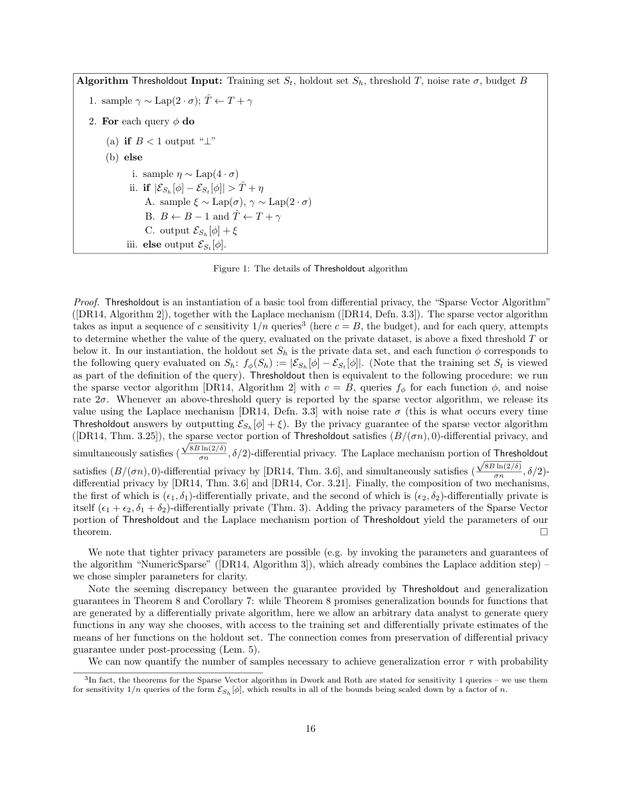
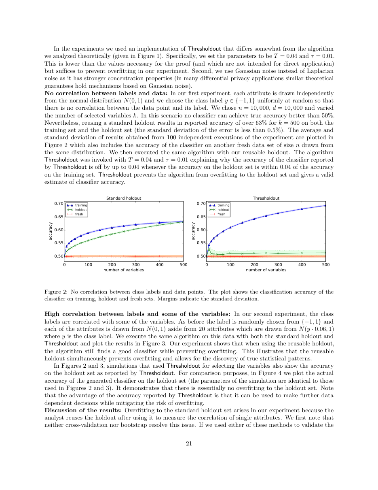
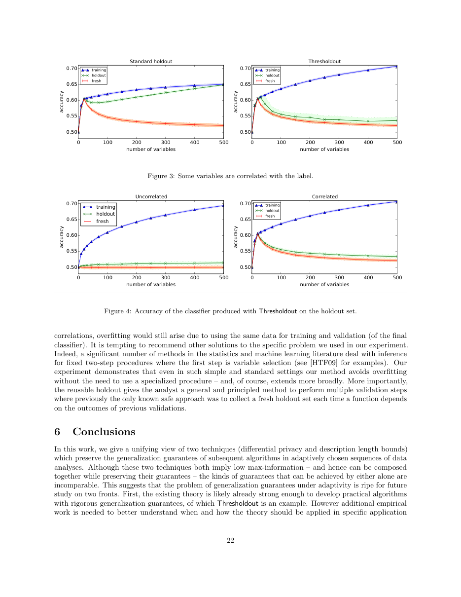

# 적응적 자료 분석에서의 일반화와 홀드아웃 재사용

원제: Generalization in Adaptive Data Analysis and Holdout Reuse

저자: Cynthia Dwork (Microsoft Research), Vitaly Feldman (IBM Almaden Research Center, 일부는 UC Berkeley Simons Institute 방문 중 수행), Moritz Hardt (Google Research), Toniann Pitassi (University of Toronto), Omer Reingold (Samsung Research America), Aaron Roth (University of Pennsylvania, Department of Computer and Information Science)

날짜: 2015년 9월 28일. arXiv:1506.02629v2 [cs.LG]

원문 파일: `Dwork2015_NIPS_holdout_reuse.pdf` (29쪽)

번역 범위: 초록부터 6절 결론까지 전문. 부록 A, B는 알고리즘과 정리 진술 중심으로 옮겼다. 참고문헌은 원문 그대로 둔다. 수식은 읽기 쉽게 풀어 쓰고, 원문 기호를 함께 적는다.

---

## 초록

과적합은 자료가 넉넉할 때조차 자료 분석가를 괴롭힌다. 이 문제를 다루는 형식적 접근은 지금까지 하나하나의 분석 절차에 대한 통계적 추론과 일반화에 초점을 맞추었다. 그러나 실제 자료 분석은 본질적으로 상호작용하고 적응하는 과정이다. 앞선 분석의 결과를 보고 새 분석과 새 가설을 제안하고, 그 결과를 보고 매개변수를 조정하며, 자료 집합을 여럿이 나눠 쓰고 다시 쓴다. 이 틈에 대한 연구는 저자들이 [DFH+14]에서 시작했고, 거기서는 적응적으로 고른 함수의 기댓값을 추정하는 문제에 집중했다.

이 논문에서는 홀드아웃(또는 시험) 집합을 다시 써서, 훈련 집합 위에서 동작하는 학습 알고리즘이 만들어 낸 가설의 정확도를 검증하는 간단하고 실용적인 방법을 제시한다. 홀드아웃 집합을 적응적으로 여러 번 다시 쓰면 홀드아웃 집합 자체에 쉽게 과적합된다. 우리는 적응적으로 고른 많은 수의 가설을 검증하면서도 과적합을 증명 가능하게 피하는 알고리즘을 제시한다. 간단한 합성 자료 실험으로 표준 홀드아웃 사용 방식 대비 우리 알고리즘의 장점을 보인다.

또한 적응적 자료 분석에서 자료 재사용이라는 일반 문제를 형식화하고 다룬다. [DFH+14]에서 제시한 차분 프라이버시 기반 접근이 훨씬 넓은 범위의 적응적 자료 분석에 적용됨을 보인다. 이어서 기술 길이(description length)에 기반한 간단한 접근도 적응적 상황에서 통계적 타당성의 보장을 줄 수 있음을 보인다. 마지막으로, 서로 비교 불가능한 이 두 접근이 우리가 새로 도입하는 근사 최대정보량(approximate max-information)이라는 개념으로 통합됨을 보인다. 이로써 분석가가 두 접근 중 어느 쪽 보장을 가진 알고리즘들을 섞어 적응적으로 합성하더라도 통계적 타당성 보장이 유지된다.

---

## 1 서론

기계 학습의 목표는 문제의 보지 않은 사례에까지 잘 일반화되는 가설이나 모형을 만드는 것이다. 더 넓게는 통계적 자료 분석은 손에 쥔 유한한 자료 집합에만 고유한 성질이 아니라, 바탕이 되는 자료 분포의 성질을 추정하는 일이다. 실제로 여러 상황에서 일반화를 보장하기 위한 많은 이론과 실험 연구가 쌓였다. 그 연구들은 보통 각 분석 절차(예를 들어 학습 알고리즘)가 새로 뽑은 자료 집합 위에서 동작한다고, 또는 그렇지 않다면 독립적으로 새로 뽑은 홀드아웃(시험) 집합으로 검증된다고 가정한다.

그러나 실제 현장에서는 자료 표본을 다시 쓰는 일이 잦아 학습과 추론이 더 어렵다. 예를 들어 흔한 관행은 한 자료 집합에서 특징 선택을 한 다음, 그 특징을 지도 학습 과제에 쓰는 것이다. 이 두 단계를 같은 자료 집합에서 수행하면, 합쳐진 알고리즘의 결과가 일반화될지 더는 분명하지 않다. 보통 이런 말로 이해되지는 않지만, "프리드먼의 역설(Freedman's paradox)"은 같은 자료에 적응적 분석을 하는 것이 얼마나 강한 (부정적) 효과를 내는지 우아하게 보여 준다 [Fre83]. 프리드먼의 모의실험에서는 t 통계량이 유의한 변수를 고르고 그렇게 적응적으로 고른 변수 부분집합에 선형 회귀를 수행한다. 결과는 유명하게도 사람을 오도한다. 종속 변수와 설명 변수 사이에 아무 관계가 없는데도 절차가 과적합하여 유의한 관계가 있다고 잘못 선언한다.

기계 학습 실무의 대부분은 학습 알고리즘의 형식적 일반화 보장에 기대지 않는다. 대신 자료 집합을 무작위로 두 부분(때로는 그 이상)으로 쪼갠다. 훈련 집합과 시험 집합, 곧 홀드아웃 집합이다. 훈련 집합으로 예측기를 학습하고, 홀드아웃 집합으로 참 분포에서의 예측기 정확도를 추정한다[각주 1]. 예측기가 홀드아웃 자료와 독립이므로 이 추정은 참 예측 정확도의 타당한 추정이다(형식적으로는 자료 분포에서의 예측 정확도에 대한 신뢰구간을 만들 수 있다). 그러나 실제로 홀드아웃 자료가 단 한 번만 쓰이는 경우는 드물고, 그 결과 예측기가 홀드아웃 집합과 독립이 아니게 되어 홀드아웃 집합에 과적합이 생긴다 [Reu03, RF08, CT10]. 그런 의존이 생기는 잘 알려진 이유 하나는, 홀드아웃 자료로 많은 수의 예측기를 시험하고 그중 가장 좋은 하나만 보고하는 것이다. 시험된 모든 가설의 집합이 미리 알려져 있고 홀드아웃 집합과 독립이라면, 이런 다중 검정은 쉽게 보정할 수 있고 Ng의 더 정교한 접근 [Ng97]을 쓸 수도 있다.

> 각주 1: 교차검증에서는 서로 다른 분할에 대한 추가 평균이 쓰인다.

그러나 이런 정적인 접근은 홀드아웃에서 시험하는 추정값이나 가설이 적응적으로 선택될 때는 적용되지 않는다. 즉 가설의 선택이 그 자료 집합에 대해 앞서 수행한 분석에 의존할 때다. 홀드아웃 집합이 적응적으로 재사용되는 대표적 예는 초매개변수 조정이다(예: [DFN07]). 비슷하게, 유명한 ImageNet 대회 같은 기계 학습 대회의 홀드아웃 집합도 보통 적응적으로 여러 번 재사용된다. 다른 예로는 특징 선택, (부스팅이나 배깅 같은 집계 기법에서의) 기저 학습기 생성, 정지 조건 확인, 분석가가 중간에 개입하는 판단에 홀드아웃을 쓰는 경우가 있다. 과적합을 일으키는 여러 미묘한 원인에 대한 논의는 [Lan05]를 보라.

우리가 다루는 구체적이고 실용적인 문제는, 적응적 상황에서 홀드아웃 집합을 다시 써서 검증을 수행할 수 있게 보장하는 방법이다. 이 문제를 다루기 위해 더 일반적인 질문도 던진다. 적응적 자료 분석의 최종 출력이 바탕 자료 분포로 일반화됨을 어떻게 보장할 수 있는가? 이 연구 흐름은 저자들이 [DFH+14]에서 최근 시작했고, 거기서는 독립 동일분포(i.i.d.) 표본에서 함수의 기댓값을 추정하는 경우(통계적 질의라고도 한다)에 집중했다. 그 논문은 차분 프라이버시 [DMNS06] 기법을 써서 적응적으로 고른 많은 수의 통계적 질의에 답하는 방법을 보였다(자세한 내용은 1.3절과 2.2절).

### 1.1 우리의 결과

적응적 자료 분석에서 통계적 타당성을 보존하는 문제의 간단하고 일반적인 형식화를 제안한다. [DFH+14]에 있는 차분 프라이버시 알고리즘과 일반화 사이의 연결이 이 더 일반적인 상황으로 확장됨을 보이고, 출력이 짧은 문자열로 기술될 수 있는 알고리즘에서도 비슷한(그러나 때로는 비교 불가능한) 보장을 얻을 수 있음을 보인다. 그다음 이 두 기본 기법을 통합하고 문제를 새 관점으로 보게 하는 새 개념, 근사 최대정보량을 정의한다. 특히 최대정보량에 대한 적응적 합성 정리를 제시한다. 이 정리는 일부 절차는 차분 프라이버시를 만족하고 다른 절차는 짧은 기술 길이 출력을 갖는 분석에 대해 일반화 보장을 얻는 간단한 길을 준다. 이 기법들을 적응적 상황에서 검증을 위해 홀드아웃 집합을 재사용하는 문제에 적용한다.

#### 1.1.1 재사용 가능한 홀드아웃

홀드아웃 집합에 과적합하는 것을 증명 가능하게 피하면서 결과를 검증하기 위해 홀드아웃 집합을 재사용하는, 간단하고 일반적인 방법 하나와 그 구체적 구현 두 가지를 설명한다. 분석가는 훈련 자료 집합 위에서는 어떤 분석이든 할 수 있지만, 홀드아웃 집합에는 자기 가설을 홀드아웃 집합에 대해 검증해 주는 알고리즘을 통해서만 접근할 수 있다. 결정적으로, 우리 알고리즘은 분석가의 가설이 우리 알고리즘의 이전 응답에 기초해 적응적으로 선택되는 경우에도 홀드아웃 집합에 대한 과적합을 막는다.

첫 알고리즘은 Thresholdout이라 부르며, 보장을 차분 프라이버시와 [DFH+14, NS15]의 결과에서 끌어온다. 분석가가 주는 임의의 함수 φ: X → [0, 1]에 대해, Thresholdout은 홀드아웃 집합을 써서 φ가 훈련 집합에 과적합하지 않았음을 검증한다. 즉 훈련 집합에서 평가한 φ의 평균값이, 자료를 뽑은 분포 P 위에서 평가한 φ의 평균값과 가까운지 확인한다. 이런 검증의 표준 방식은 홀드아웃 집합에서 φ의 평균값을 계산하는 것이다. Thresholdout의 홀드아웃 사용은 표준 방식과 다르게, 홀드아웃 집합 위 φ의 평균에 대한 정보를 아주 조금만 내놓는다. φ가 훈련 집합에 과적합하지 않았다면, 분석가는 "가깝다"는 확인만, 즉 단 1비트만 받는다. 반면 φ가 과적합했다면 Thresholdout은 조심스럽게 눈금을 맞춘 잡음을 더한 훈련 집합 위 φ의 평균값을 돌려준다.

[DFH+14, NS15]의 결과를 써서, i.i.d. 표본으로 이루어진 자료 집합에 대해 이런 수정이 분석가가 홀드아웃 집합에 과적합하는 함수를 만들어 내는 것을 증명 가능하게 막음을 보인다. 이것이 Thresholdout 응답의 정확성을 보장한다. 당연히 구체적인 보장은 홀드아웃 집합의 표본 수 n에 의존한다. Thresholdout이 답할 수 있는 질의의 수는, 분석가가 과적합하는 횟수가 n의 제곱 이하인 한, n에 대해 지수적이다.

두 번째 알고리즘 SparseValidate는 다음 발상에 기초한다. 분석가의 절차가 대부분의 경우 과적합하지 않는 결과를 낸다면, 그것들을 홀드아웃 집합에 대해 검증하는 일은 홀드아웃 집합에 대해 많은 정보를 드러내지 않는다. 구체적으로, 이 방법의 일반화 보장은 자료 분석가와 홀드아웃 집합 사이 상호작용의 기록(transcript)을 짧게 기술할 수 있다는 관찰에서 나온다. 더 형식적으로, 이 방법은 분석가가 자료 집합에 대한 임의의 불리언 함수(알고리즘으로 기술된다)를 고르고 그 값을 홀드아웃 집합에서 돌려받을 수 있게 한다. 그런 함수의 간단한 예는 홀드아웃 집합에서 어떤 예측기의 정확도가 특정 값 α 이상인지 여부다. (Thresholdout과 달리 여기서는 정확도를 재는 함수가 유계 범위를 갖거나 립시츠 조건을 만족한다고 가정할 필요가 없다. 이것이 차분 프라이버시 아래 얻을 수 있는 결과들과 질적으로 다른 점이다.) 더 복잡한 검증의 예는, 홀드아웃 자료 집합에서 알고리즘을 돌려 가설을 하나 고르고 그것이 훈련 집합에서 얻은 가설과 비슷한지(원하는 어떤 유사도 개념으로든) 확인하는 것이다. 이런 검증은 분석의 다른 결과에도 쓸 수 있다. 예를 들어 홀드아웃 집합에서 선택된 변수들이 훈련 집합에서 선택된 변수들과 많이 겹치는지 확인할 수 있다. SparseValidate 알고리즘의 한 구현은 이미 적응적 상황에서 통계적 질의(및 더 일반적인 질의)에 답하는 문제에 적용되었다 [BSSU15]. SparseValidate의 형식적 보장은 4.2절에서 기술한다.

5절에서는 표준 홀드아웃 집합을 재사용하는 것의 위험과, 우리의 재사용 가능한 홀드아웃이 이 문제를 어떻게 푸는지 보여 주는 합성 자료 실험을 설명한다. 이 실험의 설계는 같은 자료에서 변수 선택과 회귀를 수행하는 것의 위험을 보여 준 프리드먼의 고전적 실험에서 영감을 얻었다 [Fre83].

### 1.2 적응적 자료 분석에서의 일반화

같은 자료 집합에 대한 적응적 분석을, 단계들의 수열 A1 → A2 → ... → Am의 실행으로 본다. 각 단계는 알고리즘 Ai로 기술된다. Ai는 어떤 분포 D(X^n 위의 분포)에서 뽑힌 고정된 자료 집합 S = (x1, ..., xn)을 입력으로 받으며, 이 S는 분석이 진행되는 동안 바뀌지 않는다. 각 알고리즘 Ai는 앞서 실행된 알고리즘 A1부터 Ai−1까지의 출력도 입력으로 받고, 어떤 치역 Yi의 값을 낸다. 앞선 출력에 대한 의존이 자료 분석 i단계에서 이루어지는 모든 적응적 선택을 나타낸다. 예를 들어 앞선 출력에 따라 Ai는 S 위에서 다른 종류의 분석을 돌릴 수 있다. 이 정도의 일반성에서는 이 알고리즘들이 자료 분석가의 선택을 나타낼 수 있고 명시적으로 정해질 필요가 없다는 점에 유의한다.

우리는 분석가가, 분포 D에서 독립적으로 새로 뽑은 자료 집합 위에서 실행되면 일반화된다고 알려진 알고리즘들을 쓴다고 가정한다. 이를 다음과 같이 형식화한다. 모든 고정된 값 y1, ..., yi−1에 대해, D에 따른 S의 선택에 대해 확률 1 − βi 이상으로, 입력 y1, ..., yi−1과 S에 대한 Ai의 출력이 자료 분포 D에 대해 바라는 성질을 가진다(예를 들어 일반화 오차가 작다). 이 가정에서 y1, ..., yi−1은 고정되어 있고 S의 선택과 독립임에 유의한다. 반면 분석가는 Ai를 Y1, ..., Yi−1 값에서 실행하며, 여기서 Yj = Aj(S, Y1, ..., Yj−1)이다. 다시 말해 적응적 설정에서 알고리즘 Ai는 앞선 출력에 의존할 수 있고 그 출력은 S에 의존하므로, Ai에게 주어진 집합 S는 더 이상 독립적으로 뽑힌 자료 집합이 아니다. 이런 의존은 개별 절차의 일반화 보장을 무효로 만들고, 잠재적으로 과적합으로 이어진다.

**차분 프라이버시.** 먼저 [DFH+14]의 차분 프라이버시 기반 접근이 이 더 일반적인 상황에 어떻게 적용되는지 분명히 한다. 구체적으로, [DFH+14] 결과의 간단한 따름정리는 다음과 같다. i.i.d. 표본으로 이루어진 자료 집합에 대해, 차분 프라이버시를 만족하는 알고리즘의 어떤 출력이든 이어지는 분석에서 과적합 위험을 통제하면서 쓸 수 있다. 이는 [DFH+14]에서 다룬 통계적 질의 상황을 넘어선다. 이 맥락에서 차분 프라이버시의 핵심 성질은 적응적으로 합성된다는 것이다. 즉 분석가가 쓰는 알고리즘이 각각 차분 프라이버시를 만족하면 전체 절차도 (프라이버시 매개변수는 나빠지지만) 차분 프라이버시를 만족한다. 따라서 적응적 상황에서 과적합을 피하는 한 가지 길은 (충분히 강한) 차분 프라이버시 보장을 만족하는 알고리즘을 쓰는 것이다. 2.2절에서 이 결과를 형식적으로 기술한다.

**기술 길이.** 다음으로 기술 길이 한계가 적응성이 있는 상황에서 일반화를 보장하는 데 어떻게 적용되는지 보인다. 알고리즘 A1, ..., Ai−1의 출력 전체 길이를 k비트로 기술할 수 있다면, Ai의 입력 y1, ..., yi−1의 가능한 값은 최대 2^k개다. 이 개별 입력 각각에 대해 Ai는 확률 1 − βi로 일반화된다. 실패 확률에 합집합 한계를 취하면 확률 1 − 2^k*βi 이상으로 일반화됨을 얻는다. 오컴의 면도날은 더 짧은 가설이 더 낮은 일반화 오차를 가짐을 유명하게 함의한다. 우리의 관찰은, 더 짧은 가설(더 일반적으로는 분석의 결과)이 적응적 상황에서도 더 낫다는 것이다. 자료 집합에 대해 덜 드러내므로 이어지는 분석의 일반화가 더 좋아지기 때문이다. 이 결과는 자료 분포 D에 대해 아무 가정도 하지 않는다는 점에 유의한다. 형식적 내용은 2.3절에 있다. 부록 B에서는 기술 길이 기반 분석만으로도 적응적으로 고른 지수적으로 많은 통계적 질의에 답할 수 있는 알고리즘(효율적이지는 않다)을 얻을 수 있음을 보인다. 이는 [DFH+14]의 결과 하나에 대한 다른 증명을 준다.

**근사 최대정보량.** 우리의 주된 기술적 기여는, 차분 프라이버시와 기술 길이 양쪽에서 나오는 일반화 논증을 통합하고 분석가가 자료에 대해 얼마나 많은 정보를 알아냈는지 정량화하는 새 정보이론적 척도의 도입과 분석이다. 형식적으로, 결합 분포를 이루는 확률변수 (S, Y)에 대해 최대정보량은 Y 값이 주어졌을 때 S에 대한 불확실성이 줄어드는 배율의 로그의 최댓값이다. 즉

I∞(S, Y) = log max P[S = S'] | Y = y] / P[S = S'],

여기서 최댓값은 S의 지지집합의 모든 S'과 Y의 지지집합의 모든 y에 대해 취한다. 비형식적으로, β 근사 최대정보량은 위 로그가 (S, Y)의 선택에 대해 확률 1 − β 이상으로 유계임을 요구한다(실제 정의는 조금 더 약하다. 정의 10을 보라). 우리의 사용에서 S는 분포 D에서 무작위로 뽑힌 자료 집합을, Y는 S에 대한 (아마도 무작위화된) 알고리즘의 출력을 나타낸다. 근사 최대정보량이 다음 성질을 가짐을 증명한다.

- (근사) 최대정보량의 상한은 일반화 보장을 준다.
- 차분 프라이버시를 만족하는 알고리즘은 자료 집합 위의 어떤 분포 D에 대해서도 낮은 최대정보량을 가진다. i.i.d. 자료 집합에 대해서는 근사 최대정보량에 더 강한 한계가 성립한다. 이 한계들은 이른바 순수 차분 프라이버시(δ = 0인 경우)에만 적용된다.
- 알고리즘 출력의 기술 길이에 대한 한계는 어떤 D에 대해서도 그 알고리즘의 근사 최대정보량 한계를 준다.
- 근사 최대정보량은 적응적으로 합성된다.
- 근사 최대정보량은 사후 처리에 대해 보존된다.

근사 최대정보량의 합성 성질은, 일부는 차분 프라이버시를 만족하고 다른 일부는 짧은 기술 길이 출력을 갖는 알고리즘들의 적응적 수열에 대해 일반화 보장을 쉽게 얻을 수 있음을 함의한다. 이 성질들은 또한 차분 프라이버시를 써서 자료 집합 위의 임의의 분포 D에 대해 일반화를 통제할 수 있음을 함의한다. 이는 [DFH+14]에서처럼 고정 분포에서 i.i.d.로 뽑힌 자료 집합이라는 제약을 넘어 일반화 보장을 넓힌다.

(순수) 차분 프라이버시와 기술 길이는 그 밖에는 서로 비교 불가능함을 덧붙인다. 짧은 기술 길이는 차분 프라이버시의 충분조건이 아니다. 차분 프라이버시는 자료 집합 안의 어떤 한 개인에 대한 정보가 단 몇 비트라도 드러나는 것을 막기 때문이다. 동시에 차분 프라이버시는 출력의 기술 길이를 제약하지 않는다. 그러나 어떤 알고리즘의 최대정보량이나 차분 프라이버시의 한계는, 통계적으로 구별 불가능한 출력을 내는 다른 알고리즘의 무작위화된 기술 길이(randomized description length) 한계로 번역될 수 있다. 여기서 무작위화된 알고리즘이 무작위화된 기술 길이 k를 가진다는 것은, 알고리즘의 난수 비트를 어떻게 고정하더라도 기술 길이가 k라는 뜻이다. 이 결과들의 자세한 내용과 추가 논의는 3절과 부록 A에 있다.

### 1.3 관련 연구

이 연구는 자료 분석에서 적응성에 대한 형식적 연구를 시작한 [DFH+14] 위에 세워졌다. [DFH+14]의 주 초점은 적응적으로 고른 통계적 질의에 답하는 문제다. 주 기법은 차분 프라이버시와 일반화 사이의 강한 연결이다. 차분 프라이버시는 출력의 분포가 자료 표본 하나하나에 너무 많이 의존하지 않음을 보장하므로, 적응적 자료 분석에서 잘 작동하는 강한 안정성 보장을 준다. [DFH+14]가 만든 일반화와 근사 차분 프라이버시의 연결은 이후 더 강화되었다. 질적으로는 더 넓은 범위의 질의로 연결을 확장한 [BSSU15]에 의해, 양적으로는 더 조이는 한계를 준 [NS15]와 [BSSU15]에 의해서다. 이 논문들은 다른 결과들 중에서도 자료 집합 크기에 지수적으로 많은 적응적 질의에 정확히 답하는 방법을 주지만, 그 알고리즘들은 효율적이지 않다. 이는 근본적인 이유 때문임이 드러났다. Hardt와 Ullman [HU14], Steinke와 Ullman [SU14]은 암호학적 가정 아래, 참 자료 분포를 아는 적대자가 적응적으로 고른 통계적 질의에 대해 제곱보다 많이 답할 수 있는 효율적 알고리즘은 없음을 증명했다.

차분 프라이버시는 [DN03, DN04, BDMN05]로 이어지는 연구 흐름에서 나왔고 [DMNS06]의 정의로 정점을 찍었다. 여러 자료 분석 과제에 대해 차분 프라이버시 알고리즘을 설계한 연구가 아주 많고, 우리 응용에서도 일부를 활용한다. 짧은 개관은 [Dwo11], 교과서 입문은 [DR14]를 보라.

경험적 추정값이 바탕 분포로 일반화됨을 보장하는 이론 기계 학습의 고전적 접근은, 알고리즘이 출력하는 함수 집합의 복잡도에 대한 여러 개념, 특히 VC 차원에 기초한다(교과서 입문은 [SSBD14]). 어떤 유계 복잡도 함수류의 모든 함수에 대해 일반화를 보장할 만큼 자료 표본이 크다면, 자료 분석가가 그 류 안의 함수를 적응적으로 고르든 아니든 상관없다. 반면 우리의 목표는 분석가가 질의 함수를 고를 수 있는 류에 대해 아무 가정 없이 일반화 한계를 증명하는 것이다. 이 경우 적응적 설정은 비적응적 설정과 매우 다르다.

중요한 연구 흐름 [BE02, MNPR06, PRMN04, SSSSS10]은 학습 알고리즘의 안정성과 일반화 능력 사이의 연결을 세웠다. 안정성은 입력의 변화에 대해 학습 알고리즘의 출력이 얼마나 흔들리는지를 재는 척도다. 어떤 안정성 개념들은 일반화에 필요충분임이 알려져 있다. 불행히도 이 선행 연구들의 안정성 개념은 합성되지 않는다. 즉 여러 안정한 알고리즘을 순차적이고 적응적으로 돌리면 안정하지 않은 절차가 될 수 있다. 이 연구에서 도입하는 척도(최대정보량)는 차분 프라이버시처럼 적응적 합성 보장을 누린다는 강점이 있다. 덕분에 개별 구성 요소만 분석하고도 적응적으로 적용된 알고리즘 수열의 일반화 성질을 따질 수 있다. 학습 가능성 맥락에서 안정성, 경험 위험 최소화, 차분 프라이버시 사이의 연결은 최근 [WLF15]에서 탐구되었다.

Freund는 주어진 학습 알고리즘이 자료를 뽑은 분포에 대해 만들어 낼 수 있는 통계적 질의 집합을 고려하는, 자료 의존적 일반화 한계를 얻는 접근을 제시했다 [Fre98]. Langford와 Blum의 관련 접근 역시 자료 분포에 대해 출력될 수 있는 함수들의 기술 길이에 기초한 자료 의존적 일반화 한계를 얻게 한다 [LB03]. 우리 연구와 달리 이 접근들은 일반화 한계를 끌어내기 위해 학습 알고리즘의 구조를 알아야 한다. 더 중요하게, 우리 틀의 초점은 적응적 상황에서 더 나은 일반화 성질을 갖는 새 알고리즘의 설계에 있다.

마지막으로, 우리 연구에 자극받아 Blum과 Hardt [BH15]는 참가자가 대회 진행 중에 적응적으로 고른 모형을 제출할 수 있는 기계 학습 대회(예: Kaggle Inc.가 여는 대회)에서 정확한 순위표를 유지하도록 홀드아웃 집합을 재사용하는 방법을 보였다. 그들의 분석도 우리가 SparseValidate를 분석할 때 쓴 기술 길이 기반 기법에 기댄다.

---

## 2 사전 준비와 기본 기법

아래 논의에서 log는 밑이 2인 로그, ln은 자연로그를 뜻한다. 간단히 하기 위해 확률변수를 유한 정의역으로 제한한다(연속 정의역으로의 확장은 표준 형식으로 쉽게 된다). 같은 정의역 X 위의 두 확률변수 X, Y에 대해 X의 Y에 대한 최대발산(max-divergence)은 다음으로 정의한다.

D∞(X || Y) = log max over x in X of P[X = x] / P[Y = x].

β 근사 최대발산은 다음으로 정의한다.

D∞^β(X || Y) = log max over O ⊆ X with P[X ∈ O] > β of (P[X ∈ O] − β) / P[Y ∈ O].

실수값 함수 f: X^n → R가 민감도 c를 가진다는 것은, 모든 i와 모든 x1, ..., xn, xi'에 대해 자료 한 점만 바꿨을 때 f 값의 변화가 c 이하라는 뜻이다. 저민감도 함수에 대한 McDiarmid의 집중 부등식을 복습한다.

**보조정리 1 (McDiarmid 부등식).** X1, ..., Xn이 집합 X에서 값을 갖는 독립 확률변수이고 f: X^n → R가 민감도 c > 0인 함수라 하자. 그러면 모든 λ > 0과 μ = E[f(X1, ..., Xn)]에 대해

P[|f(X1, ..., Xn) − μ| ≥ λ] ≤ 2*exp(−2λ² / (n*c²)).

함수 φ: X → R와 자료 집합 S = (x1, ..., xn)에 대해 ES[φ] = (1/n)*Σ φ(xi)로 둔다. φ의 치역이 길이 Δ인 구간 안에 있으면 f(S) = ES[φ]는 민감도 Δ/n을 가진다. X 위의 분포 P와 함수 φ에 대해 P[φ] = E_{x~P}[φ(x)]로 둔다.

### 2.1 차분 프라이버시

직관적으로 차분 프라이버시는 어떤 한 개인의 자료를 가린다. 그래서 원소 하나만 다른 자료 집합 쌍 S, S'에 관심을 둔다. 이때 S와 S'을 인접(adjacent)하다고 한다.

**정의 2 [DMNS06, DKM+06].** n > 0에 대해 정의역이 X^n인 무작위화 알고리즘 A가 (ε, δ) 차분 프라이버시를 만족한다는 것은, 원소 하나만 다른 모든 자료 집합 쌍 S, S' ∈ X^n에 대해 D∞^δ(A(S) || A(S')) ≤ log(e^ε)인 것이다. δ = 0인 경우를 순수 차분 프라이버시라 부르기도 하며, 이때는 간단히 A가 ε 차분 프라이버시를 만족한다고 말한다.

차분 프라이버시는 적응적 합성 아래 보존된다. 알고리즘의 적응적 합성이란, i단계의 알고리즘이 앞선 알고리즘들의 출력에 의존할 수 있는, 같은 자료 집합 위의 순차 실행이다. 더 형식적으로, A1, ..., Am을 알고리즘 수열이라 하자. 각 Ai는 어떤 치역 Yi의 값을 내고 X^n의 자료 집합과 Y1 × ... × Yi−1의 값을 입력으로 받는다. 이들의 적응적 합성은 입력 S ∈ X^n을 받아 A1 → A2 → ... → Am을 순차 실행하되 Ai의 입력이 S와 앞선 출력 y1, ..., yi−1이 되는 알고리즘이다. 이런 합성은 앞선 분석의 결과(즉 y1, ..., yi−1)를 써서 S에서 실행할 알고리즘을 고르는, 자료 분석의 흔한 관행을 포착한다. 자료 집합 외에 다른 입력도 받는 알고리즘에 대해서는, 추가 매개변수의 모든 설정에 대해 (ε, δ) 차분 프라이버시를 만족하면 그 알고리즘이 (ε, δ) 차분 프라이버시를 만족한다고 말한다. 차분 프라이버시 알고리즘의 적응적 합성의 기본 성질은 다음과 같다(예: [DL09]).

**정리 3.** Ai가 i ∈ [m]에 대해 (εi, δi) 차분 프라이버시 알고리즘이라 하자. 그러면 Ai들을 적응적으로 합성해 얻은 알고리즘 B는 (Σεi, Σδi) 차분 프라이버시를 만족한다.

더 정교한 논증은 δ' < 1일 때 큰 개선을 준다(예: [DR14]).

**정리 4.** 모든 ε, δ, δ' ≥ 0에 대해, 임의의 (ε, δ) 차분 프라이버시 알고리즘 m개의 적응적 합성은 (ε', mδ + δ') 차분 프라이버시를 만족한다. 여기서

ε' = sqrt(2m*ln(1/δ'))*ε + m*ε*(e^ε − 1).

우리 응용에 중요한 차분 프라이버시의 또 다른 성질은 사후 처리 아래 보장이 보존된다는 것이다(예: [DR14, Prop. 2.1]).

**보조정리 5.** A가 정의역 X^n, 치역 Y의 (ε, δ) 차분 프라이버시 알고리즘이고, B가 정의역 Y, 치역 Y'의 (아마도 무작위화된) 임의의 알고리즘이면, 정의역 X^n, 치역 Y'의 알고리즘 B ∘ A도 (ε, δ) 차분 프라이버시를 만족한다.

### 2.2 차분 프라이버시를 통한 일반화

우리의 일반적 적응 분석 상황의 특수한 경우에서는 [DFH+14]의 결과와 차분 프라이버시의 합성 성질로부터 곧바로 일반화를 얻을 수 있다. i.i.d. 자료 집합 위에서 일반적 출력을 갖는 순수 차분 프라이버시 알고리즘의 경우, [DFH+14]에서 다음 결과를 증명했다.

**정리 6.** A를 치역이 Y인 ε 차분 프라이버시 알고리즘, S를 X^n 위의 분포 P^n에서 뽑힌 확률변수라 하자. Y = A(S)를 대응하는 출력 분포라 하자. 각 원소 y ∈ Y에 대해 부분집합 R(y) ⊆ X^n이 있어서 max over y of P[S ∈ R(y)] ≤ β라 가정하자. 그러면 ε ≤ sqrt(ln(1/β) / (2n))에 대해 P[S ∈ R(Y)] ≤ 3*sqrt(β)이다.

정리 6과 보조정리 1을 합친 즉각적인 따름정리는, 저민감도 함수를 출력하는 차분 프라이버시 알고리즘은 일반화된다는 것이다.

**따름정리 7.** A가 c 민감도 함수 f: X^n → R를 출력하는 알고리즘이라 하자. S를 X^n 위 분포 P^n에서 고른 무작위 자료 집합, f = A(S)라 하자. A가 λ/(c*n) 차분 프라이버시를 만족하면

P[|f(S) − P^n[f]| ≥ λ] ≤ 6*exp(−λ² / (c²*n)).

정리 3에 의해 순수 차분 프라이버시는 적응적으로 합성된다. 따라서 알고리즘 수열 A1, ..., Am에서 i ≤ m − 1인 Ai가 모두 εi 차분 프라이버시를 만족하면, 처음 i − 1개 알고리즘의 합성은 ε(i−1) = Σ εj 차분 프라이버시를 만족한다. 정리 6을 적용하면 (차분 프라이버시를 만족할 필요가 없는) 마지막 알고리즘 Am의 일반화 보장을 보존할 수 있다. 예를 들어 모든 고정된 y(m−1)에 대해 Am이, 서로 다른 가설 집합과 일반화 기법을 썼을 수 있는 가설 h를 출력한다고 하자. R(y(m−1))을, Am(S, y(m−1))이 ES[L(h)] − P[L(h)] ≥ λ인 h를 출력하는 모든 자료 집합 S의 집합으로 정의한다. 이제 ε(m−1) ≤ sqrt(λ² / (2d))이면, 무작위 i.i.d. 자료 집합 S에 대한 Am의 적응적 실행에서 출력된 가설 h에 대해서도

P[ES[L(h)] − P[L(h)] ≥ λ] ≤ 3*e^(−λ²n / (2d)).

근사 (ε, δ) 차분 프라이버시에 대해서는, 현재 강한 일반화 보존 결과가 X 위의 유계 치역(간단히 [0, 1]로 둔다) 함수를 출력하는 알고리즘에 대해서만 알려져 있다 [DFH+14, NS15]. 다음 결과는 Nissim과 Stemmer [NS15]가 증명했다(더 약한 진술은 [DFH+14, Thm. 10]에도 있다).

**정리 8.** A를 X에서 [0, 1]로 가는 함수를 출력하는 (ε, δ) 차분 프라이버시 알고리즘이라 하자. P^n을 따르는 확률변수 S에 대해 φ = A(S)라 하자. 그러면 n ≥ 2*ln(8/δ)/ε²에 대해

P[|P[φ] − ES[φ]| ≥ 13ε] ≤ (2δ/ε)*ln(2/ε).

많은 학습 알고리즘은 어떤 유계 손실 함수 L을 최소화하려는 가설 함수를 최종 출력으로 낸다. 적응적 자료 분석의 모든 단계에서 쓰인 알고리즘이 차분 프라이버시를 만족하고 마지막 단계(즉 Am)가 가설 h를 출력하면, h의 손실에 대한 일반화 한계는 정리 8에서 바로 나온다. 이 응용은 위의 순수 차분 프라이버시 예와 다르다는 점을 짚는다. 거기서는 차분 프라이버시를 만족할 필요가 없는 임의로 복잡한 학습 알고리즘 Am의 일반화 보장이 보존됨을 보였다. 4절에서 정리 8을 재사용 가능한 홀드아웃 문제에 적용한다.

### 2.3 기술 길이를 통한 일반화

A: X^n → Y, B: X^n × Y → Y'를 두 알고리즘이라 하자. 이제 Y의 크기(동등하게 A 출력의 기술 길이)에 대한 한계를 B의 일반화 보존에 적용하는 간단한 예를 든다. 여기서 일반화는 주어진 자료 집합 S와 입력 y ∈ Y에 대해 B의 타당하거나 바람직한 어떤 출력도 가리킬 수 있다. 구체적으로 집합 R(y) ⊆ X^n을, y와 S에 대한 B의 출력이 "나쁜"(예를 들어 과적합한) 모든 자료 집합으로 둔다. 간단한 합집합 한계로 그런 나쁜 결과가 (자료 집합의 무작위 선택에 대해) 일어날 확률을 한계 지을 수 있다.

**정리 9.** A: X^n → Y를 알고리즘, S를 X^n 위의 무작위 자료 집합이라 하자. R: Y → 2^(X^n)이 모든 y ∈ Y에 대해 P[S ∈ R(y)] ≤ β를 만족한다고 가정하자. 그러면 P[S ∈ R(A(S))] ≤ |Y|*β이다.

증명. P[S ∈ R(A(S))] ≤ Σ over y in Y of P[S ∈ R(y)] ≤ |Y|*β. ∎

기술 길이가 (적응적으로) 합성되므로 두 알고리즘의 경우가 일반적인 경우를 함의한다. 즉 A1, ..., Am이 각 Ai가 어떤 치역 Yi의 값을 내고 X^n의 자료 집합과 Y1 × ... × Yi−1의 값을 입력으로 받는 알고리즘 수열이라 하자. 그러면 각 i에 대해 A1부터 Ai−1까지의 실행을 치역이 Y1 × ... × Yi−1인 첫 알고리즘으로, Ai를 둘째 알고리즘으로 볼 수 있다. 정리 9는, 모든 y(i−1)에 대해 R(y(i−1)) ⊆ X^n이 P[S ∈ R(y(i−1))] ≤ βi를 만족하면

P[S ∈ R(A(i−1)(S))] ≤ |Y1 × ... × Yi−1|*βi = (Π over j < i of |Yj|)*βi

임을 함의한다. 부록 A에서는 기술 길이 한계를 무작위화 알고리즘으로 일반화하고 같은 성질을 가짐을 보인다.

---

## 3 최대정보량

적응적으로 합성되는 두 알고리즘 A: X^n → Y, B: X^n × Y → Y'를 생각하고, 모든 고정 입력 y ∈ Y에 대해 B가 자료 집합의 β 비율을 뺀 전부에서 일반화한다고 가정하자. 여기서 일반화는 비형식적으로 말하고 있다. 우리 정의는 입력 y ∈ Y와 자료 집합 S의 어떤 성질이든 지원한다. 직관적으로 B의 일반화를 보존하려면 A의 출력이 자료 집합 S에 대해 너무 많은 정보를 드러내지 않게 해야 한다. 이 직관이 최대정보량과 그 완화인 근사 최대정보량이라는 개념으로 포착됨을 보인다.

두 확률변수 X, Y에 대해 X ⊗ Y로 각자의 확률분포에서 독립적으로 뽑아 얻은 확률변수를 나타낸다.

**정의 10.** X와 Y가 결합 분포를 이루는 확률변수라 하자. X와 Y 사이의 최대정보량 I∞(X; Y)는, X의 지지집합의 모든 x와 Y의 지지집합의 모든 y에 대해 P[X = x | Y = y] ≤ 2^k*P[X = x]가 성립하는 최소 k 값이다. 동등하게 I∞(X; Y) = D∞((X, Y) || X ⊗ Y)이다. β 근사 최대정보량은 I∞^β(X; Y) = D∞^β((X, Y) || X ⊗ Y)로 정의한다.

베이즈 규칙에서 바로, 모든 β ≥ 0에 대해 I∞^β(X; Y) = I∞^β(Y; X)임이 나온다. 또한 I∞(X; Y) ≤ k인 것은 X의 지지집합의 모든 x에 대해 D∞(Y | X = x || Y) ≤ k인 것과 동치다. 분명히 최대정보량은 고전적 상호정보량의 상한이다. I(X; Y) ≤ I∞(X; Y).

우리의 사용에서 (X, Y)는 결합 분포 (S, A(S))가 된다. 여기서 S는 무작위 n 원소 자료 집합이고 A는 자료 집합을 입력으로 받는 (아마도 무작위화된) 알고리즘이다. 어떤 분포 S에 대해서도 알고리즘의 출력이 낮은 근사 최대정보량을 가지면 그 알고리즘이 낮은 최대정보량을 가진다고 말한다. 더 형식적으로 다음과 같다.

**정의 11.** 알고리즘 A가 β 근사 최대정보량 k를 가진다는 것은, n 원소 자료 집합 위의 모든 분포 S에 대해 I∞^β(S; A(S)) ≤ k인 것이다. 이를 I∞^β(A, n) ≤ k로 쓴다.

(순수) 최대정보량을 정의하는 다른 방법은 서로 다른 두 입력 위의 분포 사이 무한 발산의 최댓값을 쓰는 것이다.

**보조정리 12.** A가 정의역 X^n, 치역 Y인 알고리즘이면 I∞(A, n) = max over S, S' in X^n of D∞(A(S) || A(S')).

근사 최대정보량의 주된 쓸모는, A(S)가 S에 의존해서 생기는 "나쁜 사건"의 확률을 통제한다는 데 있다.

**정리 13.** S를 X^n 위의 무작위 자료 집합, A를 어떤 β ≥ 0에 대해 I∞^β(S; A(S)) = k인 치역 Y의 알고리즘이라 하자. 그러면 임의의 사건 O ⊆ X^n × Y에 대해

P[(S, A(S)) ∈ O] ≤ 2^k*P[S ⊗ A(S) ∈ O] + β.

특히 P[(S, A(S)) ∈ O] ≤ 2^k*max over y in Y of P[(S, y) ∈ O] + β.

S와 A(S) 사이의 상호정보량만으로는 나쁜 사건이 아주 작은 확률로 일어남을 보장하기에 충분하지 않음을 덧붙인다. 예를 들어 상호정보량 k는 P[(S, A(S)) ∈ O]가 k / (2*log(1/β'))만큼 커지는 것을 허용한다. 여기서 β' = P[S ⊗ A(S) ∈ O]이다.

**최대정보량의 합성.** 근사 최대정보량은 다음 적응적 합성 성질을 만족한다.

**보조정리 14.** A: X^n → Y가 I∞^{β1}(A, n) ≤ k1인 알고리즘이고, B: X^n × Y → Z가 모든 y에 대해 I∞^{β2}(B(*, y), n) ≤ k2인 알고리즘이면, 둘의 적응적 합성은 (β1 + β2) 근사 최대정보량 (k1 + k2)를 가진다.

이 보조정리를 반복 적용하면 최대정보량에 대한 다음 적응적 합성 정리가 바로 나온다.

**정리 15.** 치역이 Y1, ..., Yk인 임의의 알고리즘 수열 A1, ..., Ak를 생각하자. 모든 i에 대해 Ai: X^n × Y1 × ... × Yi−1 → Yi이고, y1, ..., yi−1의 모든 선택에 대해 Ai(*, y1, ..., yi−1)가 βi 근사 최대정보량 ki를 가진다고 하자. 알고리즘 B: X^n → Yk를 다음과 같이 정의한다.

B(S):
1. y1 = A1(S)로 둔다.
2. i = 2부터 k까지: yi = Ai(S, y1, ..., yi−1)로 둔다.
3. yk를 출력한다.

그러면 B는 (Σ βi) 근사 최대정보량 (Σ ki)를 가진다.

**최대정보량의 사후 처리.** (근사) 최대정보량이 차분 프라이버시와 공유하는 또 다른 유용한 성질은 사후 처리 아래 보존된다는 것이다. 이 보조정리의 간단한 증명은 차분 프라이버시의 경우(보조정리 5)와 동일하므로 생략한다.

**보조정리 16.** A가 정의역 X^n, 치역 Y인 알고리즘이고 B가 정의역 Y, 치역 Y'인 (아마도 무작위화된) 임의의 알고리즘이면, 정의역 X^n, 치역 Y'인 알고리즘 B ∘ A는 모든 확률변수 S와 모든 β ≥ 0에 대해 I∞^β(S; B ∘ A(S)) ≤ I∞^β(S; A(S))를 만족한다.

### 3.1 최대정보량의 한계

이제 기술 길이와 (순수) 차분 프라이버시에 기초한 기본 접근들이 근사 최대정보량으로 포착됨을 보인다.

#### 3.1.1 기술 길이

기술 길이 k는 최대정보량에 다음 한계를 준다.

**정리 17.** A가 n 원소 자료 집합을 입력으로 받아 유한 집합 Y의 값을 출력하는 무작위화 알고리즘이라 하자. 그러면 모든 β > 0에 대해 I∞^β(A, n) ≤ log(|Y|/β)이다.

증명에서 다음 간단한 근사 발산 성질을 쓴다(예: [DR14]). 확률변수 X에 대해 그 확률분포를 p(X)로 쓴다.

**보조정리 18.** X와 Y가 같은 정의역 위의 확률변수이고 P over x ~ p(X) of [P[X = x] / P[Y = x] > 2^k] ≤ β이면 D∞^β(X || Y) ≤ k이다.

#### 3.1.2 차분 프라이버시

다음 결과는, 차분 프라이버시 기반 접근이 [DFH+14]의 i.i.d. 상황을 넘어 쓰일 수 있음을 함의한다.

**정리 19.** A가 ε 차분 프라이버시 알고리즘이면 I∞(A, n) ≤ log e * εn.

증명. 어떤 두 자료 집합 S와 S'도 최대 n개 원소에서 다르다. 따라서 모든 y에 대해 P[Y = y | S = S] ≤ e^(εn)*P[Y = y | S = S']이고(정의 2의 직접 함의이며 군 프라이버시라 불린다 [DR14]), 동등하게 D∞(A(S) || A(S')) ≤ log e * εn이다. 보조정리 12로 주장을 얻는다. ∎

마지막으로, [DFH+14]의 기법을 써서 i.i.d. 표본으로 이루어진 자료 집합에 대해 근사 최대정보량에 더 강한 한계를 증명한다. 이 한계는 정리 13과 함께 정리 6을 일반화한다.

**정리 20.** A를 치역 Y의 ε 차분 프라이버시 알고리즘이라 하자. X 위의 분포 P에 대해 S를 P^n에서 뽑은 확률변수라 하자. Y = A(S)를 입력 S에 대해 A가 내는 출력 확률변수라 하자. 그러면 임의의 β > 0에 대해

I∞^β(S; A(S)) ≤ log e*(ε²n/2 + ε*sqrt(n*ln(2/β)/2)).

더 간단한 정리 19의 한계는 다음 따름정리를 함의한다.

**따름정리 21.** A가 c 민감도 함수 f: X^n → R를 출력하는 알고리즘이라 하자. S를 X^n 위 분포 P^n에서 고른 무작위 자료 집합, f = A(S)라 하자. β ≥ 0, λ > 0에 대해 I∞^β(S; f) ≤ log e * λ²/c²이면 P[|f(S) − P^n[f]| ≥ λ] ≤ exp(−λ²/(c²n)) + β이다. 특히 A가 λ²/(c²n²) 차분 프라이버시를 만족하면 P[|f(S) − P^n[f]| ≥ λ] ≤ exp(−λ²/(c²n))이다.

f(S) = ES[φ], φ: X → [0, 1]인 경우 이 결과는 ε = λ²을 요구한다. 더 강한 한계는 f(S) = ES[φ]일 때 ε = λ에 해당하는 ε = λ/(cn)에서도 측도의 집중을 보존할 수 있게 한다.

**따름정리 22.** A가 c 민감도 함수 f: X^n → R를 출력하는 알고리즘이라 하자. S를 X^n 위 분포 P^n에서 고른 무작위 자료 집합, f = A(S)라 하자. A가 λ/(cn) 차분 프라이버시를 만족하면

P[|f(S) − P^n[f]| ≥ λ] ≤ exp(−3λ²/(4c²n)).

---

## 4 재사용 가능한 홀드아웃

적응적 상황에서 분석가의 질의를 검증할 수 있게 하는 간단한 알고리즘 두 가지를 설명한다.

### 4.1 Thresholdout

첫 알고리즘 Thresholdout은 차분 프라이버시 알고리즘으로 적응적으로 고른 통계적 질의에 답하는 [DFH+14]의 접근을 따른다. 이 접근은 자료 집합의 어떤 저민감도 함수에도 적용할 수 있지만, 간단히 하기 위해 통계적 질의에 대한 결과를 제시한다[각주 2]. 여기서는 더 쉬운 문제를 다룬다. 분석가의 질의는 과적합할 때만 답해 주면 된다. 또한 [DFH+14]와 달리 분석가는 훈련 집합에 완전히 접근할 수 있고, 홀드아웃 알고리즘은 홀드아웃 자료 집합에 대한 과적합만 막는다. 그 결과, 일반적 질의 응답 상황과 달리 우리 알고리즘은 상대적으로 적은 수의 질의만 과적합하는 한, n에 지수적으로 많은 질의를 효율적으로 검증할 수 있다.

> 각주 2: 순수 차분 프라이버시에 기초한 보장은 같은 분석에서 나온다. 근사 차분 프라이버시에 기초해 저민감도 질의의 일반화 보장을 증명하려면 [BSSU15]의 기법으로 Thresholdout을 수정해야 한다.

Thresholdout은 훈련 자료 집합 St, 홀드아웃 자료 집합 Sh, 예산 한도 B에 접근한다. φ: X → [0, 1] 형태의 임의의 질의를 허용하며, 목표는 P[φ]의 추정값을 주는 것이다. 이를 위해 알고리즘은 분석가가 만들어 내는 함수가 홀드아웃 집합에 과적합하는 것을 막는 방식으로 ESh[φ]의 추정값을 준다. 다시 말해, Thresholdout의 응답은 높은 확률로 ESh[φ]가 P[φ]에 가깝도록, 따라서 ESh[φ]의 추정이 참 기댓값 P[φ]의 추정이 되도록 설계된다.

함수 φ가 주어지면 Thresholdout은 먼저 훈련 집합에서의 평균값 ESt[φ]와 홀드아웃 집합에서의 평균값 ESh[φ]의 차이가 어떤 문턱 T + γ 아래인지 확인한다. 여기서 T는 0.01 같은 고정된 수이고 γ는 라플라스 잡음 변수로, 그 표준편차는 원하는 보장에 따라 정해야 한다(라플라스 분포는 대칭 지수 분포다). 차이가 문턱 아래면 알고리즘은 ESt[φ]를 돌려준다. 차이가 문턱 위면 또 다른 라플라스 잡음 변수 ξ를 더한 ESh[φ] + ξ를 돌려준다. 차이가 문턱을 넘을 때마다 "과적합" 예산 B가 1 줄어든다. 예산이 소진되면 Thresholdout은 질의에 답하기를 멈춘다. 그림 1에 Thresholdout의 의사코드를 싣는다.

**그림 1: Thresholdout 알고리즘의 자세한 내용**

> 알고리즘 Thresholdout
> 입력: 훈련 집합 St, 홀드아웃 집합 Sh, 문턱 T, 잡음 크기 σ, 예산 B
>
> 1. γ ~ Lap(2*σ)를 뽑고, T̂ ← T + γ로 둔다.
> 2. 각 질의 φ에 대해
>    - (a) B < 1이면 "⊥"를 출력한다.
>    - (b) 아니면
>      - i. η ~ Lap(4*σ)를 뽑는다.
>      - ii. |ESh[φ] − ESt[φ]| > T̂ + η이면
>        - A. ξ ~ Lap(σ), γ ~ Lap(2*σ)를 뽑는다.
>        - B. B ← B − 1, T̂ ← T + γ로 둔다.
>        - C. ESh[φ] + ξ를 출력한다.
>      - iii. 아니면 ESt[φ]를 출력한다.

이제 Thresholdout이 누리는 형식적 일반화 보장을 세운다. 첫 단계로 Thresholdout이 어떤 프라이버시 매개변수를 달성하는지 진술한다.

**보조정리 23.** Thresholdout은 (2B/(σn), 0) 차분 프라이버시를 만족한다. 또한 임의의 δ > 0에 대해 (sqrt(32B*ln(2/δ))/(σn), δ) 차분 프라이버시도 만족한다.

증명 (요지). Thresholdout은 차분 프라이버시의 기본 도구인 "희소 벡터 알고리즘(Sparse Vector Algorithm)" ([DR14, Algorithm 2])과 라플라스 기법 ([DR14, Defn. 3.3])의 한 구현이다. 희소 벡터 알고리즘은 민감도 1/n인 질의 c개(여기서 c = B, 곧 예산)를 입력으로 받아, 각 질의에 대해 비공개 자료 집합에서 평가한 질의 값이 고정 문턱 T보다 위인지 아래인지 판정하려 한다[각주 3]. 우리 구현에서 홀드아웃 집합 Sh가 비공개 자료 집합이고, 각 함수 φ는 Sh에서 평가되는 질의 fφ(Sh) = |ESh[φ] − ESt[φ]|에 해당한다(훈련 집합 St는 질의 정의의 일부로 본다). 그러면 Thresholdout은 c = B, 각 φ에 대한 질의 fφ, 잡음 크기 2σ로 희소 벡터 알고리즘을 돌리는 것과 동등하다. 문턱 초과 질의가 보고될 때마다 잡음 크기 σ의 라플라스 기법으로 그 값을 내놓는다(Thresholdout이 ESh[φ] + ξ를 출력하는 것이 이것이다). 희소 벡터 알고리즘의 프라이버시 보장 ([DR14, Thm. 3.25])에 의해 Thresholdout의 희소 벡터 부분은 (B/(σn), 0) 차분 프라이버시를 만족하고, 동시에 (sqrt(8B*ln(2/δ))/(σn), δ/2) 차분 프라이버시를 만족한다. 라플라스 기법 부분은 [DR14, Thm. 3.6]에 의해 (B/(σn), 0) 차분 프라이버시를, [DR14, Thm. 3.6]과 [DR14, Cor. 3.21]에 의해 동시에 (sqrt(8B*ln(2/δ))/(σn), δ/2) 차분 프라이버시를 만족한다. 마지막으로 (ε1, δ1)과 (ε2, δ2) 차분 프라이버시 기법 두 개의 합성은 (ε1 + ε2, δ1 + δ2) 차분 프라이버시를 만족한다(정리 3). 두 부분의 프라이버시 매개변수를 더하면 정리의 매개변수를 얻는다. ∎

> 각주 3: 사실 Dwork와 Roth의 희소 벡터 알고리즘 정리는 민감도 1 질의에 대해 진술되어 있다. 우리는 ESh[φ] 형태의 민감도 1/n 질의에 쓰므로, 모든 한계가 n배만큼 줄어든다.

더 조이는 프라이버시 매개변수도 가능하다(예를 들어 라플라스 추가 단계를 이미 결합한 "NumericSparse" ([DR14, Algorithm 3])의 매개변수와 보장을 쓰면 된다). 여기서는 명료함을 위해 더 간단한 매개변수를 골랐다.

Thresholdout이 주는 보장과 정리 8, 따름정리 7의 일반화 보장 사이에 겉보기 불일치가 있음을 짚는다. 정리 8은 차분 프라이버시 알고리즘이 생성한 함수에 대한 일반화 한계를 약속하는 반면, 여기서는 임의의 자료 분석가가 훈련 집합과 홀드아웃 집합 위 자기 함수 평균의 차분 프라이버시 추정값에 접근해 원하는 어떤 방식으로든 질의 함수를 만들어 내도록 허용한다. 연결은 사후 처리 아래 차분 프라이버시 보장이 보존된다는 데서 온다(보조정리 5).

이제 확률 1 − β 이상으로 일반화 오차 τ를 달성하는 데 필요한 표본 수를 정량화할 수 있다.

**보조정리 24.** τ, β, T, B > 0이라 하자. S를 분포 P에서 i.i.d.로 뽑은 크기 n의 홀드아웃 자료 집합이라 하자. St에 접근하면서 Thresholdout(자료 집합 S, St와 매개변수 σ, B, T를 받는다)과 상호작용하며 함수 φ1, ..., φm: X → [0, 1]을 적응적으로 고르는 알고리즘을 생각하자. 만약

n ≥ n0(B, σ, τ, β) = max{2B/(στ), ln(6/β)/τ²}

이거나

n ≥ n1(B, σ, τ, β) = 80*sqrt(B*ln(1/(στ))) / (στ)

이면, 모든 i ∈ [m]에 대해 P[|P[φi] − ES[φi]| ≥ τ] ≤ β이다.

첫 한계는 B에 대해 선형으로 커지지만 더 간단하고, 다른 자료 집합 분포와 저민감도 함수로 쉽게 확장된다. 둘째 한계는 B에 대한 의존이 제곱만큼 좋은 대신 τ에 대한 의존이 조금 나쁘다. 더 큰 한계를 주는 쪽을 고르면 된다. 이제 주 결과를 Thresholdout 실행 전체에 대한 일반화 한계로 적용할 수 있다.

**정리 25.** τ, β > 0이고 m ≥ B > 0이라 하자. T = 3τ/4, σ = τ/(96*ln(4m/β))로 둔다. S를 분포 P에서 i.i.d.로 뽑은 크기 n의 홀드아웃 자료 집합, St를 X 위의 임의의 추가 자료 집합이라 하자. St에 접근하면서 Thresholdout과 상호작용하며 함수 φ1, ..., φm을 적응적으로 고르는 알고리즘을 생각하자. 모든 i ∈ [m]에 대해 ai를 함수 φi에 대한 Thresholdout의 답이라 하자. 또한 과적합 횟수 계수기를

Zi = |{j ≤ i : |P[φj] − ESt[φj]| > τ/2}|

로 정의한다. 그러면

P[∃ i ∈ [m], Zi < B 이면서 |ai − P[φi]| ≥ τ] ≤ β

가, n ≥ min{n0(B, σ, τ/8, β/(2m)), n1(B, σ, τ/8, β/(2m))} = O( (ln(m/β) / τ²) * min{B, sqrt(B*ln(ln(m/β)/τ))} ) 일 때마다 성립한다.

증명 (요지). 통제해야 할 오차는 두 종류다. 답 ai와 홀드아웃 집합 위 φi의 평균값 ES[φi] 사이의 편차, 그리고 홀드아웃 집합 위 평균값과 바탕 분포에서의 기댓값 P[φi] 사이의 편차다. 구체적으로 오차를 다음과 같이 분해한다.

P[ai ≠ ⊥ 이면서 |ai − P[φi]| ≥ τ] ≤ P[ai ≠ ⊥ 이면서 |ai − ES[φi]| ≥ 7τ/8] + P[|P[φi] − ES[φi]| ≥ τ/8].

첫 항을 통제하려면 Thresholdout이 쓰는 잡음 변수의 값을 한계 지어야 한다. 둘째 항에는 보조정리 24의 Thresholdout 일반화 성질을 쓴다. 잡음 변수 γi, ηi, ξi 각각은 최대 m번 라플라스 분포에서 뽑힌다. 매개변수 4σ인 라플라스 분포의 성질로 모든 t > 0에 대해 P[|ηi| ≥ t*4σ] = e^(−t)/2이다. 따라서 t = 2*ln(4m/β)에 대해 P[|ηi| ≥ 2*ln(4m/β)*4σ] ≤ β/(4m)이다. σ의 정의에 의해 8*ln(4m/β)*σ = τ/12이다. 합집합 한계를 적용하면 P[∃i, |ηi| ≥ τ/12] ≤ β/4를 얻는다. γi와 ξi도 비슷하게 다룬다. ∎

### 4.2 SparseValidate

이제 검증에 실패하는 질의가 적기만 하면 임의의 질의를 많이 검증할 수 있는, 홀드아웃 집합 검증의 일반 알고리즘을 제시한다. SparseValidate라 부르는 이 알고리즘은 검증이 실패할 때만 홀드아웃 집합에 대한 정보를 드러내므로, 일반화 보장 분석에 기술 길이 기반 한계를 쓴다.

더 형식적으로, 우리 알고리즘은 분석가가 자료 집합에 대한 임의의 불리언 함수 ψ(또는 단일 비트를 출력하는 임의의 알고리즘)를 고르고 그 ψ의 홀드아웃 집합 Sh에서의 값을 돌려받게 한다. SparseValidate는 던질 수 있는 질의 총수 예산 m과 값 1을 돌려준 질의 수 예산 B를 가진다. 둘 중 하나가 소진되면 더 이상 답하지 않는다. SparseValidate 보장의 일반적 기술은 다음과 같다.

**정리 27.** S를 무작위로 고른 크기 n의 홀드아웃 집합이라 하자. A를 SparseValidate(m, B)에 접근하면서 질의 ψ1, ..., ψm을 출력하는 알고리즘이라 하고, 각 ψi는 X^n에서 {0, 1}로 가는 함수들의 어떤 집합 Ψi에 속한다고 하자. 모든 i ∈ [m]과 모든 ψ ∈ Ψi에 대해 P[ψ(S) = 1] ≤ βi라 가정하자. ψi를 S에 대한 A의 i번째 질의인 확률변수라 하자. 그러면 P[ψi(S) = 1] ≤ βi*ηi이다. 여기서 ηi = Σ over j = 0 to min{i−1, B} of C(i−1, j) ≤ m^B이다.

이 일반적 형식화에서는 예산을 아껴 쓰고 검증에 자주 실패하지 않는 질의 함수를 고르는 것이 분석가의 책임이다. 동시에 SparseValidate는 (적절한 매개변수 값에 대해) 분석가가 검증 목적으로 홀드아웃 집합을 새 표본처럼 여길 수 있음을 보장한다. 따라서 분석가는 검증 실패가 과적합을 믿을 만하게 가리키도록 질의를 고를 수 있다.

이 알고리즘을 Thresholdout과 연결하려면, |ESh[φ] − ESt[φ]| > T̂ + η 조건의 지시 함수를 검증 질의 함수로 생각하면 된다(이 조건은 Sh에 접근하는 알고리즘으로 평가할 수 있다). 이것이 바로 Thresholdout의 과적합 예산을 소모시키는 조건이다. 이제 Thresholdout에서처럼 모든 고정 φ에 대해 P[|ESh[φ] − P[φ]| ≥ τ] ≤ 2*e^(−2τ²n)이다. B ≤ τ²n / ln m이면, 분석가가 만든 모든 질의 φ에 대해 홀드아웃 집합 위 평균이 기댓값 주위로 여전히 강하게 집중한다. P[|ESh[φ] − P[φ]| ≥ τ] ≤ 2*e^(−τ²n). 이는 조건 |ESh[φ] − ESt[φ]| > T̂ + η가 성립하면 높은 확률로 |P[φ] − ESt[φ]| > T̂ + η − τ도 성립함을, 곧 과적합을 가리킴을 함의한다.

Thresholdout과 SparseValidate의 눈에 띄는 차이 하나는 SparseValidate가 과적합일 때 보정값을 주지 않는다는 것이다. 이를 메우는 한 방법은 값이 {0, 1, ..., L}인 함수를 허용하는 SparseValidate 변형을 쓰는 것이다. 그런 함수에 대해 ηi*L^min{B, i−1}*βi 형태의 한계를 얻는다. 정밀도 τ로 [0, 1]의 값을 출력하려면 L = 1/τ면 충분하다. 그러나 많은 경우 더 경제적인 해법은, 정확한 추정값을 얻는 데만 쓰는 별도의 자료 집합을 두는 것이다.

통계적 질의와 저민감도 질의에 답하는 데 SparseValidate를 적용한 예는 [BSSU15]에서 찾을 수 있다. [BH15]의 홀드아웃 집합 일반화 분석과 부록 B에서 다루는 중앙값 기법 분석도 이 희소성 기반 기법에 기댄다. 이 알고리즘을 보는 다른 관점은, 어떤 특정 종류의 적응적 질의에 답하는 알고리즘을 설계하는 일반 틀로 보는 것이다. 예를 들어 자료에 가우스 혼합 모형을 맞추는 알고리즘은, 홀드아웃에 혼합 모형을 맞춰 매개변수 벡터 θh를 얻는 알고리즘을 검증 질의로 정의할 수 있다. 그러면 검증 질의는 그것을 훈련 집합에서 얻은 매개변수 벡터 θt와 비교해, 두 벡터가 "가깝지 않으면" 1을 출력한다(과적합을 가리킨다). 정적 상황에서 그 매개변수 추정 방법의 통계적 타당성 보장이 있으면, 정리 27을 통해 적응적 검증의 보장을 끌어낼 수 있다.

---

## 5 실험

표준 홀드아웃 집합을 재사용하는 것의 위험과 우리의 재사용 가능한 홀드아웃이 이 문제를 어떻게 푸는지 보여 주는 합성 자료 실험을 설명한다. 이 실험에서 분석가는 다음의 흔한 전략으로 분류기를 만들려 한다. 먼저 분석가는 클래스 레이블과 상관된 단일 속성 집합을 찾는다. 그다음 상관된 변수들을 모아 더 높은 정확도의 모형 하나로 합친다(예를 들어 부스팅이나 배깅 방법으로).

더 형식적으로, 분석가는 크기 2n의 d차원 레이블된 자료 집합 S를 받아 이를 무작위로 같은 크기의 훈련 집합 St와 홀드아웃 집합 Sh로 나눈다. S의 원소를 (x, y) 쌍으로 쓴다. x는 d차원 벡터, y ∈ {−1, 1}은 해당 클래스 레이블이다. 분석가는 분류기에 포함할 변수를 고르려 한다. 고를 변수 수 k의 여러 값에 대해, 레이블과의 절대 상관이 가장 큰 변수 k개를 고른다. 그런데 분석가는 (레이블과의) 상관을 홀드아웃 집합에서도 확인해, 훈련 집합에서의 상관과 부호가 일치하고 두 상관 모두 절댓값이 어떤 문턱보다 큰 변수만 쓴다. 그리고 선택된 변수들의 상관 부호만 써서 간단한 선형 문턱 분류기를 만든다. 마지막 시험에서 그 분류기의 분류 정확도를 훈련 집합과 홀드아웃 집합 양쪽에서 평가한다.

형식적으로 선형 문턱 분류기를 만드는 알고리즘은 다음과 같다.

1. 각 속성 i ∈ [d]에 대해 훈련 집합과 홀드아웃 집합에서 레이블과의 상관을 계산한다. wt_i = Σ over (x, y) in St of xi*y, wh_i = Σ over (x, y) in Sh of xi*y. 그리고

   W = { i | wt_i * wh_i > 0 이고 |wt_i| ≥ 1/sqrt(n) 이고 |wh_i| ≥ 1/sqrt(n) }

   즉 wt_i와 wh_i의 부호가 같고 둘 다 절댓값이 1/sqrt(n)(이 설정에서 상관의 표준편차) 이상인 변수 집합이다. Vk를 W 중 |wt_i|가 큰 상위 k개 변수의 부분집합이라 하자.
2. 분류기 f(x) = sgn( Σ over i in Vk of sgn(wt_i)*xi )를 만든다.

실험에서는 이론적으로 분석한 알고리즘(그림 1)과 조금 다른 Thresholdout 구현을 썼다. 구체적으로 매개변수를 T = 0.04, σ(원문 τ) = 0.01로 두었다. 이는 증명에 필요한 값(직접 적용을 의도한 값이 아니다)보다 낮지만 이 실험에서 과적합을 막기에 충분하다. 둘째로, 라플라스 잡음 대신 집중 성질이 더 강한 가우스 잡음을 썼다(많은 차분 프라이버시 응용에서 가우스 잡음 기반 기법에도 비슷한 이론적 보장이 성립한다).

**레이블과 자료 사이에 상관이 없는 경우.** 첫 실험에서는 각 속성을 정규분포 N(0, 1)에서 독립적으로 뽑고, 클래스 레이블 y ∈ {−1, 1}을 균등 무작위로 골라 자료점과 레이블 사이에 아무 상관이 없게 했다. n = 10,000, d = 10,000으로 두고 선택 변수 수 k를 바꾸었다. 이 상황에서 어떤 분류기도 참 정확도가 50%보다 나을 수 없다. 그런데도 표준 홀드아웃을 재사용하면 k = 500에서 훈련 집합과 홀드아웃 집합 양쪽에서 63%가 넘는 정확도가 보고된다(오차의 표준편차는 0.5% 미만). 실험을 100번 독립 실행해 얻은 평균과 표준편차를 그림 2에 그렸다. 그림에는 같은 분포에서 뽑은 크기 n의 또 다른 새 자료 집합에서의 분류기 정확도도 함께 있다. 같은 알고리즘을 우리의 재사용 가능한 홀드아웃으로 실행했다. Thresholdout은 T = 0.04, τ = 0.01로 불렀고, 그래서 홀드아웃 집합에서의 정확도가 훈련 집합에서의 정확도와 0.04 안에 있을 때마다 Thresholdout이 보고하는 정확도가 최대 0.04까지 어긋난다. Thresholdout은 알고리즘이 홀드아웃 집합에 과적합하는 것을 막고 분류기 정확도의 타당한 추정값을 준다.

**그림 2: 클래스 레이블과 자료점 사이에 상관이 없는 경우.** 훈련, 홀드아웃, 새 자료 집합에서의 분류기 분류 정확도를 그렸다. 띠는 표준편차를 가리킨다. 왼쪽은 표준 홀드아웃, 오른쪽은 Thresholdout이다. 가로축은 변수 수 0부터 500, 세로축은 정확도 0.50부터 0.70이다. 표준 홀드아웃에서는 훈련과 홀드아웃 곡선이 함께 0.63 이상까지 올라가지만 새 자료는 0.50에 머문다. Thresholdout에서는 훈련 곡선만 0.69 가까이 올라가고 홀드아웃 보고값과 새 자료는 0.50 근처에 머문다.

**레이블과 일부 변수 사이에 높은 상관이 있는 경우.** 두 번째 실험에서는 클래스 레이블이 일부 변수와 상관되어 있다. 앞서처럼 레이블은 {−1, 1}에서 무작위로 고르고, 각 속성은 N(0, 1)에서 뽑되 20개 속성만 N(y*0.06, 1)에서 뽑는다. 여기서 y는 클래스 레이블이다. 이 자료에 같은 알고리즘을 표준 홀드아웃과 Thresholdout 양쪽으로 실행해 결과를 그림 3에 그렸다. 실험은 재사용 가능한 홀드아웃을 쓰면 알고리즘이 과적합을 막으면서도 여전히 좋은 분류기를 찾아냄을 보인다. 이는 재사용 가능한 홀드아웃이 과적합을 막는 동시에 참된 통계적 패턴의 발견을 허용함을 보여 준다.

**그림 3: 일부 변수가 레이블과 상관된 경우.** 구성은 그림 2와 같다.

**그림 4: Thresholdout으로 만든 분류기의 홀드아웃 집합에서의 정확도.** 왼쪽은 상관 없는 경우, 오른쪽은 상관 있는 경우다.

그림 2와 3에서 변수 선택에 Thresholdout을 쓴 모의실험은 Thresholdout이 보고한 홀드아웃 집합 정확도도 함께 보여 준다. 비교를 위해 그림 4에는 생성된 분류기의 홀드아웃 집합에서의 실제 정확도를 그렸다(모의실험 매개변수는 그림 2, 3과 같다). 홀드아웃 집합에 대한 과적합이 사실상 없음을 보여 준다. Thresholdout이 보고하는 정확도의 장점은, 과적합 위험을 줄이면서 그 값으로 추가적인 자료 의존 결정을 내릴 수 있다는 점이다.

**결과에 대한 논의.** 우리 실험에서 표준 홀드아웃 집합에 대한 과적합이 생기는 것은, 분석가가 단일 속성의 상관을 재는 데 홀드아웃을 쓴 다음 그 홀드아웃을 다시 쓰기 때문이다. 먼저, 교차검증도 부트스트랩도 이 문제를 풀지 못함을 짚는다. 둘 중 어느 방법으로 상관을 검증했더라도, (최종 분류기의) 훈련과 검증에 같은 자료를 쓰기 때문에 과적합은 여전히 생긴다. 우리 실험에서 쓴 특정 문제에 대해서는 다른 해법을 권하고 싶어질 수 있다. 실제로 통계학과 기계 학습 문헌에는 첫 단계가 변수 선택인 고정된 2단계 절차에 대한 추론을 다루는 방법이 상당히 많다(예는 [HTF09]). 우리 실험은 이런 간단하고 표준적인 상황에서조차 우리 방법이 특수한 절차를 쓰지 않고도 과적합을 피함을 보여 주며, 물론 더 넓게 확장된다. 더 중요하게, 재사용 가능한 홀드아웃은 분석가에게 여러 번의 검증 단계를 수행하는 일반적이고 원칙 있는 방법을 준다. 어떤 함수가 앞선 검증의 결과에 의존할 때마다 새 홀드아웃 집합을 새로 모으는 것이 종래의 유일한 안전책이었다.

---

## 6 결론

이 연구에서 우리는, 적응적으로 고른 자료 분석 수열에서 이어지는 알고리즘의 일반화 보장을 보존하는 두 기법(차분 프라이버시와 기술 길이 한계)에 대한 통합된 관점을 제시한다. 이 두 기법은 모두 낮은 최대정보량을 함의하므로(따라서 보장을 유지한 채 함께 합성될 수 있다), 그럼에도 어느 하나만으로 달성할 수 있는 보장의 종류는 서로 비교 불가능하다. 이는 적응성 아래 일반화 보장 문제가 두 방향에서 앞으로 연구하기 좋은 주제임을 시사한다. 첫째, 기존 이론은 이미 엄밀한 일반화 보장을 갖는 실용 알고리즘을 개발하기에 충분히 강할 가능성이 높고, Thresholdout이 그 예다. 그러나 이론을 구체적 응용 상황에서 언제 어떻게 적용해야 하는지 더 잘 이해하려면 추가 실증 연구가 필요하다. 동시에 새 이론도 필요하다. 아직 답을 모르는 기본 질문의 예로, 불리언 값 술어의 기댓값을 계산하려고 홀드아웃 집합을 적응적으로 재사용하는 단순한 상황에서조차, 차분 프라이버시로 달성 가능하다고 알려진 것보다 (어떤 수단으로든) 더 강한 일반화 보장을 얻을 수 있는가?

---

## 부록 A. 최대정보량에서 무작위화 기술 길이로 (요지)

**정의 28.** 정의역 Y에 대해 A를 입력이 X, 출력이 Y인 무작위화 알고리즘이라 하자. A가 무작위화 기술 길이 k를 가진다는 것은, 알고리즘의 난수 비트를 어떻게 고정하더라도 가능한 출력 수가 2^k 이하인 것이다.

**정리 29.** A: X^n → Y가 무작위화 기술 길이 k인 알고리즘이고 S가 무작위 자료 집합이면, 기술 길이 기반 일반화 한계가 성립한다.

**정리 30.** A가 무작위화 기술 길이 k인 알고리즘이면, 모든 β > 0에 대해 I∞^β(S; A(S)) ≤ log(2^k/β)이다.

**보조정리 31, 정리 32, 정리 33.** 어떤 알고리즘의 최대정보량이나 차분 프라이버시 한계는, 통계적으로 구별 불가능한 출력을 내는 다른 알고리즘의 무작위화 기술 길이 한계로 번역된다. 구체적으로 정리 33은, k = I∞(A, n)인 치역 Y의 알고리즘 A에 대해 임의의 β > 0마다 출력이 통계적으로 가까우면서 무작위화 기술 길이가 k에 로그 항을 더한 정도인 알고리즘이 존재함을 말한다. 이 결과는 차분 프라이버시 학습자의 표본 복잡도 한계 [BNS13], 차분 프라이버시 프로토콜의 통신 복잡도 [MMP+10]과도 이어진다.

## 부록 B. 기술 길이 한계로 질의에 답하기 (요지)

이 절에서는 적응적으로 고른 통계적 질의 m개의 임의의 수열에, 표본 수가 m에 대해 다항 로그로만 커지는 방식으로 답하는 간단한 방법을 보인다. 이는 주어진 표본에서 질의를 그냥 정확히 평가하는 방식에 비해 지수적 개선이다. 그런 의존을 달성하는 알고리즘은 [DFH+14]와 [BSSU15]에서 차분 프라이버시 알고리즘과 일반화의 연결로 제시되었다(4.1절과 같은 방식이다). 여기서는 기술 길이 한계로 분석하는 더 간단한 알고리즘을 준다. 결과 한계는 [DFH+14]가 순수 차분 프라이버시로 얻은 것과 비슷하지만, 근사 차분 프라이버시로 얻은 것 [DFH+14, BSSU15, NS15]보다는 조금 약하다.

여기서 제시하는 기법은 Roth와 Roughgarden의 중앙값 기법(Median Mechanism) [RR10]에 기초한다. [RR10]에서는 이 기법의 차분 프라이버시 변형으로 지수적으로 많은 적응적 계수 질의에 답할 수 있음을 보였다. 여기서는 잡음 없는 판을 분석하고 간단한 기술 길이 논증으로 그 성질을 세운다.

> 알고리즘 중앙값 기법
> 입력: 총 질의 수 상한 m, 자료 집합 S, 정확도 매개변수 τ
>
> 1. α = τ/3으로 둔다.
> 2. Consistent0 = X^(log m / α²)로 둔다.
> 3. 질의 φi에 대해
>    - (a) ai^pub = median({ES'[φi] : S' ∈ Consistent(i−1)})을 계산한다.
>    - (b) ai^priv = ES[φi]를 계산한다.
>    - (c) |ai^pub − ai^priv| ≥ 2α이면 (갱신 단계를 수행한다)

**정리 34, 보조정리 35 ([DR14] Thm 4.2), 보조정리 36, 보조정리 37 ([RR10], [DR14] 5.2.1절), 보조정리 38**이 이 기법의 정확도와 무작위화 기술 길이 한계를 세운다.

---

## 참고문헌 (원문 그대로)

[BDMN05] Avrim Blum, Cynthia Dwork, Frank McSherry, and Kobbi Nissim. Practical privacy: the SuLQ framework. In PODS, pages 128-138, 2005.

[BE02] Olivier Bousquet and André Elisseeff. Stability and generalization. JMLR, 2:499-526, 2002.

[BH15] Avrim Blum and Moritz Hardt. The ladder: A reliable leaderboard for machine learning competitions. CoRR, abs/1502.04585, 2015.

[BNS13] Amos Beimel, Kobbi Nissim, and Uri Stemmer. Characterizing the sample complexity of private learners. In ITCS, pages 97-110, 2013.

[BSSU15] Raef Bassily, Adam Smith, Thomas Steinke, and Jonathan Ullman. More general queries and less generalization error in adaptive data analysis. CoRR, abs/1503.04843, 2015.

[CT10] Gavin C. Cawley and Nicola L. C. Talbot. On over-fitting in model selection and subsequent selection bias in performance evaluation. Journal of Machine Learning Research, 11:2079-2107, 2010.

[DFH+14] Cynthia Dwork, Vitaly Feldman, Moritz Hardt, Toniann Pitassi, Omer Reingold, and Aaron Roth. Preserving statistical validity in adaptive data analysis. CoRR, abs/1411.2664, 2014. Extended abstract in STOC 2015.

[DFN07] Chuong B. Do, Chuan-Sheng Foo, and Andrew Y. Ng. Efficient multiple hyperparameter learning for log-linear models. In NIPS, pages 377-384, 2007.

[DKM+06] Cynthia Dwork, Krishnaram Kenthapadi, Frank McSherry, Ilya Mironov, and Moni Naor. Our data, ourselves: Privacy via distributed noise generation. In EUROCRYPT, pages 486-503, 2006.

[DL09] C. Dwork and J. Lei. Differential privacy and robust statistics. In Proceedings of the 2009 International ACM Symposium on Theory of Computing (STOC), 2009.

[DMNS06] Cynthia Dwork, Frank McSherry, Kobbi Nissim, and Adam Smith. Calibrating noise to sensitivity in private data analysis. In Theory of Cryptography, pages 265-284. Springer, 2006.

[DN03] Irit Dinur and Kobbi Nissim. Revealing information while preserving privacy. In PODS, pages 202-210. ACM, 2003.

[DN04] Cynthia Dwork and Kobbi Nissim. Privacy-preserving datamining on vertically partitioned databases. In CRYPTO, pages 528-544, 2004.

[DR14] Cynthia Dwork and Aaron Roth. The algorithmic foundations of differential privacy. Foundations and Trends in Theoretical Computer Science, 9(3-4):211-407, 2014.

[Dwo11] Cynthia Dwork. A firm foundation for private data analysis. CACM, 54(1):86-95, 2011.

[Fre83] David A. Freedman. A note on screening regression equations. The American Statistician, 37(2):152-155, 1983.

[Fre98] Yoav Freund. Self bounding learning algorithms. In COLT, pages 247-258, 1998.

[HTF09] Trevor Hastie, Robert Tibshirani, and Jerome H. Friedman. The Elements of Statistical Learning: Data Mining, Inference, and Prediction. Springer series in statistics. Springer, 2009.

[HU14] Moritz Hardt and Jonathan Ullman. Preventing false discovery in interactive data analysis is hard. In FOCS, pages 454-463, 2014.

[Lan05] John Langford. Clever methods of overfitting. http://hunch.net/?p=22, 2005.

[LB03] John Langford and Avrim Blum. Microchoice bounds and self bounding learning algorithms. Machine Learning, 51(2):165-179, 2003.

[MMP+10] Andrew McGregor, Ilya Mironov, Toniann Pitassi, Omer Reingold, Kunal Talwar, and Salil P. Vadhan. The limits of two-party differential privacy. In FOCS, pages 81-90. IEEE Computer Society, 2010.

[MNPR06] Sayan Mukherjee, Partha Niyogi, Tomaso Poggio, and Ryan Rifkin. Learning theory: stability is sufficient for generalization and necessary and sufficient for consistency of empirical risk minimization. Advances in Computational Mathematics, 25(1-3):161-193, 2006.

[Ng97] Andrew Y. Ng. Preventing "overfitting" of cross-validation data. In ICML, pages 245-253, 1997.

[NS15] Kobbi Nissim and Uri Stemmer. On the generalization properties of differential privacy. CoRR, abs/1504.05800, 2015.

[PRMN04] Tomaso Poggio, Ryan Rifkin, Sayan Mukherjee, and Partha Niyogi. General conditions for predictivity in learning theory. Nature, 428(6981):419-422, 2004.

[Reu03] Juha Reunanen. Overfitting in making comparisons between variable selection methods. Journal of Machine Learning Research, 3:1371-1382, 2003.

[RF08] R. Bharat Rao and Glenn Fung. On the dangers of cross-validation. an experimental evaluation. In International Conference on Data Mining, pages 588-596. SIAM, 2008.

[RR10] Aaron Roth and Tim Roughgarden. Interactive privacy via the median mechanism. In 42nd ACM STOC, pages 765-774. ACM, 2010.

[SSBD14] Shai Shalev-Shwartz and Shai Ben-David. Understanding Machine Learning: From Theory to Algorithms. Cambridge University Press, 2014.

[SSSSS10] Shai Shalev-Shwartz, Ohad Shamir, Nathan Srebro, and Karthik Sridharan. Learnability, stability and uniform convergence. The Journal of Machine Learning Research, 11:2635-2670, 2010.

[SU14] Thomas Steinke and Jonathan Ullman. Interactive fingerprinting codes and the hardness of preventing false discovery. arXiv preprint arXiv:1410.1228, 2014.

[WLF15] Yu-Xiang Wang, Jing Lei, and Stephen E. Fienberg. Learning with differential privacy: Stability, learnability and the sufficiency and necessity of ERM principle. CoRR, abs/1502.06309, 2015.
