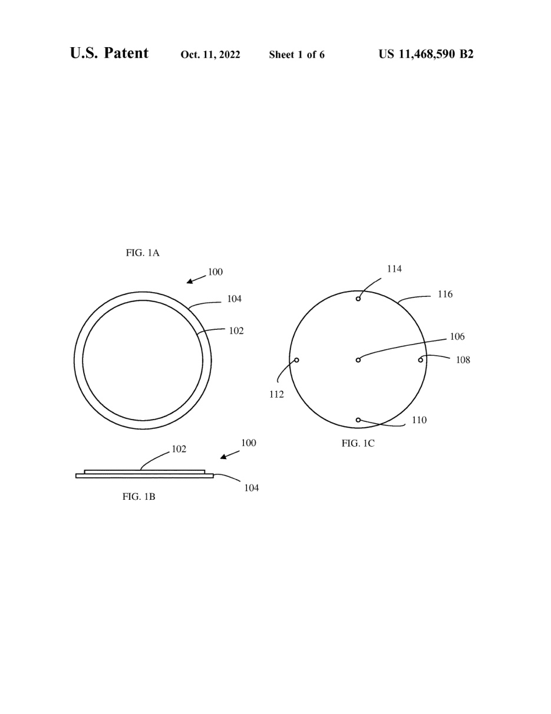
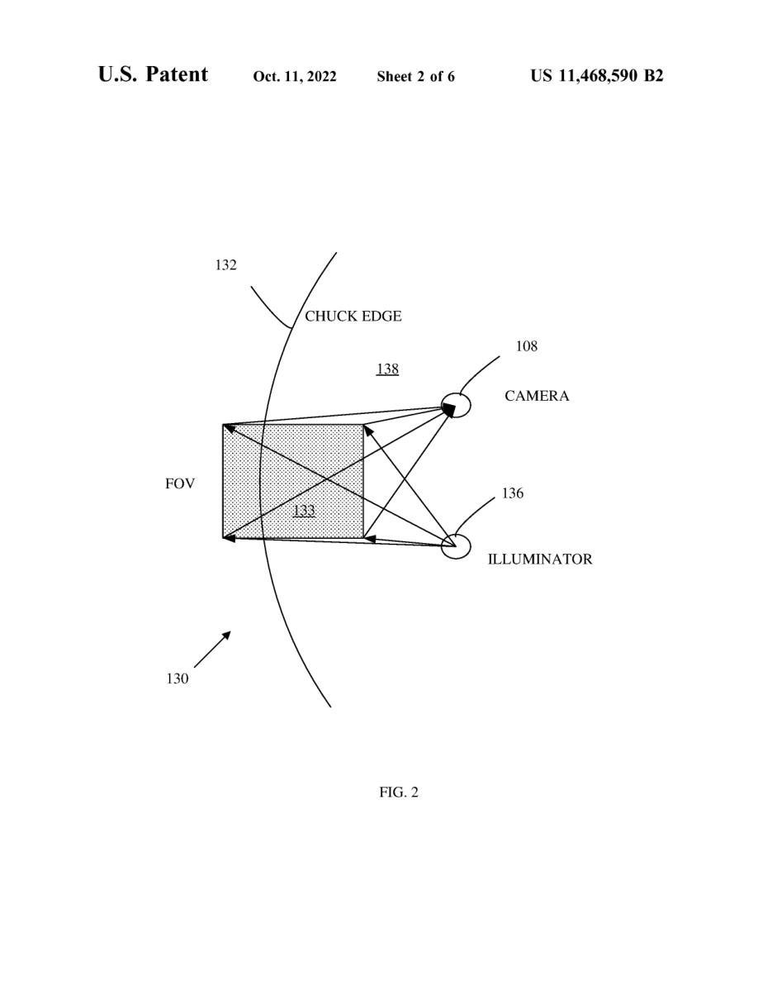
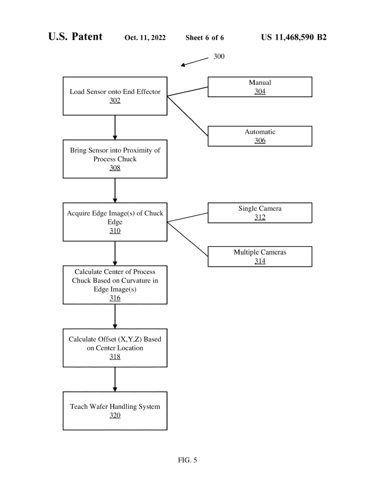

# US11468590B2 전문 번역

원제: Wireless substrate-like teaching sensor for semiconductor processing
(반도체 공정용 무선 기판형 티칭 센서)

원문 파일: `US11468590B2.pdf` (Google Patents 사본, 14쪽, 텍스트 PDF)
번역 범위: 표지 서지, 초록, 배경기술, 요약, 도면의 간단한 설명, 발명을 실시하기 위한 구체적인 내용, 청구항 1~36 전문.
인용문헌 목록은 원문 그대로 둔다.

---

## 표지 서지

- 특허번호: US 11,468,590 B2
- 등록일: 2022년 10월 11일
- 발명자: Ferris J. Chen (대만 타이중), David W. Duquette (미국 미네소타주 미네통카), Robert M. Mark (미국 미네소타주 미네통카)
- 출원인, 양수인: CyberOptics Corporation (미국 미네소타주 골든밸리)
- 출원번호: 16/389,354
- 출원일: 2019년 4월 19일
- 공개공보: US 2019/0325601 A1, 2019년 10월 24일
- 우선권: 미국 가출원 62/661,944, 2018년 4월 24일
- 국제출원: PCT/US2019/028464 (출원일 2019년 4월 22일)
- 주요 IPC, CPC: G06T 7/70, G06T 7/13, G01B 11/14, B25J 9/163, B25J 9/1697, G05B 19/042, G06N 20/00, G06T 7/0004, G06T 7/80, H01L 21/681, H01L 21/68707, H04N 5/247
- 분량: 청구항 36개, 도면 6장
- 심사관: Albert Kir
- 대리인: Christopher R. Christenson, Kelly, Holt & Christenson, PLLC

### 인용문헌 (원문 그대로)

미국 특허: 5,497,007 A (1996-03, Uritsky); 6,553,277 B1 (2003-04, Yagisawa); 7,100,954 B2 (2006-09, Klein et al.); 7,283,255 B2 (2007-10, Ramsey); 8,823,933 B2 (2014-09, Bonciolini et al.); 9,268,739 B2 (2016-02, Akada); 9,934,565 B2 (2018-04, Amanullah); 10,128,140 B2 (2018-11, Lin).

미국 공개공보: 2003/0027494 A1 (Yang); 2003/0202092 A1 (Sadighi et al.); 2006/0000964 A1 (Ye et al.); 2007/0268495 A1 (Rinn); 2007/0268496 A1 (Boesser); 2010/0030347 A1 (Shindo); 2015/0147148 A1 (Coady); 2015/0287625 A1 (Fujimoto); 2017/0264885 A1 (Haugan); 2017/0287703 A1 (Amano); 2019/0033103 A1 (Sugita); 2019/0172742 A1 (Mochizuki); 2020/0124406 A1 (Gorschenew); 2021/0012482 A1 (Yoshida); 2021/0103226 A1 (Murayama); 2021/0351057 A1 (Tamura); 2021/0407844 A1 (Ushiku).

외국 특허: JP 2004276151 A (2004-10); JP 2017207288 A (2017-11); JP 201910728 A (2019-06); KR 20090051423 A (2009-05); KR 20130125158 A (2013-11).

기타 문헌: International Search Report and Written Opinion for International Patent Application No. PCT/US2019/028464, dated Sep. 25, 2019, date of filing: Apr. 22, 2019, 10 pages. Written Opinion dated Jun. 4, 2021 for Singaporean Patent Application No. 11202010495Q, 66 pages. Search Report dated Dec. 6, 2021 for European Patent Application No. 19793158.7, 9 pages. Office Action dated Dec. 14, 2021 for Japanese Patent Application No. 2020-559518, 11 pages, English translation included. Office Action dated Jan. 24, 2022 for Korean Patent Application No. 10-2020-7031063, 14 pages including English translation.

---

## 초록

로봇 기판 취급 시스템에 이송 좌표를 가르치기 위한 무선 기판형 센서를 제공한다. 이 센서는 로봇 기판 취급 시스템이 다루는 기판과 같은 크기, 같은 모양의 베이스부를 포함한다. 베이스부에 전자부 하우징이 결합된다. 하우징 안에는 센서의 부품에 전원을 공급하는 전원 모듈이 있다. 베이스부의 가장자리 근처에 적어도 하나의 가장자리 카메라가 배치된다. 이 가장자리 카메라는 시야 안에 들어온 대상의 정렬 특징을 찍는 시야를 가진다. 하우징 안의 컨트롤러가 가장자리 카메라와 연결된다. 컨트롤러는 가장자리 카메라에서 영상을 받아 정렬 특징의 위치를 구하고, 구한 위치를 로봇 기판 취급 시스템에 전달하도록 구성된다.

---

## 관련 출원과의 상호 참조

본 출원은 2018년 4월 24일에 출원된 미국 가출원 62/661,944에 기초하고 그 이익을 주장하며, 그 내용 전부를 참조로 포함한다.

---

## 배경기술

거의 모든 현대 전자제품은 집적회로를 쓴다. 집적회로는 반도체 공정 시설에서 실리콘 같은 반도체 재료로 만든다. 반도체는 보통 둥글고 얇은 웨이퍼 형태로 공급되고, 웨이퍼 한 장에서 수백에서 수천 개의 집적회로가 나온다.

반도체 공정 시설은 챔버 안의 자재를 자동 로봇으로 다룬다. 웨이퍼는 높은 정확도와 반복정밀도로 공정 위치에 놓여야 한다. 웨이퍼를 보관 위치로 되돌릴 때도 충돌로 부스러기가 생기지 않게 조심해야 한다. 공정 환경은 매우 깨끗해야 한다. 부스러기나 먼지가 수율에 큰 악영향을 주기 때문이다.

반도체 공정용 웨이퍼 취급 시스템은 여러 형태가 있다. 보관 포드에서 웨이퍼를 꺼내고, 공정 스테이션으로 옮기고, 스테이션 사이를 옮기고, 처리가 끝난 웨이퍼를 포드로 되돌리는 일을 한다. 보통 취급 시스템은 로봇 팔과 그 끝에 달린 엔드 이펙터로 이루어진다. 엔드 이펙터는 포드 안으로 들어갈 수 있는 모양과 크기로 만든다. 이송 중에 웨이퍼가 미끄러지거나 틀어지지 않도록 진공 흡착 장치를 두기도 한다.

엔드 이펙터는 정밀하게 위치할 수 있어야 한다. 취급 시스템의 위치 오차는 웨이퍼, 엔드 이펙터, 그 밖의 부품 사이에 뜻하지 않은 접촉을 일으킬 수 있다. 작은 충격이라도 파티클을 떼어내 다른 웨이퍼를 오염시키고, 비싼 폐기로 이어진다.

어떤 공정 단계에서는 웨이퍼 표면 전체에 균일한 결과를 얻기 위해 웨이퍼를 공정 장비에 매우 정확하게 중심 맞춤 해야 한다. 그래서 취급 시스템의 위치 오차를 최소로 줄여야 한다.

반도체 공정 중에 웨이퍼는 보통 "프로세스 척"이라 부르는 받침대로 옮겨져 바르게 놓여야 한다. 프로세스 척은 공정 동안 웨이퍼를 잡아 주는 장치다. 척은 웨이퍼와 같은 크기, 같은 둥근 모양인 경우가 많다. 척에 진공 구멍이 있어서 웨이퍼를 올리면 진공으로 단단히 잡는다. 웨이퍼가 척에 바르게 놓이지 않으면 가장자리 다이가 제대로 처리되지 않는다. 그 다이는 결함이 생기고 수율이 떨어진다. 이온 에칭 같은 일부 공정에서는 척에 공정을 돕는 특수 측벽이 있다. 공정이 성공하려면 웨이퍼가 이 측벽 안에 아주 정확하게 놓여야 한다.

위치 오차를 줄이려면 공정 장비, 웨이퍼 보관과 이송 포드, 또는 둘 다에 있는 알려진 표식에 맞춰 웨이퍼 취급 시스템을 주기적으로 다시 맞추는 것이 좋다. 이것을 보통 웨이퍼 이송 좌표의 "티칭"이라 부른다. 취급 시스템의 좌표계와 반도체 공정 시스템의 좌표계 사이의 차이를 줄이거나 없애는 작업이다.

상용 제품의 하나로 CyberOptics Corporation(미국 미네소타주 골든밸리)이 WaferSense ATS라는 상표로 파는 시스템이 있다. WaferSense ATS(자동 티칭 시스템)는 머신 비전으로 교정된 "눈"을 제공해 웨이퍼 취급 시스템에 이송 좌표를 가르친다. 이 시스템은 웨이퍼와 같은 모양의 센서를 쓴다. 그래서 공정 웨이퍼와 똑같이 다룰 수 있다. 이렇게 하면 공정 챔버를 열지 않고도 센서를 공정 시스템 안에서 움직여 로봇의 주고받기를 잴 수 있다. 공정 챔버를 열고 닫는 일은 몇 시간에서 며칠까지 생산을 멈추는 비싼 작업이다. 웨이퍼형 센서는 프리얼라이너나 로드락처럼 손이 닿기 어려운 자리에도 들어갈 수 있다. WaferSense ATS 센서는 척 중앙의 구멍 같은 원형 표적 특징을 알아보도록 학습되어 있고, 머신 비전과 내장 신호 처리로 센서의 교정된 기하 중심에서 표적 특징 중심까지의 X, Y, Z 오프셋을 잰다. ATS 센서 덕분에 장비 사용자는 챔버를 열지 않고 유지보수 시간을 아낄 수 있고, 정확한 로봇 티칭으로 웨이퍼가 프로세스 척 중앙에 바르게 이송된다.

그러나 현재의 ATS 센서는 ATS가 웨이퍼와 척의 편차를 계산할 수 있도록 척 중앙에 둥근 표적이 있어야 한다. 또 로봇 블레이드나 엔드 이펙터에도 ATS 센서의 카메라가 척의 둥근 모양을 볼 수 있도록 막히지 않은 개구부나 구멍이 있어야 한다. 그런데 반도체 공정 장비의 상당수(약 70퍼센트 넘게)는 프로세스 척에 둥근 표적이 없거나, 엔드 이펙터에 필요한 중앙 개구부가 없다. 이런 경우에 현재의 ATS 센서는 쓸 수 있는 범위가 좁고, 웨이퍼 이송 좌표 티칭에 맞지 않을 수 있다.

따라서 프로세스 척의 중앙 구멍이나 엔드 이펙터의 중앙 개구부 없이도 티칭을 해낼 수 있는 자동 티칭 센서가 있으면 좋다. 그런 센서라면 자동 웨이퍼 이송 좌표 티칭의 이점을 더 많은 현장에 가져갈 수 있다.

---

## 요약

로봇 기판 취급 시스템에 이송 좌표를 가르치는 무선 기판형 센서를 제공한다. 센서는 취급 시스템이 다루는 기판과 같은 크기, 같은 모양의 베이스부를 포함한다. 베이스부에 전자부 하우징이 결합된다. 하우징 안의 전원 모듈이 센서 부품에 전원을 준다. 무선 기판형 센서의 베이스부 가장자리 근처에 적어도 하나의 가장자리 카메라가 있다. 이 카메라는 대상의 정렬 특징을 시야 안에 담는다. 하우징 안의 컨트롤러가 가장자리 카메라와 연결된다. 컨트롤러는 가장자리 카메라에서 영상을 받아 정렬 특징의 위치를 구하고, 그 위치를 로봇 기판 취급 시스템에 전달하도록 구성된다.

---

## 도면의 간단한 설명

위 그림은 원문 도면 1장(도 1A, 도 1B, 도 1C)이다. 도 1A는 센서를 위에서 본 모습, 도 1B는 옆에서 본 모습, 도 1C는 아래에서 본 모습이다. 도 1C에 중앙 카메라 106과 가장자리 카메라 108, 110, 112, 114가 보인다.

- 도 1A부터 도 1C: 본 발명의 한 실시예에 따른, 프로세스 척 가장자리 검출 기능을 갖춘 기판형 센서의 개념도.
- 도 2: 개선된 센서의 가장자리 카메라가 자신의 시야(FOV) 안에서 척 가장자리의 일부를 찍는 모습과, 그 시야가 점광원으로 조명되는 모습의 개념도.
- 도 3: 카메라가 찍을 수 있는 구조광의 예를 보여 주는 개념도. 찍은 영상은 센서가 처리해 거리를 정확히 구한다.
- 도 4A와 도 4B: 본 발명의 실시예들에 따른 무선 웨이퍼 모양 티칭 센서의 개념도.
- 도 5: 본 발명의 한 실시예에 따른, 웨이퍼 취급 로봇을 학습시키는 방법의 흐름도.

---

## 발명을 실시하기 위한 구체적인 내용

알려진 반도체 공정 장비용 자동 티칭 시스템은 보통 중앙에 놓인 카메라 하나를 쓴다. 이 카메라는 프로세스 척(웨이퍼 받침대) 위의 중앙에 있는 둥근 물체 하나를 찾는다. 카메라는 센서 몸체에 거의 완전히 수직으로 아래를 본다. 비교적 간단한 처리로 영상에서 둥근 물체를 찾고 그 중심을 교정된 센서 중심과 비교한다. 조명은 카메라 시야를 둘러싼 링 라이트가 준다.

여기서 설명하는 실시예들에서는, 센서 바깥 가장자리 근처에 카메라를 여러 개 둔 반도체 공정 장비용 자동 티칭 무선 기판형 센서를 제공한다. 새 시스템과 방법은 센서 가장자리 근처의 카메라 한 개 이상으로 프로세스 척의 물리적 가장자리를 보고, 센서 기준으로 그 위치나 곡률을 잰다. 척 가장자리 대신, 또는 척 가장자리에 더해, 가장자리 카메라에 보이는 정렬 마크를 쓸 수도 있다. 이 카메라들은 중앙 카메라 없이 쓸 수도 있고, 중앙 카메라를 보완하는 데 쓸 수도 있다.

이 가장자리 보기 카메라의 시선은 꽤 큰 시야각을 감당해야 한다. 센서와 거의 같은 지름인 프로세스 척의 가장자리를 봐야 하기 때문이다. 이렇게 보는 각도가 크면 가로 위치(X, Y)와 카메라에서 척까지의 거리(Z, 레인지)가 강하게 묶인다. 그래서 정확한 XY를 보고하려면 Z(거리)를 정확히 아는 것이 중요하다. 한 실시예에서 Z 거리 측정은 구조광으로 한다. 그러므로 각 가장자리 카메라는 어떤 구조광을 내는 조명기와 짝을 이루고 함께 교정되어야 한다. 이 구조광과 카메라, 조명기의 교정 덕분에 척 가장자리까지의 거리를 정확히 구할 수 있고, 거리가 조금 변해서 생기는 가로 이동을 보정할 수 있다. 또 가장자리 카메라가 있는 자리에서 무선 기판형 센서와 프로세스 척 표면 사이의 정확한 Z(간격)를 계산해 보고할 수도 있다. 다른 실시예에서는 카메라에서 척까지의 거리를 구하는 다른 방법을 쓸 수 있다. Z를 얻는 또 다른 방법의 예로는 초음파 거리 측정이나 비행시간(time-of-flight) 측정이 있다.

또한 카메라 시야들은, 각 시야의 위치를 다른 모든 시야와, 그리고 센서의 단일 전체 좌표계와 정확히 연결하도록 교정되어야 한다. 중앙 카메라의 시야 같은 한 카메라의 시야를 단일 전체 좌표계를 정의하는 데 쓸 수 있다. 또는 센서 바깥 가장자리, 정렬 노치, 정렬 구멍 같은 센서의 물리적 특징으로 단일 전체 좌표계를 정의할 수도 있다.

여기서 설명하는 실시예들은 대체로 기판형 센서에 카메라를 여러 개 두어 프로세스 척의 기하학적 특징(예: 가장자리)을 찍는다. 따라서 중앙의 원형 표식만 쓰는 대신, 프로세스 척 가장자리나 가장자리 근처의 다른 정렬 표시를 검출해서 엔드 이펙터와 프로세스 척을 맞출 수 있다. 무선 기판형 센서는 처리할 웨이퍼와 비슷한 모양, 비슷한 크기다. 또한 여러 카메라의 시야 안에 있는 다른 정렬 특징들을 기준으로 삼아, 시스템이 X와 Y 거리를, 그리고 선택적으로 Z 거리와 각도 방향을 자동으로 계산해 엔드 이펙터를 다시 중심 맞춤하고 다시 정렬할 수 있다.

도 1A부터 도 1C는 한 실시예에 따른, 척 가장자리 검출을 개선한 무선 기판형 센서의 개념도다. 도 1A는 위에서 본 모습, 도 1B는 옆에서 본 모습, 도 1C는 아래에서 본 모습이다.

도 1A와 도 1C는 원형 모양의 무선 기판형 센서 100을 보여 준다. 센서에는 전자부를 담은 원형 돌출부 102가 있다(도 4에서 자세히 설명한다). 본 발명의 실시예는 대체로 기판형 센서가 (둥근 웨이퍼와 비슷한) 원형인 경우로 설명하지만, 다른 모양도 쓸 수 있음을 분명히 한다. 기판형이라는 점에서 중요한 것은, 센서 100이 기판이 처리될 때와 똑같은 방식으로 공정 환경 안을 움직일 수 있다는 점이다. 그러므로 레티클 공정 시설에서는 기판형 센서를 직사각형으로 만들 수 있다. 도 1A와 도 1C의 실시예에서 센서 100은 처리되는 웨이퍼와 지름이 같은 베이스부를 포함하는 것이 좋다. 한 예로, 300 mm 지름 웨이퍼를 처리하는 시스템에서는 바깥 지름이 300 mm다. 다른 실시예에서는 200 mm 웨이퍼를 처리하는 시스템을 위해 베이스부 104의 지름이 200 mm다. 베이스부 104는 탄소섬유나 화학 강화 유리(예: Dow Corning의 Gorilla Glass)처럼 비교적 단단한 재료로 만드는 것이 좋다.

도 1C는 중앙 카메라 106과 함께, 센서 100의 바깥 가장자리 116 근처에 놓인 추가 카메라 108, 110, 112, 114를 보여 준다. 센서 100에는 구조광 조명원도 하나 이상 있다(도 2 참조). 카메라 108, 110, 112, 114마다 구조광 조명기를 하나씩 두는 것이 좋다. 도 1C의 실시예에서 카메라 108, 110, 112, 114는 센서 100의 가장자리 116 근처에 약 90도 간격으로 놓인다. 그러나 이 분야 종사자라면 실시예에 따라 바깥 카메라를 더 많이 또는 더 적게 쓸 수 있음을 알 것이다. 또 바깥 가장자리 카메라 108, 110, 112, 114가 서로 고르게 떨어져 있지만, 카메라 사이 간격이 같지 않은 실시예도 가능하다.

도 2는 무선 기판형 센서의 가장자리 카메라, 예를 들어 카메라 108이, 자신의 시야(FOV) 134 안에서 프로세스 척 가장자리 132의 일부 130을 찍는 모습의 개념도다. 시야 134는 구조광 조명기 136(점광원으로 간단히 표시)으로 조명된다. 이 그림은 카메라와 조명기가 짝을 이룬다는 것을 보여 주려는 것이다. 위에서 말한 대로, 카메라와 조명기를 짝지으면 카메라 교정이 쉬워지고, 프로세스 척 138의 가장자리 132까지의 거리를 정확히 구할 수 있다. 카메라 108은 시야의 쓸 만한 영상을 얻을 수 있는 어떤 장치든 될 수 있다. 카메라 108은 흑백 카메라일 수도 있고 컬러 카메라일 수도 있다. 보통 카메라 108과 카메라 110, 112, 114는 CCD나 CMOS 같은 면 배열 소자다. 이 카메라들은 카메라 안의 배열에 상을 맺게 하는 적절한 광학계를 포함하거나 거기에 연결될 수 있다(따로 표시하지 않음).

도 3은 거리를 정확히 구하도록 교정해 쓸 수 있는 아주 간단한 구조광의 예를 보여 주는 개념도다. 도 3에서 구조광은 점 하나 형태다. 교정을 통해 점 140의 크기와 기준 위치를 센서 컨트롤러(도 4 참조)가 알고 있다. 카메라 108 같은 카메라가 점 140의 영상을 얻으면, 영상 속 점 140의 겉보기 크기와 위치를 알려진 교정 정보와 견주어 카메라와 조명기 짝이 정확한 거리(대상까지의 거리)를 구할 수 있다. 카메라 영상 속 구조광의 위치는 높이에 대해 교정되어 있어서, 영상에서 관측한 위치를 처리해 정확한 Z 측정값을 낼 수 있다. 도 3은 간단한 예다. 이 분야 종사자라면 구조광 무늬가 여러 형태일 수 있음을 알 것이다. 예를 들면 점 하나, 점 여러 개, 십자, 원, 여러 줄의 선, 사인파로 변하는 무늬, 마름모, 체커보드가 있다.

도 4A는 본 발명의 한 실시예에 따른 무선 웨이퍼 모양 티칭 센서의 개념도다. 도 4A는 원형 돌출부 102 안의 회로를 보여 준다. 그림처럼 전원 모듈 200은 센서 100이 반도체 공정 시설 안을 움직이는 동안 전원을 공급하기 위해 배터리 202를 포함하는 것이 좋다. 배터리 202는 충전식 배터리가 좋다. 전원 모듈 200은 화살표 204("To All")가 가리키듯 센서 100의 다른 부품들에 필요한 전원을 준다. 한 예로 전원 모듈 200은 Texas Instruments의 TPS5602라는 전원 관리 집적회로를 포함할 수 있다.

컨트롤러 206은 전원 모듈 200에 연결되어 전원을 받는다. 컨트롤러 206은 하드웨어, 소프트웨어, 또는 둘의 조합으로, 연결된 카메라에서 영상 데이터를 얻는 명령을 실행하도록 구성된다. 컨트롤러 206은 통신 회로 207을 써서 센서 웨이퍼 밖의 수신 장비로 영상을 보내고, 거기서 저장하거나 처리하게 할 수도 있다. 바람직한 실시예에서 센서 컨트롤러는 영상에서 기준 위치(예: 프로세스 척의 가장자리 부분)를 나타내는 특징을 찾는 처리를 실행하고, 그 기준 위치들과 저장된 교정 정보를 바탕으로 기준 위치(즉 프로세스 척의 중심)를 계산한다. 나아가 컨트롤러 206은 통신 회로 207을 써서 기준 위치를 나타내는 정보를 로봇 취급 시스템이나 다른 적절한 장치로 보내, 그 기준 위치를 로봇 취급 시스템에 가르치도록 구성된다. 한 예로 컨트롤러는 Texas Instruments의 TMS320C6211 같은 마이크로프로세서다. 컨트롤러 206은 메모리 208에 연결되거나 메모리 208을 포함한다. 메모리는 어떤 종류든 될 수 있다. 다만 메모리 208은 적어도 16Mx16 크기의 SDRAM 모듈을 포함하는 것이 좋다. 메모리 208은 256Kx8 크기의 플래시 메모리도 포함하는 것이 좋다. 플래시 메모리는 프로그램, 교정 데이터처럼 바뀌지 않는 비휘발성 데이터를 저장하는 데 쓸모 있다. 랜덤 액세스 메모리는 얻은 영상이나 프로그램 동작에 관련된 휘발성 데이터를 저장하는 데 쓸모 있다. 메모리 208에는 컨트롤러 206이 실행하면 여기서 설명한 기능을 수행하는 명령이 들어 있다.

조명 모듈 210은 컨트롤러 206과 구조광 조명기 212, 214, 216, 218에 연결된다. 각 구조광 조명기 212, 214, 216, 218은 베이스부 104 아래쪽에서 각각의 카메라 108, 110, 112, 114 근처에 놓이는 것이 좋다. 구조광 조명기는 도 3처럼 특정한 구조를 가진 조명을 만들어, 카메라와 조명기 짝마다 거리 교정을 할 수 있게 한다. 구조광 조명기는 카메라 시야에 충분한 단색광이나 다색광을 보내 쓸 만한 영상이 찍히게 한다. 구조광 조명기는 LED, 레이저 다이오드, 그 밖의 적절한 소자로 만들 수 있다.

도 4A처럼 컨트롤러 206은 카메라 220, 222, 224 전부에 연결된다. 카메라 220은 종래 기술에서 쓰던 것과 비슷한 중앙 카메라일 수 있다. 또 카메라 220이 프로세스 척의 중앙 구멍을 막힘없이 볼 수 있는 환경이라면, 컨트롤러 200은 종래 기법으로 좌표 티칭을 할 수 있다. 컨트롤러 200은 본 발명의 실시예에 따른 좌표 티칭을 하기 위해 여러 가장자리 카메라 222, 224에도 연결된다. 도 4에서 카메라 224를 "Camera(n)"이라고 적은 것은 가장자리 카메라 222, 224를 몇 개든 쓸 수 있다는 뜻이다. 또 컨트롤러 200은 하드웨어, 소프트웨어, 또는 둘의 조합으로, 카메라 220의 시야가 막혀 있는지, 또는 프로세스 척에 중앙 구멍이나 중앙 특징이 없는지 판단하고, 그런 경우 자동으로 가장자리 카메라를 써서 프로세스 척의 중심을 계산하도록 구성될 수 있다.

통신 회로 207은 컨트롤러 206에 연결되어, 반도체 공정 환경 안에서 동작하는 동안 컨트롤러 206이 통신할 수 있게 한다. 양방향 통신이 바람직하다. 통신 회로 207은 어떤 무선 통신 규약이나 주파수든 쓸 수 있다. 한 예로 통신 회로는 널리 알려진 블루투스 표준(Bluetooth Core Specification Version 1.1, 2001년 2월 22일, Bluetooth SIG, www.bluetooth.com)에 따라 약 2.4 GHz에서 동작한다. 회로 207의 한 예는 Mitsumi의 WML-C11이다.

더 높은 정확도와 정밀도를 얻기 위해, 여기서 설명하는 실시예들은 대체로 가장자리 카메라와 조명기 짝마다 교정을 해서, 프로세스 척 가장자리까지의 거리를 정확히 구하고 거리 변화로 생기는 가로 이동을 보정하는 데 쓴다. 한 실시예에 따르면, 센서를 거리가 알려진 정밀 지그나 교정 치구에 놓는다. 적어도 하나의 가장자리 카메라가 알려진 거리 한 개 이상에서 영상을 한 장 이상 찍게 한다. 그러면 컨트롤러 206이 그 영상을 처리해, 영상 속 구조광의 겉모습을 알려진 거리와 연결한다. 이 교정 방법은 티칭할 때 영상 속 구조광의 겉모습에서 거리를 재는 데 쓰는 교정 정보를 만든다. 교정 정보는 룩업 테이블 형태일 수도 있고, 교정 정보를 함수로 나타낸 계수 형태일 수도 있다. 컨트롤러가 교정 정보를 쓸 때는 저장된 교정점 사이를 내삽하거나, 저장된 범위 밖으로 외삽할 수도 있다. 또한 센서는 환경 변화에 민감할 수 있으므로, 교정 정보는 온도, 습도, 압력, 그 밖의 환경 변수를 함께 잰 값에 의존할 수도 있다.

도 4B는 본 발명의 다른 실시예에 따른 무선 웨이퍼 모양 티칭 센서의 개념도다. 도 4B의 실시예는 도 4A의 실시예와 많이 닮았고 같은 부품에는 비슷한 번호를 붙였다. 두 실시예의 주된 차이는, 도 4B에서는 구조광 조명기 대신 거리 측정 장치 412, 414, 416, 418을 쓸 수 있다는 점이다. 이 거리 장치들은 무선 기판형 센서에서 대상이나 프로세스 척까지의 거리를 구하는 어떤 기법이든 쓸 수 있다. 바람직한 실시예에서 거리 장치 412, 414, 416, 418은 컨트롤러 206에 연결된 거리 장치 회로 410이 구동하거나 제어한다. 도 4B는 거리 장치를 여러 개 쓰는 모습이지만, 무선 기판형 센서에 장착되어 컨트롤러에 연결된 기울기(tilt, tip) 센서 420과 거리 장치 하나를 함께 써서 센서의 기울기를 알려 주는 실시예도 분명히 가능하다. 이런 기울기 센서는 위에서 말한 구조광 조명기 하나와 함께 쓸 수도 있다.

도 5는 본 발명의 한 실시예에 따라 웨이퍼 취급 로봇을 티칭하는 방법의 흐름도다. 방법 300은 블록 302에서 시작한다. 여기서 센서를 반도체 취급 로봇의 엔드 이펙터에 올린다. 이것은 기술자가 센서를 엔드 이펙터에 올려놓는 수동 방식 304일 수도 있고, 반도체 취급 로봇이 베이스 스테이션이나 웨이퍼 카세트, 포드 안의 알려진 센서 보관 위치에서 센서를 꺼내게 하는 자동 방식 306일 수도 있다. 다음 블록 308에서 취급 로봇이 센서를 이송 위치 가까이로 가져간다. 여기서 이송 위치란, 반도체 공정 시설에서 웨이퍼나 레티클 같은 반도체 기판이 로봇 엔드 이펙터를 떠나거나, 엔드 이펙터에 집히거나 물리는 모든 자리를 말한다. 따라서 프로세스 척도 그런 이송 위치의 하나다.

블록 310에서 센서는 이송 위치의 가장자리 영상을 적어도 한 장 얻는다. 한 예에서 이송 위치는 둥근 프로세스 척이다. 블록 312처럼, 프로세스 척의 가장자리를 담는 시야를 가진 카메라 한 대로도 본 발명을 실시할 수 있다고 본다. 예를 들어 얻은 영상에서 컨트롤러 206 같은 영상 처리기가 휜 바깥 가장자리를 찾아낸다. 그 휜 가장자리를 원에 맞추고, 맞춘 원에서 중심을 찾는다. 따라서 센서가 프로세스 척의 중앙을 볼 수 없더라도, 또는 중앙에 구멍 같은 기준 특징이 없더라도, 여기서 설명한 실시예들은 반도체 취급 시스템에 웨이퍼 이송 좌표의 자동 티칭을 해 줄 수 있다. 가장자리 카메라 한 대로도 실시할 수 있다고 보지만, 블록 314와 도 1C처럼 카메라를 여러 대 쓰면 더 높은 정확도를 얻을 수 있다고 본다.

다음 블록 316에서 컨트롤러 206 같은 컨트롤러가 프로세스 척의 휜 가장자리 영상 한 장 이상을 써서 척의 중심 위치를 계산한다. 중심 계산은 어떤 방법으로든 할 수 있다. 각 카메라 영상에서 찾은 원형 가장자리 호들을 합친 다음, 컨트롤러 206에 저장된 방법으로 하나의 원에 수학적으로 맞출 수 있다. 또는 카메라마다 자기 가장자리 호를 자기 원에 맞추고, 각 카메라에서 나온 원의 중심들을 적절히 합쳐 하나의 중심 결과를 얻을 수도 있다. 가장자리 카메라를 더 붙이면 센서의 정확도가 더 좋아진다. 마지막으로 블록 320에서 센서는 계산한 중심 좌표를 취급 시스템에 주어 이송 위치를 가르친다. 이 일은 통신 회로 207을 쓴 무선 통신으로 하는 것이 좋다.

이 분야 종사자라면 본 발명의 정신과 범위를 벗어나지 않고 여러 변형을 할 수 있음을 알 것이다. 변형의 예로는 구조광을 사인파나 반복 마름모 같은 여러 형태로 주는 것이 있다. Z 거리는 위에서 자세히 설명한 구조광으로 광학적으로 구할 수도 있고, 초음파나 정전용량 거리 측정 같은 다른 수단으로 구할 수도 있다. 또 한 점에서 여러 수단으로 거리를 재는 것과 척과 센서의 상대 기울기를 정확히 구하는 것을 합칠 수도 있다. 또한 카메라 여러 대를 조명원 하나에 묶을 수도 있고, 조명원 여러 개를 카메라 한 대에 묶을 수도 있다. 조명기 하나 또는 둘의 빛은 단일 파장일 수도 있고 여러 파장일 수도 있다. 마찬가지로 카메라는 컬러 영상이나 흑백 영상을 찍고 기록하는 데 쓸 수 있다. 원하는 XY 위치 결과를 얻는 데 영상 한 장을 쓸 수도 있고 여러 장을 쓸 수도 있다. 끝으로 높이(Z) 값은 정확한 X와 Y를 구하는 것과 별개의 목적에 쓸 수도 있다.

본 발명을 바람직한 실시예로 설명했지만, 이 분야 종사자라면 본 발명의 정신과 범위를 벗어나지 않고 형태와 세부에서 변경을 할 수 있음을 알 것이다.

---

## 청구항

1. 로봇 기판 취급 시스템에 이송 좌표를 가르치기 위한 무선 기판형 센서로서, 다음을 포함한다.
   - 로봇 기판 취급 시스템이 다루는 기판과 같은 크기, 같은 모양의 베이스부
   - 베이스부에 결합된 전자부 하우징
   - 하우징 안에 배치되어 센서 부품에 전원을 공급하도록 구성된 전원 모듈
   - 베이스부의 가장자리 근처에 배치된 적어도 하나의 가장자리 카메라로서, 기판을 받도록 구성된 프로세스 척의 가장자리를 자신의 시야 안에 담고, 영상 속 가로(X, Y) 위치를 거리(Z)와 묶는 시야각을 가지는 카메라
   - 베이스부에 대해 장착되고 컨트롤러에 작동 가능하게 연결되어, 무선 기판형 센서와 프로세스 척 사이의 거리를 알려 주는 거리 장치
   - 하우징 안에 배치되어 가장자리 카메라와 거리 장치에 연결된 컨트롤러로서, 가장자리 카메라에서 영상을 얻고, 프로세스 척 가장자리의 영상 적어도 한 장과 거리 값에 근거해 프로세스 척의 위치를 구하도록 구성되며, 그 영상과 프로세스 척까지의 거리(Z) 값에 근거해 거리 보정된 (X, Y) 위치를 구하고, 거리 보정된 프로세스 척 위치를 로봇 기판 취급 시스템에 보내 구한 위치를 가르치도록 구성된 컨트롤러

2. 청구항 1에 있어서, 베이스부의 중앙 영역에 배치되어 무선 기판형 센서 아래에 있는 대상의 중앙 부분을 찍도록 구성된 추가 카메라를 더 포함하는 센서.

3. 청구항 1에 있어서, 상기 가장자리가 둥근 가장자리인 센서.

4. 청구항 1에 있어서, 컨트롤러에 작동 가능하게 연결되어 무선 기판형 센서의 기울기(tip, tilt)를 재는 기울기 센서를 더 포함하는 센서.

5. 청구항 4에 있어서, 컨트롤러가 거리 값과 기울기 측정값을 써서 카메라 영상으로부터 XY 좌표를 바르게 보고하도록 구성된 센서.

6. 청구항 1에 있어서, 상기 적어도 하나의 가장자리 카메라가 네 대의 가장자리 카메라를 포함하고, 각각 베이스부 가장자리 가까이에 배치된 센서.

7. 청구항 1에 있어서, 베이스부에 대해 가장자리 카메라 가까이에 장착되어 그 카메라의 시야에 구조광을 만들도록 구성된 구조광 조명기를 더 포함하는 센서.

8. 청구항 7에 있어서, 무선 기판형 센서가 적어도 네 대의 가장자리 카메라와, 각 가장자리 카메라 가까이에 배치된 구조광 조명기를 포함하는 센서.

9. 청구항 7에 있어서, 구조광이 점, 원, 더하기 기호, 여러 줄의 평행선, X 방향과 Y 방향 중 적어도 한 방향으로 사인파처럼 변하는 밝기 무늬, 마름모 모양, 체커보드로 이루어진 군에서 선택된 형태인 센서.

10. 청구항 7에 있어서, 구조광이 겉보기 거리를 교정하는 작업을 할 수 있도록 구성된 센서.

11. 청구항 10에 있어서, 컨트롤러가 가장자리 카메라와 구조광 조명기의 각 짝에 대해 교정 작업을 수행하도록 구성된 센서.

12. 청구항 10에 있어서, 컨트롤러가 저장된 교정 정보를 써서 카메라 영상 속 구조광의 겉모습으로부터 거리를 정확히 계산하도록 구성된 센서.

13. 청구항 1에 있어서, 컨트롤러가 측정한 거리를 써서 카메라 영상으로부터 XY 좌표를 바르게 보고하도록 구성된 센서.

14. 청구항 1에 있어서, 컨트롤러가 센서 베이스 중앙 가까이의 카메라로 프로세스 척의 중앙 구멍을 찍어 보려 시도하고, 그 시도가 실패하면 선택적으로 가장자리 카메라를 쓰도록 구성된 센서.

15. 청구항 1에 있어서, 가장자리 카메라가 흑백 카메라인 센서.

16. 청구항 1에 있어서, 가장자리 카메라가 컬러 카메라인 센서.

17. 청구항 1에 있어서, 센서가 반도체 웨이퍼와 실질적으로 비슷한 형태인 센서.

18. 청구항 1에 있어서, 센서가 반도체 공정용 레티클과 실질적으로 비슷한 형태인 센서.

19. 반도체 공정 장비의 로봇 조작기가 잡은 센서를 기준으로 그 장비의 프로세스 척 위치를 재는 방법으로서, 다음을 포함한다.
   - 적어도 하나의 가장자리 검출 카메라와 거리 센서를 가진 센서를 제공하되, 그 가장자리 카메라는 영상 속 가로(X, Y) 위치를 거리(Z)와 묶는 시야각을 가진다
   - 가장자리 검출 카메라가 프로세스 척의 둥근 바깥면 영상을 적어도 한 장 얻게 한다
   - 거리 센서가 프로세스 척까지의 거리를 재게 한다
   - 프로세스 척 둥근 바깥면의 영상 적어도 한 장과 잰 거리(Z)를 분석해, 프로세스 척 중심의 거리 보정된 (X, Y) 위치를 계산한다
   - 계산한 거리 보정된 (X, Y) 위치를 로봇 조작기의 컨트롤러에 전달한다

20. 청구항 19에 있어서, 각 가장자리 카메라마다 구조광 조명기를 두고, 그 구조광으로 카메라와 조명기 짝마다 거리를 교정하는 것을 더 포함하는 방법.

21. 청구항 20에 있어서, 교정된 센서로 프로세스 척 둥근 바깥면의 후속 영상을 적어도 한 장 더 얻는 것을 포함하는 방법.

22. 청구항 19에 있어서, 저장된 교정 정보를 써서 가로(XY) 거리와 거리(Z)를 계산하는 것을 더 포함하는 방법.

23. 청구항 19에 있어서, 계산한 위치를 전달하는 것이 계산 위치를 나타내는 무선 데이터를 로봇 조작기의 컨트롤러로 보내는 것을 포함하는 방법.

24. 청구항 19에 있어서, 가장자리 검출 카메라가 네 대이고, 척 위치 계산이 각 가장자리 검출 카메라의 영상 적어도 한 장씩을 분석하는 것을 포함하는 방법.

25. 반도체 공정 장비의 로봇 조작기가 잡은 센서를 기준으로 그 장비 안의 프로세스 척 위치를 재는 방법으로서, 다음을 포함한다.
   - 적어도 하나의 가장자리 검출 카메라와 거리 센서를 가진 센서를 제공하되, 그 가장자리 카메라는 영상 속 가로(X, Y) 위치를 거리(Z)와 묶는 시야각을 가진다
   - 가장자리 검출 카메라가 자신의 시야 안에 있는 프로세스 척의 정렬 마크 영상을 적어도 한 장 얻게 한다
   - 거리 센서가 프로세스 척까지의 거리를 재게 한다
   - 정렬 마크 영상 적어도 한 장과 잰 거리(Z)를 분석해, 프로세스 척 정렬 마크의 거리 보정된 (X, Y) 위치를 계산한다
   - 계산한 거리 보정된 (X, Y) 위치를 로봇 조작기의 컨트롤러에 전달한다

26. 청구항 25에 있어서, 각 가장자리 카메라마다 구조광 조명기를 두고, 구조광으로 카메라와 조명기 짝마다 거리를 교정하는 것을 더 포함하는 방법.

27. 청구항 26에 있어서, 교정된 센서로 프로세스 척 가장자리의 후속 영상을 적어도 한 장 더 얻는 것을 포함하는 방법.

28. 청구항 25에 있어서, 저장된 교정 정보를 써서 가로(XY) 거리와 거리(Z)를 계산하는 것을 더 포함하는 방법.

29. 청구항 25에 있어서, 계산한 위치를 전달하는 것이 계산 위치를 나타내는 무선 데이터를 로봇 조작기의 컨트롤러로 보내는 것을 포함하는 방법.

30. 청구항 25에 있어서, 가장자리 검출 카메라가 네 대이고, 정렬 마크 위치 계산이 각 가장자리 검출 카메라의 영상 적어도 한 장씩을 분석하는 것을 포함하는 방법.

31. 청구항 1에 있어서, 가장자리 카메라가 베이스부의 아래쪽 면에 배치된 센서.

32. 청구항 1에 있어서, 거리 장치가 베이스부의 아래쪽 면에 배치된 센서.

33. 청구항 7에 있어서, 구조광 조명기가 베이스부의 아래쪽 면에 배치된 센서.

34. 청구항 19에 있어서, 센서를 제공하는 것이, 로봇 조작기로 센서를 프로세스 척 위 어떤 높이에 놓아 척 둥근 바깥면의 영상을 얻게 하는 것을 포함하는 방법.

35. 청구항 19에 있어서, 로봇 조작기가 잡은 센서가 기울기 센서를 더 포함하고, 그 기울기 센서의 신호를 적어도 일부 써서 프로세스 척 중심의 위치를 계산하는 방법.

36. 청구항 25에 있어서, 로봇 조작기가 잡은 센서가 기울기 센서를 더 포함하고, 그 기울기 센서의 신호를 적어도 일부 써서 프로세스 척 중심의 위치를 계산하는 방법.
