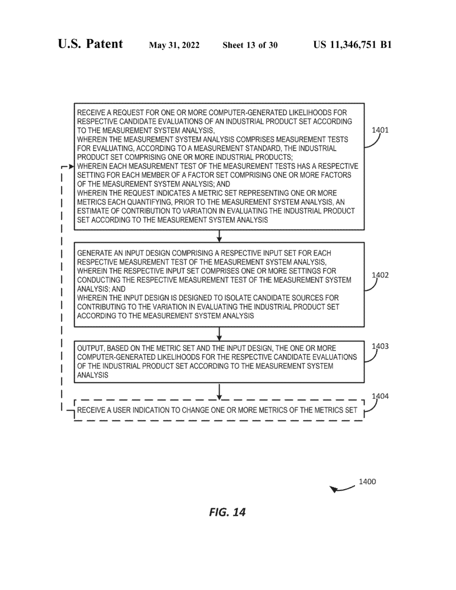
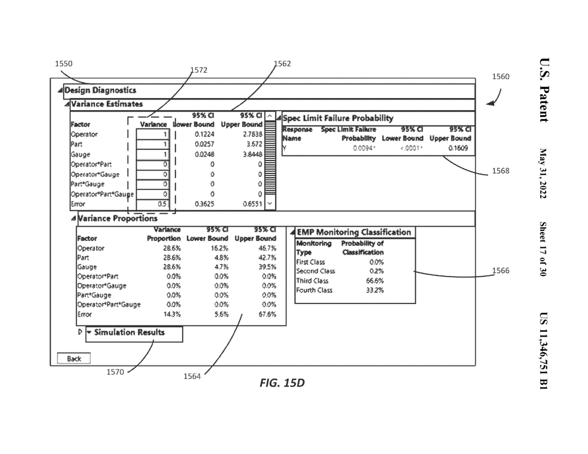
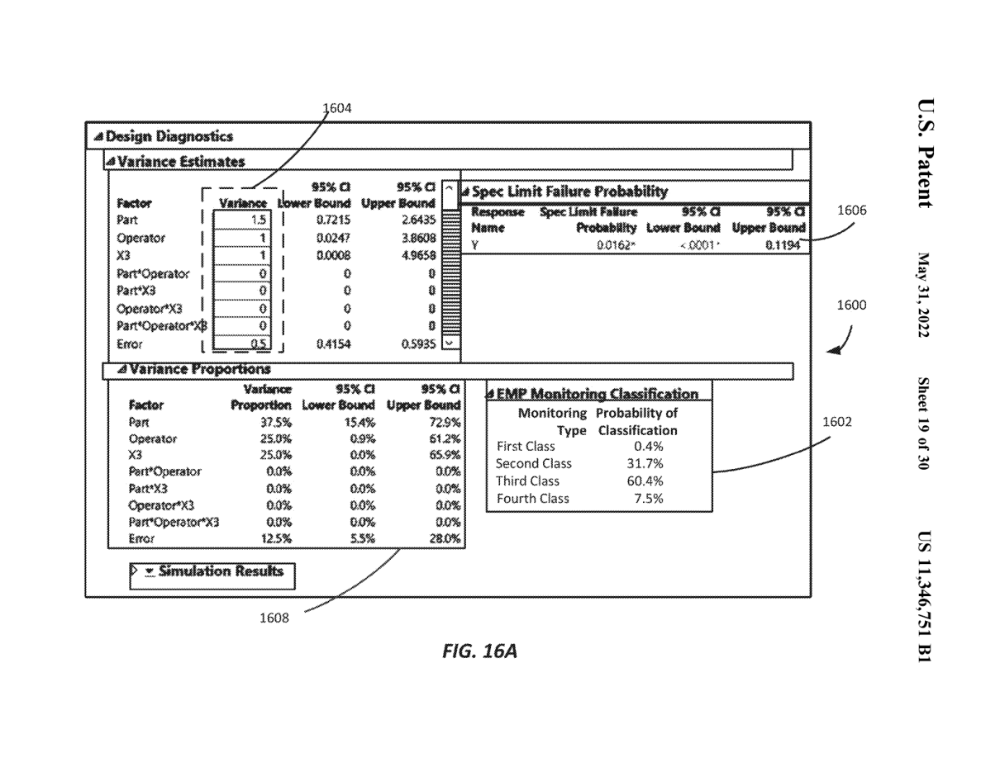

# 측정 시스템 분석용 설계를 평가하는 대화형 진단 (US11346751B1)

- 원제: Interactive diagnostics for evaluating designs for measurement systems analysis
- 원문: 같은 폴더의 `US11346751.pdf` (등록 공보, 2022-05-31, 61쪽, 도면 30장)
- 번역 범위: 표지 서지, 초록, 도면의 간단한 설명, 상세한 설명, 표 1, 표 2, 청구항 28항 전부.
  - 도 1부터 도 12까지는 출원인의 범용 전산 환경 설명이다(데이터 전송망, 통신 그리드, 이벤트 스트림 처리, 기계학습 일반). 이 부분은 발명의 내용이 아니라 출원인 공통 명세이므로 절마다 요지만 옮기고, 그 사실을 본문에 표시했다.
  - 도 13부터 도 19까지가 이 발명의 내용이다. 이 부분은 전문을 옮겼다.
  - 인용 문헌은 원문 그대로 둔다.
- 번역 기준: 2026-11-04에 Google Patents 본문(US11346751B1)과 등록 공보 PDF를 대조해 옮겼다. 원문 오기는 고치지 않았다.
- 도면: 핵심 도면 3장을 `도면/`에 넣고 처음 언급되는 곳 근처에 삽입했다.

---

## 표지 서지

| 항목 | 내용 |
|---|---|
| 공보 번호 | US 11,346,751 B1 |
| 등록일 | 2022년 5월 31일 |
| 출원 번호 | 17/388,519 |
| 출원일 | 2021년 7월 29일 |
| 가출원 | 63/123,628 (2020년 12월 10일) |
| 출원인, 양수인 | SAS Institute Inc., Cary, NC (US) |
| 발명자 | Caleb Bridges King (Cary, NC), Joseph Albert Morgan (Raleigh, NC), Ryan Adam Lekivetz (Cary, NC), Bradley Allen Jones (Cary, NC) |
| 국제 특허 분류 | G01M 99/00 (2011.01), G06N 5/04 (2006.01) |
| 미국 분류 | CPC: G01M 99/00 (2013.01), G06N 5/04 (2013.01). USPC: 702/189 |
| 심사관 | Ricky Go |
| 대리인 | Coats & Bennett, PLLC |
| 규모 | 청구항 28항, 도면 30장 |

## 초록

컴퓨팅 시스템이, 측정 시스템 분석(MSA)에 따른 산업 제품 집합의 후보 평가에 대한 컴퓨터 생성 가능도를 요청받는다. MSA는 측정 기준에 따라 산업 제품 집합을 평가하기 위한 시험들로 이루어진다. 요청은 지표 집합을 가리키며, 각 지표는 MSA에 따라 산업 제품 집합을 평가할 때 생기는 변동에 대한 기여도 추정값을 수량화한다. 시스템은 MSA의 각 시험마다 입력 집합을 하나씩 갖는 설계를 생성한다. 각 입력 집합은 MSA의 한 시험을 수행하기 위한 설정을 담는다. 이 설계는 MSA에 따라 산업 제품 집합을 평가할 때 변동에 기여하는 후보 원인들을 분리하도록 설계된다. 시스템은 (예를 들어 MSA를 수행하기 전에) 지표 집합과 설계를 근거로, MSA에 따른 산업 제품 집합의 후보 평가에 대한 컴퓨터 생성 가능도를 출력한다.

## 관련 출원의 상호 참조

본 출원은 2020년 12월 10일에 출원된 미국 가출원 제63/123,628호에 대해 35 U.S.C. 제119조에 따른 이익과 우선권을 주장하며, 그 개시 내용 전부를 참조로 포함한다.

## 배경

기계 부품, 전기 시스템 부품, 기판 같은 산업 제품은 많은 수량을 만들 때 변동이 생기기 쉽다. 예를 들어 안전을 위해(자동차나 항공기 부품) 또는 서로 잘 맞물리기 위해(끼워 맞추는 장난감 블록) 제품이 일정 공차 안에 있어야 한다면 변동은 문제가 된다. 변동은 부품 자체에서 올 수도 있고, 변동을 재는 측정 과정에서 올 수도 있다. 산업 부품이나 그 측정 과정은, 있을 수 있는 변동을 감안해 특정 측정 기준을 만족할 가능도에 따라 분류할 수 있다. 산업 제품의 분류나 평가는 제품 자체에서 오는 변동뿐 아니라 측정 도구, 측정 작업자, 측정 기법 같은 측정 과정에서 오는 변동도 함께 고려할 수 있다. 측정 과정을 평가하는 데에는 측정 시스템 분석(MSA)을 쓸 수 있다. 예를 들어 측정 과정 평가(EMP) 분류를 위해 산업 부품 집합에 대해 측정 시험을 설계하고 실행할 수 있고, 그 결과로 측정 시스템의 일관성, 재현성, 반복성을 평가할 수 있다.

## 요약(SUMMARY)

한 실시예에서, 비일시적 기계 판독 가능 저장 매체에 유형적으로 구현된 컴퓨터 프로그램 제품이 제공된다. 이 제품은 컴퓨팅 시스템이 다음을 하도록 하는 명령을 담는다.

- 측정 시스템 분석을 하기 전에, 그 측정 시스템 분석에 따른 산업 제품 집합의 각 후보 평가에 대한 컴퓨터 생성 가능도를 요청받는다. 측정 시스템 분석은 측정 기준에 따라 하나 이상의 산업 제품으로 이루어진 산업 제품 집합을 평가하기 위한 측정 시험들로 이루어진다. 각 측정 시험은 측정 시스템 분석의 인자 집합의 각 원소에 대해 설정값을 하나씩 갖는다. 요청은 지표 집합을 가리키며, 각 지표는 측정 시스템 분석 전에, 그 분석에 따라 산업 제품 집합을 평가할 때 생기는 변동에 대한 기여도 추정값을 수량화한다.
- 측정 시스템 분석을 하기 전에, 측정 시스템 분석의 각 측정 시험마다 입력 집합을 하나씩 갖는 입력 설계를 생성한다. 각 입력 집합은 해당 측정 시험을 수행하기 위한 설정을 하나 이상 담는다. 입력 설계는 변동에 기여하는 후보 원인들을 분리하도록 설계된다.
- 측정 시스템 분석을 하기 전에, 지표 집합과 입력 설계를 근거로 그 컴퓨터 생성 가능도를 출력한다.

다른 실시예에서는 프로세서와 메모리를 갖는 컴퓨팅 장치가 제공된다. 메모리는 프로세서가 실행하면 위와 같이 동작하도록 컴퓨팅 장치를 제어하는 명령을 담는다. 또 다른 실시예에서는 위 동작을 수행하는 컴퓨터 구현 방법이 제공된다.

## 도면의 간단한 설명

- 도 1: 본 기술의 적어도 한 실시예에 따른 하드웨어 구성 요소와 컴퓨팅 장치를 포함하는 데이터 전송망의 블록도.
- 도 2: 교환 시스템과 네트워크를 통해 서로 통신하는 장치 집합을 포함하는 예시 네트워크.
- 도 3: 통신 프로토콜 시스템의 개념 모형.
- 도 4: 여러 제어 노드와 작업 노드를 포함하는 통신 그리드 컴퓨팅 시스템.
- 도 5: 노드 고장 뒤 통신 그리드나 작업 프로젝트를 조정하는 과정의 흐름도.
- 도 6: 제어 노드와 작업 노드를 포함하는 통신 그리드 컴퓨팅 시스템의 일부.
- 도 7: 데이터 분석이나 처리 프로젝트를 실행하는 과정의 흐름도.
- 도 8: 이벤트 스트림 처리 엔진(ESPE)의 구성 요소를 담은 블록도.
- 도 9: 이벤트 스트림 처리 엔진이 수행하는 동작을 담은 흐름도.
- 도 10: 발행 장치와 여러 이벤트 구독 장치 사이를 잇는 ESP 시스템.
- 도 11: 기계학습 모형을 만들고 쓰는 과정의 흐름도.
- 도 12: 신경망 형태의 기계학습 모형 예.
- 도 13: 산업 제품 집합의 후보 평가에 대한 컴퓨터 생성 가능도를 출력하는 시스템의 블록도.
- 도 14: 산업 제품 집합의 후보 평가에 대한 컴퓨터 생성 가능도를 출력하는 흐름도.
- 도 15A부터 도 15D: 산업 제품 집합의 후보 평가에 대한 가능도를 생성하는 그래픽 사용자 화면 예.
- 도 15E: 측정 시스템 분석을 모의 실행하는 그래픽 사용자 화면 예.
- 도 16A부터 도 16D: 컴퓨터 생성 가능도와 실제 측정 시스템 분석 결과를 비교한 예.
- 도 16E: 상호작용에 대한 가정 분산을 감안해 후보 평가의 가능도를 계산하는 그래픽 사용자 화면 예.
- 도 17A부터 도 17C: 분산 추정값을 바꿔 후보 평가의 가능도를 갱신하는 그래픽 사용자 화면 예.
- 도 18A부터 도 18D: 측정 시험의 순서를 사용자가 고르는 그래픽 사용자 화면 예.
- 도 19: 측정 시스템 분석용 설계를 분석하고 출력하는 그래픽 사용자 화면 예.

## 상세한 설명

### 도입부(일반 면책 문구)

다음 설명은 설명을 위해 구체적 세부 사항을 제시하지만, 여러 실시예는 그 세부 사항 없이도 실시할 수 있다. 도면과 설명은 한정하려는 것이 아니다. 흐름도로 그려진 동작은 병렬로 또는 동시에 수행될 수 있고 순서를 바꿀 수 있다. 도면에 없는 동작이 더 있을 수 있다. 도면의 시스템은 여러 구성으로 제공될 수 있고, 하나 이상의 구성 요소가 클라우드 컴퓨팅 시스템의 여러 네트워크에 분산된 분산 시스템으로 구성될 수 있다.

### 도 1부터 도 12 (출원인 공통 전산 환경, 요지만)

이 부분은 발명의 내용이 아니라 SAS Institute 출원에 공통으로 붙는 전산 환경 설명이다. 요지는 다음과 같다.

- 도 1, 도 2: 데이터 전송망 100은 계산 환경 114, 네트워크 장치 102, 서버 농장, 클라우드 네트워크, 여러 센서와 장비를 네트워크 108로 잇는다. 센서는 힘, 토크, 하중, 변형, 위치, 온도, 공기압, 유량, 펌프 압력 같은 값을 보낼 수 있다.
- 도 3: 통신 프로토콜 계층(OSI 유사 모형)으로 장치 사이 통신을 설명한다.
- 도 4부터 도 7: 제어 노드와 작업 노드로 이루어진 통신 그리드에서 작업을 나누어 실행하고, 노드가 고장 나면 백업 제어 노드가 이어받아 프로젝트를 다시 조정하는 절차를 설명한다.
- 도 8부터 도 10: 이벤트 스트림 처리 엔진(ESPE)의 구조와, 발행 장치와 구독 장치 사이의 이벤트 흐름을 설명한다.
- 도 11, 도 12: 기계학습 모형을 훈련하고 평가해 쓰는 일반 절차와, 신경망 형태의 모형을 설명한다.

### 도 13: 가능도를 출력하는 시스템 1300

도 13은 산업 제품 집합의 후보 평가에 대한 컴퓨터 생성 가능도를 출력하는 시스템 1300을 보여 준다. 시스템 1300은 컴퓨팅 장치 1302를 포함한다.

하나 이상의 실시예에서 컴퓨팅 장치 1302는 측정 시스템 분석 정보 1350을 받는 입력 인터페이스 1308을 하나 이상 포함한다. 예를 들어 측정 시스템 분석 정보 1350은 측정 시스템 분석에서 고려할 인자들의 인자 정보 1352를 가리킬 수 있다(예를 들어 측정 시스템 분석에 대한 환경 영향). 한 예는 작업자 인자로, 작업자 집합의 여러 작업자 특성, 곧 측정을 수행하는 작업자의 수와 종류를 가리킨다. 또는 인자 정보 1352는 도구 집합의 측정 도구를 가리키는 게이지 인자를 담을 수 있다(측정 도구의 수, 종류, 교정 상태). 또는 인자 정보 1352는 분석 대상 산업 제품의 수나 종류를 가리키는 부품 인자를 담을 수 있다. 예를 들어 회전 톱을 재는 측정 시스템 분석이라면, 인자는 측정되는 톱날에 대한 부품 인자, 톱날을 재는 작업자에 대한 작업자 인자, 톱날을 재는 자의 교정에 대한 게이지 인자가 될 수 있다. 측정 시스템 분석 정보 1350은 미리 정해져 있을 수도 있다(기본 작업자 인자, 제품 인자, 게이지 인자).

측정 시스템 분석은, 측정 기준에 따라 하나 이상의 산업 제품으로 이루어진 산업 제품 집합을 평가하기 위한 측정 시험을 하나 이상 담을 수 있다. 예를 들어 시험마다 작업자가 다르거나, 자가 다르거나, 측정 대상 부품이 다를 수 있다(시험에서 부품이 파괴되는 경우나 다른 표본을 쓰려는 경우). 개별 측정 시험은 측정 시스템 분석의 인자 집합의 각 원소에 대해 설정값을 하나씩 가질 수 있다(톱날 측정 시험이라면 특정 작업자, 특정 자, 특정 톱날 식별자).

하나 이상의 실시예에서 컴퓨팅 장치 1302는 (예를 들어 그래픽 사용자 화면을 통해) 후보 평가에 대한 컴퓨터 생성 가능도 요청 1360을 받는 입력 인터페이스 1308을 포함한다. 요청 1360은 예를 들어 측정 기준에 따라 산업 제품 집합이 여러 집단 중 하나로 분류될 가능도에 대한 요청이거나, 측정 기준과 관련된 문턱값을 넘어설 가능도에 대한 요청일 수 있다. 예를 들어 EMP 감시 분류에서 어느 감시 유형으로 분류될 가능도에 대한 요청일 수 있다. 또 다른 예로, 부품이 어떤 수준(크기나 재료 경도)에서 작동하지 못하거나 안전하지 않게 된다면, 컴퓨터 생성 가능도는 측정 과정에 따라 그 부품이 그 수준보다 크거나 작다고 판정될 확률과 관련될 수 있다. 또는 요청은 측정 시스템 분석에서 어떤 분산 추정값이나, 총 변동에 대한 분산 기여도(추정 비율 또는 그 범위)가 나올 가능도에 대한 것일 수 있다. 요청 1360은 측정 시스템 분석을 수행하기 전에 그 분석과 관련된 평가나 예측을 구하는 요청일 수 있다(후보 결과에 대한 평가나 예측, 또는 그 평가나 예측의 불확실성 척도).

하나 이상의 실시예에서 요청 1360은 요청을 처리할 지표 집합 1362를 가리킨다. 예를 들어 요청 1360은 측정 시스템 분석 전에 변동 기여도 추정값을 수량화하는 지표들의 집합을 담을 수 있다. 예를 들어 사용자는 측정 시스템 분석에 대한 환경 영향의 사용자 추정값을 나타내는 가정 분산을 가질 수 있다. 지표 집합은 산업 제품 집합 중 적어도 하나를 측정하는 작업자 집합에 대해 가정한 작업자 분산 1364를 담을 수 있다. 또는 지표 집합은 산업 제품 집합의 적어도 한 원소를 재는 측정 도구 집합에 대해 가정한 게이지 분산 1366을 담는다. 또는 지표 집합은 측정 시스템 분석에서 산업 제품 집합의 작동에 대해 가정한 부품 분산 1368을 담는다.

요청 1360은 다른 컴퓨팅 시스템 1324에서 올 수도 있고, 시스템 1300의 사용자가 입력할 수도 있다(자료 입력을 위한 키보드 1322나 마우스 1320). 또는 입력 인터페이스 1308은 내부 인터페이스를 포함한다(자료 입력이나 저장된 기본값 사용을 위한 터치 화면). 요청이 가리키는 지표는 사용자가 줄 수 있다. 예를 들어 사용자는 측정 시스템 과정의 측정값이 시간대나 장소에 따라 어느 정도 달라진다고 추정하고, 환경 분산에 대한 가정 분산을 지정할 수 있다. 또는 지표는 컴퓨팅 시스템의 기본값일 수 있다(다른 측정 시스템 분석에서 얻은 측정 도구의 추정 변동). 또는 컴퓨팅 시스템은 지표나 인자를 사용자가 승인하도록 요구할 수 있다(사용자가 부품 인자를 지우려 하거나 부품 인자에 대한 가정 분산을 주지 않으면 경고를 띄우는 식).

하나 이상의 실시예에서 컴퓨팅 장치 1302는 측정 시스템 분석과 관련된 출력 1370을 내보내는 출력 인터페이스 1310을 하나 이상 포함한다. 예를 들어 출력 1370은 측정 시스템 분석에 대한 가능한 분류 1372나 확률 1374에 대한 컴퓨터 생성 가능도와 관련될 수 있다. 또는 출력 1370은 측정 시스템 분석의 시험을 통제하는 입력 설계 1342를 담는다. 받은 정보를 바탕으로 한 출력은 측정 시스템 분석을 수행하기 전에 나올 수 있다. 그래서 사용자는, 측정 시스템 분석이 바라는 결과를 낼 가능성이 낮다면 그 분석에 쓰려던 자원을 아낄 수 있다. 생성된 진단은 측정 시스템 분석을 개선하는 데 쓸 수 있다. 예를 들어 시험 계획자는 계획한 것이 충분한 결과를 얻기에 넘친다는 것을 알면 자원을 아끼거나 더 잘 배분할 수 있다. 반대로 목표를 이루기에 자원이 모자란다는 것을 미리 알 수도 있다. 그러면 시험 계획자는 자원을 더 요청하거나, 적어도 측정 시스템 분석의 한계를 미리 알고 들어갈 수 있다. 자원이 제한되어 있다면, 가장 쓸모 있는 정보를 얻도록 자원을 어떻게 배분할지 정할 수 있다.

출력 인터페이스 1310은 내부 인터페이스(컴퓨팅 장치 1302가 띄우는 그래픽 사용자 화면에 표시)일 수도 있고, 시스템 1300의 출력 장치 1306(디스플레이 1326이나 프린터 1328)으로 보낼 수도 있다.

시스템 1300은 장치 사이에서 정보를 주고받도록 구성된다(유선이나 무선 전송). 예를 들어 네트워크가 시스템 1300의 장치들을 서로 잇는다. 또는 시스템이 한 장치로 통합될 수 있다(입력과 표시를 겸하는 터치 화면).

컴퓨팅 장치 1302는 컴퓨터 판독 가능 매체 1312와 프로세서 1314를 갖는다. 매체 1312는 프로세서 1314가 접근할 수 있도록 정보를 담는 전자 저장소다. 임의 접근 기억 장치(RAM), 읽기 전용 기억 장치(ROM), 플래시 메모리, 자기 저장 장치(하드 디스크, 플로피 디스크, 자기 띠), 광 디스크(CD, DVD), 스마트 카드, 플래시 메모리 장치 등을 포함할 수 있으나 이에 한정되지 않는다.

프로세서 1314는 (매체 1312에 저장된) 명령을 실행한다. 명령은 특수 목적 컴퓨터, 논리 회로, 하드웨어 회로로 수행될 수 있다. 하나 이상의 실시예에서 프로세서 1314는 하드웨어나 펌웨어로 구현된다. 프로세서 1314가 명령을 실행한다는 것은 그 명령이 요구하는 동작을 수행하거나 제어한다는 뜻이다. 명령은 하나 이상의 프로그래밍 언어, 스크립트 언어, 어셈블리 언어로 쓸 수 있다. 프로세서 1314는 영구 기억 장치에서 명령 집합을 가져와 실행 가능한 형태로 임시 기억 장치(보통 RAM)에 복사할 수 있다. 프로세서 1314는 컴퓨팅 장치 1302의 구성 요소(입력 인터페이스 1308, 출력 인터페이스 1310, 매체 1312)와 작동 가능하게 결합해 정보를 받고 보내고 처리한다.

하나 이상의 실시예에서 매체 1312는 프로세서 1314가 실행할 명령을 저장한다. 매체 1312에 저장된 응용 프로그램은 소프트웨어로 구현되어 프로세서 1314가 실행한다. 이 응용 프로그램은 SAS Institute Inc.(미국 노스캐롤라이나 캐리)가 제공하는 분석 도구, 데이터 분석 소프트웨어, 소프트웨어 구조와 통합될 수 있다. 예시로 JMP®, Base SAS, SAS® Enterprise Miner™, SAS/STAT®, SAS® High Performance Analytics Server, SAS® Visual Data Mining and Machine Learning, SAS® LASR™, SAS® In-Database Products, SAS® Scalable Performance Data Engine, SAS® Cloud Analytic Services, SAS/OR®, SAS/ETS®, SAS® Inventory Optimization, SAS® Inventory Optimization Workbench, SAS® Visual Analytics, SAS® Viya™, SAS In-Memory Statistics for Hadoop®, SAS® Forecast Server, SAS/IML®이 있다.

매체 1312에 저장된 응용 프로그램은 웹 응용으로 구현될 수 있다. 예를 들어 HTTP 응답을 받고 HTTP 요청을 보내도록 구성될 수 있다. HTTP 응답은 HTML 문서 같은 웹 페이지와 연결된 객체를 담을 수 있다. 각 웹 페이지는 URL로 식별된다. 접근하는 파일 종류는 인터넷 응용 프로토콜(FTP, HTTP, H.323 등)에 따라 다르며, 텍스트 파일, 이미지 파일, 음성 파일, 영상 파일, 실행 파일, CGI 응용, 자바 애플릿, XML 파일 등 HTTP가 지원하는 어떤 종류든 될 수 있다.

예를 들어 하나 이상의 실시예에서 매체 1312는 측정 시스템 분석 응용 1340을 위한 명령을 담는다. 응용 1340은 측정 시스템 분석을 위한 입력 설계 1342를 생성해 출력할 수 있다. 또는 응용 1340은 (지표 집합 1362나 입력 설계 1342를 근거로) 후보 평가에 대한 컴퓨터 생성 가능도를 출력할 수 있다. 예를 들어 입력 설계 1342는 측정 시스템 분석의 각 측정 시험마다 입력 집합 1344를 하나씩 담을 수 있다. 입력 집합 1344는 해당 측정 시험을 수행하기 위한 설정을 하나 이상 담는다. 입력 설계 1342는 변동에 기여하는 후보 원인들을 분리하도록 설계된다(작업자가 변동에 미치는 영향, 게이지나 부품이 미치는 영향, 작업자와 게이지의 특정 조합이 미치는 영향). 이 변동 때문에 후보 평가의 가능도를 계산하기가 어렵다. 후보 평가의 가능도를 구하기 위해, 응용 1340은 지표 집합 1362의 가정 아래 입력 설계 1342에 따른 측정 시스템 분석의 결과를 모의하는 복잡하거나 많은 수의 모의 시나리오를 돌릴 수 있다.

하나 이상의 실시예에서 컴퓨팅 장치 1302에는 더 적거나 다르거나 더 많은 구성 요소가 들어갈 수 있다. 예를 들어 입력 장치나 컴퓨팅 시스템이 여럿일 수 있다(하나는 요청 1360을, 다른 하나는 측정 시스템 분석 정보 1350을 입력). 출력 장치도 여럿일 수 있다(하나는 출력 1370을 표시, 하나는 인쇄).

다른 예로, 같은 인터페이스가 입력 인터페이스 1308과 출력 인터페이스 1310을 함께 지원한다. 예를 들어 터치 화면은 사용자 입력과 출력 표시를 함께 제공한다. 또는 입력 인터페이스 1308이 같거나 다른 기술을 쓰는 입력 인터페이스를 여럿 가질 수 있다. 출력 인터페이스 1310도 마찬가지다.

하나 이상의 실시예에서 컴퓨팅 시스템(시스템 1300이나 컴퓨팅 장치 1302)은 여기에 적은 방법(도 14의 방법)을 구현한다.

### 도 14: 방법 1400



*도 14. 측정 시스템 분석 전에 후보 평가의 컴퓨터 생성 가능도를 출력하는 방법 1400. 동작 1401 요청 받기, 1402 입력 설계 생성, 1403 가능도 출력, 1404 지표 변경 지시 받기.*

도 14는 산업 제품 집합의 후보 평가에 대한 컴퓨터 생성 가능도를 출력하는 방법 1400의 흐름도다. 방법 1400은 측정 시스템 분석 전에 수행할 수 있다.

방법 1400은 측정 시스템 분석에 따른 산업 제품 집합의 각 후보 평가에 대한 컴퓨터 생성 가능도 요청을 받는 동작 1401을 포함한다. 요청은 명시적일 수도 묵시적일 수도 있다. 예를 들어 사용자가 그래픽 사용자 화면에서 측정 시스템 분석용 입력 설계를 생성하라고 요청하면, 그것이 그 설계에 대한 평가(후보 평가의 컴퓨터 생성 가능도) 생성을 촉발하거나 선택지를 더 제시한다.

측정 시스템 분석은 (입력 설계가 정한) 측정 시험들로 이루어지며, 측정 기준에 따라 산업 제품 집합을 평가한다. 각 측정 시험은 인자 집합의 각 원소에 대해 설정값을 하나씩 갖는다. 요청은 측정 시스템 분석 전에 변동 기여도 추정값을 수량화하는 지표 집합을 가리킨다. 예를 들어 사용자는 그래픽 사용자 화면에서 어떤 인자나 인자 조합의 분산 값을 넣거나, 기본 분산을 받아들일 수 있다.

방법 1400은 측정 시스템 분석의 각 측정 시험마다 입력 집합을 하나씩 갖는 입력 설계를 생성하는 동작 1402를 포함한다. 입력 집합은 해당 측정 시험을 수행하기 위한 설정을 하나 이상 담는다. 입력 설계는 변동에 기여하는 후보 원인들을 분리하도록 설계된다. 예를 들어 변동 기여 후보가 작업자라면, 입력 설계는 다른 인자의 입력을 통제한 채 여러 작업자에 대해 균형 잡힌 시험을 제공한다.

방법 1400은 지표 집합과 입력 설계를 근거로 컴퓨터 생성 가능도를 출력하는 동작 1403을 포함한다. 예를 들어 측정 시스템 분석의 분류나 결과에 대한 서로 다른 확률을 출력할 수 있다.

방법 1400은 지표 집합의 지표를 바꾸라는 사용자 지시를 받는 동작 1404를 포함한다. 예를 들어 출력은 후보 평가의 컴퓨터 생성 가능도와 지표 집합을 처음 보여 주는 그래픽 사용자 화면일 수 있다. 방법은 동작을 되풀이해 갱신된 출력을 만들 수 있다(사용자 지시를 반영한 갱신 출력을 화면에 즉시 또는 필요할 때 다시 표시). 이렇게 하면 사용자는 바라는 결과를 얻으려면 어떤 인자의 분산을 바꿔야 하는지 알 수 있다. 예를 들어 작업자 교육 과정을 바꾸거나 특정 교육을 받은 작업자를 뽑아 전체 분산을 줄이려 한다면, 사용자는 더 낮은 작업자 분산을 넣어 볼 수 있다.

방법 1400의 동작은 제시된 순서와 다르게 수행될 수 있다. 예를 들어 동작 1402는 동작 1401과 동시에 또는 그보다 먼저 수행될 수 있다. 동작은 더 많거나 적을 수 있다. 예를 들어 동작 1404는 실시예에 따라 선택적으로 수행될 수 있다.

### 도 15A부터 도 15D: 가능도를 생성하는 화면

도 15A부터 도 15D는 산업 제품 집합의 후보 평가에 대한 가능도를 생성하는 그래픽 사용자 화면 예를 보여 준다.

도 15A는 측정 시스템 분석에 특화된 기능을 갖춘 그래픽 사용자 화면 1500을 보여 준다. 이 예에서 사용자는 화면 1500의 인자 영역 1502에서 인자의 역할을 지정할 수 있다. 이 예의 인자들은 측정 시스템 분석에서 고유한 뜻을 갖는 역할, 곧 작업자 인자, 부품 인자, 게이지 인자를 갖는다. 또는 측정 시스템 분석에서 흔한 인자들을 화면에 미리 채워 두고 사용자가 더하거나 빼게 할 수 있다.

컴퓨팅 시스템은 측정 시스템 분석에 인자를 포함하라는 사용자 지시를 받을 수 있다(미리 정해진 인자를 사용자가 받아들이거나, 사용자가 인자를 지정). 예를 들어 이 예에서 시스템은 작업자 집합의 여러 작업자 특성을 가리키는 작업자 인자, 도구 집합의 여러 측정 도구를 가리키는 게이지 인자, 산업 제품 집합에서 같은 종류의 여러 산업 제품을 가리키는 부품 인자를 포함하라는 지시를 받는다. 사용자는 인자 추가 제어 1508로 인자(환경 인자나 블록 인자)를 더하거나, 제거 제어 1510으로 인자를 뺄 수 있다(시험마다 다른 부품을 쓰므로 부품 인자가 필요 없는 경우 등).

하나 이상의 실시예에서 사용자는 분산 열 1506에서 인자의 기본 초기 분산 추정값을 지정하거나 바꿀 수 있다(기본 분산 "1"). 이 분산 추정값으로 초기 설계 진단을 만든다. 이 예에서 사용자는 Show Levels 확인란 1504를 체크해 현재 인자 이름과 수준을 드러내고 이름을 바꿀 수 있다. 도 15B는 확인란 1504가 체크되어 인자 영역 1502에 수준 선택지가 보이도록 갱신된 화면 1500을 보여 준다. 사용자는 수준 선택지를 지정하거나 조정할 수도 있다. 예를 들어 수준 5개(L1부터 L5)는 측정 시스템 분석에서 다섯 명의 작업자가 측정을 수행한다는 뜻으로 쓸 수 있다. 부품 인자의 수준 3개(L1부터 L3)는 측정할 부품 표본 크기가 3이라는 뜻이다. 게이지 인자의 수준 3개(L1부터 L3)는 측정 시험에 세 가지 게이지나 측정 기법을 쓴다는 뜻이다. 인자 행은 대화형이어서 수준의 개수를 바꾸거나 이름을 구체적 기준으로 지을 수 있다(부품, 작업자, 게이지의 고유 식별자).

설계 제어 1512로 측정 시스템 분석용 설계를 생성할 수 있다(각 측정 시험에서 인자마다 어느 수준을 쓸지 알려 주는 설계). 컴퓨팅 시스템은 설계 제어 1512 선택이나 추가 선택지에 응해 후보 평가의 컴퓨터 생성 가능도 요청을 받을 수 있다. 요청은 지표 집합을 가리킬 수 있다. 이 예에서 지표 집합은 산업 제품 집합 중 적어도 하나를 재는 작업자 집합에 대한 가정 분산(작업자 인자의 분산), 산업 제품 집합의 적어도 한 원소를 재는 측정 도구 집합에 대한 가정 분산(게이지 인자의 분산), 산업 제품 집합에 대한 가정 분산(부품 인자의 분산)을 가리킨다. 측정 시스템 분석 전에 정보를 생성하기 위해 가정한 분산은, 실제 수행된 측정 시스템 분석에서 관측될 수 있는 분산에 대한 추정값 또는 사용자의 사전 짐작으로 볼 수도 있다.

컴퓨팅 시스템은 작업자 집합의 여러 작업자 특성 각각에 연결된 입력(작업자 인자의 L1부터 L5), 여러 측정 도구 각각에 연결된 입력(게이지 인자의 L1부터 L3), 산업 제품 집합의 여러 산업 제품 각각에 연결된 입력(부품 인자의 L1부터 L3)을 생성해 입력 설계를 만든다.

도 15C는 생성된 설계를 입력 설계 1542로 보여 주는 화면 1540을 나타낸다. 각 측정 시험(런)의 인자별 입력이 지정되어 있다. 이 경우 설계는 완전 요인 설계이며, 지정된 반복 수에 따라 인자가 반복된다(측정 시스템 분석의 서로 다른 측정 연구). 이 예에서 반복 수는 텍스트 상자 1544에 "2"로 지정되어, 측정 시스템 분석에 총 세 번의 연구가 있음을 가리킨다.

서로 다른 측정 연구의 반복은, 예를 들어 같은 부품을 되풀이해 써서 부품 재사용이 시험 결과에 영향을 주는지 볼 때 쓸모가 있다. 이 예에서 부품은 입력 설계 1542에서 되풀이된다(런 1부터 3은 부품 L1).

어떤 측정 시스템 분석은 비파괴 시험이어서 산업 제품 집합의 한 원소를 시험에 다시 쓴다. 후보 평가의 컴퓨터 생성 가능도 요청은 시험할 산업 제품 집합 원소의 수를 가리킨다. 이 경우 도 15A는 부품 인자에 수준 3개를 지정해 표본 크기 3을 나타냈다. 컴퓨팅 시스템은 비파괴 시험의 여러 인자(게이지와 작업자 인자)에 대해 산업 제품 집합의 각 원소를 시험할 조건을 생성해 도 15C의 입력 설계 1542를 만들었다. 입력 설계 1542는 각 원소마다 적어도 두 가지 서로 다른 조건 집합을 담는다. 여기의 실시예는 다른 종류의 시험(부품이 파괴되는 경우)에도 적용할 수 있다. 예를 들어 파괴 시험이라면 부품 인자는 수준을 하나만 지정하거나, 다른 인자 안에 중첩된 것으로 표시하거나, 사용자가 파괴 시험임을 알리도록 해 부품 인자를 지정하지 않아도 되게 할 수 있다.

하나 이상의 실시예에서 컴퓨팅 시스템은 인자들의 가정 분산을 감안한 후보 평가의 컴퓨터 생성 가능도를 출력할 수 있다(도구 집합, 산업 제품 집합, 작업자 집합의 가정 분산을 감안).

예를 들어 이 예에서 사용자는 설계 진단 선택지 1550을 골라, 실험 전에 설계의 성질을 평가할 수 있는 진단 척도를 살펴볼 수 있다. 또한 설계 진단은 측정 시스템 분석에 특화될 수 있다. 예를 들어 측정 시스템 분석의 설계 진단에서는 인자들이 반응 변동에 기여하는 수준을 찾아내는 데 무게를 둘 수 있다. 두 인자의 단순 모형은 다음과 같이 나타낼 수 있다.

σ²_Total = σ²_1 + σ²_2 + σ²_1×2 + σ²_Error

여기서 σ는 인자나 인자 조합에서 오는 분산이다.

이와 달리 더 고전적인 설계 진단은 인자가 반응에 미치는 효과를 찾아내는 데 무게를 둘 수 있다. 두 인자의 단순 모형은 다음과 같이 나타낼 수 있다.

Y = β₀ + β₁X₁ + β₂X₂ + β₁X₁X₂ + ε

여기서 Y는 반응, X₁과 X₂는 인자, β는 모형에서 인자에 가중을 주는 값, ε는 모형의 오차다.



*도 15D. 설계 진단 화면 1560. 분산 추정 영역 1562, 분산 비율 영역 1564, EMP 감시 분류 1566, 규격 한계 이탈 확률 영역 1568, 분산 열 1572, 모의 결과 선택지 1570.*

도 15D는 설계 진단 선택지 1550을 고른 화면 1560의 예를 보여 준다. 이 예에서 컴퓨팅 시스템은 분산 열 1572에 보이는 여러 지표를 가리키는 요청을 받았다. 이 지표들은 측정 시스템 분석에서 산업 제품 집합 중 적어도 하나를 재는 작업자 집합에 대한 첫째 가정 분산(작업자 인자 "1"), 산업 제품 집합의 적어도 한 원소를 재는 측정 도구 집합에 대한 둘째 가정 분산(게이지 인자 "1"), 측정 시스템 분석에서 산업 제품 집합의 작동에 대한 셋째 가정 분산(부품 인자 "1")을 가리킨다. 컴퓨팅 시스템은 이 세 가정 분산을 감안한 후보 평가의 컴퓨터 생성 가능도를 화면 1560에 출력한다.

이 예에서 사용자에게는 네 가지 진단 지표 범주가 제시된다. 이 설계 진단은 분산 추정값을 반영한다. 추정 영역 1562는 측정 시스템 분석의 각 인자 후보에 대한 현재 가정 분산과 함께, 신뢰 구간(예를 들어 95% 신뢰 구간)의 하한과 상한을 보여 준다. 이 값으로 사용자는 설계에서 기대할 수 있는 불확실성의 정도를 가늠할 수 있다.

추정 영역 1562는 대화형이어서, 분산 열 1572의 분산 짐작값을 사용자가 고칠 수 있고 그에 맞는 신뢰 구간이 따라 바뀐다. 다른 모든 진단 척도도 컴퓨팅 시스템이 그에 맞춰 갱신한다.

측정 시스템 분석은 제품 자체의 변동 밖에 있는 제품 측정 변동의 원인을 찾아내기 위해 수행할 수 있다. 예를 들어 작업자 변동에서는 사람마다 제품 규격을 재는 자기 나름의 절차가 있을 수 있다. 게이지 변동에서는 같은 종류의 도구라도 저마다 교정 상태가 달라 변동에 영향을 줄 수 있다.

비율 영역 1564는 현재 가정 분산에 근거한 추정 분산 비율과 그에 대응하는 95% 신뢰 구간을 보여 준다. 이 값으로 사용자는 설계에서 분산 비율에 대해 기대할 수 있는 불확실성의 정도를 가늠할 수 있다. 다른 신뢰 구간을 쓸 수도 있다(85% 신뢰 구간). 분산 비율 추정값은 현재 분산 짐작값에 근거해 인자별 또는 인자 조합별로 신뢰 구간과 함께 시각적으로 설명된다.

이런 외부 원인을 사용자에게 알려 주면, 사용자는 측정 절차를 개선할 원인을 골라 손댈 수 있다(표준화된 교육, 교정, 그 밖의 측정 절차 개선). 예를 들어 이 예에서 비율 영역 1564는 작업자 집합에 귀속되는 변동 비율의 추정 통계량을 화면 1560에 표시한다. 이 예에서 작업자 인자의 분산 비율은 28.6%이고 95% 신뢰 구간은 16.2%에서 46.7%다. 다시 말해 컴퓨팅 시스템은 측정 시스템 분석에서 작업자가 차지할 변동 비율이 총 변동의 16.2%에서 46.7% 사이라고 95% 신뢰도로 판단할 수 있다. 비율 영역 1564는 도구 집합에 귀속되는 변동 비율의 추정 통계량도 표시한다(게이지 인자의 분산 비율은 28.6%이고 95% 신뢰 구간은 4.8%에서 42.7%). 산업 제품 집합의 작동에 귀속되는 변동 비율의 추정 통계량도 표시한다(부품 인자의 분산 비율은 28.6%이고 95% 신뢰 구간은 4.7%에서 39.5%). 이 세 변동 원인은 변동에 똑같이 기여하는 것으로 추정된다. 그러나 신뢰 구간 정보는 작업자가 더 두드러진 기여자일 가능성이 높다는 것을 가리킬 수 있다. 이 경우 사용자는 작업자 집합 쪽 변동을 줄이는 데 집중해 측정 시스템 과정을 개선하려 할 수 있고, 측정 시스템 분석을 돌리기 전에 작업자 인자의 분산을 고쳐 추정값이 어떻게 달라지는지 볼 수 있다. 예를 들어 원통 부품의 둘레를 재는 과정이라면, 어떤 작업자는 반지름 대신 지름을 써서 둘레를 잘못 계산하고 있을 수 있다. 이 작업자 오류를 바로잡으면 분산을 4분의 1로, 곧 1에서 0.25로 줄일 수 있다.

EMP 감시 분류 1566은 측정 시스템 분석이 네 가지 EMP 감시 등급 중 하나에 들어갈 확률을 보여 준다. 이 등급은 측정 과정이 부품 사이의 변동을 얼마나 잘 가려내는지에 대한 정보를 가리킨다. 등급은 다른 예에서 더 자세히 설명한다. 이 예시 화면에는 다른 분류나 추가 분류를 쓸 수도 있다(관리도나 게이지 R&R 연구를 위한 분류).

규격 영역 1568은, 과정에 영향을 주는 각 인자의 현재 가정 분산 아래 표준 정규 분포를 따르는 반응이 사용자가 지정한 규격 한계 밖으로 나갈 확률을 95% 신뢰 구간과 함께 보여 준다. 이 값으로 그 확률의 불확실성 정도를 가늠할 수 있다.

이 예의 지표들은 컴퓨팅 시스템이 계산한 모의 실험에서 나오며, 모의 실험은 사용자가 설계 지정 창(도 15A의 화면 1500)에서 넣은 가정 분산에 근거한다. 사용자는 분산 열 1572의 수정 가능한 표 칸에서 추정값을 바꿔 가며 여러 설정 아래 설계의 성질을 살펴볼 수 있다. 그렇게 해서 자신의 필요에 더 강건한 설계를 만들 수 있다.

추정값 분산의 모의 실험은 여러 방식(분산분석 방식 등)으로 할 수 있다. 예를 들어 컴퓨팅 시스템은 게이지, 작업자, 부품 인자를 갖는 3인자 측정 시스템 분석을 다음 모형으로 다룰 수 있다.

σ²_Total = σ²_Gauge + σ²_Op + σ²_Gauge×Op + σ²_Gauge×Part + σ²_Op×Part + σ²_Error

여기서 σ는 인자나 인자 조합(Gauge×Op 등)에서 오는 분산이다.

각 분산의 추정값은 평균제곱으로 계산할 수 있다.

σ̂²_Gauge = MS_Gauge − MS_Gauge×Op − MS_Gauge×Part + MS_Error

평균제곱은 모의 실험에서 알려진 분포를 따른다. 분산을 모의로 뽑고 나면 그것으로 신뢰 구간과 분산 비율을 계산할 수 있다.

이 예에서 모의 실험은 분산에 대한 적률법 추정값으로 계산되며, 이는 평균제곱 항들의 선형 결합이다. 예를 들어 인자가 셋인 설계의 분산분석표 예는 표 1과 같다.

#### 표 1 (3인자 분산분석표)

| 인자 | 수준 수 | 제곱합 | 자유도 | 평균제곱 |
|---|---|---|---|---|
| 작업자(Operator) | a | SS_o | a−1 | MS_o = SS_o/(a−1) |
| 게이지(Gauge) | b | SS_g | b−1 | MS_g = SS_g/(b−1) |
| 부품(Part) | c | SS_p | c−1 | MS_p = SS_p/(c−1) |
| 작업자 × 게이지 | a × b | SS_og | (a−1)(b−1) | MS_og = SS_og/df |
| 작업자 × 부품 | a × c | SS_op | (a−1)(c−1) | MS_op = SS_op/df |
| 게이지 × 부품 | b × c | SS_gp | (b−1)(c−1) | MS_gp = SS_gp/df |
| 작업자 × 게이지 × 부품 | a × b × c | SS_ogp | (a−1)(b−1)(c−1) | MS_ogp = SS_ogp/df |
| 오차(Error) | | SSE | abc(r−1) | MSE = SSE/df |

각 평균제곱은 확률량이며 카이제곱 분포로 나타낼 수 있다. 각 평균제곱의 기댓값은 인자별 참 분산들의 어떤 조합이다. 예를 들어 표 1에서 MS_o의 기댓값은 다음과 같다.

bc × σ²_Op + c × σ²_Op×Ga + σ²_Op×Pa + σ²_Op×Ga×Pa + σ²_Error

작업자 인자의 분산에 대한 적률법 추정값은 다음과 같이 계산할 수 있다.

σ̂²_Op = (MS_o − MS_og − MS_op + MS_ogp) / (bc)

평균제곱은 알려진 분포로 모의할 수 있으므로, 컴퓨팅 시스템은 이 평균제곱 값들을 모의로 뽑고, 그 모의값에서 분산을 계산하고, 그 분산에서 분산 비율과 다른 지표를 계산한다. 신뢰 구간은 모의값에서 해당 백분위수를 뽑아 만든다.

사용자에게는 단일 측정 평가가 제시될 수 있다. 예를 들어 비율 영역 1564의 주 진단 척도는 모의 실험과 사용자 입력에 근거해 분산 추정값과 분산 비율의 불확실성 구간을 만든다. 추가 지표로는 EMP 감시 분류 1566의 EMP("Evaluating the Measurement Process") 범주화와, 규격 영역 1568의 사용자 지정 규격 한계 초과 확률이 있으며 둘 다 측정 시스템 분석의 평가다. 또는 단일 컴퓨터 생성 가능도를 제시할 수도 있다(이 경우처럼 가장 가능성 높은 EMP 감시 분류 하나, 여기서는 2등급). 사용자는 분산의 사전 추정값을 달리 주면서 생성된 진단과 상호작용해, 넓은 범위의 시나리오에서 설계의 성질을 평가할 수 있다.

하나 이상의 실시예에서 컴퓨팅 시스템은 측정 시스템 분석의 모의 결과를 생성하고 그 모의와 관련된 통계량이나 그래프를 그래픽 사용자 화면에 표시해, 후보 평가의 컴퓨터 생성 가능도를 평가한다. 예를 들어 도 15D처럼 분산 평가와 규격 한계 실패 확률 평가의 컴퓨터 생성 가능도에 대해 신뢰 구간(95% 신뢰 구간의 하한과 상한)이 제공된다. 이 신뢰 구간은 수많거나 복잡한 모의 실험(수백 번에서 수천 번)으로 만들 수 있다. 모의 결과 선택지 1570을 고르면 사용자는 모의와 관련된 그래프를 볼 수 있다.

이 예에서 화면 1560은 아직 측정 시스템 분석을 수행하지 않아 알 수 없는 결과에 대해 확신의 정도를 추정하는 데 쓸 수 있다. 이는 모의 실험으로 이루어지며, 측정 시스템 분석이 내놓을 수 있는 분산 항들의 개별 예측을 보여 준다. 컴퓨팅 시스템은 수천 번의 측정 연구를 모의해, 반응의 변동 면에서 무엇을 기대할 수 있는지 화면에 보고한다. 모의 결과가 넓은 범위의 추정값을 가리키면(도 15D 추정 영역 1562에서 게이지의 0.0248부터 3.8448 같은 범위), 사용자는 추정값에 확신을 갖기 어렵다는 뜻이다. 반대로 범위가 더 좁으면(추정 영역 1562에서 오차의 0.3625부터 0.6551 같은 범위), 사용자는 결과를 믿을 수 있다고 기대할 수 있다.

### 도 15E: 모의 결과 화면

도 15E는 측정 시스템 분석을 모의하는 화면 1580을 보여 준다. 모의 결과 요약은 모의에서 나온 여러 후보 분산 추정 비율의 상자 그림을 제공한다. 이 예에서는 작업자, 부품, 게이지, 오차 인자 각각에 대해 서로 다른 분산 추정 비율의 모의 결과를 보여 준다. 상자(상자 1582)는 1사분위수(25백분위수)부터 3사분위수(75백분위수)까지의 결과 범위를 나타낸다. 상자를 가로지르는 세로선(선 1590)은 결과의 중앙값을, 마름모(마름모 1586)는 모의 결과의 평균을 나타낸다. 수염(수염 1584)은 사분위 범위의 최소와 최대를 나타내고, 수염 밖의 이상값은 점(점 1588)으로 표시한다. 사용자는 대신 또는 추가로 요약 통계량을 보거나, 모의값 자료표를 내려받아 더 살펴볼 수 있다.

도 15A부터 도 15E는 예시일 뿐이다. 화면은 도 15A부터 도 15E처럼 따로 표시할 수도 있고 다르게(같은 화면에) 표시할 수도 있다. 모의에 따른 출력을 만드는 데 다른 모형을 쓸 수도 있다. 예를 들어 중첩 모형을 설계 생성과 진단 척도 양쪽에 쓸 수 있다.

### 도 16A부터 도 16D: 예측 가능도와 실제 결과의 비교



*도 16A. 측정 시스템 분석을 하기 전에 나온 EMP 감시 등급 확률 1602, 분산 추정표 1604, 규격 한계 실패 확률 1606, 분산 비율 1608.*

도 16A부터 도 16D는 컴퓨터 생성 가능도와 측정 시스템 분석의 실제 결과를 비교한 예를 보여 준다. 도 16A는 후보 평가의 컴퓨터 생성 가능도(후보 EMP 감시 분류 1602)를 담은 화면 1600을 보여 준다. EMP 감시 분류는 측정 시스템에 대한 정보를 가리키며, Donald Wheeler가 정의한 등급으로 측정 과정이 부품 사이 변동을 얼마나 잘 가려내는지 분류한다. 예를 들어 EMP 감시 분류는 총 변동 중 부품에 귀속되는 비율을 나타내는 급내 상관값을 가리킬 수 있다. 측정 과정에서 오는 측정 변동이 아주 작으면 이 값은 1에 가깝다. EMP 감시 등급은 공정 신호의 감쇠(감소) 정도와, Wheeler의 규칙 1 또는 규칙 네 개를 모두 써서 10개 부분군 안에 3 표준오차 이동을 잡아낼 확률을 가리킬 수 있다. 표 2는 감시 등급과 측정 과정 평가 정보를 짝지은 예시 표다. EMP 분류는 예시일 뿐이며, 다른 분류나 다른 등급 기준을 쓸 수 있다.

#### 표 2 (EMP 감시 등급)

| 감시 등급 | 급내 상관 계수 | 공정 신호 감소 | ±3 표준오차 이동을 잡아낼 확률 |
|---|---|---|---|
| 1등급(First Class) | 0.8부터 1.0 | 10% 미만 | 규칙 1로 99% 초과 |
| 2등급(Second Class) | 0.5부터 0.8 | 10%부터 30% | 규칙 1로 88% 초과 |
| 3등급(Third Class) | 0.2부터 0.5 | 30%부터 55% | 규칙 1, 2, 3, 4로 91% 초과 |
| 4등급(Fourth Class) | 0.0부터 0.2 | 55% 초과 | 빠르게 사라짐 |

이 예에서 컴퓨팅 시스템은 분산 추정표 1604에 보이는 여러 지표를 가리키는 요청을 받았다. 이 지표들은 측정 시스템 분석에서 산업 제품 집합의 작동에 대한 첫째 가정 분산(부품 인자 "1.5"), 산업 제품 집합 중 적어도 하나를 재는 작업자 집합에 대한 둘째 가정 분산(작업자 인자 "1"), 측정 절차 밖에 있지만 측정 절차에 영향을 줄 수 있는 블록 인자에 대한 셋째 가정 분산(X3 인자 "1")을 가리킨다. 블록 인자의 예로는 측정 시험의 장소, 요일, 시간대가 있다. 오차 인자는 어떤 원인에도 귀속되지 않는 변동을 담는 데 쓸 수 있다. 이 경우 오차에 분산 "0.5"가 지정되었다. 컴퓨팅 시스템은 측정 시스템 분석 인자와 블록 인자의 입력을 포함해 입력 설계를 만들고, 그 인자들의 영향을 감안한 컴퓨터 생성 가능도를 출력할 수 있다.

하나 이상의 실시예에서 컴퓨팅 시스템은, 산업 제품 집합의 작동에서 생기는 총 변동 중 그 집합의 한 원소에 귀속되는 비율을 나타내는 급내 상관을 구하고, 그 급내 상관에 근거해 EMP 분류를 생성함으로써 컴퓨터 생성 가능도를 출력한다. 예를 들어 화면 1600의 EMP 감시 분류 1602는, 측정 시스템 분석을 수행한다면 그 측정 시스템이 3등급으로 분류될 가능성이 가장 높고 2등급 감시 유형으로 분류될 가능성이 그다음으로 높다는 것을 가리킨다.

다른 컴퓨터 생성 가능도도 표시된다. 비율 영역 1608의 분산 비율과 규격 영역 1606의 규격 한계 미달 가능도가 그것이다. 예를 들어 비율 영역 1608은 부품 인자가 가정 분산이 더 크기 때문에 총 변동에서 더 큰 분산 비율(37.5%, 95% 신뢰 구간 15.4%부터 72.95%)을 갖는다는 것을 수량화할 수 있다.

후보 평가의 가능도가 받아들일 만해 보이면 사용자는 측정 시스템 분석을 수행할 수 있다. 도 16B는 도 16A에서 지정한 인자들에 대한 입력 설계 1610의 화면 1620을 보여 준다. 입력 설계 1610에 따른 측정 시스템 시험의 출력 1612도 함께 보여 준다.

도 16C는 출력 1612에 대한 측정 시스템 분석 그림의 화면 1640을 보여 준다. 시험 시나리오마다 출력 1612의 평균과 범위가 그려져 있다.

도 16D는 측정 시스템 분석의 EMP 결과 화면 1660을 보여 준다. 영역 1670에 보이듯 시스템은 3등급 시스템(편향 있음, 또는 편향과 인자 사이 상호작용 있음)으로 분류되었다. 이는 도 16A의 예측 분류와 일치한다. 편향을 고려한 분류는 EMP 분류 결과를 계산할 때 작업자나 계측기 같은 편향 인자를 반영한다. 인자의 편향이나 인자 사이 상호작용이 없다면 2등급으로 분류될 가능성도 있다. 이 경우 측정 시스템 분석 전에 분류를 계산할 때 편향이 반영되었다.

하나 이상의 실시예에서 컴퓨팅 시스템은 측정 시스템 분석의 인자 하나의 편향과, 여러 인자의 상호작용을 포함할지 제외할지에 대한 지시를 받을 수 있다. 이 지시는 묵시적일 수 있다(사용자가 분산을 직접 주면 편향을 포함하라는 뜻으로, 부품×작업자 같은 인자 조합에 분산을 주지 않으면 인자 사이 상호작용을 포함하지 말라는 뜻으로 볼 수 있다). 그러면 컴퓨터 생성 가능도는 그 편향이나 상호작용 지시를 반영할 수 있다.

### 도 16E: 상호작용 분산을 반영한 계산

도 16E는 상호작용에 대한 가정 분산을 감안해 후보 평가의 컴퓨터 생성 가능도를 계산하는 화면 1680을 보여 준다.

이 예에서 사용자는 부품 인자와 작업자 인자의 상호작용 인자 1682에 분산을 넣었다("part*operator"의 분산 "0.25"). 상호작용 분산은 예를 들어 다른 측정 시스템 시험이나 업계 지식에 근거해 추정할 수 있다.

컴퓨팅 시스템은 측정 시스템 분석에 여러 인자(부품 인자, 작업자 인자, 부품×작업자 인자)를 포함하라는 사용자 지시를 받고, 지표 집합은 그 인자들 중 하나 이상의 상호작용에 대한 가정 분산을 가리킨다. 입력 설계는 그 상호작용을 분리한다.

화면 1680은 이렇게 갱신된 가정 분산을 반영해 후보 평가의 컴퓨터 생성 가능도를 다시 보여 준다. 예를 들어 EMP 감시 분류 1684는 이제 측정 시스템이 2등급 감시 유형으로 분류될 가능성이 가장 높다는 것을 가리킨다. 분산 영역 1686은 분산의 대부분이 부품 인자에서 온다는 것을 가리키고, 규격 영역 1688은 부품이 규격을 벗어날 확률이 0.0015라는 것을 가리킨다. 여기의 실시예는 측정 시스템의 인자나 인자 상호작용에서 오는 분산을 달리해 가며 시나리오를 시험할 수 있는 대화형 화면을 제공한다.

### 도 17A부터 도 17C: 분산 추정값을 바꿔 가능도를 갱신

도 17A에서 화면 1700은 입력 설계 1710에 대한 여러 컴퓨터 생성 가능도를 보여 준다. 생성된 가능도는 추정 영역 1702에 보이듯 부품 인자 "1.5", 작업자 변수 "1", 오차 인자 "0.5"의 가정 분산을 반영한다. 가정 분산이나 추정 분산에 대한 확신을 나타내기 위해 신뢰 구간을 제공할 수 있다. 예를 들어 부품 인자에 분산 1.5를 가정했지만, 측정 시스템 분석에서 관측될 분산은 0.477부터 3.2799 사이일 것이라고 컴퓨팅 시스템이 95% 신뢰도로 추정해 표시한다. 규격 영역 1708은 측정 부품이 규격 한계를 벗어날 가능도(0.0044%)를 보여 준다. EMP 감시 분류 1704는 2등급 감시 유형으로 분류될 가능성이 가장 높다는 것을, 비율 영역 1706은 분산 대부분이 부품에서 온다는 것을 보여 준다.

사용자는 여러 시나리오를 시험해 가능한 분류가 어떻게 달라지는지 볼 수 있다. 도 17B에서 사용자는 작업자 분산을 "1"에서 "2"로 올린다(작업자 감독이나 교육이 줄어든 경우를 반영). 화면 1730은 이 분산 변화를 반영한 값을 보여 준다. EMP 감시 분류 1734에 보이듯 이 변화는 3등급 감시 집단으로 내려갈 수 있다는 것을 가리킨다. 규격 영역 1738에 보이듯 부품이 규격을 못 맞출 가능도도 커진다. 비율 영역 1736의 분산 비율 추정값은 이제 작업자에서 오는 변동 비율이 더 커졌음을 보여 준다.

도 17C에서 사용자는 작업자 분산을 "0.5"로 낮춘다(작업자 감독이나 교육이 늘어난 경우를 반영). 화면 1760은 이 변화를 반영한 값을 보여 준다. EMP 감시 분류 1764에 보이듯 이 변화는 2등급으로 분류될 가능성을 높인다. 규격 영역 1738에 보이듯 부품이 규격을 못 맞출 가능도도 줄어들고, 비율 영역 1766에서 부품이 변동에 가장 큰 영향을 주게 된다. 이처럼 실시예는, 측정 시스템 분석을 수행하는 비용과 자원을 들이기 전에 사용자가 시나리오를 시험해 볼 수 있는 대화형 화면을 제공한다.

### 도 18A부터 도 18D: 시험 순서의 제약

앞의 예들은 런 순서를 완전히 무작위화한다고 가정했다. 하나 이상의 실시예는 측정 시스템 분석 설계에서 런 순서 무작위화에 제약을 두는 방법을 제공한다. 도 18A부터 도 18D는 측정 시험 순서를 사용자가 고르는 화면 예를 보여 준다.

하나 이상의 실시예에서 반복(replicate)을 통제해 무작위화를 제약한다. 반복은 측정 시스템 분석의 서로 다른 측정 연구에서 비슷한 조건의 측정 시험을 여러 번 제공하는 데 쓸 수 있다. 예를 들어 컴퓨팅 시스템은 측정 시험의 순서를 제약하는 입력 설계 생성 제약 지시를 받을 수 있다. 그러면 그 제약에 맞춰 입력 설계를 생성한다. 예를 들어 도 18A의 화면 1800은 사용자가 텍스트 상자 1802에서 반복 수(2회)를 고를 수 있는 대화형 화면이다. 화면 1800은 그 반복을 측정 시험(런)에서 어떻게 다룰지도 고르게 한다. 예를 들어 반복 제어 1804로 빠른 반복(fast repeat), 묶음 반복(batch repeat), 완전 무작위 런 순서 중에서 고를 수 있다. 이 예에서 기본값은 빠른 반복 런 순서다. 사용자가 설계 제어 1806을 고르면 런 순서에서 반복이 빠르게 이어지는 입력 설계가 생성된다.

서로 다른 측정 연구나 반복에서 인자의 입력은 표 1808의 인자 지정에서 무작위화되도록 설정된다. 그러나 인자의 성격을 다르게 바꿀 수도 있다. 예를 들어 어떤 인자를 설계에서 한 가지 수준만 갖도록 고정할 수 있다. 이 또한 설계의 무작위화를 제약한다.

도 18B는 입력 설계 1830을 보여 주는 화면 1820을 나타낸다. 화면 1820은 화면 1800에서 준 제약(텍스트 상자 1802와 반복 제어 1804)을 가까이에 함께 표시한다. 이 예에서 런 순서로 빠른 반복이 선택되었다. 이는 한 시험에서 다음 시험으로 넘어갈 때 인자의 입력을 바꿔 끼우는 것이 비효율적인 상황에서 쓸모가 있다. 특정 인자의 입력을 묶어서 되풀이하도록 설계하면 좋다.

하나 이상의 실시예에서 사용자의 제약 지시는, 측정 시스템 분석이 분석하는 측정 시스템 구성 요소의 각 원소별로 측정 시험을 묶어 순서를 정하라는 뜻일 수 있다(빠른 반복 런 순서). 그러면 컴퓨팅 시스템은 그 구성 요소의 각 원소별로 측정 시험 묶음을 가리키도록 입력 설계를 생성한다. 예를 들어 작업자가 측정 시스템의 한 구성 요소이고 교대로 시험을 한다면(첫 작업자가 첫 시험 묶음을 하고 다음 작업자가 들어오는 식), 측정 시험을 작업자별로 묶는 것이 도움이 된다. 도 18B의 예에서는 부품이 측정 시스템의 구성 요소이고, 같은 종류의 부품이 모두 한데 묶여 있다. 예를 들어 부품 L3는 입력 설계 1830의 부품 열 1834 앞머리의 첫 묶음 1835에 있다. 이는 시험마다 부품을 바꿔 끼우는 데 시간이 많이 드는 경우에 쓸모가 있다. 런 열 1832는 측정 시험의 순서를, 작업자 열 1836은 그 부품을 시험할 작업자를 가리킨다. 반복 열 1838은 어느 측정 연구에 속한 시험인지 가리키는 데 쓸 수 있다(첫 측정 연구와 추가 반복 두 번).

표 제어 1824로 입력 설계 1830의 표를 만들 수 있다(입력 설계에 따라 측정을 수행할 작업자에게 인쇄해 주는 용도).

설계 진단 선택지 1822를 펼치면, 다른 예에서처럼 측정 시스템 분석에 따른 후보 평가의 컴퓨터 생성 가능도가 화면 1820에 표시된다(EMP 분류 가능도, 변동 비율 추정값, 규격 미달 가능도). 이 가능도는 설계와 그 설계의 제약에 근거해 생성된다. 앞의 예들처럼 설계 진단 선택지 1822는 측정 시스템 분석을 수행하기 전에 살펴볼 수 있다.

도 18C는 도 18A에서 지정한 인자들에 대해 반복 제어 1844를 "묶음 반복" 런 순서로 제약한 화면 1840을 보여 준다. 이 예에서 측정 시스템 분석은 각 연구에 반복 시험 조건을 갖는 여러 연구로 이루어진다. 이 예의 요청은 측정 시스템 분석에서 산업 제품 집합에 대한 연구의 수를 가리킨다(텍스트 상자 1802의 연구 1회와 반복 2회). 묶음 반복 런 순서는 여러 연구 중 각 개별 연구의 측정 시험을 묶어 순서를 정하라는 사용자의 제약 지시다. 컴퓨팅 시스템은 각 개별 연구별로 묶인 측정 시험 묶음을 가리키도록 입력 설계를 생성한다. 예를 들어 화면 1840의 설계 1850에서 반복 열 1858은 첫 측정 연구("1")의 측정 시험 묶음 1857을 갖는다. 각 측정 연구 묶음에는 비슷한 시험 조건이 들어 있다. 예를 들어 부품 열 1854와 작업자 열 1856은 런 열 1852에 적힌 측정 시험의 부품과 작업자를 지정한다. 측정 연구 1의 시험 조건 1851은 측정 연구 2의 시험 조건 1853과 일치한다.

설계 진단 선택지 1842를 펼치면 앞과 같이 후보 평가의 컴퓨터 생성 가능도가 화면 1840에 표시된다.

도 18D는 도 18A에서 지정한 인자들에 대해 반복 제어 1864를 "완전 무작위" 런 순서로 지정한 화면 1860을 보여 준다. 화면 1860의 설계 1870에 보이듯, 런 열 1872에 적힌 측정 시험에 대해 부품 열 1874, 작업자 열 1876, 반복 열 1878의 조건이 제각각으로 바뀐다. 이 무작위화는 배정 제약 때문에 생긴 도 18B와 도 18C의 유사성과 대비된다.

설계 진단 선택지 1862를 펼치면 앞과 같이 후보 평가의 컴퓨터 생성 가능도가 화면 1860에 표시된다.

도 18A부터 도 18D의 예에서 측정 시스템 분석은 산업 제품 집합에 대한 비파괴 시험이어서, 한 원소를 시험에 다시 쓴다. 이 경우 도 18A는 부품 인자에 수준 3개를 지정해 표본 크기 3을 나타냈다. 컴퓨팅 시스템은 이 세 원소에 대해 도 18B부터 도 18D의 입력 설계를 생성했다.

어떤 실시예에서 측정 시스템 분석은 파괴 시험이어서, 산업 제품 집합의 한 원소가 시험에서 파괴된다. 예를 들어 세정제를 만드는 데 일정 pH 공차의 알칼리 재료가 필요하다면, 그 재료의 pH를 재는 측정 시험이 재료를 바꿔 놓을 수 있다(색이 바뀜). 그러면 측정 시험마다 다른 표본이 필요할 수 있다. 이 경우 부품 인자를 사용자가 지정하지 않거나, 런 수와 같은 수의 수준으로 지정할 수 있다. 색 변화가 끼어드는 측정 절차를 쓰는 측정 시스템 분석은 변동 없이 수행하기가 매우 어려울 수 있다(작업자의 시력이 같지 않고, 색 게이지도 늘 일정하게 인쇄되지는 않으며, 시간대가 작업자가 색을 보는 방식에 영향을 주는 블록 인자가 될 수 있다). 그래서 작업자 인자, 게이지 인자, 블록 인자를 고려하는 입력 설계가 필요할 수 있다.

### 도 19: 파괴 시험 설계와 설계 진단 도구 통합

컴퓨팅 시스템은 파괴 시험의 여러 인자에 대해 산업 제품 집합의 각 원소를 시험할 조건을 생성해 입력 설계를 만들 수 있다. 예를 들어 도 19는 측정 시스템 분석용 설계를 분석하고 출력하는 화면 1900을 보여 준다. 도 19는 화면 1900의 입력 설계 1902를 보여 준다. 이 예에는 블록 인자 X12, 작업자, 게이지 세 인자가 있고 각각 두 수준(1 또는 −1)을 가질 수 있다. 측정 시험(런)마다 같은 부품 종류의 다른 원소를 쓰므로 부품 인자는 지정되지 않았다. 입력 설계는 측정 시스템 분석의 다른 부분에 대한 조건을 가리킨다. 이는 파괴 시험 설계의 한 가지 구현 예일 뿐이다. 각 부품을 고유하게 식별하는 열을 더하거나 파괴 시험 표시를 더하는 식의 다른 구현도 있을 수 있다.

여기의 실시예는 다른 설계 진단 도구와 통합할 수 있다. 예를 들어 SAS Institute Inc.가 제공하는 JMP®의 실험 설계(DOE) 플랫폼에 통합할 수 있다. 그러면 사용자는 측정 시스템 분석을 수행할 목적에 맞춘 설계를 만들고, 측정 시스템 분석의 목표에 특화되거나 여러 설계 유형에 두루 쓰이는 설계 진단을 얻을 수 있다.

예를 들어 입력 설계 1902는 맞춤 설계 도구에서 분석할 수 있다.

- 검정력 분석 1904는 한 인자에서 유의한 효과를 잡아낼 확률을 살피는 데 쓸 수 있다. 예를 들어 측정 시스템 분석에는 모집단에서 무작위로 뽑은 부분집합이 아닌 고정 인자가 있을 수 있다. 고정 인자에서는 각 인자 수준 때문에 생기는 편향이 중요하며, 검정력 분석 1904로 평가할 수 있다.
- 예측 분산 프로파일 1906은 설계와 인자 설정에 따라 달라지는 상대 예측 분산을 계산하는 데 쓸 수 있고, 측정 시스템 분석을 돌리기 전에 계산할 수 있다. 예측 분산이 작을수록 좋은 설계다.
- 설계 공간 비율 그림 1908은 상대 예측 분산이 놓이는 설계 공간의 비율을 보여 준다. 낮은 예측 분산 값을 갖는 설계 공간의 비율이 클수록 좋은 설계다.
- 예측 분산 곡면 1910은 변수에 대한 상대 예측 분산을 그린다.
- 추정 효율 1912는 측정 시스템 분석 모형의 각 모수 추정값에 대해 신뢰 구간 길이의 증가분과 상대 표준오차를 알려 준다.
- 별칭 행렬 1914와 상관 색상 지도 1916은 측정 시스템 분석의 인자 사이 관계를 평가하는 데 쓸 수 있다.

---

## 청구범위

청구하는 것은 다음과 같다.

**1.** 비일시적 기계 판독 가능 저장 매체에 유형적으로 구현된 컴퓨터 프로그램 제품으로서, 컴퓨팅 시스템이 다음을 하도록 하는 명령을 포함한다.

측정 시스템 분석에 앞서, 그 측정 시스템 분석에 따른 산업 제품 집합의 각 후보 평가에 대한 컴퓨터 생성 가능도를 하나 이상 요청받되,

- 상기 측정 시스템 분석은 측정 기준에 따라 하나 이상의 산업 제품으로 이루어진 산업 제품 집합을 평가하기 위한 측정 시험들을 포함하고,
- 상기 측정 시험 각각은 측정 시스템 분석의 인자 집합의 각 원소에 대해 설정값을 하나씩 가지며,
- 상기 요청은 측정 시스템 분석 전에 그 분석에 따라 산업 제품 집합을 평가할 때 생기는 변동에 대한 기여도 추정값을 각각 수량화하는 하나 이상의 지표를 나타내는 지표 집합을 가리키고,
- 상기 컴퓨터 생성 가능도는 다음 중 하나 이상을 포함한다. 측정 기준에 따라 산업 제품 집합이 여러 집단 중 하나로 분류될 가능도, 그리고 측정 기준과 관련된 문턱값을 넘어설 가능도.

측정 시스템 분석에 앞서, 측정 시스템 분석의 각 측정 시험마다 입력 집합을 하나씩 갖는 입력 설계를 생성하되,

- 상기 입력 집합은 해당 측정 시험을 수행하기 위한 설정을 하나 이상 포함하고,
- 상기 입력 설계는 측정 시스템 분석에 따라 산업 제품 집합을 평가할 때 변동에 기여하는 후보 원인들을 분리하도록 설계된다.

측정 시스템 분석에 앞서, 지표 집합과 입력 설계를 근거로 상기 컴퓨터 생성 가능도를 출력한다.

**2.** 제1항에 있어서, 명령은 컴퓨팅 시스템이 다음으로 컴퓨터 생성 가능도를 출력하게 한다. 산업 제품 집합의 작동에서 생기는 총 변동 중 그 집합의 한 원소에 귀속되는 비율을 나타내는 급내 상관을 구하고, 그 급내 상관에 근거해 측정 과정 평가(EMP) 분류를 생성한다.

**3.** 제1항에 있어서, 명령은 컴퓨팅 시스템이 측정 시스템 분석에 여러 인자를 포함하라는 사용자 지시를 더 받게 하고, 지표 집합은 그 인자들 중 하나 이상의 상호작용에 대한 가정 분산을 가리키며, 입력 설계는 그 상호작용을 분리한다.

**4.** 제1항에 있어서, 명령은 컴퓨팅 시스템이 다음을 하게 한다. 측정 시험의 순서를 제약하는 입력 설계 생성 제약 지시를 사용자로부터 더 받고, 그 제약에 맞춰 입력 설계를 생성하고, 그 제약에 근거해 컴퓨터 생성 가능도를 출력한다.

**5.** 제4항에 있어서, 사용자의 제약 지시는 측정 시스템 분석이 분석하는 측정 시스템 구성 요소의 각 원소별로 측정 시험을 묶어 순서를 정하라는 뜻이고, 명령은 컴퓨팅 시스템이 그 구성 요소의 각 원소별 측정 시험 묶음을 가리키도록 입력 설계를 생성하게 한다.

**6.** 제1항에 있어서, 측정 시스템 분석은 각 연구에 반복 시험 조건을 갖는 여러 연구를 포함하고, 요청은 산업 제품 집합에 대한 연구의 수를 더 가리키며, 사용자의 제약 지시는 여러 연구 중 각 개별 연구의 측정 시험을 묶으라는 제약이고, 명령은 컴퓨팅 시스템이 각 개별 연구별로 묶인 측정 시험 묶음을 가리키도록 입력 설계를 생성하게 한다.

**7.** 제1항에 있어서, 명령은 컴퓨팅 시스템이 다음을 하게 한다. 측정 시스템 분석의 측정 절차 밖에 있는 블록 인자의 입력을 포함해 입력 설계를 생성하고, 그 블록 인자의 영향을 감안해 컴퓨터 생성 가능도를 출력한다.

**8.** (독립항) 비일시적 기계 판독 가능 저장 매체에 유형적으로 구현된 컴퓨터 프로그램 제품으로서, 컴퓨팅 시스템이 다음을 하도록 하는 명령을 포함한다. 측정 시스템 분석에 앞서 제1항과 같은 요청을 받고, 측정 시스템 분석에 앞서 제1항과 같은 입력 설계를 생성하고, 다음 중 하나 이상을 포함할지 제외할지에 대한 사용자 지시를 받되, 그 대상은 측정 시스템 분석의 여러 인자 중 하나의 편향, 그리고 측정 시스템 분석의 여러 인자의 상호작용이며, 측정 시스템 분석에 앞서 지표 집합, 입력 설계, 그 지시를 감안해 컴퓨터 생성 가능도를 출력한다.

**9.** (독립항) 제1항과 같은 요청 수신과 입력 설계 생성을 하고, 측정 시스템 분석에 앞서 지표 집합과 입력 설계를 근거로 컴퓨터 생성 가능도와 지표 집합의 초기 출력을 그래픽 사용자 화면에 표시해 출력하고, 지표 집합의 지표를 바꾸라는 사용자 지시를 받고, 그 지시를 반영한 갱신 출력을 표시하도록 화면을 갱신하는 컴퓨터 프로그램 제품.

**10.** (독립항) 제1항과 같은 요청 수신, 입력 설계 생성, 가능도 출력을 하고, 다음으로 컴퓨터 생성 가능도를 평가하는 컴퓨터 프로그램 제품. 측정 시스템 분석의 모의 결과를 생성하고, 그 모의와 관련된 통계량이나 그래프를 그래픽 사용자 화면에 표시한다.

**11.** (독립항) 제1항과 같은 요청 수신, 입력 설계 생성, 가능도 출력을 하되, 지표 집합이 다음 중 하나 이상을 포함하는 컴퓨터 프로그램 제품. 측정 시스템 분석에서 산업 제품 집합 중 적어도 하나를 재는 하나 이상의 작업자로 이루어진 작업자 집합에 대한 가정 분산, 산업 제품 집합의 적어도 한 원소를 재는 하나 이상의 측정 도구로 이루어진 도구 집합에 대한 가정 분산, 측정 시스템 분석에서 산업 제품 집합의 작동에 대한 가정 분산.

**12.** 제11항에 있어서, 명령은 컴퓨팅 시스템이 다음 추정 통계량을 그래픽 사용자 화면에 표시해 컴퓨터 생성 가능도를 출력하게 한다. 작업자 집합에 귀속되는 변동 비율, 도구 집합에 귀속되는 변동 비율, 산업 제품 집합의 작동에 귀속되는 변동 비율.

**13.** 제11항에 있어서, 명령은 컴퓨팅 시스템이 다음을 하게 한다. 작업자 집합의 여러 작업자 특성을 가리키는 작업자 인자를 포함하라는 사용자 지시를 더 받고(지표 집합은 작업자 집합의 가정 분산을 가리킨다), 여러 작업자 특성 각각에 연결된 입력을 생성해 입력 설계를 만들고, 작업자 집합의 가정 분산을 감안해 컴퓨터 생성 가능도를 출력한다.

**14.** 제11항에 있어서, 명령은 컴퓨팅 시스템이 다음을 하게 한다. 도구 집합의 여러 측정 도구를 가리키는 게이지 인자를 포함하라는 사용자 지시를 더 받고(지표 집합은 도구 집합의 가정 분산을 가리킨다), 여러 측정 도구 각각에 연결된 입력을 생성해 입력 설계를 만들고, 도구 집합의 가정 분산을 감안해 컴퓨터 생성 가능도를 출력한다.

**15.** 제11항에 있어서, 명령은 컴퓨팅 시스템이 다음을 하게 한다. 산업 제품 집합에서 같은 종류의 여러 산업 제품을 가리키는 부품 인자를 포함하라는 사용자 지시를 더 받고(지표 집합은 산업 제품 집합 작동의 가정 분산을 가리킨다), 여러 산업 제품 각각에 연결된 입력을 생성해 입력 설계를 만들고, 산업 제품 집합의 가정 분산을 감안해 컴퓨터 생성 가능도를 출력한다.

**16.** 제11항에 있어서, 지표 집합은 여러 지표를 포함하고, 그 중 하나는 작업자 집합에 대한 첫째 가정 분산, 도구 집합에 대한 둘째 가정 분산, 측정 시스템 분석에서 산업 제품 집합의 작동에 대한 셋째 가정 분산을 가리키며, 명령은 컴퓨팅 시스템이 이 세 가정 분산을 감안해 컴퓨터 생성 가능도를 출력하게 한다.

**17.** (독립항) 제1항과 같은 요청 수신을 하되, 측정 시스템 분석이 다음 중 하나인 컴퓨터 프로그램 제품. 산업 제품 집합의 한 원소가 시험에서 파괴되는 파괴 시험, 또는 산업 제품 집합의 한 원소를 시험에 다시 쓰는 비파괴 시험. 그리고 측정 시스템 분석에 앞서, 여러 인자에 대해 산업 제품 집합의 각 원소를 시험할 조건을 생성해 입력 설계를 만들되, 입력 집합은 해당 시험을 수행하기 위한 설정을 포함하고, 입력 설계는 변동에 기여하는 후보 원인들을 분리하도록 설계되며, 그 조건을 가리킨다. 측정 시스템 분석에 앞서 지표 집합과 입력 설계를 근거로 컴퓨터 생성 가능도를 출력한다.

**18.** 제17항에 있어서, 측정 시스템 분석은 산업 제품 집합의 한 원소를 다시 쓰는 비파괴 시험이고, 요청은 시험을 위한 원소 재사용 횟수를 가리키며, 입력 설계는 각 원소마다 적어도 두 가지 서로 다른 조건 집합을 포함한다.

**19.** (독립항) 제1항의 컴퓨터 프로그램 제품과 같은 동작(요청 수신, 입력 설계 생성, 가능도 출력)을 수행하는 컴퓨터 구현 방법.

**20.** 제19항에 있어서, 가능도 출력은 급내 상관을 구하고 그에 근거해 EMP 분류를 생성하는 것을 포함한다.

**21.** 제19항에 있어서, 가능도 출력은 초기 출력과 지표 집합을 그래픽 사용자 화면에 표시하는 것을 포함하고, 방법은 지표 변경 지시를 받아 갱신 출력을 표시하도록 화면을 갱신하는 것을 더 포함한다.

**22.** 제19항에 있어서, 방법은 측정 시스템 분석의 모의 결과를 생성하고 그 모의와 관련된 통계량이나 그래프를 화면에 표시해 컴퓨터 생성 가능도를 평가하는 것을 더 포함한다.

**23.** 제19항에 있어서, 지표 집합은 작업자 집합에 대한 가정 분산, 도구 집합에 대한 가정 분산, 산업 제품 집합의 작동에 대한 가정 분산 중 하나 이상을 포함한다.

**24.** 제19항에 있어서, 방법은 작업자 인자를 포함하라는 사용자 지시를 받는 것을 더 포함하고, 입력 설계 생성은 작업자 집합의 여러 작업자 특성 각각에 연결된 입력을 생성하는 것을 포함하며, 가능도 출력은 작업자 집합의 가정 분산을 감안하는 것을 포함한다.

**25.** 제19항에 있어서, 방법은 게이지 인자를 포함하라는 사용자 지시를 받는 것을 더 포함하고, 입력 설계 생성은 여러 측정 도구 각각에 연결된 입력을 생성하는 것을 포함하며, 가능도 출력은 도구 집합의 가정 분산을 감안하는 것을 포함한다.

**26.** 제19항에 있어서, 방법은 부품 인자를 포함하라는 사용자 지시를 받는 것을 더 포함하고, 입력 설계 생성은 여러 산업 제품 각각에 연결된 입력을 생성하는 것을 포함하며, 가능도 출력은 산업 제품 집합의 가정 분산을 감안하는 것을 포함한다.

**27.** 제19항에 있어서, 방법은 측정 시험 순서를 제약하는 입력 설계 생성 제약 지시를 받는 것을 더 포함하고, 입력 설계 생성은 그 제약에 맞추는 것을 포함하며, 가능도 출력은 그 제약에 근거하는 것을 포함한다.

**28.** (독립항) 프로세서와 메모리를 포함하는 컴퓨팅 장치로서, 메모리는 프로세서가 실행할 명령을 담고, 장치는 제1항과 같은 요청 수신, 입력 설계 생성, 가능도 출력을 하도록 구성된다.

---

## 인용 문헌 (원문 그대로)

### U.S. PATENT DOCUMENTS

```
8,046,090 B2 * 10/2011 MacArthur .............. G05B 17/02
                                                       700/32
8,121,818 B2 *  2/2012 Gorinevsky ............ G05B 23/0281
                                                      702/183
```

### OTHER PUBLICATIONS

```
Genta, G. et al., "Study of Measurement Process Capability With
Non-Normal Data Distributions", 15th CIRP Conference on Computer
Aided Tolerancing - CIRP CAT 2018, vol. 75, Jun. 11, 2018,
pp. 385-390, Elsevier.

McNeese, B., "Evaluating the Measurement Process (EMP) Overview",
Jul. 1, 2019, pp. 1-12, retrieved on Jul. 29, 2021, retrieved
from internet: https://www.spcforexcel.com/Downloads/Evaluating-
the-Measurement-Process-(EMP)-Overview.pdf.

Quality-One, "Measurement System Analysis (MSA)", Jan. 1, 2020,
pp. 1-7, retreived on Jun. 10, 2021, retreived from internet: https://
quality-one.com/msa/.

McNeese, B., "Evaluating the Measurement Process Part 2", Jan.
1, 2015, pp. 1-11, retrieved on Jun. 9, 2021, retrieved from internet:
https://www.spcforexcel.com/Downloads/pdf/Evaluating-the-
Measurement-Process-Part2.pdf.

Minitab 19 Support, "Which Measurement System Analysis are
Included in Minitab?", Jan. 1, 2020, pp. 1-2, retrieved on May 20,
2021, retrieved from internet: https://support.minitab.com/en-us/
minitab/19/help-and-how-to/quality-and-process-improvement/
measurement-system-analysis/supporting-topics/basics/measurement-
system-analyses-in-minitab/.

weibull.com, "Issue 153: Measurement Systems Analysis in
DOE++", Nov. 1, 2013, pp. 1-5, retrieved on May 20, 2021,
retrieved from internet: https://www.weibull.com/hotwire/issue153/
hottopics153.htm.

* cited by examiner
```
