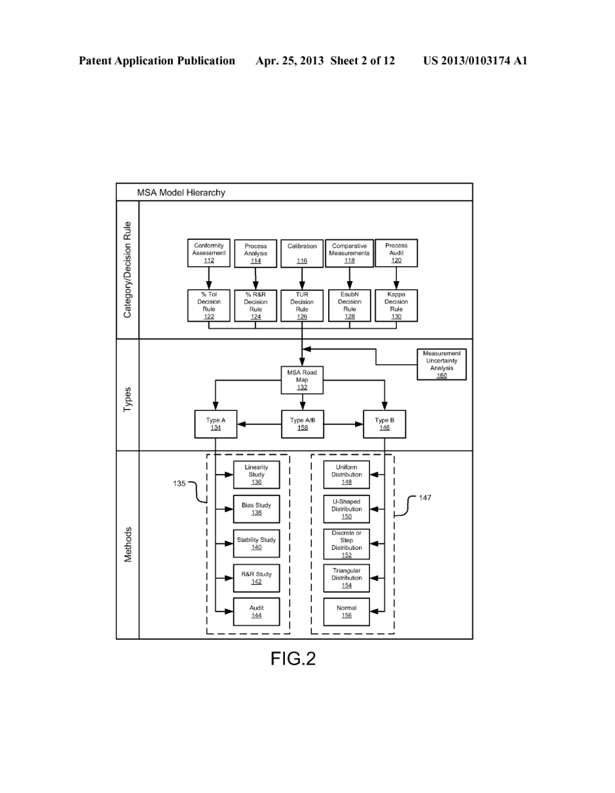
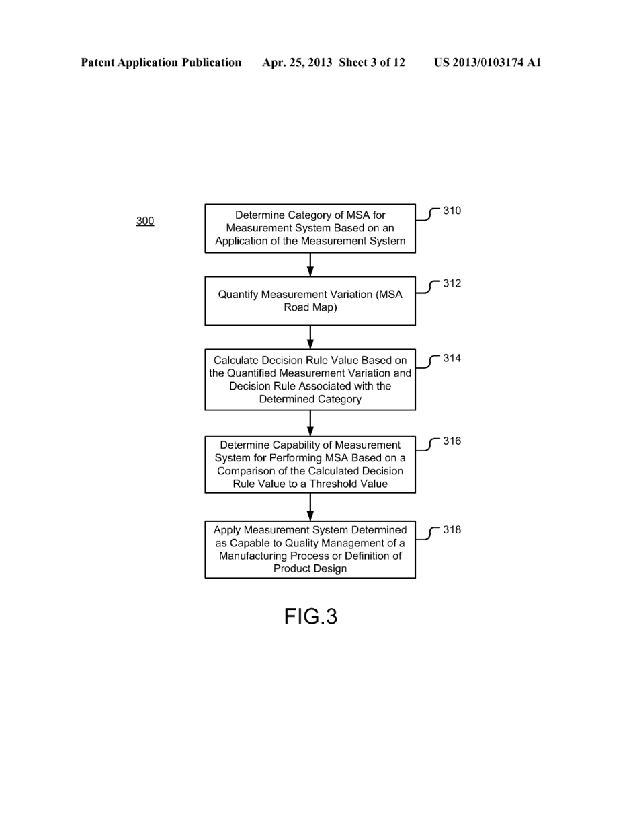
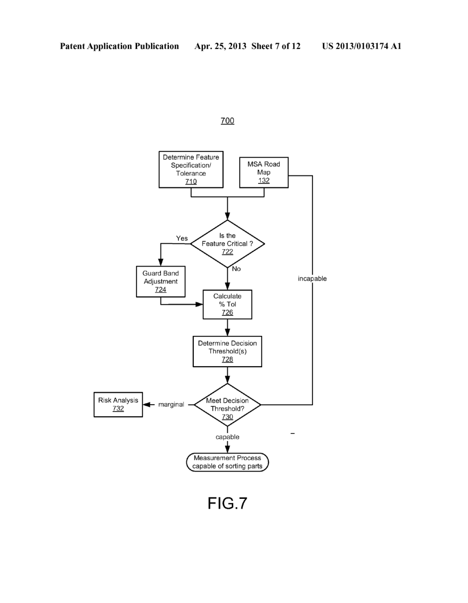

# 측정 시스템 분석 시스템과 방법 (US 2013/0103174 A1, 등록 US 8,942,838 B2)

- 원제: Measurement systems analysis system and method
- 원문: 같은 폴더의 `US20130103174A1.pdf` (공개공보), `US8942838B2.pdf` (등록공보, 2015-01-27, 청구항 7항, 도면 12장)
- 번역 범위: 전문. 표지 서지, 초록, 발명의 분야, 배경, 요약, 도면의 간단한 설명, 상세한 설명, 청구항 7항 전부. 인용 문헌 목록은 원문 그대로 둔다.
- 번역 기준: USPTO 공보 PDF를 pdftotext로 뽑아 옮겼다. 공보 PDF는 광학 문자 인식본이라 두 단 조판이 섞이고 철자가 깨진 곳이 있다. 뜻이 분명한 오인식만 바로잡아 옮겼고, 판단이 어려운 곳은 그대로 두고 표시했다.
- 등록 여부: 등록되었다. 미국 특허 8,942,838 B2, 2015년 1월 27일 등록. 출원 번호 13/448,315로 공개본과 같다.
- 도면: 핵심 도면 3장을 `도면/`에 넣고 처음 언급되는 곳 근처에 삽입했다.

---

## 표지 서지

| 항목 | 내용 |
|---|---|
| 공개 번호 | US 2013/0103174 A1, 2013년 4월 25일 공개 |
| 등록 번호 | US 8,942,838 B2, 2015년 1월 27일 등록 |
| 출원 번호 | 13/448,315 |
| 출원일 | 2012년 4월 16일 |
| 가출원 | 61/475,974 (2011년 4월 15일) |
| 발명자 | Steven Stahley (미국 인디애나주 Oldenburg) |
| 출원인, 양수인 | Cummins Intellectual Property, Inc. (미국 미네소타주 Minneapolis) |
| 국제 특허 분류 | G06F 9/00 (2011.01), G06F 17/00 (2006.01), G06Q 10/06 (2012.01), G06K 9/62 (2006.01) |
| 미국 분류 | 700/97, 700/103, 700/108, 702/182 |
| 심사관 | Sean Shechtman |
| 대리인 | Faegre Baker Daniels LLP |
| 존속기간 조정 | 35 U.S.C. 154(b)에 따라 129일 연장 |
| 청구항, 도면 | 청구항 7항, 도면 12장 |

인용 문헌(원문 그대로)

    U.S. PATENT DOCUMENTS
    5,452,218 A    9/1995   Tucker et al.
    6,577,986 B1   6/2003   Casey-Cholakis
    6,631,305 B2  10/2003   Newmark
    6,922,600 B1   7/2005   Conrad et al.
    6,961,732 B2  11/2005   Hellemann et al.
    7,006,084 B1   2/2006   Buss et al.
    7,272,532 B2   9/2007   Shafer et al.
    2004/0158338 A1  8/2004  Mammoser et al.
    2009/0093903 A1* 4/2009  Clemens et al. ..... 700/109
    2011/0040510 A1  2/2011  Nishida ..... 702/82
    * cited by examiner

## 초록

이 개시는 측정 시스템 분석(MSA)을 수행하는 구조적이고 효과적인 방법과 시스템을 제공한다. 이 MSA 시스템과 방법은 다음을 포함한다. 측정 시스템의 용도에 근거해 그 측정 시스템의 MSA 범주를 정한다. 측정 변동을 정량화한다. 정량화한 측정 변동과 정해진 범주에 딸린 판정 규칙으로 판정 규칙 값을 계산한다. 계산한 판정 규칙 값과 판정 규칙 문턱값을 견주어, 그 측정 시스템이 해당 범주의 MSA를 수행할 능력이 있는지 정한다. 능력이 있다고 정해진 측정 시스템을 제조 공정 품질 관리나 제품 설계 정의에 적용한다.

## 발명의 분야

이 발명은 측정 시스템 분석을 위한 시스템과 방법에 관한 것이다.

## 배경

측정 시스템은 계측기나 게이지, 표준기, 작업, 방법, 지그, 소프트웨어, 사람, 환경, 가정들의 묶음으로 설명할 수 있다. 이들이 모여 측정 대상 특성에 측정 단위나 판정을 부여하고, 측정값을 얻는 전체 과정을 이룬다.

측정 시스템 분석(MSA)은 그 측정 시스템의 측정 변동과 불확도를 정량화하려고 수행하는 연구다. 제조나 공학 공정을 뒷받침하려고 측정을 할 때마다, 그 측정 과정이 의도한 필요를 채울 수 있는지 확인하려고 MSA를 수행할 수 있다. MSA는 측정에 공통된 접근을 제공한다. 그 측정은 제조 공정 관리, 기술 외 사업 지표 확인, 설계 기준 평가, 측정 과정 교정, 사업 절차 검증 등에 쓰인다.

## 요약

이 개시는 MSA를 수행하는 구조적이고 효과적인 방법과 시스템을 제시한다.

한 측면에서, MSA 방법은 다음을 포함한다.

- 측정 시스템의 용도에 근거해 그 측정 시스템의 MSA 범주를 정한다.
- 측정 변동을 정량화한다.
- 정량화한 측정 변동과 정해진 범주에 딸린 판정 규칙으로 판정 규칙 값을 계산한다.
- 계산한 판정 규칙 값과 판정 규칙 문턱값을 견주어, 그 측정 시스템이 해당 범주의 MSA를 수행할 능력이 있는지 정한다.
- 능력이 있다고 정해진 측정 시스템을 제조 공정 품질 관리나 제품 설계 정의에 적용한다.

다른 측면에서, MSA 시스템은 다음을 포함한다.

- 측정 시스템의 특성에 근거해 MSA 범주를 정하도록 구성된 범주 결정 모듈.
- 측정 변동의 원천을 하나 이상 찾아내고 찾아낸 원천마다 정량화하도록 구성된 MSA 측정 변동 정량화 모듈.
- 정량화한 측정 변동과 정해진 범주에 딸린 판정 규칙으로 판정 규칙 값을 계산하도록 구성된 판정 규칙 값 계산 모듈.
- 계산한 판정 규칙 값과 판정 규칙 문턱값을 견주어 능력 유무를 정하도록 구성된 능력 판정 모듈.
- 능력이 있다고 정해진 측정 시스템을 제조 공정 품질 관리나 제품 설계 정의에 적용하도록 구성된 컨트롤러.

## 도면의 간단한 설명

- 도 1: 예시 실시예에 따른 일반 측정 시스템 분석(MSA) 계층 구조의 도면.
- 도 2: 예시 실시예에 따른 MSA 모델 계층의 더 자세한 도면.
- 도 3: 제조 공정 품질 관리나 제품 설계 정의에 쓸 측정 시스템의 MSA를 수행하는 예시 절차의 도면.
- 도 4: 예시 실시예에 따른 MSA 로드맵 수행 흐름도.
- 도 5: 측정 변동의 예시 원천 10가지와 그에 딸린 하위 원천들의 도면.
- 도 6A: 측정 변동을 정량화할 Type A 방법 선택에 관한 예시 판단도.
- 도 6B: 측정 변동 원천의 측정 변동을 정량화할 Type B 방법 선택에 관한 예시 판단도.
- 도 7: 예시 실시예에 따른 적합성 판정 MSA 범주의 MSA 절차 도면.
- 도 8: 예시 실시예에 따른 공정 분석 MSA 범주의 MSA 절차 도면.
- 도 9: 예시 실시예에 따른 교정 MSA 범주의 MSA 절차 도면.
- 도 10: 예시 실시예에 따른 비교 측정 MSA 범주의 MSA 절차 도면.
- 도 11: 예시 실시예에 따른 공정 감사 MSA 범주의 MSA 절차 도면.
- 도 12: 예시 실시예에 따른 MSA 수행 시스템의 도면.

## 상세한 설명

여러 측면을 예시 실시예와 함께 설명한다. 이해를 돕기 위한 것이고, 개시가 이 실시예로 한정된다고 해석해서는 안 된다. 잘 알려진 기능과 구성은 명확함과 간결함을 위해 설명하지 않을 수 있다.

측정 시스템 분석(MSA)은 여러 방식으로 수행될 수 있다. MSA를 어떻게 수행할지 안내하는 하나의 정해진 절차가 없기 때문이다. 발명자는 MSA를 제대로 하려면 두 가지가 중요하다고 보았다. 측정 시스템 변동을 정량화할 효율적이고 실용적이고 정확한 방법을 고르는 것, 그리고 그 결과를 측정 과정이 능력 있는지 판정하는 데 어떻게 쓸지 이해하는 것이다.

이 개시는 MSA를 수행하는 시스템과 절차 흐름을 제공한다. 이 시스템을 쓰고 이 흐름을 따르면, 사용자는 MSA 수행 경로를 받고, 측정 변동 정량화에 가장 알맞은 방법이 무엇인지 안내받고, 그 결과를 측정 과정이 의도한 용도에 능력 있는지 판정하는 데 어떻게 쓸지 지시받고, 정해진 측정 과정을 제조나 제품 설계에 적용한다. 더 구체적으로, 여기 설명한 시스템과 절차는 MSA를 범주로 나누고 범주마다 판정 규칙을 딸리게 한다. 측정 변동의 원천은 타입으로 나눈다. 그리고 적용할 가장 좋은 MSA 방법(예: GR&R 연구, 치우침 연구)을 고르는 안내를 제공한다.

여기 설명한 시스템과 방법은 MSA에 보통 드는 시간을 줄이고, 더 일관된 접근을 주고, 결과의 품질을 높일 수 있다. 측정 시스템은 제조 공정 품질 관리나 제품 설계 정의에 쓰이므로, 이 절차는 품질과 설계 판단에 쓰는 측정 결과의 신뢰를 높인다.

이 개시의 여러 측면은 컴퓨터 시스템의 요소나 프로그램된 명령을 실행할 수 있는 다른 하드웨어가 수행할 동작, 과정, 단계로 기술된다. 각 실시예에서 이 동작들은 전용 회로(특정 기능을 하도록 연결된 개별 논리 게이트), 하나 이상의 프로세서(중앙처리장치 또는 마이크로프로세서)가 실행하는 프로그램 모듈 같은 프로그램 명령, 또는 둘의 조합으로 수행될 수 있다. 논리는 알맞은 하드웨어나 소프트웨어로 구현할 수 있고, 일부는 실행 논리와 명령이 기록된 컴퓨터 판독 가능 저장 매체 형태로 있을 수 있으며, 예를 들어 룩업 테이블이나 교정 파라미터를 포함하도록 프로그램할 수 있다. 프로그램 명령은 비일시적 컴퓨터 판독 가능 매체에 저장할 수 있다. 여기에는 램(RAM), 롬(ROM), 지울 수 있는 프로그램 가능 롬(EPROM, EEPROM, 플래시 메모리), 광섬유, 휴대용 컴팩트 디스크 롬(CD-ROM), 그 밖에 정보를 저장할 수 있는 고체, 자기, 광학 디스크 매체가 들어간다.

### 도 1, 도 2: MSA 모델 계층

도 1은 예시 MSA 모델 계층을 보여 준다. MSA 모델은 세 가지 기본 요소가 계층을 이룬다.

1. MSA 범주(Categories): 평가 대상 측정 시스템의 용도에 근거해 MSA를 범주로 나눈다.
2. MSA 타입(Types): 측정 변동의 원천과 그 변동을 어떻게 정량화할지에 근거해 MSA를 타입으로 기술한다.
3. MSA 방법(Methods): 측정 변동 원천을 정량화하려고 측정 시스템에 적용하는 실험적, 경험적 방법을 기술한다.

도 2는 MSA 모델 계층의 더 자세한 도면이다. 도 2에서 각 MSA 범주 112부터 120까지는 각각 판정 규칙 122부터 130까지를 딸리게 가지고, 규칙마다 판정 문턱값이 있다. 각 판정 규칙은 어떤 범주의 MSA 결과에 적용되어, 그 측정 시스템의 정확도와 정밀도가 의도한 용도에 충분한지 정하는 규칙이다. 각 판정 규칙 문턱값은 그 판정을 내릴 때 판정 규칙에 적용하는 한계값이다.

도 2의 예시 MSA 모델의 범주는 다음과 같다.

| 번호 | 범주 | 딸린 판정 규칙 | 규칙 번호 |
|---|---|---|---|
| 112 | 적합성 판정 (conformity assessment) | % Tol (% 공차) | 122 |
| 114 | 공정 분석 (process analysis) | % R&R | 124 |
| 116 | 교정 (calibration) | TUR (시험 불확도 비) | 126 |
| 118 | 비교 측정 (comparative measurements) | E sub N (E_N 수) | 128 |
| 120 | 공정 감사 (process audit) | Kappa (카파) | 130 |

도 2의 타입(Types)과 방법(Methods) 부분은 MSA 로드맵 132로 이어진다. 로드맵은 측정 변동의 원천을 MSA Type A 134, MSA Type B 146, 또는 둘을 합친 Type A/B로 나누어 정량화한다. Type A MSA에는 방법 135가, Type B MSA에는 방법 147이 대응한다. 정량화한 측정 변동 원천들은 정해진 MSA 범주에 딸린 판정 규칙에 쓰여, 평가 대상 측정 시스템이 고려 중인 특성을 재기에 능력이 있는지 또는 충분한지 정한다.

도 2의 오른쪽에는 측정 불확도 분석 160이 함께 놓인다.

### 도 3: 전체 절차 흐름

도 3은 제조 공정 품질 관리나 제품 설계 정의에 쓸 측정 시스템의 MSA를 수행하는 예시 절차 흐름 300이다. 방법 300은 다음을 포함한다.

- 과정 310: 측정 시스템의 용도에 근거해 그 측정 시스템의 MSA 범주를 정한다.
- 과정 312: 측정 변동의 원천을 정량화한다. 정량화한 측정 변동과 정해진 범주에 딸린 판정 규칙으로 판정 규칙 값을 계산한다. 계산한 판정 규칙 값과 미리 정한 문턱값을 견주어, 그 측정 시스템이 해당 범주의 MSA를 수행할 능력이 있는지 정한다. 능력이 있다고 정해진 측정 시스템을 제조 공정 품질 관리나 제품 설계 정의에 적용한다.

도 4부터 도 6B는 예시 MSA 로드맵 132를 보여 준다. 도 7부터 도 11은 각 범주와 그에 대응하는 판정 규칙의 MSA 절차 도면이다. 구체적으로 도 7은 적합성 판정 MSA 112의 절차 700, 도 8은 공정 분석 MSA 114의 절차 800, 도 9는 교정 MSA 116의 절차 900, 도 10은 비교 측정 MSA 118의 절차 1000, 도 11은 공정 감사 MSA 120의 절차 1100이다. 각 MSA 절차는 MSA 로드맵 132를 수행해야 한다. 로드맵 132는 먼저 적합성 판정 규칙 122를 기준으로 자세히 설명한다. 다른 범주의 판정 규칙에 어떻게 바꿔 적용하는지는 그 판정 규칙 설명을 보면 쉽게 이해된다.

### 도 4: MSA 로드맵

도 4의 예시 MSA 로드맵 132는 관심 범위(range of interest) 전체에 걸친 어떤 특성의 적합성 판정에 적용하는 맥락으로 설명한다. 여기서 "관심 범위"는 측정 시스템을 분석할 지시값의 범위다. 이 범위는 측정 시스템의 용도에 따라 달라지고, MSA를 어떻게 수행할지에 영향을 준다. 예를 들어 관심 범위는 제품이나 특성의 규격(적합성 판정 MSA에서 전형적이다), 전형적인 공정 변동, 측정 시스템의 전 작동 범위가 될 수 있다.

MSA 로드맵 132는 과정 410에서 MSA 팀을 고르거나 MSA 소유자를 정하는 것으로 시작한다. 팀 소유자는 평가 대상 측정 시스템을 자세히 아는 사람으로 정한다. 예를 들어 용도, 쓰는 측정 시험 장비(M&TE), 측정 결과의 쓰임과 적용을 아는 사람이다. 많은 경우 측정 결과의 최종 사용자를 MSA 소유자로 지정할 수 있다. 평가 대상 측정 시스템을 쓰거나 잘 아는 사람들을 골라 측정 변동의 원천을 정하는 데 참여시키고, 그들의 지식을 MSA 설계에 넣는 것이 바람직하다.

다음으로 과정 412에서 측정량(measurand)과 그에 딸린 측정 단위를 정한다. 예를 들어 NIST SP811에 정의된 SI 단위를 쓸 수 있다.

과정 414에서 측정 시스템을 모델링한다.

측정 데이터와 측정 변동 계산에 쓴 주요 가정은 나중에 다시 볼 수 있게 보관하는 것이 바람직하다. 한 실시예에서 이 데이터와 가정은 컴퓨터 프로세서가 접근할 수 있는 메모리에 저장해 두고 나중에 검토하거나 다른 MSA에 쓸 수 있다.

MSA 타입(즉 Type A와 Type B)은 국제 표준화 기구(ISO)의 MSA 수행 표준 방법인 "측정 불확도 표현 지침(ISO Guide to the Expression of Uncertainty in Measurement)"에서 가져왔다.

과정 414에서 측정 시스템을 모델링할 때는 소급성(traceability), 측정 시스템의 낱낱 단계, 유의한 측정 변동 원천 등을 반영한다. 다만 측정 시스템의 소급 사슬이 짧으면 이 과정이 필요 없을 수 있다. 복잡한 측정 시스템이라면 모델링이 유의한 변동 원천을 찾는 데 크게 도움이 되고, MSA의 설계나 재설계에도 도움이 된다.

과정 416에서 MSA의 범위를 정한다. 측정 시스템을 일상적으로 쓸 때 나타나는 모든 유의한 변동 원천을 담도록 정한다. 범위를 정할 때 한 가지 고려 사항은 시험 대상(UUT)이 끌어들이는 변동을 넣을지 말지다. 예를 들어 비파괴 시험에서는 시험 과정에서 UUT가 바뀔 수 있다. 이 경우 MSA의 범위는 측정 시스템에서 오는 변동은 모두 넣되, 바뀌는 UUT 특성과의 상호작용에서 오는 변동 원천은 넣지 않아야 한다. UUT를 MSA 범위에 넣지 않는 전형적인 예는 경도 시험과 엔진 시험이다.

반대로 시험 과정에서 UUT가 바뀌지 않으면, UUT와의 상호작용에서 오는 변동 원천, 곧 반복성과 재현성을 정량화할 수 있다. UUT를 MSA 범위에 넣는 전형적인 예는 부품의 접촉식 또는 비접촉식 치수 측정이다.

과정 418에서 측정 변동의 원천을 찾는다. MSA 범위에 들어간 측정 시스템의 모든 구성 요소를 평가해서 찾는다. 각 구성 요소를 측정 변동의 범주에 비추어 보고 개별 잠재 원천을 정한다. 예를 들어 도 5는 측정 변동의 예시 원천 10가지와 그에 딸린 하위 원천들을 보여 준다.

잠재적 측정 변동 원천을 찾을 때는, 전체에서 차지하는 상대적 비중은 따지지 말고 합리적인 원천이면 모두 넣는 것이 바람직하다. 그래야 나중에 MSA 결과를 검토하는 사람도 고려된 잠재 원천 전부를 볼 수 있다. 예를 들어 측정 시스템을 모델링해 모듈에 저장해 두면, 그 측정 시스템의 MSA를 할 때 갱신하고 꺼내 쓸 수 있다. 이렇게 하면 MSA 로드맵 과정의 많은 부분을 컴퓨터 시스템 같은 처리 장치가 자동으로 수행할 수 있다.

### 도 4의 판단 420, 424: Type A와 Type B 나누기

판단 420과 424에서는 변동 원천들을 평가해, 원천마다 정량화할 알맞거나 가장 좋은 방법을 정한다. 측정 변동 원천의 평가 방법은 다음 셋 중 하나다.

- Type A 134: 측정 데이터의 통계적 평가로 불확도를 정량화할 수 있는 경우.
- Type B 146: 데이터를 얻을 수 없어 통계적 평가를 할 수 없는 경우.
- Type A/B 158: Type A 원천과 Type B 원천을 합쳐 측정 변동 원천을 정량화하는 경우.

원천마다 고른 평가 방법이 MSA 설계의 바탕이 되고, 측정 변동 원천을 정량화하는 데 필요한 실험이나 추가 정보를 목록으로 만든다.

MSA 타입(Type A와 Type B)은 ISO의 측정 불확도 표현 지침(GUM)에서 가져왔다. ISO GUM은 측정 시스템의 변동을 정량화하는 국제적으로 인정된 표준 방법이다. 측정 불확도 분석(MUA) 160을 할 때도 쓴다.

GUM은 측정 변동을 그 원천에 따라 분류한다. GUM이 정의한 측정 변동의 타입은 다음과 같다.

- Type A: 반복 측정의 결과를 써서 실험으로 측정 변동 원천을 정량화하는 경우. 예를 들어 게이지 반복성 및 재현성(GR&R)이다.
- Type B: 반복 실험 결과가 아니라 다른 수단으로 측정 변동 원천을 정량화하는 경우. 예를 들어 해석적 연구, 경험 모델, 이전 측정 데이터, 일반 지식, 제조사 규격, 교정 불확도, "공학적 판단"이다.

이 절차는 GUM의 권고를 따라 MSA 타입 셋을 정의한다. GUM의 Type A에 해당하는 Type A 134, GUM의 Type B에 해당하는 Type B 146, 그리고 Type A 134와 Type B 146의 원천을 합쳐 정량화하는 Type A/B 158이다.

도 4에서 과정 420과 424의 결과는 불확도 평가가 Type A인지 Type B인지 Type A/B인지를 정하는 것이다. 과정 422와 428에서는 변동 타입에 따라 측정 변동 원천을 정량화한다. 판단 424에서 MSA Type A/B 158로 정해지면, 측정 변동 원천을 Type A 134와 Type B 146으로 나눈다.

### MSA 방법: Type A 방법 135와 Type B 방법 147

도 2와 도 4를 함께 보면, 측정 변동 원천을 정량화하는 데 쓰는 MSA 방법은 관심 범위 전체에 걸쳐 측정 변동을 평가할 수 있다. MSA 타입마다 딸린 MSA 방법들이 있다. 원천이 Type A 134이면 과정 430에서 Type A 방법 135 중 하나 이상을 쓴다. 원천이 Type B 146이면 과정 432에서 Type B 방법 147 중 하나 이상을 쓴다. 예를 들어 Type A 변동 원천이면 그 원천을 잡아낼 실험을 짠다. 찾아낸 측정 변동 원천이 모두 실험에 들어가도록 실험 계획법(DoE)을 넣을 수 있다.

MSA 방법 135와 147은 측정 변동 원천을 정량화하려고 수행하는 "연구"다.

Type A MSA 방법 135는 변동을 통계적으로 정량화하는 실험 연구다. 다음을 포함할 수 있다.

| 번호 | 방법 |
|---|---|
| 136 | 선형성 연구 (linearity study) |
| 138 | 치우침 연구 (bias study) |
| 140 | 안정성 연구 (stability study) |
| 142 | 반복성 및 재현성 연구 (R&R study) |
| 144 | 감사 (audit) |

Type B MSA 방법 147은 변동을 가장 잘 기술하는 분포 형태로, 측정 변동의 통계적 추정값을 준다. 도 2에 따르면 다음을 포함할 수 있다.

| 번호 | 분포 |
|---|---|
| 148 | 균등 분포 (uniform) |
| 150 | U자 분포 (U-shaped) |
| 152 | 이산 또는 계단 분포 (discrete or step) |
| 154 | 삼각 분포 (triangular) |
| 156 | 정규 분포 (normal) |

### 도 6A: Type A 방법 고르기

도 6A는 Type A 측정 변동의 선택에 관한 판단도이고, 도 6B는 Type B 측정 변동의 선택에 관한 판단도다. 각 도면은 해당 타입의 측정 변동 원천의 변동을 정량화할 때 어느 방법을 쓸지 정하는 데 쓴다. 도 6A와 도 6B의 판단은 차례대로 그려져 있지만, 어떤 순서로 고려해도 되고 병렬로 고려해도 된다.

#### R&R 연구 142

도 6A에서 과정 610으로 시작해, 판단 612에서 측정 변동이 반복성과 재현성(R&R)의 단기 효과로 가장 잘 기술되는지 먼저 정한다. 그렇다면 R&R 연구 142를 골라, 측정 시스템에서 무작위로 일어나는 측정 변동 원천을 실험으로 정량화한다. R&R 연구 142로 정량화하는 원천에는 마이크로미터나 지그 게이지 같은 기계식 게이지가 있다. 이런 경우 작업자가 전체 측정 변동에 큰 영향을 줄 수 있다.

효과적인 R&R 연구 142는 다음 특징을 하나 이상 갖추는 것이 바람직하다.

1. 연구의 측정 결과가 연속형이다. 연속형 측정 결과는 구별되는 범주나 수준이 최소 개수보다 많은 데이터로 나타낼 수 있다(예: 구별되는 수준 5개). 연속형 측정 데이터의 예로는 치수 게이지 데이터, 저울의 질량 측정 데이터가 있다.
2. 측정 대상인 UUT의 특성이나 파라미터가 측정 시행 사이에 바뀌지 않는다.
3. 실험을 통해 모든 주요 측정 변동 원천을 정량화한다.

R&R 연구 142의 시료는 관심 범위 안에서 고르고, 정상 공정 산출물에서 무작위로 고를 수 있다. 연구가 적합성 판정 MSA 112에 쓰인다면, 시료는 관심 범위 전체에 걸쳐 고르는 것이 바람직하다. 가능한 한 시료의 약 50퍼센트는 관심 범위의 아래쪽 25퍼센트와 위쪽 75퍼센트 안에서 고른다.

R&R 연구 142를 설계할 때는 DoE 기법을 쓰는 것이 바람직하다. 잠재적 측정 변동 원천, 구할 수 있는 시료 수 등을 반영한다. 통계적으로 타당한 연구가 되도록 최소 개수의 시료 데이터 점, 예를 들어 30점을 모으는 것이 바람직하다. 구별되는 범주(수준)의 개수는 최소값보다 큰 것이 바람직하다. 예를 들어 분해능이 충분하도록 5 이상이어야 한다.

연구 결과의 신뢰를 확인하려면 기술 통계를 쓰는 것이 바람직하다. 예를 들어 평가자 변동(AV), 장비 변동(EV), 부품 간 변동(PV)은 R&R 연구 142에서 본 전체 측정 변동에 각자가 기여하는 상대적 크기를 추정해 준다. 다만 AV, EV, PV 통계량은 "전통적인" R&R 연구를 수행했을 때만 유효하다. 곧 같은 시료 묶음에 여러 평가자와 여러 시행을 적용했고, 연구 중에 시료가 바뀌지 않은 경우다.

예시 R&R 연구 142는 예를 들어 작업자 3명, 시행 3회, 부품 10개로 구성할 수 있다. 이것은 "전형적인" 제조 시스템을 분석하는 측정 시스템의 성능을 평가하려고 만든 특수한 경우의 DoE다.

R&R 연구가 측정 변동 원천을 제대로 정량화하려면 다음이 필요하다.

1. 작업자가 측정 변동에 유의하게 기여한다(작업자의 기여가 적거나 없다고 보면, MSA 설계에 여러 작업자를 넣을 필요가 없다).
2. 측정 변동이 관심 범위 전체에서 일관된다.
3. 통계적으로 타당한 표본이 되도록 최소 개수의 데이터 점(예: 30점)을 R&R의 일부로 모을 수 있다.

그러나 R&R 연구 방법 142는 Type B 측정 변동 원천을 정량화하는 데는 효과가 없다. 예를 들어 R&R 연구는 전형적인 교정 실험실에서 보이는 여러 측정 변동 원천을 정량화하지 못한다. 교정 과정에서는 외부에서 교정된 표준기의 측정 불확도처럼, 여러 측정 변동 원천이 측정 소급성과 얽혀 있다. 이런 원천은 실험으로 정량화할 수 없다.

#### 치우침 연구 138

판단 616에서, 변동 원천이 측정 결과와 기대값 또는 표준값 사이의 평균 차이로 가장 잘 기술된다고 정해지면, 치우침 연구 138을 수행해 측정 결과에 있는 계통 오차의 크기와 방향을 정량화한다.

효과적인 치우침 연구 138은 다음 특징을 하나 이상 갖추는 것이 바람직하다.

1. 연속형 측정 결과.
2. 관심 범위 안에서 고른 치우침 연구 시료.
3. 측정 시스템이 평가하는 측정 특성의 "전형적인" 특징, 크기 등을 닮은 치우침 연구 시료(예: 교정된 부품. 검사 대상 특성이 독립적으로 교정되어 알려진 측정 불확도와 함께 값이 부여된 것).
4. 통계적으로 타당한 연구가 되도록 모은 최소 개수의 시료 데이터 점(예: 30점).
5. 독립적으로 교정된 값을 가지며, 그 측정 불확도가 평가 대상 측정 시스템의 전체 측정 변동의 일부를 나타내는 문턱값보다 작은 시료(예: 전체 측정 변동의 25퍼센트 미만). 여기서 "독립적으로 교정된"은 연구 시료의 교정값이 연구 대상 측정 시스템과 무관하게 부여되었다는 뜻이다. 곧 연구 시료에 부여된 교정값을 그 측정 시스템 자신에서 끌어낼 수 없다.
6. 치우침 연구의 반복성에서 오는 측정 변동이, 평가 대상 측정 시스템의 전체 측정 변동의 일부를 나타내는 문턱값보다 작을 것(예: 전체 측정 변동의 10퍼센트 미만).

#### 안정성 연구 140

판단 620에서, 변동 원천이 장기 무작위 변동에서 오는 변동으로 가장 잘 기술된다고 정해지면, 안정성 연구 140을 수행해 시간에 따른 측정 시스템 드리프트의 크기와 방향을 정량화할 수 있다.

효과적인 안정성 연구 140은 다음 특징을 하나 이상 갖추는 것이 바람직하다.

1. 연속형 측정 결과.
2. 관심 범위 안에서 고른 안정성 시료.
3. 측정 시스템이 평가하는 측정 특성의 "전형적인" 특징, 크기 등을 닮은 안정성 연구 시료.
4. 시간에 따른 안정성을 독립적으로 검증받아, 드리프트 속도가 평가 대상 측정 시스템 전체 측정 변동의 미리 정한 최대 비율보다 작다고 확인된 시료(예: 전체 측정 변동의 10퍼센트 미만의 드리프트 속도).
5. 각 드리프트 점은 최소 개수의 개별 측정 결과의 평균으로 구성한다(예: 10개 결과의 평균).
6. 통계적으로 타당한 연구가 되도록 모은 최소 개수의 드리프트 점(예: 최소 5점).
7. 각 드리프트 점의 R&R에서 오는 측정 변동이, 평가 대상 측정 시스템 전체 측정 변동의 미리 정한 최대 비율보다 작을 것(예: 각 드리프트 점의 R&R에서 오는 측정 변동이 전체 측정 변동의 10퍼센트 미만).
8. 드리프트 점은 한 교정 주기에 해당하는 기간에 걸쳐 모은다.

안정성 연구 140에 쓰는 시료가 교정되어 있을 필요는 없다. 그 시료의 주된 구실은 측정 시스템의 장기 안정성을 평가하는 것이지 소급성을 평가하는 것이 아니기 때문이다. 또 "독립적으로 검증된"은 연구 시료의 드리프트 속도가 연구 대상 측정 시스템과 무관하게 부여되었다는 뜻이다. 곧 기준 감사 결과를 연구 대상 측정 시스템에서 끌어낼 수 없다.

#### 선형성 연구 136

판단 624에서 변동 원천이 측정 시스템의 비선형 효과로 가장 잘 기술되는지 정한다. 그렇다면 선형성 연구 136을 수행해, 관심 범위 안에서 계측기 눈금 전체에 걸쳐 나타나는 측정 치우침의 크기와 방향을 정량화한다.

효과적인 선형성 연구 136은 다음 특징을 하나 이상 갖추는 것이 바람직하다. (원문은 이 문단을 "effective stability study 136"으로 적었다. 선형성 연구 136의 오기로 보인다.)

1. 연속형 측정 결과.
2. 관심 범위 전체에서 모은 선형성 점. 관심 범위를 가능한 한 넓게 담는다.
3. 측정 시스템이 평가하는 측정 특성의 "전형적인" 특징, 크기 등을 닮은 연구 시료(예: 교정된 부품. 검사 대상 특성이 독립적으로 교정되어 알려진 측정 불확도와 함께 교정값이 부여된 것).
4. 각 선형성 점은 개별 측정 점 최소 10개의 평균으로 구성한다.
5. 선형성 점의 R&R에서 오는 측정 변동이, 평가 대상 측정 시스템 전체 측정 변동의 미리 정한 최대 비율보다 작을 것(예: 전체 측정 변동의 10퍼센트 미만).
6. 최소 개수의 교정된 선형성 점에서 모은 데이터(예: 최소 5점).
7. 선형성 연구 시료가 독립적으로 교정된 값을 가지며, 그 측정 불확도가 평가 대상 측정 시스템 전체 측정 변동의 미리 정한 비율보다 작을 것(예: 전체 측정 변동의 25퍼센트 미만).

#### 감사 연구 144

변동 원천이 이산적 측정 과정에서 온다고 가장 잘 기술되면, 감사 연구 144를 수행해 공정에 대해 수행한 감사의 R&R을 실험으로 정량화한다.

효과적인 감사 연구 144는 다음 특징을 하나 이상 갖추는 것이 바람직하다.

1. 이산형 측정 결과.
2. 작업자 최소 2명, 시행 최소 2회.
3. 감사 시료 최소 10개.
4. 감사 시료가 시행과 작업자에 걸쳐 안정적일 것.
5. 감사 시료를 정상 공정 산출물에서 무작위로 고를 것.

감사 연구 144에서는 연구 결과의 신뢰를 확인하려고 기술 통계를 쓰는 것이 바람직하다. 예를 들어 다음과 같다.

1. 평가자 간 일치도가 Kappa(Fleiss) 0.4보다 클 것.
2. 95퍼센트 신뢰구간에서 작업자 사이 일치율이 75퍼센트보다 클 것.
3. 독립적으로 검증된 기준 감사 결과와 견준 작업자의 유효성(effectiveness)이 미리 정한 높은 비율보다 클 것. 예를 들어 95퍼센트 초과다. 약 80퍼센트 초과도 받아들일 수 있지만, 그 경우 작업자가 개선이 필요함을 가리킬 수 있다.

"유효성"은 올바른 판단 수를 판단 기회의 총수로 나눈 값이다. 이 통계량은 기준 감사 결과 묶음을 감사할 때 작업자의 유효성 또는 치우침을 보여 준다. "독립적으로 검증된"은 어떤 시료에 대한 감사가 있었고 그 감사 결과가 연구 대상 측정 시스템과 무관하게 얻어졌다는 뜻이다. 곧 기준 감사 결과를 연구 대상 측정 시스템에서 끌어낼 수 없다.

### 도 6B: Type B 방법 고르기

Type B인 측정 변동 원천에는 아래 Type B 방법 147 중 하나를 골라 변동을 정량화한다. 도 6B에서 과정 640으로 시작한다.

#### 균등 분포 148

판단 642에서, 측정 변동이 한계값 말고는 측정 시스템 변동을 기술하는 정보가 전혀 없는 경우로 가장 잘 기술되는지 정한다. 그렇다면 균등 분포 연구 148을 수행해, 측정 변동의 성질에 대한 정보가 없고 변동의 한계만 아는 경우의 측정 변동 추정값을 얻는다.

균등 분포에서 오는 측정 변동은, 측정 오차 한계 범위의 1/2에 0.58을 곱해 정량화한다. 이것이 측정 변동의 1시그마 추정값이다.

균등 분포로 기술되는 전형적인 측정 변동 원천에는 교정 불확도, 정해진 환경 범위에 걸친 측정 시험 장비(M&TE) 규격, 연구 결과만 남아 있는 이전 MSA 연구 결과 등이 있다.

#### U자 분포 150

판단 646에서, Type B 측정 변동 원천이 정현파 응답을 만드는 제어 되먹임 과정의 영향을 받는 변동으로 가장 잘 기술되는지 정한다. 그렇다면 U자 분포 연구 150을 수행해, 측정 시스템의 응답이 컨트롤러 되먹임 과정의 직접 영향을 받아 측정 변동이 사인파 응답을 가지는 경우의 측정 변동 추정값을 얻는다.

U자 분포에서 오는 측정 변동은, 측정 오차 한계 범위의 1/2에 0.71을 곱해 정량화한다. 이것이 1시그마 추정값이다.

U자 분포로 기술되는 전형적인 원천에는, 측정이 설정값으로 제어되는 경우의 측정 시스템 온도 효과, 또는 되먹임 제어가 주기적 응답을 만드는 그 밖의 환경 영향이 있다.

#### 이산 또는 계단 분포 152

판단 650에서, Type B 측정 변동 원천이 이산 계단이나 기본 분해능의 영향을 받는 변동으로 가장 잘 기술되는지 정한다. 그렇다면 이산 또는 계단 분포 연구 152를 수행해, 측정 시스템의 기본 또는 가장 잘게 쪼갠 분해능에서 오는 측정 변동 추정값을 얻는다.

계단 분포에서 오는 측정 변동은, 측정 시스템 분해능의 가장 작은 계단에 0.29를 곱해 정량화한다. 이것이 1시그마 추정값이다.

계단 분포로 기술되는 예시 원천에는 디지털 또는 아날로그 눈금의 최소 식별 분해능, A/D 변환기의 디지털 분해능 등이 있다.

#### 삼각 분포 154

판단 654에서, Type B 측정 시스템 변동 원천이 고조파 응답의 영향을 받는 변동으로 가장 잘 기술되는지 정한다. 그렇다면 삼각 분포 연구 154를 수행해, 측정 시스템의 응답이 고조파 응답의 직접 영향을 받는 경우의 측정 변동 추정값을 얻는다.

삼각 분포에서 오는 측정 변동은, 측정 오차 한계 범위의 1/2에 0.41을 곱해 정량화한다. 이것이 1시그마 추정값이다.

삼각 분포 154로 기술할 수 있는 예시 원천에는 진동 효과가 있다. 측정 시스템이 기본 진동 주파수와 그 고조파의 영향을 받는 경우다.

#### 정규 분포 156

다음으로 판단 658에서, Type B 측정 시스템 변동 원천이, 그 변동이 무작위 또는 정규 원천이라는 것 말고는 측정 시스템 변동을 기술하는 정보가 없는 경우로 가장 잘 기술되는지 정한다.

### 합치고 확장하기 (과정 434)

다시 도 4를 보면, 측정 변동 원천을 정량화하는 데 여러 방법을 썼으면 합치고 확장하는 과정 434를 수행한다. 전체 측정 변동(측정 불확도)은 다음과 같이 계산할 수 있다.

1. 개별 방법의 결과(불확도 원천)를 제곱합제곱근(root sum square) 방법으로 합친다(합성 불확도). 이때 결과마다 개별 감도 계수를 반영한다.
2. 전체 측정 변동은 합성 결과(합성 불확도)를 알맞은 신뢰구간으로 확장해 얻는다(확장 불확도). 이때 유효 자유도를 반영한다. 유효 자유도는 Welch-Satterthwaite 계산으로 구할 수 있다.
3. 확장 계수는 스튜던트 t 분포로 정한다. 유효 자유도와 알맞은 신뢰구간을 반영한다. 신뢰구간은, 판정 규칙에서 전체 측정 변동(확장 불확도)에 견주는 공차 또는 변동의 신뢰구간과 서로 맞도록 고른다.

GUM에서 합성 결과를 가리키는 용어는 합성 측정 불확도(u)이고, 최종 결과를 가리키는 용어는 확장 측정 불확도(U)다.

위에서 말한 95퍼센트 신뢰구간은 교정 과정의 결과를 보고할 때 세계 대부분에서 쓰는 사실상의 표준이다.

판정 규칙을 적용할 때는, 확장 측정 불확도가 견주는 양과 같은 신뢰구간 위에 있는 것이 바람직하다. 예를 들어 MSA 범주가 공정 분석이고 공정 변동을 99.73퍼센트 또는 3시그마 신뢰구간으로 보고한다면, 확장 측정 불확도도 사실상의 표준인 95퍼센트가 아니라 99.73퍼센트로 확장해야 판정 규칙 결과의 비가 정확해진다.

이렇게 과정 434에서 Type A와 Type B 방법의 결과를 알맞게 합치고 확장한 다음, 과정 436에서 결과를 문서로 남긴다. 예를 들어 나중에 꺼내 볼 수 있게 메모리에 저장한다.

도 4부터 도 6B의 MSA 로드맵은 측정 불확도 분석 160(도 2 참고)이 MSA의 의도한 결과, 곧 최종 결과인 경우에도 수행할 수 있다.

### 도 7: 적합성 판정 MSA 112와 % Tol 판정 규칙 122

도 7은 적합성 판정 범주 112의 MSA를 수행하는 절차 700의 도면이고, % Tol MSA 판정 규칙 122를 쓴다. 적합성 판정 범주 112는 측정 시스템이 제품이나 공정을 규격이나 공차에 비추어 평가하는 데 쓰일 때 적용되는 MSA 범주다. 예를 들어 적합성 판정 MSA는 측정 시스템이 불량품처럼 결함 있거나 기준 미달인 제조물을 찾아낼 능력이 있는지 정하는 데 쓸 수 있다. 이 범주에서 적합성 판정 MSA를 수행하면, 측정 시스템이 어떤 특성을 시험할 능력이 있는지 정해진다.

적합성 판정 범주 112에 딸린 % Tol 판정 규칙 122는, 확장된 측정 시스템 변동과 부품 또는 공정 공차의 비를 계산한다. 그리고 문턱값 하나 이상에 비추어, 고려 중인 측정 과정이 어떤 특성의 규격 적합 여부를 정할 능력이 있는지 판정한다. 예시 실시예에서는 문턱값을 둘 이상 써서 적합성의 정도를 나눌 수 있다. 예를 들어 측정 시스템이 적합 판정을 할 능력이 있는지(capable), 간신히 있는지(marginally capable), 없는지(incapable)로 나눈다.

절차 700은 과정 710으로 시작한다. 고려 중인 측정 시스템이 평가하는 특성의 규격이나 공차를 정한다. 그리고 그 측정 시스템에 대해 MSA 로드맵 132를 수행한다.

다음으로 판단 722에서, 측정할 특성(측정량)이 중요(critical)로 분류되는지 정한다. 예를 들어 제품 안전과 관련되거나, 규격을 못 맞추면 제품 시스템 전체가 망가질 수 있는 특성이다. 중요로 정해지면 "예" 경로를 타고 과정 724로 가서, 규격에 100퍼센트 적합함을 보장하도록 보호대(guard band) 조정을 한다.

보호대 조정, 곧 보호대 두기는 규격에 100퍼센트 적합함을 보장하려고 특성의 규격 한계를 조정하는 방식이다. 보호대 조정에서는 규격 한계를 측정 시스템 변동이나 불확도만큼 줄여 새 규격 한계를 만들고, 그 한계를 기준으로 적합 판단을 한다. 보호대 조정 과정 724를 수행할 때는, 중요 특성의 규격 한계에서 전체 측정 변동을 빼서 새 합격 불합격 한계를 만든다. 이렇게 하면 측정 시스템의 어떤 변동이 있어도 규격을 못 맞춘 특성이 통과하는 일이 100퍼센트 없게 된다.

보호대 두기는 꼭 필요할 때만 쓰는 것이 바람직하다. 생산자 폐기(scrap)를 크게 늘릴 수 있기 때문이다.

보호대 두기는 공차를 보호대만큼 줄여 새 합격 한계와 불합격 한계를 세우는 판정 규칙을 만든다. 한 실시예에서 보호대는 다음 식으로 계산할 수 있다.

    g = h * U                                    (1)

여기서 h는 보호대 승수(guard band multiplier), U는 확장 불확도다.

보호대 승수 h는, 부품이 공차 안에 들 바라는 확률(적합 확률, conformance probability)에 근거해 표로 구할 수 있다.

판단 722에서 특성이 중요가 아니라고 정해지거나, 보호대 조정 724를 한 다음에는, 과정 726에서 % Tol을 계산한다. % Tol 계산은 적합성 판정 MSA 112의 판정 규칙의 일부이고, % P/T(정밀도 대 공차 비의 퍼센트)라고도 부른다. 적합성 판정 MSA에서 측정 시스템이 특성의 규격 적합 여부를 정할 능력이 있는지 판정하는 데 쓴다. % Tol은 다음과 같이 계산한다.

    % Tol = 100% * MU / Tol                      (2)

여기서 MU는 Type A와 Type B의 모든 측정 변동 원천에서 오는 전체 측정 변동을, 무한 자유도에 대해 99.73퍼센트 신뢰구간 또는 ±3시그마로 확장한 값이다. Tol은 시험 대상 특성의 공차다.

과정 728에서 그에 딸린 판정 규칙 문턱값을 정한다. 판정 규칙 문턱값은 미리 정한 값일 수 있고, 판단 730을 수행하는 프로세서나 사용자가 접근할 수 있는 물리 메모리에 저장해 둔다. 판단 730은 과정 726에서 계산한 % Tol이 판정 문턱값을 만족하는지 정한다.

예시 실시예에서는 문턱값 두 개를 정해 저장한다. 간신히 가능 문턱값 Th_m과 능력 있음 문턱값 Th_c다. 예를 들어 Th_m = 30퍼센트, Th_c = 10퍼센트로 두면, 판단 730은 계산한 % Tol 값이 30퍼센트 미만인 측정 시스템을 간신히 가능으로, 10퍼센트 미만인 측정 시스템을 능력 있음으로 판정한다.

% Tol 판정 규칙 문턱값이 능력 있음을 가리키면, 곧 % Tol이 미리 정한 Th_c 판정 문턱을 만족하면, 그 측정 시스템을 특성의 규격 적합 판정에 쓸 수 있다.

계산한 % Tol 값이 미리 정한 문턱값들이 정하는 간신히 가능 구간 안에 있으면(예: Th_c와 Th_m 사이), 미리 정한 조건 하나 이상을 만족할 때 그 측정 시스템을 규격 적합 판정에 쓸 수 있다. 예를 들어 다음을 수행하면 간신히 가능한 측정 시스템도 적합 판정에 받아들일 수 있게 구성할 수 있다.

1. 위험 분석 732를 수행해 고객의 위험을 정량화한다.
2. MSA 고객이 늘어난 위험에 동의하고, 그 동의 기록을 보관한다.
3. 늘어난 고객 위험을 반영해 그 특성의 감사 주기를 검토하고 알맞게 조정한다.

적합성 판정 MSA 112의 예시 위험 분석 732는 ASME B89.7.4.1-2005에서 끌어낸 식들을 쓸 수 있다. "측정 불확도"라는 용어는 MSA 로드맵 132로 수행한 Type A, Type B, Type A/B MSA의 결과와 같다. "표준 불확도"라는 용어를 쓸 때는 67퍼센트 또는 1시그마 신뢰의 MSA 결과와 같다. "확장 불확도"라는 용어를 쓸 때는 MSA 결과를 95퍼센트 또는 2시그마 신뢰구간으로 확장한 값으로 본다.

위험 평가 계산은 적합 확률에 근거한 합격 구역(acceptance zone) 계산으로 시작한다.

규격 적합 또는 간신히 가능하되 받아들일 만한 측정 과정이 나올 때까지, 각 반복마다 MSA 로드맵 132를 다시 수행한다. 능력 있음 또는 간신히 가능하되 받아들일 만하다고 나온 MSA는 그다음 적용할 수 있다. 예를 들어 제조 공정 품질을 관리하는 측정 시스템(불량품 찾기)으로 쓰거나, 제품 설계 정의를 돕는 데 쓴다.

부품이 공차 안에 들 적합 확률에 근거한 합격 구역 계산은, 먼저 측정 능력 지수(measurement capability index)를 계산하는 것으로 시작한다.

    C_m = T / (4 * u_c)                          (3)

여기서 T(공차) = T_U - T_L, T_U는 위쪽 공차 한계, T_L은 아래쪽 공차 한계, u_c는 표준 불확도(k=1, 곧 확장하지 않은 불확도)다. (원문 공보의 식 (3)은 광학 인식에서 분모가 깨져 있다. ASME B89.7.4.1-2005의 측정 능력 지수 정의에 따라 옮겼다. 분모 계수는 원문에서 확인하지 못했다.)

다음으로 눈금 맞춘 측정값(scaled measurement value)을 다음과 같이 계산한다.

    x_scaled = (x_m - T_L) / T                   (4)

여기서 x_m은 측정값이다.

계산한 C_m 값과 x 값을 가지고 ASME B89.7.4.1-2005를 참조할 수 있다. 이 표준은 바라는 신뢰 수준으로 합격 구역을 어떻게 정의하는지 설명한다.

% Tol 판정 규칙 계산이 간신히 가능 수준에도 못 미치면(곧 Th_c와 Th_m 문턱을 모두 만족하지 못하면), 판단 730은 그 측정 시스템이 특성의 규격 적합 여부나 받아들일 만한 적합 여부를 정할 능력이 없다고 판정한다. 능력 없음으로 판정되면 다음 중 하나 또는 둘을 수행할 수 있다.

1. 조정한 로드맵 132로 적합성 판정 MSA를 다시 수행한다. 지나친 측정 변동을 끌어들였을 수 있는 측정 시스템의 용도, 설계 등의 변경을 고려한다.
2. 그 특성의 규격을 검토한다(예: 고객과 함께 검토). 측정 시스템이 규격 적합 여부를 정할 능력이 있거나 간신히 있게 만들 조정을 적용할 수 있는지 정한다. 특성 규격의 변경은 고객이 동의하고 그 동의 기록을 보관하는 것이 바람직하다.

과정 722부터 730까지는 로드맵 132를 조정해 가며 반복할 수 있다.

### 도 8: 공정 분석 MSA 114와 % R&R 판정 규칙 124

측정 시스템을 공정 제어에 쓴다면(예: 수행 중인 공정의 변화를 잡아내려고), 공정 분석 MSA 범주 114에 따라 MSA를 수행해 그 측정 시스템이 공정을 제어할 능력이 있는지 정할 수 있다. 도 8은 공정 분석 MSA 범주 114의 MSA를 수행하는 예시 절차 800의 도면이고, % R&R 판정 규칙 124를 쓴다. 이 규칙은 측정 시스템의 정확도와 정밀도가 공정 제어에 충분한지 정한다.

도 8에서 절차 800은 과정 810으로 시작한다. 평가 대상 측정 시스템이 정상 운전 조건에서 보는 공정의 데이터 퍼짐을 정한다. 예를 들어 전형적인 운전 조건에서 공정 모집단의 6시그마 퍼짐을 정할 수 있다. 그리고 과정 820에서, 공정 분석에 전형적으로 쓰이는 대로 그 측정 시스템에 대해 알맞은 관심 범위에 걸쳐 MSA 로드맵을 수행한다(위 도 4 설명 참고). 공정 분석 MSA의 경우 관심 범위는 측정 시스템이 감시하는 모집단의 전형적인 퍼짐이다(예: 모집단의 6시그마 퍼짐).

다음으로 과정 822에서 측정 변동과 공정 변동의 비인 % R&R을 계산한다. 한 실시예에서 % R&R은 다음과 같이 계산한다.

    % R&R = 100% * GRR / TV                      (5)

여기서 GRR은 R&R 연구의 전체 측정 변동에서 부품 간 변동을 뺀 값이고, 유한 자유도에 대해 99.73퍼센트 신뢰구간 또는 ±3표준편차로 확장한 값이다. TV는 R&R 연구의 전체 변동으로, 부품 간 변동, 공정, 측정 시험 장비(M&TE), 작업자 등을 모두 포함하고 99.97퍼센트 신뢰구간으로 확장한 값이다. (원문에 99.97퍼센트로 적혀 있다. 99.73퍼센트의 오기로 보이나 원문 그대로 옮긴다.) 바라는 신뢰 수준에 따라 다른 한계를 쓸 수도 있다.

다음으로 과정 824에서 판정 문턱을 하나 이상 정하고(예: 메모리에 저장된 룩업 테이블에서 가져오거나 다른 방법으로 얻는다), 계산한 % R&R 값과 견준다. 예를 들어 문턱값이 10퍼센트와 30퍼센트라면 다음과 같다.

| 계산한 % R&R | 판정 |
|---|---|
| 10퍼센트 미만 | 측정 시스템이 공정의 변화를 잡아낼 능력이 있다 |
| 10퍼센트 이상 30퍼센트 미만 | 간신히 능력이 있다 |
| 30퍼센트 이상 | 능력이 없다 |

판단 826에서, % R&R 판정 규칙 문턱이 능력 있음을 가리키면 그 측정 시스템을 공정 제어에 쓸 수 있다. 간신히 능력 있음을 가리키면, 위험 분석 828을 수행하고 정해진 위험을 MSA 소유자, MSA 고객, 또는 다른 당사자가 받아들일 수 있을 때 공정 제어에 쓸 수 있다. 예를 들어 위험 분석 828을 수행해 고객의 위험을 정량화하고, MSA 고객이 늘어난 위험에 동의하고 그 동의 기록을 보관하며, 늘어난 고객 위험을 반영해 그 특성의 감사 주기를 검토하고 알맞게 조정한다.

예를 들어 한 실시예의 공정 분석 MSA 위험 분석은 AIAG MSA 핸드북 4판 부록 B를 참조해 실제 공정 능력을 정할 수 있다. 여기서 관측 공정 능력은 R&R 연구의 전체 변동(부품 간, 공정, M&TE, 작업자 등 포함)을 무한 자유도에 대해 99.73퍼센트 신뢰구간 또는 ±3시그마로 확장한 값으로 계산한다. 전체 측정 변동은 R&R 연구 결과에서 부품 간 변동을 빼고 무한 자유도에 대해 99.73퍼센트 신뢰구간 또는 ±3시그마로 확장한 값이다.

측정 능력은 공정 능력에도 영향을 준다. 위에서 계산한 측정 능력 지수 C_m과 보호대 g를 써서 B89.7.3.1-2005를 참조하면, 주어진 공정 능력 Cp에 대한 생산자 위험과 소비자 위험을 계산할 수 있다.

% R&R 판정 규칙 문턱(예: Th_m과 Th_c)이 간신히 가능 수준에도 못 미치면, 그 측정 시스템은 공정의 변화를 잡아낼 능력이 없다. 능력이 없으면 조정한 로드맵 820으로 공정 분석 MSA를 다시 수행할 수 있다. 지나친 측정 변동을 끌어들였을 수 있는 측정 시스템의 용도, 설계 등의 변경을 고려한다.

### 도 9: 교정 MSA 116과 TUR 판정 규칙 126

측정 시스템을 UUT 교정에, 곧 교정 대상 M&TE의 규격에 맞추어 쓴다면, 교정 MSA 116을 수행해 그 측정 시스템이 교정을 수행할 능력이 있는지(예: 교정 과정이 충분히 정확한지) 정할 수 있다. 교정 MSA 116은 TUR 판정 규칙 126을 딸리게 가진다. 이 규칙은 교정 과정의 정확도와 정밀도가 UUT를 교정하기에 충분한지 정한다.

도 9는 TUR 판정 규칙 126을 수행하는 예시 절차 900의 도면이다. 과정 910에서 알맞은 관심 범위를 정한다. 일반적으로 관심 범위는 UUT의 규격 전체에 걸칠 수 있다. 다만 어떤 경우에는 UUT가 사용 가능 범위나 기능의 일부만 쓰일 수 있다. 그런 경우 관심 범위는 UUT의 정상 사용 범위나 기능으로 둘 수 있다.

그리고 과정 920에서, UUT 교정에 전형적으로 쓰이는 대로 그 측정 시스템에 대해 관심 범위에 걸쳐 MSA 로드맵을 수행한다(위 도 4 설명 참고).

과정 922에서 % TUR 값을 계산해 그 측정 시스템이 교정을 수행할 능력이 있는지 정한다. 이 계산은 교정 불확도와 UUT 규격의 비를 정한다. 곧 다음과 같다.

    TUR = U : UUT                                (6)

여기서 U는 교정 과정의 측정 불확도를, 무한 자유도에 대해 95퍼센트 신뢰구간 또는 2표준편차(2시그마)로 확장한 값이다.

과정 924에서 교정 판정 규칙 문턱을 정한다. 예를 들어 메모리에서 문턱을 찾아온다. 예시 실시예에서 U:UUT 문턱값은 4:1이 바람직하다. 다른 값으로 둘 수도 있다. 다음으로 판단 926에서 계산한 % TUR이 문턱값을 만족하는지 정한다. MSA 결과가 판정 규칙 문턱을 만족하면, 그 교정 시스템이나 과정은 M&TE를 교정할 능력이 있다.

TUR 판정 규칙 126이 능력 있음 수준에 못 미치면, 그 측정 시스템은 교정을 수행할 능력이 없다고 본다. 능력이 없으면 다음 중 하나 이상을 수행할 수 있다.

1. UUT에 대해 MSA를 수행해, 낮아진 정확도가 UUT의 정상 용도에 어떤 영향을 주는지 정한다.
2. MSA 고객이 UUT의 낮아진 정확도에 동의하고, 그 동의 기록을 보관한다.
3. MSA 결과가 MSA 고객에게 받아들일 수 없는 위험이라고 정해지면, 로드맵 920으로 교정 능력 MSA 116을 다시 수행한다. 지나친 측정 변동을 끌어들였을 수 있는 측정 시스템의 변경을 고려한다.

### 도 10: 비교 측정 MSA 118과 E_N 판정 규칙 128

비교 측정 범주 118은 여러 측정의 결과를 견주어 그 사이에 치우침을 잡아낼 수 있는지 정할 때 적용되는 MSA 범주다. 예를 들어 설계 변경 전과 후의 제품 성능 변화를 측정 시스템이 잡아낼 수 있는지 정해야 하는 상황에서 수행할 수 있다. 비교 측정 MSA 범주 118은 E_N(E sub Normal) 판정 규칙 128을 딸리게 가진다. 이 규칙은 측정 결과들 사이의 치우침을 잡아낼 수 있는지 정한다.

도 10은 E_N 판정 규칙을 수행하는 예시 절차 1000의 도면이다. 절차 1000은 과정 1020a로 시작한다. 처음 측정의 측정 결과를 정한다. 그리고 측정 시스템의 관심 범위를 정한다. 관심 범위는 처음 측정에서 마지막 측정까지 측정 결과가 바뀔 수 있는 폭을 덮을 수 있다. 처음과 마지막 측정 결과의 변화를 추정할 수 없으면, 관심 범위를 측정 시스템의 전 범위로 둘 수 있다. 또 과정 1022a에서, 처음 측정에 적용되는 대로 그 측정 시스템에 대해 MSA 로드맵을 수행한다.

과정 1020b에서 마지막 측정의 측정 결과를 정하고, 과정 1022b에서 마지막 측정에 적용되는 대로 MSA 로드맵을 수행한다. 어떤 경우에는 과정 1022a에서 처음 측정에 대해 수행한 MSA 로드맵이 마지막 측정에 적용되는 측정 변동 원천을 이미 모두 반영했을 수 있다. 그런 경우 처음 측정에서 얻은 MSA 로드맵 결과를 마지막 측정에 적용할 수 있고, 마지막 측정에 새 로드맵을 다시 수행할 필요가 없다.

과정 1024에서 E_N(E sub Normal) 판정 규칙을 비교 측정 MSA에 써서, 처음과 마지막 측정 결과 사이에 치우침을 잡아낼 수 있는지 정한다. E_N은 두 측정 결과 사이 치우침과 두 측정 결과의 합성 측정 불확도의 비이고, 다음과 같이 계산할 수 있다.

    E_N = |x_A - x_B| / sqrt(U_A^2 + U_B^2)      (7)

여기서 x_A와 x_B는 두 측정의 평균 측정 결과다(예: 시험 A와 시험 B의 측정 결과). U_A와 U_B는 두 측정 각각의 측정 불확도를, 무한 자유도에 대해 95퍼센트 신뢰구간 또는 2표준편차(2시그마)로 확장한 값이다.

한 실시예에서는 E_N 지표 대신 t 검정을 쓸 수 있다. E_N 통계량을 실험실 간 비교(ILC) 결과를 평가하는 데 쓰면, 각 측정 시스템의 측정 결과가 서로 상관되는지 세울 수 있다.

과정 1026에서 E_N 판정 규칙 128의 문턱값을 정한다. 예를 들어 메모리에 저장해 두었다가 꺼내 오는 미리 정한 값일 수 있다. 다음으로 판단 1028에서 계산한 E_N 값을 판정 문턱과 견주어, 과정 1020a와 1020b의 처음과 마지막 측정 결과 사이에 치우침을 잡아낼 수 있는지 정한다.

한 실시예에서 판정은 다음과 같다. 계산한 E_N 값이 1.0 미만이면, 서로 치우침이 없어야 하는 측정 시스템들을 분석한 경우, 그 측정 시스템은 처음과 마지막 측정 결과 사이의 치우침을 잡아낼 능력이 없다고 본다. 계산한 E_N 값이 1.0 이상이면, 처음과 마지막 측정 결과 사이의 치우침을 잡아내려는 측정 시스템인 경우 능력이 있다고 본다.

비교 측정 MSA 118에서는, E_N 판정 규칙 128의 바라는 결과가 판정 문턱보다 클 때도 있고 작을 때도 있다. 곧 두 측정 사이의 치우침이 보여야 하는 경우와 보이지 않아야 하는 경우가 모두 있다. 설계 변경이 시스템 성능에 영향을 주었는지 정하려고 비교 측정을 쓴다면, 측정 시스템은 측정 결과 사이의 치우침을 잡아낼 능력이 있어야 설계 변경이 제품 성능에 영향을 주었음을 확인할 수 있다. 실험실 간 비교(ILC)의 일부로 비교 측정을 쓴다면, 측정 시스템은 측정 결과 사이의 치우침을 잡아내지 못해야 한다. 그것이 측정 결과들이 서로 맞는다는 뜻이기 때문이다.

### 도 11: 공정 감사 MSA 120과 Kappa 판정 규칙 130

공정 감사 범주 120은 공정 감사 결과를 검증할 때 수행하는 MSA 범주다. 예를 들어 어떤 공정이 기준을 만족하는지를 감사가 잡아낼 수 있는지 정하는 데 쓸 수 있다. 공정 감사 MSA 범주 120은 Kappa 판정 규칙 130을 딸리게 가진다. 이 규칙은 감사 결과가 유효한지 정한다.

도 11은 Kappa 판정 규칙 130을 수행하는 예시 절차 1100의 도면이다. 절차 1100은 과정 1110으로 시작한다. 공정을 감사하는 데 쓸 기준을 정한다. 다음으로 과정 1120에서 그 감사 기준에 비추어 공정 감사에 대해 MSA 로드맵을 수행한다(위 도 4 설명 참고).

과정 1122에서 Kappa 판정 규칙의 카파 값을 계산한다. 공정 감사 MSA에서 감사 결과가 유효한지 정하는 데 쓴다. 카파 값은 같은 대상을 평가할 때 평가자들 사이의 일치도를 재는 통계량이다. 더 구체적으로 카파는 두 평가자가 일치한 횟수와 일치할 것으로 기대되는 횟수의 비이고, 다음과 같이 계산한다.

    kappa = (P_o - P_e) / (1 - P_e)              (8)

여기서 P_o는 평가자들이 일치한 횟수이고, P_e는 평가자들이 일치할 것으로 기대되는 횟수다.

과정 1124에서 Kappa 판정 규칙 130의 문턱값을 정한다. 예를 들어 메모리에 저장해 두었다가 꺼내 오는 미리 정한 값일 수 있다. 한 실시예에서 능력 있음을 정하는 위쪽 문턱값은 카파 0.7 초과이고, 간신히 능력 있음을 정하는 아래쪽 문턱값은 카파 0.4 초과다. 다음으로 판단 1126에서 계산한 카파 값과 판정 문턱을 견주어, 공정 산출물이 감사 결과와 맞는지 정한다.

공정 감사 MSA 결과가 위쪽 판정 규칙 문턱을 만족하면, 그 측정 시스템은 능력이 있다고 보고 감사 결과를 유효한 것으로 인정한다.

공정 감사 MSA 결과가 판정 규칙 문턱을 만족하지 못하면, 그 측정 시스템은 능력이 없다고 보고 감사 결과를 유효하지 않은 것으로 본다. 이 경우 위험 분석 1028을 수행해 그 감사 결과를 쓰는 위험을 정할 수 있다. 고객이 늘어난 위험에 동의하고 그 동의 기록을 보관할 수 있다. 감사 결과를 쓰는 것이 받아들일 수 없는 위험이라고 정해지면, 공정 감사 MSA 120을 다시 수행할 수 있다. 감사 과정에 지나친 변동을 끌어들였을 수 있는 감사 기준의 변경을 고려한다.

Kappa 판정 규칙 문턱이 간신히 가능을 가리키면, 다음 중 하나 이상을 수행할 때 감사 결과를 유효한 것으로 인정할 수 있다.

1. 표준화된 감사 결과 묶음에 대해 감사를 수행하고, 능력 있는 감사 과정에 해당하는 Kappa 판정 규칙 문턱을 만족한다.
2. MSA 고객이 늘어난 위험에 동의하고, 그 동의 기록을 보관한다.
3. 늘어난 고객 위험을 반영해 그 특성의 감사 주기를 검토하고 알맞게 조정한다.

### 표준편차 비 대신 분산 비를 쓰는 경우

예시 실시예는 위에서 말한 표준편차의 비 대신 분산의 비를 쓸 수 있다. 그런 경우 판정 문턱을 다시 계산한다. 예를 들어 다음과 같다.

| MSA 범주 | 측정량 | 계산 | 간신히 가능 | 능력 있음 |
|---|---|---|---|---|
| 적합성 판정 | % Tol | % Tol = 100% * MU / Tol | 7.7퍼센트 미만 | 2퍼센트 미만 |
| 공정 분석 | % R&R | % GRR = 100% * GRR / TV | 7.7퍼센트 미만 | 2퍼센트 미만 |

(원문 표는 광학 인식에서 두 줄이 섞여 있다. 두 범주 모두 간신히 가능 7.7퍼센트 미만, 능력 있음 2퍼센트 미만으로 읽힌다.)

### 도 12: MSA 시스템

도 12는 한 실시예에 따른 예시 MSA 시스템의 도면이다. 이 시스템은 다음을 포함한다.

- 전자 네트워크 1200.
- 프로세서 1210 (예: 마이크로프로세서).
- 메모리 1212.
- 측정량(예: 제조 특성, 공정)을 재는 측정 시스템 1214. 작업자를 포함할 수 있다.
- 측정 시스템 1214를 제어할 수 있는 컨트롤러 1216.
- 여기 설명한 MSA 기능을 수행하도록 구성된 논리 모듈들을 담은 MSA 응용 모듈 1220.

MSA 응용 1220의 여러 모듈은 프로세서 1210을 거쳐 메모리 1212에 접근해, 측정 시스템 모델과 룩업 테이블 1222에서 데이터를 저장하거나 꺼내 MSA를 수행하고, 다음 MSA를 위해 데이터를 저장한다. 또 시스템은 입출력 인터페이스(도시하지 않음)를 포함할 수 있다. MSA 응용 모듈 1220에 아직 데이터가 채워지지 않았거나, 범주 결정, 측정 변동 원천의 식별과 평가, 평가 방법 선택(예: Type A와 Type B 방법)에 사용자 입력이 필요한 실시예에서, 사용자나 작업자가 정해진 범주와 측정 변동 원천 등에 관한 정보를 넣을 수 있게 한다.

### 효과

이 개시에 따른 MSA 시스템과 방법의 실시예는, 측정 시스템을 어떻게 적용할지, 곧 측정 데이터로 어떤 판단을 내릴지를 중심으로 짜인 MSA 접근을 제공할 수 있다. 여기 제시한 시스템과 방법은 MSA 용어의 정의도 제공하고, MSA를 수행하는 절차 흐름과 단계를 제공하고, 측정 시스템의 성능에 대한 모호하지 않은 기대를 세우고, MSA가 언제 끝났는지 재는 데 도움이 되는 점수표를 제공한다. 능력 있음 또는 받아들일 만함으로 정해진 MSA는, 예를 들어 제조 공정 관리, 기술 외 사업 지표 확인, 설계 기준 평가, 측정 과정과 표준기 교정, 사업 절차 검증에 쓸 수 있다.

여기 설명한 실시예의 수는 한정되어 있지만, 통상의 기술자는 이 실시예들에 변형이 있을 수 있음을 쉽게 알 것이고, 그 변형도 이 개시의 범위 안에 있다.

## 청구항

### 청구항 1

측정 시스템 분석(MSA) 방법으로서, 다음을 포함한다.

- 프로세서를 써서, 측정 시스템에 대해 여러 MSA 범주 중에서 MSA 범주를 정하는 단계. 각 MSA 범주는 측정 시스템의 서로 다른 용도에 대응하고, 각각 서로 다른 판정 규칙이 딸려 프로세서가 접근할 수 있는 메모리에 저장된다.
- 프로세서를 써서, 그 측정 시스템의 측정 변동 원천에 근거해 MSA의 타입을 정하는 단계.
- 프로세서를 써서, MSA 타입의 결정에 근거해 측정 변동을 정량화하는 단계.
- 프로세서를 써서, 정량화한 측정 변동과 정해진 MSA 범주에 딸린 판정 규칙에 근거해 판정 규칙 값을 계산하는 단계.
- 프로세서를 써서, 계산한 판정 규칙 값과 제1 판정 규칙 문턱값의 비교에 근거해, 그 측정 시스템이 해당 범주의 MSA를 수행할 능력이 있는지 정하는 단계.
- 능력이 있다고 정해지면, 그 측정 시스템을 적용해 제조 공정의 품질을 관리하거나 제품 설계의 정의를 돕는 단계.

### 청구항 2

청구항 1의 방법으로서, 측정 변동을 정량화하는 단계는 다음을 포함한다. 측정 변동 원천을 실험으로 정량화할 수 있을 때는 제1 방법군에서 정량화 방법을 고르고, 실험으로 정량화할 수 없을 때는 제2 방법군에서 정량화 방법을 고른다.

### 청구항 3

청구항 1의 방법으로서, 그 측정 시스템이 해당 범주의 MSA를 수행할 능력이 없다고 정해지면, 측정 변동 정량화, 판정 규칙 값 계산, 능력 판정 단계를, 그 측정 시스템의 용도나 설계의 변경을 고려하여 반복한다.

### 청구항 4

청구항 1의 방법으로서, 다음을 더 포함한다.

- 계산한 판정 규칙 값과 제2 판정 규칙 문턱값의 비교에 근거해, 그 측정 시스템이 해당 범주의 MSA를 수행할 능력이 간신히 있는지 정하는 단계.
- 간신히 능력 있는 그 측정 시스템이 받아들일 만한 위험 수준 안에 있는지 정하는 단계.
- 받아들일 만한 위험 수준을 가진, 간신히 능력 있는 측정 시스템을 적용해 제조 공정의 품질을 관리하거나 제품 설계의 정의를 돕는 단계.

### 청구항 5

청구항 1의 방법으로서, 정해진 MSA 범주는 적합성 판정, 공정 분석, 교정, 비교 측정, 공정 감사 중 하나다.

### 청구항 6

청구항 1의 방법으로서, 제조 공정의 품질을 관리한다는 것은 공차를 벗어난 제조물을 걸러 낸다는 것이다.

### 청구항 7

측정 시스템 분석(MSA) 시스템으로서, 다음을 포함한다.

- 범주 결정 모듈. 측정 시스템에 대해 여러 MSA 범주 중에서 MSA 범주를 정하도록 구성된다. 각 MSA 범주는 측정 시스템의 서로 다른 용도에 대응하고, 각각 서로 다른 판정 규칙이 딸려 범주 결정 모듈이 접근할 수 있는 메모리에 저장된다.
- MSA 측정 변동 정량화 모듈. 그 측정 시스템에서 찾아낸 측정 변동 원천에 근거해 MSA의 타입을 정하고, MSA 타입의 결정에 근거해 찾아낸 측정 변동 원천을 정량화하도록 구성된다.
- 판정 규칙 값 계산 모듈. 정량화한 측정 변동과 정해진 MSA 범주에 딸린 판정 규칙에 근거해 판정 규칙 값을 계산하도록 구성된다.
- 능력 판정 모듈. 계산한 판정 규칙 값과 판정 규칙 문턱값의 비교에 근거해, 그 측정 시스템이 해당 범주의 MSA를 수행할 능력이 있는지 정하도록 구성된다.
- 컨트롤러. 능력이 있다고 정해진 측정 시스템을 적용해 제조 공정의 품질을 관리하거나 제품 설계의 정의를 돕도록 구성된다.
