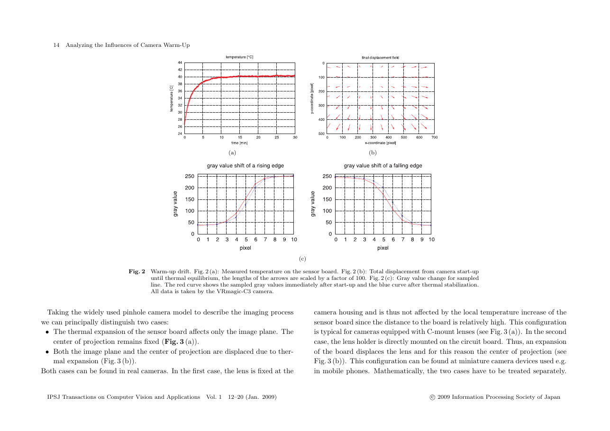
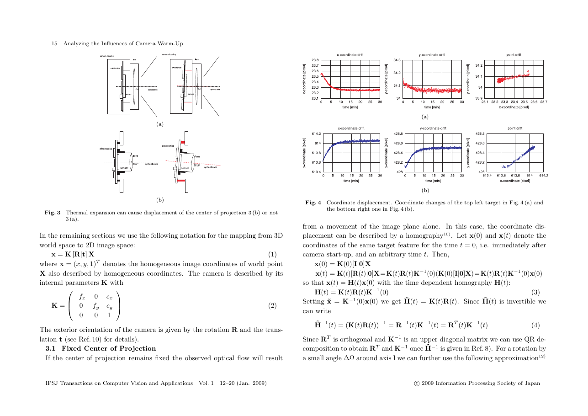
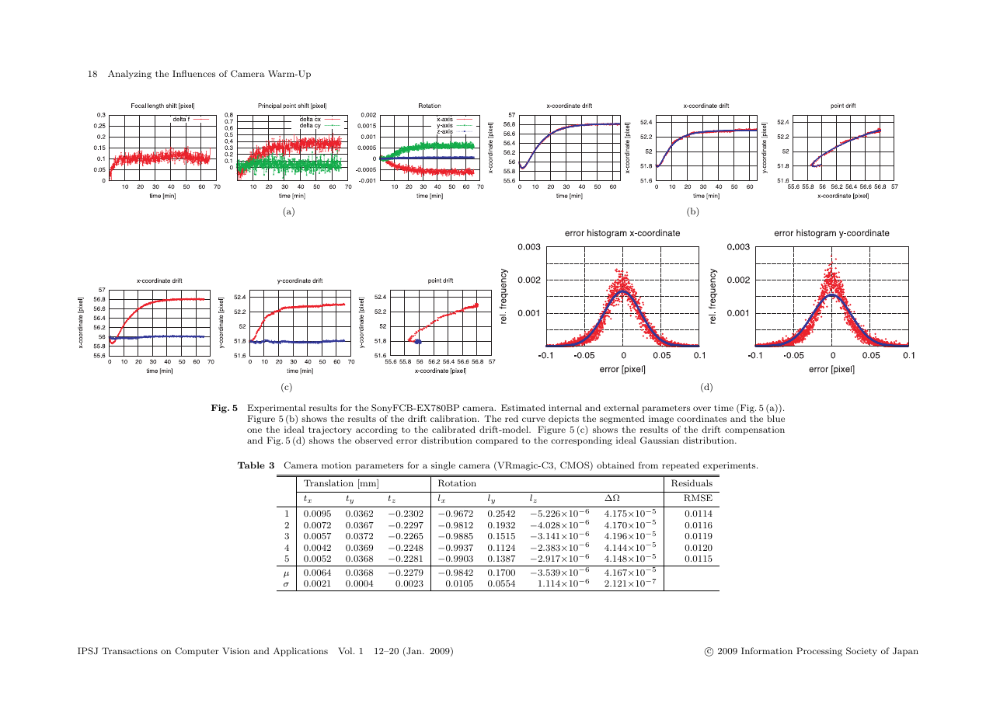

# 카메라 예열 효과가 영상 획득에 주는 영향 분석 (번역)

번역 범위: 전문 (초록, 본문, 그림과 표 캡션, 저자 소개. 참고문헌은 원문 그대로)
원문: [Handel2009_IPSJTCVA_camera_warmup.pdf](Handel2009_IPSJTCVA_camera_warmup.pdf)
서지: Holger Handel, IPSJ Transactions on Computer Vision and Applications, Vol. 1, pp. 12-20, 2009년 1월. doi:10.2197/ipsjtcva.1.12
번역 메모: 원문 PDF는 복사 금지 설정이 있으나 pdftotext로 본문을 뽑을 수 있었다. 수식은 원문 표기를 살려 옮겼다. 번역자 주석은 [역주]로 표시했다.

---

정규 논문

**카메라 예열 효과가 영상 획득에 주는 영향 분석**

Holger Handel (하이델베르크 대학 계산의학연구소, 독일)

## 초록

이 논문은 카메라 예열이 영상 획득 과정에, 따라서 분할한 영상 특징의 정확도에 주는 영향을 조사한다.
실험 연구를 바탕으로, 카메라를 켠 뒤 영상이 수십분의 1 픽셀 정도 밀린다는 것을 보인다.
이 드리프트는 센서 보드의 온도와 상관이 있고, 카메라가 열평형에 이르면 멈춘다.
관측된 영상 흐름을 더 조사하면, 그 원인은 카메라 기계 부품의 열팽창 때문에 영상 센서가 조금 움직이는 데 있다.
이 센서 이동은 사영 기하의 표준 방법에 두 지수 감쇠항(bi-exponential decay)을 더해 시간 의존성을 모형화할 수 있다.
제안한 모형의 파라미터는 교정할 수 있고, 교정한 값으로 예열 효과를 보상할 수 있다.
추가 실험에서 이 방법이 여러 종류의 카메라에 적용되며, 예열 거동이 카메라 한 대마다 고유하다는 것을 보인다.

## 1. 서론

지난 몇 년 동안 카메라 모형화와 교정에 많은 연구가 있었다 2),10),17),20).
3차원 세계 공간을 2차원 영상 공간으로 옮기는 대표적인 방법은 잘 알려진 핀홀 카메라 모형이다.
이상적인 핀홀 모형은 방사 왜곡과 편심 왜곡 4),5),18), 그리고 센서 평면이 평평하지 않은 효과 7)까지 다루도록 파라미터가 확장되어 왔다.
이 확장 덕분에 카메라 모형이 더 현실적이고 정확해졌다(정확도 평가는 Weng 외 18) 참고).
순수한 기하 측면 말고도, 카메라 센서의 전기적 성질과 그것이 영상 획득에 주는 영향에 대한 연구도 있었다.
관련 변수로 암전류, 고정 패턴 잡음, 라인 지터가 있다 3),11),13).

드물게 연구된 측면이 카메라 예열이 영상 형성에 주는 효과다.
Beyer는 카메라를 켠 뒤 첫 한 시간 동안 측정 영상 좌표가 수십분의 1 픽셀 정도 드리프트한다고 보고했다 1).
Wong 외 19)와 Robson 외 14)도 같은 효과를 보고했다.
그러나 이들은 모두 예열로 생기는 드리프트 왜곡을 보고만 했을 뿐, 관측된 영상 드리프트의 원인을 더 설명하거나, 이 왜곡을 모형화하고 보상하는 방법을 내놓지 않았다.

오늘날 머신비전 기술은 산업 생산이나 의료처럼 민감한 분야로 크게 넓어졌다.
이런 분야에서는 센서 예열 때문에 영상 특징 분할에 생기는 수십분의 1 픽셀 오차가 큰 복원 오차로 이어질 수 있다.
문헌 15)에서는 광학 추적 시스템이 켜진 뒤 첫 30분 동안 최대 1 mm의 측정 드리프트를 보였다고 한다.
많은 컴퓨터 보조 수술 응용에서 이런 복원 오차는 받아들일 수 없다.
그래서 카메라 예열이 영상 획득에 주는 영향을 더 잘 이해하는 것이 중요하다.

이 논문에서는 카메라 예열이 영상 형성에 주는 영향을 조사한다.
분할한 특징점의 좌표가 카메라 예열 동안 영상이 겪는 드리프트 움직임 때문에 오염된다는 것을 보인다.
우리 의견으로는 이 드리프트의 원인은 카메라 기계 부품의 열팽창이며, 그 결과 영상 형성 기하가 조금 바뀐다.
우리는 바뀌는 영상 형성 기하의 모형을 만들고, 이 모형으로 카메라 예열 기간의 영상 분할 왜곡을 보상할 수 있게 한다.
끝으로 방법의 적용 가능성을 뒷받침하는 추가 실험 결과를 낸다.

논문의 구성은 다음과 같다.
2절은 예열 드리프트를 관측한 기본 실험 구성과 영상 분할 방법을 설명한다.
3절은 예열 드리프트 모형과 관련 파라미터의 교정 방법을 제시한다. 또한 널리 쓰는 왜곡 보정 모형에 쉽게 끼워 넣을 수 있는 영상 드리프트 보상 절차를 설명한다.
4절은 여러 종류의 카메라로 한 추가 실험을 제시한다.

## 2. 예열 드리프트 관측

이 절은 카메라 예열의 효과를 조사하는 데 쓴 기본 실험 구성과 영상 처리 기법을 설명한다.
초기 실험의 결과를 설명하며, 이 결과로 카메라 예열의 영향에 대한 수학 모형을 만든다.

> 그림 1 (a). 교정 패턴 영상의 예 (VRmagic-C3 카메라로 촬영).
> [역주] 그림 1은 원문 13쪽에 있다. 검은 판 위 흰 원형 표적의 사진이라 이미지로 따로 넣지 않았다.

### 2.1 특징점 분할

카메라를 켠 뒤 온도 변화의 영향을 분석하려고, 검은 금속판에 흰 원형 표적을 인쇄한 평면 시험판을 카메라(640 × 480 CMOS 센서) 앞에 설치한다.
시험 패턴은 카메라 시야 전체를 덮도록 배치하고, 전체 구성은 단단히 고정한다.
표적의 중심점은 먼저 문턱값 기법으로 분할한다.
표적 중심 좌표는 문헌 6)의 방법으로 다듬는다.
표적마다 초기 중심에서 시작하는 여러 광선을 따라 명암값을 표본화하다가, 명암 에지가 검출되면 멈춘다.
찾은 에지 위치는 모멘트 보존법 16)으로 부화소 정밀도까지 다듬는다.
그림 1 (a)는 카메라에 보이는 교정 패턴의 예다.

다음으로, 표적마다 찾은 부화소 에지 점들에 최소제곱 최적화로 타원을 맞춘다.
맞춘 타원의 중심을 카메라를 켠 뒤 지난 시간과 함께 저장한다.
이 분할 과정을 계속 반복하다가 약 30분 뒤 멈춘다.
같은 시간에 센서 보드의 온도를 잰다.
얻은 자료의 시간 해상도는 약 3초다.

### 2.2 기본 결과

시험 패턴과 카메라의 상대 위치가 고정되어 있으므로, 분할한 표적 중심 좌표는 잡음을 빼면 시간에 따라 체계적으로 바뀌지 않아야 한다.
실험 결과는 그림 2와 그림 4에 있다.

> 그림 2. 예열 드리프트. 그림 2 (a): 센서 보드에서 잰 온도. 그림 2 (b): 카메라를 켠 순간부터 열평형까지의 전체 변위. 화살표 길이는 100배로 키웠다. 그림 2 (c): 표본화한 선을 따른 명암값 변화. 빨간 곡선은 켠 직후의 명암값, 파란 곡선은 열 안정화 뒤의 명암값이다. 모든 자료는 VRmagic-C3 카메라로 찍었다.
> [역주] 그림 2 (a)를 눈으로 읽으면 온도는 약 27 °C에서 시작해 약 10분에 38~39 °C, 약 15분 뒤 40 °C 근처에서 평평해진다. 그림 2 (c) 위 두 그래프의 제목은 "상승 에지의 명암값 이동", "하강 에지의 명암값 이동"이다.

그림 2 (b)에서 분명히 보이듯, 분할한 특징점은 시간에 따라 고정되어 있지 않고 예열 기간이 끝난 뒤 체계적으로 밀려 있다.
그림 4는 관측된 변위장을 더 자세히 보여 준다.
그림 4 (a)는 영상 평면 왼쪽 위에 있는 특징의 정확한 궤적(시간에 따른 x, y 좌표 변화)이고, 그림 4 (b)는 오른쪽 아래에 있는 특징의 같은 그래프다.
이 초기 관측에서 카메라 예열의 효과를 다음처럼 요약할 수 있다.

- 카메라의 예열 기간 동안 특징점의 드리프트가 관측된다.
- 관측은 문헌의 보고(특히 1))와 맞는다.
- 드리프트는 잰 온도와 상관이 있다.
- 카메라 온도가 열평형에 이르면 드리프트가 멈춘다.
- 드리프트는 센서 평면 전체에서 균일하지 않다.
- 패턴은 완전히 고정되어 있고 온도 변화에 노출되지 않으므로, 드리프트의 원인은 카메라나 그 장착부에 있어야 한다.

## 3. 예열 드리프트 모형화

앞 절의 초기 결과에 따라, 우리는 관측된 흐름장이 카메라 기계 부품의 열팽창 때문에 영상 평면이 움직여서 생긴다고 본다.
그림 2 (a)에서 보듯, 카메라 전자 부품의 자기 발열로 온도가 15~20 K까지 오를 수 있고, 이것이 카메라 기계 부품의 열팽창을 일으킬 수 있다.
이 팽창은 영상 형성 기하를 바꾸고, 그 결과 정지한 물체가 영상 평면에서 광학 흐름을 보인다.
기본 착상은 알려진 교정 장치의 관측 변위를 분석해 이 열로 생긴 카메라 움직임을 복원하는 것이다.

널리 쓰는 핀홀 카메라 모형으로 영상 형성을 설명하면, 원리상 두 경우를 나눌 수 있다.

- 센서 보드의 열팽창이 영상 평면에만 영향을 준다. 투영 중심은 고정이다(그림 3 (a)).
- 열팽창으로 영상 평면과 투영 중심이 함께 움직인다(그림 3 (b)).

두 경우 모두 실제 카메라에 있다.
첫째 경우에는 렌즈가 카메라 하우징에 고정되어 있어, 센서 보드와 거리가 비교적 멀기 때문에 센서 보드의 국소 온도 상승에 영향을 받지 않는다.
이 구성은 C 마운트 렌즈를 단 카메라에서 흔하다(그림 3 (a)).
둘째 경우에는 렌즈 홀더가 회로 기판에 바로 붙어 있다.
그래서 기판이 팽창하면 렌즈가 움직이고, 따라서 투영 중심도 움직인다(그림 3 (b)).
이 구성은 휴대전화 같은 소형 카메라 장치에서 볼 수 있다.
수학적으로 두 경우는 따로 다뤄야 한다.

> 그림 3. 열팽창은 투영 중심을 움직일 수도 있고(3 (b)), 움직이지 않을 수도 있다(3 (a)).
>
> 그림 4. 좌표 변위. 그림 4 (a)는 왼쪽 위 표적의 좌표 변화, 그림 4 (b)는 오른쪽 아래 표적의 좌표 변화.
> [역주] 그림 4를 눈으로 읽으면, 왼쪽 위 표적은 x가 약 23.55에서 23.25 px로 약 0.3 px, y는 약 0.05 px 움직이고 약 10분 안에 평평해진다. 오른쪽 아래 표적은 x가 약 613.6에서 614.05 px로 약 0.4 px, y가 약 428.05에서 428.5 px로 약 0.45 px 움직이며 약 10~15분 뒤 평평해진다. 두 표적의 이동 방향이 다르다(불균일 흐름장).

남은 절에서는 3차원 세계 공간에서 2차원 영상 공간으로의 사상에 다음 표기를 쓴다.

x = K [R|t] X  (1)

여기서 x = (x, y, 1)^T 는 세계 점 X의 동차 영상 좌표이고, X도 동차 좌표로 쓴다.
카메라는 내부 파라미터 K로 기술된다.

K = [[fx, 0, cx], [0, fy, cy], [0, 0, 1]]  (2)

카메라의 외부 방향은 회전 R과 이동 t로 주어진다(자세한 내용은 문헌 10)).

### 3.1 투영 중심이 고정된 경우

투영 중심이 고정이면, 관측되는 광학 흐름은 영상 평면의 움직임만으로 생긴다.
이 경우 좌표 변위는 호모그래피로 기술할 수 있다 10).
x(0)과 x(t)를 각각 시각 t = 0(카메라를 켠 직후)과 임의의 시각 t에서 같은 표적 특징의 좌표라 하자. 그러면

x(0) = K(0)[I|0]X
x(t) = K(t)[R(t)|0]X = K(t)R(t)K^-1(0)(K(0)[I|0]X) = K(t)R(t)K^-1(0)x(0)

이므로 시간에 따른 호모그래피 H(t)로 x(t) = H(t)x(0)이다.

H(t) = K(t)R(t)K^-1(0)  (3)

x̃ = K^-1(0)x(0)으로 두면 H̃(t) = K(t)R(t)이다. H̃(t)는 가역이므로

H̃^-1(t) = (K(t)R(t))^-1 = R^-1(t)K^-1(t) = R^T(t)K^-1(t)  (4)

로 쓸 수 있다.
R^T는 직교 행렬이고 K^-1은 위 삼각 행렬이므로, H̃^-1이 주어지면 QR 분해로 R^T와 K^-1을 얻을 수 있다(문헌 8)).
축 l 둘레로 작은 각 ΔΩ만큼 회전하면 다음 근사를 더 쓸 수 있다 12).

R(t) = I + W(t)ΔΩ(t) + O(ΔΩ²)  (5)

여기서 행렬 W(t)는

W(t) = [[0, -l3(t), l2(t)], [l3(t), 0, -l1(t)], [-l2(t), l1(t), 0]]  (6)

이다.
벡터 l은 단위 벡터라 자유도가 2이다.
회전을 3성분 벡터 l̃ = ΔΩ l로 나타낼 수 있다. l̃에서 ΔΩ = ‖l̃‖, l = l̃/‖l̃‖를 얻는다.
호모그래피 H̃(t)는

H̃(t) = (K(0) + ΔK(t))R(t)  (7)

이 된다. 여기서 ΔK(t)는 원래 카메라 파라미터에 대한 시간 의존 변화량이다.

ΔK(t) = [[Δfx(t), 0, Δcx(t)], [0, Δfy(t), Δcy(t)], [0, 0, 0]]  (8)

따라서 H̃(t)는 시간 의존 파라미터 7개로 정해진다.
내부 카메라 파라미터의 변화 Δfx(t), Δfy(t), Δcx(t), Δcy(t)와 외부 방향 l̃1(t), l̃2(t), l̃3(t)이다.
실험 연구 결과(자세한 내용은 4절)에 따라 시간 의존 파라미터에 두 지수 함수를 고른다.

f(t) = a0(1 - e^(-k1 t)) + a1(1 - e^(-k2 t))  (9)

f(t)는 f(0) = 0, 따라서 H(0) = I가 되도록 매개화했다.
f(t)는 네 파라미터 a0, a1, k1, k2로 정해지고 H̃(t)에는 시간 의존 파라미터가 7개 있으므로, 전체 예열 모형은 파라미터 28개로 이뤄진다.
4절에서 실제로는 전체 파라미터 수를 줄일 수 있음을 보인다.

### 3.2 투영 중심이 움직이는 경우

이 경우에는 투영 중심과 영상 평면이 똑같이 평행 이동한다고 단순화한다. 곧 예열 기간 동안 촬상 장치의 내부 파라미터는 그대로라고 가정한다.
이 가정은 뒤에서 실험으로 정당화한다.
그러면 다음 관계를 얻는다.

x(0) = K [I|0] X
x(t) = K [R(t)|t(t)] X

관측 표적이 평면 위에 있으므로 일반성을 잃지 않고 X = (x, y, 0, 1)^T로 둘 수 있다.
따라서 영상 좌표 변화를 다시 호모그래피로 기술할 수 있다(엄밀한 다룸은 문헌 20)).

x(t) = K [r1(t) r2(t) t(t)] x̃(0)  (10)

여기서 ri(t)는 R(t)의 i번째 열이고 x̃(0) = K^-1 x(0)이다.
따라서 H(t) = K [r1(t) r2(t) t(t)]이다.
호모그래피 H(t)가 주어지면 외부 파라미터를 다음처럼 계산할 수 있다 20).

r1 = λK^-1 h1
r2 = λK^-1 h2
r3 = r1 × r2
t = λK^-1 h3

이때 λ = 1/‖K^-1 h1‖이다.
회전 R(t)를 축-각 표기로 쓰면, 시간 의존 파라미터 6개를 얻는다. 회전 파라미터 l̃1(t), l̃2(t), l̃3(t)와 이동 파라미터 t1(t), t2(t), t3(t)이다.
여기서도 파라미터 값의 시간 거동을 두 지수항으로 기술한다.
따라서 파라미터는 24개다.

### 3.3 예열 모형 교정

앞 절에서 카메라 예열 동안 분할한 영상 특징의 좌표 변위를 모형화하는 방법을 보였다.
이제 모형의 파라미터를 교정하는 알고리즘을 개략한다.

1. 카메라를 켠 직후 찍은 몇 장의 영상으로 문헌 20) 또는 17)의 방법을 써서 내부 카메라 파라미터를 정한다. 얻은 값을 각각 K(0) 또는 K로 쓴다.
2. 표적 중심점을 계속 분할해 영상 좌표를 모은다.
3. 분할한 영상마다 호모그래피 H(t)를 구한다(문헌 10), 12)).
4. 카메라 종류에 따라 3.1절 또는 3.2절의 분해 방법을 써서 내부, 외부 파라미터 값을 얻는다.
5. 카메라 파라미터마다 그 값에 두 지수 함수를 맞춘다.
6. 28개(또는 24개) 파라미터 전부에 대해 다음 식을 최소화하는 비선형 최소제곱 최적화(예: Levenberg-Marquardt 알고리즘)를 한다.

Σ_{j=1..M} Σ_{i=1..N} ‖x^j(ti) - H(ti; β)x^j(0)‖²  (11)

여기서 M은 특징점 수이고 β는 현재 파라미터 벡터다.

### 3.4 예열 드리프트 보상

교정한 예열 모형이 있으면 센서 예열이 영상 형성에 주는 영향을 고려할 수 있다.
투영 중심이 고정인 카메라에서는 영상 좌표 보정이 간단하다.
카메라를 켠 뒤 시각 t에 관측한 영상 좌표 xo가 주어지면, H(t)의 역행렬을 곱해 왜곡을 없앤 영상 좌표 xu를 계산할 수 있다.

xu = H^-1(t) xo  (12)

이 보정은 장면 구조, 곧 관측한 세계 점이 카메라에서 얼마나 떨어져 있는지와 무관하다.
그림 5 (c)는 이 드리프트 보정의 결과를 보여 준다.
투영 중심이 고정이 아닌 둘째 경우에는, 관측 특징점의 영상 변위가 장면 안 위치에 따라 달라지므로 일반적으로 영상 좌표를 바로 보정할 수 없다.
이 경우 드리프트 모형은 카메라 위치를 그에 맞게 고치는 복원 알고리즘 안에서만 쓸 수 있다.

## 4. 실험 결과

이 절은 제안한 예열 모형의 적용 가능성을 뒷받침하는 실험 연구를 제시한다.
2절의 실험을 서로 다른 두 종류의 카메라로 했다.
하나는 VRmagic-C3로, 렌즈가 회로 기판에 바로 붙은 소형 카메라다. CMOS 기반 능동 화소 센서를 쓴다.
다른 하나는 SonyFCB-EX780BP로, CCD 기반 카메라이며 렌즈가 센서 회로 기판에 바로 붙어 있지 않다.
처음 추정한 움직임 파라미터는 그림 5에 있다.
그림에서 보듯, 카메라 파라미터의 시간 의존성을 두 지수 함수로 기술한 선택은 타당해 보인다.
또한 일부 카메라 파라미터에는 단순 지수항 하나로 충분해 전체 파라미터 수를 줄일 수 있다.
그림 5 (b)와 그림 6 (b)는 고른 모형이 관측된 영상 변위를 설명하는 데 적용 가능함을 보여 준다.
그림 5 (d)는 Sony 카메라에서 관측 영상 좌표와 예측 좌표 사이 오차의 히스토그램이고, 그림 6 (c)는 VRmagic 카메라의 같은 그래프다.
표 1과 표 2는 해당 오차 히스토그램의 파라미터다.
남은 오차는 거의 가우스 분포이거나 초가우스(super-Gaussian) 분포다.
그림 5 (c)는 3.4절에서 설명한 드리프트 보정의 결과다.

**표 1. SonyFCB-EX780BP의 오차 통계**

| | 평균 | 표준편차 | 첨도 |
|---|---|---|---|
| x | -3.0250 ×10^-5 | 0.0241 | 3.6251 |
| y | -5.4138 ×10^-5 | 0.0257 | 5.7161 |

**표 2. VRmagic-C3의 오차 통계**

| | 평균 | 표준편차 | 첨도 |
|---|---|---|---|
| x | -6.717×10^-7 | 0.0079 | 7.5030 |
| y | 1.4355×10^-6 | 0.0083 | 15.6284 |

[역주] 표의 단위는 원문에 적혀 있지 않으나 그림 5 (d)의 가로축이 "error [pixel]"이므로 픽셀로 본다.

둘째 실험에서는 교정의 반복성을 살펴본다.
카메라 한 대에 대해 드리프트 모형을 되풀이해 교정했다.
자료는 몇 주에 걸쳐 모았다.
표 3은 그 결과 파라미터다.
표에는 카메라가 열평형에 이르렀을 때의 움직임 파라미터 값이 있다.
파라미터 사이의 편차가 꽤 작으므로, 예열 거동이 특정 장치에 고유하다는 것을 결과가 보여 준다.

> 그림 5. SonyFCB-EX780BP 카메라의 실험 결과. 시간에 따라 추정한 내부, 외부 파라미터(그림 5 (a)). 그림 5 (b)는 드리프트 교정 결과다. 빨간 곡선은 분할한 영상 좌표이고 파란 곡선은 교정한 드리프트 모형에 따른 이상 궤적이다. 그림 5 (c)는 드리프트 보상 결과이고, 그림 5 (d)는 관측 오차 분포를 해당 이상 가우스 분포와 비교한 것이다.
> [역주] 그림 5 (a)의 세 그래프 제목은 "초점거리 변화 [pixel]", "주점 변화 [pixel]", "회전"이다. 눈으로 읽으면 초점거리 변화는 약 0.1 px, 주점 cx 변화는 약 0.35~0.4 px, cy는 0 근처다. 그림 5 (b), (c)에서 x 좌표는 약 55.9에서 56.8 px로 약 0.9 px, y 좌표는 약 51.8에서 52.3 px로 약 0.5 px 움직이고, 약 30~40분 뒤 평평해진다. 보상 뒤(파란 선, 그림 5 (c))는 거의 평평하다. 시간축은 약 65분까지다.

**표 3. 카메라 한 대(VRmagic-C3, CMOS)의 반복 실험으로 얻은 카메라 움직임 파라미터**

| | tx [mm] | ty [mm] | tz [mm] | lx | ly | lz | ΔΩ | 잔차 RMSE |
|---|---|---|---|---|---|---|---|---|
| 1 | 0.0095 | 0.0362 | −0.2302 | −0.9672 | 0.2542 | −5.226×10^−6 | 4.175×10^−5 | 0.0114 |
| 2 | 0.0072 | 0.0367 | −0.2297 | −0.9812 | 0.1932 | −4.028×10^−6 | 4.170×10^−5 | 0.0116 |
| 3 | 0.0057 | 0.0372 | −0.2265 | −0.9885 | 0.1515 | −3.141×10^−6 | 4.196×10^−5 | 0.0119 |
| 4 | 0.0042 | 0.0369 | −0.2248 | −0.9937 | 0.1124 | −2.383×10^−6 | 4.144×10^−5 | 0.0120 |
| 5 | 0.0052 | 0.0368 | −0.2281 | −0.9903 | 0.1387 | −2.917×10^−6 | 4.148×10^−5 | 0.0115 |
| μ | 0.0064 | 0.0368 | −0.2279 | −0.9842 | 0.1700 | −3.539×10^−6 | 4.167×10^−5 | |
| σ | 0.0021 | 0.0004 | 0.0023 | 0.0105 | 0.0554 | 1.114×10^−6 | 2.121×10^−7 | |

[역주] 원문 표에서 lx, ly, lz와 ΔΩ는 "Rotation" 묶음 아래, RMSE는 "Residuals" 아래에 있다. ΔΩ와 RMSE의 단위는 원문에 없다.

> 그림 6. VRmagic-C3 카메라의 실험 결과. 시간에 따라 추정한 외부 카메라 파라미터(그림 6 (a)). 그림 6 (b)는 점 좌표의 예측 궤적(파랑)과 관측 궤적(빨강)을 비교한다. 그림 6 (c)는 관측 오차 분포를 해당 이상 가우스 분포와 비교한 것이다.
> [역주] 그림 6은 원문 19쪽에 있다. 이미지로 넣지 않았다.

> 그림 7. SonyFCB-EX780BP의 카메라 예열 동안 최종 변위. 길이를 50배로 키웠다.
> [역주] 그림 7은 원문 20쪽에 있다. 이미지로 넣지 않았다.

## 5. 결론

카메라 예열이 분할한 영상 특징의 좌표에 주는 영향을 연구했다.
실험 관측을 바탕으로 영상 드리프트 모형과 그 보상 방법을 만들었다.
특정 카메라에 대해 예열 모형을 한 번 교정하면, 그 파라미터를 드리프트 보상에 쓸 수 있다.
우리의 변위 보정 식은 컴퓨터 비전 분야에서 널리 쓰는 사영 틀에 잘 맞는다.
따라서 컴퓨터 비전의 표준 카메라 모형을 쉽게 확장해 예열 효과를 고려할 수 있다.
추가 실험 평가에서 우리 예열 모형은 원리상 모든 종류의 디지털 카메라에 적용할 수 있고, 예열 거동이 특정 카메라에 고유하다는 것을 보였다.
앞으로는 카메라 온도를 직접 얻으려고 기판 온도 센서가 있는 카메라를 쓸 계획이다.
여기 제시한 모형은 카메라를 켠 뒤 지난 시간을 기준으로 한다. 이는 온도가 늘 비슷하게 변하고 주변 온도가 크게 바뀌지 않는다는 가정에 기댄다. 대부분의 실내 응용에서는 흔히 이렇게 가정할 수 있다.
시간 대신 온도를 직접 재면 정확도가 더 오를 것이다.

## 참고문헌 (원문 그대로)

1) Beyer, H.A.: Geometric and radiometric analysis of a CCD-camera based photogrammetric close-range system, Dissertation No.9701, ETH, Zürich (1992).
2) Brown, D.C.: Close-range camera calibration, Photogrammetric Engineering, Vol.37, No.8, pp.855–866 (1971).
3) Clarke, T.A.: A Frame Grabber Related Error In Subpixel Target Location, The Photogrammetric Record, Vol.15, No.86, pp.315–322 (1995).
4) Devernay, F. and Faugeras, O.: Straight lines have to be straight, MVA, Vol.13, No.1, pp.14–24 (2001).
5) El-Melegy, M. and Farag, A.: Nonmetric lens distortion calibration: Closed-form solutions, robust estimation and model selection, Proc. ICCV, pp.554–559 (2003).
6) Förstner, W. and Gülch, E.: A Fast Operator for Detection and Precise Location of Distinct Points, Corners and Centers of Circular Features, ISPRS Intercommission Workshop on Fast Processing of Photogrammetric Data (1987).
7) Fraser, C.S., Shortis, M.R. and Ganci, G.: Multi-sensor system self-calibration, SPIE Proceedings, Vol.2598, pp.2–15 (1995).
8) Golub, G.H. and VanLoan, C.F.: Matrix computations, Johns Hopkins University Press (1997).
9) Handel, H.: Analyzing the Influences of Camera Warm-Up Effects on Image Acquisition, ACCV 2007, Vol.4844, pp.258–268 (2007).
10) Hartley, R.I. and Zisserman, A.: Multiple View Geometry in Computer Vision, Cambridge University Press (2000).
11) Healey, G. and Kondepudy, R.: Radiometric CCD camera calibration and noise estimation, PAMI, Vol.16, No.3, pp.267–276 (1994).
12) Kanatani, K.: Geometric Computation for Machine Vision, Oxford University Press (1993).
13) Ortiz, A. and Oliver, G.: Radiometric calibration of CCD sensors: dark current and fixed pattern noise estimation, IEEE International Conference on Robotics and Automation, Vol.5, pp.4730–4735 (2004).
14) Robson, S., Clarke, T.A. and Chen, J.: Suitability of the Pulnix TM6CN CCD camera for photogrammetric measurement, SPIE Proceedings, Videometrics II, Vol.2067, pp.66–77 (1993).
15) Seto, E., Sela, G., McIlroy, W.E., Black, S.E., Staines, W.R., Bronskill, M.J., McIntosh, A.R. and Graham, S.J.: Quantifying Head Motion Associated with Motor Tasks Used in fMRI, NeuroImage, Vol.14, pp.284–297 (2001).
16) Tabatabai, A.J. and Mitchell, O.R.: Edge location to subpixel values in digital imagery, IEEE transactions on pattern analysis and machine intelligence, Vol.6, No.2, pp.188–201 (1984).
17) Tsai, R.Y.: A Versatile Camera Calibration Technique for 3D Machine Vision, IEEE Journal for Robotics & Automation, Vol.RA-3, No.4, pp.323–344 (1987).
18) Weng, J., Cohen, P. and Herniou, M.: Camera calibration with distortion models and accuracy evaluation, IEEE Transactions on Pattern Analysis and Machine Intelligence, Vol.14, No.10, pp.965–980 (1992).
19) Wong, K.W., Lew, M. and Ke, Y.: Experience with two vision systems, Close Range Photogrammetry meets machine vision, Vol.1395, pp.3–7 (1990).
20) Zhang, Z.: A Flexible New Technique for Camera Calibration, IEEE Transactions on Pattern Analysis and Machine Intelligence, Vol.22, No.11, pp.1330–1334 (2000).

(Received February 28, 2008) (Accepted October 16, 2008) (Released January 30, 2009) (Communicated by Tomas Pajdla)

## 저자 소개

Holger Handel은 1980년에 태어났다.
2004년 만하임 대학에서 컴퓨터과학 디플롬(석사 상당)을 받았다.
2005년 만하임 대학 계산의학연구소(ICM)의 박사과정생이 되었고, 이 연구소는 2008년 하이델베르크 대학으로 옮겨졌다.
현재 연구 관심은 컴퓨터 보조 수술(CAS) 분야의 컴퓨터 비전 기술 응용, 특히 의료용 광학 추적 시스템의 정확도 평가와 개선이다.
