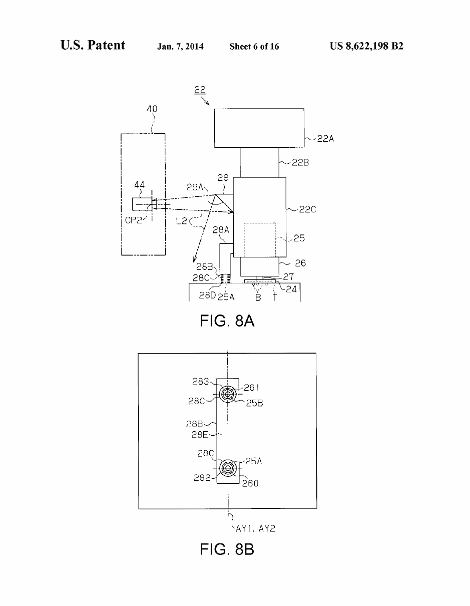
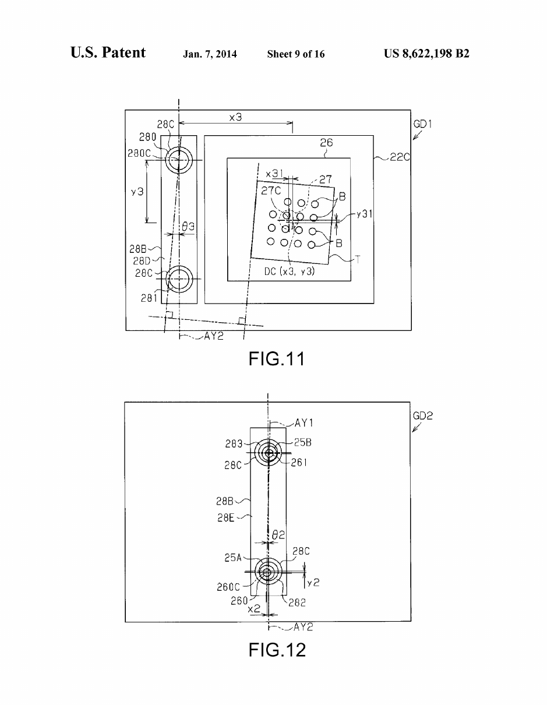
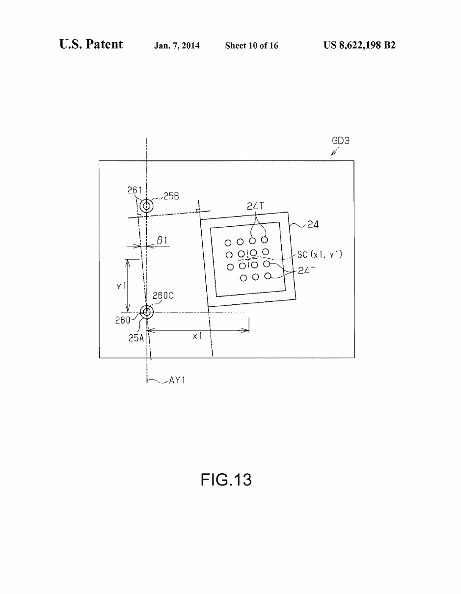

# 부품 이송 장치 및 IC 핸들러 (US 8,622,198 B2 번역)

번역 범위: 전문 (요약, 명세서 본문, 도면 설명, 청구항 21개. 서지면의 인용 문헌은 맨 끝에 원문 그대로 옮겼다)
원문: [US8622198B2.pdf](US8622198B2.pdf) (patentimages.storage.googleapis.com에서 2026-11-04 받음, 32쪽, 스캔 공보)
본문 출처: 원문 PDF의 글자층은 OCR 오류가 많아서, 같은 공보의 Google Patents 본문 텍스트(https://patents.google.com/patent/US8622198B2/en)를 번역 대본으로 썼다. 도면은 원문 PDF에서 뽑았다.
서지: US 8,622,198 B2, 등록 2014-01-07. 출원 13/275,619 (2011-10-18). 공개 US 2012/0034052 A1 (2012-02-09). 12/127,236 (2008-05-27 출원, 포기)의 계속 출원. 우선권 JP 2007-165406 (2007-06-22). 출원인 Seiko Epson Corporation. 발명자 Takashi Yamazaki, Hiroaki Fujimori, Naohisa Maeda, Daisuke Kirihara, Satoshi Nakamura, Masami Maeda.
번역 메모: 원문의 부호 번호(22C, 280 등)는 그대로 두었다. 원문 오타로 보이는 곳은 [역주]로 적었다.

---

## 요약 (Abstract)

장치는 다음을 포함한다.
- 셔틀과 소켓 사이를 움직이는 유지 장치(retainer)
- 부품을 잡는 누름 장치(presser)
- 누름 장치를 움직이는 조정 장치(adjuster)
- 소켓 근처의 소켓 마크
- 유지 장치가 부품 장착 위치에 있을 때 소켓 마크 근처에 오는 핸드 마크
- 부품과 핸드 마크를 담은 제1 영상을 찍는 제1 카메라
- 소켓 마크와 소켓을 담은 제2 영상, 그리고 소켓 마크와 핸드 마크를 담은 제3 영상을 찍는 제2 카메라
- 제2 영상에서 소켓 마크와 소켓 사이의 제1 상대 위치를 구하는 제1 계산부
- 제3 영상에서 소켓 마크와 핸드 마크 사이의 제2 상대 위치를 구하는 제2 계산부
- 제1 영상에서 핸드 마크와 부품 사이의 제3 상대 위치를 구하는 제3 계산부

조정 장치는 이 상대 위치들을 바탕으로 부품의 위치를 보정한다.

---

## 관련 출원

이 출원은 2008년 5월 27일 출원한 미국 특허 출원 12/127,236의 계속 출원이다. 그 출원은 2007년 6월 22일 출원한 일본 특허 출원 2007-165406에 우선권을 주장한다. 그 내용 전체를 참조로 여기에 넣는다.

## 배경

### 1. 기술 분야

이 발명은 부품 이송 장치와 IC 핸들러에 관한 것이다.

### 2. 관련 기술

반도체 칩 같은 전자 부품을 검사하는 장치(IC 핸들러)에는 보통 부품을 옮기는 이송 로봇이 여러 대 있다. 이송 로봇은 검사 전 부품을 검사 소켓에 넣어 품질을 재게 하고, 검사가 끝난 부품을 소켓에서 꺼낸다.

예를 들면 이렇다. 공급 로봇이 검사 전 부품을 흡착해 잡은 뒤 셔틀의 공급 포켓에 내려놓는다. 셔틀은 부품을 측정 로봇이 있는 곳까지 옮기고, 측정 로봇이 부품을 흡착해 잡는다. 측정 로봇은 검사 전 부품을 셔틀에서 검사 소켓으로 옮긴다. 검사가 끝나면 측정 로봇이 다시 부품을 흡착해 검사 소켓에서 셔틀의 회수 포켓으로 옮긴다. 셔틀은 검사한 부품을 회수 로봇 쪽으로 옮기고, 회수 로봇은 검사 결과에 따라 부품을 회수 트레이에 내려놓는다.

로봇이 부품을 검사 소켓과 포켓으로 차례로 옮길 때, 부품은 소켓과 포켓의 정해진 위치에 놓여야 한다. 특히 검사 소켓에 넣을 때는 소켓의 측정 단자와 부품의 단자가 알맞게 닿아야 한다. 그래서 부품과 검사 소켓의 상대 위치 어긋남을 가능한 한 줄여야 한다. 포켓에 넣을 때도 포켓과 부품의 상대 어긋남을 줄이는 것이 좋다.

부품과 검사 소켓 등의 상대 어긋남을 줄이는 방법이 알려져 있다. 먼저 카메라로 부품, 검사 소켓 등을 찍어 영상 자료를 얻는다. 다음 영상 처리로 상대 어긋남을 계산하고, 그 결과만큼 위치를 보정한다.

예를 들어 부품과 소켓 등의 상대 어긋남을 보정하는 방법이 공개되어 있다(예: WO 2003/023430). 이 방법의 IC 핸들러에서는 검사 전 부품을 셔틀에서 시험 장치로 옮길 때, 셔틀과 시험 소켓(시험 장치) 사이에 있는 카메라가 이송 장치의 이송 헤드에 흡착된 부품을 찍는다. 또 이송 헤드에 달린 카메라가 시험 장치를 찍는다. IC 핸들러의 제어 장치는 두 영상을 처리해 부품과 시험 장치의 상대 어긋남을 계산한다. 그 결과로 이송 장치의 조정 기구를 움직여 이송 헤드 위치를 맞추고, 부품과 시험 장치의 어긋남을 보정한다.

또 검사한 부품을 셔틀에서 트레이로 옮길 때는, 픽 앤 플레이스(P&P) 로봇이 부품을 흡착해 셔틀에서 트레이로 옮긴다. IC 핸들러는 P&P 로봇을 로봇 이동 범위 안에 있는 카메라 위로 움직여, 카메라가 로봇에 흡착된 부품을 찍게 한다. 제어 장치는 이 영상을 처리해 부품과 트레이의 상대 어긋남을 계산하고, 그 결과로 로봇의 조정 기구를 움직여 어긋남을 보정한다.

그러나 이 방법에서는 이송 헤드와 시험 소켓의 상대 어긋남을 계산하려면 이송 헤드의 카메라를 매우 정밀하게 설치해야 한다. 더욱이 **열팽창과 수축, 진동 등으로 이송 헤드와 카메라의 상대 위치 관계가 바뀌면, 그 변화를 알아내 상대 어긋남 계산에 반영할 수 없다.**

그래서 부품과 시험 장치를 직접 찍는 방법이 공개되었다(예: 일본 특허 3063899). 이 방법의 IC 핸들러에는 거울이 달린 지지 부재에 카메라가 붙어 있다. 거울은 부품과 시험 장치 사이에 놓여 둘을 함께 비춘다. 검사 전 부품을 이송 장치가 잡고 시험 장치 위에서 마주 보게 놓으면, 카메라가 거울에 비친 두 상을 동시에 찍는다.

그러나 이 방법에서는 부품과 시험 장치가 함께 비치도록 거울을 놓고 맞추는 일이 복잡하다. 거울상을 찍도록 카메라를 놓고 맞추는 일도 어렵다. 게다가 부품과 시험 장치를 찍을 때 거울이 둘 사이에 들어가야 하므로, 거울을 넣고 빼는 데 시간이 든다.

## 발명의 요약

이 발명은 위 문제를 풀기 위한 것이다. 이 발명의 한 이점은 **기계적 뒤틀림, 열팽창과 수축 같은 변화를 필요할 때마다 반영하면서** 전자 부품을 소켓에 알맞게 넣는 부품 이송 장치를 주는 것이다. 다른 이점은 그 부품 이송 장치를 포함한 IC 핸들러를 주는 것이다.

이 발명의 제1 형태에 따른 부품 이송 장치는 다음을 포함한다.
- 셔틀
- 검사 소켓
- 셔틀과 검사 소켓 사이를 움직이는 유지 장치
- 유지 장치에 포함되어 전자 부품을 잡고 옮기는 누름 장치
- 전자 부품을 찍은 영상 자료의 영상 처리 결과로 누름 장치를 움직여 부품 위치를 보정하는 위치 조정 장치
- 검사 소켓 근처에 둔 소켓 마크
- 유지 장치에 둔 핸드 마크. 누름 장치가 잡은 부품을 검사 소켓에 넣는 장착 위치로 유지 장치가 움직이면, 핸드 마크가 소켓 마크 근처에 온다.
- 셔틀에 둔 제1 카메라. 누름 장치가 잡은 부품과 유지 장치의 핸드 마크를 담은 한 장의 영상을 찍는다.
- 제2 카메라. 소켓 마크와 검사 소켓을 담은 한 장의 영상, 그리고 소켓 마크와 장착 위치로 온 유지 장치의 핸드 마크를 담은 한 장의 영상을 찍는다.
- 제1 상대 위치 계산부. 소켓 마크와 검사 소켓을 담은 한 장의 영상을 처리해 소켓 마크와 검사 소켓 사이의 제1 상대 위치를 구한다.
- 제2 상대 위치 계산부. 소켓 마크와 장착 위치의 핸드 마크를 담은 한 장의 영상을 처리해 소켓 마크와 핸드 마크 사이의 제2 상대 위치를 구한다.
- 제3 상대 위치 계산부. 부품과 핸드 마크를 담은 한 장의 영상을 처리해 핸드 마크와 부품 사이의 제3 상대 위치를 구한다.

위치 조정 장치는 제1, 제2, 제3 상대 위치를 바탕으로 부품 위치를 보정해 부품을 검사 소켓에 넣는다.

이 형태의 장치에서 소켓 마크는 검사 소켓 근처에 있다. 그래서 제2 카메라가 검사 소켓과 소켓 마크를 한 장의 영상으로 찍고, 제1 상대 위치 계산부가 이 영상을 처리한다. 이렇게 검사 소켓과 소켓 마크의 제1 상대 위치를 얻는다. 또 유지 장치가 장착 위치에 오면 핸드 마크가 소켓 마크 근처에 놓인다. 그래서 제2 카메라가 핸드 마크와 소켓 마크를 한 장의 영상으로 찍고, 제2 상대 위치 계산부가 이 영상을 처리한다. 이렇게 유지 장치의 핸드 마크와 소켓 마크의 제2 상대 위치, 곧 유지 장치에 대한 소켓 마크의 상대 위치를 얻는다. 또 제1 카메라가 부품과 핸드 마크를 한 장의 영상으로 찍고, 제3 상대 위치 계산부가 이 영상을 처리한다. 이렇게 부품과 핸드 마크의 제3 상대 위치, 곧 유지 장치에 대한 부품의 상대 위치를 얻는다. 결과적으로 위치 조정 장치는 제1~제3 상대 위치로 부품을 검사 소켓에 맞는 위치로 옮길 수 있다.

구체적으로 말하면 이렇다.
- 검사 소켓과 소켓 마크 사이에 생긴 **설치에 따른 뒤틀림과 열팽창, 수축**은 제1 상대 위치에 반영된다.
- 소켓 마크와 핸드 마크(유지 장치) 사이에 생긴 뒤틀림과 온도에 따른 변화는 제2 상대 위치에 반영된다.
- 핸드 마크(유지 장치)에 대한 부품의 흡착 위치 어긋남은 제3 상대 위치에 반영된다.

결과적으로 부품 이송 장치 안의 설치 뒤틀림과 열팽창, 수축을 필요할 때마다 반영하면서 부품을 검사 소켓에 알맞게 넣을 수 있다.

또 장치 안의 이런 물리적 변화를 필요할 때마다 반영할 수 있으므로, 이 변화를 바로잡으려고 초기 설정인 교정을 다시 할 필요가 없다. 교정에 드는 시간과 일이 줄어든다.

바람직하게는, 부품 이송 장치가 제1 거울과 제2 거울을 포함한다. 제1 거울은 유지 장치에 달려 장착 위치의 소켓 마크와 핸드 마크를 제2 카메라 쪽으로 비춘다. 제2 거울은 검사 소켓 위의 반사 위치에서 소켓 마크와 검사 소켓을 제2 카메라 쪽으로 비춘다. 제2 카메라는 소켓 마크와 검사 소켓을 담은 영상을 직접 찍을 수 없는 곳, 그리고 소켓 마크와 장착 위치의 핸드 마크를 담은 영상을 직접 찍을 수 없는 곳에 있다. 제2 카메라는 장착 위치의 제1 거울을 거쳐 소켓 마크와 핸드 마크를 담은 영상을 찍고, 반사 위치의 제2 거울을 거쳐 소켓 마크와 검사 소켓을 담은 영상을 찍는다.

이 장치에서는 제2 카메라가 두 영상을 직접 찍을 수 없는 곳에 있어도 직접 찍는 것처럼 찍을 수 있다. 그래서 설치 자리가 매우 좁은 유지 장치와 검사 소켓 둘레에 제2 카메라를 더 자유롭게 둘 수 있다. 소켓 마크와 검사 소켓을 함께 찍는 일, 소켓 마크와 핸드 마크를 함께 찍는 일이 쉬워진다.

또 제1, 제2 거울이 있으므로, 제2 카메라 한 대로 두 영상을 모두 찍을 수 있다. 장치 구조가 단순해진다.

제1 형태의 장치에서 바람직하게는, 셔틀이 제1 카메라를 포함하고, 유지 장치와 셔틀이 제1 촬영 위치로 움직여 제1 카메라가 그곳에서 부품과 핸드 마크를 담은 한 장의 영상을 찍는다.

이 장치에서는 제1 카메라가 셔틀에 있다. 그래서 카메라 자리에 제약이 많은 유지 장치와 검사 소켓 둘레에 제1 카메라 자리를 따로 마련할 필요가 없다. 장치 구조가 단순해지고 제1 카메라 설치도 쉬워진다.

제1 형태의 장치에서 바람직하게는, 소켓 마크는 원형이고 핸드 마크는 소켓 마크보다 큰 고리형이어서, 장착 위치에서 소켓 마크가 고리형 핸드 마크 안에 놓인다.

이 장치에서는 원형 소켓 마크가 고리형 핸드 마크 안에 놓이므로, 상대 위치를 계산하는 영상 처리에서 소켓 마크 중심과 핸드 마크 중심을 쉽게 비교할 수 있다.

제1 형태의 장치에서 바람직하게는, 소켓 마크가 둘 이상이고, 핸드 마크가 각 소켓 마크에 대응하도록 있다.

이 장치에서는 예를 들어 소켓 마크 두 개와 핸드 마크 두 개를 쓰면, 두 소켓 마크를 잇는 선에 대한 두 핸드 마크를 잇는 선의 기울기를 알 수 있다. 그래서 두 선 사이의 기울기, 곧 각도 어긋남을 계산할 수 있다. 또 소켓 마크를 잇는 선과 소켓의 제1 변 사이의 기울기로 둘 사이의 각도 어긋남을 계산할 수 있다. 또 핸드 마크를 잇는 선과 부품의 제1 변 사이의 기울기로 둘 사이의 각도 어긋남을 계산할 수 있다. 결과적으로 부품 제1 변의 기울기와 검사 소켓 제1 변의 기울기를 얻어, 두 변 사이의 각도 어긋남을 계산할 수 있다. 이 각도 어긋남을 "0"으로 만들어 부품 위치를 검사 소켓 위치와 일치시키면 부품을 소켓에 알맞게 넣을 수 있다.

제1 형태의 장치에서 바람직하게는, 소켓 마크는 직사각형이고 핸드 마크는 소켓 마크보다 큰 직사각형 틀 모양이어서, 장착 위치에서 소켓 마크가 틀 모양 핸드 마크 안에 놓인다.

이 장치에서는 핸드 마크와 소켓 마크가 각각 하나뿐이어도, 두 직사각형의 중심을 비교해 상대 위치를 계산하고, 두 직사각형의 방향을 비교해 각도 어긋남을 계산할 수 있다. 그래서 마크 수를 줄일 수 있다.

제1 형태의 장치에서 바람직하게는, **제1 상대 위치 계산부는 이미 정해진 횟수만큼 계산한 제1 상대 위치 값들의 평균으로 제1 상대 위치를 구하고, 제2 상대 위치 계산부도 정해진 횟수만큼 계산한 제2 상대 위치 값들의 평균으로 제2 상대 위치를 구한다.**

이 장치에서는 값이 갑자기 흔들리지 않는 제1 상대 위치(소켓 마크와 검사 소켓)와 제2 상대 위치(소켓 마크와 핸드 마크)를 얻으려고, 여러 번 계산한 자료를 쓴다. 그래서 새로 계산하는 상대 위치 값이 안정된다.

제1 형태의 장치에서 바람직하게는, 제2 카메라가 소켓 마크와 핸드 마크를 담은 한 장의 영상을 찍을 때, **유지 장치가 핸드 마크와 제2 카메라 사이의 거리를 소켓 마크와 제2 카메라 사이의 거리와 같게 만든다.**

이 장치에서는 소켓 마크와 핸드 마크가 제2 카메라에서 같은 거리에 있는 상태로 한 장의 영상을 찍는다. **두 거리가 다르면 영상 처리에서 오차가 생기기 쉽다.** 이 장치는 거리를 같게 해서 이 오차를 줄인다. 그래서 소켓 마크와 핸드 마크의 상대 거리를 더 알맞게 계산할 수 있다.

제1 형태의 장치에서 바람직하게는, 핸드 마크가 소켓 마크보다 짧고, 유지 장치가 장착 위치로 간 뒤에 핸드 마크와 제2 카메라의 거리가 소켓 마크와 제2 카메라의 거리와 같아지는 위치로 움직인다.

이 장치에서는 제2 카메라가 마크를 찍을 때 핸드 마크를 장착 위치에서 떼어 둘 수 있다. **그래서 검사 소켓 등에서 핸드 마크로 열이 전해지는 것과 핸드 마크의 열팽창, 수축을 막아**, 소켓 마크와 핸드 마크의 상대 위치를 더 알맞게 계산할 수 있다.

제1 형태의 장치에서 바람직하게는, 제3 상대 위치 계산부는 부품을 검사 소켓에 넣을 때마다 제3 상대 위치를 구하고, 제1 상대 위치 계산부는 제3 상대 위치를 정해진 횟수 계산할 때마다 제1 상대 위치를 구하고, 제2 상대 위치 계산부는 제3 상대 위치를 정해진 횟수 계산할 때마다 제2 상대 위치를 구한다.

이 장치는 값이 덜 흔들리는 제1 상대 위치(소켓 마크와 검사 소켓)와 제2 상대 위치(소켓 마크와 핸드 마크)의 계산 횟수를 줄인다. 그래서 부품을 검사 소켓에 넣는 데 드는 시간이 줄어든다.

제1 형태의 장치에서 바람직하게는, 제3 상대 위치 계산부는 부품을 넣을 때마다 제3 상대 위치를 구하고, 제2 상대 위치 계산부도 부품을 넣을 때마다 제2 상대 위치를 구하고, 제1 상대 위치 계산부는 제3 상대 위치를 정해진 횟수 계산할 때마다 제1 상대 위치를 구한다.

이 장치는 값의 흔들림이 가장 작은 제1 상대 위치(소켓 마크와 검사 소켓)의 계산 횟수를 줄인다. 그래서 부품을 넣는 데 드는 시간이 줄어든다.

제1 형태의 장치에서 바람직하게는, 제3 상대 위치 계산부는 부품을 넣을 때마다 제3 상대 위치를 구하고, 제1 상대 위치 계산부는 제3 상대 위치를 정해진 횟수 계산할 때마다 제1 상대 위치를 구하고, 제2 상대 위치 계산부는 부품이 장착 위치로 옮겨졌을 때 제2 상대 위치를 구한다.

이 장치에서는 부품을 검사 소켓에 넣을 때 소켓 마크와 핸드 마크의 제2 상대 위치를 구한다. 그래서 제2 상대 위치를 얻기 위한 별도 동작을 뺄 수 있다.

이 발명의 제2 형태에 따른 IC 핸들러는 제1 형태의 부품 이송 장치를 포함한다.

제2 형태의 IC 핸들러에서 소켓 마크는 검사 소켓 근처에 있다. 그래서 제2 카메라가 검사 소켓과 소켓 마크를 담은 한 장의 영상을 찍고, 제1 상대 위치 계산부가 이 영상을 처리해 제1 상대 위치를 얻는다. 또 유지 장치의 핸드 마크는 유지 장치가 장착 위치에 있을 때 소켓 마크 근처에 놓인다. 그래서 제2 카메라가 핸드 마크와 소켓 마크를 담은 한 장의 영상을 찍고, 제2 상대 위치 계산부가 이 영상을 처리해 제2 상대 위치, 곧 유지 장치에 대한 소켓 마크의 상대 위치를 얻는다. 또 제1 카메라가 부품과 핸드 마크를 담은 한 장의 영상을 찍고, 제3 상대 위치 계산부가 이 영상을 처리해 제3 상대 위치, 곧 유지 장치에 대한 부품의 상대 위치를 얻는다. 결과적으로 위치 조정 장치는 제1~제3 상대 위치로 부품을 검사 소켓에 맞는 위치로 옮길 수 있다.

구체적으로, 검사 소켓과 소켓 마크 사이의 설치 뒤틀림과 열팽창, 수축은 제1 상대 위치에 반영된다. 소켓 마크와 핸드 마크(유지 장치) 사이의 뒤틀림과 온도에 따른 물리적 변화는 제2 상대 위치에 반영된다. 핸드 마크(유지 장치)에 대한 부품의 흡착 위치 어긋남은 제3 상대 위치에 반영된다. 결과적으로 IC 핸들러 안의 설치 뒤틀림과 열팽창, 수축을 필요할 때마다 반영하면서 부품을 검사 소켓에 알맞게 넣을 수 있다.

또 IC 핸들러 안의 이런 물리적 변화를 필요할 때마다 반영할 수 있으므로, 뒤틀림과 팽창, 수축 같은 물리적 변화를 바로잡으려고 교정(초기 설정)을 다시 할 필요가 없다. 교정에 드는 시간과 일이 줄어든다.

## 도면의 간단한 설명

첨부 도면을 참조해 발명을 설명한다. 같은 번호는 같은 요소를 뜻한다.

- 도 1: 발명의 실시예에 따른 IC 핸들러의 평면 구조를 보이는 평면도.
- 도 2A, 2B: 실시예의 셔틀 평면 구조를 보이는 평면도와 정면 구조를 보이는 정면도.
- 도 3A, 3B: 실시예의 검사부 평면 구조를 보이는 평면도와 정면 구조를 보이는 정면도.
- 도 4A, 4B, 4C: 실시예의 측정 로봇의 정면도, 저면도, 왼쪽 측면도.
- 도 5A, 5B: 실시예의 핸드 마크 평면도와 도 5A의 5-5선 단면도.
- 도 6: 실시예의 촬영 장치와 반사 장치의 정면 구조를 보이는 정면도.
- 도 7A, 7B: 실시예의 셔틀 카메라에 의한 촬영 동작 설명도와 촬영 범위 설명도.
- 도 8A, 8B: 실시예의 제1 반사기를 거친 챔버 카메라 촬영 동작 설명도와 챔버 카메라 촬영 범위 설명도.
- 도 9A, 9B: 실시예의 제2 반사기를 거친 챔버 카메라 촬영 동작 설명도와 챔버 카메라 촬영 범위 설명도.
- 도 10: 실시예의 IC 핸들러 전기 구성을 보이는 블록도.
- 도 11: 실시예의 부품(디바이스) 인식 처리 설명도.
- 도 12: 실시예의 마크 위치 인식 처리 설명도.
- 도 13: 실시예의 소켓 인식 처리 설명도.
- 도 14: 실시예에서 IC 칩 T를 옮겨 검사하는 처리의 한 예를 보이는 흐름도.
- 도 15: 실시예 IC 핸들러의 소켓 인식 처리 흐름도.
- 도 16: 실시예 IC 핸들러의 마크 인식 처리 흐름도.
- 도 17: 실시예 IC 핸들러의 부품 인식 처리 흐름도.
- 도 18: 실시예에서 IC 칩 T를 옮겨 검사하는 처리의 다른 예를 보이는 흐름도.
- 도 19: 실시예에서 IC 칩 T를 옮겨 검사하는 처리의 또 다른 예를 보이는 흐름도.

## 실시예 설명

아래에서 도면을 참조해 발명의 실시예를 자세히 설명한다.

### 제1 실시예

도 1~17을 참조해 제1 실시예를 설명한다. 도 1은 제1 실시예의 부품 이송 장치를 포함한 IC 핸들러 10의 평면도다.

IC 핸들러 10은 베이스 11, 안전 덮개 12, 고온 챔버 13, 공급 로봇 14, 회수 로봇 15, 제1 셔틀 16, 제2 셔틀 17, 컨베이어 C1~C6을 포함한다.

베이스 11 윗면에 위 요소들이 놓인다. 안전 덮개 12는 베이스 11의 넓은 영역을 덮고, 그 안에 공급 로봇 14, 회수 로봇 15, 제1 셔틀 16, 제2 셔틀 17이 들어 있다.

컨베이어 C1~C6은 첫 끝이 안전 덮개 12 밖에, 둘째 끝이 덮개 안에 오도록 베이스 11 위에 놓인다. 각 컨베이어는 반도체 칩 같은 전자 부품 또는 문턱값 설정용 부품인 IC 칩 T를 여러 개 담은 트레이 18을 덮개 밖에서 안으로, 또는 안에서 밖으로 나른다.

공급 로봇 14는 X축 프레임 FX, 제1 Y축 프레임 FY1, 공급 로봇 핸드 유닛 20을 포함한다. 회수 로봇 15는 X축 프레임 FX, 제2 Y축 프레임 FY2 [역주: 원문 "YF 2"는 오타로 보임], 회수 로봇 핸드 유닛 21을 포함한다. X축 프레임 FX는 X 방향으로 놓인다. 제1, 제2 Y축 프레임 FY1, FY2는 Y 방향으로 서로 나란히 놓이고, X축 프레임 FX에 대해 X 방향으로 움직일 수 있게 지지된다. 두 Y축 프레임은 X축 프레임 FX에 있는 각 모터(도시 안 함)로 X 방향을 따라 오간다.

제1 Y축 프레임 FY1 아래쪽에 공급 로봇 핸드 유닛 20이 Y 방향으로 움직일 수 있게 지지된다. 핸드 유닛 20은 FY1에 있는 모터(도시 안 함)로 Y 방향을 따라 오간다. 예를 들어 핸드 유닛 20은 컨베이어 C1의 트레이 18에 담긴 검사 전 IC 칩 T를 제1 셔틀 16에 공급한다.

제2 Y축 프레임 FY2 아래쪽에 회수 로봇 핸드 유닛 21이 Y 방향으로 움직일 수 있게 지지된다. 핸드 유닛 21은 FY2에 있는 모터(도시 안 함)로 Y 방향을 따라 오간다. 예를 들어 핸드 유닛 21은 제1 셔틀 16에 놓인 검사 후 IC 칩 T를 컨베이어 C6의 트레이 18로 옮긴다.

베이스 11 윗면의 공급 로봇 14와 회수 로봇 15 사이에, 제1 레일 30A와 제2 레일 30B가 X축 방향으로 나란히 놓인다. 제1 레일 30A에는 제1 셔틀 16, 제2 레일 30B에는 제2 셔틀 17이 있다. 두 셔틀은 X축 방향으로 오갈 수 있다.

제1 셔틀 16은 X축 방향으로 긴 거의 평평한 베이스 부재 16A를 포함한다. 베이스 부재 16A 밑면에는 제1 레일 30A와 미끄럼 접촉하는 레일 가이드(도시 안 함)가 있다. 제1 셔틀 16은 자신에 포함된 제1 셔틀 모터 M1(도 10 참조)으로 제1 레일 30A를 따라 오간다.

베이스 부재 16A 윗면 왼쪽(공급 로봇 14 쪽)에 공급 교환 키트 31이 나사 등으로 바꿔 끼울 수 있게 고정된다.

공급 교환 키트 31 윗면에는 공급 로봇 14가 놓는 IC 칩 T를 담는 직사각형 포켓 32가 네 개 있다.

각 포켓 32는 놓인 IC 칩을 헐겁게 끼워 붙잡는다. 그래서 제1 셔틀 16이 움직일 때 IC 칩 T가 포켓 32의 정해진 위치에 머문다.

베이스 부재 16A 윗면 오른쪽(회수 로봇 15 쪽)에는 공급 교환 키트 31과 비슷한 회수 교환 키트 34가 나사 등으로 바꿔 끼울 수 있게 고정되어, 키트 31처럼 각 포켓 32에 IC 칩 T를 붙잡는다.

제2 셔틀 17은 X축 방향으로 긴 거의 직사각형 베이스 부재 17A를 가진다. 베이스 부재 17A 밑면에는 제2 레일 30B와 미끄럼 접촉하는 레일 가이드(도시 안 함)가 있다. 제2 셔틀 17은 자신에 포함된 제2 셔틀 모터 M2(도 10 참조)로 제2 레일 30B를 따라 오간다.

베이스 부재 17A 윗면 왼쪽(공급 로봇 14 쪽)에는 베이스 부재 16A와 같은 공급 교환 키트 31이 나사 등으로 바꿔 끼울 수 있게 고정되어 각 포켓 32에 IC 칩 T를 붙잡는다. 또 베이스 부재 17A 윗면 오른쪽(회수 로봇 15 쪽)에는 공급 교환 키트 31과 비슷한 회수 교환 키트 34가 나사 등으로 바꿔 끼울 수 있게 고정되어 각 포켓 32에 IC 칩 T를 붙잡는다.

도 2A, 2B처럼 제1, 제2 셔틀 16, 17 윗면 가운데에 제1 카메라 역할을 하는 제1 셔틀 카메라 37과 제2 셔틀 카메라 38이 각각 있어, 카메라 위의 물체를 찍는다. 곧 두 셔틀 카메라는 아래에서 설명할 측정 로봇 22가 위쪽에 잡고 있는 IC 칩 T를 아래에서 찍고, 찍은 영상 자료를 내보낸다. 측정 로봇 22 바로 아래 위치에서는 잡힌 IC 칩 T 전체와 그 둘레를 한 번에 찍을 수 있다. 이 실시예에서 두 셔틀 카메라는 CCD 카메라지만 CCD에 한정하지 않는다.

베이스 11 윗면의 제1, 제2 셔틀 16, 17 사이에 검사부 23이 있다. 도 3A, 3B처럼 검사부 23은 IC 칩 T를 넣는 검사 소켓 24와 제1 소켓 핀 25A, 제2 소켓 핀 25B를 포함한다. 두 소켓 핀은 소켓 핀 배열선 AY1 위에 솟아 있다. AY1은 검사 소켓 24보다 공급 로봇 14 쪽에 있고 Y 방향과 나란하다. 제1 소켓 핀 25A는 제2 셔틀 17 쪽(앞쪽)에, 제2 소켓 핀 25B는 제1 셔틀 16 쪽(뒤쪽)에 있다. 두 소켓 핀의 중심은 Y 방향(앞뒤 방향)으로 길이 LSy만큼 떨어져 있다.

검사 소켓 24는 그 안에 넣은 IC 칩 T를 전기적으로 검사하는 데 쓴다. 검사 소켓 24는 칩 검사에 쓰는 접촉 단자 24T를 여러 개 포함한다. 접촉 단자 24T는 검사 대상인 IC 칩 T의 접속 단자 B(도 4A~4C 참조)에 대응한다. 검사 소켓 24에서 IC 칩 T의 접속 단자 B가 접촉 단자 24T에 닿아 전기적으로 이어지고, IC 칩 T의 전기 검사가 이뤄진다.

도 3B처럼 각 소켓 핀 25A, 25B는 지름 R1, 높이 LSz의 원기둥 모양이고, **은색이며 온도가 바뀌어도 거의 늘거나 줄지 않고 거의 뒤틀리지 않는 재료(예: 금속)**로 만든다. 소켓 핀 25A, 25B 꼭대기의 원 중심에 영상 인식에 쓰는 소켓 마크 260, 261이 있다.

소켓 마크 260, 261은 원형이고 검은색이며, 온도가 바뀌어도 거의 늘거나 줄지 않고 거의 뒤틀리지 않는 재료(예: 금속)로 만든다. 곧 소켓 핀 25A, 25B의 색조가 소켓 마크 260, 261과 뚜렷이 달라서, 영상 인식 처리에서 소켓 마크를 알맞게 알아볼 수 있다. 또 소켓 마크 260, 261의 중심은 소켓 핀 배열선 AY1 위에 놓인다.

검사부 23에서 검사 소켓 24와 소켓 마크 260, 261은 정해진 상대 위치 관계를 갖도록 놓인다.

고온 챔버 13 안에는 Y 방향으로 놓인 레일(도시 안 함)이 있어, 제1, 제2 셔틀 16, 17과 검사 소켓 24 위를 가로지른다.

이 레일 아래쪽에 측정 로봇 22가 Y 방향으로 오갈 수 있게 지지되고, 레일에 있는 Y축 모터 MY(도 10 참조)로 Y 방향을 따라 오간다. 곧 측정 로봇 22는 레일을 따라 움직이며 셔틀 16, 17과 검사 소켓 24 사이에서 IC 칩 T를 서로 옮긴다.

구체적으로 측정 로봇 22는 셔틀 16, 17이 공급한 IC 칩 T를 받아 검사 소켓 24 바로 위에 놓는다. 그다음 IC 칩 T를 내려 칩의 접속 단자 B가 위에서 검사 소켓 24의 접촉 단자 24T에 닿게 하고, 스프링 핀을 아래로 눌러 IC 칩 T를 소켓 24에 넣는다. 소켓 24에 넣은 IC 칩 T의 전기 검사가 끝나면, 측정 로봇 22는 칩을 꺼내 회수 교환 키트 34 바로 위에 놓는다. 그다음 키트 34 바로 위에서 칩을 내려 키트 34의 정해진 포켓 32에 담는다.

도 4A처럼 측정 로봇 22는 유지 장치인 지지부 22A, 연결부 22B, 누름 유지부 22C를 포함한다. 지지부 22A 위쪽은 레일(도시 안 함)에 대해 앞뒤 방향(Y 방향)으로 오갈 수 있게 지지된다. 지지부 22A 아래쪽에 연결부 22B가 이어져, 22A에 대해 위아래 방향(Z 방향)으로 오갈 수 있게 지지된다. 연결부 22B는 지지부 22A의 Z축 모터 MZ(도 10 참조)로 위아래로 오간다. 연결부 22B 아래 끝은 누름 유지부 22C에 고정되어, 22C가 연결부 22B와 함께 위아래로 오간다. 요컨대 측정 로봇 22의 누름 유지부 22C는 레일에 대해 앞뒤 방향(Y)과 위아래 방향(Z)으로 움직일 수 있다.

측정 로봇 22가 앞뒤 방향(Y 방향)으로 움직여 제1, 제2 셔틀 16, 17 사이 가운데에 오면, 누름 유지부 22C가 검사 소켓 24 바로 위에 놓인다.

누름 유지부 22C 아래쪽에 검사 소켓 24와 포켓 32를 마주 보는 누름 장치 26이 있다. 누름 장치 26은 아래로 뻗고, 하강 시작 위치인 초기 위치에서 흡착 시작 위치와 장착 위치까지 내려가도록 되어 있다.

누름 장치 26 아래쪽 가운데에 흡착 노즐 27이 있다. 구체적으로, 흡착 노즐 27이 IC 칩 T가 담긴 공급 교환 키트 31의 각 포켓 32와 검사 소켓 24를 마주 본 뒤, 노즐 끝이 흡착 위치로 움직여 IC 칩 T에 닿는다. 또 흡착 노즐 27이 회수 교환 키트 34의 각 포켓 32와 검사 소켓 24를 마주 본 뒤, IC 칩 T를 흡착해 잡은 노즐 끝이 소켓의 장착 위치로 움직여 IC 칩 T를 누른다.

흡착 노즐 27 끝에는 흡착 구멍(도시 안 함)이 있다. 흡착 구멍은 노즐 안을 지나 흡착 밸브 V1(도 10 참조)을 거쳐 흡착 장치 52에 이어진다. 흡착 밸브 V1을 바꿔 노즐 27을 흡착 장치 52에 이으면 구멍이 음압이 되어 IC 칩 T를 빨아들인다. 반대로 밸브 V1을 흡착 장치 52에서 대기로 바꿔 노즐을 대기에 이으면 구멍이 대기압이 되어 빨려 있던 IC 칩 T가 떨어진다.

누름 유지부 22C 안에 누름 장치 26에 대응하는 위치 조정 장치 25가 있다. 위치 조정 장치 25는 누름 장치 26(흡착 노즐 27)을 누름 유지부 22C에 대해 좌우 방향(X)과 앞뒤 방향(Y)으로 움직이고, 수평면(XY 평면)에 대해 흡착 노즐 27의 중심축을 회전 중심으로 돌릴 수 있다. 곧 위치 조정 장치 25는 흡착 노즐 27이 잡은 IC 칩 T를 X, Y 방향으로 옮기고 노즐 중심축을 중심으로 돌려 IC 칩 T의 위치를 보정한다.

측정 로봇 22는 흡착 노즐 27로 IC 칩 T를 잡기 전에, 위치 조정 장치 25로 노즐 중심을 누름 유지부 22C 밑면의 정해진 중심과 일치하는 초기 위치로 옮기고, 노즐 중심축의 회전각이 "0"인 초기 각도로 돌려 둔다. 곧 흡착 노즐 27은 누름 유지부 22C에 대해 정해진 초기 위치와 초기 각도로 맞춰진 뒤 IC 칩 T를 잡는다.

도 4A~4C처럼 누름 유지부 22C의 공급 로봇 14 쪽 옆면에 지지 기둥 28A 한 쌍이 고정된다. 두 기둥은 옆면에서 아래로 뻗고 Y 방향으로 정해진 간격을 둔다. 두 기둥 아래쪽에 마크 형성 부재 28B가 붙어 두 기둥에 매달린다.

마크 형성 부재 28B는 도 5A, 5B처럼 직사각형 판 부재이며, **은색이고 온도가 바뀌어도 거의 늘거나 줄지 않고 거의 뒤틀리지 않는 재료(예: 금속)**로 만든다. 또 마크 형성 부재 28B의 높이는 LSz다.

마크 형성 부재 28B에는 중심이 거리 LSy만큼 떨어진 관통 구멍 28H가 두 개 있다. 각 관통 구멍 28H에는 원통 부재 28C가 끼워져 있다. 원통 부재 28C는 높이 LSz이고, 안지름 R2는 소켓 핀 25A, 25B의 지름 R1보다 크다. 곧 마크 형성 부재 28B를 소켓 핀 25A, 25B와 마주 보게 한 뒤 내리면, 두 소켓 핀이 각각 대응하는 원통 부재 28C 안에 들어간다. 관통 구멍 28H의 중심, 곧 원통 부재 28C의 중심을 잇는 선을 핸드 마크 배열선 AY2라 한다. 마크 형성 부재 28B는 AY2가 Y 방향과 거의 나란하도록 누름 유지부 22C에 달린다.

원통 부재 28C는 **검은색이고 온도가 바뀌어도 거의 늘거나 줄지 않고 거의 뒤틀리지 않는 재료(예: 금속)**로 만든다. 마크 형성 부재 28B 밑면 28D에 드러난 원통 부재 28C의 고리 면을 제1 밑면 핸드 마크 280, 제2 밑면 핸드 마크 281이라 하며, 각각 고리 모양이다. 또 마크 형성 부재 28B 윗면 28E에 드러난 원통 부재 28C의 고리 면을 제1 윗면 핸드 마크 282, 제2 윗면 핸드 마크 283이라 하며, 각각 고리 모양이다.

같은 모양인 제1 밑면 핸드 마크 280과 제1 윗면 핸드 마크 282는 Z 방향으로 떨어져 있다. 제2 밑면 핸드 마크 281과 제2 윗면 핸드 마크 283도 같은 방식으로 있다.

제1, 제2 소켓 핀 25A, 25B가 원통 부재 28C에 들어가면, 제1, 제2 윗면 핸드 마크 282, 283이 제1, 제2 소켓 마크 260, 261과 거의 같은 높이가 되어, 마크 윗면 높이가 서로 일치한다. 또 마크 형성 부재 28B의 색조가 핸드 마크 280~283과 크게 달라서, 영상 인식 처리에서 핸드 마크를 알맞게 알아볼 수 있다.

누름 유지부 22C의 공급 로봇 14 쪽 옆면, 지지 기둥 28A보다 높은 곳에 제1 반사기 29가 있다. 제1 반사기 29는 제1 거울 29A를 포함한다. 제1 반사기 29는 마크 형성 부재 28B의 평면 거울상이 제1 거울 29A에 비치도록 22C 옆면에 붙어 있다. 곧 제1 거울 29A는 마크 형성 부재 28B의 평면 거울상을 측정 로봇 22에서 공급 로봇 14 쪽(왼쪽)으로 비춘다.

도 6처럼 고온 챔버 13 안에 촬영 장치 40이 있다. 구체적으로 고온 챔버 13 안쪽의 공급 로봇 14 쪽 옆면에 검사부 23 쪽(도 6의 오른쪽)으로 뻗은 수평 레일 41이 있다. 수평 레일 41 아래쪽에 수직 레일 42가 있고, 수평 레일 41의 수평 모터 M3X가 수직 레일 42를 좌우(X)로 움직인다 [역주: 원문 문장은 "수직 레일 42가 수평 레일 41을 움직이게 한다"로 읽히지만, 뒤 문장과 도 10 설명으로 보아 수평 모터가 카메라 쪽을 좌우로 옮긴다는 뜻이다]. 수직 레일 42 앞쪽 옆면(제2 셔틀 17을 마주 보는 면)에 지지판 43이 있고, 수직 레일 42의 수직 모터 M3Z가 이를 위아래(Z)로 움직인다. 지지판 43 위에 챔버 카메라 44가 있다. 챔버 카메라 44는 제2 카메라 역할을 하며, 검사부 23 위에 놓인 측정 로봇 22의 왼쪽 옆면을 촬영 범위에 담을 수 있는 방향에 놓인다.

구체적으로 챔버 카메라 44는 수평 모터 M3X와 수직 모터 M3Z의 구동 제어로, 측정 로봇 22와 부딪치지 않는 대기 위치와 촬영 위치 사이를 움직인다. 촬영 위치에 있는 챔버 카메라 44는 측정 로봇 22 옆면의 제1 거울 29A를 촬영 범위에 담아, 제1 거울 29A를 거쳐 마크 형성 부재 28B의 평면상을 찍는다. 이 실시예에서 챔버 카메라 44는 CCD 카메라지만 그것에 한정하지 않는다.

도 6처럼 고온 챔버 13 안에 반사 장치 45가 있다. 구체적으로 고온 챔버 13 안쪽의 회수 로봇 15 쪽 옆면에 검사부 23 쪽(도 6의 왼쪽)으로 뻗은 수평 레일 46이 있다. 수평 레일 46 아래쪽에 수직 레일 47이 있고, 수평 레일 46의 수평 모터 M4X로 좌우(X)로 움직인다. 수직 레일 47 앞쪽 옆면(제2 셔틀 17을 마주 보는 면)에 지지판 48이 있고, 수직 레일 47의 수직 모터 M4Z로 위아래(Z)로 움직인다. 지지판 48 위에 검사부 23 쪽으로 뻗은 수평 팔 48A가 있다. 수평 팔 48A 끝에 제2 반사기 49가 있다. 제2 반사기 49는 제2 거울 49A를 포함한다. 제2 반사기 49가 검사부 23 위로 옮겨지면, 제2 거울 49A가 검사부 23의 평면 거울상을 챔버 카메라 44 쪽(도 6의 왼쪽)으로 비춘다.

측정 로봇 22가 검사부 23 위에 있을 때는, 제2 거울 49A가 측정 로봇 22와 부딪치지 않도록 회수 로봇 15 쪽(도 6의 오른쪽) 물러난 위치로 빠진다. 반대로 측정 로봇 22가 검사부 23 위에 없을 때는, 제2 거울 49A를 챔버 카메라 44와 같은 높이로 유지한 채 검사부 23 위의 반사 위치로 옮긴다. 제2 거울 49A가 반사 위치에 오면, 촬영 위치의 챔버 카메라 44가 제2 거울 49A를 거쳐 검사 소켓 24와 검사부 23의 제1, 제2 소켓 마크 260, 261의 평면상을 찍을 수 있다.

IC 핸들러 10에서는 도 7A처럼, IC 칩 T를 잡은 측정 로봇 22와 제1 셔틀 16이 제1 촬영 위치 CP1로 상대적으로 움직일 수 있다. CP1에서는 제1 셔틀 카메라 37이 IC 칩 T와 제1, 제2 밑면 핸드 마크 280, 281을 같은 시야에 담는다.

측정 로봇 22와 제1 셔틀 카메라 37이 CP1로 상대적으로 움직이면, 도 7B처럼 IC 칩 T와 제1, 제2 밑면 핸드 마크 280, 281이 제1 셔틀 카메라 37의 시야, 곧 촬영 범위 L1에 들어와 칩과 핸드 마크가 한 번에 찍힌다.

이 촬영으로 얻은 영상 자료로 "부품 인식 처리"를 한다. 이것은 제1 밑면 핸드 마크 280에 대한 IC 칩 T의 중심 DC(도 7B 참조) 좌표와, 핸드 마크 배열선 AY2에 대한 IC 칩 T 제1 변의 각도 어긋남을 구하는 영상 인식 처리다.

도 8A처럼 검사 소켓 24 위의 측정 로봇 22는 잡고 있는 IC 칩 T를 검사 소켓 24에 넣는다. 이때 제1, 제2 소켓 핀 25A, 25B가 제1, 제2 윗면 핸드 마크 282, 283 안에 헐거운 끼움으로 들어가, 윗면 핸드 마크 282, 283의 높이가 소켓 마크 260, 261 윗면 높이와 일치한다.

챔버 카메라 44가 제1 반사기 29를 거쳐 윗면 핸드 마크 282, 283의 상이 비치는 제2 촬영 위치 CP2에 있으면, 도 8B처럼 챔버 카메라 44가 윗면 핸드 마크 282, 283과 소켓 마크 260, 261을 촬영 범위 L2에 담아 이 마크들을 포함한 영상을 찍는다.

이 영상 자료로 "마크 위치 인식 처리"를 한다. 이것은 제1 소켓 마크 260에 대한 제1 윗면 핸드 마크 282의 중심 좌표와, 소켓 핀 배열선 AY1에 대한 핸드 마크 배열선 AY2의 각도 어긋남을 구하는 영상 인식 처리다.

또 측정 로봇 22가 검사부 23 위에 없을 때는, 도 9A처럼 챔버 카메라 44가 제2 거울 49A와 같은 높이에 놓인다. 그다음 제2 거울 49A를 반사 위치 RP로 옮겨, 챔버 카메라 44가 검사 소켓 24와 소켓 마크 260, 261을 같은 촬영 범위 L3에 담게 한다. 이어서 도 9B처럼 챔버 카메라 44가 반사 위치 RP의 제2 거울 49A를 거쳐 검사 소켓 24와 소켓 마크 260, 261을 한 번에 찍는다.

이 영상 자료로 "소켓 인식 처리"를 한다. 이것은 제1 소켓 마크 260에 대한 검사 소켓 24의 중심 SC 좌표와, 소켓 핀 배열선 AY1에 대한 검사 소켓 24 제1 변의 각도 어긋남을 구하는 영상 인식 처리다.

다음으로 도 10을 참조해, IC 칩 T를 검사 소켓 24에 알맞게 넣는 IC 핸들러 10의 전기 구성을 설명한다.

IC 핸들러 10은 제1~제3 상대 위치 계산부 66~68을 포함한 제어 장치 50을 갖는다.

도 10에서 제어 장치 50은 CPU 61, ROM 62, RAM 63, 영상 처리기 64, 영상 메모리 65를 포함한다. ROM 62와 RAM 63에 저장된 여러 자료와 제어 프로그램에 따라, 제어 장치 50(CPU 61)은 예를 들어 검사 전 IC 칩 T를 공급 교환 키트 31의 포켓 32에서 흡착해 꺼내 검사 소켓 24에 넣는 처리를 한다. 이 실시예에서 RAM 63에는 검사한 IC 칩 T 개수를 세는 검사품 계수 메모리가 있다.

제어 장치 50은 입출력 장치 70과 전기적으로 이어진다. 입출력 장치 70은 여러 스위치와 상태 표시부를 갖고, 각 처리의 실행 시작 명령 신호, 각 처리의 초기값 자료 등을 제어 장치 50에 보낸다.

제어 장치 50은 Y축 모터 구동 회로 71과 Z축 모터 구동 회로 72에도 각각 이어진다.

Y축 모터 구동 회로 71은 제어 장치 50에서 제어 신호 CMY를 받아 구동 신호 DMY를 만들고, 이것으로 Y축 모터 MY를 구동 제어한다. 또 제어 장치 50은 Y축 모터 엔코더 EMY가 잰 Y축 모터 MY의 회전량 SMY를 구동 회로 71을 거쳐 받는다. 제어 장치 50은 이 회전량 SMY로 측정 로봇 22의 위치를 안다. 요컨대 제어 장치 50은 Y축 모터 MY를 구동 제어해 누름 유지부 22C를 검사 소켓 24 위, 그리고 제1 셔틀 16 또는 제2 셔틀 17 위에 놓는다.

Z축 모터 구동 회로 72는 제어 장치 50에서 제어 신호 CMZ를 받아 구동 신호 DMZ를 만들고, 이것으로 Z축 모터 MZ를 구동 제어한다. 또 제어 장치 50은 Z축 모터 엔코더 EMZ가 잰 Z축 모터 MZ의 회전량 SMZ를 구동 회로 72를 거쳐 받는다. 제어 장치 50은 이 회전량 SMZ로 누름 유지부 22C의 위치를 안다. 요컨대 제어 장치 50은 Z축 모터 MZ를 구동 제어해, 연결부 22B를 거쳐 누름 유지부 22C(흡착 노즐 27)를 하강 시작 위치인 초기 위치에 놓는다.

제어 장치 50은 밸브 구동 회로 73과 이어진다. 밸브 구동 회로 73은 제어 장치 50에서 받은 제어 신호 CV1로 흡착 밸브 V1을 구동 제어한다. 제어 장치 50은 흡착 밸브 V1을 구동 제어해 흡착 노즐 27의 흡착 구멍을 흡착 장치 52 또는 대기 중 하나에 잇는다. 흡착 구멍이 흡착 장치 52에 이어지면 IC 칩 T가 흡착 노즐 27의 열린 끝에 흡착되어 잡힌다.

제어 장치 50은 누름 장치 26에 대응하는 전공 레귤레이터 회로 74와도 이어진다. 전공 레귤레이터 회로 74는 제어 장치 50에서 받은 제어 신호 C26으로, 공기압을 써서 누름 장치 26(흡착 노즐 27)을 하강 시작 위치인 초기 위치에서 누름 유지부 22C에 대해 더 낮은 흡착 시작 위치나 장착 위치로 옮긴다.

제어 장치 50은 누름 유지부 22C의 위치 조정 장치 25와 이어진다. 위치 조정 장치 25는 제어 장치 50에서 받은 제어 신호 C25로 누름 장치 26(흡착 노즐 27)을 누름 유지부 22C에 대해 좌우(X)와 앞뒤(Y)로 옮기고, 수평면(XY 평면)에 대해 노즐 중심축을 회전 중심으로 흡착 노즐 27을 돌린다.

제어 장치 50은 제1 셔틀 구동 회로 75와 제2 셔틀 구동 회로 76에 각각 이어진다.

제1 셔틀 구동 회로 75는 제어 장치 50에서 제어 신호 CM1을 받아 구동 신호 DM1을 만들고, 이것으로 제1 셔틀 모터 M1을 구동 제어한다. 제어 장치 50은 제1 셔틀 모터 M1을 구동해 제1 셔틀 16을 레일 30A를 따라 옮긴다. 또 제어 장치 50은 제1 셔틀 엔코더 EM1이 잰 모터 M1의 회전량 SM1을 구동 회로 75를 거쳐 받고, 이것으로 제1 셔틀 16의 위치를 안다.

제2 셔틀 구동 회로 76은 제어 장치 50에서 제어 신호 CM2를 받아 구동 신호 DM2를 만들고, 이것으로 제2 셔틀 모터 M2를 구동 제어한다. 제어 장치 50은 제2 셔틀 모터 M2를 구동해 제2 셔틀 17을 레일 30B를 따라 옮긴다. 또 제어 장치 50은 제2 셔틀 엔코더 EM2가 잰 모터 M2의 회전량 SM2를 구동 회로 76을 거쳐 받고, 이것으로 제2 셔틀 17의 위치를 안다.

제어 장치 50은 제1 셔틀 카메라 구동 회로 77, 제2 셔틀 카메라 구동 회로 78, 챔버 카메라 구동 회로 79에도 각각 이어진다.

제1 셔틀 카메라 구동 회로 77은 제어 장치 50에서 받은 제어 신호 C37로 제1 셔틀 카메라 37을 구동 제어한다. 제어 장치 50은 제1 셔틀 카메라 37을 구동 제어해 이 카메라가 찍은 "부품 인식 처리"용 영상 자료 GD1을 얻는다. 그다음 얻은 영상 자료 GD1로 영상 처리기 64가 흡착 노즐 27에 흡착된 IC 칩 T와 제1, 제2 밑면 핸드 마크 280, 281의 영상 인식 처리(부품 인식 처리)를 하게 한다.

도 11처럼 부품 인식 처리에서는 제1 밑면 핸드 마크 280의 중심 280C를 원점으로 두고, 이 원점에 대한 IC 칩 T 중심 DC의 제3 상대 위치를 나타내는 상대 좌표 (x3, y3)를 계산한다. 또 흡착 노즐 27의 중심 27C를 원점으로 두고, 이 원점에 대한 IC 칩 T 중심 DC의 흡착 위치 어긋남을 나타내는 좌표 (x31, y31)를 계산한다.

또 부품 인식 처리로, 핸드 마크 배열선 AY2에 대한 IC 칩 T 제1 변의 제3 상대 위치를 나타내는 각도 어긋남 θ3, 곧 AY2에 대한 IC 칩 T 제1 변의 회전량을 계산한다.

또 제어 장치 50은 계산한 상대 좌표 (x3, y3), 흡착 위치 어긋남 (x31, y31), 각도 어긋남 θ3을 RAM 63에 저장한다. 계산 편의상 (x3, y3)와 θ3의 값은 측정 로봇 22를 위에서 본 좌표계로 준다. 또 측정 로봇 22에 대한 제1 밑면 핸드 마크 280의 상대 위치는 측정 로봇 22에 대한 제1 윗면 핸드 마크 282의 상대 위치와 같다. 그래서 제1 윗면 핸드 마크 282의 중심은 중심 280C와 같고, 상대 좌표 (x3, y3) 값은 제1 밑면 핸드 마크 280과 제1 윗면 핸드 마크 282에서 같다.

제2 셔틀 카메라 구동 회로 78은 제어 장치 50에서 받은 제어 신호 C38로 제2 셔틀 카메라 38을 구동 제어한다. 제어 장치 50은 제2 셔틀 카메라 38을 구동 제어해 이 카메라가 찍은 "부품 인식 처리"용 영상 자료 GD1을 얻는다. 제어 장치 50은 얻은 영상 자료 GD1로 영상 처리기 64가 흡착 노즐 27에 흡착된 IC 칩 T와 제1, 제2 밑면 핸드 마크 280, 281의 영상 인식 처리(부품 인식 처리)를 하게 한다. 그다음 도 11처럼 "부품 인식 처리"를 하며, 이 처리는 위와 같으므로 설명을 생략한다.

챔버 카메라 구동 회로 79는 제어 장치 50에서 받은 제어 신호 C44로 챔버 카메라 44를 구동 제어한다. 제어 장치 50은 챔버 카메라 44를 구동 제어해 이 카메라가 찍은 "마크 위치 인식 처리"용 영상 자료 GD2 또는 "소켓 인식 처리"용 영상 자료 GD3을 얻는다.

제어 장치 50은 얻은 "마크 위치 인식 처리"용 영상 자료 GD2로 영상 처리기 64가 제1, 제2 소켓 마크 260, 261과 제1, 제2 윗면 핸드 마크 282, 283의 영상 인식 처리(마크 인식 처리)를 하게 한다.

도 12처럼 이 마크 인식 처리에서는 제1 소켓 마크 260의 중심 260C를 원점으로 두고, 이 원점에 대한 제1 윗면 핸드 마크 282 중심 280C의 제2 상대 위치, 곧 제1 소켓 마크 260에 대한 핸드 마크 282의 위치 어긋남을 나타내는 상대 좌표 (x2, y2)를 계산한다.

또 마크 위치 인식 처리로, 소켓 핀 배열선 AY1에 대한 핸드 마크 배열선 AY2의 제2 상대 위치를 나타내는 각도 어긋남 θ2를 계산한다. 그다음 제어 장치 50은 계산한 상대 좌표와 각도 어긋남을 RAM 63에 저장한다.

또 제어 장치 50은 얻은 "소켓 인식 처리"용 영상 자료 GD3으로 영상 처리기 64가 제1, 제2 소켓 마크 260, 261과 검사 소켓 24의 영상 인식 처리(소켓 인식 처리)를 하게 한다.

도 13처럼 소켓 인식 처리에서는 제1 소켓 마크 260의 중심 260C를 원점으로 두고, 이 원점에 대한 검사 소켓 24 중심 SC의 제1 상대 위치를 나타내는 상대 좌표 (x1, y1)를 계산한다. 또 소켓 인식 처리로, 소켓 핀 배열선 AY1에 대한 검사 소켓 24 제1 변의 제1 상대 위치를 나타내는 각도 어긋남 θ1, 곧 X 방향과 Y 방향 각각에서 AY1에 대한 검사 소켓 24 제1 변의 회전량을 계산한다. 그다음 제어 장치 50은 계산한 상대 좌표와 각도 어긋남을 RAM 63에 저장한다.

구체적으로 제어 장치 50은 IC 칩 T 중심 DC의 상대 좌표 (x3, y3)를 각도 어긋남 θ2만큼 회전 보정하고, 여기에 제1 윗면 핸드 마크 282 중심 280C의 상대 좌표 (x2, y2)를 더해, 제1 소켓 마크 260에 대한 IC 칩 T의 상대 위치 좌표 (x23, y23)를 계산한다. 또 제어 장치 50은 IC 칩 T의 각도 어긋남 θ3에 핸드 마크 배열선 AY2의 각도 어긋남 θ2를 더해, 소켓 핀 배열선 AY1에 대한 상대 각도 어긋남 θ23을 계산한다.

또 제어 장치 50은 검사 소켓 24 중심 SC의 상대 좌표 (x1, y1)에서 계산한 상대 위치 좌표 (x23, y23)를 빼서, 검사 소켓 24 중심 SC에 대한 IC 칩 T 중심 DC의 위치 어긋남 (Δx, Δy)를 계산한다. 또 검사 소켓 24의 각도 어긋남 θ1에서 계산한 상대 각도 어긋남 θ23을 빼서, 검사 소켓 24에 대한 IC 칩 T의 각도 어긋남 Δθ를 계산한다.

[역주: 정리하면 (x23, y23) = R(θ2)(x3, y3) + (x2, y2), θ23 = θ3 + θ2, (Δx, Δy) = (x1, y1) − (x23, y23), Δθ = θ1 − θ23 이다. 원문에는 식 기호가 없고 문장으로만 적혀 있다.]

위치 어긋남 (Δx, Δy), 각도 어긋남 Δθ, 흡착 위치 어긋남 (x31, y31)을 바탕으로, 제어 장치 50은 IC 칩 T 중심 DC를 검사 소켓 24 중심 SC에 일치시키고 각도 어긋남 Δθ를 "0"으로 만들도록 흡착 노즐 27의 X, Y 이동량(보정량)과 회전각을 계산한다. 그다음 제어 장치 50은 이 보정량으로 계산한 제어 신호 C25를 위치 조정 장치 25에 보내, 흡착 노즐 27을 돌리고 X, Y로 옮겨 IC 칩 T 중심 DC를 검사 소켓 24 중심 SC에 일치시킨다. 곧 IC 칩 T의 위치를 보정한다.

제어 장치 50은 촬영 장치 구동 회로 80과 반사 장치 구동 회로 81에 각각 이어진다.

촬영 장치 구동 회로 80은 제어 장치 50의 제어 신호 C40으로 좌우(X)용 구동 신호 D3X와 위아래(Z)용 구동 신호 D3Z를 만든다. D3X로 수평 모터 M3X를 구동 제어해 촬영 장치 40(챔버 카메라 44)을 좌우로 옮긴다. D3Z로 수직 모터 M3Z를 구동 제어해 촬영 장치 40(챔버 카메라 44)을 위아래로 옮긴다. 또 제어 장치 50은 수평 모터 엔코더 E3X가 잰 M3X의 회전량 S3X를 구동 회로 80을 거쳐 받아, 챔버 카메라 44의 좌우(X) 위치를 안다. 또 수직 모터 엔코더 E3Z가 잰 M3Z의 회전량 S3Z를 구동 회로 80을 거쳐 받아, 챔버 카메라 44의 위아래(Z) 위치를 안다.

반사 장치 구동 회로 81은 제어 장치 50의 제어 신호 C45로 좌우(X)용 구동 신호 D4X와 위아래(Z)용 구동 신호 D4Z를 만든다. D4X로 수평 모터 M4X를 구동 제어해 반사 장치 45(제2 거울 49A)를 좌우로 옮긴다. D4Z로 수직 모터 M4Z를 구동 제어해 반사 장치 45(제2 거울 49A)를 위아래로 옮긴다. 제어 장치 50은 수평 모터 엔코더 E4X가 잰 M4X의 회전량 S4X를 구동 회로 81을 거쳐 받아 제2 거울 49A의 좌우(X) 위치를 안다. 또 엔코더 E4Z가 잰 M4Z의 회전량 S4Z를 구동 회로 81을 거쳐 받아 제2 거울 49A의 위아래(Z) 위치를 안다 [역주: 원문은 "horizontal motor M4Z, horizontal motor encoder E4Z"로 적었으나 수직 모터의 오기로 보인다].

다음으로 도 14~17을 참조해, IC 핸들러 10에서 흡착해 잡은 IC 칩 T를 제1 셔틀 16에서 검사 소켓 24로 옮기는 일련의 단계를 설명한다. 이때는 IC 칩 T 검사가 막 시작되려는 참이고, IC 칩 T는 아직 측정 로봇 22에 흡착되지 않았다.

먼저 IC 칩 T 검사가 시작되면 제어 장치 50은 검사한 칩 개수를 기록하는 검사품 계수 메모리를 "0"으로 지운다(단계 S1). 계수 메모리를 "0"으로 지운 뒤 제어 장치 50은 소켓 인식 처리를 한다(단계 S2).

소켓 인식 처리에서는 도 15처럼 제어 장치 50이 제2 거울 49A를 반사 위치 RP로 옮기고(단계 S2-1), 챔버 카메라 44를 제2 촬영 위치 CP2로 옮긴다(단계 S2-2). 챔버 카메라 44가 CP2로 오면, 제어 장치 50은 챔버 카메라 44가 제1, 제2 소켓 마크 260, 261과 검사 소켓 24를 찍게 해 소켓 인식 처리용 영상 자료 GD3을 얻는다(단계 S2-3).

GD3을 얻은 뒤 제어 장치 50은 소켓 인식 처리로 상대 좌표 (x1, y1)와 각도 어긋남 θ1을 계산하고(단계 S2-4), 이를 RAM 63에 저장한다(단계 S2-5). 저장한 뒤 제어 장치 50은 챔버 카메라 44를 대기 위치로 옮기고(단계 S2-6), 제2 거울 49A를 물러난 위치로 옮겨(단계 S2-7) 소켓 인식 처리를 마친다.

소켓 인식 처리를 마치면 제어 장치 50은 마크 위치 인식 처리를 한다(단계 S3).

마크 위치 인식 처리에서는 도 16처럼 제어 장치 50이 측정 로봇 22를 검사 소켓 24 위로 옮기고(단계 S3-1), 측정 로봇 22를 내린다(단계 S3-2). 측정 로봇 22가 내려가면 소켓 핀 25A, 25B가 각각 대응하는 원통 부재 28C에 들어간다. 측정 로봇 22가 누름 유지부 22C를 원점까지 내리면, 소켓 마크 260, 261에 대응하는 윗면 핸드 마크 282, 283의 윗면 높이가 소켓 마크 260, 261 윗면 높이와 일치한다(단계 S3-3). 그 뒤 제어 장치 50은 챔버 카메라 44를 제2 촬영 위치 CP2로 옮긴다(단계 S3-4). 챔버 카메라 44가 CP2로 오면, 제어 장치 50은 챔버 카메라 44가 측정 로봇 22 왼쪽 옆면의 제1 거울 29A를 거쳐 소켓 마크 260, 261과 대응하는 윗면 핸드 마크 282, 283을 찍게 해, 마크 위치 인식 처리용 영상 자료 GD2를 얻는다(단계 S3-5).

GD2를 얻은 뒤 제어 장치 50은 마크 위치 인식 처리로 상대 좌표 (x2, y2)와 각도 어긋남 θ2를 계산하고(단계 S3-6), 이를 RAM 63에 저장한다(단계 S3-7). 저장한 뒤 제어 장치 50은 챔버 카메라 44를 대기 위치로 옮기고(단계 S3-8), 측정 로봇 22를 정해진 위치로 옮겨(단계 S3-9) 마크 위치 인식 처리를 마친다.

마크 위치 인식 처리를 마치면, 제어 장치 50은 IC 칩 T를 제1 셔틀 16의 공급 교환 키트 31 각 포켓 32에 공급해, 측정 로봇 22가 칩을 흡착해 잡는 위치로 IC 칩 T를 옮긴다(단계 S4). IC 칩 T가 흡착 위치로 옮겨지면 제어 장치 50은 부품 인식 처리를 한다(단계 S5).

부품 인식 처리에서는 흡착 노즐 27이 측정 로봇 22에 대해 정해진 초기 위치와 초기 각도에 놓인다. 그다음 도 17처럼 측정 로봇 22의 흡착 노즐 27을 흡착 위치까지 내려 측정 로봇 22가 IC 칩 T를 흡착해 잡게 한다(단계 S5-1). IC 칩 T가 잡히면 제어 장치 50은 측정 로봇 22를 올리고(단계 S5-2), 제1 셔틀 카메라 37이 IC 칩 T와 밑면 핸드 마크 280, 281을 찍는 제1 촬영 위치 CP1로 옮긴다(단계 S5-3). 측정 로봇 22를 CP1로 옮긴 뒤 제어 장치 50은 제1 셔틀 16을 옮겨 제1 셔틀 카메라 37을 CP1로 옮긴다(단계 S5-4). 측정 로봇 22와 제1 셔틀 카메라 37이 CP1로 오면, 제어 장치 50은 제1 셔틀 카메라 37이 IC 칩 T와 밑면 핸드 마크 280, 281을 찍게 해 부품 인식 처리용 영상 자료 GD1을 얻는다(단계 S5-5).

GD1을 얻으면 제어 장치 50은 부품 인식 처리를 한다. 이 처리에서 제어 장치 50은 흡착 위치 어긋남 (x31, y31), 상대 좌표 (x3, y3), 각도 어긋남 θ3을 계산해(단계 S5-6) RAM 63에 저장한다(단계 S5-7). 그 뒤 제어 장치 50은 IC 칩 T를 검사 소켓 24에 넣으려고 측정 로봇 22를 움직이기 시작한다(단계 S5-8). 측정 로봇 22가 움직이기 시작한 뒤 제어 장치 50은 제1 셔틀 16을 IC 칩 T 회수 위치로 움직이기 시작해(단계 S5-9) 부품 인식 처리를 마친다.

부품 인식 처리를 마치면 제어 장치 50은 RAM 63에 저장된 상대 좌표 (x1, y1), (x2, y2), (x3, y3)와 각도 어긋남 θ1, θ2, θ3으로, IC 칩 T 중심 DC를 검사 소켓 24 중심 SC에 일치시키기 위한 보정량을 계산한다(단계 S6).

보정량 계산에서 제어 장치 50은 흡착 위치 어긋남, 상대 좌표, 각도 어긋남으로 칩 중심 DC를 소켓 중심 SC에 일치시키고, 각도 어긋남 Δθ를 "0"으로 만들도록 흡착 노즐 27의 X, Y 이동량(보정량)과 회전각을 계산한다. 보정량을 계산한 뒤 제어 장치 50은 측정 로봇 22가 IC 칩 T를 검사 소켓 24 위로 옮기게 한다(단계 S7).

칩을 소켓 위로 옮긴 뒤 제어 장치 50은 계산한 보정량으로 위치 조정 장치 25를 움직여, IC 칩 T 중심 DC를 소켓 중심 SC에 일치시키고 IC 칩 T 제1 변의 기울기를 소켓 제1 변의 기울기에 일치시키는 위치 보정을 한다(단계 S8).

IC 칩 T의 위치를 보정한 뒤 제어 장치 50은 IC 칩 T를 검사 소켓 24에 넣어(단계 S9) IC 칩 T의 전기 검사를 한다. 칩의 전기 검사가 끝나면, 제어 장치 50은 흡착 노즐 27을 측정 로봇 22에 대해 정해진 초기 위치와 초기 각도에 놓고, 측정 로봇 22가 IC 칩 T를 검사 소켓 24에서 꺼내 제1 셔틀 16의 회수 교환 키트 34 각 포켓 32에 놓게 한다(단계 S10).

IC 칩 T를 회수 교환 키트 34에 놓은 뒤, 제어 장치 50은 제1 셔틀 16을 옮겨 회수 로봇 15가 칩을 회수하게 한다. 회수 로봇 15가 IC 칩 T를 회수한 뒤, 제어 장치 50은 다음에 검사할 칩이 있는지 판단한다(단계 S12).

다음에 검사할 칩이 없으면(단계 S12에서 아니오), 제어 장치 50은 IC 칩 T 검사를 끝낸다. 반대로 다음에 검사할 칩이 있으면(단계 S12에서 예), 제어 장치 50은 검사품 계수기에 1을 더하고(단계 S13) 정해진 개수의 칩을 검사했는지 판단한다(단계 S14).

정해진 개수의 칩을 아직 검사하지 않았으면(단계 S14에서 아니오), 제어 장치 50은 단계 S4로 돌아가 IC 칩 T의 이송과 검사를 되풀이한다. 이때는 부품 인식 처리로 상대 좌표 (x3, y3)와 각도 어긋남 θ3을 다시 계산하지만, 소켓 인식 처리와 마크 위치 인식 처리는 하지 않는다. 그래서 앞서 계산해 RAM 63에 저장한 상대 좌표 (x2, y2), (x1, y1)와 각도 어긋남 θ1, θ2로 보정값을 계산한다. 반면 정해진 개수의 칩을 검사했으면(단계 S14에서 예), 제어 장치 50은 단계 S1로 돌아가 소켓 인식 처리, 마크 위치 인식 처리, 부품 인식 처리를 모두 하고, 보정값을 계산해 IC 칩 T 검사를 되풀이한다.

또 IC 핸들러 10은 제2 셔틀 17에서 IC 칩 T를 흡착해 잡아 소켓에 넣는 데도 쓰인다. 이때 단계는 제1 셔틀 16의 경우와 같다. 그래서 제2 셔틀 17을 쓰는 단계의 설명은 생략한다.

위에서 설명한 것처럼, 발명의 실시예에 따른 부품 이송 장치와 IC 핸들러는 다음 이점을 준다.

1. 이 실시예에는 제1, 제2 소켓 마크 260, 261이 있다. 소켓 마크 260, 261과 검사 소켓 24 [역주: 원문 "240"은 오기]를 찍고, 얻은 영상 자료 GD3을 영상 인식 처리한다. 이 처리로 제1 소켓 마크 260에 대한 검사 소켓 24의 상대 좌표 (x1, y1)와 소켓 핀 배열선 AY1에 대한 소켓의 각도 어긋남 θ1 [역주: 원문 "81"은 θ1의 OCR 오기]을 얻는다. 결과적으로 IC 핸들러 10에 설치 뒤틀림과 열팽창, 수축이 생겨도, 그 물리적 변화를 반영하는 방식으로 검사 소켓 24와 제1 소켓 마크 260의 상대 위치 관계를 얻을 수 있다.

2. 이 실시예에서는 제1, 제2 윗면 핸드 마크 282, 283이 각각 제1, 제2 소켓 마크 260, 261에 끼워지도록 [역주: 실제로는 소켓 마크가 있는 소켓 핀이 핸드 마크 원통 안에 들어간다] 있다. 그래서 소켓 마크 260, 261과 대응하는 핸드 마크 282, 283을 찍고, 얻은 영상 자료 GD2를 영상 인식 처리한다. 이 처리로 제1 소켓 마크 260에 대한 제1 윗면 핸드 마크 282의 상대 좌표 (x2, y2)와 소켓 핀 배열선 AY1에 대한 핸드 마크 배열선 AY2의 각도 어긋남 θ2를 얻는다. 결과적으로 IC 핸들러 10에 설치 뒤틀림과 열팽창, 수축이 생겨도 제1 윗면 핸드 마크 282와 제1 소켓 마크 260 사이의 알맞은 상대 위치 관계, 곧 검사부 23과 측정 로봇 22 사이의 알맞은 상대 위치 관계를 얻을 수 있다.

[3.] [역주: 원문에는 번호 3이 빠져 있다] 이 실시예에서는 소켓 인식 처리용 영상 자료 GD3에서 상대 좌표 (x1, y1)와 각도 어긋남 θ1을, 마크 위치 인식 처리용 영상 자료 GD2에서 상대 좌표 (x2, y2)와 각도 어긋남 θ2를, 부품 인식 처리용 영상 자료 GD1에서 상대 좌표 (x3, y3)와 각도 어긋남 θ3을 얻는다. 상대 좌표 (x1, y1), (x2, y2), (x3, y3)와 각도 어긋남 θ2로 검사 소켓 24 중심 SC와 IC 칩 T 중심 DC 사이의 위치 어긋남 (Δx, Δy)를 계산한다. 또 각도 어긋남 θ1, θ2, θ3으로 검사 소켓 24 제1 변과 IC 칩 T 제1 변 사이의 각도 어긋남 Δθ를 계산한다. 결과적으로 검사 소켓 24와 IC 칩 T의 상대 위치를 서로 일치시킬 수 있고, 각도 어긋남이 "0"이 되도록 IC 칩 T 위치를 맞출 수 있다.

4. 이 실시예에서는 제1, 제2 윗면 핸드 마크 282, 283이 각각 제1, 제2 소켓 마크 260, 261에 끼워지도록 있고, 핸드 마크와 소켓 마크의 높이가 같다. 그래서 챔버 카메라 44가 모든 마크를 한 번에 찍을 수 있다. 또 **높이 방향 차이가 있으면 오차가 커지는 영상 인식 처리에서**, 소켓 마크 260, 261과 대응 윗면 핸드 마크 282, 283의 상대 위치 관계를 높은 정밀도로 알아보아 상대 위치와 각도 어긋남을 계산할 수 있다.

5. 이 실시예에서는 챔버 카메라 44가 "마크 위치 인식 처리"용 영상 자료 GD2와 "소켓 인식 처리"용 영상 자료 GD3을 찍는다. 이렇게 카메라 한 대로 두 영상 자료를 모두 찍으므로 카메라 수를 줄일 수 있다. 또 챔버 카메라 44가 제1, 제2 거울 29A, 49A를 거쳐 영상을 찍으므로, 카메라 설치 자리가 매우 좁은 측정 로봇 22와 검사부 23 둘레에 카메라를 쉽게 둘 수 있다.

6. 이 실시예에서는 IC 칩 T마다 "부품 인식 처리"를 하고, "마크 위치 인식 처리"와 "소켓 인식 처리"는 IC 칩 T를 정해진 개수 검사할 때마다 한다. 그래서 IC 칩 T 검사 단계 동안 영상 인식 처리 횟수가 줄어 검사 시간이 짧아진다. 또 IC 핸들러에 설치 뒤틀림과 열팽창, 수축이 생겨도, 정해진 개수의 칩을 검사할 때마다 얻는 보정값 계산 결과에 그 변화가 반영된다.

### 변형예

예를 들어 위 실시예는 다음처럼 바꿔 실시할 수 있다.

위 실시예에서는 챔버 카메라 44가 "마크 위치 인식 처리"용 영상과 "소켓 인식 처리"용 영상을 각각 제1 거울 29A와 제2 거울 49A를 거쳐 찍는다. 그러나 이 영상들을 카메라가 직접 찍어도 된다.

위 실시예에서는 챔버 카메라 44가 두 영상을 제2 촬영 위치 CP2에서 찍는다. 그러나 두 영상을 서로 다른 위치에서 찍어도 된다.

위 실시예에서는 챔버 카메라 44 한 대로 두 영상을 모두 찍는다. 그러나 영상마다 전용 카메라를 써도 된다.

위 실시예에서는 소켓 마크 260, 261 두 개와 원통 부재 28C 두 개가 있다. 그러나 소켓 마크와 원통 부재(핸드 마크)의 수는 둘로 한정하지 않는다.

위 실시예에서는 소켓 마크 260, 261과 핸드 마크 280~283이 원형이다. 그러나 타원, 다각형, 십자 모양이어도 된다. 이런 모양을 쓰면 마크 하나로 각도 어긋남을 구할 수 있다.

위 실시예에서는 소켓 핀 25A, 25B가 원통 부재 28C에 들어간다. 그러나 **소켓 핀과 원통 부재가 카메라의 같은 시야 안에 있기만 하면** 배치 방식은 특별히 한정하지 않는다. 예를 들어 소켓 핀 25A, 25B와 원통 부재 28C를 붙여 놓거나 떨어뜨려 놓아도 된다. 또 소켓 핀과 원통 부재의 높이도 LSz로 한정하지 않는다.

위 실시예에서는 소켓 핀 25A, 25B와 원통 부재 28C가 금속이다. 그러나 핸드 마크는 위아래에서 보이기만 하면 되므로 핸드 마크 280~283을 유리 위에 둘 수도 있다. 이 경우 소켓 마크가 유리 위 핸드 마크에 겹쳐도 카메라로 둘을 함께 찍을 수 있다. 또 영상 인식 처리에 알맞은 핸드 마크를 쉽게 그릴 수 있다.

위 실시예에서는 제1 소켓 마크 260을 상대 좌표의 기준점으로 쓴다. 그러나 기준점은 어디에 두어도 된다.

위 실시예에서는 위치 어긋남 (Δx, Δy)와 각도 어긋남 Δθ를 계산한다. 그러나 X 방향 위치 어긋남, Y 방향 위치 어긋남, 각도 어긋남 중 필요한 것만 계산해도 된다.

위 실시예에서는 상대 좌표 (x1, y1)와 각도 어긋남 θ1을 "소켓 인식 처리"로, 상대 좌표 (x2, y2)와 각도 어긋남 θ2를 "마크 위치 인식 처리"로 바로 계산한다. 그다음 그 결과로 위치 어긋남 (Δx, Δy)와 각도 어긋남 Δθ를 계산한다. 그 대신 "소켓 인식 처리"로 계산한 좌표에 정해진 처리를 할 수 있다. **예를 들어 여러 번 처리해 계산한 값을 저장해 두고, 정해진 횟수의 처리 값 평균을 구해 상대 좌표 (x1, y1)로 계산할 수 있다.** 또 "소켓 인식 처리"로 계산한 각도에 정해진 처리를 할 수 있다. 예를 들어 여러 번 처리해 계산한 값을 저장해 두고, 정해진 횟수의 처리 값 평균을 구해 각도 어긋남 θ1로 계산할 수 있다. 또 같은 정해진 처리를 상대 좌표 (x2, y2), 각도 어긋남 θ2, 위치 어긋남 (Δx, Δy), 각도 어긋남 Δθ 계산에도 할 수 있다.

위 실시예에서는 측정 로봇 22가 IC 칩 T 하나를 검사 소켓 24 하나에 옮긴다. 그러나 측정 로봇 22가 IC 칩 T 여러 개를 옮겨 검사 소켓 24 여러 개에 넣어도 된다. 이 경우 셔틀 카메라 37, 38, 촬영 장치 40, 반사 장치 45의 수는 하나여도 여럿이어도 된다.

위 실시예의 영상 인식 처리에서는 밑면 핸드 마크 280, 281과 IC 칩 T를 담은 한 장의 영상을 영상 자료로 처리한다. 그러나 **여러 영상 자료를 한 번에 처리해도 된다.** 마찬가지로 윗면 핸드 마크 282, 283과 대응 소켓 마크 260, 261을 담은 한 장의 영상, 그리고 소켓 마크 260, 261과 검사 소켓 24를 담은 한 장의 영상도 영상 인식 처리에서 같은 방식으로 처리할 수 있다.

위 실시예에서는 윗면 핸드 마크 282, 283이 검사부 23에 닿았을 때 핸드 마크 282, 283의 윗면 높이를 소켓 마크 260, 261 윗면 높이와 일치시킨다. 그 대신 **검사부 23에서 떨어진 위치에서 핸드 마크와 소켓 마크의 윗면 높이를 일치시켜도 된다. 이렇게 하면 원통 부재 28C가 검사부 23의 온도 상승에 덜 영향받는다.**

그 경우 예를 들어 측정 로봇 22를 윗면 핸드 마크 282, 283이 검사부 23에 닿는 위치, 곧 장착 위치까지 한 번 내린 뒤 정해진 거리만큼 올릴 수 있다. 이렇게 하면 측정 로봇 22와 검사부 23 사이 상대 거리 변화의 영향을 없애면서, 핸드 마크 282, 283을 검사부 23에서 정해진 거리만큼 떨어진 곳에 둘 수 있다.

위 실시예에서는 IC 칩 T를 검사 소켓 24로 옮길 때마다 "부품 인식 처리"를 하고, "소켓 인식 처리"와 "마크 위치 인식 처리"는 칩 이송을 정해진 횟수 할 때마다 동시에 한다. 그러나 "소켓 인식 처리"와 "마크 위치 인식 처리"의 간격은 특별히 한정하지 않으며, 두 처리를 동시에 하지 않아도 된다.

예를 들어 도 18처럼 "부품 인식 처리"를 할 때마다 그 뒤에 "마크 위치 인식 처리"를 해도 된다.

또 예를 들어 도 19처럼 IC 칩 T를 검사 소켓 24에 넣을 때 "마크 위치 인식 처리"용 영상을 얻어 "마크 위치 인식 처리"를 할 수 있다. 그다음 IC 칩 T를 검사 소켓 24에 넣을 때, 앞선 "마크 위치 인식 처리"로 계산한 상대 좌표로 위치 어긋남 (Δx, Δy)와 각도 어긋남 Δθ를 계산할 수 있다.

---

## 청구항 (21개)

1. 부품 이송 장치로서, 다음을 포함한다.
   - 서로 나란히 놓여 같은 방향으로 움직이는 셔틀 두 개
   - 전자 부품을 올려놓는 제1, 제2 교환 키트. 각 셔틀의 길이 방향 양 끝에 각각 있다.
   - 검사 소켓
   - 지지판
   - 각 셔틀과 검사 소켓 사이를 움직이는 유지 장치
   - 유지 장치에 포함되어 전자 부품을 잡고 옮기는 누름 장치
   - 전자 부품을 찍은 영상 자료의 영상 처리 결과로 누름 장치를 움직여 부품 위치를 보정하는 위치 조정 장치
   - 검사 소켓 근처에 둔 소켓 마크
   - 유지 장치에 둔 핸드 마크. 누름 장치가 잡은 부품을 검사 소켓에 넣는 장착 위치로 유지 장치가 움직이면 소켓 마크 근처에 놓인다.
   - 각 셔틀의 제1, 제2 교환 키트 사이 가운데에 둔 제1 카메라. 누름 장치가 잡은 부품과 유지 장치의 핸드 마크를 담은 제1 단일 영상을 찍는다.
   - 셔틀 사이의 지지판에 둔 제2 카메라. 소켓 마크와 검사 소켓을 담은 제2 단일 영상, 그리고 소켓 마크와 장착 위치로 온 유지 장치의 핸드 마크를 담은 제3 단일 영상을 찍는다.
   - 제1 상대 위치 계산부. 제2 단일 영상을 처리해 소켓 마크와 검사 소켓 사이의 제1 상대 위치를 구한다.
   - 제2 상대 위치 계산부. 제3 단일 영상을 처리해 소켓 마크와 핸드 마크 사이의 제2 상대 위치를 구한다.
   - 제3 상대 위치 계산부. 제1 단일 영상을 처리해 핸드 마크와 부품 사이의 제3 상대 위치를 구한다.

   위치 조정 장치는 제1, 제2, 제3 상대 위치로 부품 위치를 보정해 부품을 검사 소켓에 넣는다.

2. 청구항 1의 장치로서, 유지 장치에 있어 장착 위치의 소켓 마크와 핸드 마크를 제2 카메라 쪽으로 비추는 제1 거울과, 검사 소켓 위 반사 위치에서 소켓 마크와 검사 소켓을 제2 카메라 쪽으로 비추는 제2 거울을 더 포함한다. 제2 카메라는 소켓 마크와 검사 소켓을 담은 단일 영상을 직접 찍을 수 없고, 소켓 마크와 장착 위치의 핸드 마크를 담은 단일 영상도 직접 찍을 수 없는 곳에 있다. 제2 카메라는 장착 위치의 제1 거울을 거쳐 소켓 마크와 핸드 마크를 담은 단일 영상을 찍고, 반사 위치의 제2 거울을 거쳐 소켓 마크와 검사 소켓을 담은 단일 영상을 찍는다.

3. 청구항 1의 장치로서, 유지 장치와 각 셔틀이 제1 카메라가 부품과 핸드 마크를 담은 단일 영상을 찍는 제1 촬영 위치로 움직여, 제1 카메라가 그곳에서 그 영상을 찍게 한다.

4. 청구항 1의 장치로서, 소켓 마크는 원형이고 핸드 마크는 소켓 마크보다 큰 고리형이어서, 장착 위치에서 소켓 마크가 고리형 핸드 마크 안에 놓인다.

5. 청구항 1의 장치로서, 적어도 하나의 다른 소켓 마크를 더 포함하고, 핸드 마크가 각 소켓 마크에 대응하도록 있다.

6. 청구항 1의 장치로서, 소켓 마크는 직사각형이고 핸드 마크는 소켓 마크보다 큰 직사각형 틀 모양이어서, 장착 위치에서 소켓 마크가 틀 모양 핸드 마크 안에 놓인다.

7. 청구항 1의 장치로서, 제1 상대 위치 계산부는 정해진 횟수만큼 이미 계산한 제1 상대 위치 값의 평균으로 제1 상대 위치를 구하고, 제2 상대 위치 계산부는 정해진 횟수만큼 이미 계산한 제2 상대 위치 값의 평균으로 제2 상대 위치를 구한다.

8. 청구항 1의 장치로서, 제2 카메라가 소켓 마크와 핸드 마크를 담은 단일 영상을 찍을 때, 유지 장치가 핸드 마크와 제2 카메라 사이 거리를 소켓 마크와 제2 카메라 사이 거리와 같게 한다.

9. 청구항 8의 장치로서, 핸드 마크가 소켓 마크보다 짧고, 유지 장치는 장착 위치로 간 뒤에 핸드 마크와 제2 카메라 거리가 소켓 마크와 제2 카메라 거리와 같아지는 위치로 움직인다.

10. 청구항 1의 장치로서, 제3 상대 위치 계산부는 부품을 검사 소켓에 넣을 때마다 제3 상대 위치를 구하고, 제1 상대 위치 계산부는 제3 상대 위치를 정해진 횟수 계산할 때마다 제1 상대 위치를 구하고, 제2 상대 위치 계산부는 제3 상대 위치를 정해진 횟수 계산할 때마다 제2 상대 위치를 구한다.

11. 청구항 1의 장치로서, 제3 상대 위치 계산부는 부품을 넣을 때마다 제3 상대 위치를 구하고, 제2 상대 위치 계산부도 부품을 넣을 때마다 제2 상대 위치를 구하고, 제1 상대 위치 계산부는 제3 상대 위치를 정해진 횟수 계산할 때마다 제1 상대 위치를 구한다.

12. 청구항 1의 장치로서, 제3 상대 위치 계산부는 부품을 넣을 때마다 제3 상대 위치를 구하고, 제1 상대 위치 계산부는 제3 상대 위치를 정해진 횟수 계산할 때마다 제1 상대 위치를 구하고, 제2 상대 위치 계산부는 부품이 장착 위치로 옮겨졌을 때 제2 상대 위치를 구한다.

13. 청구항 1의 부품 이송 장치를 포함하는 IC 핸들러.

14. 청구항 10의 장치로서, 청구항 2와 같은 제1 거울과 제2 거울을 더 포함하고, 제2 카메라의 위치와 촬영 방식이 청구항 2와 같다.

15. 청구항 10의 장치로서, 청구항 3과 같이 유지 장치와 각 셔틀이 제1 촬영 위치로 움직여 제1 카메라가 그곳에서 부품과 핸드 마크를 담은 단일 영상을 찍는다.

16. 청구항 10의 장치로서, 소켓 마크는 원형이고 핸드 마크는 소켓 마크보다 큰 고리형이어서, 장착 위치에서 소켓 마크가 고리형 핸드 마크 안에 놓인다.

17. 청구항 10의 장치로서, 적어도 하나의 다른 소켓 마크를 더 포함하고, 핸드 마크가 각 소켓 마크에 대응하도록 있다.

18. 청구항 10의 장치로서, 소켓 마크는 직사각형이고 핸드 마크는 소켓 마크보다 큰 직사각형 틀 모양이어서, 장착 위치에서 소켓 마크가 틀 모양 핸드 마크 안에 놓인다.

19. 청구항 10의 장치로서, 제1 상대 위치 계산부는 이미 구한 제1 상대 위치 값의 평균으로 제1 상대 위치를 구하고, 제2 상대 위치 계산부는 이미 구한 제2 상대 위치 값의 평균으로 제2 상대 위치를 구한다.

20. 청구항 10의 장치로서, 제2 카메라가 소켓 마크와 핸드 마크를 담은 단일 영상을 찍을 때, 유지 장치가 핸드 마크와 제2 카메라 사이 거리를 소켓 마크와 제2 카메라 사이 거리와 같게 한다.

21. 청구항 20의 장치로서, 핸드 마크가 소켓 마크보다 짧고, 유지 장치는 장착 위치로 간 뒤에 핸드 마크와 제2 카메라 거리가 소켓 마크와 제2 카메라 거리와 같아지는 위치로 움직인다.

[역주: 청구항 14는 원문에서 청구항 2의 문장 전체를 되풀이한다. 뜻이 같아 짧게 옮겼다. 청구항 15도 청구항 3의 문장을 되풀이한다.]

---

## 인용 문헌 (References Cited, 원문 그대로)

서지면 (56)항. 스캔 글자층의 OCR 오류(a1, IZumi)만 바로잡았다.

U.S. PATENT DOCUMENTS
- 5,140,643 A, 8/1992, Izumi et al.
- 5,631,573 A, 5/1997, Ohno
- 5,864,944 A *, 2/1999, Kashiwagi et al., 29/833
- 6,152,679 A, 11/2000, Araya et al.
- 6,538,425 B1, 3/2003, Kawada
- 6,791,346 B2 *, 9/2004, Mehta et al., 324/750.13
- 6,836,959 B2, 1/2005, Watanabe et al.
- 6,984,973 B2 *, 1/2006, Fujimori et al., 324/757.04
- 2005/0235489 A1, 10/2005, Okuda et al.

FOREIGN PATENT DOCUMENTS
- JP 06-249915, 9/1994
- JP 08-304510, 11/1996
- JP 10-332763, 12/1998
- JP 3063899, 5/2000
- JP 2003-023430, 3/2003

\* cited by examiner

Primary Examiner: Saul Rodriguez. Assistant Examiner: Glenn Myers. Attorney, Agent, or Firm: Harness, Dickey & Pierce, P.L.C.
