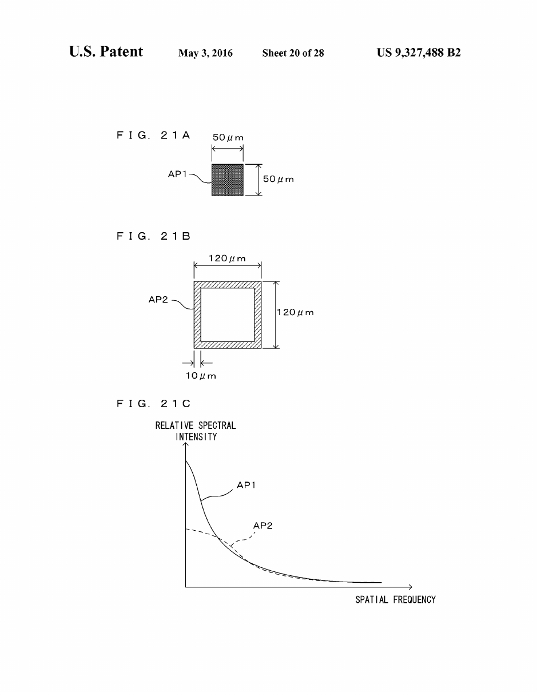
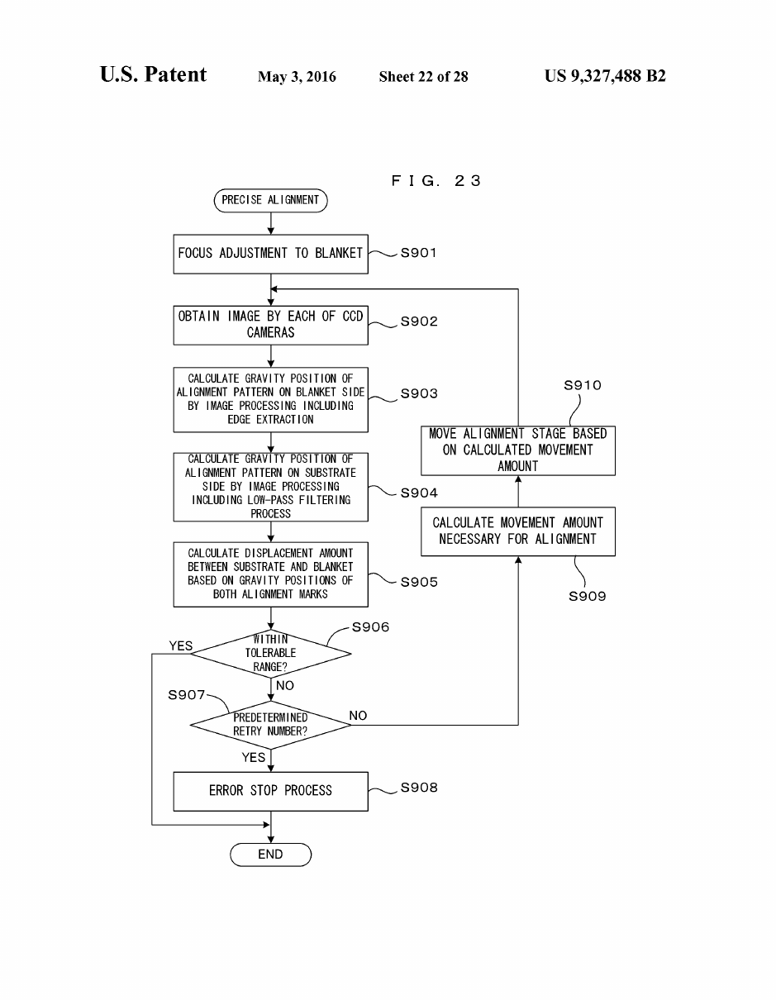
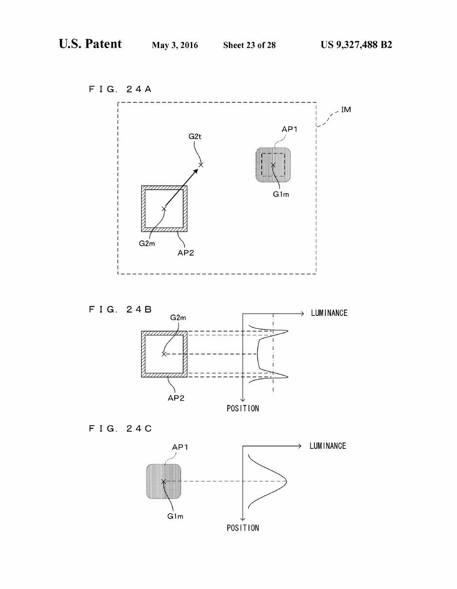

# US9327488B2 번역: 정렬 방법, 전사 방법, 전사 장치

번역 범위: 전문 (요약, 명세서 본문, 도면 설명, 청구항). 인용 문헌 목록은 원문 그대로 둔다.

- 원문: [US9327488B2.pdf](US9327488B2.pdf) (53쪽, 도면 28장)
- 본문 출처: 공보 PDF와 Google Patents 본문 텍스트(https://patents.google.com/patent/US9327488B2/en). PDF의 글자층은 OCR이라 오자가 있어, 문장은 Google Patents 텍스트를 기준으로 옮겼다.
- 번역일: 2026-11-04
- 용어
  - blanket: 블랭킷 (투명한 전사용 판, 본문의 "담체(carrier)" 예)
  - printing plate: 인쇄판
  - alignment mark / alignment pattern element: 정렬 마크 / 정렬 패턴 요소
  - depth of field: 피사계 심도
  - center of gravity: 무게중심
  - imager: 촬상부

---

## 서지

- (10) 특허 번호: US 9,327,488 B2
- (45) 등록일: 2016-05-03
- (54) 발명의 명칭: Alignment method, transfer method and transfer apparatus (정렬 방법, 전사 방법, 전사 장치)
- (75) 발명자: Kazutaka Taniguchi, Masafumi Kawagoe, Mikio Masuichi, Tomoyuki Komura (모두 일본 교토)
- (73) 권리자: SCREEN Holdings Co., Ltd. (일본)
- (21) 출원 번호: 13/599,534
- (22) 출원일: 2012-08-30
- 우선권: 일본 특허출원 2011-261821, 2011-261822 (둘 다 2011-11-30)
- (*) 특허 기간 연장: 35 U.S.C. 154(b)에 따라 567일

## 요약 (Abstract)

촬상부가 담체와 기판 양쪽에 형성된 정렬 마크에 동시에 초점을 맞출 수 없더라도 담체와 기판을 정렬한다.
CCD 카메라가 투명한 블랭킷을 통해 찍은 영상 IM에서, 기판 위 정렬 패턴 요소 AP1의 무게중심 위치 G1m과 블랭킷 위 정렬 패턴 요소 AP2의 무게중심 위치 G2m을 영상 처리로 계산한다.
블랭킷 위의 정렬 패턴 요소 AP2는 초점이 맞은 상태로 찍힌다. 그 영상에서 에지 추출을 포함하는 처리로 무게중심 G2m의 위치를 정한다.
기판 위의 정렬 패턴 요소 AP1은 초점이 맞지 않아 윤곽이 흐리게 찍힌다. 여기서는 높은 공간 주파수 성분을 없애고 낮은 주파수 성분을 뽑은 뒤, 그 결과에서 무게중심 G1m의 위치를 정한다.

---

## 명세서

### 관련 출원 참조

아래 일본 특허출원의 명세서, 도면, 청구항을 포함한 개시 내용 전체를 여기에 참조로 포함한다.
- 2011-261821, 2011-11-30 출원
- 2011-261822, 2011-11-30 출원

### 발명의 배경

#### 1. 발명의 분야

이 발명은 두 기판을 마주 보게 놓고 서로 정렬하는 정렬 기술에 관한 것이다.
또 한 기판에 실린 패턴이나 박막(전사재)을 다른 기판의 정해진 위치로 옮기는 전사 기술에 관한 것이다.

#### 2. 관련 기술 설명

두 기판을 겹치는 정렬 기술로, 예를 들어 특허 문헌 JP2004-151653A의 기술이 알려져 있다.
이 기술에서는 붙일 두 기판의 표면에 각각 정렬 마크를 만들고, 촬상부(예: CCD 카메라)로 찍은 영상을 바탕으로 정렬한다.
구체적으로, 두 기판의 마크 면이 서로 마주 보게 놓아 마크 사이 거리를 촬상부의 피사계 심도 이하로 만든다. 그러면 두 마크에 모두 초점이 맞은 상태로 찍을 수 있다.
찍은 영상에서 찾은 두 마크의 위치 관계로 기판 사이의 상대 위치를 맞춘다.

이 정렬 기술은 한 기판에 실린 패턴을 다른 기판에 옮겨 정해진 패턴을 만드는 패턴 형성 방법에도 쓸 수 있다.
즉 패턴을 실은 기판과 패턴을 받을 기판을 높은 정확도로 정렬하면, 받는 기판의 알맞은 위치에 패턴을 만들 수 있다.

이런 기술에서는 정렬 정확도를 더 높이기를 원한다.
효과적인 방법 하나는 찍을 영상의 배율을 올리는 것이다.
그런데 촬상 광학계의 배율을 올리면 보통 피사계 심도가 줄어든다. 위의 종래 기술은 두 마크가 모두 초점 안에 있다는 전제이므로, 두 기판을 더 가까이 붙여야 한다.
하지만 기판과 그 지지 기구의 치수 편차, 처짐 등을 생각하면 기판 사이 거리에는 알맞은 범위가 있다.
따라서 배율을 올려 짧아진 피사계 심도 안에 두 마크를 모두 넣지 못할 수 있다. 종래 기술은 이런 경우를 다루지 못한다.

다른 방법으로, 촬상부의 초점을 두 마크에 차례로 맞춰 각각 따로 찍는 것을 생각할 수 있다.
그러나 종래 기술은 이 경우도 다루지 못한다.
게다가 초점 맞춤 동작에서 광축이 흔들려 생기는 검출 오차가 오히려 정렬 정확도를 떨어뜨릴 수 있다.

### 발명의 요약

위에서 본 것처럼, 두 기판에 각각 만든 정렬 마크에 동시에 초점을 맞출 수 없는 상태에서 높은 정확도로 정렬하는 기술은 아직 확립되지 않았다.

이 발명은 이 문제를 보고 만들었다.
목적은 두 기판을 마주 보게 놓고 서로 정렬하는 정렬 기술과, 그 정렬 기술로 패턴 등을 옮기는 전사 기술에서, 두 기판의 마크에 동시에 초점을 맞출 수 없어도 두 기판을 높은 정확도로 정렬하는 기술을 제공하는 것이다.

이 발명의 한 측면에 따른 정렬 방법은 제1 기판과 제2 기판을 마주 보게 놓고 서로의 위치 관계를 맞추는 방법이며, 다음 단계를 포함한다.
- 유지 단계: 표면에 제1 정렬 마크를 만든 제1 기판과, 표면에 제2 정렬 마크를 만든 제2 기판을 마크 면끼리 마주 보게 하여 가깝게 잡는다.
- 촬상 단계: 제2 기판의 마크 면 반대쪽에서 제2 기판을 통해, 제1 정렬 마크와 제2 정렬 마크를 촬상부의 같은 시야 안에서 찍는다.
- 위치 검출 단계: 찍은 영상을 바탕으로 제1, 제2 정렬 마크의 위치를 검출한다.
- 정렬 단계: 위치 검출 결과를 바탕으로 제1, 제2 기판의 상대 위치를 맞춘다.

여기서 촬상 단계는, 제1 기판의 마크 면과 제2 기판의 마크 면 사이의 촬상부 광축 방향 거리가 피사계 심도보다 길고, 촬상부의 초점이 제2 기판의 마크 면에 맞은 상태에서 한다.
위치 검출 단계에서는 영상에서 높은 공간 주파수 성분을 없애는 필터 처리를 하고, 필터 처리한 영상에서 제1 정렬 마크의 무게중심 위치를 검출한다.

이렇게 구성한 발명에서는 두 마크 사이의 광축 방향 거리가 피사계 심도보다 길다. 그래서 한 영상에서 두 마크에 동시에 초점이 맞지 않는다.
그래서 촬상부에 더 가까운 제2 정렬 마크에 초점을 맞춘다. 그러면 제2 정렬 마크는 높은 대비로 찍힌다.
따라서 영상 속 제2 정렬 마크의 위치는 널리 알려진 여러 방법, 예를 들어 에지 추출을 포함하는 영상 처리로 검출할 수 있다.

한편 피사계 심도 범위 뒤에 있는 제1 정렬 마크의 상은 초점이 맞지 않아 대비가 낮고 흐리다.
즉 제1 정렬 마크의 공간 주파수 성분 중 특히 높은 주파수 성분이 찍힌 영상에서 사라진다.
그래서 에지 추출 같은 위치 검출로는 충분한 정확도를 얻지 못한다.
이 발명에서는 영상에서 높은 공간 주파수 성분을 없애고, 남은 낮은 주파수 성분에서 제1 정렬 마크의 무게중심 위치를 검출한다.
제1 정렬 마크의 패턴 요소 모양을 알맞게 정하면, 높은 주파수 성분이 사라진 상태에서도 무게중심 위치를 높은 정확도로 검출할 수 있다.

이렇게 얻은 영상 속 두 마크의 위치 관계로 제1, 제2 기판의 상대 위치 관계를 파악하고, 두 기판의 상대 위치를 맞춘다.
이처럼 이 발명에 따르면 두 정렬 마크가 모두 피사계 심도 안에 있을 필요 없이 두 기판을 높은 정확도로 정렬할 수 있다.

이 발명의 다른 측면은, 투명한 담체에 실린 패턴이나 박막(전사재)을 기판의 정해진 위치로 옮기는 전사 방법이며, 다음 단계를 포함한다.
- 유지 단계: 표면에 제1 정렬 마크를 만든 기판과, 표면에 전사재와 제2 정렬 마크를 만든 담체를 마크 면끼리 마주 보게 하여 가깝게 잡는다.
- 촬상 단계: 담체의 마크 면 반대쪽에서 담체를 통해 두 마크를 촬상부의 같은 시야 안에서 찍는다.
- 위치 검출 단계: 찍은 영상으로 두 마크의 위치를 검출한다.
- 정렬 단계: 검출 결과로 기판과 담체의 상대 위치를 맞춘다.
- 전사 단계: 상대 위치를 맞춘 기판과 담체를 맞닿게 하여 담체 표면의 전사재를 기판으로 옮긴다.

촬상 단계는 가깝게 잡은 기판의 마크 면과 담체의 마크 면 사이의 광축 방향 거리가 피사계 심도보다 길고, 초점이 담체의 마크 면에 맞은 상태에서 한다.
위치 검출 단계에서는 영상에서 높은 공간 주파수 성분을 없애는 필터 처리를 하고, 필터 처리한 영상에서 제1 정렬 마크의 무게중심 위치를 검출한다.

이 발명은 위의 정렬 방법과 같은 생각을 기판과 담체의 위치 맞춤에 적용한다.
이 발명의 "기판"과 "담체"의 관계는 위 정렬 방법의 "제1 기판"과 "제2 기판"의 관계에 해당한다.
따라서 담체와 기판을 높은 정확도로 정렬한 채 맞닿게 하여 전사재를 옮기므로, 전사재를 기판 표면의 정해진 위치에 정확히 옮길 수 있다.

이 발명의 또 다른 측면은 패턴이나 박막(전사재)을 기판으로 옮기는 전사 장치이며, 다음을 포함한다.
- 유지부: 표면에 제1 정렬 마크를 만든 기판과, 기판으로 옮길 전사재와 제2 정렬 마크를 표면에 실은 담체를 마크 면끼리 마주 보게 하여 가깝게 잡는다.
- 촬상부: 담체의 마크 면 반대쪽에서 담체를 통해 두 마크를 같은 시야 안에서 찍는다.
- 위치 검출부: 촬상부가 찍은 영상으로 두 마크의 위치를 검출한다.
- 정렬부: 위치 검출부의 결과로 기판과 담체의 상대 위치를 맞춘다.

유지부가 가깝게 잡은 기판의 마크 면과 담체의 마크 면 사이의 광축 방향 거리는 피사계 심도보다 길다.
촬상부는 담체의 마크 면에 초점이 맞은 상태로 찍는다.
위치 검출부는 영상에서 높은 공간 주파수 성분을 없애는 필터 처리를 하고, 필터 처리한 영상에서 제1 정렬 마크의 무게중심 위치를 검출한다.

이 발명에서도 위 전사 방법과 같이, 영상 속 두 마크의 위치 관계로 기판과 담체의 상대 위치 관계를 파악하고 정렬부가 상대 위치를 맞춘다.
따라서 두 마크가 모두 피사계 심도 안에 있을 필요 없이 기판과 담체를 높은 정확도로 정렬할 수 있다.
이렇게 정렬한 뒤 담체에서 기판으로 전사재를 옮기므로, 기판의 정해진 위치에 패턴이나 박막을 좋은 위치 정확도로 만들 수 있다.

이 발명의 위와 다른 목적과 새로운 특징은 첨부 도면과 함께 아래 상세한 설명을 읽으면 더 분명해진다.
다만 도면은 설명용일 뿐이며 발명의 한계를 정하지 않는다.

### 도면의 간단한 설명

- 도 1: 이 발명에 따른 패턴 형성 장치의 실시예를 갖춘 인쇄 장치의 사시도
- 도 2: 도 1 장치의 전기 구성 블록도
- 도 3: 도 1 인쇄 장치의 반송 유닛 사시도
- 도 4A: 도 1 인쇄 장치의 상부 스테이지 유닛 사시도
- 도 4B: 도 4A 상부 스테이지 유닛의 단면도
- 도 5: 도 1 인쇄 장치의 정렬 유닛과 하부 스테이지 유닛 사시도
- 도 6: 정렬 유닛의 촬상 장치 사시도
- 도 7A: 하부 스테이지 유닛의 리프트 핀 유닛 평면도
- 도 7B: 도 7A 리프트 핀 유닛의 측면도
- 도 8: 블랭킷 두께 측정 유닛 사시도
- 도 9A: 도 1 인쇄 장치의 누름 유닛 구성 사시도
- 도 9B: 흡착판에 흡착된 블랭킷을 누름 유닛이 누르는 상태
- 도 9C: 블랭킷이 누름 유닛에서 풀린 상태
- 도 10: 도 1 인쇄 장치의 사전 정렬 유닛 사시도
- 도 11: 도 1 인쇄 장치의 제전기 사시도
- 도 12: 도 1 인쇄 장치의 전체 동작 흐름도
- 도 13~19: 도 1 인쇄 장치의 동작을 보여 주는 차트
- 도 20: 정밀 정렬 동작용 정렬 마크 배치도
- 도 21A: 제1 정렬 패턴 요소
- 도 21B: 제2 정렬 패턴 요소
- 도 21C: 두 정렬 패턴 요소의 공간 주파수 스펙트럼
- 도 22: 정밀 정렬용 촬상 동작
- 도 23: 정밀 정렬 동작의 처리 흐름도
- 도 24A~24C: CCD 카메라가 찍은 영상 예
- 도 25: 촬상 결과로부터 가상 평면 위에 다시 배치한 정렬 패턴 요소의 위치 관계
- 도 26A, 26B: 이를 바탕으로 한 변위 보정의 원리
- 도 27: 촬상 유닛 장착 위치의 변동이 정렬에 주는 영향
- 도 28A, 28B: 정렬 마크의 구체 예
- 도 29A~29D: 결함이 있는 정렬 패턴 요소 모양의 예

### 바람직한 실시예의 상세한 설명

여기서는 이 발명에 따른 전사 장치의 한 실시예인 인쇄 장치의 전체 구성을 먼저 설명하고, 이어서 장치 각 유닛의 구성과 동작을 자세히 설명한다.
이 실시예는 전사로 기판 표면에 정해진 패턴을 만드는 전사 장치다.
다만 아래처럼 인쇄 기술과 같이 인쇄판 PP로 블랭킷 BL 위에 패턴을 만들고 이를 기판 SB로 옮기는 공정을 쓰므로, 이 명세서에서는 이 장치를 "인쇄 장치"라고 부른다.

#### A. 장치 전체 구성

도 1은 이 발명에 따른 패턴 형성 장치의 실시예를 갖춘 인쇄 장치의 사시도다. 내부 구성을 잘 보이도록 장치 덮개를 떼어 낸 상태를 그렸다.
도 2는 도 1 장치의 전기 구성 블록도다.
블랭킷은 인쇄 장치 100의 앞쪽에서, 인쇄판은 왼쪽에서 들어온다.
장치 100에서는 블랭킷 윗면을 인쇄판 아랫면에 밀착한 뒤 블랭킷을 떼어 낸다. 그러면 인쇄판 아랫면의 패턴에 따라 블랭킷의 도포층이 패턴화되어 패턴층이 된다(패턴화 공정).
또 기판은 장치 100의 오른쪽에서 들어온다. 패턴화된 블랭킷 윗면을 기판 아랫면에 밀착한 뒤 블랭킷을 떼어 내면, 블랭킷의 패턴층이 기판 아랫면으로 옮겨진다(전사 공정).
도 1과 뒤의 각 도면에서는 장치 100 각 유닛의 배치를 분명히 하려고 인쇄판과 기판의 반송 방향을 "X 방향"이라 한다.
도 1에서 오른쪽에서 왼쪽으로 가는 수평 방향을 "+X 방향", 그 반대를 "−X 방향"이라 한다.
X 방향에 수직인 수평 방향 중 장치 100의 앞쪽을 향하는 방향을 "+Y 방향", 뒤쪽을 향하는 방향을 "−Y 방향"이라 한다.
수직 위쪽과 아래쪽을 각각 "+Z 방향", "−Z 방향"이라 한다.

인쇄 장치 100에서는 스프링식 방진대 11 위에 본체 베이스 12를 놓고, 그 위에 석정반 13을 얹는다.
석정반 13 윗면 가운데에 아치형 프레임 14L, 14R 두 개가 X 방향으로 떨어져 선다.
두 프레임의 윗부분 (−Y) 쪽에 수평판 15 두 장을 이어 제1 프레임 구조를 만든다.
석정반 13 윗면에는 제1 프레임 구조에 덮이도록 제2 프레임 구조도 둔다.
구체적으로 도 1처럼 아치형 프레임 14L, 14R 바로 아래에 그보다 작은 아치형 프레임 16L, 16R이 석정반 13 위에 선다.
X 방향으로 뻗은 수평판 17 여러 장이 프레임 16L, 16R의 기둥을 잇고, Y 방향으로 뻗은 수평판 17 여러 장이 프레임 16L과 16R을 잇는다.

이렇게 만든 프레임 구조 사이, 즉 프레임 14L과 16L의 보 사이, 14R과 16R의 보 사이에 반송 공간이 생긴다.
인쇄판과 기판은 수평 자세로 이 반송 공간을 통해 옮겨진다.
제2 프레임 구조 뒤, 즉 (−Y) 쪽에 반송 유닛 2를 두어 인쇄판과 기판을 X 방향으로 옮긴다.

상부 스테이지 유닛 3은 제1 프레임 구조의 수평판 15에 고정되며, 반송 유닛 2가 옮겨 온 인쇄판과 기판의 윗면을 흡착해 잡는다.
즉 반송 유닛 2의 인쇄판 셔틀이 도 1 왼쪽에서 반송 공간을 지나 인쇄판을 상부 스테이지 유닛 3 바로 아래로 옮기면, 상부 스테이지 유닛 3의 흡착판이 내려와 흡착해 잡는다.
반대로 인쇄판 셔틀이 상부 스테이지 유닛 3 바로 아래에 있을 때 흡착판이 흡착을 풀면 인쇄판이 반송 유닛 2로 넘어간다.
이렇게 인쇄판은 반송 유닛 2와 상부 스테이지 유닛 3 사이에서 주고받는다.

기판도 인쇄판처럼 상부 스테이지 유닛 3이 잡는다.
즉 반송 유닛 2의 기판 셔틀이 도 1 오른쪽에서 반송 공간을 지나 기판을 상부 스테이지 유닛 3 바로 아래로 옮기면, 흡착판이 내려와 흡착해 잡는다.
반대로 기판 셔틀이 바로 아래에 있을 때 흡착판이 흡착을 풀면 기판이 반송 유닛 2로 넘어간다.

상부 스테이지 유닛 3의 수직 아래(이하 "수직 아래" 또는 "(−Z) 방향")에는 석정반 13 윗면에 정렬 유닛 4를 둔다.
정렬 유닛 4의 정렬 스테이지 위에 하부 스테이지 유닛 5를 놓고, 그 윗면이 상부 스테이지 유닛 3의 흡착판과 마주 보게 한다.
하부 스테이지 유닛 5 윗면은 블랭킷을 흡착해 잡을 수 있다. 제어 유닛 6이 정렬 스테이지를 제어해 블랭킷을 높은 정확도로 위치시킨다.

이처럼 상부 스테이지 유닛 3과 하부 스테이지 유닛 5는 수직 방향 Z로 마주 본다.
그 사이에 하부 스테이지 유닛 5 위의 블랭킷을 위에서 누르는 누름 유닛 7과, 인쇄판, 기판, 블랭킷을 사전 정렬하는 사전 정렬 유닛 8을 제2 프레임 구조에 고정해 둔다.

사전 정렬 유닛 8은 수직 방향으로 두 단인 사전 정렬 상부와 하부로 이루어진다.
사전 정렬 상부는 상부 스테이지 흡착판 바로 아래에 놓인 인쇄판 셔틀 위의 인쇄판에 접근해 위치를 잡는다(인쇄판 사전 정렬).
또 같은 자리의 기판 셔틀 위 기판 SB에 접근해 위치를 잡는다(기판 사전 정렬).
사전 정렬 하부는 하부 스테이지 유닛 5의 흡착판 위 블랭킷에 접근해 위치를 잡는다(블랭킷 사전 정렬).

블랭킷의 패턴층을 기판에 정밀하게 옮기려면 기판 사전 정렬 외에 정밀 정렬이 필요하다.
그래서 정렬 유닛 4에는 CCD(전하 결합 소자) 카메라 CMa~CMd 네 대가 있어, 상부 스테이지 유닛 3이 잡은 기판과 하부 스테이지 유닛 5가 잡은 블랭킷의 정렬 마크를 각각 읽는다.
제어 유닛 6은 카메라 영상으로 정렬 스테이지를 제어해, 하부 스테이지 유닛 5에 흡착된 블랭킷을 상부 스테이지 유닛 3의 기판에 대해 정밀하게 위치시킨다.

블랭킷의 패턴층을 기판에 옮긴 뒤 블랭킷을 기판에서 떼어 낸다. 이때 정전기가 생긴다.
인쇄판으로 블랭킷 도포층을 패턴화한 뒤 블랭킷을 인쇄판에서 뗄 때도 정전기가 생긴다.
그래서 정전기를 없애는 제전기 9를 둔다. 제전기 9에는 제1 프레임 구조의 왼쪽, 즉 (+X) 쪽에서 상부와 하부 스테이지 사이 공간으로 이온을 쏘는 이오나이저 91이 있다.

도 1에는 없지만, 장치 덮개 중 (+X) 쪽 덮개에는 인쇄판을 넣고 빼는 개구와, 이를 여닫는 인쇄판 셔터(뒤의 도 13의 18)가 있다.
제어 유닛 6의 밸브 제어부 64가 인쇄판 셔터 구동 실린더 CL11에 이어진 밸브를 여닫아 셔터를 연다, 닫는다.
실린더 CL11의 구동원은 압축 공기이며, 공장 설비를 양압 공급원으로 쓴다. 장치 100에 공기 공급 장치를 두어 실린더를 구동해도 된다. 뒤에 나올 실린더도 같다.

(−X) 쪽 덮개와 (+Y) 쪽 덮개에는 각각 기판과 블랭킷을 넣고 빼는 개구가 있고, 기판 셔터(뒤의 도 13의 19)와 블랭킷 셔터(도시 안 함)가 있다.
밸브 제어부 64가 밸브를 여닫아 기판 셔터 구동 실린더 CL12와 블랭킷 셔터 구동 실린더 CL13을 움직여 셔터를 여닫는다.

이처럼 셔터 세 개와 구동 실린더 CL11~CL13으로 셔터 유닛 10을 이루며, 인쇄판, 기판, 블랭킷을 각각 따로 넣고 뺄 수 있다.
도 1에는 없지만, 이 실시예에서는 장치 100 왼쪽에 인쇄판 반입출 유닛을, 오른쪽에 기판 반입출 유닛을 나란히 둔다.
또는 인쇄판 반송 로봇(도시 안 함)이 반송 유닛 2의 인쇄판 셔틀에 직접 접근해 인쇄판을 넣고 뺄 수도 있다. 이때는 인쇄판 반입출 유닛이 필요 없다.
기판 쪽도 같다. 기판 반송 로봇(도시 안 함)이 기판 셔틀에 직접 접근해 기판을 넣고 빼면 기판 반입출 유닛이 필요 없다.

한편 이 실시예에서는 블랭킷 반송 로봇으로 블랭킷을 넣고 뺀다.
즉 반송 로봇이 하부 스테이지 유닛 5에 접근해 공정 전 블랭킷을 직접 넣고, 사용 뒤 블랭킷을 받아 빼낸다.
물론 인쇄판과 기판처럼 장치 앞쪽에 전용 반입출 유닛을 두어도 된다.

#### B. 장치 각 유닛의 구성

##### B-1. 반송 유닛 2

도 3은 도 1 인쇄 장치의 반송 유닛 사시도다.
반송 유닛 2에는 수직 방향 Z로 뻗은 브래킷 21L, 21R 두 개가 있다.
도 1처럼 브래킷 21L은 왼쪽 프레임 14L 뒤 기둥의 왼쪽 옆에, 브래킷 21R은 오른쪽 프레임 14R 뒤 기둥의 오른쪽 옆에, 각각 석정반 13 위에 선다.
도 3처럼 볼나사 기구 22가 가로, 즉 X 방향으로 뻗어 두 브래킷의 윗부분을 잇는다.
볼나사 기구 22에서는 볼나사(도시 안 함)가 X 방향으로 뻗고, 그 한쪽 끝에 셔틀 수평 구동 모터 M21의 회전축(도시 안 함)이 이어진다.
볼나사 가운데에 볼나사 브래킷 23 두 개가 나사로 물린다. 이 브래킷의 (+Y) 쪽 옆면에 X 방향으로 뻗은 셔틀 지지판 24를 붙인다.

셔틀 지지판 24의 (+X) 쪽 끝에는 인쇄판 셔틀 25L이, (−X) 쪽 끝에는 기판 셔틀 25R이 각각 수직 방향 Z로 오르내릴 수 있게 달린다.
두 셔틀은 손 회전 기구를 빼면 구성이 같으므로, 인쇄판 셔틀 25L만 설명하고 기판 셔틀 25R은 같은 부호를 붙이고 설명을 생략한다.

셔틀 25L은 승강판 251과 인쇄판 핸드 252 두 개로 이루어진다.
승강판 251은 X 방향으로 뻗으며 길이는 인쇄판 PP의 폭(X 방향 크기)과 같거나 조금 길다.
두 핸드 252는 승강판 251의 (+X) 쪽 끝과 (−X) 쪽 끝에서 앞쪽, 즉 (+Y) 쪽으로 뻗는다.
승강판 251은 볼나사 기구 253을 통해 셔틀 지지판 24의 (+X) 쪽 끝에 오르내릴 수 있게 달린다.
즉 볼나사 기구 253은 셔틀 지지판 24의 (+X) 쪽 끝에서 수직 방향 Z로 뻗고, 아래 끝에 인쇄판 셔틀 승강 모터 M22L의 회전축(도시 안 함)이 이어진다.
볼나사 기구 253에 볼나사 브래킷(도시 안 함)이 물리고, 그 (+Y) 쪽 옆면에 승강판 251을 붙인다.
제어 유닛 6의 모터 제어부 63의 동작 명령에 따라 모터 M22L이 돌면 승강판 251이 수직 방향으로 오르내린다.

각 핸드 252의 앞뒤 길이(Y 방향 크기)는 인쇄판 PP의 길이(Y 방향 크기)보다 길다. 그래서 핸드 앞쪽(+Y 쪽)에 인쇄판 PP를 얹을 수 있다.

이렇게 핸드가 인쇄판 PP를 잡았는지 감지하려고, 승강판 251 가운데에서 (+Y) 쪽으로 센서 브래킷 254가 뻗고 그 끝에 인쇄판 감지 센서 SN21을 단다.
두 핸드에 인쇄판 PP를 얹으면 센서 SN21이 인쇄판의 뒤끝, 즉 (−Y) 쪽 끝을 감지해 제어 유닛 6에 신호를 보낸다.

각 인쇄판 핸드 252는 베어링(도시 안 함)을 통해 승강판 251에 달려 앞뒤 방향(Y 방향)의 회전축 YA2를 중심으로 돌 수 있다.
승강판 251의 X 방향 양 끝에 회전 액추에이터 RA2를 단다.
이 액추에이터는 압축 공기로 움직이며, 공기 공급로의 밸브(도시 안 함)를 여닫아 180도 돈다.
제어 유닛 6의 밸브 제어부 64가 밸브를 여닫아 미사용 자세와 사용 자세를 바꾼다.
미사용 자세는 각 핸드의 한 주면이 위를 향해 패턴화 전 인쇄판 PP를 다루기 알맞은 자세다.
사용 자세는 다른 주면이 위를 향해 패턴화 뒤 인쇄판 PP를 다루기 알맞은 자세다.
인쇄판 셔틀 25L은 이 핸드 자세 전환 기구가 있다는 점만 기판 셔틀 25R과 다르다.

다음으로 셔틀 지지판 24에 대한 두 셔틀의 장착 위치를 설명한다.
도 3처럼 두 셔틀은 인쇄판 PP와 기판 SB의 폭보다 긴 거리만큼 X 방향으로 떨어져 셔틀 지지판 24에 달린다.
이 실시예에서 인쇄판 PP와 기판 SB의 폭은 같다.
셔틀 수평 구동 모터 M21의 회전축을 정해진 방향으로 돌리면 두 셔틀은 이 간격을 유지하며 X 방향으로 움직인다.
예를 들어 도 3에서 상부 스테이지 유닛 3 바로 아래 위치를 XP23이라 한다. 셔틀 25L, 25R은 XP23에서 (+X)와 (−X) 방향으로 같은 거리(이 거리를 "스텝 이동 단위"라 한다)만큼 떨어진 XP22, XP24에 있다.
이 실시예에서는 도 3의 상태를 "중간 위치 상태"라 한다.

중간 위치 상태에서 모터 M21을 정해진 방향으로 돌려 셔틀 지지판 24를 스텝 이동 단위만큼 (+X) 방향으로 옮기면, 기판 셔틀 25R은 상부 스테이지 유닛 3 바로 아래 XP23으로 옮겨져 위치가 잡힌다.
이때 인쇄판 셔틀 25L도 함께 (+X) 방향으로 움직여 인쇄판 반입출 유닛에 가까운 XP21에 놓인다.

반대로 모터 M21을 반대 방향으로 돌려 셔틀 지지판 24를 스텝 이동 단위만큼 (−X) 방향으로 옮기면, 중간 위치 상태에서 인쇄판 셔틀 25L은 XP23으로 옮겨져 위치가 잡힌다.
이때 기판 셔틀 25R도 함께 (−X) 방향으로 움직여 기판 반입출 유닛에 가까운 XP25에 놓인다.
이처럼 이 명세서에서는 X 방향 셔틀 위치로 XP21~XP25 다섯 곳을 정한다.
인쇄판 주고받는 위치 XP21은 인쇄판 셔틀 25L이 놓이는 XP21~XP23 세 곳 중 인쇄판 반입출 유닛에 가장 가까운 곳이다. 즉 인쇄판 PP를 반입출 유닛과 주고받는 X 위치다.
기판 주고받는 위치 XP25는 기판 셔틀 25R이 놓이는 XP23~XP25 세 곳 중 기판 반입출 유닛에 가장 가까운 곳이다. 즉 기판 SB를 반입출 유닛과 주고받는 X 위치다.
XP23은 상부 스테이지 유닛 3의 흡착판 37이 수직으로 움직여 인쇄판 PP나 기판 SB를 흡착해 잡는 X 위치다.
이 명세서에서는 인쇄판 셔틀 25L이 XP23에 있을 때 이 위치를 "인쇄판 흡착 위치 XP23", 기판 셔틀 25R이 XP23에 있을 때 "기판 흡착 위치 XP23"이라 한다.
또 셔틀 25L, 25R이 인쇄판 PP와 기판 SB를 옮기는 수직 방향 Z의 높이를 "반송 위치"라 한다.

패턴화 때 인쇄판 PP와 블랭킷 사이 간격을 정확히 제어하려면 인쇄판 PP의 두께를 재야 한다.
전사 때 기판 SB와 블랭킷 사이 간격을 정확히 제어하려면 기판 SB의 두께도 재야 한다.
그래서 인쇄판 두께 측정 센서 SN22와 기판 두께 측정 센서 SN23을 둔다.

구체적으로 도 3처럼 왼쪽 브래킷 21L에 앞쪽, 즉 (+Y) 쪽으로 뻗은 센서 브래킷 26L을 달고, 그 끝이 XP21에 놓인 인쇄판 PP 위까지 뻗게 한다.
센서 브래킷 26L 끝에 인쇄판 두께 측정 센서 SN22를 단다.
센서 SN22는 발광부와 수광부로 두 거리를 잰다.
인쇄판 PP 윗면에서 반사된 빛으로 센서에서 윗면까지 거리를 재고, 아랫면에서 반사된 빛으로 센서에서 아랫면까지 거리를 잰다.
거리 정보는 센서 SN22에서 제어 유닛 6으로 보내진다. 제어 유닛 6은 이 거리 정보로 인쇄판 PP의 두께를 정확히 계산한다.

기판 두께 측정 센서 SN23도 인쇄판 쪽과 같은 방식으로 기판 쪽에 둔다.
오른쪽 브래킷 21R에 센서 브래킷 26R을 달고, 그 끝이 XP25에 놓인 기판 SB 위까지 뻗게 한다.
센서 브래킷 26R 끝에 기판 두께 측정 센서 SN23을 달아 기판 SB의 두께를 잰다.

##### B-2. 상부 스테이지 유닛 3

도 4A는 도 1 인쇄 장치의 상부 스테이지 유닛 사시도, 도 4B는 그 단면도다.
상부 스테이지 유닛 3은 XP23에 놓인 인쇄판 PP나 기판 SB 위에 있다(도 3 참조).
지지 프레임 31이 수평판 15에 이어져 제1 프레임 구조에 지지된다.
도 4A, 4B처럼 지지 프레임 31에는 수직 방향 Z로 뻗은 옆면이 있고, 여기에 수직 방향 볼나사 기구 32가 지지된다.
볼나사 기구 32 윗부분에 제1 스테이지 승강 모터 M31의 회전축(도시 안 함)이 이어지고, 볼나사 브래킷 321이 물린다.

다른 지지 프레임 33이 볼나사 브래킷 321에 고정되어 함께 오르내린다.
지지 프레임 33의 면에는 다른 볼나사 기구 34가 지지된다. 볼나사 기구 34의 볼나사는 볼나사 기구 32보다 피치가 좁다.
이 좁은 피치 볼나사의 윗부분에 제2 스테이지 승강 모터 M32의 회전축(도시 안 함)이 이어지고, 가운데에 볼나사 브래킷 341이 물린다.

볼나사 브래킷 341에 스테이지 홀더 35를 단다. 스테이지 홀더 35는 수직으로 뻗은 수직판 351~353 세 장으로 이루어진다.
수직판 351은 볼나사 브래킷 341에 고정되고, 나머지 352, 353은 351의 왼쪽과 오른쪽에 각각 고정된다.
수직판 351~353의 아래 끝에 수평 지지판 36을 달고, 그 아랫면에 금속(예: 알루미늄 합금) 흡착판 37을 단다.

제어 유닛 6의 모터 제어부 63의 명령에 따라 승강 모터 M31, M32가 움직여 흡착판 37을 수직으로 오르내린다.
피치가 다른 두 볼나사 기구 32, 34를 조합하여, 제1 승강 모터 M31을 쓰면 흡착판 37이 비교적 넓은 피치로, 즉 빠르게 오르내린다.
제2 승강 모터 M32를 쓰면 비교적 좁은 피치로 움직여 흡착판 37을 정밀하게 위치시킬 수 있다.

흡착판 37 아랫면, 즉 인쇄판 PP나 기판 SB를 흡착해 잡는 흡착면에 흡착 홈 371 여러 개를 둔다.
흡착판 37 바깥 둘레의 절결부 373 여러 곳과 흡착판 가운데에 흡착 패드 38 여러 개를 둔다.
흡착 패드 38을 지지하는 노즐 몸체는 수평 지지판 36, 노즐 지지판 39 등이 지지하여, 흡착 패드 38의 끝면이 흡착판 37 아랫면과 같은 높이가 되게 한다.
흡착판 가운데의 흡착 패드(도시 안 함)는 흡착력을 높이는 보조용이다. 이 보조 패드는 없어도 된다.

이처럼 흡착 홈 371과 흡착 패드 38이 인쇄판 PP와 기판 SB를 흡착해 잡는 수단이며, 각각 따로 음압을 주는 음압 공급로로 음압 공급원에 이어진다.
흡착 홈용 음압 공급로에는 밸브 V31(도 2)이, 흡착 패드용에는 밸브 V32(도 2)가 끼워진다.
제어 유닛 6의 밸브 제어부 64가 밸브 V31을 여닫으면 흡착 홈 371로 인쇄판 PP와 기판 SB를 흡착할 수 있다.
밸브 V32를 여닫으면 흡착 패드 38로 흡착할 수 있다.
이 실시예에서는 인쇄판, 기판, 블랭킷을 잡는 음압 공급원으로 공장 설비를 쓰지만, 장치 100에 진공 펌프 같은 음압 공급 장치를 두어도 된다.

##### B-3. 정렬 유닛 4

도 5는 도 1 인쇄 장치의 정렬 유닛과 하부 스테이지 유닛 사시도다.
도 1처럼 정렬 유닛 4와 하부 스테이지 유닛 5는 상부 스테이지 유닛 3의 수직 아래에 있다.
정렬 유닛 4는 카메라 장착 베이스 41, 기둥 부재 42 네 개, 가운데에 개구가 있는 틀 모양의 스테이지 지지판 43, 정렬 스테이지 44, 촬상 장치 45로 이루어진다.
도 1처럼 카메라 장착 베이스 41은 석정반 13 윗면 가운데에 판 오목부의 안쪽 바닥에 고정된다.
카메라 장착 베이스 41의 앞뒤 끝에서 기둥 부재 42가 두 개씩 수직 위("수직 위" 또는 "(+Z) 방향")로 서며, 이것으로 카메라 장착 베이스 41을 다루기 쉬워진다.

도 1처럼 스테이지 지지판 43은 석정반 13의 오목부를 가로지르는 수평 자세로 놓여, 가운데 개구가 카메라 장착 베이스 41과 마주 보게 석정반 13 윗면에 고정된다.
정렬 스테이지 44는 스테이지 지지판 43 윗면에 고정된다.

정렬 스테이지 44는 스테이지 베이스 441과 스테이지 톱 442로 이루어진다.
스테이지 베이스 441은 스테이지 지지판 43 위에 고정된다. 스테이지 톱 442는 스테이지 베이스 441 수직 위에 놓여 하부 스테이지 유닛 5를 받친다.
둘 다 가운데에 개구가 있는 틀 모양이다.
스테이지 베이스 441과 스테이지 톱 442 사이, 스테이지 톱 442의 각 모서리 근처에 수직 방향 Z 축 회전, X 방향, Y 방향의 3 자유도를 갖는 지지 기구(도시 안 함, 예: 크로스 롤러 베어링)를 둔다.

이 지지 기구 중 앞왼쪽 모서리의 것에는 Y축 볼나사 기구 443a와 Y축 구동 모터 M41을 단다.
앞오른쪽 모서리에는 X축 볼나사 기구 443b와 X축 구동 모터 M42를 단다.
뒤오른쪽 모서리에는 Y축 볼나사 기구 443c와 Y축 구동 모터 M43을 단다.
뒤왼쪽 모서리에는 X축 볼나사 기구(도시 안 함)와 X축 구동 모터 M44(도 2)를 단다.
제어 유닛 6의 모터 제어부 63의 명령으로 구동 모터 M41~M44를 움직이면, 정렬 스테이지 44 가운데에 비교적 큰 공간을 남긴 채 스테이지 톱 442가 수평면 안에서 움직인다.
또 하부 스테이지 유닛 5의 흡착판을 수직축 둘레로 돌려 위치시킬 수 있다.

이 실시예에서 가운데가 빈 정렬 스테이지 44를 쓰는 이유 하나는, 하부 스테이지 유닛 5 윗면에 잡힌 블랭킷과 상부 스테이지 유닛 3 아랫면에 잡힌 기판 SB의 정렬 마크를 촬상 장치 45로 찍기 위해서다.
아래에서 도 5와 6을 보며 촬상 장치 45의 구성을 설명한다.

도 6은 정렬 유닛의 촬상 장치 사시도다.
촬상 장치 45는 블랭킷 네 곳과 기판 SB 네 곳에 만든 정렬 마크를 찍는 장치이며, 촬상 유닛 45a~45d 네 개로 이루어진다.
각 촬상 유닛의 촬상 대상 영역은 다음과 같다.
- 촬상 유닛 45a: 블랭킷과 기판 SB의 앞왼쪽 모서리 근처
- 촬상 유닛 45b: 블랭킷과 기판 SB의 앞오른쪽 모서리 근처
- 촬상 유닛 45c: 블랭킷과 기판 SB의 뒤오른쪽 모서리 근처
- 촬상 유닛 45d: 블랭킷과 기판 SB의 뒤왼쪽 모서리 근처

네 촬상 유닛은 찍는 영역만 다르고 구성은 같다. 촬상 유닛 45a만 설명하고 나머지는 같은 부호를 붙이고 설명을 생략한다.

촬상 유닛 45a에서는 도 6처럼 카메라 장착 베이스 41의 앞왼쪽 모서리 근처 윗면에 XY 테이블 451을 둔다.
XY 테이블 451의 테이블 베이스는 카메라 장착 베이스 41에 고정되고, 테이블 톱은 조정 손잡이(도시 안 함)를 손으로 돌려 X, Y 방향으로 정밀하게 위치시킨다.
테이블 톱 위에 정밀 승강 테이블 452를 단다.
정밀 승강 테이블 452에는 Z축 구동 모터 M45a(도 2)가 달려, 제어 유닛 6의 모터 제어부 63의 명령으로 움직여 테이블 톱을 수직으로 오르내린다.

정밀 승강 테이블 452의 테이블 톱 윗면에 수직으로 뻗은 카메라 브래킷 453의 아래 끝을 고정한다.
카메라 브래킷 453의 위 끝은 스테이지 지지판 43의 가운데 개구, 정렬 스테이지 44의 가운데 개구, 스테이지 베이스의 긴 개구(뒤에서 자세히 설명)를 지나 하부 스테이지 유닛 5의 흡착판 51 바로 아래까지 뻗는다.
카메라 브래킷 453 위 끝에 CCD 카메라 CMa, 경통 454, 대물렌즈 455를 이 순서로 겹쳐 두고, 촬상면이 수직 위를 향하게 한다.
경통 454 옆면에 광원 456을 달고, 광원 구동부 46이 켠다.
이 실시예에서는 광원 456으로 적색 LED(발광 다이오드)를 쓰지만, 블랭킷과 기판 SB의 재질 등에 맞는 광원을 쓸 수 있다.
대물렌즈 455는 경통 454에 달린다.
경통 454 안에는 하프 미러(도시 안 함)가 있어, 광원 456의 조명광을 (+Z) 방향으로 반사해 대물렌즈 455와 흡착판 51 앞왼쪽 모서리 근처의 석영 창 52a를 거쳐 하부 스테이지 유닛 5 위의 블랭킷을 비춘다.
조명광 일부는 블랭킷을 지나 상부 스테이지 유닛 3의 흡착판 37에 흡착된 기판 SB도 비춘다.
이 실시예에서는 블랭킷이 투명 재료이므로, 조명광이 블랭킷을 지나 기판 SB 아랫면까지 닿는다.

블랭킷과 기판 SB에서 나와 (−Z) 쪽으로 가는 빛의 일부는 석영 창 52a, 대물렌즈 455, 경통 454를 거쳐 CCD 카메라 CMa로 들어간다.
CCD 카메라 CMa는 석영 창 52a 수직 위에 있는 정렬 마크를 찍는다.
이처럼 촬상 유닛 45a는 석영 창 52a로 조명하고, 석영 창 52a를 통해 블랭킷과 기판 SB의 앞왼쪽 모서리 근처 영상을 얻는다.
찍은 영상에 해당하는 영상 신호는 제어 유닛 6의 영상 처리부 65로 보내진다.
다른 촬상 유닛 45b~45d도 45a처럼 석영 창 52b~52d를 통해 영상을 얻는다.

##### B-4. 하부 스테이지 유닛 5

다시 도 5를 보며 하부 스테이지 유닛 5의 구성을 자세히 설명한다.
하부 스테이지 유닛 5는 흡착판 51, 석영 창 52a~52d 네 개, 기둥 부재 53 네 개, 스테이지 베이스 54, 리프트 핀 유닛 55로 이루어진다.
스테이지 베이스 54에는 가로 방향 X로 뻗은 긴 구멍 모양의 개구 세 개가 앞뒤 방향 Y로 늘어서 있다.
스테이지 베이스 54는 위에서 볼 때 이 긴 개구와 정렬 스테이지 44의 가운데 개구가 겹치도록 정렬 스테이지 44 위에 고정된다.
촬상 유닛 45a, 45b의 윗부분(CCD 카메라, 경통, 대물렌즈)은 앞쪽 긴 개구에, 45c, 45d의 윗부분은 뒤쪽 긴 개구에 헐겁게 끼워진다.
기둥 부재 53은 스테이지 베이스 54 윗면 모서리에서 (+Z) 방향으로 서고, 그 꼭대기가 흡착판 51을 받친다.

흡착판 51은 금속판(예: 알루미늄 합금)이며, 앞왼쪽, 앞오른쪽, 뒤오른쪽, 뒤왼쪽 모서리 근처에 석영 창 52a~52d를 둔다.
흡착판 51 윗면에는 석영 창 52a~52d를 둘러싸는 홈 511을 둔다.
홈 511로 둘러싸인 안쪽에는 석영 창 자리를 빼고 가로 방향 X로 뻗은 홈 512 여러 개를 앞뒤 방향 Y로 일정 간격을 두고 둔다.

각 홈 511, 512에 양압 공급관(도시 안 함)의 한쪽 끝을 잇고, 다른 쪽 끝을 가압 매니폴드에 잇는다.
각 양압 공급관 중간에 압력 밸브 V51(도 2)을 끼운다.
공장 설비의 압축 공기를 레귤레이터로 조정해 정해진 압력의 공기를 얻고, 이 공기를 가압 매니폴드에 늘 공급한다.
제어 유닛 6의 밸브 제어부 64의 명령으로 원하는 압력 밸브 V51을 골라 열면, 그 밸브에 이어진 홈 511, 512로 조정된 압축 공기가 들어간다.

각 홈 511, 512에는 압축 공기뿐 아니라 음압도 골라 줄 수 있다.
각 홈에 음압 공급관(도시 안 함)의 한쪽 끝을 잇고 다른 쪽 끝을 음압 매니폴드에 잇는다.
각 음압 공급관 중간에 흡착 밸브 V52(도 2)를 끼운다.
음압 공급원이 레귤레이터를 거쳐 음압 매니폴드에 이어져 정해진 값의 음압을 늘 공급한다.
밸브 제어부 64의 명령으로 원하는 흡착 밸브 V52를 골라 열면, 그 밸브에 이어진 홈으로 조정된 음압이 들어간다.

이처럼 밸브 V51, V52를 여닫아 흡착판 51이 블랭킷의 일부나 전체를 흡착하게 할 수 있다.
또 흡착판 51과 블랭킷 사이에 부분적으로 공기를 넣어 블랭킷 일부를 들어 올리고, 상부 스테이지 유닛 3이 잡은 인쇄판 PP나 기판 SB에 블랭킷을 밀어붙일 수 있다.

도 7A는 하부 스테이지 유닛의 리프트 핀 유닛 평면도, 도 7B는 그 측면도다.
리프트 핀 유닛 55에서는 흡착판 51과 스테이지 베이스 54 사이에 리프트판 551이 오르내릴 수 있게 있다.
리프트판 551에는 촬상 유닛 45a~45d와 부딪히지 않도록 네 곳에 절결부 551a~551d를 낸다.
즉 촬상 유닛이 각 절결부에 들어간 상태에서 리프트판 551이 수직으로 오르내릴 수 있다.
네 곳에 절결부를 내어 리프트판 551에는 손가락 부분 551e~551j 여섯 개가 생기고, 각 끝에서 리프트 핀 552e~552j가 수직 위로 선다.
리프트 핀 552e와 552f 사이에 리프트 핀 552k가, 552i와 552j 사이에 552m이 더 선다.
이 리프트 핀 552 여덟 개(552e~552k, 552m)가 리프트판 551 위에 서서 블랭킷 아랫면 전체를 받칠 수 있다.
리프트 핀 552는 흡착판 51 바깥 둘레에 수직으로 뚫린 관통 구멍(도시 안 함)보다 가늘어, 도 5처럼 아래에서 관통 구멍으로 들어갈 수 있다.

각 리프트 핀 552에는 위에서부터 압축 스프링 553과 하우징 554를 이 순서로 끼운다. 스프링 553의 아래 끝은 리프트판 551에 걸리고 위 끝은 하우징 554가 덮는다.
하우징 554 윗면은 흡착판 51 관통 구멍의 안지름보다 바깥지름이 큰 원형이다.
아래에 설명할 핀 승강 실린더 CL51로 리프트판 551을 올리면, 하우징 554 윗면이 흡착판 51 아랫면에 걸리고 스프링 553이 그 윗면과 리프트판 551 사이에 끼어 눌린다. 이로써 리프트판 551의 상승 속도가 조절된다.
리프트판 551을 내릴 때도 스프링 553의 압축력으로 하강 속도를 조절한다.

핀 승강 실린더 CL51은 아랫면이 카메라 장착 베이스 41에 고정된 가이드 브래킷 555의 옆면에 고정되고, 피스톤 끝이 슬라이드 블록 556을 거쳐 리프트판 551을 받친다.
밸브 제어부 64가 핀 승강 실린더 CL51에 이어진 밸브를 여닫으면 실린더가 리프트판 551을 오르내린다.
그 결과 모든 리프트 핀 552가 흡착판 51 윗면, 즉 흡착면에 다가가거나 멀어진다.
예를 들어 리프트 핀 552가 흡착판 51 윗면에서 (+Z) 방향으로 튀어나와 있으면, 블랭킷 반송 로봇이 블랭킷을 핀 꼭대기에 얹을 수 있다.
블랭킷을 얹은 뒤 핀을 흡착판 윗면 아래 (−Z) 방향으로 물리면 블랭킷이 흡착판 51 윗면으로 넘어간다.
그 뒤 뒤에 설명하듯 알맞은 시점에 흡착판 51 근처의 블랭킷 두께 측정 센서 SN51로 블랭킷 두께를 잰다.

도 8은 블랭킷 두께 측정 유닛 사시도다.
블랭킷 두께 측정 유닛 56은 하부 스테이지 유닛 5의 일부이며 다음과 같이 구성된다.
흡착판 51 오른쪽 근처에서 제2 프레임 구조에 실린더 브래킷 561을 고정한다.
실린더 브래킷 561에 센서 수평 구동 실린더 CL52를 수평 자세로 고정한다.
밸브 제어부 64가 실린더 CL52에 이어진 밸브를 여닫으면 실린더에 달린 슬라이드판 562가 가로 방향 X로 미끄러진다.
슬라이드판 562 왼쪽 끝에 블랭킷 두께 측정 센서 SN51을 단다.
실린더 CL52가 슬라이드판 562를 왼쪽 (+X), 즉 흡착판 51 쪽으로 수평 이동하면 센서 SN51이 흡착판 51에 흡착된 블랭킷 오른쪽 끝 바로 위에 놓인다.
센서 SN51도 인쇄판 두께 측정 센서 SN22, 기판 두께 측정 센서 SN23과 같은 구성이며 같은 원리로 블랭킷 두께를 잰다.
측정 시점이 아닐 때는 실린더 CL52가 슬라이드판 562를 오른쪽 (−X), 즉 흡착판 51에서 먼 물러난 위치로 옮겨 블랭킷 두께 측정 유닛 56이 방해되지 않게 한다.

##### B-5. 누름 유닛 7

도 9A는 도 1 인쇄 장치의 누름 유닛 구성 사시도다.
도 9B는 흡착판에 흡착된 블랭킷을 누름 유닛이 누르는 상태(이하 "블랭킷 누름 상태"), 도 9C는 블랭킷이 누름 유닛에서 풀린 상태(이하 "블랭킷 해제 상태")다.
누름 유닛 7은 흡착판 51 수직 위의 누름 부재 71을 전환 기구 72로 수직으로 오르내려 블랭킷 누름 상태와 해제 상태를 바꾼다.

전환 기구 72에서는 누름 부재 승강 실린더 CL71~CL73을 실린더 브래킷 721~723으로 제2 프레임 구조의 수평판 17에 달아, 피스톤 724가 수직 아래쪽으로 나왔다 들어갔다 하게 한다.
누름 부재 71은 이 피스톤 724 끝에 매달린 상태로 헐겁게 끼워진다.

누름 부재 71은 지지판 711과 블랭킷 누름판 712 네 장으로 이루어진다.
지지판 711은 평면 크기가 블랭킷 BL과 같고, 가운데가 뚫린 틀 모양이다.
블랭킷 누름판 712 네 장은 지지판 711 아랫면에 고정되어 그 아랫면 전체를 덮는다.

도 9B, 9C처럼 지지판 711에는 누름 부재 승강 실린더 CL71~CL73 자리에 피스톤 724 바깥지름보다 안지름이 큰 관통 구멍 716을 뚫는다.
각 관통 구멍 아래에서 체결 부재 717을 관통 구멍을 지나 피스톤 724 끝에 잇는다.
그래서 실린더 CL71~CL73의 피스톤 724는 지지판 711에 헐겁게 끼워진 채로 이어진다.
즉 누름 부재 71은 실린더 CL71~CL73에 대해 떠 있는 상태로 지지된다.

밸브 제어부 64가 실린더 CL71~CL73에 이어진 밸브를 여닫으면, 실린더가 누름 부재 71을 하부 스테이지 유닛 5의 흡착판 51에 닿게 하거나 떼어 놓는다.
예를 들어 누름 부재 71을 내려 블랭킷 BL을 잡은 흡착판 51을 누르고, 블랭킷 BL의 둘레 전체를 흡착판 51과 함께 끼워 잡는다.
정렬을 위해 흡착판 51이 움직일 때도 누름 부재 71이 흡착판 51과 함께 수평 방향(X, Y)으로 움직여 블랭킷 BL을 안정되게 잡는다.

##### B-6. 사전 정렬 유닛 8

도 10은 도 1 인쇄 장치의 사전 정렬 유닛 사시도다.
사전 정렬 유닛 8은 사전 정렬 상부 81과 사전 정렬 하부 82로 이루어진다.
상부 81은 하부 82의 수직 위에 있으며, 블랭킷 BL과 밀착하기 전에 XP23에서 인쇄판 셔틀 25L이 잡은 인쇄판 PP와 기판 셔틀 25R이 잡은 기판 SB를 정렬한다.
하부 82는 인쇄판 PP나 기판 SB와 밀착하기 전에 하부 스테이지 유닛 5의 흡착판 51 위에 놓인 블랭킷 BL을 정렬한다.
상부 81과 하부 82는 기본적으로 구성이 같다. 아래에서는 상부 81을 설명하고, 하부 82는 같은 부호를 붙이고 설명을 생략한다.

사전 정렬 상부 81에는 상부 가이드 이동부 811~814 네 개가 있다.
각 이동부는 제2 프레임 구조 안 위층의 수평판 17에 달린다.
앞뒤 방향 Y로 뻗은 수평판 두 장 중 왼쪽 수평판 17a의 가운데에 811을, 앞끝에 812를 단다.
오른쪽 수평판 17b의 가운데에 813을, 뒤끝에 814를 단다.
811과 813은 구성이 같고, 812와 814도 구성이 같다. 아래에서는 811과 812를 설명하고 나머지는 같은 부호를 붙이고 설명을 생략한다.

상부 가이드 이동부 811에서는 볼나사 기구 811a가 가로 방향 X로 뻗어 왼쪽 수평판 17a 가운데에 고정된다.
볼나사 기구 811a의 볼나사에 볼나사 브래킷이 물리고, 여기에 상부 가이드 811b를 상부 가이드 이동부 813 쪽을 향하게 단다.
볼나사 기구 811a 왼쪽 끝에 상부 가이드 구동 모터 M81a의 회전축(도시 안 함)이 이어진다. 모터 제어부 63의 명령으로 모터 M81a가 움직이면 상부 가이드 811b가 가로 방향 X로 움직인다.

상부 가이드 이동부 812에서는 볼나사 기구 812a가 앞뒤 방향 Y로 뻗어 왼쪽 수평판 17a 앞끝에 고정된다.
볼나사 기구 812a의 볼나사에 볼나사 브래킷이 물리고, 여기에 가로로 뻗은 가이드 홀더 812c의 왼쪽 끝을 고정한다.
가이드 홀더 812c의 오른쪽 끝은 수평판 17a와 17b의 중간까지 닿고, 그 끝에 상부 가이드 812b를 상부 가이드 이동부 814 쪽을 향하게 단다.
볼나사 기구 812a 뒤끝에 상부 가이드 구동 모터 M81b의 회전축(도시 안 함)이 이어진다. 모터 제어부 63의 명령으로 모터 M81b가 움직이면 상부 가이드 812b가 앞뒤 방향 Y로 움직인다.

이렇게 상부 가이드 811b~814b 네 개가 XP23 수직 아래에서 인쇄판 PP나 기판 SB(도 10의 일점쇄선)를 둘러싸고, 각각 따로 인쇄판 등에 다가가거나 멀어진다.
각 상부 가이드의 이동량을 제어하여, 셔틀 핸드 위의 인쇄판 PP와 기판 SB를 수평으로 옮기거나 돌려 정렬할 수 있다.

##### B-7. 제전기 9

도 11은 도 1 인쇄 장치의 제전기 사시도다.
제전기 9에서는 하부 스테이지 유닛 5 왼쪽에서 석정반 13 윗면에 베이스판 92를 고정한다.
베이스판 92에서 기둥 부재 93이 서고, 그 위 끝은 하부 스테이지 유닛 5보다 높다.
기둥 부재 93 위 끝에 고정구 94로 이오나이저 브래킷 95를 단다.
이오나이저 브래킷 95는 오른쪽 (−X) 방향으로 뻗어 끝이 흡착판 51 근처에 닿는다. 그 끝에 이오나이저 91을 단다.

##### B-8. 제어 유닛 6

제어 유닛 6은 CPU(중앙 처리 장치) 61, 메모리 62, 모터 제어부 63, 밸브 제어부 64, 영상 처리부 65, 표시 및 조작부 66으로 이루어진다.
CPU 61은 메모리 62에 미리 저장한 프로그램에 따라 장치 각 부를 제어하여, 도 12~19에 보인 패턴화 공정과 전사 공정을 수행한다.

#### C. 인쇄 장치 전체 동작

도 12는 도 1 인쇄 장치의 전체 동작 흐름도다.
도 13~19는 도 1 인쇄 장치의 동작을 보여 주는 차트다. 각 도면의 표는 제어 유닛 6의 제어 내용(제어 대상과 동작 내용)을, 각 도면의 그림은 장치 각 부의 상태를 보여 준다.
인쇄 장치 100의 초기 상태에서는 도 13 (a)처럼 인쇄판 셔틀 25L과 기판 셔틀 25R이 각각 중간 위치 XP22, XP24에 있다.
인쇄판 PP를 인쇄판 반입출 유닛에 놓으면 인쇄판 셔틀 25L이 인쇄판 반입 단계(스텝 S1)를 한다.
기판 SB를 기판 반입출 유닛에 놓으면 기판 셔틀 25R이 기판 반입 단계(스텝 S2)를 한다.
인쇄판 셔틀 25L과 기판 셔틀 25R을 가로 방향으로 함께 움직이는 반송 구조이므로, 인쇄판 반입(S1) 뒤에 기판 반입(S2)을 한다. 물론 순서를 바꿔도 된다.

##### C-1. 인쇄판 반입 단계 (스텝 S1)

도 13 (b)의 "스텝 S1"처럼 하위 단계 (1-1)~(1-7)을 한다.
셔틀 수평 구동 모터 M21이 회전축을 정해진 방향으로 돌려 셔틀 지지판 24를 (+X) 방향으로 옮긴다(1-1). 그러면 인쇄판 셔틀 25L이 인쇄판 주고받는 위치 XP21로 옮겨져 위치가 잡힌다.
회전 액추에이터 RA2가 인쇄판 핸드 252를 180도 돌려 원래 자리에 놓는다(1-2). 핸드 자세가 사용 자세에서 미사용 자세로 바뀌어, 사용 전 인쇄판 PP를 받을 준비가 끝난다.

인쇄판 셔터 구동 실린더 CL11이 인쇄판 셔터 18을 수직 아래로 옮겨 셔터를 연다(1-3).
인쇄판 반입출 유닛이 제어 유닛 6의 명령에 따라 인쇄판 PP를 인쇄 장치 100 안으로 넣어 인쇄판 셔틀 25L의 핸드 252 위에 얹는다(1-4).
인쇄판 반입이 끝나면 밸브 개폐 상태를 원래대로 되돌려, 실린더 CL11이 반대로 움직여 셔터 18을 원래 자리로 되돌린다. 즉 셔터를 닫는다(1-5).

인쇄판 반입이 끝나면 인쇄판 PP는 XP21에 있다.
이 시점에 인쇄판 두께 측정 센서 SN22가 인쇄판 PP 윗면과 아랫면의 높이(수직 방향 Z 위치)를 검출해 제어 유닛 6에 높이 정보를 보낸다.
CPU 61은 이 높이 정보로 인쇄판 PP의 두께를 계산해 메모리 62에 저장한다. 이렇게 인쇄판 두께를 잰다(1-6).
그 뒤 모터 M21이 회전축을 반대로 돌려 셔틀 지지판 24를 (−X) 방향으로 옮겨 중간 위치 XP22에 놓는다(1-7).

##### C-2. 기판 반입 단계 (스텝 S2)

도 13 (b)의 "스텝 S2"처럼 하위 단계 (2-1)~(2-6)을 한다.
모터 M21이 회전축을 정해진 방향과 반대로 돌려 셔틀 지지판 24를 (−X) 방향으로 옮긴다(2-1). 기판 셔틀 25R이 기판 주고받는 위치 XP25로 옮겨져 위치가 잡힌다.
기판 핸드 252에는 회전 기구가 없으므로, (2-1)이 끝나면 기판 SB를 받을 준비가 끝난다.

기판 셔터 구동 실린더 CL12가 기판 셔터 19를 수직 아래로 옮겨 셔터를 연다(2-2).
기판 반입출 유닛이 제어 유닛 6의 명령에 따라 기판 SB를 인쇄 장치 100 안으로 넣어 기판 셔틀 25R의 핸드 252 위에 얹는다(2-3).
기판 반입이 끝나면 밸브 개폐 상태를 원래대로 되돌려, 실린더 CL12가 반대로 움직여 셔터 19를 닫는다(2-4).

기판 반입이 끝나면 기판 SB는 XP25에 있다.
이 시점에 기판 두께 측정 센서 SN23이 기판 SB 윗면과 아랫면의 높이를 검출해 제어 유닛 6에 높이 정보를 보낸다.
CPU 61은 이 높이 정보로 기판 SB의 두께를 계산해 메모리 62에 저장한다(2-5).
그 뒤 모터 M21이 회전축을 정해진 방향으로 돌려 셔틀 지지판 24를 (+X) 방향으로 옮겨 중간 위치 XP24에 놓는다(2-6).

이처럼 이 실시예에서는 도 13 (c)처럼 패턴화 공정 전에 인쇄판 PP뿐 아니라 기판 SB도 준비해 둔다.
그 뒤 뒤에 자세히 설명하듯 패턴화 공정과 전사 공정을 이어서 한다.
그래서 블랭킷 BL 위에서 패턴화한 도포층을 기판 SB로 옮길 때까지의 시간 간격을 줄일 수 있고, 공정이 안정된다.

##### C-3. 인쇄판 흡착 (스텝 S3)

도 14 (a)의 "스텝 S3"처럼 하위 단계 (3-1)~(3-7)을 한다.
모터 M21이 회전축을 돌려 셔틀 지지판 24를 (−X) 방향으로 옮긴다(3-1). 인쇄판 셔틀 25L이 인쇄판 흡착 위치 XP23으로 옮겨져 위치가 잡힌다.
인쇄판 셔틀 승강 모터 M22L이 회전축을 돌려 승강판 251을 아래 (−Z) 방향으로 옮긴다(3-2). 인쇄판 셔틀 25L이 받친 인쇄판 PP가 반송 위치보다 낮은 사전 정렬 위치로 옮겨진다.

상부 가이드 구동 모터 M81a~M81d가 회전축을 돌려 상부 가이드 811b, 813b를 가로 방향 X로, 812b, 814b를 앞뒤 방향 Y로 옮긴다.
그러면 각 상부 가이드가 인쇄판 셔틀 25L 위 인쇄판 PP의 끝면에 닿아 인쇄판 PP를 미리 정한 수평 위치에 놓는다.
그 뒤 각 모터가 회전축을 반대로 돌려 상부 가이드가 인쇄판 PP에서 떨어진다(3-3).

인쇄판 사전 정렬이 끝나면 스테이지 승강 모터 M31이 회전축을 정해진 방향으로 돌려 흡착판 37을 아래 (−Z) 방향으로 내려 인쇄판 PP 윗면에 닿게 한다.
이어서 밸브 V31, V32를 열어 흡착 홈 371과 흡착 패드 38로 인쇄판 PP를 흡착판 37에 흡착한다(3-4).

흡착 감지 센서 SN31(도 2)이 인쇄판 PP의 흡착을 감지하면, 모터 M31이 회전축을 반대로 돌려 흡착판 37이 인쇄판 PP를 흡착한 채 수직 위로 올라간다. 인쇄판 PP는 인쇄판 흡착 위치 XP23의 수직 위로 옮겨진다(3-5).
인쇄판 셔틀 승강 모터 M22L이 회전축을 돌려 승강판 251을 수직 위로 옮겨, 인쇄판 셔틀 25L을 사전 정렬 위치에서 반송 위치, 즉 XP23으로 옮긴다(3-6).
그 뒤 모터 M21이 회전축을 돌려 셔틀 지지판 24를 (+X) 방향으로 옮기고, 비게 된 인쇄판 셔틀 25L을 중간 위치 XP22에 놓는다(3-7).

##### C-4. 블랭킷 흡착 (스텝 S4)

도 14 (a)의 "스텝 S4"처럼 하위 단계 (4-1)~(4-9)를 한다.
X축 구동 모터 M42, M44와 Y축 구동 모터 M41, M43을 움직여 정렬 스테이지 44를 초기 위치로 옮긴다(4-1). 그래서 정렬 스테이지 44는 매번 같은 위치에서 시작한다.
핀 승강 실린더 CL51이 리프트판 551을 들어 리프트 핀 552가 흡착판 51 윗면에서 수직 위로 튀어나오게 한다(4-2).
이렇게 블랭킷 BL을 받을 준비가 끝나면 블랭킷 셔터 구동 실린더 CL13이 블랭킷 셔터(도시 안 함)를 옮겨 연다(4-3).
블랭킷 반송 로봇이 장치 100에 들어와 블랭킷 BL을 리프트 핀 552 꼭대기에 얹고 물러난다(4-4).
블랭킷 셔터 구동 실린더 CL13이 셔터를 닫는다(4-5).

핀 승강 실린더 CL51이 리프트판 551을 내려, 리프트 핀 552가 블랭킷 BL을 받친 채 내려가 블랭킷을 흡착판 51 위에 놓는다(4-6).
하부 가이드 구동 모터 M82a~M82d가 회전축을 돌려 하부 가이드 821b, 823b를 가로 방향 X로, 822b, 824b를 앞뒤 방향 Y로 옮긴다.
그러면 각 하부 가이드가 흡착판 51 위 블랭킷 BL의 끝면에 닿아 블랭킷 BL을 미리 정한 수평 위치에 놓는다(4-7).

블랭킷 사전 정렬이 끝나면 흡착 밸브 V52를 열어 홈 511, 512에 조정된 음압을 주고, 블랭킷 BL을 흡착판 51에 흡착한다(4-8).
각 하부 가이드 구동 모터가 회전축을 반대로 돌려 하부 가이드를 블랭킷 BL에서 떼어 놓는다(4-9).
이렇게 도 14 (b)처럼 패턴화 공정 준비가 끝난다.

##### C-5. 패턴화 (스텝 S5)

여기서는 블랭킷 두께를 잰 뒤 패턴화한다.
도 15 (a)의 "스텝 S5"처럼 센서 수평 구동 실린더 CL52가 블랭킷 두께 측정 센서 SN51을 블랭킷 BL 오른쪽 끝 바로 위에 놓는다(5-1).
센서 SN51이 블랭킷 BL의 두께 정보를 제어 유닛 6에 보내 두께를 잰다(5-2).
그 뒤 실린더 CL52가 반대로 움직여 슬라이드판 562를 (−X) 방향으로 밀어 센서 SN51을 흡착판 51에서 물린다(5-3).

제1 스테이지 승강 모터 M31이 회전축을 정해진 방향으로 돌려 흡착판 37을 아래 (−Z) 방향으로 내려 인쇄판 PP를 블랭킷 BL 근처로 옮긴다.
제2 스테이지 승강 모터 M32가 회전축을 돌려 흡착판 37을 좁은 피치로 오르내리며, 인쇄판 PP와 블랭킷 BL 사이의 수직 거리, 즉 간격을 정확히 맞춘다(5-4).
간격은 제어 유닛 6이 인쇄판 PP와 블랭킷 BL의 두께 측정 결과로 정한다.

누름 부재 승강 실린더 CL71~CL73이 누름 부재 71을 내려 블랭킷 BL 둘레 전체를 누른다(5-5).
밸브 V51, V52를 움직여 흡착판 51과 블랭킷 BL 사이에 부분적으로 공기를 넣어 블랭킷 BL 일부를 들어 올린다. 들린 부분이 상부 스테이지 유닛 3이 잡은 인쇄판 PP에 밀어붙여진다(5-6).
그 결과 도 15 (b)처럼 블랭킷 BL 가운데가 인쇄판 PP에 밀착한다.
인쇄판 PP 아랫면에 미리 만든 패턴(도시 안 함)이 블랭킷 BL 윗면에 미리 바른 도포층에 닿아 도포층을 패턴화한다.
이렇게 블랭킷 BL 윗면에 패턴층이 생긴다.

##### C-6. 인쇄판 분리 (스텝 S6)

도 15 (c)의 "스텝 S6"처럼 하위 단계 (6-1)~(6-5)를 한다.
제2 스테이지 승강 모터 M32가 회전축을 돌려 흡착판 37을 들어 인쇄판 PP를 블랭킷 BL에서 떼어 낸다(6-1).
분리를 위해 인쇄판 PP를 드는 것과 나란히, 알맞은 시점에 밸브 V51, V52의 개폐 상태를 바꿔 블랭킷 BL에 음압을 주어 블랭킷 BL을 흡착판 쪽으로 끌어당긴다.
그 뒤 제1 스테이지 승강 모터 M31이 회전축을 돌려 흡착판 37을 들어, 인쇄판 PP를 이오나이저 91과 거의 같은 높이의 제전 위치에 놓는다(6-2).
누름 부재 승강 실린더 CL71~CL73이 누름 부재 71을 들어 블랭킷 BL을 누름 상태에서 푼다(6-3).
이오나이저 91을 켜서 인쇄판 분리 때 생긴 정전기를 없앤다(6-4).
제전이 끝나면 모터 M31이 회전축을 돌려, 도 15 (d)처럼 흡착판 37이 인쇄판 PP를 흡착한 채 원래 위치(인쇄판 흡착 위치 XP23보다 높은 위치)로 올라간다(6-5).

##### C-7. 인쇄판 물림 (스텝 S7)

도 16 (a)의 "스텝 S7"처럼 하위 단계 (7-1)~(7-7)을 한다.
회전 액추에이터 RA2가 인쇄판 핸드 252를 180도 돌려 원래 자리에서 뒤집힌 자리로 놓는다(7-1). 핸드 자세가 미사용 자세에서 사용 자세로 바뀌어, 사용한 인쇄판 PP를 받을 준비가 끝난다.
모터 M21이 회전축을 돌려 셔틀 지지판 24를 (−X) 방향으로 옮겨(7-2), 인쇄판 셔틀 25L을 인쇄판 흡착 위치 XP23에 놓는다.

제1 스테이지 승강 모터 M31이 회전축을 돌려, 흡착판 37이 인쇄판 PP를 흡착한 채 인쇄판 셔틀 25L의 핸드 252 쪽으로 내려가 인쇄판 PP를 핸드 위에 놓는다.
밸브 V31, V32를 닫아 흡착 홈 371과 흡착 패드 38의 흡착을 푼다. 이로써 반송 위치에서 인쇄판 PP를 넘겨주기가 끝난다(7-3).
모터 M31이 회전축을 반대로 돌려 흡착판 37을 초기 위치로 올린다(7-4).
모터 M21이 회전축을 돌려 셔틀 지지판 24를 (+X) 방향으로 옮긴다(7-5). 인쇄판 셔틀 25L이 사용한 인쇄판 PP를 실은 채 중간 위치 XP22로 옮겨져 위치가 잡힌다.

##### C-8. 기판 흡착 (스텝 S8)

도 16 (a)의 "스텝 S8"처럼 모터 M21이 회전축을 정해진 방향으로 돌려 셔틀 지지판 24를 (+X) 방향으로 옮긴다(8-1).
공정 전 기판 SB를 실은 기판 셔틀 25R이 기판 흡착 위치 XP23으로 옮겨져 위치가 잡힌다.
인쇄판 PP의 사전 정렬(3-2, 3-3)과 흡착판 37의 인쇄판 흡착(3-4)처럼, 기판 SB의 사전 정렬(8-2, 8-3)과 흡착(8-4)을 한다.

흡착 감지 센서 SN31(도 2)이 기판 SB의 흡착을 감지하면, 스테이지 승강 모터 M31이 회전축을 돌려 흡착판 37이 기판 SB를 흡착한 채 수직 위로 올라간다. 기판 SB는 기판 흡착 위치 XP23보다 높은 곳으로 옮겨진다(8-5).
기판 셔틀 승강 모터 M22R이 회전축을 돌려 승강판 251을 수직 위로 옮겨, 기판 셔틀 25R을 사전 정렬 위치에서 반송 위치로 옮긴다(8-6).
모터 M21이 회전축을 돌려 셔틀 지지판 24를 (−X) 방향으로 옮기고, 비게 된 기판 셔틀 25R을 중간 위치 XP24에 놓는다(8-7).

##### C-9. 전사 (스텝 S9)

도 17 (a)의 "스텝 S9"처럼 블랭킷 두께를 재고, 정밀 정렬을 하고, 전사 공정을 한다.
패턴화(스텝 S5)의 (5-1~5-3)처럼 블랭킷 BL의 두께를 잰다(9-1~9-3).
블랭킷 BL 두께는 패턴화 직전뿐 아니라 전사 직전에도 잰다.
블랭킷 BL이 부분적으로 부풀어 두께가 시간에 따라 바뀌기 때문이다. 전사 직전에 두께를 재면 높은 정확도로 전사할 수 있다.

제1 스테이지 승강 모터 M31이 회전축을 정해진 방향으로 돌려 흡착판 37을 아래 (−Z) 방향으로 내려 기판 SB를 블랭킷 BL 근처로 옮긴다.
제2 스테이지 승강 모터 M32가 회전축을 돌려 흡착판 37을 좁은 피치로 오르내리며 기판 SB와 블랭킷 BL 사이 수직 거리, 즉 간격을 정확히 맞춘다(9-4).
간격은 제어 유닛 6이 기판 SB와 블랭킷 BL의 두께 측정 결과로 정한다.
이어지는 (9-5)에서는 패턴화(스텝 S5)처럼 누름 부재 71로 블랭킷 BL 둘레를 누른다.

기판 SB와 블랭킷 BL은 둘 다 사전 정렬되어 전사에 알맞은 거리만큼 떨어진 채 놓여 있다.
블랭킷 BL의 패턴층을 기판 SB에 정확히 옮기려면 둘을 정밀하게 위치시켜야 한다.
그래서 하위 단계 (9-6~9-8)을 한다(정밀 정렬).

정렬 유닛 4의 Z축 구동 모터 M45a~M45d를 움직여 각 촬상 유닛 45a~45d의 초점을 블랭킷 BL에 패턴화된 정렬 마크에 맞춘다(9-6).
각 촬상 유닛이 찍은 영상을 제어 유닛 6의 영상 처리부 65로 보낸다(9-7).
제어 유닛 6은 이 영상으로 블랭킷 BL을 기판 SB에 대해 위치시키는 제어량을 계산하고, 정렬 유닛 4의 X축 구동 모터 M42, M44와 Y축 구동 모터 M41, M43의 동작 명령을 만든다.
이 명령에 따라 모터가 움직여 흡착판 51을 수평으로 옮기고 수직 방향 Z로 뻗은 가상 회전축 둘레로 돌려, 블랭킷 BL을 기판 SB에 대해 정밀하게 위치시킨다(9-8).

밸브 V51, V52를 움직여 흡착판 51과 블랭킷 BL 사이에 부분적으로 공기를 넣어 블랭킷 BL 일부를 들어 올린다. 들린 부분이 상부 스테이지 유닛 3이 잡은 기판 SB에 밀어붙여진다(9-9).
그 결과 도 17 (b)처럼 블랭킷 BL이 기판 SB에 밀착한다.
이렇게 블랭킷 BL의 패턴층이 기판 SB 아랫면의 패턴에 대해 정밀하게 위치가 맞은 채 기판 SB로 옮겨진다.

##### C-10. 기판 분리 (스텝 S10)

도 18 (a)의 "스텝 S10"처럼 하위 단계 (10-1)~(10-5)를 한다.
인쇄판 분리(스텝 S6)와 같이 기판 SB를 블랭킷 BL에서 떼고(10-1), 기판 SB를 제전 위치에 놓고(10-2), 누름 부재 71의 누름에서 블랭킷 BL을 풀고(10-3), 제전한다(10-4).
그 뒤 모터 M31이 회전축을 돌려, 도 18 (b)처럼 흡착판 37이 기판 SB를 흡착한 채 초기 위치(반송 위치보다 높은 위치)로 올라간다(10-5).

##### C-11. 기판 물림 (스텝 S11)

도 19 (a)의 "스텝 S11"처럼 하위 단계 (11-1)~(11-4)를 한다.
모터 M21이 회전축을 돌려 셔틀 지지판 24를 (+X) 방향으로 옮겨(11-1), 기판 셔틀 25R을 기판 흡착 위치 XP23에 놓는다.

모터 M31이 회전축을 돌려, 흡착판 37이 기판 SB를 흡착한 채 기판 셔틀 25R의 핸드 252 쪽으로 내려간다.
밸브 V31, V32를 닫아 흡착 홈 371과 흡착 패드 38의 기판 흡착을 푼다(11-2).
모터 M31이 회전축을 반대로 돌려 흡착판 37을 초기 위치로 올린다(11-3).
모터 M21이 회전축을 돌려 셔틀 지지판 24를 (−X) 방향으로 옮기고, 기판 셔틀 25R이 기판 SB를 실은 채 중간 위치 XP24로 옮겨진다(11-4).

##### C-12. 블랭킷 반출 (스텝 S12)

도 19 (a)의 "스텝 S12"처럼 하위 단계 (12-1)~(12-6)을 한다.
밸브 V51, V52를 움직여 흡착판 51의 블랭킷 BL 흡착을 푼다(12-1).
핀 승강 실린더 CL51이 리프트판 551을 들어, 사용한 블랭킷 BL을 흡착판 51에서 수직 위로 들어 올린다(12-2).

블랭킷 셔터 구동 실린더 CL13이 블랭킷 셔터(도시 안 함)를 연다(12-3).
블랭킷 반송 로봇이 장치 100에 들어와 리프트 핀 552 꼭대기에서 사용한 블랭킷 BL을 받아 물러난다(12-4).
실린더 CL13이 블랭킷 셔터를 닫는다(12-5).
핀 승강 실린더 CL51이 리프트판 551을 내려 리프트 핀 552를 흡착판 51 아래 (−Z) 방향으로 내린다(12-6).

##### C-13. 인쇄판 반출 단계 (S13)

도 19 (a)의 "스텝 S13"처럼 하위 단계 (13-1)~(13-5)를 한다.
모터 M21이 회전축을 돌려 셔틀 지지판 24를 (+X) 방향으로 옮겨(13-1), 인쇄판 셔틀 25L을 인쇄판 주고받는 위치 XP21에 놓는다.
인쇄판 셔터 구동 실린더 CL11이 셔터 18을 연다(13-2).
인쇄판 반입출 유닛이 제어 유닛 6의 명령에 따라 사용한 인쇄판 PP를 인쇄 장치 100에서 꺼낸다(13-3).
인쇄판 반출이 끝나면 밸브 개폐 상태를 원래대로 되돌려 실린더 CL11이 반대로 움직여 셔터 18을 닫는다(13-4).
모터 M21이 회전축을 돌려 셔틀 지지판 24를 (−X) 방향으로 옮기고 인쇄판 셔틀 25L을 중간 위치 XP22에 놓는다(13-5).

##### C-14. 기판 반출 (스텝 S14)

도 19 (a)의 "스텝 S14"처럼 하위 단계 (14-1)~(14-5)를 한다.
모터 M21이 회전축을 돌려 셔틀 지지판 24를 (−X) 방향으로 옮겨(14-1), 기판 셔틀 25R을 기판 주고받는 위치 XP25에 놓는다.
기판 셔터 구동 실린더 CL12가 셔터 19를 연다(14-2).
기판 반입출 유닛이 제어 유닛 6의 명령에 따라 전사를 마친 기판 SB를 인쇄 장치 100에서 꺼낸다(14-3).
기판 반출이 끝나면 실린더 CL12가 반대로 움직여 셔터 19를 닫는다(14-4).
모터 M21이 회전축을 돌려 셔틀 지지판 24를 (+X) 방향으로 옮기고 기판 셔틀 25R을 중간 위치 XP24에 놓는다(14-5).
이렇게 인쇄 장치 100은 도 19 (b)처럼 초기 상태로 돌아간다.

#### D. 정밀 정렬 동작

이제 이 실시예의 정밀 정렬(도 17, 하위 단계 9-8)의 구체 동작을 더 자세히 설명한다.
정밀 정렬 동작은 사전 정렬 유닛 8로 대략 맞춘 기판 SB와 블랭킷 BL의 XY 평면 안 상대 위치를 더 정밀하게 맞추는 공정이다.
이 발명의 정렬 방법을 적용해 둘을 높은 정확도, 예를 들어 약 ±3 μm로 정렬한다.
상정한 기판 SB의 평면 크기는 약 350 mm × 300 mm다.

이 실시예의 정밀 정렬에서는 기판 SB와 블랭킷 BL에 위치 기준이 되는 정렬 마크를 각각 만들고, 아래처럼 이 마크들의 위치 관계를 맞춰 정렬한다.
정밀 정렬의 최종 목적은 블랭킷 BL에 실린 패턴을 기판 SB의 정해진 위치에 바르게 옮기는 것이다.
한편 인쇄판 PP로 블랭킷 BL에 만든 패턴의 블랭킷 위 위치는 패턴화 때 인쇄판 PP와 블랭킷 BL의 위치 관계에 따라 조금씩 달라질 수 있다.
그래서 정밀 정렬에서는 블랭킷 BL에 실린 패턴과 기판 SB의 위치 관계만 바르게 맞추면 되고, 기판 SB에 대한 블랭킷 BL 자체의 자세는 제어하지 않아도 된다.

##### D-1. 정렬 마크

도 20은 정밀 정렬 동작용 정렬 마크의 배치도다.
기판 SB와 블랭킷 BL은 평면 크기가 거의 같은 판이며, 둘을 겹쳤을 때 서로 대응하는 자리에 정렬 마크를 각각 만든다.
즉 판 모양 기판 SB의 가운데에 회로 패턴 같은 기판 패턴을 만들어 최종적으로 소자로 기능하게 할 유효 패턴 영역 PA를 정한다.
이에 대응하는 블랭킷 BL의 표면 영역이 블랭킷의 유효 패턴 영역 PA이며, 기판 SB로 옮길 패턴을 인쇄판 PP로 이 영역에 패턴화한다.
도 20 예에서는 정사각형 기판 SB 가운데의 정사각형 영역이 유효 패턴 영역 PA이지만, 모양은 정사각형에 한정되지 않고 자유롭다.

유효 패턴 영역 PA의 네 모서리 바깥이면서 기판 SB 모서리에 가까운 영역을 정렬 마크 형성 영역 AA로 정한다.
기판 SB에는 네 곳의 정렬 마크 형성 영역 AA에 예를 들어 포토리소그래피로 정렬 마크를 미리 만든다.
한편 블랭킷 BL의 각 정렬 마크 형성 영역 AA의 정렬 마크는 유효 패턴 영역 PA의 패턴과 함께 인쇄판 PP로 패턴 형성 재료에 패턴화한다.
그래서 블랭킷 BL 위에서 유효 패턴 영역 PA의 패턴과 정렬 마크 형성 영역 AA의 정렬 마크 사이의 위치 관계는 패턴화 때 인쇄판 PP와 블랭킷 BL의 위치 관계와 상관없이 변하지 않는다.
이렇게 정렬 마크로 정렬하여 기판 SB와 블랭킷 BL 위 패턴의 위치 관계를 일정하게 유지한다.

도 21A~21C는 정렬 마크의 패턴 요소 예를 보여 준다.
도 21A는 이 실시예에서 기판에 만드는 제1 정렬 마크의 구성 요소인 제1 정렬 패턴 요소다.
도 21B는 이 실시예에서 블랭킷에 만드는 제2 정렬 마크의 구성 요소인 제2 정렬 패턴 요소다.
도 21C는 두 정렬 패턴 요소의 공간 주파수 스펙트럼이다.

도 21A처럼 기판 SB에 만든 제1 정렬 패턴 요소 AP1은 초점이 맞지 않아도 모양이 사라지지 않을 크기의 속이 찬 도형이다. 예를 들어 한 변이 약 50 μm이고 네 변으로 둘러싸인 안쪽을 고르게 채운 사각형(이 예에서는 정사각형)이다.
도 21B처럼 블랭킷 BL에 만든 제2 정렬 패턴 요소 AP2는 한 변이 예를 들어 약 120 μm이고 안이 빈 사각 고리 모양 도형이다.
정사각형 각 변의 선폭은 예를 들어 10 μm이므로, 안쪽 정사각형의 한 변은 약 100 μm다.
그래서 두 요소의 무게중심을 같은 자리에 두고 겹치면, 제1 정렬 패턴 요소 AP1은 제2 정렬 패턴 요소 AP2 안쪽 빈 곳에 완전히 들어가는 크기다.

두 패턴 요소의 공간 주파수 성분을 비교하면, 도 21C처럼 속이 찬 도형인 AP1이 속이 빈 도형인 AP2보다 낮은 주파수 성분을 더 많이 갖는다.
즉 AP1의 공간 주파수 스펙트럼은 낮은 주파수 쪽으로 더 치우친다.
뒤에 설명할 정밀 정렬 동작에서는 이 특성을 써서 각 정렬 패턴 요소의 위치를 검출한다.

구체적으로 이렇게 만든 정렬 패턴 요소를 정렬 유닛 4의 촬상 장치 45로 찍고, 찍은 영상에서 정렬 패턴 요소를 검출해 기판 SB와 블랭킷 BL(엄밀히는 블랭킷 BL 위의 패턴)의 위치 관계를 파악하고, 필요하면 위치를 맞추는 조정 동작을 한다.

뒤에 자세히 설명하지만, 이 실시예의 제1, 제2 정렬 마크는 각각 위 정렬 패턴 요소를 하나 이상 구성 요소로 갖는다.
그러나 이 발명의 정렬 방법을 쓴 이 실시예의 정밀 정렬 동작 자체는 정렬 패턴 요소 하나만으로 된 정렬 마크로도 이루어진다.
그래서 여기서는 기판 SB에 제1 정렬 패턴 요소 AP1 하나로 된 제1 정렬 마크를, 블랭킷 BL에 제2 정렬 패턴 요소 AP2 하나로 된 제2 정렬 마크를 만든 예로 정렬 동작의 원리를 설명한다.

##### D-2. 정밀 정렬의 원리

도 22는 정밀 정렬을 위한 촬상 동작을 보여 준다.
이 실시예의 정렬 유닛 4에는 위처럼 촬상 유닛 45a~45d 네 벌이 있지만, 구조가 같으므로 여기서는 45a 하나의 동작만 설명한다.

위 제1 정렬 패턴 요소 AP1을 만든 기판 SB는 마크 면을 아래로 향한 채 상부 스테이지 유닛 3의 흡착판 37 아랫면에 흡착된다.
제2 정렬 패턴 요소 AP2를 만든 블랭킷 BL은 마크 면을 위로 향한 채 하부 스테이지 유닛 5의 흡착판 51에 흡착된다.
그래서 기판 SB와 블랭킷 BL은 마크 면끼리 마주 보게 놓인다. 이렇게 하면 두 정렬 마크 사이의 수직(Z) 거리를 줄일 수 있다.
기판 SB와 블랭킷 BL 사이 간격 Gsb는 되도록 작은 것이 좋다.
그러나 장치 각 부의 치수 정확도, 기판 SB와 블랭킷 BL의 처짐 등을 생각하면, 뜻하지 않은 접촉을 막으려고 어느 정도 떨어뜨려야 한다.
여기서 간격 Gsb는 예를 들어 300 μm다.

블랭킷 BL 표면의 제2 정렬 패턴 요소 AP2는 하부 스테이지 유닛 5 흡착판 51의 석영 창 52a 바로 위에 놓인다.
다시 말해 석영 창 52a는 블랭킷 BL의 한 정렬 마크 형성 영역 AA(도 20) 바로 아래에 있다.
이에 대응하는 자리에 있는 기판 SB의 제1 정렬 패턴 요소 AP1은 석영 창 52a와 마주 보는 자리에 놓인다.

블랭킷 BL은 유리판이나 투명 수지판 표면에 예를 들어 실리콘 고무로 된 얇은 탄성층을 만든 것으로, 빛이 통한다.
그래서 하부 스테이지 유닛 5 아래에서 석영 창 52a와 블랭킷 BL을 통해 제1, 제2 정렬 패턴 요소 AP1, AP2를 동시에 볼 수 있다.
기판으로 옮길 패턴과 제2 정렬 패턴 요소 AP2는 블랭킷 BL 탄성층의 표면에 만든다.
즉 블랭킷 BL의 두 주면 중 탄성층이 있는 쪽 주면이 패턴과 정렬 마크를 만든 면이다.

촬상 유닛 45a는 석영 창 52a 아래(−Z)에 있다.
구체적으로 석영 창 52a 바로 아래에 대물렌즈 455, 하프 미러 457, CCD 카메라 CMa의 수광면 458이 이 순서로 놓인다.
대물렌즈 455의 광축은 거의 수직 방향과 같고, 석영 창 52a와 수광면 458은 이 광축 위에 놓인다.
광원 456의 빛이 옆에서 하프 미러 457로 들어가, 하프 미러 457이 석영 창 52a 쪽으로 반사하여 석영 창을 거쳐 제1, 제2 정렬 패턴 요소를 비춘다.
석영 창 52a와 마주 보는 제1, 제2 정렬 패턴 요소 AP1, AP2는 CCD 카메라 수광면 458 위의 같은 시야 안에서 함께 찍힌다.

대물렌즈 455, 하프 미러 457, 수광면 458, 광원 456은 XY 테이블 451로 XY 평면 방향으로, 정밀 승강 테이블 452로 수직(Z) 방향으로 한 몸으로 움직인다.
정밀 승강 테이블 452로 대물렌즈 455의 앞 초점을 블랭킷 BL의 마크 면에 맞춘다.
뒤 초점은 CCD 카메라의 수광면 458에 맞춘다.
그래서 블랭킷 BL의 제2 정렬 패턴 요소 AP2에 초점이 맞은 광학 상이 CCD 카메라 수광면 458에 맺히고, CCD 카메라 CMa가 이 상을 찍는다.

도 23은 정밀 정렬 동작의 처리 흐름도다.
이 처리에서 스텝 S901, S902는 도 17의 하위 단계 (9-6), (9-7)에 해당한다.
도 17의 하위 단계 (9-8) "정밀 정렬"은 도 23의 스텝 S903~S910에 해당한다.
먼저 정밀 승강 테이블 452로 촬상 유닛 45a의 초점을 블랭킷 BL의 마크 면(윗면)에 맞춘다(스텝 S901).
구체적으로 다음과 같이 초점을 맞춘다.

첫째 방법에서는 직전에 잰 블랭킷 BL의 두께를 바탕으로, 대물렌즈 455의 앞 초점이 블랭킷 BL 윗면에 오도록 정밀 승강 테이블 452로 촬상 유닛 45a의 높이를 맞춘다.
즉 블랭킷 두께 측정 결과로 흡착 스테이지 51에 잡힌 블랭킷 BL 윗면의 Z 위치를 계산하고, 정밀 승강 테이블 452로 대물렌즈 455의 Z 방향 초점 위치를 블랭킷 BL 윗면에 맞춘다.

다른 둘째 방법에서는 정밀 승강 테이블 452로 촬상 유닛 45a를 수직(Z)으로 움직여 초점 위치를 Z 방향으로 일정 피치씩 바꾸며, 바꿀 때마다 CCD 카메라 CMa 등으로 찍는다.
찍은 정렬 패턴 요소 AP2의 영상에서 대비가 가장 높은 위치를 계산하고, 대물렌즈 455의 초점 위치를 그 위치에 맞춘다.

초점 조정은 두 방법 중 어느 것으로 해도 된다. 작업자가 조작 입력으로 고를 수도 있다.
이렇게 촬상 유닛 45a의 초점을 제2 정렬 패턴 요소 AP2를 만든 블랭킷 BL 윗면에 맞춘다.
그 뒤에는 광축이 어긋나 생기는 검출 오차를 막으려고 촬상 유닛 45a의 높이를 움직이지 않는다.

이때 네 촬상 유닛 45a~45d는 한꺼번에 같은 양을 움직이거나 각각 다른 양을 움직일 수 있다.
앞의 경우에는 블랭킷 두께를 대표 위치 한 곳에서만 재면 되므로 처리 시간을 줄일 수 있다.
뒤의 경우에는 블랭킷 BL의 위치별 두께 차이에 맞춰 더 섬세하게 조정할 수 있다.

이렇게 초점을 맞춘 상태에서는 제1 정렬 패턴 요소 AP1과 이에 대응하는 제2 정렬 패턴 요소 AP2가 각 CCD 카메라 CMa~CMd의 시야 안에 들어오고, 그중 AP2에 초점이 맞는다.
각 CCD 카메라가 이 상을 찍어 영상 데이터를 영상 처리부 65로 보낸다(스텝 S902).
영상 처리부 65는 찍은 영상에 정해진 영상 처리를 하여 각 영상에서 제1, 제2 정렬 패턴 요소 AP1, AP2의 위치를 검출한다(스텝 S903, S904).
구체적으로 두 요소의 무게중심 위치 G1m, G2m을 검출한다.

도 24A~24C는 CCD 카메라가 찍은 영상 예다.
찍은 영상 IM에는 도 24A처럼 초점이 맞은 상태에서 높은 대비로 찍힌 제2 정렬 패턴 요소 AP2의 상이 들어 있다.
그래서 찍은 영상에서 AP2의 무게중심 위치 G2m을 검출하기는 비교적 쉽다.
AP2가 사각 고리 모양의 속이 빈 도형이면 무게중심 위치는 예를 들어 다음처럼 계산한다.
도 24B처럼 영상 각 위치의 밝기를 정해진 문턱값으로 이진화하여 AP2의 에지 부분을 뽑는다.
뽑은 결과에서 윤곽을 추정하여 AP2의 무게중심 위치 G2m을 계산한다(스텝 S903).
특히 패턴 요소의 바깥 치수, 선폭 같은 특성을 미리 알고 있으므로, 그 특성에 맞춘 영상 처리를 쓸 수 있다.

한편 기판에 만든 제1 정렬 패턴 요소 AP1에는 초점이 꼭 맞지는 않는다.
제1, 제2 정렬 패턴 요소 AP1, AP2 사이의 광축 방향 거리가 대물렌즈 455의 피사계 심도 이하이면 두 요소 모두 초점이 맞은 영상을 찍을 수 있다.
그러나 패턴 요소 사이 거리가 대물렌즈 455의 피사계 심도보다 길면, AP2에 초점을 맞출 때 AP1은 피사계 심도를 벗어나 초점이 맞지 않고 윤곽이 흐린 상으로 찍힌다.

이 실시예에서는 배율 약 5배의 대물렌즈 455를 쓰며, 피사계 심도는 약 ±30 μm(초점 범위 60 μm)다.
한편 장치 100에 설정한 기판 SB와 블랭킷 BL 사이 간격 Gsb는 약 300 μm다.
이 조건에서는 두 정렬 마크에 동시에 초점을 맞출 수 없다.
즉 AP2에 초점을 맞추면 AP1은 반드시 초점이 맞지 않는다.
이 실시예의 정밀 정렬 방법은 이런 경우에도 대응하여 높은 정확도의 정렬을 가능하게 한다.

초점이 맞지 않으면 제1 정렬 패턴 요소 AP1은 도 24A처럼 점선으로 보인 원래 외형보다 크고 윤곽이 흐리게 찍힌다.
그래서 원래 AP1 모양의 공간 주파수 성분 중 비교적 높은 주파수 성분이 사라진다.
따라서 AP2처럼 에지를 뽑는 방법은 쓰기 어렵고, 검출 오차가 커질 것으로 본다.
그래서 도 24C처럼 밝기 수준의 봉우리 위치를 써서 AP1의 무게중심 위치를 계산한다.

이때 도 21C처럼 AP1의 모양을 낮은 공간 주파수 성분이 많도록 미리 정해 두면, 영상 정보의 손실과 무게중심 검출 정확도의 저하를 줄일 수 있다.
특히 셰이딩 보정을 포함하는 영상 처리를 하면 이것 때문에 낮은 주파수 성분도 사라지므로, 공간 주파수 분포가 낮은 주파수 쪽으로 치우친 모양의 패턴 요소를 쓰는 것이 효과적이다.

원래 모양에 들어 있던 높은 주파수 성분이 사라질 것을 미리 알고 있으므로, 높은 주파수 성분은 무게중심 검출에 쓸모가 없고 오히려 잡음으로 작용한다.
그래서 영상에서 높은 주파수 성분을 없애는 저역 통과 필터 처리를 하고, 없앤 뒤의 영상에서 무게중심 위치를 검출하는 것이 바람직하다.
이렇게 초점이 맞지 않은 AP1의 무게중심 위치 G1m을 계산한다(스텝 S904).

도 24A처럼, 기판 SB와 블랭킷 BL이 바른 위치 관계에 있을 때 AP2가 있어야 할 무게중심 위치를, 예를 들어 AP1의 무게중심 G1m을 기준으로 G2t라 한다.
그러나 실제로 잰 무게중심 G2m은 이와 꼭 같지 않으며, 둘을 일치시키려면 정밀 정렬 동작이 필요하다.
즉 정밀 정렬 동작에서는 도 24A의 화살표처럼 검출한 AP2의 무게중심 G2m이 바른 위치 G2t와 일치하도록 기판 SB와 블랭킷 BL의 상대 위치를 맞춘다.
이 실시예에서는 촬상 결과로 정렬 스테이지 44의 스테이지 톱 442에 필요한 이동량을 계산하고, 스테이지 톱 442를 움직여 그 위의 하부 스테이지 유닛 5와 그 위에 놓인 블랭킷 BL을 옮겨 블랭킷 BL을 기판 SB에 맞춘다.

이렇게 AP1의 무게중심 G1m과 AP2의 무게중심 G2m을 검출하면, 이어서 둘 사이의 변위량을 계산한다(스텝 S905).
여기서 계산할 것은 검출한 두 무게중심 G1m, G2m 사이의 변위량이 아니라, G1m에서 유도한 AP2의 바른 무게중심 위치 G2t와 실제로 검출한 AP2의 무게중심 G2m 사이의 변위량이다.
물론 두 패턴 요소가 같은 무게중심을 공유하도록 배치되어 있으면(즉 G2t가 G1m과 같으면), 두 무게중심 G1m, G2m 사이의 변위량이 곧 계산할 양이다.

XY 평면 안에서 기판 SB와 블랭킷 BL 사이의 변위에는 X, Y 방향 변위뿐 아니라 비틀림, 즉 수직축 둘레의 회전각이 달라 생기는 변위도 있다.
기판 SB와 블랭킷 BL에 하나씩 둔 정렬 패턴 요소 한 쌍의 무게중심만 맞춰서는 이 수직축 둘레 회전 방향(이하 "θ 방향")의 변위를 바로잡기 어렵다.
특히 한쪽 정렬 패턴 요소가 초점이 맞지 않은 상태로 찍히면, 흐린 영상에서 그 패턴의 회전각을 파악하기 어렵다.

이 실시예에서는 기판 SB와 블랭킷 BL의 네 모서리마다 정렬 마크 한 쌍을 두고(도 20), 촬상 유닛 45a~45d 네 벌로 이를 찍는다(도 6).
이 네 벌의 촬상 유닛이 찍은 각 영상을 바탕으로 아래처럼 X, Y, θ 방향 변위를 바로잡아, 기판 SB와 블랭킷 BL을 높은 정확도로 정렬한다.

도 25, 26A, 26B는 이 실시예의 정밀 정렬 원리를 보여 준다.
도 25는 촬상 결과로부터 가상 평면 위에 다시 배치한 정렬 패턴 요소의 위치 관계다.
도 26A, 26B는 이를 바탕으로 한 변위 보정의 원리다.
도 25, 26A, 26B와 뒤의 도 27의 좌표축 방향은 촬상 유닛이 찍는 것처럼 기판 SB와 블랭킷 BL의 정렬 패턴 요소를 아래에서 올려다본 상태의 방향이다.

여기서는 기판 SB의 위치를 기준으로 블랭킷 BL의 위치를 맞추는 블랭킷 이동량을 계산한다고 보고, 그 기본 생각을 설명한다.
도 25처럼 CCD 카메라 CMa~CMd 네 벌이 찍은 영상 IMa~IMd를 가상 XY 평면 위에 다시 배치한다.
그리고 각 카메라가 찍은 기판 SB 네 곳의 정렬 패턴 요소 AP1a~AP1d로 만든 가상 도형과, 블랭킷 BL 네 곳의 정렬 패턴 요소 AP2a~AP2d로 만든 가상 도형 사이의 위치 관계로부터 기판 SB와 블랭킷 BL의 위치 관계를 파악한다.

이 실시예에서는 기판 SB의 AP1a~AP1d를, 각 무게중심을 꼭짓점으로 하는 사각형 Rsb가 직사각형이 되도록 배치한다.
그래서 서로 대각에 있는 AP1a와 AP1c의 무게중심을 잇는 선분이 이 직사각형의 한 대각선이며, 다른 대각선인 AP1b와 AP1d의 무게중심을 잇는 선분과의 교점 G10이 직사각형 Rsb의 무게중심과 같다.
마찬가지로 블랭킷 BL의 AP2a~AP2d도 각 무게중심을 꼭짓점으로 하는 사각형 Rbl이 직사각형이 되도록 배치하며, AP2a와 AP2c를 잇는 선분과 AP2b와 AP2d를 잇는 선분의 교점 G20이 직사각형 Rbl의 무게중심과 같다.

가상 평면에서 직사각형 Rsb와 Rbl의 무게중심 좌표와 좌표축에 대한 기울기는, 기판 SB와 블랭킷 BL에서 각각 검출한 네 곳 정렬 패턴 요소의 무게중심으로 쉽게 계산할 수 있다.
이 값들로 기판 SB와 블랭킷 BL 사이 변위량과, 이를 바로잡는 블랭킷 BL의 X, Y, θ 방향 이동량을 계산할 수 있다.

가장 단순한 예로, 기판 SB의 직사각형 Rsb와 블랭킷 BL의 직사각형 Rbl이 닮은꼴이라고 하자.
그리고 기판 SB와 블랭킷 BL이 바르게 놓였을 때, 가상 평면에서 Rsb의 무게중심 G10과 Rbl의 무게중심 G20이 일치하고 두 직사각형의 기울기가 같도록 각 정렬 패턴 요소를 배치한 경우를 생각한다.

도 26A처럼 XY 평면에서 직사각형 Rsb의 무게중심 G10과 Rbl의 무게중심 G20 사이 변위를 바로잡으려면, 직사각형 Rbl(즉 블랭킷 BL)을 (−X) 방향으로 Mx, (+Y) 방향으로 My만큼 옮겨야 한다.
이렇게 옮기면 도 26B처럼 Rbl의 무게중심 G20이 Rsb의 무게중심 G10과 일치한다.
그러나 두 직사각형의 기울기가 달라 기판 SB와 블랭킷 BL 사이에 θ 방향 변위가 남을 수 있다.
이 변위를 바로잡는 데 필요한 블랭킷 BL의 수직축(Z축) 둘레 회전량 Mθ는 각 정렬 패턴 요소의 무게중심 검출 결과로 계산할 수 있다.

이처럼 기판 SB에 대한 변위를 바로잡는 블랭킷 BL의 X, Y, θ 방향 이동량 Mx, My, Mθ는 각 정렬 패턴 요소의 무게중심 검출 결과로 계산할 수 있다.
이 계산 결과로 정렬 스테이지 44의 스테이지 톱 442를 움직여 기판 SB에 대한 블랭킷 BL의 위치를 맞추면, 기판 SB와 블랭킷 BL을 높은 정확도로 정렬할 수 있다.

이 예에서는 기판 SB와 블랭킷 BL의 정렬 패턴 요소 무게중심을 이은 도형이 서로 닮은꼴이고, 변위가 없으면 두 도형의 무게중심과 기울기가 같다고 전제했지만, 이에 한정되지 않는다.
즉 정렬 패턴 요소의 배치와 상관없이, 기판 SB의 정렬 패턴 요소 무게중심을 알맞게 이은 가상 도형과 블랭킷 BL의 정렬 패턴 요소 무게중심을 알맞게 이은 가상 도형의 상대 위치 관계가, 배치에 따라 미리 정한 관계가 되도록 기판 SB에 대한 블랭킷 BL의 이동량을 계산하면 된다.

위 동작을 도 23의 흐름도에 따라 설명한다.
영상 처리부 65의 영상 처리로 기판 SB와 블랭킷 BL 각각에 대해 각 카메라가 찍은 정렬 패턴 요소의 무게중심을 계산하면(스텝 S903, S904), 그 결과로 기판 SB와 블랭킷 BL 사이 변위량을 계산한다(스텝 S905).
여기서 변위량은 X, Y, θ 방향 각각에 대해 계산한다.
계산한 변위량이 정해진 허용 범위 안에 있으면(스텝 S906), 기판 SB와 블랭킷 BL 사이 변위는 무시해도 된다고 보고 정밀 정렬 동작을 마친다.

변위량이 허용 범위를 넘으면 이를 바로잡도록 블랭킷 BL을 옮겨야 한다. 그래서 이어서 블랭킷 BL을 옮긴다.
장치의 어떤 문제로 정렬이 안 될 가능성을 생각해, 정렬 이동의 재시도 횟수에 상한을 둔다.
즉 재시도 횟수가 미리 정한 횟수에 이르면(스텝 S907), 정해진 오류 정지 처리를 한 뒤 처리를 마친다(S908).
오류 정지 처리의 내용은 예를 들어 정해진 오류 메시지를 표시하고 처리 자체를 완전히 멈추는 것, 사용자에게 오류 내용을 알린 뒤 다음 처리에 대한 사용자 지시를 기다리는 것 등이다.
사용자 지시에 따라 처리를 다시 시작해도 된다.

한편 정해진 재시도 횟수에 아직 이르지 않았으면(스텝 S907), 정렬에 필요한 블랭킷 BL의 이동량(Mx, My, Mθ)을 계산한다(스텝 S909).
계산한 이동량으로 정렬 스테이지 44를 움직이고(스텝 S910), 블랭킷 BL의 위치를 스테이지 톱 442와 함께 옮긴다.
이 상태에서 각 정렬 패턴 요소를 다시 찍고 무게중심을 다시 검출하여, 블랭킷 BL을 다시 옮겨야 하는지 판단한다(스텝 S902~S906).
이를 정해진 재시도 횟수에 이를 때까지 되풀이한다(스텝 S907).

이렇게 하면, 도 26B에서 실선으로 보인 기판 SB 네 곳의 정렬 패턴 요소 AP1이 이루는 직사각형 Rsb와, 점선으로 보인 블랭킷 BL 네 곳의 정렬 패턴 요소 AP2가 이루는 직사각형 Rbl의 XY 평면 안 무게중심 위치(X, Y 방향)와 기울기(θ 방향 회전각)가 모두 일치하거나, 둘 사이 변위량이 허용 범위 안에 들어온다.
이렇게 기판 SB와 블랭킷 BL의 정렬(정밀 정렬)이 끝난다.

이 실시예에서는 정렬 패턴 요소를 되풀이해 찍고 그 결과로 블랭킷 BL을 옮겨, 기판 SB에 대한 블랭킷 BL의 위치를 변위가 바로잡히도록 맞춘다.
이때 적어도 θ 방향의 변위량 보정은 되도록 이른 단계에서 마치는 것이 바람직하다.
θ 방향 변위를 바로잡으려면 정렬 스테이지 44를 비트는 움직임이 필요하고, 이런 움직임을 되풀이하면 이동 기구의 백래시에 따른 오차가 생기기 쉽기 때문이다.

이처럼 여러 위치에서 찍은 정렬 패턴 요소로 정한 도형을 비교해 정렬하면 다음 이점이 있다.
첫째, 여러 위치의 검출 결과를 합치면 X, Y 방향뿐 아니라 수직축(Z축) 둘레 θ 방향의 변위도 쉽게 검출하고 바로잡을 수 있다.
둘째, 각 카메라가 찍은 영상 안에서 정렬 패턴 요소의 위치 검출 오차를 줄여 정렬 정확도가 좋아진다.

셋째, 카메라 장착 베이스 41 위 촬상 유닛 45a~45d의 장착 위치 정확도 요구를 낮출 수 있다.
높은 정확도로 정렬하려면 카메라 장착 베이스 41 위 촬상 유닛의 장착 위치를 높은 정확도로 관리해야 한다.
그러나 이 실시예에서는 기판 SB와 블랭킷 BL에 둔 여러 정렬 패턴 요소를 각각 개별 촬상 유닛으로 찍고, 그 위치 검출 결과로 종합적으로 정렬한다.
이 구성에서는 아래처럼 촬상 유닛 45a~45d의 장착 위치 편차와 장착 위치의 시간에 따른 변화로 생기는 오차를 줄일 수 있다.

도 27은 촬상 유닛 장착 위치의 변동이 정렬에 주는 영향을 보여 준다.
예로, 도 27에서 IMa로 보인 영역을 찍어야 할 CCD 카메라 CMa가 장착 위치가 어긋나 IMa2로 보인 영역을 찍는 경우를 생각한다.
이때 가상 평면에서 AP1a와 AP1a2의 위치가 달라, 네 요소 AP1a, AP1b, AP1c, AP1d가 가리키는 원래 무게중심 G10과, 검출한 요소 AP1a2, AP1b, AP1c, AP1d가 가리키는 무게중심 G11 사이에 오차가 생긴다.
그러나 이 변위량은 다른 촬상 유닛이 찍은 정렬 패턴 요소의 위치 검출 결과와 평균되므로, 정렬 패턴 요소 자체의 검출 위치 오차보다 작아진다.

또 이 실시예에서는 기판 SB 네 곳의 정렬 패턴 요소와, 이와 짝을 이루는 블랭킷 BL 네 곳의 정렬 패턴 요소를 각각 같은 촬상 유닛의 같은 시야 안에서 찍는다.
그래서 촬상 유닛 45a~45d의 장착 위치 정확도에 따른 변위는 기판 SB의 정렬 패턴 요소와 블랭킷 BL의 정렬 패턴 요소에서 거의 같다.
따라서 기판 SB의 정렬 패턴 요소가 이루는 도형 Rsb의 무게중심과 블랭킷 BL의 정렬 패턴 요소가 이루는 도형 Rbl의 무게중심 사이 변위량은 더 낮은 수준으로 억제된다.

즉 촬상 유닛 45a~45d의 장착 위치가 검출 결과에 주는 영향이 줄어, 촬상 유닛 장착 위치에 요구되는 정확도를 낮출 수 있다.
또 촬상 유닛 장착 위치의 시간에 따른 변화의 영향도 억제할 수 있다.

이처럼 이 실시예의 정밀 정렬 동작에서는 촬상 유닛 45a 등의 초점을 블랭킷 BL의 속이 빈 도형인 제2 정렬 패턴 요소 AP2에 맞춘 채, AP2와 기판 SB의 제1 정렬 패턴 요소 AP1을 같은 시야 안에서 찍는다.
AP2의 무게중심 위치는 에지 추출을 포함하는 영상 처리로, AP1의 무게중심 위치는 저역 통과 필터 처리를 포함하는 영상 처리로 검출한다.
그래서 AP1은 낮은 공간 주파수 성분이 많은 속이 찬 도형으로 정한다.

이런 구성으로 이 실시예에서는 AP1이 초점에서 벗어난 상태로 찍어도 제1, 제2 정렬 패턴 요소의 무게중심 위치를 높은 정확도로 계산할 수 있다.
그래서 이를 바탕으로 기판 SB와 블랭킷 BL을 높은 정확도로 정렬할 수 있다.
이 출원 발명자들의 실험에 따르면, 수직 방향으로 약 300 μm 떨어진 기판 SB와 블랭킷 BL을 정렬할 때 상대 변위를 약 수 μm 수준으로 억제할 수 있음을 확인했다.

또 이 실시예에서는 기판 SB와 블랭킷 BL의 대응하는 자리에 정렬 패턴 요소를 여러 개 두고, 이를 각각 찍은 영상에서 기판 SB와 블랭킷 BL의 위치 관계를 종합적으로 구한다.
그러면 찍은 영상 속 정렬 패턴 요소의 위치 검출 오차, 촬상부 장착 위치 편차에 따른 검출 오차 등으로 정확도가 떨어지는 것을 막을 수 있다.

##### D-3. 정렬 마크의 실제 예

위의 정밀 정렬 원리 설명에서는 이해를 돕기 위해, 기판 SB 네 곳의 정렬 마크를 각각 속이 찬 사각형 정렬 패턴 요소 AP1 하나로, 블랭킷 BL 네 곳의 정렬 마크를 각각 속이 빈 사각형 정렬 패턴 요소 AP2 하나로 했다.
원리상 도형 하나인 정렬 마크로도 정렬할 수 있지만, 이 실시예에서는 기판 SB의 정렬 마크를 아래처럼 배열한 여러 정렬 패턴 요소 AP1로 만든다.

도 28A, 28B는 정렬 마크의 구체 예다.
도 28A처럼 기판 SB에 만든 정렬 마크 AM1은 위의 속이 찬 사각형 정렬 패턴 요소 AP1 여러 개를 배열한 것이다.
구체적으로 정렬 마크 AM1 가운데에 가로세로 세 개씩, 모두 아홉 개의 같은 모양 정렬 패턴 요소 AP101~AP109를 배열한다.
이웃한 정렬 패턴 요소 사이 간격은 각 요소 한 변 길이(50 μm)의 두 배 이상이며, 여기서는 150 μm다.
이렇게 만든 3×3 배열 바깥을 둘러싸도록 정렬 패턴 요소 AP111~AP114 네 개를 더 둔다.
한편 블랭킷 BL의 정렬 마크 AM2는 속이 빈 사각형 정렬 패턴 요소 AP2 하나로 이루어지지만, 여러 정렬 패턴 요소로 만들어도 된다.

기판 SB의 정렬 패턴 요소 AP101~AP109, AP111~AP114 모두 13개 중 어느 하나와 블랭킷 BL의 AP2를 써서 위 원리로 기판 SB와 블랭킷 BL을 정렬할 수 있다.
다만 이 실시예에서는 정렬 마크 AM2가 블랭킷 BL 표면에서 뒤의 전사 공정(도 17의 하위 단계 9-9)에서 기판 SB로 옮겨질 패턴과 같은 재료로 만들어지므로, AM2는 패턴과 함께 기판 SB로 옮겨진다.
이를 이용해 기판 SB로 패턴이 옮겨진 위치를 나중에 확인할 수 있게 한 정렬 마크 배치 예가 도 28A다.

도 28A처럼 정밀 정렬 동작은, 각 촬상 유닛이 찍은 영상에서 기판 SB의 정렬 마크 AM1과 블랭킷 BL의 정렬 마크 AM2가 겹치지 않는 위치 관계에서 시작하는 것이 바람직하다.
그러면 두 정렬 마크가 서로 간섭해 위치 검출 정확도가 떨어지는 것을 막을 수 있다.
이는 사전 정렬 때 기판 SB와 블랭킷 BL의 위치를 알맞게 정하면 이룰 수 있다.

한편 전사 공정 때, 즉 정밀 정렬 뒤의 기판 SB와 블랭킷 BL 위치는 고리 모양 제2 정렬 패턴 요소 AP2가 제1 정렬 마크 AM1 안쪽 요소 AP101~AP109 중 하나를 둘러싸는 관계다.
예를 들어 위치를 다음처럼 정한다.
이때 AP2의 무게중심과 AP2가 둘러쌀 기판 SB 위 정렬 패턴 요소의 무게중심이 일치하면 더 바람직하다.

패턴은 기판 SB에 여러 번에 걸쳐 옮길 수 있다. 그러면 기판 SB 표면에 다층 패턴을 만들 수 있다.
도 28B는 패턴 전사를 세 번 한 예다.
첫 번째 전사에서는 블랭킷 BL에 실린 제2 정렬 패턴 요소 AP21이 기판 SB의 정렬 패턴 요소 AP101에 겹치도록 옮겨진다.
마찬가지로 두 번째, 세 번째 전사에서는 블랭킷 BL의 제2 정렬 패턴 요소 AP22, AP23이 기판 SB의 AP102, AP103에 각각 겹치도록 옮겨진다.

이때 정밀 정렬이 알맞게 되었다면, 블랭킷 BL에서 기판 SB로 옮겨진 정렬 패턴 요소의 무게중심과 그것이 둘러싼 기판 SB 위 정렬 패턴 요소의 무게중심이 일치해야 한다.
도 28B 예에서는 AP21과 AP101 사이, AP22와 AP102 사이에서 이 관계가 유지된다.
한편 AP23과 AP103 사이에서는 무게중심이 어긋나 있다.
이로부터 세 번째 패턴 전사에서 어떤 원인으로 기판 SB와 블랭킷 BL 사이에 약간의 변위가 있었음을 나중에 확인할 수 있다.
이 예에서는 정렬 패턴 요소 AP101~AP109가 아홉 개이므로, 최대 아홉 번의 패턴 전사에서 매번 정밀 정렬이 잘 되었는지 판단할 수 있다.

이처럼 정렬 패턴 요소 AP101~AP109는 패턴이 옮겨진 위치를 확인하는 기판 SB의 위치 기준인 기준 마크 역할을 한다.
이렇게 블랭킷 BL에서 이미 옮겨진 AP21 등에 둘러싸인 기판 SB의 AP101 등은 이후 정밀 정렬에서 위치 기준으로 쓰기에 알맞지 않다.
둘레에 옮겨진 AP21 등이 위치 검출 때 방해가 될 수 있기 때문이다.
즉 AP101~AP109는 전사할 때마다 하나씩 "소모된다"고 할 수 있다.
이 실시예에서는 블랭킷 BL의 정렬 패턴 요소가 둘레에 옮겨지지 않는 AP111~AP114를 따로 두고, 정밀 정렬 때 이를 위치 기준으로 써서 이 문제를 푼다.

다음으로 정렬 패턴 요소 AP2의 모양을 설명한다.
이 실시예에서는 AP2로 도 21B처럼 바깥 모양이 사각형(이 예에서는 정사각형)인 속이 빈 도형을 쓴다.
AP2는 초점이 맞은 상태로 찍으므로 모양의 자유도가 비교적 높다.
예를 들어 원형 고리 도형도 쓸 수 있지만, 이때는 패턴 요소가 불완전하면 아래처럼 무게중심 검출 정확도가 크게 떨어지는 문제가 있다.
패턴 요소의 불완전함은 예를 들어 블랭킷 BL 표면의 긁힘, 얼룩 등으로 생기며, 블랭킷 BL에 바른 액체로 정렬 패턴 요소를 만들 때 건조가 부족해서도 생긴다.

도 29A~29D는 결함이 있는 정렬 패턴 요소 모양의 예다.
도 29A의 원형 고리 정렬 패턴 요소 AP01에서는 고리 일부에 결함 D01이 있으면, 관찰한 패턴 요소에서 파악한 무게중심이 원래 무게중심에서 벗어난다. 또 회전 대칭이라 영상에서 원래 무게중심을 계산할 실마리 정보를 얻기 쉽지 않다.

반면 이 실시예의 사각 고리 도형에서는 도 29B처럼 한 변에 결함 D21이 있어도 서로 평행한 두 변 S21, S22가 남아 있으면 무게중심을 정확히 검출할 수 있다.
도 29C처럼 꼭짓점 하나를 포함하는 결함 D22가 있어도 이웃한 두 변 S23, S24가 남아 있으면 무게중심을 정확히 검출할 수 있다.
결함이 극단적이어도 도 29D처럼 대각선 위의 두 꼭짓점 P21, P22가 남아 있으면 원래 무게중심을 정확히 검출할 수 있다.

#### E. 기타

위처럼 이 실시예에서 기판 SB는 이 발명의 "제1 기판"과 "기판"에, 블랭킷 BL은 "제2 기판"과 "담체"에 해당한다.
하부 스테이지 유닛 5는 이 발명의 "유지부", 그 흡착판 51은 "담체 유지 스테이지"로 기능한다.
각 촬상 유닛 45a~45d는 이 발명의 "촬상부"로 기능한다.
CPU 61과 영상 처리부 65는 "위치 검출부", 정렬 스테이지 44는 "정렬부"로 기능한다.

도 25 등의 직사각형 Rsb, Rbl은 이 발명의 "제1 도형"과 "제2 도형"에 해당한다.

이 실시예의 스텝 S4(도 12)와 S8은 이 발명의 "유지 단계"에, 스텝 S9는 "촬상 단계", "위치 검출 단계", "정렬 단계"에 해당한다.
더 구체적으로 도 23의 스텝 S902는 "촬상 단계"에, 스텝 S903, S904는 "위치 검출 단계"에, 스텝 S909, S910은 "정렬 단계"에 해당한다.

이 발명은 위 실시예에 한정되지 않으며, 발명의 요지를 벗어나지 않는 범위에서 위와 다른 여러 변경을 할 수 있다.
예를 들어 위 실시예의 정렬 마크 모양은 예일 뿐이며, 발명의 요건을 만족하면 다른 여러 모양을 쓸 수 있다.
다만 위처럼 패턴 요소 결함에 따른 무게중심 검출 오차를 줄이려면 무게중심에 대해 여러 회전각에서 점대칭인 도형이 바람직하며, 이 도형은 원이나 원형 고리가 아닌 것이 바람직하다.

예를 들어 위 실시예에서는 기판 SB와 블랭킷 BL의 네 모서리 근처에 정렬 마크 네 쌍을 만들었지만, 만들 정렬 마크의 수는 이에 한정되지 않고 자유롭다.
다만 수직축 둘레 변위를 바르게 바로잡으려면 서로 다른 위치에 만든 정렬 마크 여러 쌍을 쓰는 것이 바람직하고, 이들은 되도록 멀리 떨어진 위치에 있는 것이 더 바람직하다.
또 각 카메라의 변위로 생기는 오차를 억제하려면 정렬 마크를 세 쌍 이상 두는 것이 바람직하다.

위 실시예에서는 블랭킷 BL의 정렬 마크를 패턴 형성 재료와 같은 재료로 만들었지만, 필수 요건은 아니다.
예를 들어 기판으로 옮겨지지 않는 정렬 마크를 블랭킷 BL에 미리 만들어 둘 수도 있다.
이 경우 기판 SB로 높은 위치 정확도로 패턴을 옮기려면 블랭킷 BL에 실린 패턴의 위치 정확도가 중요하므로, 인쇄판 PP로 블랭킷 BL에 패턴화할 때 인쇄판 PP와 블랭킷 BL을 더 정밀하게 정렬해야 한다.

위 실시예에서는 블랭킷 BL의 AP21 등을 기판 SB의 AP101 등 둘레에 옮겨 전사 위치를 나중에 확인하기 쉽게 했지만, 필수 요건은 아니다.
즉 블랭킷 BL의 정렬 패턴 요소를 기판 SB의 유효 패턴 영역 PA 바깥 알맞은 위치로 옮겨도 된다.

위 실시예에서는 이 발명에 따른 전사 장치의 한 실시예인 인쇄 장치 안에서 블랭킷 BL에 패턴화했지만, 이 발명은 이에 한정되지 않는다. 밖에서 패턴화한 블랭킷을 넣어 기판으로 패턴을 옮기는 장치에도 알맞게 적용할 수 있다.

예를 들어 위 실시예의 제2 정렬 마크 패턴 요소 모양은 사각 고리 모양의 속이 빈 도형이지만, 속이 빈 도형에 한정되지 않는다.
예를 들어 가는 선을 주기적으로 배열한 반복 패턴 요소여도 된다.
제1 정렬 마크의 패턴 요소 모양도 속이 찬 도형에 한정되지 않지만, 높은 공간 주파수 성분을 없애도 무게중심 위치가 바뀌지 않는 모양이 바람직하다.

위 실시예에서는 기판 SB와 블랭킷 BL 사이 거리가 CCD 카메라 CMa 등의 피사계 심도보다 길어, 제1, 제2 정렬 마크에 동시에 초점을 맞출 수 없다.
이 발명은 이런 상황에서도 기판 SB와 블랭킷 BL을 높은 정확도로 정렬하게 해 주지만, 두 정렬 마크에 동시에 초점이 맞는 시스템에 이 발명의 정렬 마크 패턴 요소 모양을 적용해도 비슷한 기능과 효과를 얻을 수 있다.

위 실시예에서는 이 발명의 "제2 기판"인 블랭킷 BL에 실린 패턴을 "제1 기판"인 기판 SB로 옮기는 장치에 이 발명을 적용했지만, 이 발명은 이처럼 패턴 전사를 위한 기판 사이 정렬뿐 아니라 예를 들어 두 기판을 서로 붙일 때의 정렬에도 알맞게 적용할 수 있다.

이 발명은 제1 기판과 제2 기판을 마주 보게 놓고 높은 정확도로 정렬해야 하는 기술 분야에 알맞게 적용할 수 있다.
예를 들어 전사재를 실은 담체와 전사재를 받을 기판을 높은 정확도로 정렬해야 하는 기술 분야에 알맞게 적용할 수 있다.

이 발명(정렬 방법과 전사 방법)의 위치 검출 단계에서는 예를 들어 영상의 에지 추출 결과로 제2 정렬 마크의 위치를 검출해도 된다.
또 위치 검출 단계에서 영상 속 제1, 제2 정렬 마크의 무게중심 위치를 각각 검출하고, 정렬 단계에서 두 마크의 무게중심 위치로 계산한 이동량만큼 제1 기판과 제2 기판 중 적어도 하나를 옮겨도 된다.

이 발명들에서는 위처럼 제2 정렬 마크를 초점이 맞은 채 찍으므로 그 높은 공간 주파수 성분이 남는다.
그래서 위치 검출 단계에서 예를 들어 영상의 에지 추출을 포함하는 처리로 제2 정렬 마크의 위치를 높은 정확도로 검출할 수 있다.
제2 정렬 마크에는 여러 패턴 요소 모양을 쓸 수 있어 자유도가 높다.

또 제1, 제2 기판이 바르게 정렬된 상태에서 두 정렬 마크의 위치 관계는 알려져 있다.
그래서 영상에서 검출한 두 마크의 무게중심 위치로 제1, 제2 기판 사이 상대 변위가 있는지와 그 크기를 파악하고, 필요하면 제1 또는 제2 기판을 옮겨 변위를 바로잡을 수 있다.

또 이 발명의 정렬 방법은 다음처럼 구성해도 된다.
- 제1 기판에 제1 정렬 마크를 여러 개, 제2 기판에 이에 대응하는 제2 정렬 마크를 여러 개 둔다.
- 촬상 단계에서, 제1 정렬 마크 하나와 이에 대응하는 제2 정렬 마크 하나로 된 정렬 마크 쌍 여러 개를 각각 개별 촬상부로 찍는다.
- 정렬 단계에서, 검출한 여러 제1 정렬 마크의 무게중심을 이은 가상 제1 도형과, 여러 제2 정렬 마크의 무게중심을 이은 가상 제2 도형을 바탕으로 이동량을 계산한다.

여러 촬상부로 정렬을 조정할 때는 촬상부 사이 상대 위치의 편차 때문에 각 촬상부의 영상에서 따로 구한 이동량이 일치하지 않을 수 있다.
이는 최종 정렬 결과의 정확도에 영향을 줄 수 있다.
한편 같은 촬상부의 같은 시야 안에서 찍은 영상 속 제1, 제2 정렬 마크 한 쌍의 위치 관계는 촬상부의 위치 정확도에 영향을 받지 않는다.
즉 촬상부 위치 정확도에서 생기는 검출 위치 오차는 제1, 제2 정렬 마크에서 거의 같다.

그래서 제1 정렬 마크의 무게중심을 이어 얻은 제1 도형과 제2 정렬 마크의 무게중심을 이어 얻은 제2 도형 사이의 상대 위치 관계는 촬상부의 위치 정확도에 덜 영향을 받는다.
이 도형들의 위치 관계로 제1, 제2 기판의 위치 관계를 파악해 정렬하면, 촬상부 배치에 높은 위치 정확도를 요구하지 않고도 제1, 제2 기판을 높은 정확도로 정렬할 수 있다.

더 구체적으로 예를 들어 정렬 단계에서 계산하는 이동량은, 제1 기판 표면에 평행한 가상 투영 평면에 투영한 제1 도형과 제2 도형 사이에서 무게중심 위치와 회전각을 각각 일치시키는 양이어도 된다.

제1, 제2 도형이 같은 무게중심을 공유하면, 촬상부 배치 편차 때문에 각 정렬 마크의 검출 위치에 오차가 있어도, 정렬 마크를 이은 도형의 무게중심 위치와 회전각의 변위량은 제1, 제2 도형에서 거의 같다.
따라서 이 도형들의 무게중심 위치와 회전각을 일치시키도록 조정하면 촬상부 배치 편차와 상관없이 제1, 제2 기판을 높은 정확도로 정렬할 수 있다.

또 제1 정렬 마크가 제2 정렬 마크보다 낮은 공간 주파수 성분을 더 많이 가져도 된다.

여기서 "제1 정렬 마크가 제2 정렬 마크보다 낮은 공간 주파수 성분을 더 많이 갖는다"는 다음 뜻이다.
예를 들어 푸리에 변환으로 두 정렬 마크의 공간 주파수 스펙트럼을 구했을 때, 직류 성분과 직류 성분에 이웃한 주파수 영역 성분의 상대 스펙트럼 세기가 제2 정렬 마크보다 제1 정렬 마크에서 더 높다.
예를 들어 굵은 선으로 된 패턴 요소는 가는 선으로 된 패턴 요소보다 낮은 공간 주파수 성분을 더 많이 갖는다. 덜 반복되는 단조로운 패턴 요소는 더 반복되는 패턴 요소보다 낮은 공간 주파수 성분을 더 많이 갖는다.
대체로 단순한 패턴 요소는 낮은 공간 주파수 성분을 많이 갖고, 복잡한 패턴 요소일수록 높은 공간 주파수 성분을 더 많이 갖는다.

이 발명에서는 제2 정렬 마크에 초점이 맞은 상태로 두 정렬 마크를 찍는다.
제2 정렬 마크는 높은 대비로 찍히므로 위치를 비교적 쉽게 검출한다.
한편 제1 정렬 마크는 제2 정렬 마크와의 거리에 따라 초점이 맞지 않으므로 위치 검출이 어려울 수 있다.

그래서 제1 정렬 마크가 제2 정렬 마크보다 낮은 공간 주파수 성분을 더 많이 갖게 하고, 찍은 영상에서 제1 정렬 마크의 무게중심 위치를 검출하는 것이 바람직하다.
초점이 맞지 않은 영상에서는 제1 정렬 마크의 공간 주파수 성분 중 높은 주파수 성분이 사라져 윤곽이 흐려지기 쉽지만, 낮은 주파수 성분은 거의 사라지지 않는다.
제1 정렬 마크를 낮은 주파수 성분이 많은 패턴 요소 모양으로 미리 정해 두면 손실이 더 낮은 수준으로 억제된다.
그래서 윤곽이 흐린 영상에서도 무게중심 위치를 검출할 만한 정보를 얻을 수 있다.

이처럼 이 발명에서는 영상 속 제1, 제2 정렬 마크의 위치를 높은 정확도로 검출하고, 이 영상을 바탕으로 제1, 제2 기판을 높은 정확도로 정렬할 수 있다.
이 기술은 영상에서 제1 정렬 마크에 초점이 맞았는지와 상관없이 적용할 수 있고, 어느 경우든 같은 정확도로 정렬할 수 있다.

또 제2 기판이 투명하고, 촬상 단계에서 제2 기판의 마크 면 반대쪽에서 제2 기판을 통해 제1, 제2 정렬 마크를 찍어도 된다.
그러면 마크 면에 수직인 방향으로 찍을 수 있고, 이 방향으로 떨어져 놓인 제1, 제2 정렬 마크 사이의 영상 속 변위를 줄여 더 정확히 정렬할 수 있다.

또 제1 정렬 마크는 속이 찬 도형을, 제2 정렬 마크는 속이 빈 도형을 포함해도 된다.
크기가 거의 같으면 속이 찬 도형은 대체로 낮은 공간 주파수 성분을, 속이 빈 도형은 높은 공간 주파수 성분을 많이 갖는다.
그래서 속이 찬 도형은 제1 정렬 마크로, 속이 빈 도형은 제2 정렬 마크로 각각 알맞게 쓸 수 있다.

더 구체적으로 속이 찬 도형은 예를 들어 무게중심에 대해 점대칭인 도형이어도 된다.
이런 도형은 초점이 맞지 않은 영상에서도 무게중심 위치가 움직이지 않으므로 이 발명에 특히 알맞다.
예를 들어 사각형 도형을 속이 찬 도형으로 쓸 수 있다.

또 속이 빈 도형으로는 무게중심에 대해 점대칭이면서 원형 고리가 아닌 도형을 쓸 수 있다.
점대칭 도형을 쓰면 위처럼 초점 흐림에 따른 무게중심 위치 이동을 줄일 수 있다.
그러나 속이 빈 도형은 예를 들어 도형 둘레 일부가 빠지면 무게중심 위치 변위가 크다.
이런 원인의 오검출을 줄이려면, 도형의 일부만으로도 무게중심 위치를 복원해 뽑을 수 있는 특징 부분을 도형이 갖는 것이 바람직하다.
그래서 이 발명의 제2 정렬 마크인 속이 빈 도형은 임의 각도로 회전 대칭이어서 위와 같은 특징 부분이 없는 원형 고리가 아닌 것이 바람직하다.
예를 들어 바깥 둘레와 안 둘레가 사각형인 고리 도형을 쓰면, 도형 일부가 빠져도 마주 보는 두 변, 대각선 위 두 꼭짓점, 또는 이웃한 두 변으로 무게중심 위치를 구할 수 있다.

또 제2 정렬 마크를 전사재와 같은 재료로 담체 표면에 만들고, 전사 단계에서 전사재와 함께 담체에서 기판으로 옮겨도 된다.
제2 정렬 마크를 전사재인 패턴이나 박막과 같은 재료로 만들면 담체 위에서 전사재와 제2 정렬 마크가 어긋나지 않는다.
그래서 기판의 제1 정렬 마크와 담체의 제2 정렬 마크로 정렬한 결과, 기판으로 옮기는 전사재의 전사 위치를 높은 정확도로 맞출 수 있다.

또 제2 정렬 마크의 전사 위치를 나타내는 기준 마크를 기판에 미리 둬도 된다.
제2 정렬 마크는 전사 뒤 전사재와 함께 기판으로 옮겨지며, 기판에 기준 마크가 있으면 전사재가 바른 위치에 바르게 옮겨졌는지 쉽게 판별할 수 있다.

또 한 기판에 전사재를 여러 번 옮기고, 여러 번의 전사 각각에 대응하는 기준 마크를 따로 둬도 된다.
그러면 각 전사가 바른 위치에 되었는지 각각 판별할 수 있다.

위처럼 제2 정렬 마크는 초점이 맞은 채 찍히므로 높은 공간 주파수 성분이 남는다.
그래서 이 발명의 전사 장치에서 위치 검출부는 예를 들어 영상의 에지 추출을 포함하는 처리로 제2 정렬 마크의 위치를 높은 정확도로 검출할 수 있다.
제2 정렬 마크에는 여러 패턴 요소 모양을 쓸 수 있어 자유도가 높다.

또 위치 검출부는 영상 속 제1, 제2 정렬 마크의 무게중심 위치를 검출하고, 정렬부는 두 마크의 무게중심 위치에 따라 정한 이동량만큼 기판과 담체 중 적어도 하나를 옮겨도 된다.

이 구성에서는 위 정렬 방법 발명과 같은 원리로, 두 정렬 마크가 모두 촬상부의 피사계 심도 안에 있을 필요 없이 기판과 담체를 높은 정확도로 정렬할 수 있다.

또 예를 들어 기판과 담체 각각에 둔 여러 정렬 마크에 대응해 촬상부를 여러 개 둬도 된다.
여러 위치에 둔 정렬 마크의 영상으로 정렬하면 정렬 정확도를 더 높일 수 있다.
특히 초점이 맞지 않게 찍히는 제1 정렬 마크는 기울기 검출이 어려울 수 있고, 영상 한 장에서 기판의 회전각을 계산하기 어렵다.
여러 위치에서 검출하면 기판과 담체의 회전각 차이도 바로잡을 수 있다.

또 유지부는 윗면이 담체를 얹어 거의 수평으로 잡는 놓임면인 담체 유지 스테이지를 포함하고, 담체 유지 스테이지 중 적어도 제2 정렬 마크에 대응하는 부분은 투명하며, 촬상부는 담체 유지 스테이지 아래에서 그 투명 부분을 통해 찍어도 된다.

이 구성에서는 담체를 담체 유지 스테이지의 놓임면에 거의 수평으로 잡은 상태에서 찍고 정렬할 수 있다.
그래서 얇거나 무른 재료로 된 유연한 담체도 기판과 높은 정확도로 정렬할 수 있다.

예를 들어 촬상부의 초점 위치를 광축 방향으로 바꿀 수 있게 해도 된다.
그러면 담체 두께의 편차에도 대응해 담체의 마크 면에 초점을 맞출 수 있다. 즉 담체 두께가 달라도 제2 정렬 마크에 초점을 맞출 수 있다.
초점을 맞추면서 촬상부 위치가 광축에 수직인 평면 안에서 바뀌어도, 바뀐 위치에서 두 정렬 마크를 같은 시야 안에서 찍고 그 영상을 정렬에 쓰므로 촬상부 위치 변동에 따른 오차가 없다.

이 발명을 구체적 실시예를 참조해 설명했지만, 이 설명을 한정하는 뜻으로 해석해서는 안 된다.
이 발명의 설명을 참조하면, 개시한 실시예의 여러 변형과 이 발명의 다른 실시예가 당업자에게 분명해질 것이다.
따라서 첨부한 청구항은 이 발명의 참된 범위 안에 드는 그런 변형이나 실시예를 모두 포함하는 것으로 본다.

---

## 청구항 (23개)

청구하는 것은 다음과 같다.

**1.** 제1 기판과 제2 기판을 마주 보게 놓고 서로의 위치 관계를 맞추는 정렬 방법으로서, 다음을 포함한다.
- 표면에 제1 정렬 마크를 만든 제1 기판과 표면에 제2 정렬 마크를 만든 제2 기판을 마크 면끼리 마주 보게 하여 가깝게 잡는 유지 단계
- 제2 기판의 마크 면 반대쪽에서 제2 기판을 통해, 제1 정렬 마크와 제2 정렬 마크를 같은 촬상부의 같은 시야 안에서 함께 찍는 촬상 단계
- 찍어서 얻은, 두 마크를 모두 담은 영상을 바탕으로 두 마크의 위치를 검출하는 위치 검출 단계
- 위치 검출 결과로 제1 기판과 제2 기판의 상대 위치를 맞추는 정렬 단계

여기서
- 제1 정렬 마크는 제2 정렬 마크보다 낮은 공간 주파수 성분을 더 많이 갖는다.
- 촬상 단계는 제1 기판의 마크 면과 제2 기판의 마크 면 사이의 촬상부 광축 방향 거리가 촬상부의 피사계 심도보다 길고, 촬상부의 초점이 제2 기판의 마크 면에 맞은 상태에서 한다.
- 위치 검출 단계에서는 영상에서 높은 공간 주파수 성분을 없애는 필터 처리를 하고, 필터 처리한 영상에서 제1 정렬 마크의 무게중심 위치를 검출한다.

**2.** 청구항 1의 정렬 방법으로서, 위치 검출 단계에서 영상에서 에지를 뽑고 그 결과로 제2 정렬 마크의 위치를 검출한다.

**3.** 청구항 1의 정렬 방법으로서, 위치 검출 단계에서 영상 속 제1, 제2 정렬 마크의 무게중심 위치를 각각 검출하고, 정렬 단계에서 두 마크의 무게중심 위치로 계산한 이동량만큼 제1 기판과 제2 기판 중 적어도 하나를 옮긴다.

**4.** 청구항 3의 정렬 방법으로서,
- 제1 기판에 제1 정렬 마크를 여러 개, 제2 기판에 이에 대응하는 제2 정렬 마크를 여러 개 둔다.
- 촬상 단계에서, 제1 정렬 마크 하나와 이에 대응하는 제2 정렬 마크 하나로 된 정렬 마크 쌍 여러 개를 각각 개별 촬상부로 찍는다.
- 정렬 단계에서, 검출한 여러 제1 정렬 마크의 무게중심을 이은 가상 제1 도형과 여러 제2 정렬 마크의 무게중심을 이은 가상 제2 도형으로 이동량을 계산한다.

**5.** 청구항 4의 정렬 방법으로서, 정렬 단계에서 계산하는 이동량은 제1 기판 표면에 평행한 가상 투영 평면에 투영한 제1 도형과 제2 도형 사이의 무게중심 위치와 회전각을 각각 일치시키는 양이다.

**6.** 청구항 1의 정렬 방법으로서, 제1 정렬 마크는 속이 찬 도형을, 제2 정렬 마크는 속이 빈 도형을 포함한다.

**7.** 청구항 6의 정렬 방법으로서, 속이 찬 도형은 무게중심에 대해 점대칭인 도형이다.

**8.** 청구항 6의 정렬 방법으로서, 속이 빈 도형은 무게중심에 대해 점대칭이면서 원형 고리 모양이 아닌 도형이다.

**9.** 청구항 6의 정렬 방법으로서, 속이 찬 도형은 사각형이고, 속이 빈 도형은 바깥 둘레와 안 둘레가 사각형인 고리 도형이다.

**10.** 청구항 1의 정렬 방법으로서, 제1 정렬 마크는 공간 주파수 스펙트럼 분포에서 제2 정렬 마크보다 낮은 주파수 성분을 더 많이 포함하는 패턴 모양이다.

**11.** 투명한 담체에 실린 패턴이나 박막(전사재)을 기판의 정해진 위치로 옮기는 전사 방법으로서, 다음을 포함한다.
- 표면에 제1 정렬 마크를 만든 기판과 표면에 전사재와 제2 정렬 마크를 만든 담체를 마크 면끼리 마주 보게 하여 가깝게 잡는 유지 단계
- 담체의 마크 면 반대쪽에서 담체를 통해, 두 마크를 같은 촬상부의 같은 시야 안에서 함께 찍는 촬상 단계
- 찍어서 얻은, 두 마크를 모두 담은 영상을 바탕으로 두 마크의 위치를 검출하는 위치 검출 단계
- 위치 검출 결과로 기판과 담체의 상대 위치를 맞추는 정렬 단계
- 상대 위치를 맞춘 기판과 담체를 맞닿게 하여 담체 표면의 전사재를 기판으로 옮기는 전사 단계

여기서
- 제1 정렬 마크는 제2 정렬 마크보다 낮은 공간 주파수 성분을 더 많이 갖는다.
- 촬상 단계는 가깝게 잡은 기판의 마크 면과 담체의 마크 면 사이의 촬상부 광축 방향 거리가 피사계 심도보다 길고, 촬상부의 초점이 담체의 마크 면에 맞은 상태에서 한다.
- 위치 검출 단계에서는 영상에서 높은 공간 주파수 성분을 없애는 필터 처리를 하고, 필터 처리한 영상에서 제1 정렬 마크의 무게중심 위치를 검출한다.

**12.** 청구항 11의 전사 방법으로서, 제2 정렬 마크는 전사재와 같은 재료로 담체 표면에 만들고, 전사 단계에서 전사재와 함께 담체에서 기판으로 옮겨진다.

**13.** 청구항 12의 전사 방법으로서, 제2 정렬 마크의 전사 위치를 나타내는 기준 마크를 기판에 미리 둔다.

**14.** 청구항 13의 전사 방법으로서, 한 기판에 전사재를 여러 번 옮기고, 여러 번의 전사 각각에 대응하는 기준 마크를 따로 둔다.

**15.** 청구항 11의 전사 방법으로서, 제1 정렬 마크는 공간 주파수 스펙트럼 분포에서 제2 정렬 마크보다 낮은 주파수 성분을 더 많이 포함하는 패턴 모양이다.

**16.** 패턴이나 박막(전사재)을 기판으로 옮기는 전사 장치로서, 다음을 포함한다.
- 표면에 제1 정렬 마크를 만든 기판과, 기판으로 옮길 전사재와 제2 정렬 마크를 표면에 실은 담체를 마크 면끼리 마주 보게 하여 가깝게 잡는 유지부
- 담체의 마크 면 반대쪽에서 담체를 통해 두 마크를 같은 시야 안에서 함께 찍도록 구성한 촬상부
- 촬상부가 찍은, 두 마크를 모두 담은 영상을 바탕으로 두 마크의 위치를 검출하도록 구성한 위치 검출부
- 위치 검출부의 결과로 기판과 담체의 상대 위치를 맞추는 정렬부

여기서
- 제1 정렬 마크는 제2 정렬 마크보다 낮은 공간 주파수 성분을 더 많이 갖는다.
- 유지부가 가깝게 잡은 기판의 마크 면과 담체의 마크 면 사이의 촬상부 광축 방향 거리는 피사계 심도보다 길다.
- 촬상부는 담체의 마크 면에 초점이 맞은 상태로 찍는다.
- 위치 검출부는 영상에서 높은 공간 주파수 성분을 없애는 필터 처리를 하고, 필터 처리한 영상에서 제1 정렬 마크의 무게중심 위치를 검출한다.

**17.** 청구항 16의 전사 장치로서, 위치 검출부는 영상 속 제1, 제2 정렬 마크의 무게중심 위치를 검출하고, 정렬부는 두 마크의 무게중심 위치에 따라 정한 이동량만큼 기판과 담체 중 적어도 하나를 옮긴다.

**18.** 청구항 16의 전사 장치로서, 기판과 담체 각각에 둔 여러 정렬 마크에 대응해 촬상부를 여러 개 둔다.

**19.** 청구항 16의 전사 장치로서, 유지부는 윗면이 담체를 얹어 거의 수평으로 잡는 놓임면인 담체 유지 스테이지를 포함하고, 담체 유지 스테이지 중 적어도 제2 정렬 마크에 대응하는 부분은 투명하며, 촬상부는 담체 유지 스테이지 아래에서 그 투명 부분을 통해 찍는다.

**20.** 청구항 16의 전사 장치로서, 촬상부의 초점 위치를 광축 방향으로 바꿀 수 있다.

**21.** 청구항 16의 전사 장치로서, 제1 정렬 마크는 공간 주파수 스펙트럼 분포에서 제2 정렬 마크보다 낮은 주파수 성분을 더 많이 포함하는 패턴 모양이다.

**22.** 제1 기판과 제2 기판을 마주 보게 놓고 서로의 위치 관계를 맞추는 정렬 방법으로서, 다음을 포함한다.
- 표면에 제1 정렬 마크를 만든 제1 기판과 표면에 제2 정렬 마크를 만든 제2 기판을 마크 면끼리 마주 보게 하여 가깝게 잡는 유지 단계
- 제2 기판의 마크 면 반대쪽에서 제2 기판을 통해 두 마크를 촬상부의 같은 시야 안에서 찍는 촬상 단계
- 찍어서 얻은 영상으로 두 마크의 위치를 검출하는 위치 검출 단계
- 위치 검출 결과로 제1 기판과 제2 기판의 상대 위치를 맞추는 정렬 단계

여기서
- 촬상 단계는 두 마크 면 사이의 촬상부 광축 방향 거리가 피사계 심도보다 길고, 촬상부의 초점이 제2 기판의 마크 면에 맞은 상태에서 한다.
- 위치 검출 단계에서는 영상에서 높은 공간 주파수 성분을 없애는 필터 처리를 하고, 필터 처리한 영상에서 제1 정렬 마크의 무게중심 위치를 검출한다.
- 위치 검출 단계에서 영상 속 두 마크의 무게중심 위치를 각각 검출하고, 정렬 단계에서 두 마크의 무게중심 위치로 계산한 이동량만큼 제1 기판과 제2 기판 중 적어도 하나를 옮긴다.
- 제1 기판에 제1 정렬 마크를 여러 개, 제2 기판에 이에 대응하는 제2 정렬 마크를 여러 개 둔다.
- 촬상 단계에서, 제1 정렬 마크 하나와 이에 대응하는 제2 정렬 마크 하나로 된 정렬 마크 쌍 여러 개를 각각 개별 촬상부로 찍는다.
- 정렬 단계에서, 검출한 여러 제1 정렬 마크의 무게중심을 이은 가상 제1 도형과 여러 제2 정렬 마크의 무게중심을 이은 가상 제2 도형으로 이동량을 계산한다.

**23.** 청구항 22의 정렬 방법으로서, 정렬 단계에서 계산하는 이동량은 제1 기판 표면에 평행한 가상 투영 평면에 투영한 제1 도형과 제2 도형 사이의 무게중심 위치와 회전각을 각각 일치시키는 양이다.

---

## 인용 문헌 (원문 그대로)

공보 1~2쪽의 (56) References Cited 목록은 원문 PDF 1~2쪽을 본다. 아래는 Google Patents 텍스트에서 뽑은 목록이다.

| 공보 번호 | 우선일 | 공개일 | 출원인 | 제목 |
|---|---|---|---|---|
| JPH0574685A (en) | 1991-09-11 | 1993-03-26 | Canon Inc | Positioning device and exposing device using the same |
| JPH08146371A (en) | 1994-11-18 | 1996-06-07 | Sony Corp | Liquid crystal display device and manufacturing method thereof |
| JPH0927276A (en) | 1995-07-12 | 1997-01-28 | Canon Inc | Image forming apparatus manufacturing method and manufacturing apparatus |
| JPH09326343A (en) | 1996-06-04 | 1997-12-16 | Nikon Corp | Exposure method and apparatus |
| JPH1041219A (en) | 1996-07-17 | 1998-02-13 | Canon Inc | Projection exposure apparatus and device manufacturing method using the same |
| JPH11153805A (en) | 1997-11-21 | 1999-06-08 | Dainippon Printing Co Ltd | Alignment mark for transparent electrode film |
| JP2000243762A (en) | 1999-02-17 | 2000-09-08 | Hitachi Ltd | Method for manufacturing optical semiconductor device and pellet bonding apparatus used therefor |
| US6278957B1 (en) | 1993-01-21 | 2001-08-21 | Nikon Corporation | Alignment method and apparatus therefor |
| US20020043344A1 (en) | 2000-09-14 | 2002-04-18 | Hitachi Electronics Engineering Co., Ltd. | Method and apparatus for bonding substrate plates together through gap-forming sealer material |
| JP2002229043A (en) | 2000-09-14 | 2002-08-14 | Hitachi Electronics Eng Co Ltd | Substrate bonding method and apparatus |
| US20020109827A1 (en) | 1996-06-04 | 2002-08-15 | Nikon Corporation | Exposure apparatus and method |
| JP2003066466A (en) | 2001-08-23 | 2003-03-05 | Internatl Business Mach Corp <Ibm> | Substrate laminating apparatus, substrate laminating method, and liquid crystal cell manufacturing method |
| US20040021254A1 (en) | 2002-08-01 | 2004-02-05 | Sreenivasan Sidlgata V. | Alignment methods for imprint lithography |
| US20040021866A1 (en) | 2002-08-01 | 2004-02-05 | Watts Michael P.C. | Scatterometry alignment for imprint lithography |
| US20040022888A1 (en) | 2002-08-01 | 2004-02-05 | Sreenivasan Sidlgata V. | Alignment systems for imprint lithography |
| WO2004013693A2 (en) | 2002-08-01 | 2004-02-12 | Molecular Imprints, Inc. | Scatterometry alignment for imprint lithography |
| JP2004140512A (en) | 2002-10-16 | 2004-05-13 | Toshiba Corp | Print image inspection apparatus, print inspection apparatus, and print inspection method |
| JP2004151653A (en) | 2002-11-01 | 2004-05-27 | Seiko Epson Corp | Electro-optical device, manufacturing method of electro-optical device, manufacturing device of electro-optical device, and electronic apparatus |
| US20040118311A1 (en) | 2002-12-10 | 2004-06-24 | Shizurou Tokiwa | Method and apparatus for detecting registering errors, and automatic register control apparatus for multi-color rotary presses |
| US20040150823A1 (en) * | 2003-01-29 | 2004-08-05 | Canon Kabushiki Kaisha | Exposure apparatus and aligning method |
| JP2004233643A (en) | 2003-01-30 | 2004-08-19 | Sony Corp | Manufacturing method of liquid crystal display device |
| US20040213436A1 (en) | 2003-04-25 | 2004-10-28 | Quad/Tech, Inc. | System and method for measuring color on a printing press |
| CN1749002A (en) | 2005-09-12 | 2006-03-22 | 浙江华泰丝绸有限公司 | Detecting system and method for quality of textile dyeing and printing screen |
| JP2006330512A (en) | 2005-05-27 | 2006-12-07 | Sharp Corp | Coordinate identification method |
| CN1963679A (en) | 2006-11-24 | 2007-05-16 | 上海微电子装备有限公司 | Alignment mark structure for aligning wafer |
| US20070242272A1 (en) | 2006-04-18 | 2007-10-18 | Canon Kabushiki Kaisha | Pattern transfer apparatus, imprint apparatus, and pattern transfer method |
| CN101059650A (en) | 2006-04-18 | 2007-10-24 | 佳能株式会社 | Pattern transfer printing device, stamping device and pattern transfer printing method |
| JP2008007857A (en) | 2006-06-02 | 2008-01-17 | Sony Corp | Alignment apparatus, alignment method, and display device manufacturing method |
| JP2008096605A (en) | 2006-10-11 | 2008-04-24 | Nikon Corp | Alignment microscope, mark detection method, and manufacturing method of stacked semiconductor device |
| JP2008162291A (en) | 1994-09-07 | 2008-07-17 | Ferag Ag | Controlling and monitoring method and device applicable for further processing of product of printing machine |
| TW200844684A (en) | 2006-12-01 | 2008-11-16 | Nikon Corp | Exposure apparatus, exposure method, and device production method |
| JP2009026976A (en) | 2007-07-20 | 2009-02-05 | Canon Inc | Exposure device and device manufacturing method |
| JP2009075142A (en) | 2007-08-31 | 2009-04-09 | V Technology Co Ltd | Exposure method |
| US20090108483A1 (en) | 2006-04-18 | 2009-04-30 | Nobuhito Suehira | Alignment method, imprint method, alignment apparatus, and position measurement method |
| JP2009090673A (en) | 2002-08-29 | 2009-04-30 | Toppan Printing Co Ltd | Pattern forming apparatus and method |
| US20090133595A1 (en) * | 2005-11-11 | 2009-05-28 | Matsushita Electric Industrial Co., Ltd. | Screen printing apparatus and screen printing method |
| US20090155026A1 (en) | 2007-10-10 | 2009-06-18 | Asml Netherlands B.V. | Method of Transferring a Substrate, Transfer System and Lithographic Projection Apparatus |
| JP2010034132A (en) | 2008-07-25 | 2010-02-12 | Bondtech Inc | Inclination adjusting mechanism and method of controlling the same |
| US20100173553A1 (en) | 2009-01-07 | 2010-07-08 | Sony Corporation | Printing method and display apparatus manufacturing method |
| CN201559345U (en) | 2009-06-23 | 2010-08-25 | 西安工程大学 | A device for detecting alignment accuracy of a rotary screen printing machine |
| JP2011002737A (en) | 2009-06-22 | 2011-01-06 | Toppan Printing Co Ltd | Exposure apparatus and exposure method |
| JP2011002475A (en) | 2009-06-16 | 2011-01-06 | V Technology Co Ltd | Alignment method, alignment device, and exposure apparatus |
| US20110141448A1 (en) * | 2009-11-27 | 2011-06-16 | Nikon Corporation | Substrate carrier device, substrate carrying method, substrate supporting member, substrate holding device, exposure apparatus, exposure method and device manufacturing method |
| US8339614B2 (en) * | 2005-03-25 | 2012-12-25 | Nikon Corporation | Method of measuring shot shape and mask |
| US20130135458A1 (en) | 2011-11-30 | 2013-05-30 | Kazutaka Taniguchi | Alignment method, transfer method and transfer apparatus |
| JP2013113766A (en) | 2011-11-30 | 2013-06-10 | Dainippon Screen Mfg Co Ltd | Alignment method and pattern formation method |
| JP2004151654A (en) * | 2002-11-01 | 2004-05-27 | Seiko Epson Corp | Electro-optical device, method of manufacturing electro-optical device, and electronic apparatus |
| JPH0574685A (en) | 1991-09-11 | 1993-03-26 | Canon Inc | Positioning device and exposing device using the same |
| US6278957B1 (en) | 1993-01-21 | 2001-08-21 | Nikon Corporation | Alignment method and apparatus therefor |
| JP2008162291A (en) | 1994-09-07 | 2008-07-17 | Ferag Ag | Controlling and monitoring method and device applicable for further processing of product of printing machine |
| JPH08146371A (en) | 1994-11-18 | 1996-06-07 | Sony Corp | Liquid crystal display device and manufacturing method thereof |
| JPH0927276A (en) | 1995-07-12 | 1997-01-28 | Canon Inc | Image forming apparatus manufacturing method and manufacturing apparatus |
| US20020109827A1 (en) | 1996-06-04 | 2002-08-15 | Nikon Corporation | Exposure apparatus and method |
| JPH09326343A (en) | 1996-06-04 | 1997-12-16 | Nikon Corp | Exposure method and apparatus |
| JPH1041219A (en) | 1996-07-17 | 1998-02-13 | Canon Inc | Projection exposure apparatus and device manufacturing method using the same |
| JPH11153805A (en) | 1997-11-21 | 1999-06-08 | Dainippon Printing Co Ltd | Alignment mark for transparent electrode film |
| JP2000243762A (en) | 1999-02-17 | 2000-09-08 | Hitachi Ltd | Method for manufacturing optical semiconductor device and pellet bonding apparatus used therefor |
| JP2002229043A (en) | 2000-09-14 | 2002-08-14 | Hitachi Electronics Eng Co Ltd | Substrate bonding method and apparatus |
| US20020043344A1 (en) | 2000-09-14 | 2002-04-18 | Hitachi Electronics Engineering Co., Ltd. | Method and apparatus for bonding substrate plates together through gap-forming sealer material |
| JP2003066466A (en) | 2001-08-23 | 2003-03-05 | Internatl Business Mach Corp <Ibm> | Substrate laminating apparatus, substrate laminating method, and liquid crystal cell manufacturing method |
| US20040022888A1 (en) | 2002-08-01 | 2004-02-05 | Sreenivasan Sidlgata V. | Alignment systems for imprint lithography |
| TWI266970B (en) | 2002-08-01 | 2006-11-21 | Molecular Imprints Inc | Scatterometry alignment for imprint lithography |
| WO2004013693A2 (en) | 2002-08-01 | 2004-02-12 | Molecular Imprints, Inc. | Scatterometry alignment for imprint lithography |
| US20040021866A1 (en) | 2002-08-01 | 2004-02-05 | Watts Michael P.C. | Scatterometry alignment for imprint lithography |
| US20040021254A1 (en) | 2002-08-01 | 2004-02-05 | Sreenivasan Sidlgata V. | Alignment methods for imprint lithography |
| JP2009090673A (en) | 2002-08-29 | 2009-04-30 | Toppan Printing Co Ltd | Pattern forming apparatus and method |
| JP2004140512A (en) | 2002-10-16 | 2004-05-13 | Toshiba Corp | Print image inspection apparatus, print inspection apparatus, and print inspection method |
| JP2004151653A (en) | 2002-11-01 | 2004-05-27 | Seiko Epson Corp | Electro-optical device, manufacturing method of electro-optical device, manufacturing device of electro-optical device, and electronic apparatus |
| US20040118311A1 (en) | 2002-12-10 | 2004-06-24 | Shizurou Tokiwa | Method and apparatus for detecting registering errors, and automatic register control apparatus for multi-color rotary presses |
| JP2004188684A (en) | 2002-12-10 | 2004-07-08 | Tokyo Kikai Seisakusho Ltd | Method for detecting register error of multi-color rotary press, register error detector, and automatic control device for register adjustment |
| US20040150823A1 (en) * | 2003-01-29 | 2004-08-05 | Canon Kabushiki Kaisha | Exposure apparatus and aligning method |
| JP2004233643A (en) | 2003-01-30 | 2004-08-19 | Sony Corp | Manufacturing method of liquid crystal display device |
| US20040213436A1 (en) | 2003-04-25 | 2004-10-28 | Quad/Tech, Inc. | System and method for measuring color on a printing press |
| US8339614B2 (en) * | 2005-03-25 | 2012-12-25 | Nikon Corporation | Method of measuring shot shape and mask |
| JP2006330512A (en) | 2005-05-27 | 2006-12-07 | Sharp Corp | Coordinate identification method |
| CN1749002A (en) | 2005-09-12 | 2006-03-22 | 浙江华泰丝绸有限公司 | Detecting system and method for quality of textile dyeing and printing screen |
| US20090133595A1 (en) * | 2005-11-11 | 2009-05-28 | Matsushita Electric Industrial Co., Ltd. | Screen printing apparatus and screen printing method |
| JP2008221821A (en) | 2006-04-18 | 2008-09-25 | Canon Inc | Pattern transfer apparatus, imprint apparatus, pattern transfer method, and alignment method |
| US20090108483A1 (en) | 2006-04-18 | 2009-04-30 | Nobuhito Suehira | Alignment method, imprint method, alignment apparatus, and position measurement method |
| CN101059650A (en) | 2006-04-18 | 2007-10-24 | 佳能株式会社 | Pattern transfer printing device, stamping device and pattern transfer printing method |
| US20070242272A1 (en) | 2006-04-18 | 2007-10-18 | Canon Kabushiki Kaisha | Pattern transfer apparatus, imprint apparatus, and pattern transfer method |
| JP2008007857A (en) | 2006-06-02 | 2008-01-17 | Sony Corp | Alignment apparatus, alignment method, and display device manufacturing method |
| JP2008096605A (en) | 2006-10-11 | 2008-04-24 | Nikon Corp | Alignment microscope, mark detection method, and manufacturing method of stacked semiconductor device |
| CN1963679A (en) | 2006-11-24 | 2007-05-16 | 上海微电子装备有限公司 | Alignment mark structure for aligning wafer |
| TW200844684A (en) | 2006-12-01 | 2008-11-16 | Nikon Corp | Exposure apparatus, exposure method, and device production method |
| US20090002658A1 (en) | 2006-12-01 | 2009-01-01 | Nikon Corporation | Exposure apparatus, exposure method, and method for producing device |
| JP2009026976A (en) | 2007-07-20 | 2009-02-05 | Canon Inc | Exposure device and device manufacturing method |
| JP2009075142A (en) | 2007-08-31 | 2009-04-09 | V Technology Co Ltd | Exposure method |
| US20090155026A1 (en) | 2007-10-10 | 2009-06-18 | Asml Netherlands B.V. | Method of Transferring a Substrate, Transfer System and Lithographic Projection Apparatus |
| JP2010034132A (en) | 2008-07-25 | 2010-02-12 | Bondtech Inc | Inclination adjusting mechanism and method of controlling the same |
| US20100173553A1 (en) | 2009-01-07 | 2010-07-08 | Sony Corporation | Printing method and display apparatus manufacturing method |
| JP2010158799A (en) | 2009-01-07 | 2010-07-22 | Sony Corp | Printing method and method of manufacturing display device |
| JP2011002475A (en) | 2009-06-16 | 2011-01-06 | V Technology Co Ltd | Alignment method, alignment device, and exposure apparatus |
| US20120147343A1 (en) | 2009-06-16 | 2012-06-14 | Iwamoto Takamitsu | Alignment method, alignment apparatus, and exposure apparatus |
| JP2011002737A (en) | 2009-06-22 | 2011-01-06 | Toppan Printing Co Ltd | Exposure apparatus and exposure method |
| CN201559345U (en) | 2009-06-23 | 2010-08-25 | 西安工程大学 | A device for detecting alignment accuracy of a rotary screen printing machine |
| US20110141448A1 (en) * | 2009-11-27 | 2011-06-16 | Nikon Corporation | Substrate carrier device, substrate carrying method, substrate supporting member, substrate holding device, exposure apparatus, exposure method and device manufacturing method |
| US20130135458A1 (en) | 2011-11-30 | 2013-05-30 | Kazutaka Taniguchi | Alignment method, transfer method and transfer apparatus |
| JP2013113766A (en) | 2011-11-30 | 2013-06-10 | Dainippon Screen Mfg Co Ltd | Alignment method and pattern formation method |

공보 1~2쪽 (56) References Cited의 기타 문헌(Other Publications, 원문 OCR 그대로)
- Notice of Allowance issued May 20, 2014 in the corresponding Korean Patent Application No. 10-2012-0094872.
- Taiwanese Patent Application No. 101134350 (4 pages).
- Office Action issued Mar. 17, 2015 in corresponding Japanese Patent Application No. 2011-261822.
- Office Action mailed Sep. 28, 2014 in corresponding Chinese Patent Application No. 201210465012.2.
- Office Action mailed Jun. 11, 2015 in corresponding Chinese Patent Application No. 201210465012.2.
- Office Action issued Jun. 30, 2015 in corresponding Japanese Patent Application No. 2011-261821.
