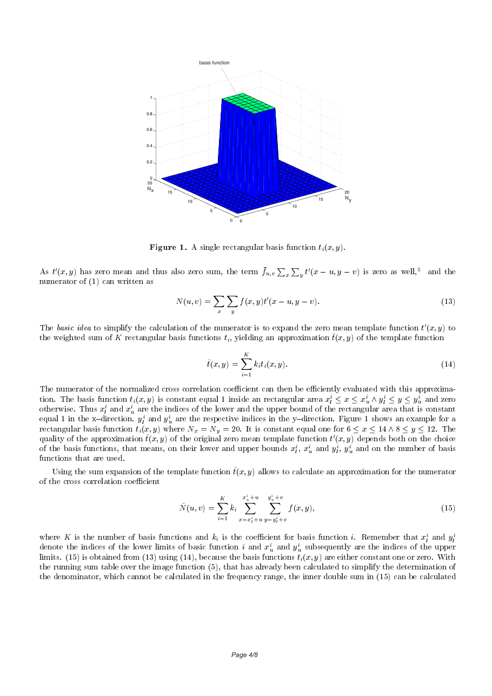
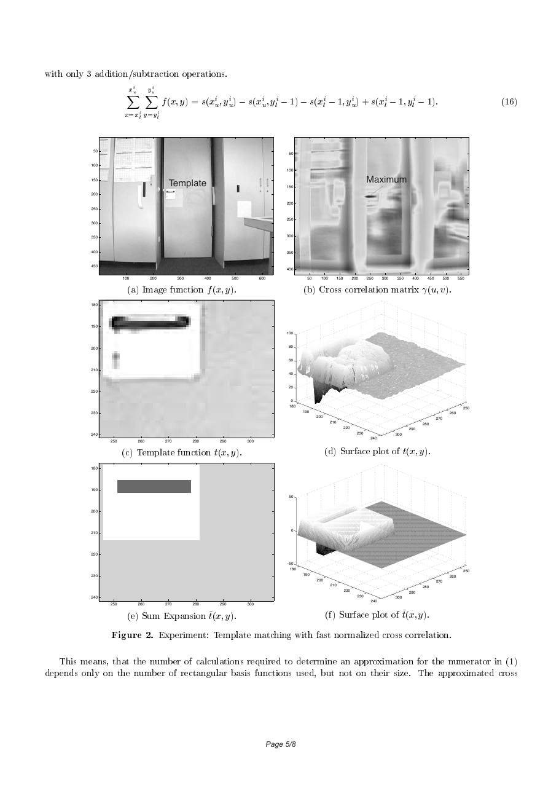

# 고속 정규화 상호상관을 이용한 템플릿 정합 (번역)

- 원제: Template Matching using Fast Normalized Cross Correlation
- 저자: Kai Briechle, Uwe D. Hanebeck (Institute of Automatic Control Engineering, Technische Universität München)
- 서지: Proc. SPIE 4387, Optical Pattern Recognition XII, pp. 95-102, 2001. doi:10.1117/12.421129
- 원문 파일: [Briechle2001_SPIE_fast_NCC.pdf](Briechle2001_SPIE_fast_NCC.pdf) (KITopen 공개본, 8쪽)
- 번역 범위: 전문 (초록, 본문, 그림 캡션, 표, 감사의 글). 참고문헌은 원문 그대로.
- 번역 메모: 원문 PDF는 텍스트 추출 때 수식 기호가 많이 깨진다. 수식은 쪽 이미지와 문맥을 보고 다시 적었다. 기호는 원문을 따른다. f는 영상, t는 템플릿, γ는 상관계수다.

---

## 초록

이 논문은 정규화 상호상관(NCC)을 빠르게 계산하는 알고리즘과, 그것을 템플릿 정합 문제에 쓰는 방법을 보인다. 영상 f 안에서 위치를 찾아야 하는 템플릿 t가 주어졌다고 하자. 알고리즘의 기본 생각은, 정규화 상호상관을 계산할 템플릿을 직사각형 기저 함수의 합으로 나타내는 것이다. 그러면 템플릿 전체 대신 기저 함수 하나하나에 대해 상관을 계산한다. 템플릿 t와 영상 f의 상관 결과는 기저 함수들의 상관 함수에 가중치를 곱해 더한 값으로 얻는다.

근사 정도에 따라, 이 알고리즘은 푸리에 변환 기반 NCC 구현보다 훨씬 빠를 수 있다. 특히 같은 영상 f에서 서로 다른 템플릿을 많이 찾아야 하는 문제에 알맞다.

핵심어: 정규화 상호상관, 영상 처리, 템플릿 정합, 기저 함수

## 1. 서론

영상 처리에서 자주 생기는 기본 문제는, 주어진 무늬가 영상 안, 또는 영상의 일부(이른바 관심 영역) 안에서 어디에 있는지 정하는 것이다. 이 문제는 신호 처리에서 정합 필터(matched filter) 등으로 받은 디지털 신호를 찾아내는 문제와 가깝다.

두 가지 기본 경우를 나눌 수 있다.

- 무늬의 위치를 모른다.
- 무늬 위치의 추정값이 주어져 있다.

보통 영상에서 주어진 무늬의 위치를 정하려면 두 경우를 모두 다뤄야 한다. 두 번째 경우에는 무늬 위치 정보를 써서 계산량을 크게 줄일 수 있다. 이것은 영상 열에서의 특징 추적(feature tracking)이라고도 한다.(1, 2)

특징 추적과, 무늬 위치의 첫 추정 모두에 대해 잘 알려진 여러 알고리즘이 개발되었다.(3, 4) 위의 두 경우에 모두 쓸 수 있는 기본 방법이 템플릿 정합이다. 원하는 무늬를 담은 템플릿과 영상을 화소 단위로 비교해 무늬의 위치를 정한다는 뜻이다. 이를 위해 템플릿을 영상의 x 방향으로 u 칸, y 방향으로 v 칸씩 이산적으로 옮기고, 각 위치 (u, v)에서 템플릿 영역에 걸쳐 비교값을 계산한다. 이 비교값으로는 많은 경우 정규화 상호상관이 합리적인 선택이다.(5) 그러나 계산이 비싸서, 기본형보다 계산이 적은 고속 상관 알고리즘이 필요하다.

2절에서는 이 논문이 다루는 문제를 정의하고 정규화 상호상관 알고리즘을 짧게 정리한다. 3절에서는 템플릿의 근사에 대해 정규화 상호상관을 효율적으로 계산하는 새 고속 알고리즘을 소개한다. 새 알고리즘의 성능을 표준적인 단순 구현, 그리고 잘 알려진 푸리에 변환과 비교한다. 4절은 알고리즘을 재귀적으로 적용하는 방법을 짧게 설명한다. 5절에서는 제안 알고리즘을 템플릿 정합에 적용한 예를 보인다. 마지막에 앞으로의 연구 방향을 적는다.

K. Briechle: E-mail: kai.briechle@ei.tum.de
U. D. Hanebeck: E-mail: uwe.hanebeck@ei.tum.de

## 2. NCC 알고리즘

이 논문이 다루는 문제는 2차원 영상 f 안에서 주어진 무늬의 위치를 정하는 것이다. f(x, y)를 크기 Mx × My인 영상의 점 (x, y)에서의 밝기 값이라 하자. 여기서 x ∈ {0, ..., Mx−1}, y ∈ {0, ..., My−1}이다. 무늬는 크기 Nx × Ny인 템플릿 t로 주어진다. 영상 f 안에서 무늬의 위치 (u_pos, v_pos)를 구하는 흔한 방법은, 영상 f와, x 방향으로 u 칸, y 방향으로 v 칸 옮긴 템플릿 t 사이의 정규화 상호상관 값 γ를 각 점 (u, v)에서 계산하는 것이다. 식 (1)은 정규화 상호상관 계수의 기본 정의다.

$$
\gamma(u,v)=\frac{\sum_{x,y}\big(f(x,y)-\bar f_{u,v}\big)\big(t(x-u,y-v)-\bar t\big)}{\sqrt{\sum_{x,y}\big(f(x,y)-\bar f_{u,v}\big)^2\ \sum_{x,y}\big(t(x-u,y-v)-\bar t\big)^2}} \tag{1}
$$

식 (1)에서 f̄_{u,v}는 (u, v)로 옮긴 템플릿 영역 안에서 f(x, y)의 평균이며 다음과 같이 계산한다.

$$
\bar f_{u,v}=\frac{1}{N_xN_y}\sum_{x=u}^{u+N_x-1}\sum_{y=v}^{v+N_y-1} f(x,y) \tag{2}
$$

비슷한 표기로 t̄는 템플릿 t의 평균이다. 식 (1)의 분모는 평균을 뺀 영상 함수 f(x, y) − f̄_{u,v}와, 평균을 뺀 이동 템플릿 함수 t(x−u, y−v) − t̄의 분산이다. 이 정규화 덕분에 γ(u, v)는 영상의 밝기나 대비의 변화, 곧 평균과 표준편차에 관련된 변화에 영향을 받지 않는다.

t로 나타낸 무늬의 위치 (u_pos, v_pos)는 γ(u, v)의 최댓값 γ_max가 나오는 위치 (u_max, v_max)와 같다. 정규화 덕분에 식 (1)로 무늬 위치를 구하는 것은 단순 공분산이나 절대차 합(SAD) 같은 다른 유사도보다 강건하다. 그러나 가장 큰 단점은 식 (1)의 계산이 비싸다는 것이다. 상관계수를 정규화하는 분모를 위해, γ(u, v)를 구하는 영상의 모든 점 (u, v) ∈ {0, ..., Mx−Nx} × {0, ..., My−Ny}에서 평균을 뺀 영상의 에너지

$$
e_f(u,v)=\sum_{x=u}^{u+N_x-1}\sum_{y=v}^{v+N_y-1}\big(f(x,y)-\bar f_{u,v}\big)^2 \tag{3}
$$

와 템플릿 영역 안의 영상 평균 f̄_{u,v}(식 2)를 다시 계산해야 한다. 이를 식 (1)대로 단순하게 구현하면 계산 횟수는 Nx Ny (Mx−Nx)(My−Ny)에 비례한다. 반면 평균을 뺀 템플릿 함수의 에너지

$$
e_t=\sum_{x=1}^{N_x}\sum_{y=1}^{N_y}\big(t(x,y)-\bar t\big)^2 \tag{4}
$$

와 템플릿의 평균 t̄는 한 번만 미리 계산하면 된다. 이런 계산량은 대부분의 실용 응용에서 받아들일 수 없다. 식 (1)의 분자는 잘 알려진 푸리에 변환을 써서 주파수 영역에서 계산할 수 있지만, 그래도 계산 횟수가 비교적 많다. 그래서 더 적은 계산으로 정규화 상호상관을 구하는 알고리즘이 크게 필요하다.

이런 복잡도 문제를 풀기 위해, Lewis는 정규화 상호상관 계수의 분모를 효율적으로 계산하는 방법을 제안했다.(5) 주된 생각은, 영상 f마다 한 번씩 영상 함수 f(x, y)와 제곱 영상 함수 f²(x, y)의 적분(누적 합)을 담은 합 표(sum table)를 미리 계산하는 것이다. 그리고 이 표로, 정규화 상호상관 계수를 구하는 각 점 (u, v)에서 (f(x, y) − f̄_{u,v})² 식을 효율적으로 계산한다. 이 합 표를 쓰면 분모의 계산 횟수는 더 이상 템플릿 크기 Nx × Ny에 의존하지 않고 영상 함수의 크기 Mx × My에만 의존한다. 이 계산은 3.1절에서 짧게 설명한다.

3.2절에서는 식 (1)의 분자를 매우 효율적으로 계산하게 해 주는 핵심 생각을 자세히 설명한다. 그러면 근사 템플릿 함수 t̃(x, y)에 대해 정규화 상호상관 계수 (1)을 표준 FFT 방법보다 한 자릿수 적은 계산으로 구할 수 있다. 이것은 많은 새 응용을 가능하게 한다.

## 3. 고속 NCC 알고리즘

### 3.1. 분모 계산

정규화 상호상관 계수의 분모 계산을 단순하게 하는 핵심 생각은, 영상 함수 f(x, y)와 영상 에너지 f²(x, y)에 대한 두 합 표 s(u, v), s²(u, v)를 쓰는 것이다.(5) 영상 함수의 합 표는 다음 점화식으로 정의한다.

$$
s(u,v)=f(u,v)+s(u-1,v)+s(u,v-1)-s(u-1,v-1) \tag{5}
$$

영상 에너지의 합 표도 비슷한 점화식으로 정의한다.

$$
s^2(u,v)=f^2(u,v)+s^2(u-1,v)+s^2(u,v-1)-s^2(u-1,v-1) \tag{6}
$$

u < 0 또는 v < 0이면 s(u, v) = s²(u, v) = 0이다. 분모를 단순하게 계산하는 아래 알고리즘은 영상 함수 전체에도, 영상 함수 f(x, y)의 어떤 부분 영상에도 적용할 수 있다. 그때는 합 표를 그 부분 영상 영역에 대해서만 계산하면 된다. 이 표가 있으면 식 (2)를 템플릿 크기 Nx × Ny와 상관없이 매우 효율적으로 계산할 수 있다.

$$
\sum_{x=u}^{u+N_x-1}\sum_{y=v}^{v+N_y-1} f(x,y)=s(u+N_x-1,v+N_y-1)-s(u-1,v+N_y-1)-s(u+N_x-1,v-1)+s(u-1,v-1) \tag{7}
$$

식 (7)에서 보듯, 합 표 s(u, v)를 읽어서 f(x, y)의 이중 합을 구하는 데 덧셈, 뺄셈 세 번이면 된다.

식 (1)의 분모는 누적 합 표 (5), (6)과 다음 식으로 계산한다.

$$
\sum_x\sum_y\big(f(x,y)-\bar f_{u,v}\big)^2=\sum_x\sum_y f^2(x,y)-2\bar f_{u,v}\sum_x\sum_y f(x,y)+\sum_x\sum_y \bar f_{u,v}^2 \tag{8}
$$

식 (8)과 이 단락의 나머지 식에서 이중 합 Σx Σy는 템플릿 영역, 곧 u ≤ x ≤ u+Nx−1, v ≤ y ≤ v+Ny−1에 대해 계산한다.

$$
\sum_x\sum_y \bar f_{u,v}^2=N_xN_y\Big(\frac{1}{N_xN_y}\sum_x\sum_y f(x,y)\Big)^2 \tag{9}
$$

를 쓰면 식 (8)은 다음과 같이 간단해진다.

$$
\sum_x\sum_y\big(f(x,y)-\bar f_{u,v}\big)^2=\sum_x\sum_y f^2(x,y)-\frac{1}{N_xN_y}\Big(\sum_x\sum_y f(x,y)\Big)^2 \tag{10}
$$

식 (10)의 f²(x, y)와 f(x, y)의 합은 누적 합 표 (5), (6)으로 효율적으로 계산할 수 있다. 또 식 (1)의 분모를 정하려면 각 점 (u, v)마다 제곱근을 한 번 계산해야 한다.(5)

### 3.2. 분자 계산

앞 절의 알고리즘으로 분모는 효율적으로 계산할 수 있다. 그러나 NCC 계수 (1)의 분자를 계산하는 데 드는 계산은, FFT 알고리즘으로 주파수 영역에서 해도 여전히 비교적 많다. 그래서 이 계산을 더 단순하게 할 필요가 있다. 분자는 다음과 같이 다시 쓸 수 있다.

$$
N(u,v)=\sum_x\sum_y f(x,y)\,t'(x-u,y-v)-\bar f_{u,v}\sum_x\sum_y t'(x-u,y-v) \tag{11}
$$

여기서 t'(x−u, y−v)는 다음과 같이 정의한, 평균을 뺀 템플릿 함수다.

$$
t'(x-u,y-v)=t(x-u,y-v)-\bar t \tag{12}
$$

그림 1. 하나의 직사각형 기저 함수 t_i(x, y).

t'(x, y)는 평균이 0이므로 합도 0이다. 따라서 f̄_{u,v} Σx Σy t'(x−u, y−v) 항도 0이 되고,(5) 식 (1)의 분자는 다음과 같이 쓸 수 있다.

$$
N(u,v)=\sum_x\sum_y f(x,y)\,t'(x-u,y-v) \tag{13}
$$

분자 계산을 단순하게 하는 기본 생각은, 평균을 뺀 템플릿 함수 t'(x, y)를 K개의 직사각형 기저 함수 t_i의 가중 합으로 전개해, 템플릿 함수의 근사 t̃(x, y)를 얻는 것이다.

$$
\tilde t(x,y)=\sum_{i=1}^{K} k_i\,t_i(x,y) \tag{14}
$$

이 근사를 쓰면 정규화 상호상관 계수의 분자를 효율적으로 계산할 수 있다. 기저 함수 t_i(x, y)는 직사각형 영역 x_l^i ≤ x ≤ x_u^i, y_l^i ≤ y ≤ y_u^i 안에서 1이고, 밖에서는 0이다. 따라서 x_l^i와 x_u^i는 x 방향에서 값이 1인 직사각형 영역의 아래 경계와 위 경계의 번호다. y_l^i와 y_u^i는 y 방향의 해당 번호다. 그림 1은 Nx = Ny = 20인 직사각형 기저 함수 t_i(x, y)의 예다. 6 ≤ x ≤ 14, 8 ≤ y ≤ 12에서 값이 1이다. 원래의 평균을 뺀 템플릿 함수 t'(x, y)를 근사한 t̃(x, y)의 품질은, 기저 함수의 선택(곧 아래, 위 경계 x_l^i, x_u^i, y_l^i, y_u^i)과 쓰는 기저 함수의 개수에 달려 있다.

템플릿 함수의 합 전개 t̃(x, y)를 쓰면 상관계수의 분자의 근사를 계산할 수 있다.

$$
\tilde N(u,v)=\sum_{i=1}^{K} k_i\sum_{x=x_l^i+u}^{x_u^i+u}\ \sum_{y=y_l^i+v}^{y_u^i+v} f(x,y) \tag{15}
$$

여기서 K는 기저 함수의 개수이고 k_i는 기저 함수 i의 계수다. x_l^i와 y_l^i는 기저 함수 i의 아래 경계 번호이고, x_u^i와 y_u^i는 위 경계 번호임을 기억하자. 식 (15)는 기저 함수 t_i(x, y)가 1 아니면 0이므로 식 (13)과 (14)에서 바로 얻는다. 분모를 단순하게 구하려고 이미 계산해 둔 영상 함수의 누적 합 표 (5)를 쓰면(분모는 주파수 영역에서 계산할 수 없다), 식 (15)의 안쪽 이중 합은 덧셈, 뺄셈 세 번만으로 계산할 수 있다.

$$
\sum_{x=x_l^i}^{x_u^i}\sum_{y=y_l^i}^{y_u^i} f(x,y)=s(x_u^i,y_u^i)-s(x_u^i,y_l^i-1)-s(x_l^i-1,y_u^i)+s(x_l^i-1,y_l^i-1) \tag{16}
$$

그림 2. 실험: 고속 정규화 상호상관을 이용한 템플릿 정합.
(a) 영상 함수 f(x, y). (b) 상호상관 행렬 γ(u, v). (c) 템플릿 함수 t(x, y). (d) t(x, y)의 표면 그림. (e) 합 전개 t̃(x, y). (f) t̃(x, y)의 표면 그림.

이것은 분자의 근사를 구하는 데 필요한 계산 횟수가, 쓰는 직사각형 기저 함수의 개수에만 달려 있고 그 크기와는 상관없다는 뜻이다. 근사 상호상관 계수 γ̃(u, v)는 다음과 같다.

$$
\tilde\gamma(u,v)=\frac{\tilde N(u,v)}{\sqrt{\sum_{x,y}\big(f(x,y)-\bar f_{u,v}\big)^2\ \sum_{x,y}\big(t(x-u,y-v)-\bar t\big)^2}} \tag{17}
$$

이 식의 분모는 식 (1)과 같고, 합 표 (5), (6)으로 효율적으로 계산할 수 있다. 식 (15)와 (16)을 대입하면 마침내 근사 상호상관 계수의 다음 간단한 식을 얻는다.

$$
\tilde\gamma(u,v)=\frac{\sum_{i=1}^{K}k_i\Big(s(x_u^i+u,y_u^i+v)-s(x_u^i+u,y_l^i+v-1)-s(x_l^i+u-1,y_u^i+v)+s(x_l^i+u-1,y_l^i+v-1)\Big)}{\sqrt{\sum_{x,y}\big(f(x,y)-\bar f_{u,v}\big)^2\ \sum_{x,y}\big(t(x-u,y-v)-\bar t\big)^2}} \tag{18}
$$

### 3.3. 분자 계산의 복잡도 분석

크기 Mx × My인 영상과, K개의 직사각형 기저 함수로 근사한 크기 Nx × Ny인 템플릿에 대해 NCC 계수의 분자를 계산하는 데 필요한 계산 횟수를 표 1에 보였다. 주어진 영상 함수 f(x, y)에 대해 곱셈 횟수는 기저 함수 개수 K에 선형으로 비례한다. 정규화 상호상관 계수 γ(u, v)를 구하는 각 점 (u, v)에서 분자를 구하는 데 기저 함수마다 한 번씩, K번의 곱셈이 필요하다.

이와 달리 γ(u, v)를 직접 계산하면, γ를 구하는 각 점 (u, v)마다 Nx Ny번의 곱셈이 필요하다. FFT의 복잡도는 템플릿과 영상 함수의 크기에 달려 있다.(6) M이 N보다 훨씬 크면 직접 방법의 계산 횟수를 넘을 수도 있다. M과 N과 상관없이, 기저 함수 개수 K에 따라 FFT는 제안 알고리즘의 계산 횟수를 크게 넘을 수 있다.

합 표를 만들고 정규화 상호상관 계수의 분모를 구하는 데 드는 계산은 표 1과 표 2에 넣지 않았다. 상관계수를 정규화하는 분모를 계산하는 데는 Lewis가 제안한 방법(5)이 단순한 직접 계산보다 훨씬 효율적이다. 따라서 합 표를 만드는 계산은 여기서 다루는 세 방법 모두에 필요하므로 비교에 넣지 않았다. 물론 제안한 분자 계산 알고리즘은 정규화 없는 일반 상호상관을 효율적으로 계산하는 데도 쓸 수 있다. 다만 그때는 합 표가 필요 없는 표준 FFT와 비교할 때 합 표를 만드는 추가 비용을 따져야 한다.

표 1. 복잡도 분석, 분자만.

| 방법 | 덧셈/뺄셈 | 곱셈 |
|---|---|---|
| 직접 계산 | Nx Ny (Mx−Nx+1)(My−Ny+1) | Nx Ny (Mx−Nx+1)(My−Ny+1) |
| FFT | 9 Mx My log2(Mx My) | 6 Mx My log2(Mx My) |
| 새 알고리즘 | (4K−1)(Mx−Nx+1)(My−Ny+1) | K (Mx−Nx+1)(My−Ny+1) |

표 2. 복잡도 분석, 예. Mx = 640, My = 480, Nx = Ny = 64, K = 3.

| 방법 | 덧셈/뺄셈 | 곱셈 |
|---|---|---|
| 직접 계산 | 985.5 백만 | 985.5 백만 |
| FFT | 50.4 백만 | 33.6 백만 |
| 새 알고리즘 | 2.65 백만 | 0.72 백만 |

### 3.4. 기저 함수 정하기

분자 (1)을 효율적으로 계산하는 제안 알고리즘을 쓰려면, 원래 템플릿 함수를 근사할 기저 함수 t_i의 집합을 정해야 한다. 간단한 템플릿 함수 t(x, y)라면 5절에서 보이듯 기저 함수 집합을 손으로 정할 수 있다. 기저 함수를 자동으로 정할 때는 근사 품질을 평가하는 데 다음 2차 기준을 쓴다.

$$
J=\sum_{x,y}\big(t'(x,y)-\tilde t(x,y)\big)^2 \tag{19}
$$

재귀 알고리즘이 템플릿 함수 t(x, y)를 직사각형 기저 함수로 나눈다. 하나의 기저 함수 t_1(x, y) = t̄ = 상수에서 시작해, 식 (14)와 (19)로 J를 계산한다. J > J_max이면(J_max는 미리 정한 문턱) 그 기저 함수를 두 기저 함수로 나누고, J가 최소가 되도록 계수 k_i (i = 1, 2)를 다시 계산한다. 이 과정을 각 기저 함수 t_i에 대해 J < J_max가 될 때까지 재귀적으로 계속한다. 다만 이 알고리즘으로 찾은 근사는, 템플릿을 근사하는 데 필요한 기저 함수 개수의 측면에서 전역 최적이 아니다. 곧, 같은 품질 J를 가지면서 K보다 적은 기저 함수 t_i를 쓰는 다른 근사가 있을 수 있다. 그래도 실내 환경에서 만나는 많은 특징은 재귀 알고리즘으로 적은 개수의 기저 함수로 잘 근사할 수 있다. 근사한 분자 (1)을 구하는 데 드는 계산 횟수는 근사에 쓴 기저 함수 개수 K에 정비례한다. 그래서 잘 고른 적은 수의 기저 함수가 바람직하다. 반대로 기저 함수를 너무 적게 쓰면 템플릿의 근사가 나빠지고, 따라서 분자 (1)의 근사도 나빠진다. 기저 함수를 자동으로 정하면 계산 복잡도와 근사 오차 사이의 절충점을 정할 수 있다.

## 4. 알고리즘의 재귀 적용

앞 절에서 지적했듯, 템플릿 근사의 품질은 제안 알고리즘의 결과, 곧 분자 (1)의 근사에 바로 영향을 준다. 템플릿을 나타내는 데 K = Nx Ny개의 기저 함수를 쓰면 직접 계산과 제안 알고리즘의 결과는 같다. 그러나 이것은 실용적이지 않다. 제안 알고리즘의 계산 복잡도가 γ(u, v)의 직접 계산에 가까워지고, 따라서 FFT 기반 계산의 복잡도를 넘기 때문이다.

템플릿 함수의 근사가 충분히 좋으면, 5장의 예에서 보이듯 t(x, y)로 나타낸 무늬는 아주 적은 계산으로 γ̃(u, v)의 최댓값을 써서 강건하게 검출된다. 3.4절에서 제안한 알고리즘으로 계산한 템플릿 t(x, y)의 근사가, 정규화 상호상관 계수 γ(u, v)를 충분히 잘 근사할 만큼 좋지 않으면 제안 알고리즘을 재귀적으로 적용한다. 충분히 좋은 근사의 정의는 주어진 문제에 달려 있다. 템플릿 정합 응용에서는 γ(u, v)의 최댓값을 찾아 영상 안 템플릿의 위치를 정해야 한다. 이런 맥락에서 좋은 근사란 γ̃(u, v)의 최댓값이 γ(u, v)의 최댓값과 같거나 가깝다는 뜻이다.

알고리즘을 재귀적으로 적용할 때는, 재귀의 각 단계마다 기저 함수를 더 많이 쓰는 템플릿 함수 t(x, y)의 근사로 상호상관 계수 γ̃(u, v)를 계산한다. 첫 단계에서는 기저 함수 몇 개만 쓰는 매우 거친 t(x, y) 근사로 γ̃(u, v)를 계산한다. 이 근사로 얻은 γ̃(u, v)의 최대 오차를 추정할 수 있다. 이 오차 한계로 영상 함수 f(x, y)의 모든 화소 가운데 부분집합 f_2(x, y)를 정한다. 이 부분집합에 대해, 더 좋은 t(x, y) 근사로 제안 알고리즘을 재귀적으로 적용해 더 작은 부분집합 f_3(x, y)를 얻는다. 부분집합 f_N(x, y)의 화소 수가 충분히 작아지면 과정을 멈춘다. 그러면 부분집합 f_N(x, y)에서 식 (1)을 직접 계산해 γ(u, v)의 정확한 최댓값을 찾을 수 있다. 이것은 최대 개수의 기저 함수 K = Nx Ny로 나타낸 표현과 제안 알고리즘을 쓰는 것과 같다.

## 5. 예

그림 2a는 전형적인 실내 환경에서 찍은 보통의 카메라 영상이다. 문손잡이가 이 영상에서 찾을 무늬다. 크기 64 × 64인 무늬의 템플릿 함수 t(x, y)를 그림 2c에 확대해 보였다. 이 템플릿은 직사각형 기저 함수 3개의 가중 합으로 잘 근사되며, 새 템플릿 함수 t̃(x, y)를 얻는다(그림 2e). 기저 함수는 보통 제안한 재귀 알고리즘으로 계산하지만, 그러면 기저 함수를 더 많이 쓰면서도 더 나쁜 근사가 나온다. 그래서 이 예에서는 상호상관 알고리즘이 어떻게 동작하는지 보이려고 세 기저 함수 t_i를 손으로 골랐다. 자동으로 계산한 더 나쁜 근사로도 비슷하지만 덜 뚜렷한 결과를 얻을 수 있다. 근사 템플릿 함수 t̃(x, y)는 평균이 0임에 주의하라. 그림 2d와 e는 원래 템플릿 함수 t(x, y)와 근사 템플릿 함수 t̃(x, y)의 표면 그림이다. 그림의 높이는 점 (x, y)에서 함수 t(x, y)와 t̃(x, y)의 값이다.

다만 t̃(x, y)의 값 5, 18, 30은 K = 3개 기저 함수의 계수 k_i와 같지 않다. 이 예에서 기저 함수 t_i(x, y)가 서로 겹치기 때문이다. 곧, 가장 작은 직사각형 영역에서 t̃(x, y)의 실제 값은 세 기저 함수의 가중 합과 같으므로, 가장 작은 직사각형의 계수는 바깥 두 직사각형을 고려해 계산한다.

그림 2b는 식 (9), (10)의 알고리즘으로 계산한 NCC의 상호상관 함수 γ̃(u, v)다. 어두운 화소는 1에 가까운 높은 γ̃ 값, 밝은 화소는 −1에 가까운 낮은 값이다. 템플릿 함수의 근사가 거칠어도(그림 2e), 고속 NCC 알고리즘은 원래 영상에서 템플릿의 위치를 바르게 정해, [x0, y0] = [245, 178]에서 γ̃(u, v)의 최댓값을 얻는다.

### 5.1. 효율

VGA 카메라 영상을 쓴 이 예에서 영상 함수의 크기는 640 × 480 화소이고, 템플릿 함수는 64 × 64 화소다. 표 2는, 분모 계산에 쓰는 합 표가 모든 알고리즘에 필요하다고 가정할 때, 분자의 곱셈 횟수가 FFT보다 47배, 직접 계산보다 2048배 줄어든다는 것을 보여 준다. 곧 계산량이 FFT 알고리즘과 같아지기 전까지 기저 함수를 140개까지 쓸 수 있다는 뜻이다. FFT 알고리즘은 f와 t를 0으로 채워 공통의 2의 거듭제곱 크기로 늘려야 한다고 가정했다(zero padding).

## 6. 결론

주어진 템플릿 함수 t의 합 전개와 직사각형 기저 함수 t_i(x, y)를 쓰는, 정규화 상호상관을 계산하는 새 고속 알고리즘을 유도했다. 영상 함수 f(x, y)에 대해 정규화 상호상관 계수 γ(u, v)를 구하는 데 필요한 계산 횟수는 쓰는 기저 함수 개수에 선형으로 비례하며, 템플릿 t의 크기와는 상관없다. 문손잡이 같은 간단한 특징의 위치를, FFT를 쓰는 γ(u, v) 계산보다 47배 적은 곱셈으로 VGA 카메라 영상에서 정할 수 있음을 보였다. 그래서 제안 알고리즘은 특징 추적 같은 실시간 영상 처리 응용에 매력적이다.

## 감사의 글

이 연구는 프로젝트 "DIROKOL"의 일부로 바이에른 연구재단(BFS)의 지원을 받았다.

## 참고문헌 (원문 그대로)

1. Gregory D. Hager and Kentaro Toyama, The XVision System: A General-Purpose Substrate for Portable Real-Time Vision Applications Computer Vision and Image Understanding, Volume 69, Number 1, pp. 23-37, 1998.
2. B. D. Lucas and T. Kanade, An Iterative Image Registration Technique with an Application to Stereo Vision, IJCAI 1981.
3. Hirochika Inoue, Tetsuya Tachikawa and Masayuki Inaba, Robot Vision System with a Correlation Chip for Real-time Tracking, Optical Flow and Depth Map Generation, Proceedings of the IEEE International Conference on Robotics and Automation, pp 1621-1626, France, 1992.
4. Changming Sun, A Fast Stereo Matching Method, Digital Image Computing: Techniques and Applications, pp. 95-100, Massey University, Auckland, New Zealand, 10-12 December 1997.
5. J. P. Lewis, Fast Normalized Cross-Correlation, Industrial Light and Magic.
6. Rafael C. Gonzales, Paul Wintz, Digital Image Processing, Second Edition, Addison-Wesley Publishing Company, Reading, Massachusetts, November 1987, ISBN 0-201-11026-1.
