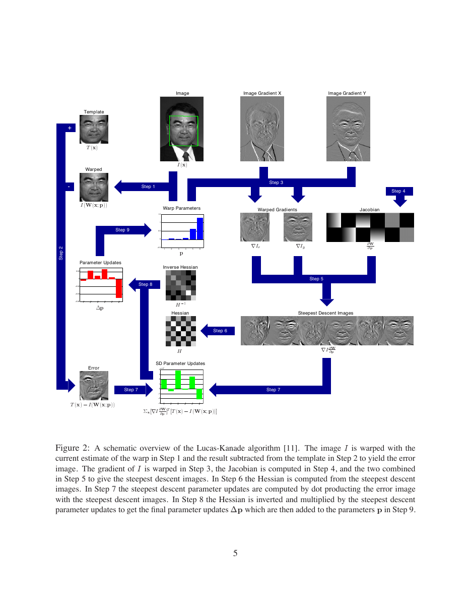
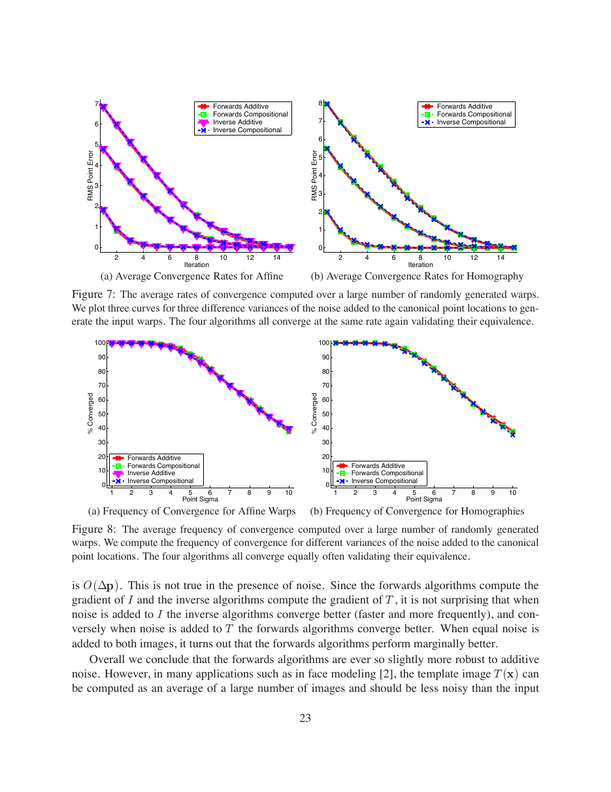
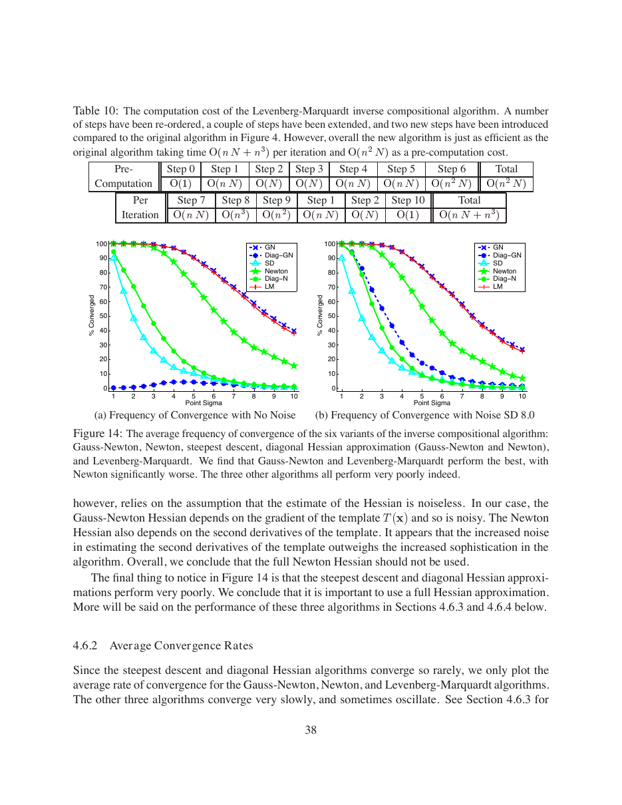

# 루카스-카나데 20년: 통합 틀, 1부 (번역)

- 원제: Lucas-Kanade 20 Years On: A Unifying Framework: Part 1
- 저자: Simon Baker, Iain Matthews
- 번역 대상 파일: 같은 폴더의 `Baker2004_IJCV_LK20years.pdf`
- 번역 범위: 전문 (초록, 본문 1~5절, 그림 17개와 표 12개의 캡션, 감사의 글, 부록 A). 참고문헌은 원문 그대로 둔다.

알아 둘 점

- 받은 PDF는 IJCV 출판본이 아니라, 같은 내용의 CMU 로봇연구소 기술보고서 **CMU-RI-TR-02-16 (2002년, 48쪽)** 이다. 출판본(IJCV 56(3), 221-255, 2004)과 쪽 번호, 그림 번호, 일부 문장이 다를 수 있다. 출판본과 한 줄씩 대조하지는 않았다.
- pdftotext가 그리스 문자(Δ, δ, ε, Γ, Ψ)와 일부 기호를 잃었다. 수식은 문맥과 원문 쪽 이미지로 다시 적었다. 기호 표기: 템플릿 $T(\mathbf{x})$, 입력 영상 $I(\mathbf{x})$, 워프 $\mathbf{W}(\mathbf{x};\mathbf{p})$, 증분 $\Delta\mathbf{p}$.
- 쪽 번호는 PDF 쪽(표지 포함 1부터) 기준이다.

---

## 초록

1981년 루카스-카나데(Lucas-Kanade) 알고리즘이 나온 뒤, 영상 정렬(image alignment)은 컴퓨터 비전에서 가장 널리 쓰이는 기법 가운데 하나가 되었다. 응용은 광류(optical flow)와 추적에서 층별 움직임(layered motion), 모자이크 만들기, 얼굴 부호화까지 넓다. 많은 알고리즘이 제안되었고, 원래 식을 넓힌 확장도 아주 다양하다. 우리는 영상 정렬을 개관하면서, 대부분의 알고리즘과 확장을 하나의 일관된 틀로 설명한다. 우리가 최근 제안한 효율적인 알고리즘인 **역방향 합성(inverse compositional) 알고리즘**에 집중한다. 루카스-카나데의 확장 가운데 어떤 것은 효율을 크게 잃지 않고 역방향 합성 알고리즘과 함께 쓸 수 있고, 어떤 것은 그렇지 않은지 살펴본다. 2부로 된 연재의 1부인 이 논문에서는 근사하는 양(quantity approximated), 워프 갱신 규칙, 경사 하강 근사를 다룬다. 다음 2부에서는 노름(norm)의 선택, 선형 외관 변화를 허용하는 방법, 매개변수에 사전 분포를 거는 방법, 국소 최소를 피하는 여러 경험 규칙을 다룬다.

핵심어: 영상 정렬, 루카스-카나데, 통합 틀, 덧셈형 대 합성형 알고리즘, 정방향 대 역방향 알고리즘, 역방향 합성 알고리즘, 효율, 최급강하, 가우스-뉴턴, 뉴턴, 레벤버그-마쿼트.

## 1 서론

영상 정렬은 템플릿을 움직이고, 필요하면 변형해서, 템플릿과 영상의 차이를 최소로 만드는 일이다. 루카스-카나데 광류 알고리즘 [11]에서 처음 쓰인 뒤, 영상 정렬은 컴퓨터 비전에서 가장 널리 쓰이는 기법이 되었다. 광류 말고도 추적 [4, 10], 매개변수 움직임과 층별 움직임 추정 [3], 모자이크 만들기 [14], 얼굴 부호화 [2, 6] 같은 응용이 있다.

영상 정렬의 보통 방법은 경사 하강(gradient descent)이다. 차이 분해(difference decomposition) [9], 선형 회귀 [6] 같은 다른 수치 알고리즘도 제안되었지만, 사실상 표준은 경사 하강이다. 다만 경사 하강을 하는 방식은 여러 가지다. 예를 들어 매개변수에 더할 증분을 추정하는지(덧셈형 [11]), 아니면 증분 워프를 추정해 현재 워프 추정에 합성하는지(합성형 [14])가 다르다. 또 각 경사 하강 단계에서 가우스-뉴턴, 뉴턴, 최급강하, 레벤버그-마쿼트 가운데 어떤 근사를 쓰는지도 다르다.

우리는 영상 정렬을 위한 통합 틀을 제안하고, 여러 알고리즘과 확장을 일관되게 설명한다. 틀 전체에서 우리가 최근 제안한 효율적 알고리즘인 역방향 합성 알고리즘 [2]에 집중한다. 루카스-카나데의 확장 가운데 어떤 것은 효율을 크게 잃지 않고 역방향 합성 알고리즘에 적용할 수 있고, 어떤 것은 계산이 더 필요한지 살펴본다. 가능한 곳마다 실험 결과로 여러 알고리즘과 확장을 보여 준다.

2부 연재의 1부인 이 논문은 다음 순서다. 2절에서 루카스-카나데 알고리즘을 다시 본다. 3절에서 여러 영상 정렬 알고리즘이 근사하는 양과 워프 갱신 규칙을 분석한다. 알고리즘을 덧셈형 또는 합성형, 정방향 또는 역방향으로 나눈다. 여러 방식이 1차까지 같다는 것을 증명하고, 각 알고리즘의 효율을 유도하고, 각 방식을 적용할 수 있는 워프 집합을 설명하고, 마지막으로 실험으로 비교한다. 4절에서는 매 반복에 쓸 수 있는 여러 경사 하강 근사, 즉 가우스-뉴턴, 뉴턴, 대각 헤세 행렬, 레벤버그-마쿼트, 최급강하 [12]를 설명한다. 이 대안들을 속도와 실험 성능 두 면에서 비교한다. 5절에서 논의로 마친다. 지금 준비 중인 2부에서는 오차 노름의 선택, 선형 외관 변화를 허용하는 법, 매개변수에 사전 분포를 넣는 법, 국소 최소를 피하는 여러 경험 규칙을 다룬다.

## 2 배경: 루카스-카나데

원래의 영상 정렬 알고리즘은 루카스-카나데 알고리즘 [11]이다. 목표는 템플릿 영상 $T(\mathbf{x})$를 입력 영상 $I(\mathbf{x})$에 맞추는 것이다. 여기서 $\mathbf{x}=(x,y)^T$는 화소 좌표를 담은 열벡터다. 루카스-카나데로 광류를 구하거나 영상 조각을 시각 $t=1$에서 $t=2$로 추적한다면, 템플릿 $T(\mathbf{x})$는 $t=1$ 영상에서 떼어 낸 부분 영역(예를 들어 5x5 창)이고 $I(\mathbf{x})$는 $t=2$의 영상이다.

$\mathbf{W}(\mathbf{x};\mathbf{p})$를 허용된 워프들의 매개변수 집합이라 하자. $\mathbf{p}=(p_1,\ldots,p_n)^T$는 매개변수 벡터다. 워프 $\mathbf{W}(\mathbf{x};\mathbf{p})$는 템플릿 $T$ 좌표계의 화소 $\mathbf{x}$를 영상 $I$ 좌표계의 부화소 위치 $\mathbf{W}(\mathbf{x};\mathbf{p})$로 보낸다. 예를 들어 광류를 구한다면 워프는 평행이동일 수 있다.

$$\mathbf{W}(\mathbf{x};\mathbf{p})=\begin{pmatrix}x+p_1\\ y+p_2\end{pmatrix}\qquad(1)$$

이때 매개변수 벡터 $\mathbf{p}=(p_1,p_2)^T$가 곧 광류다. 3차원에서 움직이는 더 큰 영상 조각을 추적한다면 아핀 워프 집합을 대신 쓸 수 있다.

$$\mathbf{W}(\mathbf{x};\mathbf{p})=\begin{pmatrix}(1+p_1)x+p_3y+p_5\\ p_2x+(1+p_4)y+p_6\end{pmatrix}=\begin{pmatrix}1+p_1&p_3&p_5\\ p_2&1+p_4&p_6\end{pmatrix}\begin{pmatrix}x\\y\\1\end{pmatrix}\qquad(2)$$

예를 들어 [3]처럼 매개변수가 6개, $\mathbf{p}=(p_1,\ldots,p_6)^T$다. (아핀 워프를 매개변수화하는 다른 방법도 있다. 어떤 방법이 가장 좋은지는 이 틀의 2부에서 살핀다.) 일반적으로 매개변수 수 $n$은 얼마든지 클 수 있고 $\mathbf{W}(\mathbf{x};\mathbf{p})$도 얼마든지 복잡할 수 있다. 복잡한 워프의 예로 능동 외관 모델(Active Appearance Models) [6], 능동 블롭(Active Blobs) [13], 유연 외관 모델(Flexible Appearance Models) [2]에서 쓰는 조각별 아핀 워프가 있다.

### 2.1 루카스-카나데 알고리즘의 목표

루카스-카나데 알고리즘의 목표는 두 영상, 즉 템플릿 $T$와 템플릿 좌표계로 되돌려 워프한 영상 $I$ 사이의 제곱 오차 합을 최소로 만드는 것이다.

$$\sum_{\mathbf{x}}\left[I(\mathbf{W}(\mathbf{x};\mathbf{p}))-T(\mathbf{x})\right]^2\qquad(3)$$

$I$를 되돌려 워프해 $I(\mathbf{W}(\mathbf{x};\mathbf{p}))$를 구하려면 부화소 위치 $\mathbf{W}(\mathbf{x};\mathbf{p})$에서 $I$를 보간해야 한다. 식 (3)의 최소화는 $\mathbf{p}$에 대해 하고, 합은 템플릿 영상 $T(\mathbf{x})$의 모든 화소 $\mathbf{x}$에 대해 한다. $\mathbf{W}(\mathbf{x};\mathbf{p})$가 $\mathbf{p}$에 대해 선형이라도 식 (1)[원문 그대로, 식 (3)을 뜻함]의 최소화는 비선형 최적화다. 화소값 $I(\mathbf{x})$가 일반적으로 $\mathbf{x}$에 대해 비선형이기 때문이다. 사실 화소값 $I(\mathbf{x})$는 화소 좌표 $\mathbf{x}$와 본질적으로 관계가 없다. 식 (3)을 최적화하려고 루카스-카나데 알고리즘은 현재 추정 $\mathbf{p}$를 안다고 보고, 매개변수 증분 $\Delta\mathbf{p}$를 반복해서 푼다. 즉 다음 식을 $\Delta\mathbf{p}$에 대해 (근사적으로) 최소화하고,

$$\sum_{\mathbf{x}}\left[I(\mathbf{W}(\mathbf{x};\mathbf{p}+\Delta\mathbf{p}))-T(\mathbf{x})\right]^2\qquad(4)$$

매개변수를 갱신한다.

$$\mathbf{p}\leftarrow\mathbf{p}+\Delta\mathbf{p}\qquad(5)$$

이 두 단계를 매개변수 추정 $\mathbf{p}$가 수렴할 때까지 되풀이한다. 보통 수렴 판정은 벡터 $\Delta\mathbf{p}$의 어떤 노름이 문턱 $\epsilon$보다 작은지, 즉 $\|\Delta\mathbf{p}\|\le\epsilon$인지로 한다.

### 2.2 루카스-카나데 알고리즘의 유도

루카스-카나데 알고리즘(가우스-뉴턴 경사 하강 비선형 최적화 알고리즘이다)은 다음처럼 유도한다. 식 (4)의 비선형 식을 $I(\mathbf{W}(\mathbf{x};\mathbf{p}+\Delta\mathbf{p}))$의 1차 테일러 전개로 선형화하면 다음을 얻는다.

$$\sum_{\mathbf{x}}\left[I(\mathbf{W}(\mathbf{x};\mathbf{p}))+\nabla I\frac{\partial\mathbf{W}}{\partial\mathbf{p}}\Delta\mathbf{p}-T(\mathbf{x})\right]^2\qquad(6)$$

이 식에서 $\nabla I=(\partial I/\partial x,\partial I/\partial y)$는 $\mathbf{W}(\mathbf{x};\mathbf{p})$에서 계산한 영상 $I$의 기울기다. 즉 $\nabla I$는 $I$의 좌표계에서 계산한 뒤 현재 워프 추정 $\mathbf{W}(\mathbf{x};\mathbf{p})$로 템플릿 좌표계에 되돌려 워프한 것이다. $\partial\mathbf{W}/\partial\mathbf{p}$는 워프의 야코비안이다. $\mathbf{W}(\mathbf{x};\mathbf{p})=(W_x(\mathbf{x};\mathbf{p}),W_y(\mathbf{x};\mathbf{p}))^T$이면 다음과 같다.

$$\frac{\partial\mathbf{W}}{\partial\mathbf{p}}=\begin{pmatrix}\frac{\partial W_x}{\partial p_1}&\frac{\partial W_x}{\partial p_2}&\cdots&\frac{\partial W_x}{\partial p_n}\\ \frac{\partial W_y}{\partial p_1}&\frac{\partial W_y}{\partial p_2}&\cdots&\frac{\partial W_y}{\partial p_n}\end{pmatrix}\qquad(7)$$

열벡터에 대한 편미분은 행벡터로 늘어놓는다는 약속을 따른다. 이렇게 하면 연쇄 법칙이 식 (6)처럼 행렬 곱이 된다. 예를 들어 식 (2)의 아핀 워프의 야코비안은 다음과 같다.

$$\frac{\partial\mathbf{W}}{\partial\mathbf{p}}=\begin{pmatrix}x&0&y&0&1&0\\0&x&0&y&0&1\end{pmatrix}\qquad(8)$$

식 (6)은 최소제곱 문제이고, 닫힌 형태의 해가 있다. 식 (6)을 $\Delta\mathbf{p}$로 편미분하면 다음과 같다.

$$2\sum_{\mathbf{x}}\left[\nabla I\frac{\partial\mathbf{W}}{\partial\mathbf{p}}\right]^T\left[I(\mathbf{W}(\mathbf{x};\mathbf{p}))+\nabla I\frac{\partial\mathbf{W}}{\partial\mathbf{p}}\Delta\mathbf{p}-T(\mathbf{x})\right]\qquad(9)$$

여기서 $\nabla I\,\partial\mathbf{W}/\partial\mathbf{p}$를 **최급강하 영상(steepest descent images)**이라 부른다. (이유는 4.3절에서 설명한다.) 이 식을 0으로 놓고 풀면 식 (6)의 닫힌 해가 나온다.

$$\Delta\mathbf{p}=H^{-1}\sum_{\mathbf{x}}\left[\nabla I\frac{\partial\mathbf{W}}{\partial\mathbf{p}}\right]^T\left[T(\mathbf{x})-I(\mathbf{W}(\mathbf{x};\mathbf{p}))\right]\qquad(10)$$

여기서 $H$는 $n\times n$ 헤세 행렬(의 가우스-뉴턴 근사)이다.

$$H=\sum_{\mathbf{x}}\left[\nabla I\frac{\partial\mathbf{W}}{\partial\mathbf{p}}\right]^T\left[\nabla I\frac{\partial\mathbf{W}}{\partial\mathbf{p}}\right]\qquad(11)$$

뒤에서 분명해질 이유로, $\sum_{\mathbf{x}}[\nabla I\,\partial\mathbf{W}/\partial\mathbf{p}]^T[T(\mathbf{x})-I(\mathbf{W}(\mathbf{x};\mathbf{p}))]$를 **최급강하 매개변수 갱신량**이라 부른다. 그러면 식 (10)은 매개변수 갱신 $\Delta\mathbf{p}$가 최급강하 매개변수 갱신량에 헤세 행렬의 역행렬을 곱한 것이라는 뜻이다. 루카스-카나데 알고리즘 [11]은 식 (10)과 (5)를 되풀이해 적용하는 것이다. 그림 1과 2에 정리했다. 기울기 $\nabla I$는 $\mathbf{W}(\mathbf{x};\mathbf{p})$에서, 야코비안 $\partial\mathbf{W}/\partial\mathbf{p}$는 $\mathbf{p}$에서 계산해야 하므로, 둘 다 일반적으로 $\mathbf{p}$에 따라 바뀐다. 식 (1)의 평행이동, 식 (2)의 아핀 워프처럼 간단한 워프에서는 야코비안이 상수일 때가 있다. 식 (8)이 그 예다. 그러나 일반적으로는 매 반복마다 매개변수 추정 $\mathbf{p}$가 바뀌므로 9단계를 모두 되풀이해야 한다.

> **그림 1 (5쪽, 알고리즘 상자) 루카스-카나데 알고리즘**
> 되풀이:
> (1) $I$를 $\mathbf{W}(\mathbf{x};\mathbf{p})$로 워프해 $I(\mathbf{W}(\mathbf{x};\mathbf{p}))$를 구한다.
> (2) 오차 영상 $T(\mathbf{x})-I(\mathbf{W}(\mathbf{x};\mathbf{p}))$를 구한다.
> (3) 기울기 $\nabla I$를 $\mathbf{W}(\mathbf{x};\mathbf{p})$로 워프한다.
> (4) 야코비안 $\partial\mathbf{W}/\partial\mathbf{p}$를 $(\mathbf{x};\mathbf{p})$에서 계산한다.
> (5) 최급강하 영상 $\nabla I\,\partial\mathbf{W}/\partial\mathbf{p}$를 구한다.
> (6) 식 (11)로 헤세 행렬을 구한다.
> (7) $\sum_{\mathbf{x}}[\nabla I\,\partial\mathbf{W}/\partial\mathbf{p}]^T[T(\mathbf{x})-I(\mathbf{W}(\mathbf{x};\mathbf{p}))]$를 구한다.
> (8) 식 (10)으로 $\Delta\mathbf{p}$를 구한다.
> (9) 매개변수를 갱신한다. $\mathbf{p}\leftarrow\mathbf{p}+\Delta\mathbf{p}$
> $\|\Delta\mathbf{p}\|\le\epsilon$이 될 때까지.
>
> 캡션: 루카스-카나데 알고리즘 [11]은 매개변수 추정 $\mathbf{p}$가 수렴할 때까지 식 (10)과 (5)를 되풀이해 적용한다. 보통 수렴 판정은 벡터 $\Delta\mathbf{p}$의 어떤 노름이 사용자가 정한 문턱 $\epsilon$보다 작은지로 한다. 기울기 $\nabla I$는 $\mathbf{W}(\mathbf{x};\mathbf{p})$에서, 야코비안 $\partial\mathbf{W}/\partial\mathbf{p}$는 $\mathbf{p}$에서 계산해야 하므로, 9단계 모두를 매 반복마다 되풀이해야 한다.

> **그림 2 (6쪽)** 루카스-카나데 알고리즘 [11]의 개요도. 1단계에서 영상 $I$를 현재 워프 추정으로 워프하고, 2단계에서 그 결과를 템플릿에서 빼 오차 영상을 얻는다. 3단계에서 $I$의 기울기를 워프하고, 4단계에서 야코비안을 구하고, 5단계에서 둘을 합쳐 최급강하 영상을 얻는다. 6단계에서 최급강하 영상으로 헤세 행렬을 구한다. 7단계에서 오차 영상과 최급강하 영상의 내적으로 최급강하 매개변수 갱신량을 구한다. 8단계에서 헤세 행렬의 역행렬을 최급강하 매개변수 갱신량에 곱해 최종 매개변수 갱신 $\Delta\mathbf{p}$를 얻고, 9단계에서 이를 매개변수 $\mathbf{p}$에 더한다.

### 2.3 워프 집합에 대한 조건

워프 $\mathbf{W}(\mathbf{x};\mathbf{p})$에 대한 유일한 조건은 워프 매개변수 $\mathbf{p}$에 대해 미분 가능해야 한다는 것이다. 야코비안 $\partial\mathbf{W}/\partial\mathbf{p}$를 구하려면 이 조건이 필요하다. 보통 워프는 $\mathbf{x}$에 대해서도 (조각별로) 미분 가능하지만, 이 조건이 꼭 필요하지는 않다.

### 2.4 루카스-카나데 알고리즘의 계산 비용

워프 매개변수 수를 $n$, $T$의 화소 수를 $N$이라 하자. 1단계는 보통 $O(nN)$이 걸린다. $T$의 각 화소 $\mathbf{x}$마다 $\mathbf{W}(\mathbf{x};\mathbf{p})$를 계산하고 그 위치에서 $I$를 표본한다. $\mathbf{W}(\mathbf{x};\mathbf{p})$의 계산 비용은 $\mathbf{W}$에 따라 다르지만, 대부분의 워프에서 화소당 $O(n)$이다. 2단계는 $O(N)$이다. 3단계는 1단계와 같은 시간, 보통 $O(nN)$이다. 4단계의 야코비안 계산도 $\mathbf{W}$에 따라 다르지만 대부분의 워프에서 화소당 $O(n)$이므로 4단계 전체는 $O(nN)$이다. 5단계는 $O(nN)$, 6단계는 $O(n^2N)$, 7단계는 $O(nN)$이다. 8단계는 헤세 행렬의 역행렬에 $O(n^3)$, 그 결과를 7단계의 최급강하 매개변수 갱신량에 곱하는 데 $O(n^2)$이 걸린다. 9단계는 매개변수에 갱신량을 더하므로 $O(n)$이다. 따라서 반복 한 번의 총 계산 비용은 $O(n^2N+n^3)$이고, 가장 비싼 단계는 6단계다. 표 1에 정리했다.

> **표 1 (7쪽)** 루카스-카나데 알고리즘 반복 한 번의 계산 비용. $n$이 워프 매개변수 수, $N$이 템플릿 $T$의 화소 수이면, 반복당 비용은 $O(n^2N+n^3)$이다. 단연 가장 비싼 단계는 헤세 행렬을 구하는 6단계이며, 이것만으로 $O(n^2N)$이 걸린다.
>
> | 1단계 | 2단계 | 3단계 | 4단계 | 5단계 | 6단계 | 7단계 | 8단계 | 9단계 | 합계 |
> |---|---|---|---|---|---|---|---|---|---|
> | $O(nN)$ | $O(N)$ | $O(nN)$ | $O(nN)$ | $O(nN)$ | $O(n^2N)$ | $O(nN)$ | $O(n^3)$ | $O(n)$ | $O(n^2N+n^3)$ |

## 3 근사하는 양과 워프 갱신 규칙

루카스-카나데 알고리즘은 매 반복에서 다음 식을 $\Delta\mathbf{p}$에 대해 근사적으로 최소화하고,

$$\sum_{\mathbf{x}}\left[I(\mathbf{W}(\mathbf{x};\mathbf{p}+\Delta\mathbf{p}))-T(\mathbf{x})\right]^2\qquad(12)$$

9단계에서 매개변수 추정을 다음처럼 갱신한다.

$$\mathbf{p}\leftarrow\mathbf{p}+\Delta\mathbf{p}\qquad(13)$$

조금 놀랍게도, 이 두 단계를 되풀이하는 것만이 식 (3)을 최소화하는 유일한 방법은 아니다. 이 절에서는 루카스-카나데 알고리즘과 같다는 것이 증명되는 세 가지 대안을 설명한다. 그다음 실험으로도 같음을 보인다.

### 3.1 합성형 영상 정렬

루카스-카나데 알고리즘의 첫 번째 대안은 합성형(compositional) 알고리즘이다.

#### 3.1.1 합성형 알고리즘의 목표

합성형 알고리즘은 [14]에서 대표적으로 쓰였으며, 매 반복에서 다음 식을 $\Delta\mathbf{p}$에 대해 근사적으로 최소화한다.

$$\sum_{\mathbf{x}}\left[I(\mathbf{W}(\mathbf{W}(\mathbf{x};\Delta\mathbf{p});\mathbf{p}))-T(\mathbf{x})\right]^2\qquad(14)$$

그리고 워프 추정을 다음처럼 갱신한다.

$$\mathbf{W}(\mathbf{x};\mathbf{p})\leftarrow\mathbf{W}(\mathbf{x};\mathbf{p})\circ\mathbf{W}(\mathbf{x};\Delta\mathbf{p})\qquad(15)$$

즉 합성형 방식은 매개변수에 더할 증분 $\Delta\mathbf{p}$가 아니라 증분 워프 $\mathbf{W}(\mathbf{x};\Delta\mathbf{p})$를 반복해서 푼다. 이와 대비하려고 식 (12), (13)의 루카스-카나데 알고리즘을 덧셈형(additive) 방식이라 부른다. 합성형과 덧셈형이 $\Delta\mathbf{p}$의 1차까지 같다는 것은 3.1.5절에서 증명한다. 다음 식은 두 워프의 합성이다.

$$\mathbf{W}(\mathbf{x};\mathbf{p})\circ\mathbf{W}(\mathbf{x};\Delta\mathbf{p})\equiv\mathbf{W}(\mathbf{W}(\mathbf{x};\Delta\mathbf{p});\mathbf{p})\qquad(16)$$

예를 들어 $\mathbf{W}(\mathbf{x};\mathbf{p})$가 식 (2)의 아핀 워프이면 다음과 같다.

$$\mathbf{W}(\mathbf{x};\mathbf{p})\circ\mathbf{W}(\mathbf{x};\Delta\mathbf{p})=\begin{pmatrix}(1+p_1)\left((1+\Delta p_1)x+\Delta p_3y+\Delta p_5\right)+p_3\left(\Delta p_2x+(1+\Delta p_4)y+\Delta p_6\right)+p_5\\ p_2\left((1+\Delta p_1)x+\Delta p_3y+\Delta p_5\right)+(1+p_4)\left(\Delta p_2x+(1+\Delta p_4)y+\Delta p_6\right)+p_6\end{pmatrix}\qquad(17)$$

즉 $\mathbf{W}(\mathbf{x};\mathbf{p})\circ\mathbf{W}(\mathbf{x};\Delta\mathbf{p})$의 매개변수는 다음과 같다.

$$\begin{pmatrix}p_1+\Delta p_1+p_1\Delta p_1+p_3\Delta p_2\\ p_2+\Delta p_2+p_2\Delta p_1+p_4\Delta p_2\\ p_3+\Delta p_3+p_1\Delta p_3+p_3\Delta p_4\\ p_4+\Delta p_4+p_2\Delta p_3+p_4\Delta p_4\\ p_5+\Delta p_5+p_1\Delta p_5+p_3\Delta p_6\\ p_6+\Delta p_6+p_2\Delta p_5+p_4\Delta p_6\end{pmatrix}\qquad(18)$$

$\mathbf{W}(\mathbf{x};\mathbf{p})$와 $\mathbf{W}(\mathbf{x};\Delta\mathbf{p})$ 매개변수의 간단한 쌍선형 결합이다.

#### 3.1.2 합성형 알고리즘의 유도

합성형 방식에서 루카스-카나데 알고리즘에 해당하는 것을 유도하려고 식 (14)에 1차 테일러 전개를 적용하면 다음을 얻는다.

$$\sum_{\mathbf{x}}\left[I(\mathbf{W}(\mathbf{W}(\mathbf{x};\mathbf{0});\mathbf{p}))+\nabla I(\mathbf{W})\frac{\partial\mathbf{W}}{\partial\mathbf{p}}\Delta\mathbf{p}-T(\mathbf{x})\right]^2\qquad(19)$$

이 식에서 $I(\mathbf{W})(\mathbf{x})$는 워프한 영상 $I(\mathbf{W}(\mathbf{x};\mathbf{p}))$를 뜻한다. 다음처럼 더 전개할 수도 있다.

$$\nabla I(\mathbf{W})\equiv\frac{\partial I(\mathbf{W})}{\partial\mathbf{x}}=\frac{\partial I}{\partial\mathbf{x}}\frac{\partial\mathbf{W}}{\partial\mathbf{x}}=\nabla I\frac{\partial\mathbf{W}}{\partial\mathbf{x}}\qquad(20)$$

그러나 이렇게 할 가치는 없다. 워프한 영상 $I(\mathbf{W})$는 루카스-카나데 알고리즘의 1단계(그림 1)에서 어차피 계산하므로, 그 기울기를 쉽게 대신 쓸 수 있기 때문이다.

진행하려고 가정을 하나 둔다. $\mathbf{W}(\mathbf{x};\mathbf{0})$이 항등 워프, 즉 $\mathbf{W}(\mathbf{x};\mathbf{0})=\mathbf{x}$라고 가정한다. 고려하는 워프 집합에 항등 워프가 들어 있으면, 워프를 다시 매개변수화해 $\mathbf{W}(\mathbf{x};\mathbf{0})=\mathbf{x}$가 되게 할 수 있다. 따라서 실제로는 항등 워프가 집합에 들어 있다는 것만 가정하는 셈이다. $\mathbf{W}(\mathbf{x};\mathbf{0})=\mathbf{x}$로 두면 식 (19)는 다음처럼 간단해진다.

$$\sum_{\mathbf{x}}\left[I(\mathbf{W}(\mathbf{x};\mathbf{p}))+\nabla I(\mathbf{W})\frac{\partial\mathbf{W}}{\partial\mathbf{p}}\Delta\mathbf{p}-T(\mathbf{x})\right]^2\qquad(21)$$

> **그림 3 (9쪽, 알고리즘 상자) 합성형 알고리즘**
> 미리 계산:
> (4) 야코비안 $\partial\mathbf{W}/\partial\mathbf{p}$를 $(\mathbf{x};\mathbf{0})$에서 계산한다.
> 되풀이:
> (1) $I$를 $\mathbf{W}(\mathbf{x};\mathbf{p})$로 워프해 $I(\mathbf{W}(\mathbf{x};\mathbf{p}))$를 구한다.
> (2) 오차 영상 $T(\mathbf{x})-I(\mathbf{W}(\mathbf{x};\mathbf{p}))$를 구한다.
> (3) 영상 $I(\mathbf{W}(\mathbf{x};\mathbf{p}))$의 기울기 $\nabla I(\mathbf{W})$를 구한다.
> (5) 최급강하 영상 $\nabla I(\mathbf{W})\,\partial\mathbf{W}/\partial\mathbf{p}$를 구한다.
> (6) 식 (11)로 헤세 행렬을 구한다.
> (7) $\sum_{\mathbf{x}}[\nabla I(\mathbf{W})\,\partial\mathbf{W}/\partial\mathbf{p}]^T[T(\mathbf{x})-I(\mathbf{W}(\mathbf{x};\mathbf{p}))]$를 구한다.
> (8) 식 (10)으로 $\Delta\mathbf{p}$를 구한다.
> (9) 워프를 갱신한다. $\mathbf{W}(\mathbf{x};\mathbf{p})\leftarrow\mathbf{W}(\mathbf{x};\mathbf{p})\circ\mathbf{W}(\mathbf{x};\Delta\mathbf{p})$
> $\|\Delta\mathbf{p}\|\le\epsilon$이 될 때까지.
>
> 캡션: [14]에서 쓴 합성형 알고리즘은 루카스-카나데 알고리즘과 비슷하다. 다른 점은 셋뿐이다. (1) 3단계에서 $\mathbf{W}(\mathbf{x};\mathbf{p})$에서 계산한 $I$의 기울기 대신 $I(\mathbf{W}(\mathbf{x};\mathbf{p}))$의 기울기를 쓴다. (2) 야코비안을 $(\mathbf{x};\mathbf{0})$에서 계산하므로 상수이고 미리 계산할 수 있다. (3) 9단계에서 증분 워프 $\mathbf{W}(\mathbf{x};\Delta\mathbf{p})$를 현재 추정에 합성해 워프를 갱신한다.

식 (21)과, 루카스-카나데 유도에서 이에 해당하는 식 (6)은 두 가지가 다르다. 첫째, $\mathbf{W}(\mathbf{x};\mathbf{p})$에서 계산한 $I(\mathbf{x})$의 기울기가 $I(\mathbf{W})$의 기울기로 바뀐다. 이 두 기울기는 다르다. 둘째 차이는 간결한 표기에 숨어 있다. 야코비안 $\partial\mathbf{W}/\partial\mathbf{p}$는 식 (6)에서는 $(\mathbf{x};\mathbf{p})$에서 계산하지만, 식 (21)에서는 테일러 전개를 한 곳인 $(\mathbf{x};\mathbf{0})$에서 계산한다. 따라서 야코비안은 상수이고 미리 계산할 수 있다. 해석적으로도 대개 더 간단하다 [14].

따라서 합성형 알고리즘은 덧셈형 알고리즘(루카스-카나데 알고리즘)과 거의 똑같다. 다른 점은 세 가지뿐이다. (1) 3단계에서 $I(\mathbf{W}(\mathbf{x};\mathbf{p}))$의 기울기를 써야 한다. (2) 야코비안을 $(\mathbf{x};\mathbf{0})$에서 계산하므로, 4단계에서 매 반복 다시 계산하지 않고 미리 계산할 수 있다. (3) 9단계에서 워프를 $\mathbf{W}(\mathbf{x};\mathbf{p})\leftarrow\mathbf{W}(\mathbf{x};\mathbf{p})\circ\mathbf{W}(\mathbf{x};\Delta\mathbf{p})$로 갱신한다. 합성형 알고리즘을 그림 3에 정리했다.

#### 3.1.3 워프 집합에 대한 조건

합성형 알고리즘에서는 루카스-카나데 알고리즘처럼 덧셈 갱신 $\Delta\mathbf{p}$를 현재 매개변수 추정 $\mathbf{p}$에 그냥 더하는 대신, 증분 워프 $\mathbf{W}(\mathbf{x};\Delta\mathbf{p})$를 현재 워프 추정 $\mathbf{W}(\mathbf{x};\mathbf{p})$에 합성해야 한다. 이 연산은 보통 아핀 워프의 식 (18)처럼 두 행렬을 곱해 합성된 워프의 매개변수를 구하는 일이다. 더 복잡한 워프에서는 두 워프의 합성이 더 복잡할 수 있다 [2]. 따라서 워프 집합에 두 조건이 있다. (1) 워프 집합은 항등 워프를 포함해야 하고, (2) 합성에 대해 닫혀 있어야 한다. 따라서 워프 집합은 반군(semi-group)이어야 한다. 이 조건은 그리 강하지 않다. 호모그래피와 3차원 회전 [14]을 포함해 컴퓨터 비전에서 쓰는 대부분의 워프는 자연스럽게 반군을 이룬다.

> **표 2 (10쪽)** 합성형 알고리즘의 계산 비용. 4단계의 야코비안을 한 번 미리 계산하는 비용은 $O(nN)$이다. 그 뒤 반복당 비용은 $O(n^2N+n^3)$이다.
>
> | 미리 계산 | 4단계 | 합계 |
> |---|---|---|
> | | $O(nN)$ | $O(nN)$ |
>
> | 반복당 | 1단계 | 2단계 | 3단계 | 5단계 | 6단계 | 7단계 | 8단계 | 9단계 | 합계 |
> |---|---|---|---|---|---|---|---|---|---|
> | | $O(nN)$ | $O(N)$ | $O(N)$ | $O(nN)$ | $O(n^2N)$ | $O(nN)$ | $O(n^3)$ | $O(n^2)$ | $O(n^2N+n^3)$ |

#### 3.1.4 합성형 알고리즘의 계산 비용

합성형 알고리즘의 계산 비용은 루카스-카나데 알고리즘과 거의 똑같다. 표 2에 정리했다. 바뀌는 단계는 3, 4, 9단계뿐이다. 3단계는 $O(N)$으로 조금 싸다. 4단계는 미리 계산할 수 있지만, 어차피 비용이 $O(nN)$뿐이다. 9단계에서 두 워프를 합성하는 비용은 $\mathbf{W}$에 따라 다르지만, 대부분의 워프에서 $O(n^2)$ 이하이고, 식 (18)의 아핀 워프에서는 $O(n^2)$이다. 반복당 총비용은 루카스-카나데 알고리즘과 같이 $O(n^2N+n^3)$이고, 가장 비싼 단계는 여전히 6단계다. 미리 계산 비용은 $O(nN)$이다.

#### 3.1.5 덧셈형과 합성형 알고리즘이 같음

이제 덧셈형과 합성형 방식이, $\Delta\mathbf{p}$의 1차 근사에서 매 반복 같은 걸음을 간다는 뜻에서 같다는 것을 보인다. 즉 워프 갱신이 근사적으로 같다. 식 (6)의 덧셈형 식에서는 다음을 $\Delta\mathbf{p}$에 대해 최소화하고,

$$\sum_{\mathbf{x}}\left[I(\mathbf{W}(\mathbf{x};\mathbf{p}))+\nabla I\frac{\partial\mathbf{W}}{\partial\mathbf{p}}\Delta\mathbf{p}-T(\mathbf{x})\right]^2\qquad(22)$$

$\mathbf{p}\leftarrow\mathbf{p}+\Delta\mathbf{p}$로 갱신한다. 테일러 전개를 하면, 해당하는 워프 갱신은 다음과 같다.

$$\mathbf{W}(\mathbf{x};\mathbf{p})\leftarrow\mathbf{W}(\mathbf{x};\mathbf{p}+\Delta\mathbf{p})\approx\mathbf{W}(\mathbf{x};\mathbf{p})+\frac{\partial\mathbf{W}}{\partial\mathbf{p}}\Delta\mathbf{p}\qquad(23)$$

식 (21)의 합성형 식에서는 다음을 최소화한다.

$$\sum_{\mathbf{x}}\left[I(\mathbf{W}(\mathbf{x};\mathbf{p}))+\nabla I(\mathbf{W})\frac{\partial\mathbf{W}}{\partial\mathbf{p}}\Delta\mathbf{p}-T(\mathbf{x})\right]^2\qquad(24)$$

식 (20)을 쓰면 이는 다음처럼 간단해진다.

$$\sum_{\mathbf{x}}\left[I(\mathbf{W}(\mathbf{x};\mathbf{p}))+\nabla I\frac{\partial\mathbf{W}}{\partial\mathbf{x}}\frac{\partial\mathbf{W}}{\partial\mathbf{p}}\Delta\mathbf{p}-T(\mathbf{x})\right]^2\qquad(25)$$

합성형 방식에서 워프 갱신은 $\mathbf{W}(\mathbf{x};\mathbf{p})\leftarrow\mathbf{W}(\mathbf{x};\mathbf{p})\circ\mathbf{W}(\mathbf{x};\Delta\mathbf{p})$다. 이 식을 간단히 하려고, 다음이 $\mathbf{W}(\mathbf{x};\Delta\mathbf{p})$의 1차 테일러 전개이고,

$$\mathbf{W}(\mathbf{x};\Delta\mathbf{p})\approx\mathbf{W}(\mathbf{x};\mathbf{0})+\frac{\partial\mathbf{W}}{\partial\mathbf{p}}\Delta\mathbf{p}=\mathbf{x}+\frac{\partial\mathbf{W}}{\partial\mathbf{p}}\Delta\mathbf{p}\qquad(26)$$

다음이 성립함을 본다.

$$\mathbf{W}(\mathbf{x};\mathbf{p})\circ\mathbf{W}(\mathbf{x};\Delta\mathbf{p})=\mathbf{W}(\mathbf{W}(\mathbf{x};\Delta\mathbf{p});\mathbf{p})\qquad(27)$$

이 두 식을 합치고 테일러 전개를 다시 하면, 합성형 식의 갱신은 $\Delta\mathbf{p}$의 1차까지 다음과 같다.

$$\mathbf{W}(\mathbf{x};\mathbf{p})\leftarrow\mathbf{W}(\mathbf{x};\mathbf{p})+\frac{\partial\mathbf{W}}{\partial\mathbf{x}}\frac{\partial\mathbf{W}}{\partial\mathbf{p}}\Delta\mathbf{p}\qquad(28)$$

식 (22), (23)의 덧셈형과 식 (25), (28)의 합성형의 차이는 $\partial\mathbf{W}/\partial\mathbf{p}$가 $\frac{\partial\mathbf{W}}{\partial\mathbf{x}}\frac{\partial\mathbf{W}}{\partial\mathbf{p}}$로 바뀐 것이다. 따라서 식 (22)와 (24)는 일반적으로 $\Delta\mathbf{p}$의 추정값이 다르다. (두 번째 식의 $\partial\mathbf{W}/\partial\mathbf{p}$는 첫 번째 식처럼 $(\mathbf{x};\mathbf{p})$가 아니라 $(\mathbf{x};\mathbf{0})$에서 계산한다는 점에 주의하라.)

그러나 덧셈형의 벡터 $\partial\mathbf{W}/\partial\mathbf{p}$와 합성형의 벡터 $\frac{\partial\mathbf{W}}{\partial\mathbf{x}}\frac{\partial\mathbf{W}}{\partial\mathbf{p}}$가 같은 선형 공간을 생성하면, 식 (23)과 (28)의 최종 워프 갱신은 $\Delta\mathbf{p}$의 1차까지 같고, 두 식은 $\Delta\mathbf{p}$의 1차까지 같다. 즉 식 (22)에서 $\frac{\partial\mathbf{W}}{\partial\mathbf{p}}\Delta\mathbf{p}$의 최적값은 식 (24)에서 $\frac{\partial\mathbf{W}}{\partial\mathbf{x}}\frac{\partial\mathbf{W}}{\partial\mathbf{p}}\Delta\mathbf{p}$의 최적값과 근사적으로 같다. 식 (23)에서 첫 번째 식은

$$\frac{\partial\mathbf{W}}{\partial\mathbf{p}}=\frac{\partial\mathbf{W}(\mathbf{x};\mathbf{p}+\Delta\mathbf{p})}{\partial\Delta\mathbf{p}}\qquad(29)$$

이고, 식 (28)에서 두 번째 식은

$$\frac{\partial\mathbf{W}}{\partial\mathbf{x}}\frac{\partial\mathbf{W}}{\partial\mathbf{p}}=\frac{\partial\,\mathbf{W}(\mathbf{x};\mathbf{p})\circ\mathbf{W}(\mathbf{x};\mathbf{0}+\Delta\mathbf{p})}{\partial\Delta\mathbf{p}}\qquad(30)$$

이다. 따라서 덧셈형의 $\partial\mathbf{W}/\partial\mathbf{p}$와 합성형의 $\frac{\partial\mathbf{W}}{\partial\mathbf{x}}\frac{\partial\mathbf{W}}{\partial\mathbf{p}}$는, 어떤 $\epsilon>0$이 있어 모든 $\Delta\mathbf{p}$ ($\|\Delta\mathbf{p}\|\le\epsilon$)에 대해 다음을 만족하는 $\Delta\mathbf{p}'$이 있으면, 같은 선형 공간, 즉 다양체 $\mathbf{W}(\mathbf{x};\mathbf{p})$의 접공간을 생성한다.

$$\mathbf{W}(\mathbf{x};\mathbf{p}+\Delta\mathbf{p})=\mathbf{W}(\mathbf{x};\mathbf{p})\circ\mathbf{W}(\mathbf{x};\mathbf{0}+\Delta\mathbf{p}')\qquad(31)$$

이 조건은 $\Delta\mathbf{p}$와 $\Delta\mathbf{p}'$ 사이의 함수가 양방향으로 정의된다는 뜻이다. 그러면 식 (29)와 (30)은 같은 선형 공간을 생성한다. 워프가 역변환을 가지면, 다음처럼 $\Delta\mathbf{p}'$을 고를 수 있으므로 식 (32)[원문 그대로, 식 (31)을 뜻함]는 늘 성립한다.

$$\mathbf{W}(\mathbf{x};\mathbf{0}+\Delta\mathbf{p}')=\mathbf{W}(\mathbf{x};\mathbf{p})^{-1}\circ\mathbf{W}(\mathbf{x};\mathbf{p}+\Delta\mathbf{p})\qquad(32)$$

정리하면, 워프가 역변환을 가지면 두 식은 같다. 3.1.3절에서 합성형 알고리즘을 적용하려면 워프 집합이 반군이어야 한다고 했다. 이는 맞지만, 합성형 알고리즘이 루카스-카나데 알고리즘과 같다는 것까지 증명되려면 워프 집합이 군(group)이어야 한다. 즉 모든 워프가 역변환을 가져야 한다.

### 3.2 역방향 합성 영상 정렬

여러 저자가 지적했듯이, 루카스-카나데 알고리즘에서 매 반복 헤세 행렬을 다시 계산하는 데 큰 계산 비용이 든다 [10, 7, 14]. 헤세 행렬이 상수라면 미리 계산해 두고 다시 쓸 수 있다. 그러면 알고리즘의 각 반복(그림 1)은 영상 워프(1단계), 영상 차(2단계), 영상 "내적" 모음(7단계), 결과에 헤세 행렬 곱하기(8단계), 매개변수 갱신(9단계)만 남는다. 이 연산은 모두 (거의) 프레임 속도로 할 수 있다 [7].

불행히도 두 식 모두에서 헤세 행렬은 $\mathbf{p}$의 함수다. 여러 근사 해법을 쓸 수 있지만(몇 반복마다 헤세 행렬을 갱신하거나, 영상 전체에서 헤세 행렬이 거의 상수라고 가정하는 것 [14]), 이런 근사는 깔끔하지 않고 얼마나 좋은 근사인지 말하기 어려울 때가 많다. 문제를 같은 뜻으로 바꾸되 헤세 행렬이 상수가 되게 다시 세울 수 있다면 훨씬 낫다.

#### 3.2.1 역방향 합성 알고리즘의 목표

효율의 열쇠는 [10]처럼 영상과 템플릿의 역할을 바꾸는 것이다. [10]에서는 변수를 바꿔 템플릿과 영상의 역할을 맞바꾼다(뒤집는다). 이런 변수 바꾸기는 덧셈형 [10]에서도, 합성형 [2]에서도 할 수 있다. (역방향 합성 알고리즘의 제한된 형태가 호모그래피에 대해 [7]에서 제안되었다.) 더 간단하므로 역방향 합성 방식을 먼저 설명한다. 앞의 알고리즘과 새 알고리즘을 구별하려고, 원래 알고리즘을 정방향 덧셈형(즉 루카스-카나데)과 정방향 합성형 알고리즘이라 부른다. 뒤집은 뒤의 해당 알고리즘은 역방향 덧셈형, 역방향 합성형 알고리즘이라 부른다.

정방향 합성형과 역방향 합성형 알고리즘이 같다는 증명은 3.2.5절에 있다. 결론은 역방향 합성 알고리즘이 다음 식을 $\Delta\mathbf{p}$에 대해 최소화하고(I와 T의 역할이 바뀐 것에 주의),

$$\sum_{\mathbf{x}}\left[T(\mathbf{W}(\mathbf{x};\Delta\mathbf{p}))-I(\mathbf{W}(\mathbf{x};\mathbf{p}))\right]^2\qquad(33)$$

워프를 다음처럼 갱신한다는 것이다.

$$\mathbf{W}(\mathbf{x};\mathbf{p})\leftarrow\mathbf{W}(\mathbf{x};\mathbf{p})\circ\mathbf{W}(\mathbf{x};\Delta\mathbf{p})^{-1}\qquad(34)$$

정방향 합성형 알고리즘의 갱신, 식 (13)[원문 그대로, 식 (15)를 뜻함]과 다른 점은 증분 워프 $\mathbf{W}(\mathbf{x};\Delta\mathbf{p})$를 현재 추정에 합성하기 전에 뒤집는다는 것뿐이다. 예를 들어 식 (2)의 아핀 워프의 역변환 매개변수는 다음과 같다.

$$\frac{1}{(1+p_1)(1+p_4)-p_2p_3}\begin{pmatrix}-p_1-p_1p_4+p_2p_3\\ -p_2\\ -p_3\\ -p_4-p_1p_4+p_2p_3\\ -p_5-p_4p_5+p_3p_6\\ -p_6-p_1p_6+p_2p_5\end{pmatrix}\qquad(35)$$

$(1+p_1)(1+p_4)-p_2p_3=0$이면 아핀 워프는 퇴화해 역변환이 없다. 모든 화소가 $I$의 한 직선 위로 보내진다. 이런 아핀 워프는 모두 고려에서 뺀다. 그래도 남은 아핀 워프 집합은 합성에 대해 닫혀 있다. 식 (18)의 매개변수로 $(1+p_1)(1+p_4)-p_2p_3$를 계산해 보면 알 수 있다. 꽤 정리하면 이 값은 $[(1+p_1)(1+p_4)-p_2p_3]\cdot[(1+\Delta p_1)(1+\Delta p_4)-\Delta p_2\Delta p_3]$가 되고, 합성되는 두 워프 가운데 하나가 퇴화할 때만 0이 된다.

#### 3.2.2 역방향 합성 알고리즘의 유도

식 (33)에 1차 테일러 전개를 하면 다음을 얻는다.

$$\sum_{\mathbf{x}}\left[T(\mathbf{W}(\mathbf{x};\mathbf{0}))+\nabla T\frac{\partial\mathbf{W}}{\partial\mathbf{p}}\Delta\mathbf{p}-I(\mathbf{W}(\mathbf{x};\mathbf{p}))\right]^2\qquad(36)$$

다시 일반성을 잃지 않고 $\mathbf{W}(\mathbf{x};\mathbf{0})$이 항등 워프라고 두면, 이 최소제곱 문제의 해는 다음과 같다.

$$\Delta\mathbf{p}=H^{-1}\sum_{\mathbf{x}}\left[\nabla T\frac{\partial\mathbf{W}}{\partial\mathbf{p}}\right]^T\left[I(\mathbf{W}(\mathbf{x};\mathbf{p}))-T(\mathbf{x})\right]\qquad(37)$$

여기서 $H$는 $I$를 $T$로 바꾼 헤세 행렬이다.

$$H=\sum_{\mathbf{x}}\left[\nabla T\frac{\partial\mathbf{W}}{\partial\mathbf{p}}\right]^T\left[\nabla T\frac{\partial\mathbf{W}}{\partial\mathbf{p}}\right]\qquad(38)$$

야코비안 $\partial\mathbf{W}/\partial\mathbf{p}$는 $(\mathbf{x};\mathbf{0})$에서 계산한다. 헤세 행렬에는 $\mathbf{p}$에 의존하는 것이 없으므로 반복 사이에 상수이고 미리 계산할 수 있다. 따라서 그림 3의 정방향 합성형 알고리즘의 3~6단계는 반복마다가 아니라 미리 계산으로 한 번만 하면 된다. 정방향과 역방향 합성형 알고리즘(그림 3과 4)의 차이는 다음뿐이다. (1) 오차 영상을 $I$와 $T$의 역할을 바꾼 뒤 계산한다. (2) 3, 5, 6단계는 $I$의 기울기 대신 $T$의 기울기를 쓰며 미리 계산할 수 있다. (3) $\Delta\mathbf{p}$를 식 (10) 대신 식 (37)로 구한다. (4) 9단계에서 증분 워프를 현재 추정에 합성하기 전에 뒤집는다.

#### 3.2.3 워프 집합에 대한 조건

정방향 합성형 알고리즘의 반군 조건 말고도, 역방향 합성 알고리즘은 증분 워프 $\mathbf{W}(\mathbf{x};\Delta\mathbf{p})$를 현재 추정에 합성하기 전에 뒤집어야 한다. 따라서 역방향 합성 알고리즘은 군을 이루는 워프 집합에만 적용할 수 있다. 다행히 호모그래피와 3차원 회전 [14]을 포함해 컴퓨터 비전에서 쓰는 대부분의 워프는 군을 이룬다. 눈에 띄는 예외는 능동 외관 모델(AAM) [6], 능동 블롭 [13], 유연 외관 모델(FAM) [2]에서 쓰는 조각별 아핀 워프다. [2]에서 우리는 역방향 합성 알고리즘을 조각별 아핀 워프로 넓히는 방법을 보였다. 군이 아닌 다른 워프 집합에도 비슷한 확장을 적용할 수 있을지 모른다.

> **그림 4 (14쪽, 알고리즘 상자) 역방향 합성 알고리즘**
> 미리 계산:
> (3) 템플릿 $T(\mathbf{x})$의 기울기 $\nabla T$를 계산한다.
> (4) 야코비안 $\partial\mathbf{W}/\partial\mathbf{p}$를 $(\mathbf{x};\mathbf{0})$에서 계산한다.
> (5) 최급강하 영상 $\nabla T\,\partial\mathbf{W}/\partial\mathbf{p}$를 구한다.
> (6) 식 (38)로 헤세 행렬을 구한다.
> 되풀이:
> (1) $I$를 $\mathbf{W}(\mathbf{x};\mathbf{p})$로 워프해 $I(\mathbf{W}(\mathbf{x};\mathbf{p}))$를 구한다.
> (2) 오차 영상 $I(\mathbf{W}(\mathbf{x};\mathbf{p}))-T(\mathbf{x})$를 구한다.
> (7) $\sum_{\mathbf{x}}[\nabla T\,\partial\mathbf{W}/\partial\mathbf{p}]^T[I(\mathbf{W}(\mathbf{x};\mathbf{p}))-T(\mathbf{x})]$를 구한다.
> (8) 식 (37)로 $\Delta\mathbf{p}$를 구한다.
> (9) 워프를 갱신한다. $\mathbf{W}(\mathbf{x};\mathbf{p})\leftarrow\mathbf{W}(\mathbf{x};\mathbf{p})\circ\mathbf{W}(\mathbf{x};\Delta\mathbf{p})^{-1}$
> $\|\Delta\mathbf{p}\|\le\epsilon$이 될 때까지.
>
> 캡션: 역방향 합성 알고리즘 [2]은 [10]의 방식과 비슷하게 $I$와 $T$의 역할을 뒤집어 정방향 합성형 알고리즘에서 유도한다. 계산이 많은 단계는 모두 미리 계산 단계에서 한 번만 한다. 본 알고리즘은 영상 워프(1단계), 영상 차(2단계), 영상 내적(7단계), 헤세 행렬의 역행렬 곱하기(8단계), 워프 갱신(9단계)만으로 이루어진다. 이 단계들은 모두 효율적이며 $O(nN+n^3)$이다.

#### 3.2.4 역방향 합성 알고리즘의 계산 비용

역방향 합성 알고리즘은 루카스-카나데 알고리즘이나 합성형 알고리즘보다 계산이 훨씬 효율적이다. 표 3에 정리했다. 가장 시간이 많이 드는 6단계의 헤세 행렬 계산을 미리 계산으로 한 번만 할 수 있다. 미리 계산은 $O(n^2N)$이 걸린다. 3단계도 미리 계산으로 할 수 있고, 루카스-카나데 알고리즘보다 조금 빠르다. 3단계는 $O(nN)$이 아니라 $O(N)$이 걸린다. 추가 비용은 $\mathbf{W}(\mathbf{x};\Delta\mathbf{p})$를 뒤집고 $\mathbf{W}(\mathbf{x};\mathbf{p})$와 합성하는 것뿐이다. 이 두 단계는 식 (17), (35)의 아핀 워프처럼 보통 $O(n^2)$ 연산이 필요하다. [2]처럼 이 두 단계가 꽤 복잡할 수도 있지만, 계산 부담은 거의 언제나 완전히 무시할 만하다. 전체적으로 역방향 합성 알고리즘의 비용은 반복당 $O(n^2N)$이 아니라 $O(nN+n^3)$이며, 크게 절약된다. 미리 계산 비용은 $O(n^2N)$이지만 한 번만 하면 된다.

> **표 3 (15쪽)** 역방향 합성 알고리즘의 계산 비용. 3~6단계에서 최급강하 영상과 헤세 행렬을 한 번 미리 계산하는 비용은 $O(n^2N)$이다. 그 뒤 반복당 비용은 $O(nN+n^2)$[원문 그대로, 표 안 합계는 $O(nN+n^3)$]이며, 루카스-카나데와 합성형 알고리즘보다 크게 절약된다.
>
> | 미리 계산 | 3단계 | 4단계 | 5단계 | 6단계 | 합계 |
> |---|---|---|---|---|---|
> | | $O(N)$ | $O(nN)$ | $O(nN)$ | $O(n^2N)$ | $O(n^2N)$ |
>
> | 반복당 | 1단계 | 2단계 | 7단계 | 8단계 | 9단계 | 합계 |
> |---|---|---|---|---|---|---|
> | | $O(nN)$ | $O(N)$ | $O(nN)$ | $O(n^3)$ | $O(n^2)$ | $O(nN+n^3)$ |

#### 3.2.5 정방향과 역방향 합성형 알고리즘이 같음

이제 역방향 합성 알고리즘이 3.1절의 정방향 합성형 알고리즘과 같다는 것을 보인다. 정방향 합성형 알고리즘이 루카스-카나데 알고리즘과 같다는 것은 3.1.5절에서 이미 보였으므로, 역방향 합성 알고리즘도 루카스-카나데와 같다는 결론이 나온다. 여기서의 증명은 3.1.5절의 증명과 형식이 아주 다르다. 첫 단계는 식 (14)와 (33)의 합이 적분의 이산 근사라는 점을 보는 것이다. 식 (14)는 다음의 이산판이다.

$$\int_T\left[I(\mathbf{W}(\mathbf{W}(\mathbf{x};\Delta\mathbf{p});\mathbf{p}))-T(\mathbf{x})\right]^2d\mathbf{x}\qquad(39)$$

적분은 템플릿 $T$ 위에서 한다. $\mathbf{y}=\mathbf{W}(\mathbf{x};\Delta\mathbf{p})$, 즉 $\mathbf{x}=\mathbf{W}(\mathbf{y};\Delta\mathbf{p})^{-1}$로 두고 변수를 바꾸면 식 (39)는 다음이 된다.

$$\int_{\mathbf{W}(T)}\left[I(\mathbf{W}(\mathbf{y};\mathbf{p}))-T(\mathbf{W}(\mathbf{y};\Delta\mathbf{p})^{-1})\right]^2\left|\frac{\partial\mathbf{W}^{-1}}{\partial\mathbf{y}}\right|d\mathbf{y}\qquad(40)$$

이제 적분은 워프 $\mathbf{W}(\mathbf{x};\Delta\mathbf{p})$에 의한 $T$의 상 위에서 한다. 이것을 $\mathbf{W}(T)=\{\mathbf{W}(\mathbf{x};\Delta\mathbf{p})\mid\mathbf{x}\in T\}$로 적는다. $\mathbf{W}(\mathbf{x};\mathbf{0})$이 항등 워프이므로 다음이 나온다.

$$\left|\frac{\partial\mathbf{W}^{-1}}{\partial\mathbf{y}}\right|=1+O(\Delta\mathbf{p})\qquad(41)$$

적분 영역 $\mathbf{W}(T)$도 0차 근사에서 $T=\{\mathbf{W}(\mathbf{x};\mathbf{0})\mid\mathbf{x}\in T\}$와 같다. $\Delta\mathbf{p}$의 고차 항을 무시하므로 식 (40)은 다음처럼 간단해진다.

$$\int_T\left[T(\mathbf{W}(\mathbf{x};\Delta\mathbf{p})^{-1})-I(\mathbf{W}(\mathbf{x};\mathbf{p}))\right]^2d\mathbf{x}\qquad(42)$$

이렇게 간단히 할 때 $T(\mathbf{W}(\mathbf{y};\Delta\mathbf{p})^{-1})-I(\mathbf{W}(\mathbf{y};\mathbf{p}))$, 또는 같은 뜻으로 $T(\mathbf{y})-I(\mathbf{W}(\mathbf{y};\mathbf{p}))$가 $O(\Delta\mathbf{p})$라고 가정했다. (이 가정은 [10]에서 둔 가정, 즉 현재 매개변수 추정이 대략 맞다는 가정과 같다.) 따라서 야코비안과 적분 영역의 1차 항은 무시할 수 있다. 식 (42)는 $\mathbf{W}(\mathbf{x};\Delta\mathbf{p})$가 뒤집혀 있다는 점만 빼면 식 (33)의 연속판이다. 따라서 역방향 합성 알고리즘이 식 (33)으로 구한 $\Delta\mathbf{p}$의 추정은, 합성형 알고리즘이 식 (14)로 구한 증분 워프의 역인 $\mathbf{W}(\mathbf{x};\Delta\mathbf{p})$를 준다. 역방향 합성 알고리즘은 9단계에서 $\mathbf{W}(\mathbf{x};\Delta\mathbf{p})$를 $\mathbf{W}(\mathbf{x};\mathbf{p})$에 합성하기 전에 뒤집으므로, 두 알고리즘은 $\Delta\mathbf{p}$의 1차까지 같은 걸음을 간다.

### 3.3 역방향 덧셈형 영상 정렬

여기서 자연스럽게, 식 (39)를 식 (40)으로 바꾼 변수 바꾸기 요령을 덧셈형 식에도 쓸 수 있느냐는 질문이 나온다. 같은 단계를 쓸 수는 있지만, 변수 바꾸기가 $\mathbf{y}=\mathbf{W}(\mathbf{x};\Delta\mathbf{p})$가 아니라 $\mathbf{y}=\mathbf{W}(\mathbf{x};\mathbf{p}+\Delta\mathbf{p})$ 꼴이 된다. 따라서 식 (41)의 야코비안 단순화를 할 수 없다. 역방향 덧셈형 알고리즘에는 $\left|\partial\mathbf{W}^{-1}/\partial\mathbf{y}\right|$ 항을 어떤 형태로든 넣어야 한다.

#### 3.3.1 역방향 덧셈형 알고리즘의 목표

이 어려움을 다루는 영상 정렬 알고리즘이 헤이거-벨휴머(Hager-Belhumeur) 알고리즘 [10]이다. [10]의 유도는 3.2.5절의 유도와 조금 다르지만, 헤이거-벨휴머 알고리즘은 우리 틀에서 역방향 덧셈형 알고리즘에 들어맞는다. 헤이거-벨휴머 알고리즘의 처음 목표는 루카스-카나데 알고리즘과 같다. 즉 다음을 $\Delta\mathbf{p}$에 대해 최소화하고,

$$\sum_{\mathbf{x}}\left[I(\mathbf{W}(\mathbf{x};\mathbf{p}+\Delta\mathbf{p}))-T(\mathbf{x})\right]^2\qquad(43)$$

매개변수를 갱신한다.

$$\mathbf{p}\leftarrow\mathbf{p}+\Delta\mathbf{p}\qquad(44)$$

3.2.5절처럼 변수를 바꾸는 대신, 템플릿과 영상의 역할을 다음처럼 바꾼다. 먼저 2.1절[원문 그대로, 2.2절을 뜻함]과 똑같이 테일러 전개를 한다.

$$\sum_{\mathbf{x}}\left[I(\mathbf{W}(\mathbf{x};\mathbf{p}))+\nabla I\frac{\partial\mathbf{W}}{\partial\mathbf{p}}\Delta\mathbf{p}-T(\mathbf{x})\right]^2\qquad(45)$$

그다음 $\nabla I$와 $\nabla T$의 관계를 유도해 템플릿과 영상을 바꾼다. [10]에서는 현재 매개변수 추정이 대략 맞다고 가정한다. 즉

$$I(\mathbf{W}(\mathbf{x};\mathbf{p}))\approx T(\mathbf{x})\qquad(46)$$

이는 3.2.5절에서 둔 가정, 즉 $T(\mathbf{W}(\mathbf{y};\Delta\mathbf{p})^{-1})-I(\mathbf{W}(\mathbf{y};\mathbf{p}))$가 $O(\Delta\mathbf{p})$라는 가정과 같다. $\mathbf{x}$로 편미분하고 연쇄 법칙을 쓰면 다음을 얻는다.

$$\nabla I\frac{\partial\mathbf{W}}{\partial\mathbf{x}}\approx\nabla T\qquad(47)$$

$\partial\mathbf{W}/\partial\mathbf{x}$를 뒤집어 식 (47)을 식 (45)에 넣으면 다음을 얻는다.

$$\sum_{\mathbf{x}}\left[I(\mathbf{W}(\mathbf{x};\mathbf{p}))+\nabla T\left(\frac{\partial\mathbf{W}}{\partial\mathbf{x}}\right)^{-1}\frac{\partial\mathbf{W}}{\partial\mathbf{p}}\Delta\mathbf{p}-T(\mathbf{x})\right]^2\qquad(48)$$

템플릿과 영상 $I$의 역할을 완전히 바꾸려고 $\Delta\mathbf{p}$를 $-\Delta\mathbf{p}$로 바꾼다. 그러면 헤이거-벨휴머 알고리즘의 최종 목표는 다음을 반복해 푸는 것이고,

$$\sum_{\mathbf{x}}\left[T(\mathbf{x})+\nabla T\left(\frac{\partial\mathbf{W}}{\partial\mathbf{x}}\right)^{-1}\frac{\partial\mathbf{W}}{\partial\mathbf{p}}\Delta\mathbf{p}-I(\mathbf{W}(\mathbf{x};\mathbf{p}))\right]^2\qquad(49)$$

매개변수를 $\mathbf{p}\leftarrow\mathbf{p}-\Delta\mathbf{p}$로 갱신한다.

#### 3.3.2 역방향 덧셈형 알고리즘의 유도

2.2절처럼 식 (49)의 해를 헤세 행렬로 적을 수 있다. 그러나 일반적으로 헤세 행렬은 $(\partial\mathbf{W}/\partial\mathbf{x})^{-1}$와 $\partial\mathbf{W}/\partial\mathbf{p}$를 통해 $\mathbf{p}$에 의존한다. 그래서 단순한 방법으로는 매 반복 헤세 행렬을 다시 계산해야 하고, 결과 알고리즘은 원래 루카스-카나데 알고리즘만큼 비효율적이다.

효율적인 역방향 덧셈형 알고리즘을 유도하려고 헤이거와 벨휴머는 워프 $\mathbf{W}$가 특정 꼴이라고 가정했다. 두 야코비안의 곱을 다음처럼 쓸 수 있다고 가정했다.

$$\left(\frac{\partial\mathbf{W}}{\partial\mathbf{x}}\right)^{-1}\frac{\partial\mathbf{W}}{\partial\mathbf{p}}=\Gamma(\mathbf{x})\Sigma(\mathbf{p})\qquad(50)$$

여기서 $\Gamma(\mathbf{x})$는 템플릿 좌표만의 함수인 $2\times k$ 행렬이고, $\Sigma(\mathbf{p})$는 워프 매개변수만의 함수인 $k\times n$ 행렬이다($k$는 어떤 양의 정수). 모든 워프를 이 꼴로 쓸 수는 없지만, 일부는 쓸 수 있다. 예를 들어 $\mathbf{W}$가 식 (2)의 아핀 워프이면

$$\left(\frac{\partial\mathbf{W}}{\partial\mathbf{x}}\right)^{-1}=\begin{pmatrix}1+p_1&p_3\\p_2&1+p_4\end{pmatrix}^{-1}=\frac{1}{(1+p_1)(1+p_4)-p_2p_3}\begin{pmatrix}1+p_4&-p_3\\-p_2&1+p_1\end{pmatrix}\qquad(51)$$

이므로 다음과 같다.

$$\left(\frac{\partial\mathbf{W}}{\partial\mathbf{x}}\right)^{-1}\frac{\partial\mathbf{W}}{\partial\mathbf{p}}=\frac{1}{(1+p_1)(1+p_4)-p_2p_3}\begin{pmatrix}1+p_4&-p_3\\-p_2&1+p_1\end{pmatrix}\begin{pmatrix}x&0&y&0&1&0\\0&x&0&y&0&1\end{pmatrix}\qquad(52)$$

대각 행렬은 어떤 행렬과도 교환되고, $2\times6$ 행렬 $\partial\mathbf{W}/\partial\mathbf{p}$는 $2\times2$ 행렬 블록 3개로 볼 수 있으므로, 식 (52)는 다음처럼 다시 쓸 수 있다.

$$\left(\frac{\partial\mathbf{W}}{\partial\mathbf{x}}\right)^{-1}\frac{\partial\mathbf{W}}{\partial\mathbf{p}}=\begin{pmatrix}x&0&y&0&1&0\\0&x&0&y&0&1\end{pmatrix}\begin{pmatrix}\frac{1+p_4}{det}&\frac{-p_3}{det}&0&0&0&0\\ \frac{-p_2}{det}&\frac{1+p_1}{det}&0&0&0&0\\ 0&0&\frac{1+p_4}{det}&\frac{-p_3}{det}&0&0\\ 0&0&\frac{-p_2}{det}&\frac{1+p_1}{det}&0&0\\ 0&0&0&0&\frac{1+p_4}{det}&\frac{-p_3}{det}\\ 0&0&0&0&\frac{-p_2}{det}&\frac{1+p_1}{det}\end{pmatrix}\qquad(53)$$

여기서 $det=(1+p_1)(1+p_4)-p_2p_3$이다. 이렇게 두 야코비안의 곱을 식 (50)의 꼴로 썼다. 그러면 식 (49)는 다음처럼 다시 쓸 수 있다.

$$\sum_{\mathbf{x}}\left[T(\mathbf{x})+\nabla T\,\Gamma(\mathbf{x})\Sigma(\mathbf{p})\Delta\mathbf{p}-I(\mathbf{W}(\mathbf{x};\mathbf{p}))\right]^2\qquad(54)$$

식 (54)의 닫힌 해는 다음과 같다.

$$\Delta\mathbf{p}=H^{-1}\sum_{\mathbf{x}}\left[\nabla T\,\Gamma(\mathbf{x})\Sigma(\mathbf{p})\right]^T\left[I(\mathbf{W}(\mathbf{x};\mathbf{p}))-T(\mathbf{x})\right]\qquad(55)$$

여기서 $H$는 $n\times n$ 헤세 행렬(의 1차 근사)이다.

$$H=\sum_{\mathbf{x}}\left[\nabla T\,\Gamma(\mathbf{x})\Sigma(\mathbf{p})\right]^T\left[\nabla T\,\Gamma(\mathbf{x})\Sigma(\mathbf{p})\right]\qquad(56)$$

$\Sigma(\mathbf{p})$는 $\mathbf{x}$에 의존하지 않으므로 헤세 행렬은 다음처럼 다시 쓸 수 있다.

$$H=\Sigma(\mathbf{p})^T\left(\sum_{\mathbf{x}}\left[\nabla T\,\Gamma(\mathbf{x})\right]^T\left[\nabla T\,\Gamma(\mathbf{x})\right]\right)\Sigma(\mathbf{p})\qquad(57)$$

다음처럼 적고,

$$H_*=\sum_{\mathbf{x}}\left[\nabla T\,\Gamma(\mathbf{x})\right]^T\left[\nabla T\,\Gamma(\mathbf{x})\right]\qquad(58)$$

$\Sigma(\mathbf{p})$가 역행렬을 가진다고 가정하면(헤이거와 벨휴머는 실제로 조금 더 일반적인 경우를 다룬다. 관심 있는 독자는 [10]을 보라), 다음을 얻는다.

$$H^{-1}=\Sigma(\mathbf{p})^{-1}H_*^{-1}\Sigma(\mathbf{p})^{-T}\qquad(59)$$

이를 식 (55)에 넣고 정리하면 다음이 나온다.

$$\Delta\mathbf{p}=\Sigma(\mathbf{p})^{-1}H_*^{-1}\sum_{\mathbf{x}}\left[\nabla T\,\Gamma(\mathbf{x})\right]^T\left[I(\mathbf{W}(\mathbf{x};\mathbf{p}))-T(\mathbf{x})\right]\qquad(60)$$

식 (60)은 두 단계로 나눌 수 있다.

$$\Delta\mathbf{p}_*=H_*^{-1}\sum_{\mathbf{x}}\left[\nabla T\,\Gamma(\mathbf{x})\right]^T\left[I(\mathbf{W}(\mathbf{x};\mathbf{p}))-T(\mathbf{x})\right]\qquad(61)$$

$$\Delta\mathbf{p}=\Sigma(\mathbf{p})^{-1}\Delta\mathbf{p}_*\qquad(62)$$

첫 단계에는 현재 워프 매개변수 추정 $\mathbf{p}$에 의존하는 것이 없다. 헤이거-벨휴머 알고리즘은 식 (61)을 되풀이해 적용하고 매개변수를 $\mathbf{p}\leftarrow\mathbf{p}-\Sigma(\mathbf{p})^{-1}\Delta\mathbf{p}_*$로 갱신한다. 식 (2)의 아핀 워프에서는 다음과 같다.

$$\Sigma(\mathbf{p})^{-1}=\begin{pmatrix}1+p_1&p_3&0&0&0&0\\p_2&1+p_4&0&0&0&0\\0&0&1+p_1&p_3&0&0\\0&0&p_2&1+p_4&0&0\\0&0&0&0&1+p_1&p_3\\0&0&0&0&p_2&1+p_4\end{pmatrix}\qquad(63)$$

헤이거-벨휴머 역방향 덧셈형 알고리즘을 그림 5에 정리했다. 그림 4의 역방향 합성 알고리즘과의 주요 차이는 다음과 같다. (1) 4단계에서 야코비안 대신 $\Gamma(\mathbf{x})$를 계산한다. (2) 5단계에서 수정된 최급강하 영상을 구한다. (3) 6단계에서 수정된 헤세 행렬 $H_*$를 구한다. (3)[원문 그대로] 7, 8단계에서 식 (61)로 $\Delta\mathbf{p}_*$를 구한다. 마지막으로 (4) 9단계에서 증분 워프를 뒤집어 현재 워프 추정에 합성하는 대신 $\mathbf{p}\leftarrow\mathbf{p}-\Sigma(\mathbf{p})^{-1}\Delta\mathbf{p}_*$로 워프를 갱신한다.

> **그림 5 (19쪽, 알고리즘 상자) 헤이거-벨휴머 역방향 덧셈형 알고리즘**
> 미리 계산:
> (3) 템플릿 $T(\mathbf{x})$의 기울기 $\nabla T$를 계산한다.
> (4) $\Gamma(\mathbf{x})$를 계산한다.
> (5) 수정된 최급강하 영상 $\nabla T\,\Gamma(\mathbf{x})$를 구한다.
> (6) 식 (58)로 수정된 헤세 행렬 $H_*$를 구한다.
> 되풀이:
> (1) $I$를 $\mathbf{W}(\mathbf{x};\mathbf{p})$로 워프해 $I(\mathbf{W}(\mathbf{x};\mathbf{p}))$를 구한다.
> (2) 오차 영상 $I(\mathbf{W}(\mathbf{x};\mathbf{p}))-T(\mathbf{x})$를 구한다.
> (7) $\sum_{\mathbf{x}}[\nabla T\,\Gamma(\mathbf{x})]^T[I(\mathbf{W}(\mathbf{x};\mathbf{p}))-T(\mathbf{x})]$를 구한다.
> (8) 식 (61)로 $\Delta\mathbf{p}_*$를 구한다.
> (9) $\Sigma(\mathbf{p})^{-1}$를 구하고 $\mathbf{p}\leftarrow\mathbf{p}-\Sigma(\mathbf{p})^{-1}\Delta\mathbf{p}_*$로 갱신한다.
> $\|\Delta\mathbf{p}\|\le\epsilon$이 될 때까지.
>
> 캡션: 헤이거-벨휴머 역방향 덧셈형 알고리즘 [10]은 그림 4의 역방향 합성 알고리즘과 아주 비슷하다. 주요 차이는 둘이다. 야코비안 대신 $\Gamma$를 쓰고, 증분 워프를 뒤집어 현재 추정에 합성하는 대신 $\Sigma(\mathbf{p})$로 워프를 갱신한다. 그 밖에는 두 알고리즘이 비슷함이 분명하다. 두 알고리즘의 계산 비용은 거의 똑같다. 그러나 헤이거-벨휴머 알고리즘의 문제는 식 (50)의 가정이 성립하는 (아주 적은) 워프에만 적용할 수 있다는 것이다.

#### 3.3.3 워프 집합에 대한 조건

유도가 훨씬 복잡하다는 것 말고도, 헤이거-벨휴머 알고리즘이 역방향 합성 알고리즘보다 크게 불리한 점은 아주 작은 워프 집합에만 적용할 수 있다는 것이다. 헤이거-벨휴머 알고리즘을 쓰려면 두 야코비안의 곱을 식 (50)의 꼴로 쓸 수 있어야 한다. 이 조건은 아주 제한적이다. 어떤 워프 집합에 이 알고리즘을 쓸 수 있는지 말하기도 아주 어렵다. [10]에서 저자들은 이 알고리즘을 2차원 평행이동, 2차원 닮음 변환, 2차원 아핀 워프, 그리고 소수의 특이한 비선형 워프에 쓸 수 있음을 보였다. 헤이거-벨휴머 알고리즘을 다른 워프 집합에도 쓸 수 있을지 모르지만, 식 (51)~(53)과 비슷한 분석을 해 보지 않고는 말할 수 없다. 반면 역방향 합성 알고리즘은 군을 이루는 어떤 워프 집합에도 적용할 수 있고, 이는 아주 약한 조건이다. 컴퓨터 비전에서 쓰는 워프는 거의 모두 군을 이룬다. 게다가 역방향 합성 알고리즘은 군을 이루지 않는 많은 워프로도 넓힐 수 있다 [2].

#### 3.3.4 역방향 덧셈형 알고리즘의 계산 비용

헤이거-벨휴머 알고리즘의 계산 비용은 역방향 합성 알고리즘과 비슷하다. 대부분의 단계에서 비용은 $n$이 아니라 $k$의 함수이지만, 헤이거-벨휴머 알고리즘에서는 대부분 $k=n$이다. 1, 2, 3단계는 두 알고리즘에서 같다. 4단계는 일반적으로 $O(kN)$이 걸려 무시할 만하다. 5단계는 $O(nN)$이 아니라 $O(kN)$이다. 가장 시간이 많이 드는 6단계는 $O(k^2N)$이지만 미리 계산 단계이므로 한 번만 하면 된다. 7단계는 역방향 합성 알고리즘의 $O(nN)$ 대신 $O(kN)$이다. 마찬가지로 8단계는 $O(n^3)$ 대신 $O(k^3)$이다. 9단계의 워프 갱신은 일반적으로 $O(n^2)$ 대신 $O(k^2)$이다. 모두 합하면 헤이거-벨휴머 알고리즘의 미리 계산 비용은 $O(n^2N)$ 대신 $O(k^2N)$이고, 반복당 계산은 $O(nN+n^3)$ 대신 $O(nN+kN+k^3)$이다. 전체적으로 $k=n$일 때(대개 그렇다) 두 알고리즘은 거의 똑같은 시간이 걸린다. 헤이거-벨휴머 알고리즘의 계산 비용을 표 4에 정리했다.

> **표 4 (20쪽)** 헤이거-벨휴머 알고리즘의 계산 비용. $k=n$일 때 미리 계산 비용과 반복당 비용 모두 역방향 합성 알고리즘과 거의 똑같다.
>
> | 미리 계산 | 3단계 | 4단계 | 5단계 | 6단계 | 합계 |
> |---|---|---|---|---|---|
> | | $O(N)$ | $O(kN)$ | $O(kN)$ | $O(k^2N)$ | $O(k^2N)$ |
>
> | 반복당 | 1단계 | 2단계 | 7단계 | 8단계 | 9단계 | 합계 |
> |---|---|---|---|---|---|---|
> | | $O(nN)$ | $O(N)$ | $O(kN)$ | $O(k^3)$ | $O(k^2)$ | $O(nN+kN+k^3)$ |

#### 3.3.5 아핀 워프에서 역방향 덧셈형과 합성형 알고리즘이 같음

3.1.5절과 3.2.5절에서 역방향 합성 알고리즘이 루카스-카나데 알고리즘과 같음을 보였다. 헤이거-벨휴머 알고리즘도 같은 뜻에서 루카스-카나데 알고리즘과 같다. 자세한 것은 [10]을 보라. 따라서 역방향 합성 알고리즘과 헤이거-벨휴머 알고리즘도 $\Delta\mathbf{p}$의 1차까지 같은 걸음을 가야 한다. 이 같음을 확인할 수 있는 가장 흥미로운 워프 집합은 식 (2)에서 소개한 2차원 아핀 워프 집합이다. 헤이거-벨휴머 알고리즘은 호모그래피와 다른 더 흥미로운 워프 집합에는 적용할 수 없다.

식 (8)과 (53)을 비교하면 아핀 워프에서 $\Gamma(\mathbf{x})=\partial\mathbf{W}/\partial\mathbf{p}$임을 알 수 있다. 따라서 헤이거-벨휴머 알고리즘과 역방향 합성 알고리즘의 유일한 차이는 9단계의 매개변수 갱신이다. 헤이거-벨휴머 알고리즘의 갱신은 다음과 같다.

$$\mathbf{p}\leftarrow\mathbf{p}-\begin{pmatrix}1+p_1&p_3&0&0&0&0\\p_2&1+p_4&0&0&0&0\\0&0&1+p_1&p_3&0&0\\0&0&p_2&1+p_4&0&0\\0&0&0&0&1+p_1&p_3\\0&0&0&0&p_2&1+p_4\end{pmatrix}\Delta\mathbf{p}_*\qquad(64)$$

아핀 워프에서는 두 알고리즘의 1~8단계가 같으므로, 헤이거-벨휴머 알고리즘의 $\Delta\mathbf{p}_*$는 역방향 합성 알고리즘의 $\Delta\mathbf{p}$와 같다. $\mathbf{W}(\mathbf{x};\Delta\mathbf{p})$가 역방향 합성 알고리즘의 증분 워프이면, $\mathbf{W}(\mathbf{x};\Delta\mathbf{p})^{-1}$의 매개변수는 $\Delta\mathbf{p}$의 1차까지 다음과 같다.

$$\frac{1}{(1+\Delta p_1)(1+\Delta p_4)-\Delta p_2\Delta p_3}\begin{pmatrix}-\Delta p_1-\Delta p_1\Delta p_4+\Delta p_2\Delta p_3\\ -\Delta p_2\\ -\Delta p_3\\ -\Delta p_4-\Delta p_1\Delta p_4+\Delta p_2\Delta p_3\\ -\Delta p_5-\Delta p_4\Delta p_5+\Delta p_3\Delta p_6\\ -\Delta p_6-\Delta p_1\Delta p_6+\Delta p_2\Delta p_5\end{pmatrix}\approx\begin{pmatrix}-\Delta p_1\\-\Delta p_2\\-\Delta p_3\\-\Delta p_4\\-\Delta p_5\\-\Delta p_6\end{pmatrix}\qquad(65)$$

이 식을 식 (18)에 넣으면 $\mathbf{W}(\mathbf{x};\mathbf{p})\circ\mathbf{W}(\mathbf{x};\Delta\mathbf{p})^{-1}$의 매개변수가 식 (64) 오른쪽의 매개변수와 같음을 알 수 있다. 따라서 두 알고리즘을 모두 쓸 수 있는 아핀 워프에서 헤이거-벨휴머 알고리즘과 역방향 합성 알고리즘은 $\Delta\mathbf{p}$의 1차까지 같은 걸음을 간다. 물론 호모그래피와 3차원 회전 [14]처럼 역방향 합성 알고리즘은 쓸 수 있지만 헤이거-벨휴머 알고리즘은 쓸 수 없는 워프도 많다 [2].

### 3.4 실험 검증

네 영상 정렬 알고리즘이, 적어도 모두 쓸 수 있는 워프 집합에서는, $\Delta\mathbf{p}$의 1차까지 같은 걸음을 간다는 것을 수학적으로 증명했다. 네 알고리즘이 같음을 확인하려고 다음 실험을 했다.

#### 3.4.1 수렴 속도의 예

그림 2의 영상 $I(\mathbf{x})$로 실험했다. 얼굴 가운데에서 100x100 화소 템플릿 $T(\mathbf{x})$를 손으로 골랐다. 그다음 아핀 워프 $\mathbf{W}(\mathbf{x};\mathbf{p})$를 다음처럼 무작위로 만들었다. 템플릿에서 기준점(canonical point) 3개를 골랐다. 왼쪽 아래 모서리 (0, 0), 오른쪽 아래 모서리 (99, 0), 위쪽 가운데 화소 (49, 99)를 기준점으로 썼다. 이 점들에 어떤 분산의 덧셈 백색 가우스 잡음을 더해 무작위로 흔들고, 흔든 세 점이 정하는 아핀 워프 매개변수 $\mathbf{p}$를 맞췄다. 그다음 이 아핀 워프 $\mathbf{W}(\mathbf{x};\mathbf{p})$로 $I$를 워프하고, 항등 워프에서 출발해 네 영상 정렬 알고리즘을 돌렸다.

아핀 워프의 6개 매개변수는 단위가 서로 다르므로, 매개변수 오차 대신 다음 오차 척도를 쓴다. 현재 워프 추정으로 기준점 3개가 가는 곳을 구해 올바른 위치와 비교한다. 3개 점에서 현재 위치와 올바른 위치 사이 거리의 RMS 오차를 구한다.

호모그래피에도 비슷한 실험 절차를 썼다. 다른 점은 아핀 워프에서 쓴 기준점 3개 대신 템플릿 모서리 4개, 즉 왼쪽 아래 (0, 0), 오른쪽 아래 (99, 0), 왼쪽 위 (0, 99), 오른쪽 위 (99, 99)를 기준점으로 쓴 것뿐이다.

그림 6에 알고리즘이 수렴하는 예를 실었다. 기준점 위치의 RMS 오차를 반복 횟수에 대해 그렸다. 그림 6(a), (c), (e)는 아핀 워프, (b), (d), (f)는 호모그래피의 결과다. 보이듯이 알고리즘들은 같은 속도로 수렴하며, 이로써 같음이 확인된다. 역방향 덧셈형 알고리즘은 호모그래피에 쓸 수 없으므로 그림 6(b), (d), (f)에는 곡선이 3개뿐이다.

> **그림 6 (23쪽)** 네 알고리즘이 수렴하는 예. 템플릿의 기준점 3개(호모그래피는 4개) 위치의 RMS 오차를 알고리즘 반복 횟수에 대해 그렸다. 모든 예에서 알고리즘들은 같은 속도로 수렴하며, 이로써 같음이 확인된다. 역방향 덧셈형 알고리즘은 호모그래피에 쓸 수 없으므로 (b), (d), (f)에는 곡선이 3개만 있다. (그림 안 표기: 세로축 RMS 점 오차, 가로축 반복 횟수, (a)(c)(e) 아핀 워프의 수렴 예, (b)(d)(f) 호모그래피의 수렴 예, 범례 정방향 덧셈형, 정방향 합성형, 역방향 덧셈형, 역방향 합성형.)

#### 3.4.2 평균 수렴 속도

무작위로 만든 많은 수(5000개)의 입력에서 평균 수렴 속도도 구했다. 하나 이상의 알고리즘이 발산한 경우 때문에 결과가 치우치지 않도록, 네 알고리즘이 모두 수렴한 표본만 평균에 넣었다. 이 실험에서는 기준점 위치의 최종 RMS 오차가 입력 때보다 크면 알고리즘이 발산했다고 한다. 평균 수렴 속도를 그림 7에 실었다. 기준점 위치에 더한 잡음의 분산 세 가지에 대해 곡선 세 개를 그렸다. 보이듯이 네 알고리즘(호모그래피는 셋)은 거의 정확히 같은 속도로 수렴하며, 다시 네 알고리즘이 같음이 확인된다. 처음 오차의 크기에 따라 알고리즘은 모두 5~15회 반복해야 수렴한다.

#### 3.4.3 평균 수렴 빈도

알고리즘이 발산하는 경우는 어떤가? 무작위로 만든 5000개 입력에서 비슷한 두 번째 실험을 했다. 이번에는 각 알고리즘이 수렴한 횟수를 셌다. 이 두 번째 실험에서는 15회 반복 뒤 기준점 위치의 RMS 오차가 1.0 화소보다 작으면 수렴했다고 한다. 기준점 위치에 더한 잡음의 여러 분산에 대해 각 알고리즘이 수렴한 비율을 구했다. 결과를 그림 8에 실었다. 다시 네 알고리즘은 거의 같게 동작하며, 같음이 확인된다. **기준점 위치의 흔들림이 약 4.0 화소보다 작으면, 네 알고리즘 모두 거의 언제나 수렴한다. 그보다 흔들림이 커지면 수렴 빈도가 빠르게 떨어진다.**

> **그림 7 (24쪽)** 무작위로 만든 많은 워프에서 구한 평균 수렴 속도. 입력 워프를 만들려고 기준점 위치에 더한 잡음의 분산 세 가지에 대해 곡선 세 개를 그렸다. 네 알고리즘은 모두 같은 속도로 수렴하며, 다시 같음이 확인된다. (그림 안 표기: (a) 아핀의 평균 수렴 속도, (b) 호모그래피의 평균 수렴 속도, 세로축 RMS 점 오차, 가로축 반복 횟수.)
>
> **그림 8 (24쪽)** 무작위로 만든 많은 워프에서 구한 평균 수렴 빈도. 기준점 위치에 더한 잡음의 여러 분산에 대해 수렴 빈도를 구했다. 네 알고리즘은 모두 같은 비율로 수렴하며, 같음이 확인된다. (그림 안 표기: (a) 아핀 워프의 수렴 빈도, (b) 호모그래피의 수렴 빈도, 세로축 수렴 비율(%), 가로축 점 시그마(Point Sigma, 1~10).)

어느 알고리즘도 강건성을 높이려고 다중 해상도 피라미드를 쓰지 않았다. 이 확장은 모든 알고리즘에 적용할 수 있다. 우리의 목표는 기본 알고리즘들이 같음을 확인하는 것뿐이었다. 다중 해상도 피라미드를 쓰는 효과는 2부 연재의 2부에서 다룬다.

#### 3.4.4 덧셈 밝기 잡음의 효과

지금까지의 결과에는 영상 자체에 잡음이 없었다. (기준점 위치에만 잡음이 있었는데, 이는 실제 잡음이 아니라 무작위 워프를 만드는 방법일 뿐이다.) 입력 영상을 만들려고 영상 $I(\mathbf{x})$를 $\mathbf{W}(\mathbf{x};\mathbf{p})$로 워프하는데, 이 과정에서 아주 적은 재표본 잡음이 생기지만 무시할 만하다.

영상에 덧셈 백색 가우스 잡음을 더해 위 실험을 되풀이했다. 세 경우를 보았다. (1) 영상 $I(\mathbf{x})$에 잡음을 더한 경우, (2) 템플릿 $T(\mathbf{x})$에 더한 경우, (3) $I(\mathbf{x})$와 $T(\mathbf{x})$ 모두에 더한 경우다. 표준편차 8 회색 단계(grey level)의 덧셈 잡음 결과를 그림 9에 실었다.

먼저 볼 것은 잡음이 정방향과 역방향 알고리즘의 같음을 깬다는 것이다. 이는 그리 놀랍지 않다. 같음의 증명에서 $T(\mathbf{y})-I(\mathbf{W}(\mathbf{y};\mathbf{p}))$가 $O(\Delta\mathbf{p})$라고 가정했다. 잡음이 있으면 이것이 참이 아니다. 정방향 알고리즘은 $I$의 기울기를, 역방향 알고리즘은 $T$의 기울기를 구하므로, $I$에 잡음을 더하면 역방향 알고리즘이 더 잘(더 빨리, 더 자주) 수렴하고, 반대로 $T$에 잡음을 더하면 정방향 알고리즘이 더 잘 수렴하는 것은 놀랍지 않다. 두 영상에 같은 잡음을 더하면 정방향 알고리즘이 아주 조금 더 낫다.

전체적으로 정방향 알고리즘이 덧셈 잡음에 아주 조금 더 강건하다고 결론짓는다. 그러나 얼굴 모델링 [2] 같은 많은 응용에서는 템플릿 영상 $T(\mathbf{x})$를 많은 영상의 평균으로 만들 수 있어 입력 영상 $I(\mathbf{x})$보다 잡음이 적어야 한다. 이런 경우에는 역방향 알고리즘이 잡음에 더 강건할 것이다.

> **표 5 (25쪽)** 네 알고리즘의 Matlab 구현 시간 측정 결과(밀리초). 933 MHz 펜티엄 IV에서 100x100 화소 템플릿으로 6매개변수 아핀 워프를 쓴 결과다.
>
> 미리 계산
>
> | | 3단계 | 4단계 | 5단계 | 6단계 | 합계 |
> |---|---|---|---|---|---|
> | 정방향 덧셈형 (FA) | - | - | - | - | 0.0 |
> | 정방향 합성형 (FC) | - | 17.4 | - | - | 17.4 |
> | 역방향 덧셈형 (IA) | 8.30 | 17.1 | 27.5 | 37.0 | 89.9 |
> | 역방향 합성형 (IC) | 8.31 | 17.1 | 27.5 | 37.0 | 90.0 |
>
> 반복당
>
> | | 1단계 | 2단계 | 3단계 | 4단계 | 5단계 | 6단계 | 7단계 | 8단계 | 9단계 | 합계 |
> |---|---|---|---|---|---|---|---|---|---|---|
> | FA | 1.88 | 0.740 | 36.1 | 17.4 | 27.7 | 37.2 | 6.32 | 0.111 | 0.108 | 127 |
> | FC | 1.88 | 0.736 | 8.17 | - | 27.6 | 37.0 | 6.03 | 0.106 | 0.253 | 81.7 |
> | IA | 1.79 | 0.688 | - | - | - | - | 6.22 | 0.106 | 0.624 | 9.43 |
> | IC | 1.79 | 0.687 | - | - | - | - | 6.22 | 0.106 | 0.409 | 9.21 |

> **그림 9 (26쪽)** 밝기 잡음이 아핀 워프의 수렴 속도와 수렴 빈도에 주는 효과. 호모그래피 결과는 비슷하며 지면 관계로 뺐다. 모든 경우에 표준편차 8.0 회색 단계의 덧셈 백색 가우스 잡음을 템플릿 $T(\mathbf{x})$와 워프한 입력 영상 $I(\mathbf{x})$ 가운데 하나 또는 둘 다에 더했다. 결과는 정방향 알고리즘이 템플릿의 잡음에, 역방향 알고리즘이 입력 영상의 잡음에 더 강건함을 보인다. 전체적으로 템플릿과 입력 영상 모두에 잡음을 더하면 정방향 알고리즘이 조금 더 강건하다. (그림 안 표기: (a) $T(\mathbf{x})$에 잡음을 더한 수렴 속도, (b) $T(\mathbf{x})$에 잡음을 더한 수렴 빈도, (c) $I(\mathbf{x})$에 잡음을 더한 수렴 속도, (d) $I(\mathbf{x})$에 잡음을 더한 수렴 빈도, (e) $T$와 $I$에 잡음을 더한 수렴 속도, (f) $T$와 $I$에 잡음을 더한 수렴 빈도.)

#### 3.4.5 시간 측정 결과

네 알고리즘을 Matlab으로 구현했다. 영상 워프(1단계, 정방향 덧셈형에서는 3단계에도 씀)의 Matlab 구현은 아주 느리다. 그래서 그 단계는 "C"로 다시 구현했다. 933 MHz 펜티엄 IV에서 100x100 화소 회색 템플릿으로 6매개변수 아핀 워프를 쓴 시간 측정 결과를 표 5에 실었다. 보이듯이 두 역방향 알고리즘은 계산의 많은 부분을 미리 계산으로 옮기므로 반복당 훨씬 빠르다. 정방향 합성형 알고리즘도 정방향 덧셈형 알고리즘보다 다소 빠르다. 3단계에서 영상 기울기를 워프할 필요가 없고, 영상 기울기를 보통 더 큰 입력 영상이 아니라 템플릿에서 구하기 때문이다.

### 3.5 요약

원래의 정방향 덧셈형 루카스-카나데 알고리즘 말고 영상 정렬의 세 방식을 설명했다. 이들을 정방향 합성형, 역방향 덧셈형, 역방향 합성형 알고리즘이라 부른다. 3.1.5절, 3.2.5절, 3.3.5절에서 네 알고리즘이 모두 매 반복 $\Delta\mathbf{p}$의 1차까지 같은 걸음을 간다는 뜻에서 같음을 증명했다. 3.4절에서 이 같음을 실험으로 확인했다.

그러나 네 알고리즘은 다른 두 면에서 다르다. 표 6에 정리했다. 두 정방향 알고리즘의 계산 요구량은 거의 같고 두 역방향 알고리즘의 계산 요구량도 거의 같지만, 두 역방향 알고리즘이 두 정방향 알고리즘보다 훨씬 효율적이다. 한편 정방향 덧셈형 알고리즘은 어떤 워프에도 쓸 수 있고, 정방향 합성형 알고리즘은 반군을 이루는 워프 집합에만, 역방향 합성 알고리즘은 군을 이루는 워프 집합에만 쓸 수 있다. 역방향 덧셈형 알고리즘은 아주 적은 워프, 주로 평행이동과 아핀 워프 같은 간단한 2차원 선형 워프에만 쓸 수 있다.

> **표 6 (27쪽)** 경사 하강 영상 정렬 알고리즘의 틀. 경사 하강 영상 정렬 알고리즘은 덧셈형 또는 합성형, 정방향 또는 역방향일 수 있다. 역방향 알고리즘은 계산이 효율적이고 정방향 알고리즘은 그렇지 않다. 알고리즘마다 적용할 수 있는 워프 집합이 다르다. 컴퓨터 비전의 대부분의 워프 집합은 군을 이루므로, 정방향 덧셈형, 정방향 합성형, 역방향 합성 알고리즘은 대부분의 워프 집합에 쓸 수 있다. 역방향 덧셈형 알고리즘은 아주 작은 부류의 워프, 주로 선형 2차원 워프에만 쓸 수 있다.
>
> | 알고리즘 | 예 | 효율적인가? | 적용 대상 |
> |---|---|---|---|
> | 정방향 덧셈형 | Lucas-Kanade [11] | 아니오 | 모든 워프 |
> | 정방향 합성형 | Shum-Szeliski [14] | 아니오 | 모든 반군 |
> | 역방향 덧셈형 | Hager-Belhumeur [10] | 예 | 간단한 선형 2차원 + |
> | 역방향 합성형 | Baker-Matthews [2] | 예 | 모든 군 |

여기서 자연스럽게 네 알고리즘 가운데 무엇을 써야 하느냐는 질문이 나온다. 효율이 문제가 아니면 어느 쪽이 편한지에 따라 두 정방향 알고리즘 가운데 하나를 쓰면 된다. 두 알고리즘 사이에는 차이가 거의 없다. 정방향 합성형 알고리즘은 야코비안이 상수이고 일반적으로 더 간단해 잘못 계산할 가능성이 적다는 작은 장점이 있다 [14]. 다만 증분 워프를 현재 추정에 합성하는 것은 매개변수 갱신을 그냥 더하는 것보다 조금 더 복잡하다. 전체적으로 두 정방향 알고리즘을 가를 것은 많지 않다.

높은 효율이 중요하면 역방향 합성 알고리즘과 역방향 덧셈형 사이에서 고르게 된다. 여기서는 분명히 역방향 합성 알고리즘이 더 낫다. 역방향 합성 알고리즘의 유도가 훨씬 간단하고, 새 워프 집합에 적용할 수 있는지, 어떻게 적용하는지 판단하기도 훨씬 쉽다. 아핀 워프 같은 워프에서는 두 알고리즘이 거의 똑같으므로 역방향 덧셈형 알고리즘을 쓸 이유가 없다. 역방향 합성 알고리즘은 똑같이 효율적이면서, 개념이 더 깔끔하고, 역방향 덧셈형보다 더 넓게 적용된다.

## 4 경사 하강 근사

대부분의 비선형 최적화와 매개변수 추정 알고리즘은 두 단계를 되풀이한다. 첫 단계는 보통 현재 매개변수 추정 근처에서 어떤 선형 또는 2차 근사를 써서 최적성 기준을 근사적으로 최소화한다. 둘째 단계는 매개변수 추정을 갱신한다. 예를 들어 역방향 합성 알고리즘은 식 (33)을 근사적으로 최소화하고 식 (34)로 매개변수를 갱신한다.

위 2절과 3절에서 근사하는 양과 매개변수 갱신 규칙의 같은 짝 4개를 설명했다. 각 경우에 쓴 근사는 가우스-뉴턴 근사라 불린다. 이 절에서는 먼저 역방향 합성 알고리즘에 대해 가우스-뉴턴 근사를 다시 유도하고, 그다음 몇 가지 다른 근사를 살핀다. 그 뒤 모든 대안을 역방향 합성 알고리즘에 적용해 4.6절에서 실험으로 평가한다. 4.7절에서 경사 하강 선택지를 요약하고, 4.8절에서 관련된 다른 알고리즘을 개관하며 이 절을 마친다.

### 4.1 가우스-뉴턴 알고리즘

가우스-뉴턴 역방향 합성 알고리즘은 식 (33)을 최소화하려 한다.

$$\sum_{\mathbf{x}}[F(\mathbf{x};\Delta\mathbf{p})]^2\equiv\sum_{\mathbf{x}}\left[T(\mathbf{W}(\mathbf{x};\Delta\mathbf{p}))-I(\mathbf{W}(\mathbf{x};\mathbf{p}))\right]^2\qquad(66)$$

여기서 $F(\mathbf{x};\Delta\mathbf{p})=T(\mathbf{W}(\mathbf{x};\Delta\mathbf{p}))-I(\mathbf{W}(\mathbf{x};\mathbf{p}))$이며, $F(\mathbf{x};\Delta\mathbf{p})$의 1차 테일러 전개를 쓴다.

$$\sum_{\mathbf{x}}\left[F(\mathbf{x};\mathbf{0})+\frac{\partial F}{\partial\mathbf{p}}\Delta\mathbf{p}\right]^2\equiv\sum_{\mathbf{x}}\left[T(\mathbf{W}(\mathbf{x};\mathbf{0}))+\nabla T\frac{\partial\mathbf{W}}{\partial\mathbf{p}}\Delta\mathbf{p}-I(\mathbf{W}(\mathbf{x};\mathbf{p}))\right]^2\qquad(67)$$

여기서 $F(\mathbf{x};\mathbf{0})=T(\mathbf{W}(\mathbf{x};\mathbf{0}))-I(\mathbf{W}(\mathbf{x};\mathbf{p}))=T(\mathbf{x})-I(\mathbf{W}(\mathbf{x};\mathbf{p}))$, $\frac{\partial F}{\partial\mathbf{p}}=\nabla T\frac{\partial\mathbf{W}}{\partial\mathbf{p}}$이며, $\frac{\partial F}{\partial\mathbf{p}}$는 $F$의 두 번째 벡터 인자에 대한 편미분을 뜻한다. 식 (67)은 $\Delta\mathbf{p}$의 2차식이고 닫힌 해가 있다.

$$\Delta\mathbf{p}=-H^{-1}\sum_{\mathbf{x}}\left[\frac{\partial F}{\partial\mathbf{p}}\right]^TF(\mathbf{x};\mathbf{0})\equiv H^{-1}\sum_{\mathbf{x}}\left[\nabla T\frac{\partial\mathbf{W}}{\partial\mathbf{p}}\right]^T\left[I(\mathbf{W}(\mathbf{x};\mathbf{p}))-T(\mathbf{x})\right]\qquad(68)$$

여기서 $H$는 헤세 행렬의 1차(가우스-뉴턴) 근사다.

$$H=\sum_{\mathbf{x}}\left[\frac{\partial F}{\partial\mathbf{p}}\right]^T\left[\frac{\partial F}{\partial\mathbf{p}}\right]\equiv\sum_{\mathbf{x}}\left[\nabla T\frac{\partial\mathbf{W}}{\partial\mathbf{p}}\right]^T\left[\nabla T\frac{\partial\mathbf{W}}{\partial\mathbf{p}}\right]\qquad(69)$$

식 (68), (69)가 식 (67)의 닫힌 해임을 보는 간단한 방법은 식 (67)을 $\Delta\mathbf{p}$로 미분해 0으로 놓는 것이다.

$$2\sum_{\mathbf{x}}\left[\frac{\partial F}{\partial\mathbf{p}}\right]^T\left[F(\mathbf{x};\mathbf{0})+\frac{\partial F}{\partial\mathbf{p}}\Delta\mathbf{p}\right]=\mathbf{0}\qquad(70)$$

이 식을 정리하면 식 (68), (69)의 닫힌 결과가 나온다.

### 4.2 뉴턴 알고리즘

뉴턴 알고리즘 [8, 12]의 유도에서는 $F(\mathbf{x};\Delta\mathbf{p})=T(\mathbf{W}(\mathbf{x};\Delta\mathbf{p}))-I(\mathbf{W}(\mathbf{x};\mathbf{p}))$로 쓰고 $F$를 1차 테일러 전개하는 대신, $G(\mathbf{x};\Delta\mathbf{p})=\frac12[F(\mathbf{x};\Delta\mathbf{p})]^2=\frac12[T(\mathbf{W}(\mathbf{x};\Delta\mathbf{p}))-I(\mathbf{W}(\mathbf{x};\mathbf{p}))]^2$로 쓰고 2차 테일러 전개를 한다.

$$\sum_{\mathbf{x}}G(\mathbf{x};\Delta\mathbf{p})=\sum_{\mathbf{x}}G(\mathbf{x};\mathbf{0})+\sum_{\mathbf{x}}\frac{\partial G}{\partial\mathbf{p}}\Delta\mathbf{p}+\frac12\Delta\mathbf{p}^T\sum_{\mathbf{x}}\frac{\partial^2G}{\partial\mathbf{p}^2}\Delta\mathbf{p}\qquad(71)$$

여기서

$$\sum_{\mathbf{x}}\frac{\partial G}{\partial\mathbf{p}}=\left(\sum_{\mathbf{x}}\frac{\partial G}{\partial p_1},\sum_{\mathbf{x}}\frac{\partial G}{\partial p_2},\cdots,\sum_{\mathbf{x}}\frac{\partial G}{\partial p_n}\right)\qquad(72)$$

는 $\sum_{\mathbf{x}}G(\mathbf{x};\Delta\mathbf{p})$의 기울기이고,

$$\sum_{\mathbf{x}}\frac{\partial^2G}{\partial\mathbf{p}^2}=\sum_{\mathbf{x}}\begin{pmatrix}\frac{\partial^2G}{\partial p_1\partial p_1}&\cdots&\frac{\partial^2G}{\partial p_1\partial p_n}\\ \vdots&\ddots&\vdots\\ \frac{\partial^2G}{\partial p_n\partial p_1}&\cdots&\frac{\partial^2G}{\partial p_n\partial p_n}\end{pmatrix}\qquad(73)$$

는 $\sum_{\mathbf{x}}G(\mathbf{x};\Delta\mathbf{p})$의 헤세 행렬이다.

#### 4.2.1 가우스-뉴턴 알고리즘의 헤세 행렬과의 관계

뉴턴 알고리즘의 유도를 마치기 전에, 이 헤세 행렬과 가우스-뉴턴 방식의 "헤세 행렬의 1차 근사" 사이의 관계를 짧게 설명한다. [8]의 4.7.2절도 보라. 식 (67)을 전개하면 다음 2차식이 나온다.

$$\frac12\sum_{\mathbf{x}}\left[F(\mathbf{x};\mathbf{0})+\frac{\partial F}{\partial\mathbf{p}}\Delta\mathbf{p}\right]^2=\frac12\sum_{\mathbf{x}}\left[F^2(\mathbf{x};\mathbf{0})+2F(\mathbf{x};\mathbf{0})\frac{\partial F}{\partial\mathbf{p}}\Delta\mathbf{p}+\Delta\mathbf{p}^T\frac{\partial F}{\partial\mathbf{p}}^T\frac{\partial F}{\partial\mathbf{p}}\Delta\mathbf{p}\right]\qquad(74)$$

식 (71)과 (74)를 비교하면, 뉴턴 근사와 가우스-뉴턴 근사의 차이는 기울기가 $\frac{\partial G}{\partial\mathbf{p}}=F(\mathbf{x};\mathbf{0})\frac{\partial F}{\partial\mathbf{p}}$이고 헤세 행렬이 다음처럼 근사된다는 점이다.

$$\frac{\partial^2G}{\partial\mathbf{p}^2}=\frac{\partial F}{\partial\mathbf{p}}^T\frac{\partial F}{\partial\mathbf{p}}\qquad(75)$$

이 근사는 $G$의 헤세 행렬을 $F$의 기울기로 근사한다는 뜻에서 1차 근사다. 이 근사에서는 $F$의 헤세 행렬을 무시한다. $G$의 헤세 행렬의 완전한 식은 다음과 같다.

$$\frac{\partial^2G}{\partial\mathbf{p}^2}=\frac{\partial F}{\partial\mathbf{p}}^T\frac{\partial F}{\partial\mathbf{p}}+F\frac{\partial^2F}{\partial\mathbf{p}^2}\qquad(76)$$

#### 4.2.2 기울기와 헤세 행렬의 유도

$G(\mathbf{x};\mathbf{p})=\frac12[T(\mathbf{W}(\mathbf{x};\mathbf{p}))-I(\mathbf{W}(\mathbf{x};\mathbf{p}))]^2$이면 기울기는 다음과 같다.

$$\frac{\partial G}{\partial\mathbf{p}}=\left[\nabla T\frac{\partial\mathbf{W}}{\partial\mathbf{p}}\right]\left[T(\mathbf{W}(\mathbf{x};\mathbf{p}))-I(\mathbf{W}(\mathbf{x};\mathbf{p}))\right]\qquad(77)$$

편의상 $\frac{\partial G}{\partial\mathbf{p}}$로 $G$의 두 번째 벡터 인자 $\mathbf{p}$에 대한 편미분을 나타낸다. 헤세 행렬은 다음과 같다.

$$\frac{\partial^2G}{\partial\mathbf{p}^2}=\left[\frac{\partial\mathbf{W}}{\partial\mathbf{p}}\right]^T\left[\frac{\partial^2T}{\partial\mathbf{x}^2}\right]\left[\frac{\partial\mathbf{W}}{\partial\mathbf{p}}\right]\left[T(\mathbf{W}(\mathbf{x};\mathbf{p}))-I(\mathbf{W}(\mathbf{x};\mathbf{p}))\right]+\left[\nabla T\frac{\partial^2\mathbf{W}}{\partial\mathbf{p}^2}\right]\left[T(\mathbf{W}(\mathbf{x};\mathbf{p}))-I(\mathbf{W}(\mathbf{x};\mathbf{p}))\right]+\left[\nabla T\frac{\partial\mathbf{W}}{\partial\mathbf{p}}\right]^T\left[\nabla T\frac{\partial\mathbf{W}}{\partial\mathbf{p}}\right]\qquad(78)$$

여기서

$$\frac{\partial^2T}{\partial\mathbf{x}^2}=\begin{pmatrix}\frac{\partial^2T}{\partial x^2}&\frac{\partial^2T}{\partial x\partial y}\\ \frac{\partial^2T}{\partial x\partial y}&\frac{\partial^2T}{\partial y^2}\end{pmatrix}\qquad(79)$$

는 템플릿 $T$의 2계 도함수 행렬이고,

$$\nabla T\frac{\partial^2\mathbf{W}}{\partial\mathbf{p}^2}=\frac{\partial T}{\partial x}\begin{pmatrix}\frac{\partial^2W_x}{\partial p_1\partial p_1}&\cdots&\frac{\partial^2W_x}{\partial p_1\partial p_n}\\ \vdots&&\vdots\\ \frac{\partial^2W_x}{\partial p_n\partial p_1}&\cdots&\frac{\partial^2W_x}{\partial p_n\partial p_n}\end{pmatrix}+\frac{\partial T}{\partial y}\begin{pmatrix}\frac{\partial^2W_y}{\partial p_1\partial p_1}&\cdots&\frac{\partial^2W_y}{\partial p_1\partial p_n}\\ \vdots&&\vdots\\ \frac{\partial^2W_y}{\partial p_n\partial p_1}&\cdots&\frac{\partial^2W_y}{\partial p_n\partial p_n}\end{pmatrix}\qquad(80)$$

이다. 식 (77), (78)은 임의의 $\mathbf{p}$에서 성립한다. 뉴턴 알고리즘에서는 $\mathbf{p}=\mathbf{0}$에서의 값만 필요하다. $\mathbf{p}=\mathbf{0}$이면 기울기는 다음처럼 간단해지고,

$$\frac{\partial G}{\partial\mathbf{p}}=\left[\nabla T\frac{\partial\mathbf{W}}{\partial\mathbf{p}}\right]\left[T(\mathbf{x})-I(\mathbf{W}(\mathbf{x};\mathbf{p}))\right]\qquad(81)$$

헤세 행렬은 다음처럼 간단해진다.

$$\frac{\partial^2G}{\partial\mathbf{p}^2}=\left(\left[\frac{\partial\mathbf{W}}{\partial\mathbf{p}}\right]^T\left[\frac{\partial^2T}{\partial\mathbf{x}^2}\right]\left[\frac{\partial\mathbf{W}}{\partial\mathbf{p}}\right]+\nabla T\left[\frac{\partial^2\mathbf{W}}{\partial\mathbf{p}^2}\right]\right)\left[T(\mathbf{x})-I(\mathbf{W}(\mathbf{x};\mathbf{p}))\right]+\left[\nabla T\frac{\partial\mathbf{W}}{\partial\mathbf{p}}\right]^T\left[\nabla T\frac{\partial\mathbf{W}}{\partial\mathbf{p}}\right]\qquad(82)$$

이 식들은 워프의 야코비안 $\partial\mathbf{W}/\partial\mathbf{p}$와 헤세 행렬 $\partial^2\mathbf{W}/\partial\mathbf{p}^2$에 의존한다. 식 (2)의 아핀 워프에서 이 값은 다음과 같다.

$$\frac{\partial\mathbf{W}}{\partial\mathbf{p}}=\begin{pmatrix}x&0&y&0&1&0\\0&x&0&y&0&1\end{pmatrix}\quad\&\quad\frac{\partial^2\mathbf{W}}{\partial\mathbf{p}^2}=\mathbf{0}\qquad(83)$$

호모그래피에 해당하는 식의 유도는 부록 A를 보라.

#### 4.2.3 뉴턴 알고리즘의 유도

뉴턴 알고리즘의 유도는 $G(\mathbf{x};\Delta\mathbf{p})=\frac12[T(\mathbf{W}(\mathbf{x};\Delta\mathbf{p}))-I(\mathbf{W}(\mathbf{x};\mathbf{p}))]^2$의 2차 근사인 식 (71)에서 시작한다. 이 식을 $\Delta\mathbf{p}$로 미분해 0으로 놓으면 다음이 나온다 [8, 12].

$$\left[\sum_{\mathbf{x}}\frac{\partial G}{\partial\mathbf{p}}\right]^T+\sum_{\mathbf{x}}\frac{\partial^2G}{\partial\mathbf{p}^2}\Delta\mathbf{p}=\mathbf{0}\qquad(84)$$

최소는 다음에서 얻는다.

$$\Delta\mathbf{p}=-\left[\sum_{\mathbf{x}}\frac{\partial^2G}{\partial\mathbf{p}^2}\right]^{-1}\left[\sum_{\mathbf{x}}\frac{\partial G}{\partial\mathbf{p}}\right]^T\qquad(85)$$

기울기 $\frac{\partial G}{\partial\mathbf{p}}$와 헤세 행렬 $\frac{\partial^2G}{\partial\mathbf{p}^2}$는 식 (81), (82)에 있다. 부호 변화와 전치를 무시하면, 식 (81), (82), (85)는 3.2절의 역방향 합성 알고리즘 설명에 있는 식 (37), (38)과 거의 같다. 유일한 차이는 식 (82)의 헤세 행렬에 있는 2차 항(첫 번째 항)이다. 이 항을 빼면 두 식은 $\Delta\mathbf{p}$에 대해 정확히 같은 식이 된다. 2차 항을 넣으면 헤세 행렬은 $I(\mathbf{W}(\mathbf{x};\mathbf{p}))$를 통해 매개변수 $\mathbf{p}$에 의존하므로 더는 독립이 아니다. 따라서 매 반복 헤세 행렬을 다시 계산해야 한다. 뉴턴 역방향 합성 알고리즘을 그림 10에 정리했다.

#### 4.2.4 뉴턴 역방향 합성 알고리즘의 계산 비용

뉴턴 역방향 합성 알고리즘은 매 반복 헤세 행렬을 다시 계산해야 하므로 가우스-뉴턴판보다 계산 비용이 훨씬 크다. 헤세 행렬의 2차 근사는 더 복잡하고, 템플릿과 워프의 2계 도함수를 미리 계산해 두어야 한다. 1, 2단계는 두 알고리즘에서 같다. 3단계에서는 템플릿의 2계 도함수도 구해야 하지만, 이것도 $O(N)$이므로 점근적 증가는 없다. 4단계에서는 워프의 헤세 행렬을 구해야 하며 보통 $O(n^2N)$이 걸려, 야코비안만 구하는 비용보다 늘어난다. 5단계에서 구해야 하는 항 $[\frac{\partial\mathbf{W}}{\partial\mathbf{p}}]^T[\frac{\partial^2T}{\partial\mathbf{x}^2}][\frac{\partial\mathbf{W}}{\partial\mathbf{p}}]+\nabla T[\frac{\partial^2\mathbf{W}}{\partial\mathbf{p}^2}]$도 $O(n^2N)$이 걸린다. 6단계의 헤세 행렬 계산은 $O(n^2N)$이 걸린다. 7, 8, 9단계는 모두 가우스-뉴턴 알고리즘과 아주 비슷하다. 전체적으로 미리 계산은 $O(n^2N)$, 반복당 비용은 $O(n^2N+n^3)$으로 크게 늘어난다. 뉴턴 역방향 합성 알고리즘은 점근적으로 원래 루카스-카나데 알고리즘만큼 느리다. 표 7에 정리했다.

> **그림 10 (32쪽, 알고리즘 상자) 뉴턴 역방향 합성 알고리즘**
> 미리 계산:
> (3) 기울기 $\nabla T$와 2계 도함수 $\frac{\partial^2T}{\partial\mathbf{x}^2}$를 계산한다.
> (4) 야코비안 $\frac{\partial\mathbf{W}}{\partial\mathbf{p}}$와 헤세 행렬 $\frac{\partial^2\mathbf{W}}{\partial\mathbf{p}^2}$를 $(\mathbf{x};\mathbf{0})$에서 계산한다.
> (5) $\nabla T\frac{\partial\mathbf{W}}{\partial\mathbf{p}}$, $[\frac{\partial\mathbf{W}}{\partial\mathbf{p}}]^T[\frac{\partial^2T}{\partial\mathbf{x}^2}][\frac{\partial\mathbf{W}}{\partial\mathbf{p}}]+\nabla T[\frac{\partial^2\mathbf{W}}{\partial\mathbf{p}^2}]$, $[\nabla T\frac{\partial\mathbf{W}}{\partial\mathbf{p}}]^T[\nabla T\frac{\partial\mathbf{W}}{\partial\mathbf{p}}]$를 구한다.
> 되풀이:
> (1) $I$를 $\mathbf{W}(\mathbf{x};\mathbf{p})$로 워프해 $I(\mathbf{W}(\mathbf{x};\mathbf{p}))$를 구한다.
> (2) 오차 영상 $I(\mathbf{W}(\mathbf{x};\mathbf{p}))-T(\mathbf{x})$를 구한다.
> (6) 식 (82)로 헤세 행렬 $\sum_{\mathbf{x}}\frac{\partial^2G}{\partial\mathbf{p}^2}$를 구한다.
> (7) $[\sum_{\mathbf{x}}\frac{\partial G}{\partial\mathbf{p}}]^T=\sum_{\mathbf{x}}[\nabla T\frac{\partial\mathbf{W}}{\partial\mathbf{p}}]^T[T(\mathbf{x})-I(\mathbf{W}(\mathbf{x};\mathbf{p}))]$를 구한다.
> (8) 식 (85)로 $\Delta\mathbf{p}$를 구한다.
> (9) 워프를 갱신한다. $\mathbf{W}(\mathbf{x};\mathbf{p})\leftarrow\mathbf{W}(\mathbf{x};\mathbf{p})\circ\mathbf{W}(\mathbf{x};\Delta\mathbf{p})^{-1}$
> $\|\Delta\mathbf{p}\|\le\epsilon$이 될 때까지.
>
> 캡션: 그림 4의 가우스-뉴턴 역방향 합성 알고리즘과 비교해, 뉴턴 역방향 합성 알고리즘은 꽤 더 복잡하다. 헤세 행렬이 반복마다 바뀌므로 매번 다시 계산해야 한다. 헤세 행렬의 식도 꽤 더 복잡하고, 템플릿 $T$와 워프 $\mathbf{W}(\mathbf{x};\mathbf{p})$ 둘 다의 2계 도함수가 필요하다. 뉴턴 역방향 합성 알고리즘의 계산 비용은 $O(n^2N+n^3)$이고 미리 계산 비용은 $O(n^2N)$이다.

> **표 7 (32쪽)** 뉴턴 역방향 합성 알고리즘의 계산 비용. 3~5단계의 한 번 미리 계산 비용은 $O(n^2N)$이다. 그 뒤 반복당 비용은 $O(n^2N+n^3)$으로, 그림 4의 가우스-뉴턴 역방향 합성 알고리즘보다 상당히 많고, 2절 그림 1의 원래 루카스-카나데 알고리즘과 점근적으로 같다.
>
> | 미리 계산 | 3단계 | 4단계 | 5단계 | 합계 |
> |---|---|---|---|---|
> | | $O(N)$ | $O(n^2N)$ | $O(n^2N)$ | $O(n^2N)$ |
>
> | 반복당 | 1단계 | 2단계 | 6단계 | 7단계 | 8단계 | 9단계 | 합계 |
> |---|---|---|---|---|---|---|---|
> | | $O(nN)$ | $O(N)$ | $O(n^2N)$ | $O(nN)$ | $O(n^3)$ | $O(n^2)$ | $O(n^2N+n^3)$ |
>
> (표 안 지수는 PDF 추출에서 일부 잃었다. 본문 4.2.4절 설명에 맞춰 적었다.)

### 4.3 최급강하

가우스-뉴턴 알고리즘과 뉴턴 알고리즘의 차이는 $G(\mathbf{x};\Delta\mathbf{p})=\frac12[T(\mathbf{W}(\mathbf{x};\Delta\mathbf{p}))-I(\mathbf{W}(\mathbf{x};\mathbf{p}))]^2$에 대한 근사다. 가우스-뉴턴 알고리즘은 $F(\mathbf{x};\Delta\mathbf{p})=T(\mathbf{W}(\mathbf{x};\Delta\mathbf{p}))-I(\mathbf{W}(\mathbf{x};\mathbf{p}))$를 1차 테일러 전개하고, 뉴턴 알고리즘은 $G$를 2차 전개한다. 가우스-뉴턴 알고리즘은 실제로 뉴턴의 완전한 헤세 행렬

$$\frac{\partial^2G}{\partial\mathbf{p}^2}=\left(\left[\frac{\partial\mathbf{W}}{\partial\mathbf{p}}\right]^T\left[\frac{\partial^2T}{\partial\mathbf{x}^2}\right]\left[\frac{\partial\mathbf{W}}{\partial\mathbf{p}}\right]+\nabla T\left[\frac{\partial^2\mathbf{W}}{\partial\mathbf{p}^2}\right]\right)\left[T(\mathbf{x})-I(\mathbf{W}(\mathbf{x};\mathbf{p}))\right]+\left[\nabla T\frac{\partial\mathbf{W}}{\partial\mathbf{p}}\right]^T\left[\nabla T\frac{\partial\mathbf{W}}{\partial\mathbf{p}}\right]\qquad(86)$$

을 1차 항으로 근사한다.

$$\left[\nabla T\frac{\partial\mathbf{W}}{\partial\mathbf{p}}\right]^T\left[\nabla T\frac{\partial\mathbf{W}}{\partial\mathbf{p}}\right]\qquad(87)$$

이 근사의 장점은 헤세 행렬이 상수가 되어 미리 계산할 수 있다는 것이다. 뉴턴 알고리즘에서는 매 반복 다시 계산해야 한다.

그러면 자연스럽게, 다른 효율적인 경사 하강 알고리즘이 나오는 다른 헤세 행렬 근사가 있느냐는 질문이 나온다. 가장 간단한 것은 헤세 행렬을 항등 행렬에 비례한다고 근사하는 것이다. 다음처럼 근사하면,

$$\left[\sum_{\mathbf{x}}\frac{\partial^2G}{\partial\mathbf{p}^2}\right]^{-1}=c\mathbf{I}\qquad(88)$$

($\mathbf{I}$는 $n\times n$ 항등 행렬) 최급강하 알고리즘을 얻는다. 이 식을 식 (85)에 넣으면 다음이 나온다.

$$\Delta\mathbf{p}=-c\left[\sum_{\mathbf{x}}\frac{\partial G}{\partial\mathbf{p}}\right]^T\qquad(89)$$

즉 매개변수를 오차 $G(\mathbf{x};\Delta\mathbf{p})$의 기울기의 몇 배로 갱신한다.

#### 4.3.1 최급강하 알고리즘의 유도

남은 질문은 $c$를 어떻게 고르느냐다. 상수로 할지, 반복마다 바꿀지? 일반적으로 $c$를 고르는 일은 꽤 복잡하다 [8]. 간단한 방법 하나는 식 (89)를 식 (71)에 다시 넣는 것이다.

$$\sum_{\mathbf{x}}G(\mathbf{x};\Delta\mathbf{p})=\sum_{\mathbf{x}}G(\mathbf{x};\mathbf{0})-c\left[\sum_{\mathbf{x}}\frac{\partial G}{\partial\mathbf{p}}\right]\left[\sum_{\mathbf{x}}\frac{\partial G}{\partial\mathbf{p}}\right]^T+\frac12c^2\left[\sum_{\mathbf{x}}\frac{\partial G}{\partial\mathbf{p}}\right]\left[\sum_{\mathbf{x}}\frac{\partial^2G}{\partial\mathbf{p}^2}\right]\left[\sum_{\mathbf{x}}\frac{\partial G}{\partial\mathbf{p}}\right]^T\qquad(90)$$

최솟값을 얻으려고 이 식을 $c$로 미분하면 다음이 나온다.

$$c=\frac{\left[\sum_{\mathbf{x}}\frac{\partial G}{\partial\mathbf{p}}\right]\left[\sum_{\mathbf{x}}\frac{\partial G}{\partial\mathbf{p}}\right]^T}{\left[\sum_{\mathbf{x}}\frac{\partial G}{\partial\mathbf{p}}\right]\left[\sum_{\mathbf{x}}\frac{\partial^2G}{\partial\mathbf{p}^2}\right]\left[\sum_{\mathbf{x}}\frac{\partial G}{\partial\mathbf{p}}\right]^T}\qquad(91)$$

여기서 앞에서처럼

$$\frac{\partial G}{\partial\mathbf{p}}=\left[\nabla T\frac{\partial\mathbf{W}}{\partial\mathbf{p}}\right]\left[T(\mathbf{x})-I(\mathbf{W}(\mathbf{x};\mathbf{p}))\right]\qquad(92)$$

이다. 2절의 루카스-카나데 알고리즘에서 $\nabla T\frac{\partial\mathbf{W}}{\partial\mathbf{p}}$를 최급강하 영상, $\sum_{\mathbf{x}}[\nabla T\frac{\partial\mathbf{W}}{\partial\mathbf{p}}]^T[T(\mathbf{x})-I(\mathbf{W}(\mathbf{x};\mathbf{p}))]$를 최급강하 매개변수 갱신량이라 부른 이유가 이것이다.

$c$를 정하는 이 방식에는 헤세 행렬 $\sum_{\mathbf{x}}\frac{\partial^2G}{\partial\mathbf{p}^2}$가 필요하다는 분명한 문제가 있다. 따라서 완전한 뉴턴 헤세 근사를 쓰면 느린 알고리즘이 된다. 한 가지 해법은 식 (91)에서 $c$를 구할 때 가우스-뉴턴 헤세 근사를 쓰는 것이다. 헤세 행렬은 숫자 하나를 추정하는 데만 쓰이므로, 그 추정이 완벽하지 않아도 크게 문제 되지 않는다. 다른 해법은 적응형 알고리즘으로 $c$를 구하는 것이다. 예를 들어 4.5절의 레벤버그-마쿼트 알고리즘과 같은 방식을 쓸 수 있다. 이 논문에서는 다른 알고리즘과 더 자연스럽게 비교되므로 첫 번째 해법을 쓴다. 가우스-뉴턴 최급강하 역방향 합성 알고리즘을 그림 11에 정리했다.

> **그림 11 (34쪽, 알고리즘 상자) GN 최급강하 역방향 합성 알고리즘**
> 미리 계산:
> (3) 템플릿 $T(\mathbf{x})$의 기울기 $\nabla T$를 계산한다.
> (4) 야코비안 $\frac{\partial\mathbf{W}}{\partial\mathbf{p}}$를 $(\mathbf{x};\mathbf{0})$에서 계산한다.
> (5) 최급강하 영상 $\nabla T\frac{\partial\mathbf{W}}{\partial\mathbf{p}}$를 구한다.
> (6) $\sum_{\mathbf{x}}\frac{\partial^2G}{\partial\mathbf{p}^2}=\sum_{\mathbf{x}}[\nabla T\frac{\partial\mathbf{W}}{\partial\mathbf{p}}]^T[\nabla T\frac{\partial\mathbf{W}}{\partial\mathbf{p}}]$를 구한다.
> 되풀이:
> (1) $I$를 $\mathbf{W}(\mathbf{x};\mathbf{p})$로 워프해 $I(\mathbf{W}(\mathbf{x};\mathbf{p}))$를 구한다.
> (2) 오차 영상 $I(\mathbf{W}(\mathbf{x};\mathbf{p}))-T(\mathbf{x})$를 구한다.
> (7) $[\sum_{\mathbf{x}}\frac{\partial G}{\partial\mathbf{p}}]^T=\sum_{\mathbf{x}}[\nabla T\frac{\partial\mathbf{W}}{\partial\mathbf{p}}]^T[I(\mathbf{W}(\mathbf{x};\mathbf{p}))-T(\mathbf{x})]$를 구한다.
> (8) 식 (91)로 $c$를, 식 (89)로 $\Delta\mathbf{p}$를 구한다.
> (9) 워프를 갱신한다. $\mathbf{W}(\mathbf{x};\mathbf{p})\leftarrow\mathbf{W}(\mathbf{x};\mathbf{p})\circ\mathbf{W}(\mathbf{x};\Delta\mathbf{p})^{-1}$
> $\|\Delta\mathbf{p}\|\le\epsilon$이 될 때까지.
>
> 캡션: 가우스-뉴턴 최급강하 역방향 합성 알고리즘은 기울기에 헤세 행렬의 역행렬을 곱하는 대신, 매개변수 갱신 $\Delta\mathbf{p}$를 기울기 $[\sum_{\mathbf{x}}\frac{\partial G}{\partial\mathbf{p}}]^T$의 상수배로 추정한다. 다만 상수 곱 인자 $c$를 구하려면 헤세 행렬이 필요하며, 여기서는 가우스-뉴턴 근사로 추정한다. 최급강하 역방향 합성 알고리즘은 원래 역방향 합성 알고리즘보다 조금 빠르며 반복당 $O(nN+n^2)$이 걸린다.

> **표 8 (34쪽)** GN 최급강하 역방향 합성 알고리즘의 계산 비용. 원래 역방향 합성 알고리즘과 다른 곳은 8단계뿐이다. 헤세 행렬을 뒤집는 대신 식 (91)로 $c$를 구한다. 이는 $O(n^3)$이 아니라 $O(n^2)$이 걸린다. 따라서 반복당 비용은 $O(nN+n^3)$이 아니라 $O(nN+n^2)$이다. 미리 계산 시간은 여전히 $O(n^2N)$이다.
>
> | 미리 계산 | 3단계 | 4단계 | 5단계 | 6단계 | 합계 |
> |---|---|---|---|---|---|
> | | $O(N)$ | $O(nN)$ | $O(nN)$ | $O(n^2N)$ | $O(n^2N)$ |
>
> | 반복당 | 1단계 | 2단계 | 7단계 | 8단계 | 9단계 | 합계 |
> |---|---|---|---|---|---|---|
> | | $O(nN)$ | $O(N)$ | $O(nN)$ | $O(n^2)$ | $O(n^2)$ | $O(nN+n^2)$ |

#### 4.3.2 가우스-뉴턴 최급강하 알고리즘의 계산 비용

원래 역방향 합성 알고리즘에서 바뀌는 단계는 8단계뿐이다. 헤세 행렬을 뒤집어 기울기에 곱하는 대신, 식 (91)로 $c$를 추정한 뒤 식 (89)로 기울기에 곱한다. 이는 $O(n^3)$이 아니라 $O(n^2)$이 걸린다. 따라서 GN 최급강하 알고리즘은 반복당 $O(nN+n^2)$이 걸린다. 미리 계산 비용은 정확히 같은 $O(n^2N)$이다. 표 8에 정리했다.

### 4.4 헤세 행렬의 대각 근사

최급강하 알고리즘은 헤세 행렬을 항등 행렬로 근사한다고 볼 수 있다. 그다음으로 간단한 근사는 헤세 행렬을 대각으로 근사하는 것이다.

$$\mathrm{Diag}\left[\sum_{\mathbf{x}}\frac{\partial^2G}{\partial\mathbf{p}^2}\right]=\sum_{\mathbf{x}}\begin{pmatrix}\frac{\partial^2G}{\partial p_1\partial p_1}&0&\cdots&0\\0&\frac{\partial^2G}{\partial p_2\partial p_2}&\cdots&0\\ \vdots&&\ddots&\vdots\\0&0&\cdots&\frac{\partial^2G}{\partial p_n\partial p_n}\end{pmatrix}\qquad(93)$$

주대각 원소만 계산한다면, 미리 계산과 반복 모두에서 모든 단계의 계산 비용이 $O(n^2N)$이 아니라 많아야 $O(nN)$이 된다. 다음 벡터를

$$\mathrm{Diag}\left[\sum_{\mathbf{x}}\frac{\partial^2G}{\partial\mathbf{p}^2}\right]^{-1}=\left(\frac{1}{\sum_{\mathbf{x}}\frac{\partial^2G}{\partial p_1\partial p_1}},\frac{1}{\sum_{\mathbf{x}}\frac{\partial^2G}{\partial p_2\partial p_2}},\ldots,\frac{1}{\sum_{\mathbf{x}}\frac{\partial^2G}{\partial p_n\partial p_n}}\right)^T\qquad(94)$$

로 적으면, 식 (85)의 워프 매개변수 갱신은 다음이 된다.

$$\Delta\mathbf{p}=-\mathrm{Diag}\left[\sum_{\mathbf{x}}\frac{\partial^2G}{\partial\mathbf{p}^2}\right]^{-1}\cdot\left[\sum_{\mathbf{x}}\frac{\partial G}{\partial\mathbf{p}}\right]^T\qquad(95)$$

여기서 두 벡터 사이의 곱 $\cdot$은 원소별 곱을 뜻하며, 기울기와 헤세 행렬은 식 (81), (82)로 주어진다. 그러면 헤세 행렬의 대각 근사를 뉴턴 알고리즘에 바로 쓸 수 있다. 그림 12에 정리했다. 이 근사는 매개변수가 아주 많은 최적화 문제에서 흔히 쓴다. 비전에서 이 대각 근사의 예로 스테레오 [15]와 초해상도 [1]가 있다.

#### 4.4.1 헤세 행렬 대각 근사의 계산 비용

헤세 행렬의 대각 근사는 뉴턴 역방향 합성 알고리즘을 훨씬 효율적으로 만든다. 헤세 행렬 전체에는 원소가 $n^2$개 있지만 주대각에는 $n$개뿐이므로, 4, 5, 6단계는 $O(n^2N)$이 아니라 $O(nN)$만 걸린다. 헤세 행렬을 뒤집을 필요가 없으므로 8단계도 조금 빨라진다. $O(n^3)$이 아니라 $O(n)$이 걸린다. 전체적으로 미리 계산은 $O(nN)$, 반복당 비용은 $O(nN+n^2)$뿐이다. 이 비용은 가우스-뉴턴 역방향 합성 알고리즘과 견줄 만하다. 대각 근사를 쓴 뉴턴 알고리즘의 비용을 표 9에 정리했다.

### 4.5 레벤버그-마쿼트 알고리즘

여러 근사 가운데 일반적으로 최급강하와 대각 근사는 국소 최소에서 먼 곳에서 더 잘 작동하고, 뉴턴과 가우스-뉴턴 근사는 2차 근사가 좋은 국소 최소 가까이에서 더 잘 작동한다 [8, 12]. 지금까지 다룬 알고리즘이 모두 고려하지 않은 또 하나는 매 반복 뒤 오차가 좋아지는지 나빠지는지다. 오차가 나빠지면, 경사 하강 알고리즘은 오차를 더 나쁘게 만들기보다 같은 방향으로 더 작은 걸음을 시도하는 것이 좋을 수 있다.

> **그림 12 (36쪽, 알고리즘 상자) 대각 헤세 역방향 합성 알고리즘**
> 미리 계산:
> (3) 기울기 $\nabla T$와 2계 도함수 $\frac{\partial^2T}{\partial\mathbf{x}^2}$를 계산한다.
> (4) $\frac{\partial\mathbf{W}}{\partial\mathbf{p}}$와 $\mathrm{Diag}[\frac{\partial^2\mathbf{W}}{\partial\mathbf{p}^2}]$를 $(\mathbf{x};\mathbf{0})$에서 계산한다.
> (5) $\nabla T\frac{\partial\mathbf{W}}{\partial\mathbf{p}}$와 $\mathrm{Diag}[(\frac{\partial\mathbf{W}}{\partial\mathbf{p}})^T(\frac{\partial^2T}{\partial\mathbf{x}^2})(\frac{\partial\mathbf{W}}{\partial\mathbf{p}})+\nabla T(\frac{\partial^2\mathbf{W}}{\partial\mathbf{p}^2})]$를 구한다.
> 되풀이:
> (1) $I$를 $\mathbf{W}(\mathbf{x};\mathbf{p})$로 워프해 $I(\mathbf{W}(\mathbf{x};\mathbf{p}))$를 구한다.
> (2) 오차 영상 $I(\mathbf{W}(\mathbf{x};\mathbf{p}))-T(\mathbf{x})$를 구한다.
> (6) 대각 헤세 행렬 $\mathrm{Diag}[\sum_{\mathbf{x}}\frac{\partial^2G}{\partial\mathbf{p}^2}]$를 구한다.
> (7) $[\sum_{\mathbf{x}}\frac{\partial G}{\partial\mathbf{p}}]^T=\sum_{\mathbf{x}}[\nabla T\frac{\partial\mathbf{W}}{\partial\mathbf{p}}]^T[T(\mathbf{x})-I(\mathbf{W}(\mathbf{x};\mathbf{p}))]$를 구한다.
> (8) 식 (95)로 $\Delta\mathbf{p}$를 구한다.
> (9) 워프를 갱신한다. $\mathbf{W}(\mathbf{x};\mathbf{p})\leftarrow\mathbf{W}(\mathbf{x};\mathbf{p})\circ\mathbf{W}(\mathbf{x};\Delta\mathbf{p})^{-1}$
> $\|\Delta\mathbf{p}\|\le\epsilon$이 될 때까지.
>
> 캡션: 헤세 행렬의 대각 근사를 쓴 뉴턴 역방향 합성 알고리즘은 그림 10의 완전한 뉴턴판과 거의 똑같다. 유일한 차이는 4, 5, 6단계에서 헤세 행렬의 주대각 원소만 계산하고, 8단계에서 그것으로 매개변수 갱신을 구한다는 것이다. 결과는 훨씬 효율적인 알고리즘이다. 표 9에 정리했다.

> **표 9 (36쪽)** 헤세 행렬의 대각 근사를 쓴 뉴턴 역방향 합성 알고리즘의 계산 비용. 알고리즘은 그림 12를 보라. 헤세 행렬에서 $n$개 원소만 계산하면 되므로 4, 5, 6단계는 $O(n^2N)$이 아니라 $O(nN)$이 걸린다. 8단계도 조금 빨라진다. 전체적으로 미리 계산은 $O(nN)$, 반복당 비용은 $O(nN+n^2)$뿐이다.
>
> | 미리 계산 | 3단계 | 4단계 | 5단계 | 합계 |
> |---|---|---|---|---|
> | | $O(N)$ | $O(nN)$ | $O(nN)$ | $O(nN)$ |
>
> | 반복당 | 1단계 | 2단계 | 6단계 | 7단계 | 8단계 | 9단계 | 합계 |
> |---|---|---|---|---|---|---|---|
> | | $O(nN)$ | $O(N)$ | $O(nN)$ | $O(nN)$ | $O(n)$ | $O(n^2)$ | $O(nN+n^2)$ |

대각 근사와 완전한 헤세 행렬을 결합해 두 장점을 모두 얻으려는 알고리즘이 잘 알려진 레벤버그-마쿼트 알고리즘이다. 가우스-뉴턴 헤세 행렬이나 뉴턴 헤세 행렬 어느 쪽이든 쓸 수 있다. 효율적인 알고리즘을 얻으려고 가우스-뉴턴 근사를 쓴다. 가우스-뉴턴 레벤버그-마쿼트 알고리즘은 다음 헤세 행렬을 쓴다.

$$H_{lm}=\sum_{\mathbf{x}}\left[\nabla T\frac{\partial\mathbf{W}}{\partial\mathbf{p}}\right]^T\left[\nabla T\frac{\partial\mathbf{W}}{\partial\mathbf{p}}\right]+\delta\sum_{\mathbf{x}}\begin{pmatrix}\left(\nabla T\frac{\partial\mathbf{W}}{\partial p_1}\right)^2&0&\cdots&0\\0&\left(\nabla T\frac{\partial\mathbf{W}}{\partial p_2}\right)^2&\cdots&0\\ \vdots&&\ddots&\vdots\\0&0&\cdots&\left(\nabla T\frac{\partial\mathbf{W}}{\partial p_n}\right)^2\end{pmatrix}\qquad(96)$$

여기서 $\nabla T\frac{\partial\mathbf{W}}{\partial p_i}=\frac{\partial T}{\partial x}\frac{\partial W_x}{\partial p_i}+\frac{\partial T}{\partial y}\frac{\partial W_y}{\partial p_i}$, $\delta>0$이며, 워프 갱신 매개변수는 다음처럼 추정한다.

$$\Delta\mathbf{p}=H_{lm}^{-1}\sum_{\mathbf{x}}\left[\nabla T\frac{\partial\mathbf{W}}{\partial\mathbf{p}}\right]^T\left[I(\mathbf{W}(\mathbf{x};\mathbf{p}))-T(\mathbf{x})\right]\qquad(97)$$

[원문 추출본에는 대괄호 안이 $T(\mathbf{x})-I(\mathbf{W}(\mathbf{x};\mathbf{p}))$로 보인다. 부호 약속은 식 (37)과 같다고 보고 적었다.]

아주 작은 $\delta\ll1$이면 레벤버그-마쿼트 헤세 행렬 $H_{lm}$은 대략 가우스-뉴턴 헤세 행렬이다. 큰 $\delta\gg1$이면 헤세 행렬은 대략 가우스-뉴턴 헤세 행렬의 대각 근사이되, 걸음 크기가 $\frac1\delta$로 줄어든다. 레벤버그-마쿼트는 작은 초깃값, 예를 들어 $\delta=0.01$에서 시작한다. 매 반복 뒤 매개변수를 잠정 갱신하고 새 오차를 계산한다. 오차가 줄었으면 $\delta$를 줄인다. 예를 들어 $\delta\to\delta/10$. 오차가 늘었으면 잠정 갱신을 되돌리고 $\delta$를 늘린다. 예를 들어 $\delta\to\delta\times10$. 레벤버그-마쿼트 역방향 합성 알고리즘을 그림 13에 정리했다.

#### 4.5.1 레벤버그-마쿼트 역방향 합성 알고리즘의 계산 비용

가우스-뉴턴 역방향 합성 알고리즘과 비교해, 레벤버그-마쿼트 알고리즘은 몇 단계의 순서를 바꾸고, 두어 단계를 늘리고, 새 단계 두 개를 더해야 한다. 순서 바꾸기는 계산 비용에 영향을 주지 않는다. 미리 계산 시간을 점근적으로는 아니지만 아주 조금 늘릴 뿐이다. 2단계에서 $e$를 추가로 계산해도 그 단계의 점근적 시간은 바뀌지 않는다. 8단계의 $H_{lm}$ 계산은 $O(n^2)$만 걸리며, 그 뒤 헤세 행렬을 뒤집는 데 $O(n^3)$, 최급강하 매개변수 갱신량에 곱하는 데 $O(n^2)$이 걸린다. 새 0단계와 10단계는 모두 시간이 아주 적게 들며, 새 자료 구조와 옛 자료 구조를 가리키는 포인터로 구현하면 상수 시간이다. 전체적으로 레벤버그-마쿼트 알고리즘은 가우스-뉴턴 역방향 합성 알고리즘과 똑같이 효율적이며, 반복당 $O(nN+n^3)$, 미리 계산 비용 $O(n^2N)$이 걸린다.

### 4.6 실험 검증

역방향 합성 영상 정렬 알고리즘의 여섯 변형, 즉 가우스-뉴턴, 뉴턴, 가우스-뉴턴 최급강하, 대각 헤세(가우스-뉴턴과 뉴턴), 레벤버그-마쿼트를 설명했다. 이제 이 알고리즘들을 실험으로 비교한다. 아핀 워프의 결과만 싣는다. 호모그래피 결과는 비슷하며 지면 관계로 뺐다.

> **그림 13 (38쪽, 알고리즘 상자) 레벤버그-마쿼트 역방향 합성 알고리즘**
> 미리 계산:
> (0) $\delta=0.01$로 초기화한다.
> (1) $I$를 $\mathbf{W}(\mathbf{x};\mathbf{p})$로 워프해 $I(\mathbf{W}(\mathbf{x};\mathbf{p}))$를 구한다.
> (2) $I(\mathbf{W}(\mathbf{x};\mathbf{p}))-T(\mathbf{x})$와 $e=\sum_{\mathbf{x}}[I(\mathbf{W}(\mathbf{x};\mathbf{p}))-T(\mathbf{x})]^2$을 구한다.
> (3) 템플릿 $T(\mathbf{x})$의 기울기 $\nabla T$를 계산한다.
> (4) 야코비안 $\frac{\partial\mathbf{W}}{\partial\mathbf{p}}$를 $(\mathbf{x};\mathbf{0})$에서 계산한다.
> (5) 최급강하 영상 $\nabla T\frac{\partial\mathbf{W}}{\partial\mathbf{p}}$를 구한다.
> (6) GN 헤세 행렬 $\sum_{\mathbf{x}}[\nabla T\frac{\partial\mathbf{W}}{\partial\mathbf{p}}]^T[\nabla T\frac{\partial\mathbf{W}}{\partial\mathbf{p}}]$를 구한다.
> 되풀이:
> (7) $\sum_{\mathbf{x}}[\nabla T\frac{\partial\mathbf{W}}{\partial\mathbf{p}}]^T[I(\mathbf{W}(\mathbf{x};\mathbf{p}))-T(\mathbf{x})]$를 구한다.
> (8) 식 (96)으로 $H_{lm}$을, 식 (97)로 $\Delta\mathbf{p}$를 구한다.
> (9) 워프를 갱신한다. $\mathbf{W}(\mathbf{x};\mathbf{p})\leftarrow\mathbf{W}(\mathbf{x};\mathbf{p})\circ\mathbf{W}(\mathbf{x};\Delta\mathbf{p})^{-1}$
> (1) $I$를 $\mathbf{W}(\mathbf{x};\mathbf{p})$로 워프해 $I(\mathbf{W}(\mathbf{x};\mathbf{p}))$를 구한다.
> (2) $I(\mathbf{W}(\mathbf{x};\mathbf{p}))-T(\mathbf{x})$와 $e^*=\sum_{\mathbf{x}}[I(\mathbf{W}(\mathbf{x};\mathbf{p}))-T(\mathbf{x})]^2$을 구한다.
> (10) $e<e^*$이면 $\delta\to\delta\times10$으로 하고 9, 1, 2단계를 되돌린다. 아니면 $\delta\to\delta/10$, $e=e^*$로 한다.
> $\|\Delta\mathbf{p}\|\le\epsilon$이 될 때까지.
>
> 캡션: 가우스-뉴턴 레벤버그-마쿼트 역방향 합성 알고리즘. 8단계에서 레벤버그-마쿼트 헤세 행렬을 쓰고 1, 2단계의 순서를 조금 바꾼 것 말고, 이 알고리즘은 10단계에서 각 반복 끝에 오차 $e$가 줄었는지 확인한다. 오차가 줄었으면 $\delta$를 줄이고 다음 반복을 시작한다. 오차가 늘었으면 $\delta$를 늘리고 9, 1, 2단계를 "되돌려" 현재 갱신을 취소한다. 레벤버그-마쿼트 알고리즘의 계산 비용은 표 10에 자세히 있다. 이 알고리즘은 원래 가우스-뉴턴 역방향 합성 알고리즘과 똑같이 효율적이며, 반복당 $O(nN+n^3)$이 걸린다. 미리 계산 비용은 $O(n^2N)$이다.

#### 4.6.1 평균 수렴 빈도

아주 나쁘게 동작하는 몇 알고리즘을 걸러 내려고, 평균 수렴 속도보다 평균 수렴 빈도부터 본다. 그림 14(a)에 밝기 잡음이 없을 때의 평균 수렴 빈도(5000개 표본에서 구함)를 그렸다. 그림 14(b)에는 템플릿과 입력 영상 모두에 표준편차 8.0 회색 단계의 화소 밝기 잡음을 더했을 때의 평균 수렴 빈도(역시 5000개 표본)를 그렸다. 3.4절처럼, 15회 반복 뒤 기준점 위치의 RMS 오차가 1.0 화소보다 크면 알고리즘이 수렴하지 못했다고 한다.

그림 14에서 먼저 볼 것은 가장 잘 동작하는 알고리즘이 가우스-뉴턴과 레벤버그-마쿼트라는 점이다. 조금 놀랍게도, 기준점 위치의 변위가 더 클 때에도 레벤버그-마쿼트가 가우스-뉴턴보다 낫지 않다.

둘째로 볼 것은 뉴턴 알고리즘이 가우스-뉴턴보다 상당히 나쁘다는 점이다. 일반적으로 많은 최적화 문제에서 뉴턴 알고리즘은 헤세 행렬을 더 정교하게 추정하므로 더 나을 것으로 기대한다. 그러나 이 기대는 헤세 행렬의 추정에 잡음이 없다는 가정에 기댄다. 우리 경우 가우스-뉴턴 헤세 행렬은 템플릿 $T(\mathbf{x})$의 기울기에 의존하므로 잡음이 있다. 뉴턴 헤세 행렬은 템플릿의 2계 도함수에도 의존한다. 템플릿의 2계 도함수를 추정할 때 늘어나는 잡음이 알고리즘이 정교해진 이득보다 큰 것으로 보인다. 전체적으로 완전한 뉴턴 헤세 행렬은 쓰지 말아야 한다고 결론짓는다.

> **표 10 (39쪽)** 레벤버그-마쿼트 역방향 합성 알고리즘의 계산 비용. 그림 4의 원래 알고리즘과 비교해 몇 단계의 순서를 바꾸고, 두어 단계를 늘리고, 새 단계 두 개를 넣었다. 그러나 전체적으로 새 알고리즘은 원래 알고리즘과 똑같이 효율적이며, 반복당 $O(nN+n^3)$, 미리 계산 비용 $O(n^2N)$이 걸린다.
>
> | 미리 계산 | 0단계 | 1단계 | 2단계 | 3단계 | 4단계 | 5단계 | 6단계 | 합계 |
> |---|---|---|---|---|---|---|---|---|
> | | $O(1)$ | $O(nN)$ | $O(N)$ | $O(N)$ | $O(nN)$ | $O(nN)$ | $O(n^2N)$ | $O(n^2N)$ |
>
> | 반복당 | 7단계 | 8단계 | 9단계 | 1단계 | 2단계 | 10단계 | 합계 |
> |---|---|---|---|---|---|---|---|
> | | $O(nN)$ | $O(n^3)$ | $O(n^2)$ | $O(nN)$ | $O(N)$ | $O(1)$ | $O(nN+n^3)$ |

> **그림 14 (39쪽)** 역방향 합성 알고리즘의 여섯 변형, 즉 가우스-뉴턴, 뉴턴, 최급강하, 대각 헤세 근사(가우스-뉴턴과 뉴턴), 레벤버그-마쿼트의 평균 수렴 빈도. 가우스-뉴턴과 레벤버그-마쿼트가 가장 잘 동작하고, 뉴턴은 상당히 나쁘다. 다른 세 알고리즘은 모두 정말 아주 나쁘게 동작한다. (그림 안 표기: (a) 잡음이 없을 때의 수렴 빈도, (b) 잡음 표준편차 8.0일 때의 수렴 빈도, 세로축 수렴 비율(%), 가로축 점 시그마, 범례 GN, Diag-GN, SD, Newton, Diag-N, LM.)

그림 14에서 마지막으로 볼 것은 최급강하와 대각 헤세 근사가 아주 나쁘게 동작한다는 점이다. 완전한 헤세 근사를 쓰는 것이 중요하다고 결론짓는다. 이 세 알고리즘의 성능은 아래 4.6.3절과 4.6.4절에서 더 다룬다.

#### 4.6.2 평균 수렴 속도

최급강하와 대각 헤세 알고리즘은 아주 드물게 수렴하므로, 가우스-뉴턴, 뉴턴, 레벤버그-마쿼트 알고리즘의 평균 수렴 속도만 그린다. 다른 세 알고리즘은 아주 느리게 수렴하고 때로 진동한다. 더 자세한 논의는 4.6.3절을 보라. 그림 15(a)에 밝기 잡음이 없을 때의 평균 수렴 속도를, 그림 15(b)에 템플릿과 입력 영상 모두에 표준편차 8.0 회색 단계의 잡음을 더했을 때의 평균 수렴 속도를 그렸다. 결과는 4.6.1절의 결과와 일치한다. 가우스-뉴턴과 레벤버그-마쿼트 알고리즘이 가장 빨리 수렴한다. 뉴턴 알고리즘은 잡음이 없을 때에도 평균적으로 상당히 느리게 수렴한다.

> **그림 15 (40쪽)** 가우스-뉴턴, 뉴턴, 레벤버그-마쿼트 알고리즘의 평균 수렴 속도. 다른 세 알고리즘은 너무 느리게 수렴해 결과를 뺐다. 가우스-뉴턴과 레벤버그-마쿼트는 비슷하게, 가장 빨리 수렴한다. 뉴턴은 상당히 느리게 수렴한다. (그림 안 표기: (a) 잡음이 없을 때의 수렴 속도, (b) 잡음 표준편차 8.0일 때의 수렴 속도, 세로축 RMS 점 오차, 가로축 반복 횟수.)

#### 4.6.3 최급강하와 대각 헤세 근사의 성능

최급강하와 대각 헤세 근사는 아주 나쁘게 동작한다. 그림 14에서 특히 놀라운 것은 최급강하 알고리즘이 가우스-뉴턴 대각 헤세 근사보다 낫다는 점이다. 어떻게 이럴 수 있을까? 헤세 행렬의 대각 근사가 항등 행렬로 근사하는 것보다 언제나 나아야 할 것처럼 보인다.

최급강하 알고리즘이 대각 헤세 근사 알고리즘보다 나은 까닭은 걸음 크기를 정할 때 가우스-뉴턴 헤세 행렬을 쓰기 때문이다. 식 (91), (92)를 보라. 대각 헤세 근사는 내려가는 방향은 더 잘 추정하지만 걸음 크기를 잘 추정하지 못할 때가 많다. 그 결과 걸음 크기 추정이 너무 크면(여기가 그런 경우다) "진동"하거나 발산할 수도 있다.

대각 헤세 근사 알고리즘에도, 역시 가우스-뉴턴 헤세 행렬을 써서, 비슷한 걸음 크기 추정 단계를 더할 수 있다. (다른 걸음 크기 추정 알고리즘도 쓸 수 있다. 몇 가지 가능성은 [8]을 보라.) 이 단계를 더하면 대각 헤세 알고리즘의 성능이 극적으로 좋아진다. 걸음 크기 추정 단계가 있을 때와 없을 때 대각 헤세 알고리즘의 성능 비교는 그림 16을 보라.

헤세 행렬의 대각 근사는 스테레오 [15], 초해상도 [1] 같은 여러 비전 알고리즘에서 쓰인다. 우리 결과는 이 알고리즘들이, 특히 걸음 크기를 올바르게 고르지 않으면, 쓰는 최적화 알고리즘 때문에 제 성능을 내지 못하고 있을 수 있음을 시사한다.

> **그림 16 (41쪽)** 대각 헤세 근사 알고리즘의 성능. 최급강하 알고리즘에서 쓰는 걸음 크기 추정 단계가 있을 때와 없을 때를 비교했다. 식 (91), (92)를 보라. 걸음 크기 추정 단계를 넣으면 대각 헤세 알고리즘의 성능이 극적으로 좋아진다. (그림 안 표기: (a) 평균 수렴 속도, (b) 평균 수렴 빈도, 범례 GN, Diag-GN, Diag-GN (SS), SD, Diag-N, Diag-N (SS). SS는 걸음 크기 추정을 넣은 것.)

#### 4.6.4 매개변수화의 중요성

걸음 크기를 바로잡은 뒤에도 최급강하와 대각 헤세 알고리즘의 성능은 여전히 놀랄 만큼 나쁘다. 성능이 이렇게 나쁜 한 가지 이유는 매개변수화다. 일반적으로 워프 집합을 매개변수화하는 방법은 여러 가지다. 아핀 워프에서 식 (1)[원문 그대로, 식 (2)를 뜻함]의 매개변수화가 유일한 방법은 아니다. 다른 방법은 우리 오차 척도에서 쓴 것과 비슷하게 기준점 3개의 도착 위치로 아핀 워프를 매개변수화하는 것이다.

최급강하와 대각 헤세 알고리즘은 모두 매개변수화에 크게 의존한다. 방금 설명한 것 같은 선형 재매개변수화만으로도 성능이 극적으로 바뀔 수 있다. 가우스-뉴턴은 매개변수화에 훨씬 덜 의존한다. 이를 보이려고 기준점 3개의 도착 위치에 기반한 매개변수화로 알고리즘을 빠르게 다시 구현했다. 새 매개변수화에서 최급강하와 대각 헤세 알고리즘은 훨씬 잘 동작하지만, 여전히 가우스-뉴턴보다 조금 나쁘다. 그림 17을 보라.

매개변수화에 이렇게 극적으로 의존한다는 것도 최급강하나 헤세 행렬의 대각 근사를 쓰지 말아야 할 또 하나의 이유다. 이는 스테레오 [15]와 초해상도 [1]에서 쓰는 최적화 알고리즘에 다시 의문을 던진다. 워프 집합을 어떻게 가장 잘 매개변수화할지는 2부 연재의 2부로 남긴다.

> **그림 17 (42쪽)** 아핀 워프의 두 매개변수화, 즉 (1) 식 (1)[원문 그대로]의 매개변수화와 (2) 기준점 3개의 위치에 기반한 매개변수화에서 가우스-뉴턴, 최급강하, 가우스-뉴턴 대각 헤세 근사의 성능. 가우스-뉴턴은 재매개변수화의 영향을 비교적 받지 않지만, 다른 알고리즘의 성능은 극적으로 좋아진다. (그림 안 표기: (a) 평균 수렴 속도, (b) 평균 수렴 빈도, 범례 GN (1), Diag-GN (1), SD (1), GN (2), Diag-GN (2), SD (2).)

#### 4.6.5 시간 측정 결과

여섯 알고리즘의 Matlab 구현 시간 측정 결과(밀리초)를 표 11에 실었다. 933 MHz 펜티엄 IV에서 100x100 화소 회색 템플릿으로 6매개변수 아핀 워프를 쓴 결과다. 보이듯이 훨씬 느린 뉴턴 알고리즘을 빼면 모든 알고리즘이 대략 똑같이 빠르다. 대각 뉴턴 알고리즘도 매 반복 헤세 행렬을 계산해야 하므로 조금 느리다. 대각 가우스-뉴턴과 최급강하 알고리즘은 반복당은 아니지만 미리 계산이 조금 빠르다.

> **표 11 (43쪽)** 여섯 알고리즘의 Matlab 구현 시간 측정 결과(밀리초). 933 MHz 펜티엄 IV에서 100x100 화소 회색 템플릿으로 6매개변수 아핀 워프를 쓴 결과다. 레벤버그-마쿼트의 0, 10단계는 무시할 만해 지면 관계로 뺐다.
>
> 미리 계산
>
> | | 1단계 | 2단계 | 3단계 | 4단계 | 5단계 | 6단계 | 합계 |
> |---|---|---|---|---|---|---|---|
> | 가우스-뉴턴 (GN) | - | - | 8.31 | 17.1 | 27.5 | 37.0 | 90.0 |
> | 뉴턴 (N) | - | - | 24.5 | 17.1 | 209 | - | 250 |
> | 최급강하 (SD) | - | - | 8.36 | 17.0 | 27.5 | 36.6 | 89.5 |
> | 가우스-뉴턴 대각 (Diag-GN) | - | - | 8.31 | 17.1 | 27.5 | 4.48 | 57.4 |
> | 뉴턴 대각 (Diag-N) | - | - | 24.4 | 17.1 | 78.4 | - | 120 |
> | 레벤버그-마쿼트 (LM) | 1.83 | 0.709 | 8.17 | 17.1 | 27.6 | 40.8 | 96.2 |
>
> 반복당
>
> | | 1단계 | 2단계 | 3단계 | 4단계 | 5단계 | 6단계 | 7단계 | 8단계 | 9단계 | 합계 |
> |---|---|---|---|---|---|---|---|---|---|---|
> | GN | 1.79 | 0.687 | - | - | - | - | 6.22 | 0.106 | 0.409 | 9.21 |
> | N | 1.76 | 0.713 | - | - | - | 39.5 | 5.99 | 0.106 | 0.414 | 48.5 |
> | SD | 1.76 | 0.688 | - | - | - | - | 6.22 | 0.140 | 0.409 | 9.22 |
> | Diag-GN | 1.78 | 0.777 | - | - | - | - | 6.16 | 0.107 | 0.414 | 9.23 |
> | Diag-N | 1.88 | 0.692 | - | - | - | 8.20 | 6.53 | 0.107 | 0.417 | 17.8 |
> | LM | 1.83 | 0.709 | - | - | - | - | 6.06 | 0.319 | 0.348 | 9.26 |

### 4.7 요약

이 절에서는 경사 하강 근사의 선택을 살폈다. 영상 정렬 알고리즘은 전통적으로 헤세 행렬의 가우스-뉴턴 1차 근사를 썼지만, 그것만이 가능한 선택은 아니다. 다섯 가지 대안을 보였다. (1) 뉴턴, (2) 최급강하, (3) 가우스-뉴턴 헤세 행렬의 대각 근사, (4) 뉴턴 헤세 행렬의 대각 근사, (5) 레벤버그-마쿼트. 살핀 여섯 경사 하강 근사를 표 12에 정리했다.

최급강하와 헤세 행렬의 대각 근사들은 수렴 속도와 수렴 빈도 모두에서 아주 나쁘게 동작했다. 이 세 알고리즘은 걸음 크기 추정과 워프의 매개변수화에도 아주 민감하다. 뉴턴 알고리즘은 가우스-뉴턴 알고리즘보다 상당히 나쁘다(다른 세 알고리즘보다는 낫다). 가장 그럴듯한 이유는 템플릿의 2계 도함수를 구할 때 생기는 잡음이다. 레벤버그-마쿼트는 가우스-뉴턴만큼 효율적으로 구현할 수 있지만 그보다 낫지 않다.

여섯 경사 하강 근사를 역방향 합성 알고리즘과 결합해 살폈다. 뉴턴 알고리즘을 빼면 모든 대안이 역방향 합성 알고리즘과 결합할 때 가우스-뉴턴 알고리즘만큼 효율적이다. 어떤 대안이든 정방향 덧셈형이나 정방향 합성형 알고리즘과 함께 쓸 수도 있다. 이 경우 가우스-뉴턴과 레벤버그-마쿼트 알고리즘은 덜 효율적이다. 그러나 최급강하와 대각 헤세 알고리즘은 여전히 효율적이다. 이 유도의 세부는 지면 관계로 뺐다. 핵심은 이 알고리즘들은 헤세 행렬의 대각만 계산하면 되므로 늘 효율적이라는 것이다.

> **표 12 (44쪽)** 살핀 여섯 경사 하강 근사, 즉 가우스-뉴턴, 뉴턴, 최급강하, 대각 헤세(가우스-뉴턴과 뉴턴), 레벤버그-마쿼트. 역방향 합성 알고리즘과 결합하면 뉴턴을 빼고 여섯 대안 모두 똑같이 효율적이다. 정방향 알고리즘과 결합하면 최급강하와 대각 헤세 알고리즘만 효율적이다. 실험에서 잘 수렴하는 것은 가우스-뉴턴과 레벤버그-마쿼트뿐이다.
>
> | 알고리즘 | 역방향에서 효율적? | 정방향에서 효율적? | 수렴 속도 | 수렴 빈도 |
> |---|---|---|---|---|
> | 가우스-뉴턴 | 예 | 아니오 | 빠름 | 높음 |
> | 뉴턴 | 아니오 | 아니오 | 보통 | 보통 |
> | 최급강하 | 예 | 예 | 느림 | 낮음 |
> | 가우스-뉴턴 대각 헤세 | 예 | 예 | 느림 | 낮음 |
> | 뉴턴 대각 헤세 | 예 | 예 | 느림 | 낮음 |
> | 레벤버그-마쿼트 | 예 | 아니오 | 빠름 | 높음 |

### 4.8 다른 알고리즘

여섯 가지 경사 하강 근사를 살폈지만, 선택지는 이것만이 아니다. 다른 많은 알고리즘을 쓸 수 있다. 대안의 일부는 다음과 같다.

#### 4.8.1 헤세 행렬의 다른 근사

이 절은 헤세 행렬의 근사, 즉 가우스-뉴턴 근사, 최급강하(항등) 근사, 대각 근사에 집중했다. 헤세 행렬을 근사하는 다른 방법도 연구되었다. [14]에서는 정방향 합성형 알고리즘의 가우스-뉴턴 헤세 행렬을 효율적으로 추정하는 알고리즘을 제안했다. 헤세 행렬 계산에 시간이 그렇게 많이 드는 한 가지 이유는 템플릿 전체에 대한 합이기 때문이다. 식 (11)을 보라. [14]에서는 템플릿을 조각으로 나누고 식 (11)에서 더하는 항이 각 조각 안에서 상수라고 가정하면 이 계산을 빠르게 할 수 있다고 제안한다. 그러면 헤세 행렬 계산을 템플릿 전체가 아니라 조각들(의 중심 화소)에 대한 합으로 할 수 있다. 관련된 방법으로 [7]이 있는데, 헤세 행렬(과 최급강하 영상)을 템플릿의 부분 집합에서만 계산한다.

#### 4.8.2 경사 하강이 아닌 알고리즘

경사 하강 근사의 핵심은 매개변수 증분과 오차 영상 사이의 선형 관계를 찾는 것이다. 식 (10)을 보라. 역방향 합성 알고리즘에서는 이 선형 관계의 계수가 상수인 알고리즘을 해석적으로 유도했다. 계수가 상수이므로 미리 계산할 수 있다. 다른 방법으로는 (1) 선형 관계가 상수라고 가정하고 선형 회귀로 계수를 찾는 방법 [6], (2) "차이 분해"로 계수를 수치적으로 추정하는 방법 [9, 13, 5]이 있다.

## 5 논의

두 부분으로 된 영상 정렬의 통합 틀을 설명했다. 앞 부분에서는 근사하는 양과 워프 갱신 규칙으로 알고리즘을 분류했다. 알고리즘은 덧셈형 또는 합성형, 정방향 또는 역방향으로 나눌 수 있다. 뒷부분에서는 경사 하강 근사를 살폈다. 가우스-뉴턴 근사, 뉴턴 근사, 최급강하 근사, 두 가지 대각 헤세 근사, 레벤버그-마쿼트 근사를 보았다. 이 세 선택은 서로 독립이다. 예를 들어 정방향 합성형 최급강하 알고리즘도 생각할 수 있다.

전체적으로 어떤 알고리즘을 쓸지는 주로 두 가지에 달려 있다. (1) 잡음이 템플릿에 더 많을지 입력 영상에 더 많을지, (2) 알고리즘이 효율적이어야 하는지다. 템플릿에 잡음이 더 많으면 정방향 알고리즘을 써야 한다. 입력 영상에 잡음이 더 많으면 역방향 알고리즘을 써야 한다. 효율적인 알고리즘이 필요하면 가장 좋은 선택은 역방향 합성 가우스-뉴턴과 역방향 합성 레벤버그-마쿼트 알고리즘이다. 대각 헤세와 최급강하 정방향 알고리즘도 하나의 선택지지만, 수렴 성질이 나쁘므로 템플릿에 잡음이 있어도 역방향 합성 알고리즘을 쓰는 것이 아마 더 낫다.

이 논문에서 설명한 선택 말고도, 영상 정렬 알고리즘이 할 수 있는 선택이 여럿 더 있다. 오차 노름의 선택, 조명이나 더 일반적인 외관 변화를 허용할지, 매개변수에 사전 분포를 더할지, 국소 최소를 피하는 여러 경험 규칙을 쓸지가 그것이다. 2부 연재의 2부에서는 이 틀을 넓혀 이런 선택을 다루고, 특히 역방향 합성 알고리즘이 루카스-카나데 알고리즘의 이런 확장과 어울리는지 살핀다.

## 감사의 글

영상 정렬에 대해 토론해 준 Bob Collins, Matthew Deans, Frank Dellaert, Daniel Huber, Takeo Kanade, Jianbo Shi, Sundar Vedula, Jing Xiao에게, 그리고 이 논문의 예비 원고에서 대수 오류 두어 개를 짚어 준 Sami Romdhani에게 감사한다. [2]에 의견을 준 익명의 CVPR 심사자들에게도 감사한다. 이 논문의 연구는 미국 해군연구청(Office of Naval Research) 계약 N00014-00-1-0915로 수행했다.

## 참고문헌 (원문 그대로)

[1] S. Baker and T. Kanade. Limits on super-resolution and how to break them. In Proceedings of the IEEE Conference on Computer Vision and Pattern Recognition, 2000.

[2] S. Baker and I. Matthews. Equivalence and efficiency of image alignment algorithms. In Proceedings of the IEEE Conference on Computer Vision and Pattern Recognition, 2001.

[3] J.R. Bergen, P. Anandan, K.J. Hanna, and R. Hingorani. Hierarchical model-based motion estimation. In Proceedings of the European Conference on Computer Vision, 1992.

[4] M. Black and A. Jepson. Eigen-tracking: Robust matching and tracking of articulated objects using a view-based representation. International Journal of Computer Vision, 36(2):101–130, 1998.

[5] M. La Cascia, S. Sclaroff, and V. Athitsos. Fast, reliable head tracking under varying illumination: An approach based on registration of texture-mapped 3D models. IEEE Transactions on Pattern Analysis and Machine Intelligence, 22(6):322–336, 2000.

[6] T.F. Cootes, G.J. Edwards, and C.J. Taylor. Active appearance models. In Proceedings of the European Conference on Computer Vision, 1998.

[7] F. Dellaert and R. Collins. Fast image-based tracking by selective pixel integration. In Proceedings of the ICCV Workshop on Frame-Rate Vision, 1999.

[8] P.E. Gill, W. Murray, and M.H. Wright. Practical Optimization. Academic Press, 1986.

[9] M. Gleicher. Projective registration with difference decomposition. In Proceedings of the IEEE Conference on Computer Vision and Pattern Recognition, 1997.

[10] G.D. Hager and P.N. Belhumeur. Efficient region tracking with parametric models of geometry and illumination. IEEE Transactions on Pattern Analysis and Machine Intelligence, 20(10):1025–1039, 1998.

[11] B. Lucas and T. Kanade. An iterative image registration technique with an application to stereo vision. In Proceedings of the International Joint Conference on Artificial Intelligence, 1981.

[12] W.H. Press, B.P. Flannery, S.A. Teukolsky, and W.T. Vetterling. Numerical Recipes in C: The Art of Scientific Computing. Cambridge University Press, second edition, 1992.

[13] S. Sclaroff and J. Isidoro. Active blobs. In Proceedings of the 6th IEEE International Conference on Computer Vision, 1998.

[14] H.-Y. Shum and R. Szeliski. Construction of panoramic image mosaics with global and local alignment. International Journal of Computer Vision, 16(1):63–84, 2000.

[15] R. Szeliski and P. Golland. Stereo matching with transparency and matting. In Proceedings of the 6th IEEE International Conference on Computer Vision, 1998.

## 부록 A 호모그래피에 대한 역방향 합성 유도

### A.1 가우스-뉴턴 역방향 합성 알고리즘

가우스-뉴턴 역방향 합성 알고리즘(3.2절 그림 4)을 새 워프 집합에 적용하려면 네 가지를 해야 한다. (1) 워프 집합 $\mathbf{W}(\mathbf{x};\mathbf{p})$를 정하고, (2) 야코비안을 유도하고, (3) 워프와 증분 워프의 합성 $\mathbf{W}(\mathbf{x};\mathbf{p})\circ\mathbf{W}(\mathbf{x};\Delta\mathbf{p})$의 식을 유도하고, (4) 워프의 역 $\mathbf{W}(\mathbf{x};\mathbf{p})^{-1}$의 식을 유도한다. 이제 호모그래피에 대해 이 네 단계를 한다. 호모그래피는 매개변수가 8개 $\mathbf{p}=(p_1,\ldots,p_8)^T$이며 다음처럼 매개변수화할 수 있다.

$$\mathbf{W}(\mathbf{x};\mathbf{p})=\frac{1}{1+p_7x+p_8y}\begin{pmatrix}(1+p_1)x+p_3y+p_5\\ p_2x+(1+p_4)y+p_6\end{pmatrix}\qquad(98)$$

호모그래피를 매개변수화하는 다른 방법도 있지만, 이것이 아마 가장 흔하다. 식 (98)의 호모그래피의 야코비안은 다음과 같다.

$$\frac{\partial\mathbf{W}}{\partial\mathbf{p}}=\frac{1}{1+p_7x+p_8y}\begin{pmatrix}x&0&y&0&1&0&\frac{-x[(1+p_1)x+p_3y+p_5]}{1+p_7x+p_8y}&\frac{-y[(1+p_1)x+p_3y+p_5]}{1+p_7x+p_8y}\\ 0&x&0&y&0&1&\frac{-x[p_2x+(1+p_4)y+p_6]}{1+p_7x+p_8y}&\frac{-y[p_2x+(1+p_4)y+p_6]}{1+p_7x+p_8y}\end{pmatrix}\qquad(99)$$

$\mathbf{W}(\mathbf{x};\mathbf{p})\circ\mathbf{W}(\mathbf{x};\Delta\mathbf{p})$의 매개변수는 다음과 같다.

$$\frac{1}{1+p_7\Delta p_5+p_8\Delta p_6}\begin{pmatrix}p_1+\Delta p_1+p_1\Delta p_1+p_3\Delta p_2+p_5\Delta p_7-p_7\Delta p_5-p_8\Delta p_6\\ p_2+\Delta p_2+p_2\Delta p_1+p_4\Delta p_2+p_6\Delta p_7\\ p_3+\Delta p_3+p_1\Delta p_3+p_3\Delta p_4+p_5\Delta p_8\\ p_4+\Delta p_4+p_2\Delta p_3+p_4\Delta p_4+p_6\Delta p_8-p_7\Delta p_5-p_8\Delta p_6\\ p_5+\Delta p_5+p_1\Delta p_5+p_3\Delta p_6\\ p_6+\Delta p_6+p_2\Delta p_5+p_4\Delta p_6\\ p_7+\Delta p_7+p_7\Delta p_1+p_8\Delta p_2\\ p_8+\Delta p_8+p_7\Delta p_3+p_8\Delta p_4\end{pmatrix}\qquad(100)$$

마지막으로 $\mathbf{W}(\mathbf{x};\mathbf{p})^{-1}$의 매개변수는 다음과 같다.

$$\frac{1}{det\cdot[(1+p_1)(1+p_4)-p_2p_3]}\begin{pmatrix}1+p_4-p_6p_8-det\cdot[(1+p_1)(1+p_4)-p_2p_3]\\ -p_2+p_6p_7\\ -p_3+p_5p_8\\ 1+p_1-p_5p_7-det\cdot[(1+p_1)(1+p_4)-p_2p_3]\\ -p_5-p_4p_5+p_3p_6\\ -p_6-p_1p_6+p_2p_5\\ -p_7-p_4p_7+p_2p_8\\ -p_8-p_1p_8+p_3p_7\end{pmatrix}\qquad(101)$$

여기서 $det$는 다음 행렬식이다.

$$det=\begin{vmatrix}1+p_1&p_3&p_5\\p_2&1+p_4&p_6\\p_7&p_8&1\end{vmatrix}\qquad(102)$$

(식 (99)~(102)는 PDF 47쪽 이미지와 대조했다.)

### A.2 뉴턴 역방향 합성 알고리즘

뉴턴 역방향 합성 알고리즘(4.2절)을 호모그래피에 적용하려면 호모그래피의 헤세 행렬도 필요하다. 헤세 행렬은 워프 $\mathbf{W}(\mathbf{x};\mathbf{p})=(W_x(\mathbf{x};\mathbf{p}),W_y(\mathbf{x};\mathbf{p}))^T$의 각 성분마다 하나씩 두 성분이 있다. $x$ 성분 $\frac{\partial^2W_x}{\partial\mathbf{p}^2}$는 다음과 같다.

$$\frac{\partial^2W_x}{\partial\mathbf{p}^2}=\frac{1}{(1+p_7x+p_8y)^2}\begin{pmatrix}0&0&0&0&0&0&-x^2&-xy\\0&0&0&0&0&0&0&0\\0&0&0&0&0&0&-xy&-y^2\\0&0&0&0&0&0&0&0\\0&0&0&0&0&0&-x&-y\\0&0&0&0&0&0&0&0\\-x^2&0&-xy&0&-x&0&\frac{2x^2[(1+p_1)x+p_3y+p_5]}{1+p_7x+p_8y}&\frac{2xy[(1+p_1)x+p_3y+p_5]}{1+p_7x+p_8y}\\-xy&0&-y^2&0&-y&0&\frac{2xy[(1+p_1)x+p_3y+p_5]}{1+p_7x+p_8y}&\frac{2y^2[(1+p_1)x+p_3y+p_5]}{1+p_7x+p_8y}\end{pmatrix}\qquad(103)$$

$y$ 성분 $\frac{\partial^2W_y}{\partial\mathbf{p}^2}$는 다음과 같다.

$$\frac{\partial^2W_y}{\partial\mathbf{p}^2}=\frac{1}{(1+p_7x+p_8y)^2}\begin{pmatrix}0&0&0&0&0&0&0&0\\0&0&0&0&0&0&-x^2&-xy\\0&0&0&0&0&0&0&0\\0&0&0&0&0&0&-xy&-y^2\\0&0&0&0&0&0&0&0\\0&0&0&0&0&0&-x&-y\\0&-x^2&0&-xy&0&-x&\frac{2x^2[p_2x+(1+p_4)y+p_6]}{1+p_7x+p_8y}&\frac{2xy[p_2x+(1+p_4)y+p_6]}{1+p_7x+p_8y}\\0&-xy&0&-y^2&0&-y&\frac{2xy[p_2x+(1+p_4)y+p_6]}{1+p_7x+p_8y}&\frac{2y^2[p_2x+(1+p_4)y+p_6]}{1+p_7x+p_8y}\end{pmatrix}\qquad(104)$$

(식 (103), (104)는 PDF 48쪽 이미지와 대조했다.)
