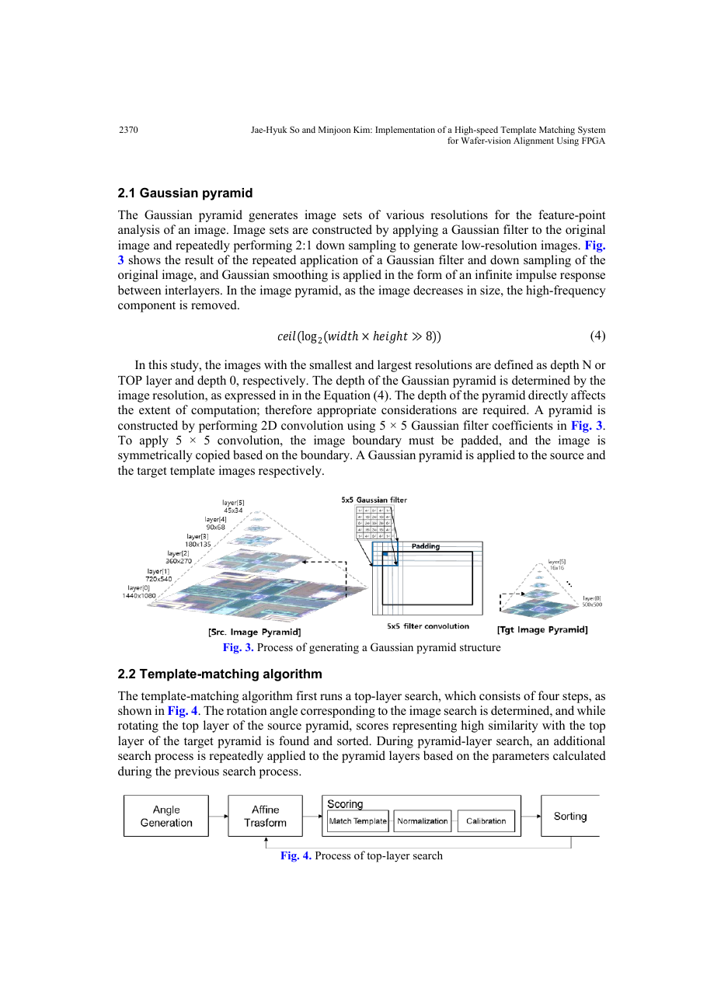
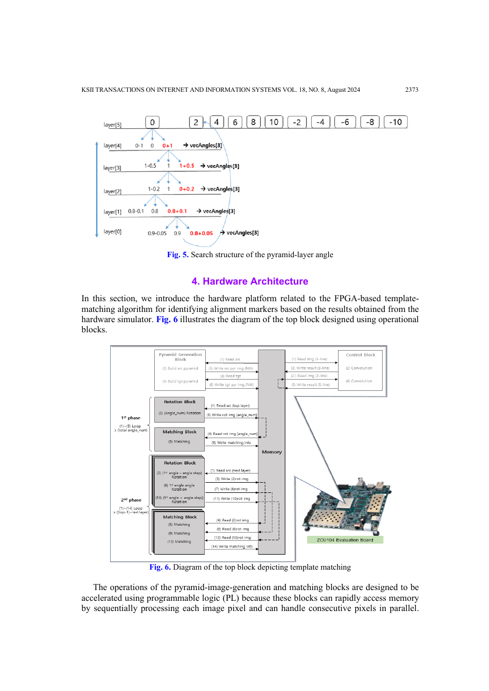
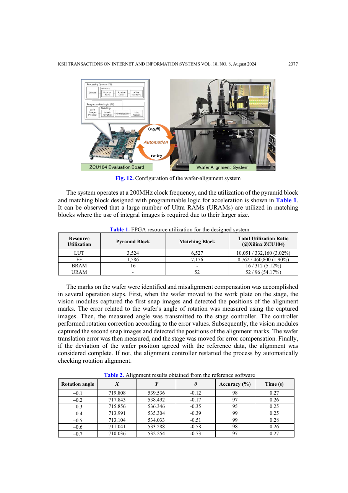

# FPGA를 이용한 웨이퍼 비전 정렬용 고속 템플릿 정합 시스템 구현 (번역)

- 원제: Implementation of a High-speed Template Matching System for Wafer-vision Alignment Using FPGA
- 저자: Jae-Hyuk So (소재혁, 한국전자기술연구원 데이터융합플랫폼연구센터), Minjoon Kim (김민준, 한국외국어대학교 반도체전자공학부, 교신저자)
- 서지: KSII Transactions on Internet and Information Systems, 18(8), pp. 2366-2380, 2024년 8월. doi:10.3837/tiis.2024.08.017
- 원문 파일: [So2024_TIIS_wafer_alignment_FPGA.pdf](So2024_TIIS_wafer_alignment_FPGA.pdf) (학회 공개 PDF, 15쪽, 2026-11-04 받음)
- 번역 범위: 전문 (초록, 본문, 그림 캡션, 표, 감사의 글, 저자 소개). 참고문헌은 원문 그대로.
- 번역 메모
  - 원문 PDF의 수식은 그림으로 들어 있어 텍스트 추출이 안 된다. 쪽 이미지를 보고 다시 적었다.
  - 원문의 식 (2)는 인쇄된 그대로 옮겼다. 평균을 구하는 식인데 T(i,j) × T(i,j)로 적혀 있다. 원문의 오타로 보인다 (번역자 판단).
  - 3절의 "식 (2)와 같이 각도 간격이 정해진다"는 문맥상 식 (5)를 가리킨다 (번역자 판단). 원문 표현은 그대로 두었다.
  - 표의 "Rotation angle"과 θ는 단위가 적혀 있지 않다. 본문이 각도를 도(°)로 말하므로 도로 보인다. X, Y도 단위가 없다. 1440×1080 영상의 가운데(720, 540) 근처 값이라 화소 좌표로 보인다 (모두 번역자 판단).
  - [ ] 안은 번역자 주석이다.

---

## 초록

이 연구는 웨이퍼 비전 정렬을 위한 고속 템플릿 정합 시스템을 제안한다. 제안한 시스템은 웨이퍼 비전 정렬에 쓰는 반도체 장비에서 마커 위치를 빠르게 찾도록 설계했다. 고해상도 웨이퍼 영상을 빠르게 처리하도록 템플릿 정합 알고리즘을 최적화하고 구현했다. 웨이퍼 마커가 단순하므로 알고리즘에서 필요 없는 요소를 뺐다. 그리고 고속 처리를 위해 FPGA(field-programmable gate array)로 시스템을 설계했다.

하드웨어 블록은 Xilinx ZCU104 보드로 설계했다. 피라미드 블록과 정합 블록은 연산을 가속하도록 프로그래머블 로직으로 설계했다. 제안한 시스템을 검증하려고, 산업 현장에서 흔히 쓰는 스테이지 장비와 기준 소프트웨어 기반 검증 틀로 검증 환경을 만들었다. FPGA 출력은 웨이퍼 정렬 제어기로 보내 시스템을 검증했다.

제안한 시스템은 데이터 처리 시간을 약 30% 줄였다. 웨이퍼 마커 검출 정확도는 기준 소프트웨어와 비슷한 수준이었고 차이는 작았다. 이 시스템은 반도체 제조 공정의 정밀도와 생산성을 높이는 데 쓸 수 있다.

핵심어: 웨이퍼 정렬 시스템, 정규화 상호상관, 템플릿 정합, 비전 검사, 하드웨어 가속기

이 논문의 초기 판은 ICONI 2023에서 발표했고 우수 논문으로 뽑혔다. 이 연구는 산업통상자원부(MOTIE)의 기술혁신프로그램(20015975, 고정밀 3축 로더 기반 프로브 헤드 장치 개발)의 지원을 받았다. 또 2024년 한국외국어대학교 연구비의 지원을 받았다.

## 1. 서론

반도체 검사 장비와 부품은 제조 공정 중 웨이퍼 위에 만든 반도체 부품의 물리, 화학, 전기 특성을 확인하는 데 쓴다. 기술이 발전하면서 높은 집적도와 미세 패턴을 제공할 수 있는 고정밀 기술이 필요해졌다. 그래서 이런 발전에 대응할 수 있는 검사 장비의 수요가 늘고 있다.

반도체 제조에서 웨이퍼 정렬 시스템은 웨이퍼 프로빙의 핵심 하위 시스템이다. 광학 영상 처리로 웨이퍼 정렬 키를 찾고, 웨이퍼 위치를 높은 정밀도로 자동 보정한다 [1,2]. 최근 반도체 공정이 점점 정밀해지면서 빠르고 정확한 자동 비전 검사 방법의 수요가 크게 늘었다 [3]. 비전 검사 방법은 정렬에 필요한 단계와 시간을 줄이고, 제조 중 작업자 때문에 생기는 뜻밖의 문제도 줄인다.

템플릿 정합은 기본 방법이며, 영상 안의 정렬 키를 프로브 위치에 맞출 때 웨이퍼 비전 검사에 특히 쓸모가 있다. 사전 정렬(pre-alignment) 뒤에, 웨이퍼 위 정렬 키의 위치를 정확히 찾는 것이 다음 단계다. 그 다음 웨이퍼의 중심과 방향을 맞춘다. 보통은 회전과 평행이동을 고려한 유사도 계산과, 회전시킨 템플릿들이 필요하다.

이 방법으로 목표 표시의 현재 위치를 찾고, 오차 정보를 시스템의 스테이지 제어기로 보낸다. 그러면 웨이퍼를 검사 위치로 옮기고 돌린다. 이 과정에서 템플릿 정합 알고리즘의 정확도와 소프트웨어의 데이터 처리 속도가 중요하다. 그러나 검출 영역의 위치마다, 목표 각도 간격에 따라 회전시킨 템플릿들로 유사도를 여러 번 계산해야 하므로 계산 비용이 크게 늘어난다 [4,5].

이 연구에서는 이 문제를 풀려고, 하드웨어 가속 템플릿 정합 알고리즘을 FPGA에 구현하는 전용 하드웨어 구조를 제안한다. 계산을 단순하게 하려고, 전체 탐색 영역 안에서 기본 탐색 영역을 먼저 확인하고 그 기본 탐색 영역을 단계적으로 넓히는 최적화 전략을 썼다. 웨이퍼 정렬 시스템을 만들고 FPGA 보드 시험에서 구현 결과를 얻었다.

이 연구의 기여는 다음과 같다.

- 첫째, 산업에서 웨이퍼에 쓰는 마커 특징을 바탕으로 흔히 쓰는 템플릿 정합 알고리즘을 최적화한다. 기존 소프트웨어를 기준으로 삼아 정확도를 유지하면서 속도를 높인다. 탐색 영역을 제한하고, 각도를 제한하고, 필요 없는 블록을 빼서 시뮬레이터에서 얻은 최적화 결과를 보인다.
- 둘째, 기존 시스템보다 고해상도 영상을 빠르게 처리할 수 있는 고속 템플릿 정합 하드웨어 구조를 제안한다. 고정밀 카메라로 찍은 영상을 빠르게 처리하도록 설계했다. 이 구조는 정확도를 유지하면서 프로세싱 시스템과 프로그래머블 로직을 함께 쓴다.
- 셋째, 제안한 알고리즘과 하드웨어를 Xilinx ZCU104 보드에 구현하고, 산업에서 쓰는 웨이퍼 비전 검사 장비를 만들었다. 마지막으로 산업에서 쓰는 실제 장비에서 기준 소프트웨어의 결과와 비교한 실험 결과를 보인다.

이 논문의 나머지 구성은 다음과 같다. 2장은 템플릿 정합 알고리즘을 설명한다. 3장은 기존 템플릿 정합 알고리즘을 바탕으로 웨이퍼 정렬 마커에 맞게 최적화한 템플릿 정합용 하드웨어 시뮬레이터를 보인다. 4장은 하드웨어 구조와 설계 결과를 보인다. 5장은 이 연구에서 제안한 플랫폼의 검증을 다룬다. 6장에서 결론을 맺는다.

## 2. 정규화 상호상관 기반 템플릿 정합 알고리즘

이 절은 정규화 상호상관(NCC) 방법을 바탕으로 쓰는 템플릿 정합 알고리즘의 자세한 변환을 설명한다. 템플릿 정합은 가장 흔히 쓰는 머신 비전 기법 중 하나다. 템플릿으로 영상을 훑고, 유사도 계산 방법으로 필요한 목표를 찾는다. 이때 영상 안의 물체는 실제 물체의 위치와 맞춰져야 한다. 템플릿 영상(T)은 주어진 영상이며, 검사 영상과 비교된다. 가장 잘 맞는 템플릿 영상이 존재한다고 기대한다. 또 T는 2차원 배열 T(m×n)로 나타낼 수 있다. m과 n은 각각 영상의 세로와 가로 방향 화소 수다.

그림 1. 템플릿 정합의 원리 [원문 그림 1은 PDF 3쪽에 있다]

이 알고리즘의 목표는 주어진 영상 안에서 템플릿 영상과 가장 비슷한 영역을 찾는 것이다. 그림 1은 템플릿 정합 과정의 원리를 보인다. 기준 템플릿 영상이 입력 검사 영상의 탐색 영역 위를 x축과 y축으로 화소 하나씩 움직인다. 움직일 때마다 유사도를 계산한다. 그 다음 탐색 영역 안에서 두 영상의 유사도가 가장 큰 (x, y) 위치를 찾는다 [6].

보통 가장 널리 쓰이고 강력한 상관 기반 유사도 측정은 NCC다. NCC로 템플릿과 원본 영상의 유사도를 평가한다. 템플릿 정합의 최적 결과는 NCC 상관의 최댓값으로 나타난다. NCC 계수가 1에 가까우면 잘 맞는다는 뜻이다. 즉 비교한 두 영상이 같다. NCC 계수로 템플릿 영상 T(i, j)와 검사 영상 I(i, j)를 다음과 같이 맞출 수 있다.

```
            Σ_{i=-m/2..m/2} Σ_{j=-n/2..n/2} [ I(x+i, y+j) × T(i, j) ] − m × n × μ_I × μ_T
δ_g(x, y) = ─────────────────────────────────────────────────────────────────────    (1)
                                   sqrt(σ_I  ×  σ_T)

μ_T = (1/(m × n)) Σ_{i=-m/2..m/2} Σ_{j=-n/2..n/2} T(i, j) × T(i, j)                          (2)  [원문 인쇄 그대로]

μ_I = (1/(m × n)) Σ_{i=-m/2..m/2} Σ_{j=-n/2..n/2} I(x+i, y+j)                              (3)
```

여기서 템플릿 영상 크기는 m × n이다. μ_T와 μ_I는 각각 템플릿과 창으로 자른 탐색 영상의 밝기 평균이다. δ_g(x, y)는 밝기 영상에서 좌표 (x, y)의 템플릿과 창으로 자른 탐색 영상 사이의 유사도다 [3].

그러나 NCC는 높은 정밀도로 크기와 회전까지 맞추려 할 때 계산 비용이 크다. 훑는 시간이 긴 것이 큰 문제다. 영상이 클수록 훑는 시간이 길어진다. NCC를 계산하려면 장면 영상 위에서 템플릿 창을 화소 하나씩 밀면서 NCC 계수를 계산한다. 그래서 정합 시간이 늘어날 수밖에 없다. 전수 탐색 상관 척도를 쓰는 템플릿 정합은 시간이 매우 많이 든다. 그래서 정합 과정에서 목표 물체를 빨리 찾는 것이 중요한 과제다 [7].

계산 부담을 줄이려고, 전수 탐색 템플릿 정합 절차에 상한(upper bound) 기반 제거 방법을 적용해 가능성이 낮은 목표 후보를 건너뛰었다 [8]. 탐색 단계에 대해 거친-정밀(coarse-to-fine) 방식과 2단계 기법이 제안되었다. 먼저 1차 탐색 영역을 확인하고 전체 탐색 영역으로 넓힌다. NCC 척도의 불필요한 계산을 피하려고 다단 승자 갱신(multilevel winner-update) 방식 [9]과 약한 분류기도 제안되었다.

이 문제를 풀려고 회전 각도를 포함한 NCC 방법이 도입되었다 [10,11]. [10]에서는 원래 템플릿과 회전시킨 템플릿들 사이에서 미리 계산한 문턱 점수 집합을 써서, 1차 탐색 단계의 불필요한 계산을 건너뛰고 목표 물체를 알아본다. 그 다음 전체 탐색 단계에서 목표 물체의 회전 각도를 추정한다. 이때 첫 단계에서 정한 각도 근처에서 템플릿을 정밀하게 비교한다. 그러나 얻는 정렬 정확도는 회전 각도에 따라 달라진다.

템플릿 정합 과정은 그림 2처럼 세 단계로 진행된다. 먼저 입력 원본 영상과 템플릿 영상에 가우시안 피라미드를 적용하고, 피라미드 영상 안의 특징점을 비교한다. 탐색 과정의 첫 단계는 최상층 탐색(Top-layer search)이다. 영상 피라미드의 가장 낮은 해상도에서 목표 영상을 여러 각도로 돌려 가며 찾는다. 더 구체적으로는, 이 탐색 과정은 낮은 해상도에서 대략의 탐색점을 뽑는다. 피라미드 탐색은 1차 탐색에서 남은 모든 피라미드 영상을 자세히 비교하는 과정이다 [12].

그림 2. 템플릿 정합의 주요 과정 [가우시안 피라미드 → 최상층(TOP layer) 탐색 → 피라미드 탐색]

### 2.1 가우시안 피라미드

가우시안 피라미드는 영상의 특징점 분석을 위해 여러 해상도의 영상 집합을 만든다. 원본 영상에 가우시안 필터를 적용하고 2:1 축소를 되풀이해 낮은 해상도 영상들을 만든다. 그림 3은 원본 영상에 가우시안 필터와 축소를 되풀이한 결과를 보인다. 층 사이에서는 가우시안 평활화를 무한 임펄스 응답(IIR) 형태로 적용한다. 영상 피라미드에서 영상이 작아질수록 고주파 성분이 없어진다.

```
ceil( log2( width × height ≫ 8 ) )                                                  (4)
```

이 연구에서는 가장 작은 해상도와 가장 큰 해상도의 영상을 각각 깊이 N(또는 TOP 층)과 깊이 0으로 정한다. 가우시안 피라미드의 깊이는 식 (4)처럼 영상 해상도로 정한다. 피라미드 깊이는 계산량에 바로 영향을 주므로 알맞게 정해야 한다. 피라미드는 그림 3의 5×5 가우시안 필터 계수로 2차원 합성곱을 해서 만든다. 5×5 합성곱을 하려면 영상 경계를 덧대야(padding) 한다. 경계를 기준으로 영상을 대칭으로 복사한다. 가우시안 피라미드는 원본 영상과 목표 템플릿 영상에 각각 적용한다.



그림 3. 가우시안 피라미드 구조를 만드는 과정 [원본 피라미드: layer[0] 1440×1080, layer[1] 720×540, layer[2] 360×270, layer[3] 180×135, layer[4] 90×68, layer[5] 45×34. 목표(템플릿) 피라미드: layer[0] 500×500에서 layer[5] 16×16. 가운데는 5×5 가우시안 필터와 경계 덧대기]

### 2.2 템플릿 정합 알고리즘

템플릿 정합 알고리즘은 먼저 최상층 탐색을 한다. 최상층 탐색은 그림 4처럼 네 단계로 되어 있다. 영상 탐색에 해당하는 회전 각도를 정한다. 그리고 원본 피라미드의 최상층을 돌려 가며, 목표 피라미드의 최상층과 유사도가 높은 점수를 찾아 정렬한다. 피라미드 층 탐색에서는, 앞 탐색에서 계산한 매개변수를 바탕으로 피라미드 층마다 추가 탐색을 되풀이한다.

그림 4. 최상층 탐색 과정 [각도 생성 → 아핀 변환 → 점수 계산(템플릿 정합, 정규화, 보정) → 정렬. 정렬 뒤 아핀 변환으로 되돌아가는 반복]

#### 2.2.1 각도 생성

각도 생성에서는 영상 해상도에 따라 계산한 각도 간격으로 회전 각도를 정한다. 영상이 클수록 각도 간격이 작아지고 정합에 드는 시간이 늘어난다. 허용값(tolerance)이 180°이면 360°까지 모든 각도를 찾을 수 있다.

```
step   = arctan( 2 / max(dst_w_n, dst_h_n) ) × 180 ÷ π                                   (5)

angles = [ −tolerance_angle : tolerance_angle : step ]                                   (6)
```

[dst_w_n, dst_h_n은 n번째 층 목표 영상의 가로, 세로 크기로 보인다. 번역자 판단]

#### 2.2.2 아핀 변환

여러 각도로 돌린 원본 영상과 목표 영상을 비교하려고, 앞 과정에서 정한 각도 간격마다 원본 영상에 아핀 변환을 한다. 식 (7)처럼 2×3 회전 행렬로 변환한 영상에서 쌍선형(bilinear) 필터로 화소를 보간한다.

```
M = [  α   β   (1−α) × center.x − β × center.y ]      α = scale × cos(angle)
    [ −β   α   β × center.x + (1−α) × center.y ]      β = scale × sin(angle)              (7)
```

#### 2.2.3 점수 계산과 정렬

점수 계산 과정에서는 변환한 원본 영상과 목표 영상 사이의 유사도를 계산해 최적 위치를 찾는다. 영상 유사도는 NCC로 정한다. 정합 템플릿(match template)으로 영상 전체를 훑고 모든 위치의 상관을 계산한다. 상관이 클수록 두 영상이 비슷할 확률이 높다. 계산한 상관 값의 비트 깊이가 크므로, 데이터 크기를 줄이려고 비트 깊이를 정규화한다. 그 다음 보정(calibration)에서, 최적 위치를 기준으로 이웃한 화소 9개를 추가로 찾는다. 정렬(sorting) 과정에서는 문턱값을 넘는 가장 높은 상관의 위치 정보와 그 상관 점수를 분류해 매개변수로 저장한다.

## 3. 하드웨어 시뮬레이터

하드웨어는 특정 응용을 위해 설계한 전용 장비를 말한다. 범용 소프트웨어와 달리, 하드웨어는 제약이 있는 환경에서 고성능 연산을 제공하는 장점이 있다. 하드웨어 개발 전에 성능 검증과 문제의 조기 발견을 위해, 하드웨어 시뮬레이션 단계에서 정확도를 평가해야 한다. 이 연구에서 기준으로 쓴 알고리즘은 OpenCV 소프트웨어로 설계한 템플릿 정합 알고리즘이다 [3]. 이 알고리즘은 반도체 장비에서 웨이퍼 정렬 마크를 찾도록 다시 설계해 최적화해야 한다. 이 절에서는 OpenCV 함수를 직접 구현하면서 필요 없는 계산 단계를 빼고 코드를 하드웨어 설계에 맞는 형태로 바꾸는 설계 과정과, 하드웨어 시뮬레이터에서 얻은 결과를 보인다.

최상층 탐색에서 각도 간격은 식 (2)처럼 목표 영상의 해상도에 영향을 받는다. [문맥상 식 (5). 번역자 주] 영상 크기가 클수록 만들어지는 간격이 작아져 [원문은 "the number of steps generated decreases". 문맥상 간격 크기가 작아지고 각도 개수는 늘어난다는 뜻으로 보인다. 번역자 주] 필요한 계산 수가 늘어난다. 탐색점마다 아핀 변환과 템플릿 정합을 비교하므로, 각도 간격은 계산 복잡도에 바로 영향을 준다.

기준 소프트웨어에서는 허용값 180°로 모든 각도를 찾는다. 입력 목표 영상 크기에 따라 보통 50~200개 각도를 찾을 수 있다. 기준 소프트웨어는 입력 영상 해상도에 따라 여러 각도 간격을 쓴다. 그러나 하드웨어로는 모든 각도를 적용할 수 없다. 그래서 간격 값을 고정한 뒤 성능 평가에서 정확도와 속도를 잰다. 각도 간격이 커지면 탐색 속도는 빨라지지만, 찾지 않은 각도에 있는 물체는 찾을 수 없으므로 성공률이 떨어진다. 각도 간격 말고도, 기존 알고리즘은 각도마다 탐색 위치 9개를 더 넣는다. 이 과정은 최상층의 점수 계산 단계에서 얻은 가장 높은 유사도를 기준으로, 최적 위치 주변의 9개 위치를 더 찾는 것이다. 최적 위치가 50개 나오면 모두 450개 각도를 더 찾아야 한다. [원문 그대로 "450 angles". 문맥상 450개 탐색으로 보인다. 번역자 주] 그래서 계산 부하가 커서 실시간 성능을 보장하기 어렵다. 그러나 이 문제는 하드웨어 시뮬레이터에서 추가 탐색 블록을 빼되 웨이퍼 마커를 찾는 정확도는 유지하는 방식으로 풀 수 있다.

하드웨어 설계에 맞춰 웨이퍼 마커 영상의 해상도를 제한한다. 가우시안 피라미드의 깊이는 영상 해상도로 정한다. 피라미드 깊이가 계산 부하에 바로 영향을 주므로, 현재 시스템에서는 목표 영상 해상도를 최대 512×512로 정했다. 피라미드 층은 최대 6개까지 지원하도록 설계했고, 층마다 고정된 각도 간격을 썼다. 정확도를 보장하려고 소수점 둘째 자리까지 지원했다.

처음에 반도체 장비는 웨이퍼 정렬 마커가 기계적으로 카메라 시야(FOV) 안에 들어오도록 사전 정렬된다. 정렬 마커가 시야 안에 들어오면 정렬 오차 범위는 일정 각도 범위 안으로 제한되므로, 360°까지 각도를 찾을 필요가 없다. 기준 소프트웨어의 알고리즘은 360° 아래의 각도를 포함한다. 그러나 하드웨어 시뮬레이터는 −10°에서 +10°까지의 허용 각도를 지원하도록 설계했다. 각도 탐색의 정밀도를 높이려고 0.01°까지 찾을 수 있게 설계했고, 그에 맞춰 0.01° 간격의 삼각함수 조회표(LUT)를 만들었다. 첫 단계에서는 최상층을 큰 각도 간격으로 찾고, 아래 층으로 갈수록 작은 각도 간격으로 점점 찾았다. 그래서 최상층에서 지원하는 삼각함수 LUT는 −20°에서 +20°까지의 각도로 구성했다. 그림 5는 피라미드 층의 각도 간격에 따라 마지막 층까지 이어지는 탐색 구조를 보인다. 두 번째 단계부터는 층마다 정해 둔 각도 간격을 기준으로, 이 기준의 왼쪽과 오른쪽 각도를 탐색한다.



그림 5. 피라미드 층 각도의 탐색 구조 [layer[5]에서 0, ±2, ±4, ±6, ±8, ±10을 찾는다. 이 예에서는 0이 뽑힌다. layer[4]에서 0−1, 0, 0+1, layer[3]에서 1−0.5, 1, 1+0.5, layer[2]에서 1−0.2, 1, 1+0.2, layer[1]에서 0.8−0.1, 0.8, 0.8+0.1, layer[0]에서 0.9−0.05, 0.9, 0.9+0.05를 찾는다. 층마다 세 각도(vecAngles[3])만 본다. 붉은 글씨가 그 층에서 뽑힌 각도로 보인다. 번역자 판단]

## 4. 하드웨어 구조

이 절에서는 하드웨어 시뮬레이터의 결과를 바탕으로, 정렬 마커를 찾는 FPGA 기반 템플릿 정합 알고리즘의 하드웨어 플랫폼을 소개한다. 그림 6은 연산 블록으로 설계한 최상위 블록의 도식이다.

그림 6. 템플릿 정합을 나타낸 최상위 블록 도식 [위 그림 5와 같은 쪽. 피라미드 생성 블록, 제어 블록, 메모리. 1단계: 회전 블록과 정합 블록을 전체 각도 수만큼 반복. 2단계: 회전 블록이 (1차 각도 − 간격), 1차 각도, (1차 각도 + 간격) 세 영상을 만들고 정합 블록이 세 번 정합. (최상층−1)층부터 마지막 층까지 반복. ZCU104 평가 보드 사진]

피라미드 영상 생성 블록과 정합 블록은 프로그래머블 로직(PL)으로 가속하도록 설계했다. 이 블록들은 영상 화소를 차례로 처리해 메모리에 빨리 접근할 수 있고, 이어진 화소를 병렬로 다룰 수 있기 때문이다. 그러나 회전 블록은 수학 계산이 많고 메모리 접근 때 좌표 값이 이어지지 않으므로, 프로세싱 시스템(PS)에서 처리한다. 그림 7은 PS와 PL에 들어간 블록을 보인다.

그림 7. FPGA PS/PL 블록 도식 [원문 PDF 9쪽]

피라미드 블록에서는 원본 영상이나 목표 영상을, 최대 6층 안에서 사용자가 정한 최소 크기에 이를 때까지 2:1로 축소한다. 축소 결과는 메모리에 저장한다. 5×5 합성곱을 하려고 필요한 데이터만 메모리에서 한 줄씩 읽어 내부 줄 버퍼에 저장한다. 줄 버퍼는 7줄이며, 처음 3줄로 먼저 합성곱을 한다. 그 다음 5줄씩 한 번에 처리해 출력을 만든다. 클록마다 출력 화소 하나가 나오고, 정해 둔 층 수만큼 만든 피라미드 영상을 메모리에 저장한다. 그림 8은 피라미드 블록 처리 과정이다.

그림 8. 피라미드 블록 처리 과정 [원문 PDF 9쪽]

제안한 시스템에서 템플릿 정합 블록이 가장 많은 데이터 처리와 메모리를 필요로 한다. 기준 소프트웨어는 상호상관을 바탕으로 템플릿 정합을 한다. 다만 상호상관 값을 템플릿 정합에 바로 쓰기 전에 정규화 과정을 거친다. 상호상관은 템플릿 영역의 모든 화소(템플릿과 원본 영상이 겹치는 영역의 화소 포함)의 곱의 합으로 계산한다. 그래서 값이 크고 템플릿 크기에 따라 달라진다.

기준 소프트웨어에서는 정규화를 위해 입력 영상의 합과 제곱합에 관한 적분 영상을 미리 계산한다. 이렇게 미리 계산한 영상은 화소 단위로 정규화된다. 적분 영상을 쓰려면 입력 영상의 모든 화소에 대해 한 번 계산해야 하므로 초기 계산 부하가 크다. 또 적분 영상 값은 화소 위치마다 다르게 쌓이고 표현 범위도 달라서, 특히 최댓값 기준으로 저장하면 적분 영상 저장에 메모리가 많이 든다.

그러나 적분 영상을 프레임 단위로 한 번 계산해 두면, 템플릿 크기가 달라져도 특정 템플릿 위치의 화소 합을 같은 계산량으로 구할 수 있다는 장점이 있다. 소프트웨어 관점에서는 메모리 제약이 없으므로 적분 영상이 최적화에 도움이 된다. 그러나 하드웨어 구현 관점에서는 구조에 따라 결과의 질이 달라질 수 있다. 또 적분 영상을 먼저 프레임 전체 화소에 대해 계산해야 하므로 초기 지연이 생긴다. 그래서 제안한 시스템의 구조는 적분 영상을 쓰지 않고 블록 단위 파이프라인 처리를 해서, 이 연산에 처리 요소를 효율적으로 쓴다. 이 설계로 연산을 직접 계산하면서 단계마다 처리 시간을 아꼈다. 그림 9는 정합 블록의 처리 단계를 보인다. FPGA 자원을 아끼려고, 원본 영상에서 목표 영상 높이만큼의 부분만 메모리에서 읽어 정합용 버퍼에 저장한다.

그림 9. 정합 블록이 구현한 과정 [시작 → 목표 영상 전체 읽기 → 원본 영상을 목표 높이만큼 읽기 → 정합 → 원본 영상 한 줄 읽기 → 정합 → 마지막 줄이 아니면 한 줄 읽기로 되돌아감 → 끝. 원문 PDF 10쪽]

## 5. 시스템 구현

4절에서 설명한 구조를 Xilinx ZCU104에서 구현, 시뮬레이션, 합성했다. 그림 10과 그림 11은 FPGA 보드에 합성한 제안 설계를 보인다.

그림 10. FPGA 보드 위 최상위 블록 도식 [원문 PDF 11쪽]

그림 11. 정합 블록과 피라미드 블록의 회로도 [원문 PDF 11쪽]

그림 12처럼 비전 모듈, 3축 전동 스테이지, 제어기로 이루어진 시스템 구현 장치를 개발했다. 비전 모듈에는 1.4~9.0배 줌 렌즈를 단 1440×1080 비전 센서 4개가 위판에 달려 있고, 정렬 마크 영상을 각각 동시에 다뤘다. NCC 기반 템플릿 정합을 Xilinx ZCU104 개발 보드에 구현해 평가했다. 개발한 웨이퍼 정렬 하드웨어 시스템을 평가 보드와 연결하려고, 정렬 API를 통한 자동 처리로 구동했다. 카메라 센서에서 들어온 원시 영상 데이터는 FPGA 보드가 실시간으로 처리해 마크의 평행이동과 회전에 관한 중요한 정보를 뽑았다. 전동 스테이지 제어기는 3축(X, Y, θ) 스테이지를 제어하며 정렬 작업을 자동으로 한다.



그림 12. 웨이퍼 정렬 시스템의 구성 [왼쪽: ZCU104 평가 보드와 PS(제어, 회전점, 회전 행렬, 아핀 변환), PL(영상 피라미드 만들기, 정합 템플릿, 정규화, 최대 위치). 가운데: (x, y, θ)를 보내고 다시 시도(re-try)하는 자동화 고리. 오른쪽: 웨이퍼 정렬 장치 사진]

시스템은 200 MHz 클록으로 동작한다. 가속을 위해 프로그래머블 로직으로 설계한 피라미드 블록과 정합 블록의 자원 사용량은 표 1과 같다. 적분 영상을 써야 하는 정합 블록에서는 크기가 커서 Ultra RAM(URAM)을 많이 쓰는 것을 볼 수 있다. [4절에서는 정합 블록이 적분 영상을 쓰지 않는다고 했다. 원문 그대로 옮긴다. 번역자 주]

표 1. 설계한 시스템의 FPGA 자원 사용량

| 자원 사용 | 피라미드 블록 | 정합 블록 | 전체 사용률 (Xilinx ZCU104) |
|---|---|---|---|
| LUT | 3,524 | 6,527 | 10,051 / 332,160 (3.02%) |
| FF | 1,586 | 7,176 | 8,762 / 460,800 (1.90%) |
| BRAM | 16 | - | 16 / 312 (5.12%) |
| URAM | - | 52 | 52 / 96 (54.17%) |

웨이퍼 위 마크를 찾고 정렬 어긋남 보정을 여러 동작 단계로 했다. 먼저 웨이퍼가 스테이지의 작업판으로 오면, 비전 모듈이 첫 영상을 찍고 정렬 마크 위치를 찾았다. 찍은 영상으로 웨이퍼의 회전 각도 오차를 쟀다. 그 다음 잰 각도를 스테이지 제어기로 보냈다. 제어기는 오차 값에 따라 회전 보정을 했다. 이어서 비전 모듈이 두 번째 영상을 찍고 정렬 마크 위치를 찾았다. 그리고 웨이퍼 평행이동 오차를 재고, 오차 보정을 위해 스테이지를 옮겼다. 마지막으로 웨이퍼 위치의 편차가 기준 데이터와 맞으면 정렬을 끝난 것으로 보았다. 맞지 않으면 정렬 제어기가 회전 정렬 확인부터 자동으로 다시 시작했다.

표 2. 기준 소프트웨어로 얻은 정렬 결과

| 회전 각도 | X | Y | θ | 정확도 (%) | 시간 (s) |
|---|---|---|---|---|---|
| −0.1 | 719.808 | 539.536 | -0.12 | 98 | 0.27 |
| −0.2 | 717.843 | 538.492 | -0.17 | 97 | 0.26 |
| −0.3 | 715.856 | 536.346 | -0.35 | 95 | 0.25 |
| −0.4 | 713.991 | 535.304 | -0.39 | 99 | 0.25 |
| −0.5 | 713.104 | 534.033 | -0.51 | 99 | 0.28 |
| −0.6 | 711.041 | 533.288 | -0.58 | 98 | 0.26 |
| −0.7 | 710.036 | 532.254 | -0.73 | 97 | 0.27 |
| −0.8 | 707.032 | 530.048 | -0.91 | 89 | 0.27 |
| −0.9 | 706.048 | 529.032 | -0.91 | 99 | 0.27 |
| −1.0 | 704.996 | 528.332 | -1.09 | 91 | 0.29 |
| 0.1 | 720.000 | 539.000 | 0.16 | 94 | 0.28 |
| 0.2 | 717.006 | 537.014 | 0.22 | 98 | 0.27 |
| 0.3 | 715.994 | 536.026 | 0.33 | 97 | 0.25 |
| 0.4 | 714.016 | 535.008 | 0.39 | 99 | 0.29 |
| 0.5 | 712.976 | 534.048 | 0.48 | 98 | 0.29 |
| 0.6 | 711.235 | 532.997 | 0.58 | 98 | 0.26 |
| 0.7 | 710.091 | 532.105 | 0.65 | 95 | 0.28 |
| 0.8 | 707.086 | 530.559 | 0.81 | 99 | 0.28 |
| 0.9 | 706.016 | 529.032 | 0.91 | 99 | 0.29 |
| 1.0 | 705.316 | 527.981 | 0.93 | 93 | 0.26 |
| 평균 | | | | 96.6 | 0.271 |

표 3. 하드웨어 시뮬레이터와 FPGA로 얻은 정렬 결과

| 회전 각도 | X | Y | θ | 정확도 (%) | 시간 (s), 시뮬레이터 | 시간 (s), FPGA |
|---|---|---|---|---|---|---|
| −0.1 | 719.758 | 539.196 | -0.05 | 95 | 1.70 | 0.24 |
| −0.2 | 718.257 | 538.744 | -0.12 | 92 | 0.99 | 0.18 |
| −0.3 | 716.351 | 536.117 | -0.39 | 91 | 0.92 | 0.17 |
| −0.4 | 713.736 | 535.102 | -0.35 | 95 | 0.92 | 0.17 |
| −0.5 | 712.821 | 534.181 | -0.45 | 95 | 0.93 | 0.17 |
| −0.6 | 711.098 | 533.819 | -0.56 | 96 | 0.86 | 0.18 |
| −0.7 | 710.372 | 532.461 | -0.58 | 88 | 0.81 | 0.17 |
| −0.8 | 706.793 | 530.507 | -0.93 | 87 | 0.81 | 0.17 |
| −0.9 | 705.744 | 529.487 | -0.92 | 98 | 0.88 | 0.17 |
| −1.0 | 705.024 | 528.219 | -0.90 | 90 | 0.95 | 0.18 |
| 0.1 | 719.776 | 539.302 | -0.00 | 90 | 1.01 | 0.19 |
| 0.2 | 716.902 | 537.493 | 0.22 | 98 | 0.90 | 0.18 |
| 0.3 | 716.479 | 536.507 | 0.22 | 92 | 0.88 | 0.17 |
| 0.4 | 713.706 | 535.684 | 0.45 | 95 | 0.89 | 0.17 |
| 0.5 | 713.162 | 533.947 | 0.45 | 95 | 0.95 | 0.19 |
| 0.6 | 710.841 | 533.266 | 0.65 | 95 | 0.82 | 0.17 |
| 0.7 | 709.829 | 532.278 | 0.68 | 98 | 0.73 | 0.16 |
| 0.8 | 707.423 | 530.442 | 0.76 | 96 | 0.83 | 0.17 |
| 0.9 | 706.021 | 529.735 | 0.92 | 98 | 0.88 | 0.17 |
| 1.0 | 705.113 | 528.667 | 0.90 | 90 | 0.87 | 0.17 |
| 평균 | | | | 93.7 | 0.9265 | 0.195 |

그림 12의 정렬 시스템에서 얻은 결과(기준 소프트웨어와 이 연구에서 설계한 FPGA의 결과 포함)를 x, y, 각도, 처리 시간의 네 범주로 정리했다. 웨이퍼에 실제로 쓰는 정렬 마커를 사용했다 [13]. 표 2는 기준 소프트웨어의 결과다. 표 3은 하드웨어 시뮬레이터와 FPGA로 얻은 처리 시간을 보인다. 하드웨어 시뮬레이터로 짠 출력은 OpenCV 함수 없이 하드웨어 수준으로 짰으므로 기준 소프트웨어보다 처리 시간이 길었다. 그러나 FPGA에서는 가속 블록을 적용했고, 파이프라인 구조 덕분에 결과를 빠르게 처리했다. 실험 결과, 제안한 FPGA 기반 하드웨어는 기준 소프트웨어 대비 약 3% 이하의 정확도 오차를 유지하면서 30% 넘는 속도 향상을 이뤘다.

[정확도(%)의 정의는 원문에 없다. 번역자 주]

## 6. 결론

이 연구는 FPGA 기반 하드웨어로 실시간 웨이퍼 정렬 시스템에 템플릿 정합 알고리즘을 적용하는 방법을 보인다. 템플릿 정합 알고리즘을 구현하려고 하드웨어 시뮬레이터를 설계했고, 시뮬레이터의 효율을 검증했다. 이를 바탕으로 FPGA 기반 하드웨어 구조를 개발했다. 개발한 시스템은 Xilinx ZCU104로 만들었고, 실제 웨이퍼를 정렬하도록 비전 모듈과 전동 스테이지와 통합했다. 실험 결과, 제안한 FPGA 기반 하드웨어는 기준 소프트웨어보다 정확도가 조금 떨어졌지만, 처리 시간을 줄여 고속 처리를 이뤘다.

이 결과는 실제 제조 환경에서 FPGA 기반 템플릿 정합 알고리즘이 쓸모 있음을 보여 준다. 또 초기 설계 단계에서 하드웨어 시뮬레이터로 효율적으로 최적화한 것이 시스템의 실제 구현을 쉽게 했다. 그래서 반도체 산업의 생산성과 정확도를 높일 수 있는 발전된 웨이퍼 정렬 시스템의 개발을 기대한다. 이 결과는 FPGA 기반 하드웨어 구현을 실제 환경에 적용할 수 있음을 강조한다.

## 참고문헌 (원문 그대로)

[1] J. KIM, "New Wafer Alignment Process Using Multiple Vision Method for Industrial Manufacturing," Electronics, vol.7, no.3, 2018. Article (CrossRef Link)
[2] M. Cong, X. Kong, Y. Du, J. Liu, "Wafer Pre-Aligner System Based on Vision Information Processing," Information Technology Journal, vol.6, no.8, pp.1245-1251, 2007. Article (CrossRef Link)
[3] C. Chen, C. Huang, C. Yeh, W. Chang, "An accelerating CPU based correlation-based image alignment for real-time automatic optical inspection," Computers & Electrical Engineering, vol.49, pp.207-220, Jan. 2016. Article (CrossRef Link)
[4] B.A. Draper, J.R. Beveridge, A.P.W. Böhm, C. Ross and M. Chawathe, "Implementing image applications on FPGAs," in Proc. of 2002 International Conference on Pattern Recognition, vol.3, pp.265-268, 2002. Article (CrossRef Link)
[5] C. T. Johnston, K. T. Gribbon, and D. G Bailey, "Implementing Image Processing Algorithms on FPGAs," in Proc. of the Eleventh Electronics New Zealand Conference, ENZCon'04, pp.118-123, 2004. Article (CrossRef Link)
[6] C. Zhao, C. Cheung, and M. Liu, "Integrated polar microstructure and template-matching method for optical position measurement," Optics Express, vol.26, vol.4, pp.4330-4345, 2018. Article (CrossRef Link)
[7] W. Ouyang, F. Tombari, S. Mattoccia, L. Di Stefano, W.K. Cham, "Performance Evaluation of Full Search Equivalent Pattern Matching Algorithms," IEEE Transactions on Pattern Analysis and Machine Intelligence, vol.34, no.1, pp.127-143, Jan. 2012. Article (CrossRef Link)
[8] S. Mattoccia, F. Tombari, L. Di Stefano, "Efficient template matching for multi-channel images," Pattern Recognition Letters, vol.32, no.5, pp.694-700, Apr. 2011. Article (CrossRef Link)
[9] W. Shou-Der, L. Shang-Hong, "Fast Template Matching Based on Normalized Cross Correlation With Adaptive Multilevel Winner Update," IEEE Transactions on Image Processing, vol.17, no.11, pp.2227-2235, Nov. 2008. Article (CrossRef Link)
[10] S. Sassanapitak, P. Kaewtrakulpong, "An efficient translation-rotation template matching using pre-computed scores of rotated templates," in Proc. of 2009 6th International Conference on Electrical Engineering/Electronics, Computer, Telecommunications and Information Technology, ECTI-CON, pp.1040-1043, 2009. Article(CrossRefLink)
[11] X. Cui, H. Kim, E. Park, H. Choi, "Robust and accurate pattern matching in fuzzy space for fiducial mark alignment," Machine Vision and Applications, vol.24, pp.447-459, 2013. Article (CrossRef Link)
[12] Y. Zhang, Z. Zhang, S. Peng, D. Li, H. Xiao, C. Tang, R. Miao, L. Peng, "A rotation invariant template matching algorithm based on Sub-NCC," Mathematical Biosciences and Engineering, vol.19, no.9, pp.9505-9519, Jun. 2022. Article (CrossRef Link)
[13] G. Kertész, S. Szénási and Z. Vámossy, "Performance measurement of a general multi-scale template matching method," in Proc. of 2015 IEEE 19th International Conference on Intelligent Engineering Systems (INES), pp.153-157, 2015. Article(CrossRefLink)

## 저자 소개

소재혁(Jaehyuk So)은 2014년 명지대학교(용인)에서 전자공학 학사를, 2017년 연세대학교(서울)에서 전기전자공학 석사를 받았다. 2017년부터 2021년까지 LG전자(서울) 선임 연구원으로 비디오 코덱 IP의 설계와 개발에 참여했다. 지금은 한국전자기술연구원 선임연구원이다. 연구 관심사는 디지털 신호 처리 알고리즘과 영상 신호 처리를 위한 SoC/VLSI 구현이다.

김민준(Minjoon Kim)은 2012년과 2018년에 연세대학교(서울)에서 전기전자공학 학사와 박사를 받았다. 2018년부터 2024년까지 한국전자기술연구원 선임 연구원이었다. 지금은 한국외국어대학교 반도체전자공학부 조교수다. 연구 관심사는 디지털 신호 처리 알고리즘과 그 SoC/VLSI 구현이다.
