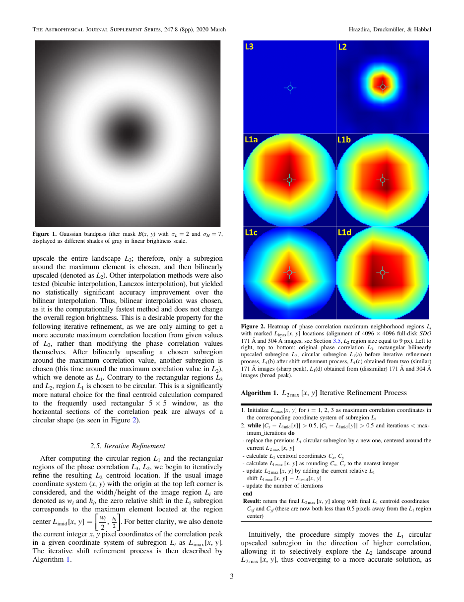
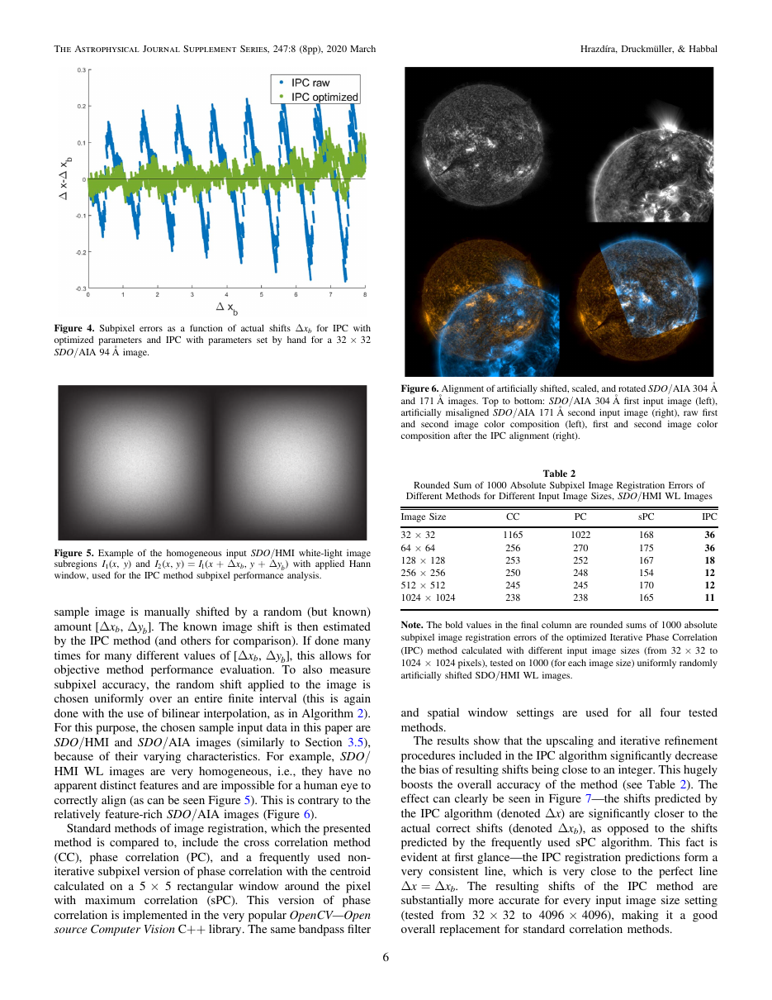
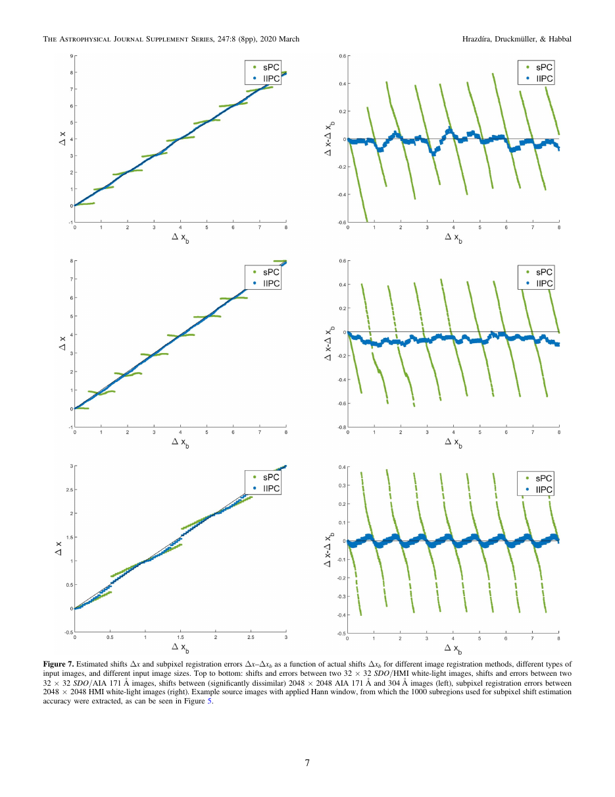

# 고정밀 부화소 영상 정합을 위한 반복 위상상관 알고리즘 (번역)

- 원제: Iterative Phase Correlation Algorithm for High-precision Subpixel Image Registration
- 저자: Zdenek Hrazdíra, Miloslav Druckmüller (Brno University of Technology, 기계공학부 수학연구소), Shadia Habbal (University of Hawaii, 천문학연구소)
- 서지: The Astrophysical Journal Supplement Series 247(1), 8 (8쪽), 2020년 3월. doi:10.3847/1538-4365/ab63d7
- 접수 2019-11-07, 수정 2019-12-14, 게재 승인 2019-12-17, 출판 2020-02-20
- 원문 파일: [Hrazdira2020_ApJS_iterative_phase_correlation.pdf](Hrazdira2020_ApJS_iterative_phase_correlation.pdf) (IOPscience 공개 PDF, 8쪽, 2026-11-04 받음)
- 번역 범위: 전문 (초록, 본문, 알고리즘 1과 2, 그림 캡션, 표 1과 2, 감사의 글). 참고문헌은 원문 그대로.
- 번역 메모
  - pdftotext로 뽑으면 수식 기호(푸리에 변환 기호, 켤레 윗줄)가 빠진다. 수식은 쪽 이미지를 보고 다시 적었다.
  - 푸리에 변환은 F{ }, 역변환은 F⁻¹{ }, 켤레 복소수는 conj( )로 적는다. 원소별 곱은 그냥 붙여 쓴다.
  - 원문의 "registration"은 "정합", "phase correlation landscape"는 "위상상관 지형", "subregion"은 "부분 영역"으로 옮겼다.

---

## 초록

영상에서 얻은 자료에 기대는 천체물리 관측과 측정 기법 가운데 많은 것이 영상 정합 단계를 포함한다. 그래서 이런 기법의 결과는 정합의 정밀도에 크게 좌우된다.

우리는 반복 위상상관(Iterative Phase Correlation, IPC) 알고리즘을 제시한다. 이것은 잘 알려진 위상상관 정합법을 확장한 것이다. 부화소 정합 정확도가 결정적인 문제에 특히 알맞다.

또 IPC의 최적 파라미터를 정교하고 믿을 만하게 추정하는 방법을 설명한다. 논문에는 이렇게 최적화한 파라미터의 예가 들어 있다. 대상은 Solar Dynamics Observatory(SDO)의 Helioseismic and Magnetic Imager(HMI) 영상, SDO의 Atmospheric Imaging Assembly(AIA) 영상, Solar Terrestrial Relations Observatory(STEREO) A/B의 Sun Earth Connection Coronal and Heliospheric Investigation(SECCHI) 영상이다.

새 방법은 (파라미터 최적화 단계를 쓰든 안 쓰든) 부화소 정확도 면에서 표준 정합법보다 크게 낫다. 표준 정합법은 (반복하지 않는) 위상상관, (정규화) 상호상관 등이다. 단계별 의사코드 구현도 함께 싣는다.

통합 천문학 시소러스 개념: 천문 기법(1684), 직접 촬상(387), 천문 소프트웨어(1855), CCD 관측(207), 공개 소프트웨어(1864), 고속 푸리에 변환(1958), 천체 측정(80), 알고리즘(1883), 천문 방법(1043), 천문 자료 분석(1858), 계산 방법(1965), 해석 수학(38)

## 1. 서론

영상 정합 문제를 효율적으로 풀어야 할 필요는 여러 분야에서 생긴다(Foroosh et al. 2002). 의료 영상(Jenkinson & Smith 2001), 위성 영상(Do et al. 2019; Li et al. 2019; Mahmood & Lee 2019), 광학 흐름(Lefébure & Cohen 2001), 실험 역학(Bing et al. 2006), 3차원 복원(Gravel et al. 2012; Li et al. 2018; Casella et al. 2019), 천체물리(Shapiro et al. 2013; Chen et al. 2014; Zhou & Yu 2018) 등이다. 상관 개념에 기반한 알고리즘은 이 분야에서 가장 자주 쓰이고 가장 널리 알려진 기법 가운데 하나다(Leng et al. 2019).

영상 정합 문제는 정확한 영상 기하 정렬을 찾는 것이다. 이는 두 입력 영상 사이의 크기, 회전, 이동을 정하는 일이다. 두 입력 영상의 진폭 스펙트럼에 로그 극좌표 변환을 적용하면, 회전과 크기는 둘 사이의 이동으로 바뀌어 구할 수 있다(Reddy & Chatterji 1996; Druckmüller 2009). 그래서 일반성을 잃지 않고 영상 이동만 정하는 문제에 집중하면 된다.

표준 상호상관 방식에서는 실수 함수 두 개 f(t), g(t)와 그 상호상관(×), 합성곱(*)을 다음처럼 정의한다.

(f × g)(t) = ∫₋∞^∞ f(τ) g(t + τ) dτ, (1)

(f * g)(t) = ∫₋∞^∞ f(τ) g(t − τ) dτ. (2)

합성곱 정리와 푸리에 변환으로 합성곱을 쉽게 계산할 수 있으므로, 상호상관을 합성곱 꼴로 나타내는 것이 좋다. 정의에서 바로 다음을 알 수 있다.

f(t) × g(t) = f(−t) * g(t), (3)

이것이 찾던 상호상관과 합성곱의 관계다. 푸리에 변환(여기서는 F로 적는다)의 기본 성질 가운데 하나인 켤레 성질

F{f(−t)} = conj(F{f(t)}) (4)

을 쓰면 상호상관을 주파수 영역에서 다음처럼 계산할 수 있다.

F{f × g} = conj(F{f}) F{g}. (5)

역푸리에 변환(F⁻¹로 적는다)을 적용하면

f × g = F⁻¹{ conj(F{f}) F{g} } (6)

를 얻는다. 함수 f와 g를 유한한 영역 위의 2차원 이산 함수(예를 들어 영상)로 보고, 연속 푸리에 변환을 알맞은 2차원 이산 변환으로 바꾸면, 상호상관 최댓값의 좌표가 입력 영상 사이의 화소 이동이 된다.

[Δx, Δy] = arg max_(x,y) ( F⁻¹{ conj(F{f}) F{g} } ). (7)

위상상관 방식(Reddy & Chatterji 1996)은 상호상관과 한 가지만 다르다. 교차 파워 스펙트럼을 원소마다 정규화해서 크기 성분을 없애고 위상만 상관시킨다(그래서 이름이 위상상관이다). 이론상 이 방식은 영상 이동 위치에 디랙 임펄스 δ(Δx, Δy)를 만든다. 실제 입력 영상은 유한하고 잡음이 있으므로 그렇게 되지는 않는다. 그래도 상호상관 방식과 비슷하게, 위상상관 최댓값 위치를 영상 이동으로 추정할 수 있다. 위상상관 영상 이동은 다음처럼 계산한다.

[Δx, Δy] = arg max_(x,y) ( F⁻¹{ conj(F{f}) F{g} / | conj(F{f}) F{g} | } ). (8)

여기서 제시하는 반복 위상상관(IPC) 알고리즘은 표준 위상상관법의 확장이다.

## 2. IPC 알고리즘

IPC 알고리즘에서 부화소 정확도가 좋아지는 것은 방법의 반복 성격과 쌍선형 확대 덕분이다. 똑같은 확장을 상호상관법이나 그 변형 어느 것에도 적용할 수 있다는 점을 말해 둔다. 하지만 표준 위상상관 기법은 (부화소 정확도 면에서) 상호상관보다 나은 경우가 많다(Foroosh et al. 2002). 그래서 정확도를 더 다듬을 후보로 더 알맞다. 필요한 단계는 아래와 같다.

### 2.1. 영상 정렬

예를 들어 천체 사진과 현미경 분야에서는, 서로 다른 장비와 다른 파장으로 찍은 영상을 합성해야 할 때가 많다. 이런 영상은 장비 위치 차이, 촬영 시각 차이, 다른 광학계 때문에 눈에 띄게 어긋날 수 있다. 어긋남은 보통 두 방향의 영상 이동, 영상 회전, 크기 변화가 섞여 있다.

이런 두 영상을 정확히 맞추려면 네 파라미터를 정밀하게 추정해야 한다. x, y 방향의 화소 이동 Δx, Δy, 회전각 φ, 크기 비 s다. 이 네 파라미터를 좋은 부화소 정확도로 계산하면, 합성한 영상은 표준 화소 정확도 방법으로 만든 영상보다 뚜렷하게 더 좋은 특성을 갖는다. 이런 부화소 합성은 쌍선형(또는 다른) 보간으로 할 수 있다.

### 2.2. IPC 영상 정렬 과정

IPC 영상 정렬 과정은 먼저 회전과 크기 파라미터 φ, s를 구한다. 두 입력 영상의 푸리에 변환 크기 성분에 로그를 취해 정규화하고, 이를 로그 극좌표로 변환한 다음, 둘 사이의 이동을 IPC 알고리즘으로 계산한다. 푸리에 변환의 크기 성질에 따라, 푸리에 변환 크기 성분의 크기 비는 영상 크기 비에 반비례한다.

F{f(ax)}(ξ) = (1/|a|) F{f(x)}(ξ/a). (9)

이 식은 직관적으로 이렇게 해석할 수 있다. 영상 속 특징의 크기를 키우려면 그에 해당하는 기본 공간 주파수를 낮춰야 하고, 반대도 마찬가지다.

그다음 입력 영상 하나를 계산한 양만큼 되돌려 회전하고 크기를 맞춘다. 이어서 IPC를 한 번 더 돌린다. 이번에는 부화소 이동 Δx, Δy를 추정한다. 이 값을 다시 해당 영상에 적용하면 정렬이 끝난다. 앞에서 말한 모든 기하 변환은 쌍선형 보간으로 부화소 단위로 한다.

### 2.3. 필터링

C(x, y)를 영상 I1(x, y)와 I2(x, y)의 정규화된 교차 파워 스펙트럼이라고 하자. 두 영상에는 공간 창(window)을 씌울 수도 있다. 창을 씌우면 이산 푸리에 변환에 생기는 스펙트럼 누설을 줄이는 데 도움이 된다(Harris 1978).

결과로 얻는 위상상관 봉우리와 그 주변의 특성은, 교차 파워 스펙트럼에 먼저 주파수 영역 필터를 적용해서 좋게 만들 수 있다. C(x, y)의 높은 주파수에는 주로 잡음이 들어 있다. 그래서 그 위상까지 상관시키면 결과의 정밀도가 떨어질 가능성이 크다. 따라서 이상적으로는 먼저 C(x, y)에 저역 통과 필터를 적용한다.

마찬가지로 가장 낮은 주파수에는 주로 영상 전체 밝기가 들어 있다. 그래서 두 입력 영상의 밝기 수준 차이에 더 강하게 만들고, 파라미터 최적화의 여지도 더 주려면, 이 낮은 주파수도 줄일 수 있다. 다만 위상상관 알고리즘은 상호상관과 달리 위상만 상관시키므로, 어느 정도 밝기 강건성을 이미 갖고 있다는 점을 알아야 한다.

그래서 제안한 방법에 이상적인 주파수 영역 필터는 대역 통과 필터다. 최적 파라미터는 영상마다 특성(잡음 수준, 영상 크기, 노출 시간 차이, 선명도 등)에 따라 다르다. 여기서 제시한 방법은 가우스 대역 통과 필터로 잘 동작했다. 이 필터는 가우스 저역 통과 필터와 역가우스 고역 통과 필터를 곱해서 만든다. 적용한 대역 통과 필터 B(x, y)의 식은 다음과 같다.

B(x, y) = exp( −(x − w/2)² / (2 (w/σL)²) − (y − h/2)² / (2 (h/σL)²) )
 × ( 1 − exp( −(x − w/2)² / (2 (w/σH)²) − (y − h/2)² / (2 (h/σH)²) ) ), (10)

여기서 w와 h는 교차 파워 스펙트럼의 가로와 세로 화소 수다. σL과 σH는 저역 통과와 고역 통과 필터링의 양을 정하는 파라미터다. σL = 2, σH = 7인 가우스 대역 통과 필터의 예를 그림 1에 보였다. 저역 통과 주파수 감쇠(스펙트럼 가장자리 근처의 어두운 부분)와 고역 통과 주파수 감쇠(스펙트럼 가운데 근처의 어두운 부분)가 뚜렷이 보인다.

그림 1. σL = 2, σH = 7인 가우스 대역 통과 필터 마스크 B(x, y). 선형 밝기 눈금의 회색 농도로 나타냈다. (위 쪽 이미지 왼쪽 위)

### 2.4. 부분 영역과 확대

교차 파워 스펙트럼 C(x, y)에 알맞은 대역 통과 필터 B(x, y)를 원소마다 곱하고 역푸리에 변환 F⁻¹{B C}를 계산하면 위상상관 지형 r(x, y)를 얻는다. 표준 위상상관 알고리즘은 여기서 끝난다. r(x, y)의 최댓값 원소의 위치를 돌려주거나, 최댓값 원소 둘레의 작은 직사각형 이웃(보통 5×5 화소)을 골라 그 이웃에서 계산한 무게중심의 부화소 좌표를 돌려준다(Druckmüller 2009).

먼저 정확도를 높이고 뒤의 반복 정밀화의 효과를 더 키우기 위해, 원래의 위상상관 지형 r(x, y)(뒤에서 쓰기 위해 줄여서 L3이라고도 적는다)를 확대한다. 지형 L3 전체를 확대하는 것은 불필요하고 비용이 매우 크다. 그래서 최댓값 원소 둘레의 부분 영역만 골라서 쌍선형으로 확대한다(이것을 L2라고 적는다).

다른 보간법(쌍삼차 보간, Lanczos 보간)도 시험했지만, 쌍선형 보간보다 통계적으로 의미 있는 정확도 향상은 없었다. 그래서 쌍선형 보간을 골랐다. 계산이 가장 빠르고 영역 전체 밝기를 바꾸지 않기 때문이다. 이 성질은 뒤의 반복 정밀화에 바람직하다. 우리가 원하는 것은 위상상관 값 자체를 바꾸는 것이 아니라, 주어진 L3 값들에서 더 정확한 최대 상관 위치를 얻는 것이기 때문이다.

선택한 부분 영역을 최대 상관값 둘레에서 쌍선형으로 확대한 뒤, 또 하나의 부분 영역을 고른다(이번에는 L2 안의 최대 상관값 둘레). 이것을 L1이라고 적는다. 직사각형인 L3, L2와 달리, L1은 원형으로 고른다. 이것은 흔히 쓰는 5×5 직사각형 창보다 마지막 무게중심 계산에 훨씬 자연스러운 선택이다. 상관 봉우리의 수평 단면은 항상 원 모양이기 때문이다(그림 2에서 보듯이).

그림 2. 위상상관 최댓값 이웃 영역 Li의 열지도와 표시한 Li max[x, y] 위치. (4096×4096 전면 SDO 171 Å과 304 Å 영상의 정렬, 3.5절 참고, L2 영역 크기 9 px.) 왼쪽에서 오른쪽, 위에서 아래 순서로, 원래 위상상관 L3, 직사각형 쌍선형 확대 부분 영역 L2, 반복 정밀화 전의 원형 부분 영역 L1(a), 이동 정밀화 과정 뒤의 L1(b), 비슷한 171 Å 영상 두 장에서 얻은 L1(c)(뾰족한 봉우리), 서로 다른 171 Å과 304 Å 영상에서 얻은 L1(d)(넓은 봉우리). (위 쪽 이미지 오른쪽)

### 2.5. 반복 정밀화

원형 영역 L1과 위상상관의 직사각형 영역 L3, L2를 구한 다음, 결과로 나온 L2 무게중심 위치를 반복해서 정밀화하기 시작한다. 원점이 왼쪽 위 구석에 있는 보통 영상 좌표계 (x, y)를 생각하고, 영상 영역 Li의 가로와 세로를 wi, hi라고 하자. 그러면 부분 영역 Li에서 상대 이동 0은 최댓값 원소가 영역 가운데 Li mid[x, y] = [wi/2, hi/2]에 있는 경우에 해당한다. 더 분명히 하려고, 부분 영역 Li의 좌표계에서 상관 봉우리의 현재 정수 좌표를 Li max[x, y]라고 적는다. 반복 이동 정밀화 과정은 알고리즘 1로 나타낸다.

알고리즘 1. L2 max[x, y] 반복 정밀화 과정

1. i = 1, 2, 3에 대해 Li max[x, y]를, 부분 영역 Li의 좌표계에서 최대 상관 좌표로 초기화한다.
2. |Cx − L1 mid[x]| > 0.5, |Cy − L1 mid[y]| > 0.5 이고 반복 횟수 < 최대 반복 횟수인 동안 반복한다.
   - 앞의 원형 부분 영역 L1을, 현재 L2 max[x, y]를 가운데로 하는 새 영역으로 바꾼다.
   - L1의 무게중심 좌표 Cx, Cy를 계산한다.
   - Cx, Cy를 가장 가까운 정수로 반올림해 L1 max[x, y]를 계산한다.
   - 현재의 L1 상대 이동 L1 max[x, y] − L1 mid[x, y]를 더해 L2 max[x, y]를 갱신한다.
   - 반복 횟수를 갱신한다.
   끝
   결과: 마지막 L2 max[x, y]와, 마지막 L1 무게중심 좌표 Cxf, Cyf를 돌려준다(이제 둘 다 L1 영역 가운데에서 0.5 화소 안에 있다).

직관적으로 말하면, 이 과정은 원형으로 확대한 부분 영역 L1을 상관이 더 높은 쪽으로 옮길 뿐이다. 그래서 L2 max[x, y] 둘레의 L2 지형을 골라서 살펴볼 수 있고, 반복하지 않는 방법에서처럼 최대 상관값을 가운데로 한 이웃에서 무게중심을 한 번만 계산하는 것보다 더 정확한 해로 수렴한다.

L1 무게중심 좌표와 L1 mid[x, y]의 차이가 두 방향 모두 0.5 화소보다 작으면 반복을 멈춘다. 확대한 L1 부분 영역은 정수 화소 단위로만 옮길 수 있기 때문이다. 이것이 바라는 동작이며, 이때 무게중심은 수렴한다.

반복이 끝난 이유가 최대 반복 횟수에 다다른 것이라면, 무게중심은 발산한 것이다. 이것은 병적인 경우이며, 결과로 나온 위상상관 지형 r(x, y)에 애초에 뚜렷한 봉우리가 없을 때만 생긴다(가능한 이유로는 매우 낮은 신호 대 잡음비, 잘못된 대역 통과 필터 파라미터가 있다).

마지막 L1 원형 부분 영역의 위치(L2 max[x, y])와 마지막 L1 무게중심 좌표 Cxf, Cyf를 얻으면, 정밀화한 영상 이동 [Δxr, Δyr]를 계산할 수 있다. 확대를 썼으므로 정밀화 양은 확대 배율만큼 줄여야 한다. 두 입력 영상 사이의 정밀화한 화소 이동은 다음처럼 구한다.

[Δxr, Δyr] = L3 max[x, y] − L3 mid[x, y] + (1/U) × ( L2 max[x, y] − L2 mid[x, y] + [Cxf, Cyf] − L1 mid[x, y] ), (11)

여기서 U = 2k + 1 (k는 자연수, k ≥ 1)은 확대 계수다. 가운데 정렬한 이산 푸리에 변환을 가정한다(가장 낮은 주파수가 L3 mid[x, y] 근처에 있다).

## 3. 파라미터 최적화

### 3.1. 범용 파라미터 설정

제시한 방법의 주요 파라미터는 L2와 L1 영역 크기, 확대 계수 U, 대역 통과 필터 파라미터 σL과 σH, 입력 영상 창 종류다.

- L2 영역 크기는, 반복 단계에서 원형 L1 영역이 L2 max[x, y]의 가까운 주변을 살펴볼 수 있을 만큼 커야 한다.
- L1 영역 크기는 위상상관 지형의 특성에 맞춰 골라야 한다. 이상적으로는 상관 봉우리 전체가 원형 영역 안에 꼭 맞게 들어가야 결과가 가장 좋다. 그림 2의 예에서는 그 크기가 L2 확대본의 35%다.
- L2와 L1의 크기는 둘 다 홀수여야 한다. 그래야 최대 상관 진폭에 해당하는 가운데 화소가 있다.
- 확대 계수 U도 (같은 이유로) 홀수여야 하고, 더 세밀하게 정밀화할 수 있을 만큼 커야 한다. 다만 U를 더 키워도 IPC 정확도가 더 좋아지지 않는 한계가 있다(한계는 신호 대 잡음비에 따라 다르다).
- 대역 통과 필터 파라미터 σL과 σH는 입력 영상 특성에 맞춰 골라야 한다. 당연히 영상에 잡음이 많으면 저역 통과 필터링을 더 강하게 해야 결과가 좋다.
- 입력 영상 창은 직사각형 창(가장자리가 대체로 비슷한 영상)이나 Hann 창(가장자리가 대체로 다른 영상)을 권한다.

### 3.2. 파라미터 최적화 과정

3.1절에 따라 정한 범용 IPC 파라미터 값은 일반 권장값이다. 보통 충분히 잘 동작한다. 하지만 가능한 가장 높은 정렬 정확도가 필요한 응용에서는, 특정 종류의 입력 영상에 맞춘 수학적 최적화 과정이 꼭 필요하다. 입력 영상 종류가 다르면 대개 IPC 파라미터도 달라야 한다. 그래서 이상적으로는 영상 자료 종류마다 알맞은 최적화 알고리즘으로 최적 파라미터를 찾는다.

목적 함수(3.4절에서 설명)는 본질적으로 블랙박스 함수다. 그래서 이 일에는 차분 진화(Differential Evolution, Storn & Price 1997)라는 진화 방법을 골랐다. 이 진화형 연속 파라미터 최적화 방법은 목적 함수의 전역 최솟값 탐색에서 충분히 잘 동작했다.

### 3.3. 정의역 변환 함수

최적화할 가치가 있는 주요 파라미터는 L2(또는 L1) 크기, 대역 통과 필터 파라미터 σL, σH, 입력 영상 창 방법이다. 이 파라미터들은 정의역이 서로 다르다. 대역 통과 필터 계수는 0이 아닌 연속값이고, L2 크기는 음이 아닌 정수이며, 창은 직사각형 창이나 Hann 창 둘 중 하나(참/거짓 변수)다.

표준 차분 진화 알고리즘은 연속 변수만 다룬다. 그래서 최적화하는 가상의 연속, 무제한 파라미터를, 해당 정의역의 실제로 쓸 수 있는 파라미터로 바꾸는 변환 함수가 필요하다. 가장 자연스러운 변환 함수는 다음과 같다.

W(x, y) = H(x, y) (w* > 0 일 때), R(x, y) (w* ≤ 0 일 때), (12)

σL = max(ε, |σL*|), (13)

σH = max(ε, |σH*|), (14)

L2 = max(3, |⌈L2*⌉|), (15)

여기서 w*, σL*, σH*, L2*는 차분 진화 알고리즘이 최적화하는 가상의 연속, 무제한 변수다. R과 H는 직사각형 창과 Hann 창이다. 기호 ⌈x⌉는 x를 가장 가까운 정수로 반올림한다는 뜻이다. ε은 0에 가까운 값으로 나눌 때 생기는 문제를 피하려고 넣은 작은 양수다. 가상 연속 파라미터를 이 함수에 통과시키면 IPC 알고리즘에서 쓸 수 있는 값이 된다.

### 3.4. 목적 함수

올바른 파라미터 최적화에서 마지막이자 가장 중요한 부분은 알맞은 목적 함수를 만드는 것이다. IPC 파라미터는 방법의 부화소 정확도를 높이도록 최적화한다. 그러므로 목적 함수를, 정해진 횟수의 정합 시행에서 나온 평균 부화소 오차로 정의하는 것이 자연스럽다. 알맞은 목적 함수 값을 계산하는 과정은 알고리즘 2에 적었다.

단순화한 2개 파라미터 판의 목적 함수 지형 예는 그림 3에 있다. 이 2차원 단순화 목적 함수 지형은 L2와 w* 파라미터를 고정하고, 다른 두 파라미터 σL과 σH(가로축과 세로축 값으로 씀)를 매끄럽게 바꿔서 얻었다. 높이축 값은 해당 σL과 σH에 대한 정합 오차 척도로 두었다. 32×32 Solar Dynamics Observatory(SDO)/Helioseismic and Magnetic Imager(HMI) 영상에 대한 이 단순화 목적 함수의 전역 최솟값(σL = 4.83, σH = 12.14)이 분명히 보인다.

그림 3. 알고리즘 2에서 설명한 4차원 IPC 파라미터 목적 함수의 2차원 단면 예. 32×32 SDO/HMI 영상(3.5절 참고)에 대한 것이다. IPC 부분 영역 크기 L2 = 15로 고정하고, 두 입력 영상에 Hann 창을 씌운 상태(w* > 0)에서, 대역 통과 파라미터 σL과 σH를 바꾸며 목적 함수를 그렸다.

알고리즘 2. IPC 파라미터 최적화에 쓰는 목적 함수

1. 알맞은 입력 영상을 읽는다.
2. 최적화하는 연속 파라미터를 변환 함수에 통과시켜, 쓸 수 있는 IPC 파라미터로 초기화한다.
3. 미리 정한 크기(예: 32×32)의 부분 영역 1을 잘라 낸다.
4. (선택) 입력 영상 파장에 맞는 특성의 인공 잡음을 만들어 부분 영역 1에 더한다.
5. 전체 부화소 오차를 0으로 초기화한다.
6. 시행 횟수 < 최대 시행 횟수인 동안 반복한다.
   - 인공 이동값을 무작위로, 또는 등간격 격자에서 만든다.
   - 부분 영역 1과 같은 크기이고 알려진 정수가 아닌 양만큼 인공으로 옮긴 부분 영역 2를 잘라 낸다.
   - (선택) 입력 영상 파장에 맞는 특성의 인공 잡음을 만들어 부분 영역 2에 더한다.
   - 부분 영역 1과 부분 영역 2 사이의 이동을 IPC로 계산한다.
   - 전체 부화소 오차를 갱신한다.
   끝
   결과: 평균 부화소 정합 오차를 돌려준다.

목적 함수 값 계산에 쓰는 인공 부화소 이동은, 주어진 관심 영역 전체에 고르게 무작위로 분포시킬 수도 있고, 미리 정한 등간격 [x, y] 격자로 배치할 수도 있다. 정수가 아닌(부화소) 이동이면, 인공으로 옮긴 영상은 쌍선형 보간으로 얻을 수 있다. 입력 영상 사이의 실제 잡음을 흉내 내려고, 두 입력 영상에 (각각 따로 만든) 인공 잡음을 더할 수도 있다.

### 3.5. SDO 영상에 대한 파라미터 최적화

이 논문에서 IPC 파라미터를 최적화한 구체적인 예는 SDO(Pesnell et al. 2011)/HMI 영상(Schou et al. 2012 참고), Atmospheric Imaging Assembly(AIA) 영상(Boerner et al. 2011; Lemen et al. 2011 참고), Solar Terrestrial Relations Observatory(STEREO A/B)의 Sun Earth Connection Coronal and Heliospheric Investigation(SECCHI) 영상(Howard et al. 2008 참고)이다.

표 1. 차분 진화 알고리즘으로 찾은 최적 IPC 파라미터(3절에서 설명). 여러 종류의 천문 입력 영상(3.5절 참고)에 대해 알고리즘 2의 목적 함수를 최적화했다. 입력 영상 크기 32×32/512×512.

| 장비 | λ | σL | σH | L2 | W |
|---|---|---|---|---|---|
| SDO/HMI | WL | 1.2/5.4 | 70.3/76.2 | 11/19 | Hann |
| SDO/AIA | 94 Å | 5.5/5.1 | 8.7/98.1 | 11/17 | Hann |
| | 131 Å | 4.9/5.2 | 9.1/92.3 | 11/19 | Hann |
| | 171 Å | 6.5/5.5 | 1.4/199.0 | 11/19 | Hann |
| | 193 Å | 3.8/5.4 | 10.1/82.9 | 11/19 | Rect |
| | 211 Å | 4.9/5.9 | 1.6/30.3 | 9/17 | Rect |
| | 304 Å | 5.9/5.2 | 4.1/95.9 | 11/19 | Hann |
| | 335 Å | 4.9/5.2 | 9.8/84.3 | 11/19 | Hann |
| STEREO A SECCHI | 171 Å | 5.1/6.1 | 1.4/30.1 | 9/15 | Hann |
| | 195 Å | 4.8/5.2 | 1.9/197.1 | 9/19 | Hann |
| | 284 Å | 4.9/9.4 | 1.2/7.4 | 9/17 | Hann |
| | 304 Å | 5.1/6.0 | 1.7/32.7 | 9/15 | Hann |
| STEREO B SECCHI | 171 Å | 4.9/5.9 | 1.6/35.0 | 9/17 | Hann |
| | 195 Å | 4.5/7.0 | 1.5/18.1 | 9/15 | Hann |
| | 284 Å | 5.1/8.0 | 1.1/12.8 | 9/17 | Hann |
| | 304 Å | 4.9/5.8 | 2.0/34.6 | 9/17 | Hann |

적용한 인공 잡음의 표준편차는 입력 영상 구석의 어두운 영역에서 계산한다. 이 영역은 (필터 바퀴 장치에 가려져) 광학계로부터 태양 빛을 받지 않으므로 잡음만 들어 있다(Lemen et al. 2011에 설명). 이렇게 잰 표준편차(σMES로 적는다)는 검출기마다 다를 수 있으므로 파장마다 따로 계산한다. 또 원시 최대, 최소 화소 밝기도 파장에 따라 다르며, 모든 영상은 IPC로 처리하기 전에 히스토그램을 16비트 전체 범위(0~65,535)로 늘렸다. 그래서 표준편차도 똑같이 정규화해야 한다(σN으로 적는다). 그러면 입력 영상 잡음의 (상대) 척도가 더 정확해진다.

σN = 65,535 / (max I(x, y) − min I(x, y)) × σMES. (16)

차분 진화 알고리즘으로 최적화한, SDO/HMI, SDO/AIA, STEREO A/B SECCHI 영상에 쓸 수 있는 IPC 파라미터는 표 1에 있다. 대역 통과 필터를 쓰는 것이 모든 입력 영상 파장에서 이로웠다.

최적 IPC 파라미터(차분 진화 같은 수학적 최적화 알고리즘으로 최적화)를 써서 얻은 대표적인 부화소 정확도 향상은 그림 4에서 볼 수 있다. SDO/AIA 32×32 입력 영상에 대한 것이다. 최적화한 IPC의 정합 오차(초록색)는, 손으로 정한 파라미터의 원래 IPC 정합 오차(파란색)보다 눈에 띄게 0에 훨씬 가깝다. 이것은 파라미터 최적화 단계가 주는 효과와 정확도 향상을 보여 준다.

그림 4. 32×32 SDO/AIA 94 Å 영상에서, 최적화한 파라미터의 IPC와 손으로 정한 파라미터의 IPC의 부화소 오차를 실제 이동 Δxb의 함수로 그렸다. (위 쪽 이미지 왼쪽 위)

## 4. 결과

제시한 방법이 표준 방법보다 정확도를 얼마나 높이는지 정하려고, 표본 영상의 부분 영역을 무작위(하지만 알려진) 양 [Δxb, Δyb]만큼 손으로 옮긴다. 그다음 알려진 영상 이동을 IPC 방법(그리고 비교할 다른 방법들)으로 추정한다. 여러 [Δxb, Δyb] 값에 대해 이것을 여러 번 하면 방법의 성능을 객관적으로 평가할 수 있다.

부화소 정확도도 재려고, 영상에 적용하는 무작위 이동은 유한 구간 전체에서 고르게 고른다(알고리즘 2처럼 이것도 쌍선형 보간으로 한다). 이를 위해 이 논문에서 고른 표본 입력 자료는 (3.5절과 비슷하게) SDO/HMI와 SDO/AIA 영상이다. 특성이 서로 다르기 때문이다. 예를 들어 SDO/HMI WL 영상은 매우 균질하다. 즉 뚜렷한 특징이 없어서 사람 눈으로는 바르게 맞출 수 없다(그림 5에서 볼 수 있다). 이것은 특징이 비교적 많은 SDO/AIA 영상(그림 6)과 대조된다.

그림 5. IPC 방법의 부화소 성능 분석에 쓴, Hann 창을 씌운 균질한 입력 SDO/HMI 백색광 영상 부분 영역 I1(x, y)와 I2(x, y) = I1(x + Δxb, y + Δyb)의 예. (위 쪽 이미지 왼쪽 아래)

제시한 방법과 비교한 표준 정합 방법은 상호상관법(CC), 위상상관(PC), 그리고 최대 상관 화소 둘레 5×5 직사각형 창에서 무게중심을 계산하는, 자주 쓰는 반복하지 않는 부화소 위상상관(sPC)이다. 이 판의 위상상관은 매우 널리 쓰이는 OpenCV(Open source Computer Vision C++ 라이브러리)에 구현되어 있다. 시험한 네 방법 모두에 같은 대역 통과 필터와 공간 창 설정을 썼다.

그림 6. 인공으로 옮기고 크기를 바꾸고 회전한 SDO/AIA 304 Å과 171 Å 영상의 정렬. 위에서 아래로, SDO/AIA 304 Å 첫 입력 영상(왼쪽), 인공으로 어긋나게 한 SDO/AIA 171 Å 둘째 입력 영상(오른쪽), 첫째와 둘째 영상의 원래 색 합성(왼쪽), IPC 정렬 후 첫째와 둘째 영상의 색 합성(오른쪽). (위 쪽 이미지 오른쪽 위)

표 2. 입력 영상 크기별, 방법별 부화소 영상 정합 절대 오차 1000개의 합(반올림). SDO/HMI WL 영상.

| 영상 크기 | CC | PC | sPC | IPC |
|---|---|---|---|---|
| 32×32 | 1165 | 1022 | 168 | **36** |
| 64×64 | 256 | 270 | 175 | **36** |
| 128×128 | 253 | 252 | 167 | **18** |
| 256×256 | 250 | 248 | 154 | **12** |
| 512×512 | 245 | 245 | 170 | **12** |
| 1024×1024 | 238 | 238 | 165 | **11** |

주. 마지막 열의 굵은 값은, 최적화한 반복 위상상관(IPC) 방법의 부화소 영상 정합 절대 오차 1000개의 합(반올림)이다. 입력 영상 크기를 32×32에서 1024×1024 화소까지 바꾸며 계산했다. 영상 크기마다 고르게 무작위로 인공 이동한 SDO/HMI WL 영상 1000장으로 시험했다.

결과를 보면, IPC 알고리즘에 들어 있는 확대와 반복 정밀화 과정이, 결과 이동이 정수 근처로 쏠리는 편향을 크게 줄인다. 이것이 방법의 전체 정확도를 크게 높인다(표 2 참고).

이 효과는 그림 7에서 분명히 보인다. IPC 알고리즘이 예측한 이동(Δx로 적는다)은, 자주 쓰는 sPC 알고리즘이 예측한 이동보다 실제 정답 이동(Δxb로 적는다)에 훨씬 가깝다. 이 사실은 한눈에 알 수 있다. IPC 정합 예측은 매우 일관된 선을 이루며, 그 선은 완벽한 선 Δx = Δxb에 아주 가깝다. IPC 방법이 낸 이동은 모든 입력 영상 크기 설정(32×32에서 4096×4096까지 시험)에서 훨씬 더 정확하다. 그래서 표준 상관 방법을 대신할 좋은 전반적 대안이 된다.

그림 7. 여러 영상 정합 방법, 여러 종류의 입력 영상, 여러 입력 영상 크기에서, 추정 이동 Δx와 부화소 정합 오차 Δx − Δxb를 실제 이동 Δxb의 함수로 그렸다. 위에서 아래로, 32×32 SDO/HMI 백색광 영상 두 장 사이의 이동과 오차, 32×32 SDO/AIA 171 Å 영상 두 장 사이의 이동과 오차, (크게 다른) 2048×2048 AIA 171 Å과 304 Å 영상 사이의 이동(왼쪽), 2048×2048 HMI 백색광 영상 사이의 부화소 정합 오차(오른쪽). 부화소 이동 추정 정확도 평가에 쓴 1000개 부분 영역을 잘라 낸, Hann 창을 씌운 원본 영상의 예는 그림 5에서 볼 수 있다.

연속한 SDO 영상(예: 171 Å과 304 Å) 사이의 실제 이동, 회전, 크기 어긋남은 보이기는 하지만 꽤 작다. 하지만 IPC 방법은 훨씬 더 큰 입력 어긋남에도 매우 강하다. 이번에는 훨씬 큰 양만큼 인공으로 회전, 이동, 크기 변경한 영상의 정렬도 시험했다. 결과 정렬의 품질은, 덜 어긋난 영상에서 얻은 고정밀 결과와 구별되지 않는다. 특성과 특징이 매우 다른 영상(SDO/AIA 171과 304 Å)을 극단적으로 인공 어긋나게 한 뒤 고정밀 부화소 정렬한 예를 그림 6에서 볼 수 있다.

이 정렬과 합성 예에서, 빨간 색 채널은 첫째 영상(304 Å)만으로 정한다. 파란 색 채널은 극단적으로 인공 어긋나게 한 둘째 영상(171 Å)만으로 정한다. 초록 색 채널은 두 입력 영상의 평균값으로 둔다. 이렇게 색 채널을 배정하면, 정확히 정렬된 동일한 영상이라면 이론상 완벽한 흑백 합성이 된다(그림 6은 그런 경우가 아니다).

IPC 영상 정렬 방법은 SDO/AIA PM-NAFE 처리 영상을 만드는 데 일상적으로 쓰는 작업 흐름의 한 부분이다. 이 영상들의 보관소는 http://www.zam.fme.vutbr.cz/~druck/Sdo/Pm-nafe/0-info.htm 에 있다.

## 5. 요약

이 논문에서 설명한 IPC 알고리즘은 영상 정합을 위한 강력하고 강건하며 매우 정확한 방법이다. 이 위상상관 확장은 주로, 작은 부화소 차이가 결과 품질에 결정적인 일에 쓸모 있다. 이 방법은 여러 천체물리 예에서 다른 알고리즘과 폭넓게 시험하고 비교했다. 시험한 모든 입력 영상 종류와 크기(32×32에서 4096×4096까지의 16비트 영상)에서 더 나은 결과를 냈다.

이 알고리즘은 C++로 구현했고, 사용자가 모든 IPC 파라미터(3절에서 설명)를 지정할 수 있는 쉬운 명령줄 인터페이스가 있다. 설명서와 필요한 모든 의존 파일과 함께 무료 소프트웨어로 https://github.com/zdenyhraz/IPC 에서 받을 수 있다.

## 감사의 글

Z.H.와 M.D.의 연구는 Brno University of Technology 연구비 기관의 과제 번호 FSI-S-14-2290의 지원을 받았다.

## ORCID iDs

- Zdenek Hrazdíra https://orcid.org/0000-0001-7362-4947
- Shadia Habbal https://orcid.org/0000-0003-4089-9316

## References (원문 그대로)

Bing, P., Hui-Min, X., Bo-Qin, X., & Fu-Long, D. 2006, MeScT, 17, 1615
Boerner, P., Edwards, C., Lemen, J., et al. 2011, The Solar Dynamics Observatory (Berlin: Springer), 41
Casella, A., De Falco, I., Della Cioppa, A., Scafuri, U., & Tarantino, E. 2019, JPDC, 133, 307
Chen, J., Ji, K., Deng, H., & Feng, S. 2014, Unifying Electrical Engineering and Electronics Engineering (Berlin: Springer), 1241
Do, H. N., Chin, T.-J., Moretti, N., Jah, M. K., & Tetlow, M. 2019, AdSpR, 64, 733
Druckmüller, M. 2009, ApJ, 706, 1605
Foroosh, H., Zerubia, J. B., & Berthod, M. 2002, ITIP, 11, 188
Gravel, P., Verhaeghe, J., & Reader, A. J. 2012, PMB, 58, 105
Harris, F. J. 1978, IEEEP, 66, 51
Howard, R., Moses, J., Vourlidas, A., et al. 2008, SSRv, 136, 67
Jenkinson, M., & Smith, S. 2001, Medical Image Analysis, 5, 143
Lefébure, M., & Cohen, L. D. 2001, Journal of Mathematical Imaging and Vision, 14, 131
Lemen, J. R., Akin, D. J., Boerner, P. F., et al. 2011, The Solar Dynamics Observatory (Berlin: Springer), 17
Leng, C., Zhang, H., Li, B., et al. 2019, IEEE Access, 7, 6424
Li, C., Lu, B., Zhang, Y., Liu, H., & Qu, Y. 2018, Neural Processing Letters, 48, 1281
Li, S., Peng, M., Zhang, B., Feng, X., & Wu, Y. 2019, IJRS, 40, 5635
Mahmood, M. T., & Lee, I. H. 2019, Applied Sciences, 9, 3487
Pesnell, W. D., Thompson, B. J., & Chamberlin, P. 2011, The Solar Dynamics Observatory (Berlin: Springer), 3
Reddy, B. S., & Chatterji, B. N. 1996, ITIP, 5, 1266
Schou, J., Scherrer, P., Bush, R., et al. 2012, SoPh, 275, 229
Shapiro, C., Rowe, B., Goodsall, T., et al. 2013, PASP, 125, 1496
Storn, R., & Price, K. 1997, Journal of Global Optimization, 11, 341
Zhou, H., & Yu, Y. 2018, Frontiers of Computer Science, 12, 1013
