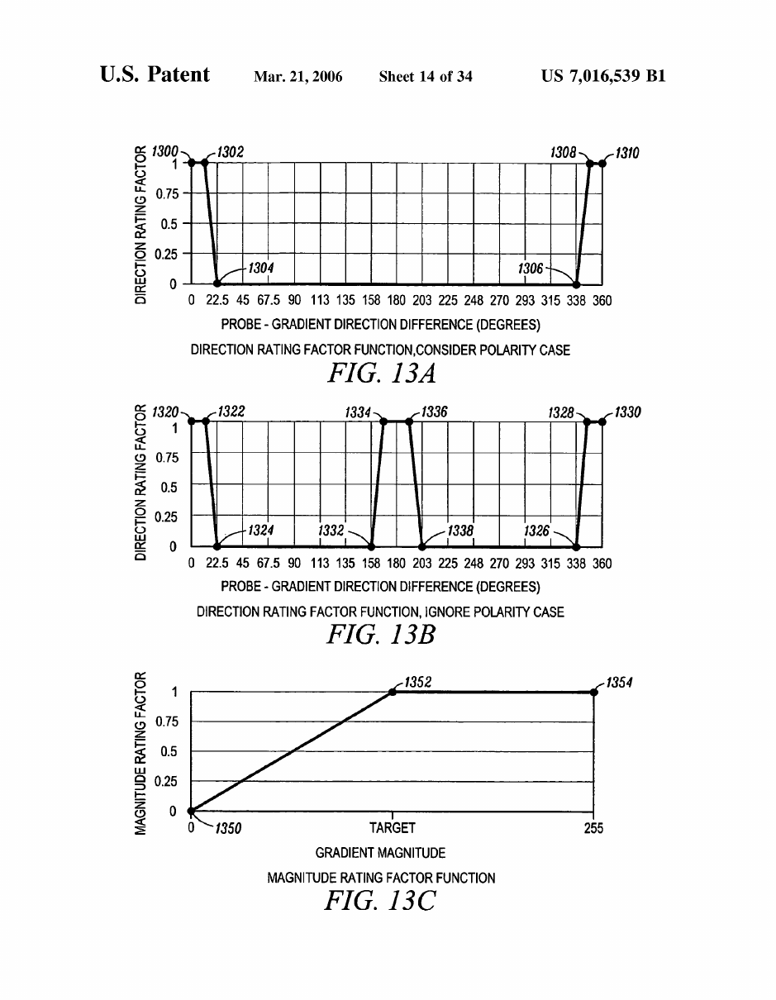
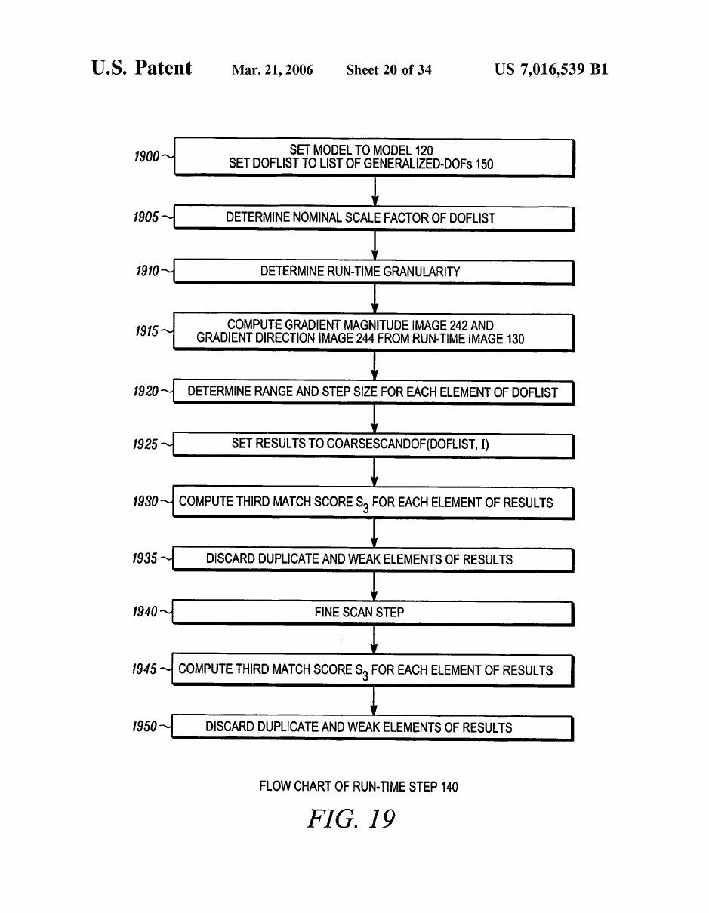
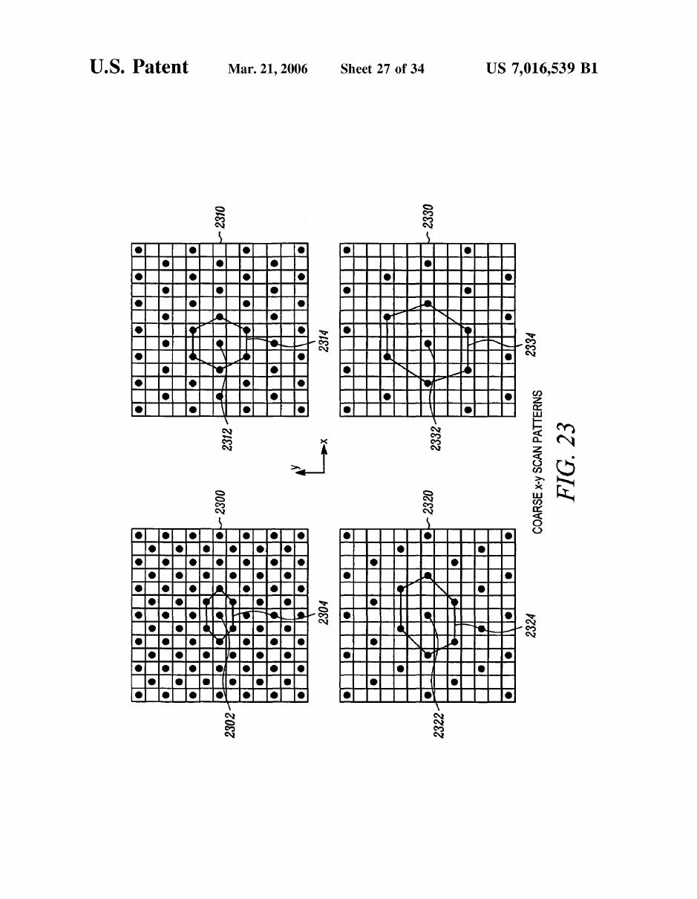

# US7016539B1 번역: 빠르고 강건한 다차원 패턴 인식 방법

번역 범위: 전문. 서지, 초록, 발명의 배경, 용어, 발명의 요약, 도면의 간단한 설명, 상세한 설명, 청구항 1~35, 재심사 증명서(US7016539C1, 2010-10-05)의 변경 요지. 인용 문헌 목록은 원문 그대로 둔다.

- 원문: 같은 폴더의 `US7016539B1.pdf` (60쪽, 도면 34장, 재심사 증명서 포함. patentimages.storage.googleapis.com 공보 PDF)
- 본문 추출: `pdftotext -layout`와 `-raw`. 공보 PDF는 스캔 영상에 OCR 글자를 얹은 것이라 수식 일부가 깨져 있다. 수식은 해당 쪽을 이미지로 뽑아 눈으로 확인해 옮겼다. 확인이 불확실한 곳은 [확인 필요]로 적었다.
- 번역 원칙: 쉬운 말, 짧은 문장. 원문의 도면 부호(예: 1925, 2214)는 그대로 둔다. 번역자 주는 [역주]로 표시한다.

## 서지

| 항목 | 내용 |
|---|---|
| 번호 | US 7,016,539 B1 |
| 제목 | Method for fast, robust, multi-dimensional pattern recognition |
| 등록일 | 2006-03-21 |
| 발명자 | William M. Silver (Weston, MA), E. John McGarry (Portland, OR), Matthew L. Hill (Yonkers, NY), Nigel Foster (Newton, MA), Sanjay Nichani (Natick, MA), Willard P. Foster (Brookline, MA), Adam Wagman (Framingham, MA) |
| 권리자 | Cognex Corporation, Natick, MA (재심사 증명서에서는 Cognex Technology and Investment Corporation, Mountain View, CA) |
| 출원 번호, 출원일 | 09/114,335, 1998-07-13 |
| 국제 분류 | G06K 9/62 (2006.01) |
| 미국 분류 | 382/216; 382/291 |
| 청구항 | 35개, 도면 34장 |
| 재심사 | 요청 90/010,514 (2009-06-22), 증명서 US 7,016,539 C1 (7796th), 2010-10-05 발행 |

인용 문헌 (원문 그대로, 첫 장에 보이는 부분)

```
U.S. PATENT DOCUMENTS
3,069,654 12/1962 Hough
3,936,800 2/1976 Ejiri et al.
4,200,861 4/1980 Hubach et al.
4,441,206 4/1984 Kuniyoshi et al.
4,567,610 1/1986 McConnell
4,637,055 1/1987 Taylor
4,651,341 3/1987 Nakashima et al.
4,672,676 6/1987 Linger
4,736,437 4/1988 Sacks et al.
4,783,829 11/1988 Miyakawa et al.
4,799,175 1/1989 Sano et al.
4,823,394 4/1989 Berkin et al.
4,843,631 A 6/1989 Steinpichler et al.
4,955,062 A 9/1990 Terui
5,046,109 A 9/1991 Fujimori et al.
5,048,094 A 9/1991 Aoyama et al.
5,168,530 A 12/1992 Peregrim et al.
5,220,621 A 6/1993 Saitoh ........ 382/200
5,253,306 A 10/1993 Nishio
5,313,532 A 5/1994 Harvey et al.
5,347,595 A 9/1994 Bokser
5,384,711 A 1/1995 Kanai et al.
5,471,541 A * 11/1995 Burtnyk et al. ........ 382/153
5,481,712 A 1/1996 Silver et al.
5,495,537 A 2/1996 Bedrosian et al.
(Continued)
OTHER PUBLICATIONS
Joseph. "Fast Optimal Pose Estimation for Matching in Two Dimensions." 5th Int. Conf. on Image Processing and Its Applications, Jul. 4, 1995, pp. 355-359.*
(Continued)
```

## 초록

이 발명은 영상 안에 미리 정한 패턴이 하나 이상 있는지 없는지를 판단하고, 찾은 각 패턴이 다차원 공간에서 어디에 있는지를 정하는 방법이다. 찾을 패턴은 모델로 나타낸다. 모델은 여러 개의 탐침(probe)을 가진다. 각 탐침은 주어진 자세(pose)에서 영상 안의 상대 위치 하나를 나타내며, 그 위치에서 검사를 한다. 각 검사는 그 자세에 패턴이 있다는 증거를 보탠다. 이 방법은 실행 영상과 모델을 여러 자세에서 비교한다. 각 자세에서 일치 점수를 계산해 일치 점수 곡면을 만든다. 그다음 일치 점수를 수락 문턱과 비교하고, 이를 써서 영상 안의 패턴 위치를 내놓는다.

## 발명의 배경

디지털 영상은 많은 장치로 만들어지고 많은 실제 목적에 쓰인다. 장치에는 가시광이나 적외선으로 동작하는 TV 카메라, 라인 스캔 센서, 비행점 스캐너, 전자 현미경, CT 스캐너를 포함한 X선 장치, 자기 공명 영상기 등이 있다. 응용은 산업 자동화, 의료 진단, 군사, 민간, 과학 목적의 위성 영상, 사진 처리, 감시와 교통 관찰, 문서 처리 등 매우 많다.

이 응용들을 위해 장치가 만든 영상을 디지털 장치로 분석해 필요한 정보를 뽑는다. 실제로 매우 중요한 분석 하나는, 촬영 장치 시야 안의 물체에 해당하는 패턴이 영상에서 어디에 있는지, 어느 방향인지, 크기가 얼마인지를 정하는 것이다. 패턴 위치 찾기 방법은 산업 자동화에서 특히 중요하다. 반도체 제조, 전자 조립, 제약, 식품 가공, 소비재 제조 등에서 로봇과 자동화 장비를 안내하는 데 쓰인다.

실제로 중요한 또 다른 분석은, 물체의 영상과 그 물체의 "이상적인" 모습을 담은 저장 패턴 사이의 차이를 찾는 것이다. 이런 차이를 찾는 방법을 보통 패턴 검사 방법이라 부른다. 산업 자동화에서 조립, 포장, 품질 관리 등에 쓰인다.

패턴 위치 찾기와 검사에 일찍부터 널리 쓰인 방법으로 블롭 분석이 있다. 이 방법은 영상의 각 화소를 어떤 수단으로 "물체" 또는 "배경"으로 나눈다. 보통 화소 밝기를 문턱과 비교한다. 물체로 분류된 화소는 블롭으로 묶는다. 두 물체 화소가 이웃이면 같은 블롭이라는 규칙을 쓴다. 이를 연결성 분석이라 한다. 각 블롭마다 면적, 둘레, 질량 중심, 주 관성 모멘트, 주 관성축 같은 성질을 구한다. 블롭의 위치, 방향, 크기는 각각 질량 중심, 첫 주 관성축의 각도, 면적으로 본다. 이런 성질은 검사를 위해 알려진 이상값과 비교할 수 있다.

블롭 분석은 계산이 비교적 싸서 값싼 하드웨어에서도 빠르다. 이상적인 조건에서는 꽤 정확하다. 방향과 크기가 바뀌는 물체에도 잘 맞는다. 한계 하나는, 물체 일부가 빠지거나 가려지거나 예상하지 않은 특징이 더 있으면 정확도가 크게 떨어진다는 것이다.

다른 한계는, 검사에 쓸 수 있는 값이 물체의 거친 특징뿐이라 미세한 변화를 찾을 수 없다는 것이다. 그러나 가장 심각한 한계는, 제한되고 잘 통제된 조건이 아니면 화소를 물체와 배경으로 믿을 만하게 나눌 방법이 일반적으로 없다는 것이다. 이 한계 때문에 개발자들은 다른 방법을 찾아야 했다.

일찍 널리 쓰인 또 다른 방법은 이진 템플릿 정합이다. 이 방법은 찾을 패턴의 예가 들어 있는 학습 영상을 쓴다. 학습 영상에서 예가 들어 있는 부분을 문턱 처리해 이진 패턴을 만들고 메모리에 저장한다. 실행 시에는 찾을 물체가 들어 있는 영상이 주어진다. 저장 패턴을 실행 영상의 같은 크기 부분과 모든 위치 또는 고른 위치에서 비교한다. 저장 패턴과 가장 잘 맞는 위치를 물체의 위치로 본다. 어떤 위치에서의 일치 정도는, 패턴 화소 중 대응 영상 화소와 맞는 화소의 비율이다.

이진 템플릿 정합은 화소를 물체와 배경으로 나눌 필요가 없다. 그래서 블롭 분석보다 훨씬 넓은 문제에 쓸 수 있다. 빠지거나 더해진 특징도 정확도를 크게 잃지 않고 견딘다. 패턴과 물체 사이의 더 미세한 차이도 찾을 수 있다. 그러나 이진화 문턱이 필요하다는 한계가 있다. 실제로는 이 문턱을 믿을 만하게 고르기 어렵다. 특히 신호 대 잡음비가 나쁘거나 조명 세기나 물체 대비가 바뀔 때 그렇다. 문턱 처리로 정보를 많이 잃기 때문에 정확도는 보통 약 1화소로 제한된다. 더 심각한 것은, 이진 템플릿 정합은 물체의 방향과 크기를 잴 수 없다는 점이다. 게다가 방향이나 크기가 조금만 바뀌어도 정확도가 빠르게 나빠진다. 변화가 더 크면 아예 쓸 수 없다.

이진 템플릿 정합보다 크게 나아진 것은, 밝기 정규화 상관(gray-level normalized correlation)을 비교적 싸게 쓰는 방법이 나오면서부터다. 이 방법은 이진 템플릿 정합과 비슷하지만 문턱을 쓰지 않는다. 그래서 영상 밝기의 전체 범위를 쓴다. 일치 정도는 어떤 위치에서 저장 패턴과 영상 부분 사이의 상관 계수가 된다. 이진화 문턱이 필요 없고 상관 자체가 잡음에 강하므로, 신호 대 잡음비가 나쁘거나 조명 세기나 물체 대비가 바뀌어도 성능이 크게 떨어지지 않는다. 또 문턱 처리로 잃는 정보가 없으므로, 잘 알려진 보간법을 쓰면 위치 정확도를 약 1/4화소까지 얻을 수 있다. 그러나 방향과 크기에 관해서는 크게 나아지지 않았다.

상관 방법의 또 다른 한계는, 많은 응용에서 물체의 음영이 물체 위에서 국소적이고 비선형으로 바뀐다는 것이다. 그러면 저장 패턴과의 상관이 나빠져 위치를 찾지 못한다. 예를 들어 반도체 제조의 화학 기계 연마(CMP) 공정은 패턴 음영을 급격하고 비선형으로 바꾼다. 그래서 상관으로 정렬하는 것이 불가능해진다. 또 다른 예로, 로봇 집어 놓기처럼 3차원 물체를 다루는 거의 모든 응용에서, 조명 입사각과 반사각의 변화, 그림자, 상호 조명 때문에 음영이 바뀐다. 거울 반사가 큰 물체, 특히 금속과 플라스틱에서 그 영향이 더 심하다.

최근에는 방향이나 크기가 크게 바뀔 것으로 예상되는 응용에도 쓸 수 있도록 밝기 상관을 개선한 방법이 나왔다. 이 방법들은 영상과 비교하기 전에 디지털 재표본화로 저장 패턴을 회전하거나 크기를 바꾼다. 여러 각도, 크기, x-y 위치에 걸쳐 맞춰 보면, 해당 다차원 공간에서 물체의 위치를 찾을 수 있다. 이진 영상은 화소 양자화 오차가 훨씬 심하므로, 이런 방법은 이진 템플릿 정합과는 잘 맞지 않는다.

이 방법들의 문제 하나는 계산 비용이 매우 크다는 것이다. 디지털 재표본화도 비싸고, 2차원을 넘는 공간을 탐색하는 것도 비싸다. 이 비용을 다루기 위해 탐색 방법은 문제를 두 단계 이상으로 나눈다. 첫 단계는 거칠게 줄인(subsampled) 패턴으로 전체 탐색 공간을 빠르게 훑어 물체가 있을 만한 위치를 찾는다. 다음 단계들은 더 고운 패턴으로 앞 단계가 정한 위치를 다듬고, 더 고운 해상도에서 패턴과 상관이 좋지 않다고 드러난 위치를 없앤다. 이런 거친-고운(coarse-fine) 방법의 변형은 이진 템플릿 정합과 원래의 2차원 상관에도 쓰였다. 하지만 차원이 높은 탐색 공간에서는 더 중요하다.

그러나 이런 기법을 써도 계산 비용은 여전히 크고, 음영의 비선형 변화 문제는 남는다.

널리 쓰이는 또 다른 패턴 위치 찾기 방법으로 일반화 허프 변환(GHT)이 있다. 이 방법의 기원은 미국 특허 3,069,654 (Hough, P.V.C., 1962)이다. 이 특허는 직선이나 원뿔 곡선 같은 매개변수 곡선을 찾는 방법을 적었다. 그 뒤 이 방법은 거의 임의의 패턴을 찾을 수 있도록 일반화되었다. 위의 템플릿 정합이나 상관 방법처럼 이 방법도 학습한 패턴에 기반한다. 그러나 밝기를 직접 쓰는 대신, 잘 알려진 에지 검출법으로 물체 경계를 따라 놓인 점을 찾는다. 허프 공간이라 부르는 큰 누산기 배열을 만든다. 탐색할 다차원 공간의 각 위치마다 누산기가 하나씩 있다. 영상의 각 에지 점은 허프 공간에서 가능한 패턴 위치들의 곡면 하나에 대응한다. 각 에지 점마다 그 곡면을 따라 놓인 누산기들을 1씩 늘린다. 모든 에지 점을 처리한 뒤, 가장 큰 값을 가진 누산기를 패턴의 다차원 위치로 본다.

GHT의 일반 성능 특성은 상관과 매우 비슷하다. 차원 수가 늘면 계산 비용이 매우 빠르게 커진다. 성능을 높이려 거친-고운 방법도 개발되었지만, 2차원을 넘는 실제 응용은 거의 없다. GHT의 에지 검출 단계는 물체 대비의 비선형 변화 때문에 생기는 문제를 대체로 줄인다. 그러나 새 문제를 만든다. 에지 검출기를 쓰면 보통 잡음과 초점 흐림에 더 약해진다. 많은 물체는 에지가 충분히 뚜렷하지 않아 에지 검출 결과를 믿기 어렵다. 게다가 에지 검출에는 근본적으로 이진화 단계가 필요하다. 보통 문턱 처리와 봉우리 검출을 함께 써서 화소를 "에지"와 "에지 아님"으로 나눈다. 어떤 방법을 쓰든 이진화는 항상 불확실성과 오분류를 낳는다. 그래서 이진화가 필요한 모든 방법에 실패 경우를 더한다.

## 용어

이 명세서 전체에서 다음 용어를 쓴다.

- 물체(Object): 영상 형성 장치로 잴 수 있거나 데이터 처리 장치로 모사할 수 있는 특성을 가진, 실제 또는 모사된 물체나 그 일부.
- 영상(Image): 2차원 함수. 그 값은 물체의 물리 특성(밝기(반사된 것이든 아니든 복사 에너지), 색, 온도, 기준면 위의 높이 등)에 대응하며 영상 형성 장치로 잰다. 또는 물체의 모사된 특성에 대응하며 데이터 처리 장치로 만든다.
- 밝기(Brightness): 출처와 상관없이 영상의 값이 나타내는 물리량 또는 모사량.
- 입도(Granularity): 고를 수 있는 크기(거리 단위). 이보다 작은 밝기의 공간 변화는 점점 더 약해지고, 따라서 이보다 작은 영상 특징은 점점 더 구별할 수 없다. 입도는 해상도와 관련된 것으로 생각할 수 있다.
- 경계(Boundary): 상상의 윤곽선. 열린 것이든 닫힌 것이든, 곧든 굽든, 매끄럽든 날카롭든, 지정한 입도에서 영상 밝기의 불연속이 생기는 곳을 따라 놓인다. 각 점에서 불연속의 방향은 경계에 수직이다.
- 기울기(Gradient): 영상의 한 점에서, 지정한 입도로 본 밝기 변화가 가장 큰 방향과 크기를 주는 벡터.
- 패턴(Pattern): 평면의 유한한 부분 안에 놓인 윤곽선들의 특정한 기하 배치. 이 윤곽선들은 위치를 찾거나 검사할 물체의 이상화된 영상의 경계를 나타낸다.
- 모델(Model): 패턴 찾기 방법이 쓰도록, 찾을 패턴의 특성을 담은 데이터 집합.
- 학습(Training): 예시 물체의 영상, 또는 물체나 패턴의 기하 설명으로부터 모델을 만드는 일.
- 자세(Pose): 패턴 좌표에서 영상 좌표로 가는 사상. 패턴을 영상 위에 겹치는 특정한 변환을 나타낸다.

## 발명의 요약

한 측면에서 이 발명은, 영상 안에 미리 정한 패턴의 사례가 하나 이상 있는지 없는지를 판단하고, 찾은 각 사례의 위치를 정하는 범용 방법이다. 패턴 위치 찾기는 다차원 공간 안에서 일어난다. 이 공간은 x-y 위치(이동, translation이라고도 함), 방향, 크기를 포함할 수 있으며 이에 한정되지 않는다. 다른 측면에서 이 발명은 미리 정한 패턴과 그에 맞는 영상 부분 사이의 차이를 찾는 방법이다. 차이를 찾는 과정을 검사라 부른다.

모호함을 피하기 위해, 다차원 공간에서 패턴의 위치를 자세라고 부른다. 더 정확히 말하면, 자세는 패턴의 점을 영상의 대응점으로 옮기는 좌표 변환이다. 바람직한 실시예에서 자세는 일반적인 6자유도 선형 좌표 변환이다. 6자유도는 2x2 행렬의 원소 4개와, 이동 2자유도에 해당하는 벡터 원소 2개로 나타낼 수 있다. 같은 뜻으로, 이동이 아닌 4자유도는 다른 방식으로도 나타낼 수 있다. 예를 들어 방향, 크기, 종횡비, 기울임(shear)으로, 또는 x크기, y크기, x축 각도, y축 각도로 나타낸다.

이 발명이 내는 결과는 그대로 쓸 수도 있고, 미국 특허 6,658,145 "Fast High-Accuracy Multi-Dimensional Pattern Inspection"에 적힌 것 같은 다차원 정밀 위치 결정 방법으로 더 다듬을 수도 있다.

[역주] 같은 출원인의 정밀화 특허 US6856698B1(이 단계의 특허 02)이 "대략 위치를 받아 정밀화하는" 역할을 맡는다. 원문은 여기서 6,658,145를 인용했다.

이 발명은 찾을 패턴을 나타내는 모델을 쓴다. 모델은 학습 영상에서 만들거나 기하 설명으로 합성할 수 있다. 이 발명은 템플릿 정합 방법이다. 적절한 자세 집합의 각 자세에서 모델을 영상과 비교하고, 각 자세에서 일치 점수를 계산한다. 일치 점수가 국소 최대이고 적절한 수락 문턱보다 높은 자세를 영상 안의 패턴 사례로 본다.

이 발명에서 모델은 탐침(probe)이라 부르는 데이터 원소들의 집합을 포함한다. 각 탐침은 주어진 자세에서 영상 안에서 어떤 측정과 검사를 할 상대 위치를 나타낸다. 각 검사는 그 자세에 패턴이 있다는 증거를 보탠다. 한 실시예에서 각 탐침은 기울기 방향의 측정과 검사를 나타낸다. 다른 실시예에서 각 탐침은 기울기 방향과 크기 둘 다의 측정과 검사를 나타낸다. 바람직한 실시예에서 탐침은 방법의 단계마다 다른 검사를 나타낸다. 탐침이 검사할 기울기 크기나 방향을 "탐침 아래의" 기울기 크기나 방향이라 부른다.

바람직한 실시예에서 탐침은 위치, 방향, 가중치로 정의한다. 이 값들은 개념상 실수이며, 실제 구현에서는 부동소수점이나 고정소수점 근사로 나타낸다. 탐침 위치는 패턴 좌표계의 한 점이다. 주어진 자세로 영상 좌표계로 옮긴 뒤 그 점에서 측정과 검사를 한다. 탐침 방향은 그 위치에서 패턴 좌표로 본 예상 기울기 방향이다. 이것도 쓰기 전에 영상 좌표로 옮겨야 한다. 탐침 가중치는 패턴의 존재와 위치를 정할 때 그 탐침의 상대적 중요도를 준다.

바람직한 실시예에서 탐침 가중치는 양수일 수도 음수일 수도 있다. 음의 가중치는, 비슷한 기울기 방향과 충분한 기울기 크기를 보이는 검사 결과를 지정한 자세에 패턴이 "없다는" 증거로 센다는 뜻이다.

영상의 대부분의 점은 패턴 위치에 관해 쓸모 있는 정보를 거의 담지 않는다. 예를 들어 균일한 영역은 위치 정보가 없다. 밝기가 국소적으로 위치와 무관하기 때문이다. 쓸모 있는 정보가 있으려면 보통 밝기의 2차 이상 미분이 어떤 방향으로 0이 아니어야 한다. 이 분야에서는 가장 좋은 정보가 경계를 따라 있다는 것이 오래전부터 알려져 있다. 따라서 패턴 위치를 찾으려고 영상의 모든 점을 보는 것은 불필요하며, 메모리와 처리 시간을 낭비한다.

바람직한 실시예에서 모델은 해당 패턴이 나타내는 경계를 따라 고른 점들에 놓인 작은 탐침 집합을 포함한다. 탐침은 곡률이 작은 경계 구간을 따라 고르게 놓인다. 탐침 간격은 미리 정한 개수의 탐침을 쓰도록 고른다. 다만 간격이 미리 정한 최솟값보다 작아지지 않도록 탐침을 더 적게 쓸 수 있고, 미리 정한 최댓값보다 커지지 않도록 더 많이 쓸 수 있다. 바람직한 실시예에서 미리 정한 탐침 개수는 64개다.

주어진 영상에 나타나는 경계는 절대적이지 않다. 영상을 어떤 입도로 해석하느냐에 달려 있다. 예를 들어 신문 사진을 생각해 보자. 매우 고운 입도 범위에서는 크기와 간격이 여러 가지인 점들의 무늬만 보인다. 더 거친 입도 범위에서는 점들이 구별되지 않고, 눈, 코, 입 같은 얼굴 특징이 보일 수 있다. 더 거친 입도에서는 사람 머리만 보일 수 있다.

디지털 영상을 만드는 영상 센서에서 입도는 화소 크기와 초점의 선명도로 제한된다. 적절한 영상 처리로 입도를 이 한계보다 크게(더 거칠게) 만들 수 있으므로, 넓은 범위에서 실질적으로 조절할 수 있다. 패턴 위치 찾기 시스템에서 입도 선택은 속도, 정확도, 신뢰성에 영향을 준다. 적절한 방법을 쓰면, 입도가 커질수록 패턴 위치 찾기 속도를 빠르게 높일 수 있다. 이것은 패턴의 자세가 2자유도를 넘어 바뀌는 고속 응용에서 결정적일 수 있다. 그러나 입도가 커지면 위치 정확도는 떨어진다. 패턴 위치 찾기의 신뢰성, 즉 패턴이 있을 때 바르게 찾고 패턴이 아닌 영상 부분을 패턴으로 잘못 찾지 않는 능력은, 입도가 너무 거칠어 핵심 특징을 구별하지 못하면 떨어질 수 있다. 입도가 너무 고와서 표면 결이나 다른 무작위 미세 구조처럼 사례마다 일관되지 않은 세부까지 구별해도 떨어질 수 있다.

이 발명의 바람직한 실시예에서 입도는 영상 센서가 주는 한계까지 넓은 범위에서 고를 수 있다. 다른 바람직한 실시예에서는 모델 학습 중에 적절한 입도를 자동으로 고른다. 또 다른 바람직한 실시예에서는 입도를 적어도 두 개 쓴다. 그래서 가장 거친 입도의 속도 이점과 가장 고운 입도의 정확도 이점을 함께 얻는다. 입도를 둘 이상 쓰는 바람직한 실시예에서 모델은 입도마다 별도의 탐침 집합을 가진다.

입도는 저역 통과 필터로, 그리고 선택적으로 그 뒤에 표본 줄이기(sub-sampling)로 영상 센서 한계보다 크게 만들 수 있다. 디지털 영상의 저역 통과 필터와 표본 줄이기 방법은 이 분야에 잘 알려져 있다. 그러나 최근까지는 성능을 크게 잃지 않고 넓은 범위로 조절할 수 있는 싸고 빠른 방법이 없었다. 바람직한 실시예에서 이 발명은 미국 특허 6,457,032 "Efficient, Flexible Digital Filtering"에 적힌 상수 시간 2차 근사 포물선 필터를 쓴다. 그 뒤에 정수가 아닌 표본 줄이기를 한다. 이 단계에서는 가로와 세로로 g화소씩 떨어진 밝기 값을 필터된 화소 값 사이에서 선형 보간한다. g 값은 학습 때 고른다.

[역주] OCR 글자에는 "6,4570,032"로 찍혀 있으나, 상세한 설명의 같은 인용이 6,457,032이므로 그것으로 옮겼다.

영상 기울기의 크기와 방향을 추정하는 방법은 이 분야에 잘 알려져 있다. 그러나 흔히 쓰는 방법 대부분은 너무 느리거나 정확도가 부족해 이 발명에 맞지 않는다. 예를 들어 상용 기울기 추정 방법 대부분은 방향을 45도 단위로만 구별하고 크기도 거칠게만 추정한다. 주목할 예외가 미국 특허 5,657,403에 적혀 있으며 여기에 참조로 포함한다. 다만 그 특허 당시에는 고속 동작에 전용 하드웨어가 필요했다. 최근 컴퓨터 구조와 성능의 발전으로 값싼 하드웨어에서도 빠르고 정확한 기울기 추정이 가능해졌다. 바람직한 실시예에서 이 발명은 잘 알려진 소벨(Sobel) 커널로 기울기의 가로와 세로 성분을 추정한다. 그리고 예를 들어 미국 특허 6,408,109 "Apparatus and Method for Detecting and Sub-Pixel Location of Edges in a Digital Image"(여기에 참조로 포함)에 적힌 잘 알려진 CORDIC 알고리즘으로 기울기의 크기와 방향을 계산한다. 소벨 커널은 입력 영상에 직접 쓰거나, 위에서 말한 필터와 표본 줄이기를 거친 영상에 쓴다. 그 결과로 기울기 크기 영상과 기울기 방향 영상을 얻는다. 두 영상은 함께 균일한 간격의 점들에서 영상 기울기 정보를 준다. 이 점들은 입력 영상의 화소와 일치할 수도 있고 아닐 수도 있으며, 입도는 고를 수 있다.

바람직한 실시예에서 기울기 크기 영상과 방향 영상은 컴퓨터나 다른 데이터 처리 장치의 임의 접근 메모리에 저장한다. 이때 가로로 이웃한 화소 사이의 주소 차이는 첫째 상수이고, 세로로 이웃한 화소 사이의 주소 차이는 둘째 상수가 되도록 저장한다.

작은 집합(예: 64개)의 위치 각각에서 기울기 방향을 검사하는 이 발명의 방법은, 종래의 템플릿 정합 방법보다 장점이 많다. 탐침의 위치와 방향은 이산 화소 격자에 묶이지 않는다. 또 탐침은 영상 밝기가 아니라 순수한 기하 정보만 나타낸다. 그래서 디지털 영상 재표본화보다 훨씬 빠르고, 화소 격자 양자화 오차도 더 적게 이동, 회전, 크기 변환을 할 수 있다. 또한 탐침은 위치 정보가 가장 많은 윤곽선을 따라 놓이므로, 작은 탐침 집합만 써서 처리 시간을 최소로 할 수 있다.

기울기 방향은 영상 밝기보다 패턴 위치를 찾는 훨씬 믿을 만한 근거다. 밝기는 물체 표면 반사율, 조명 세기, 조명 입사각과 반사각, 상호 조명과 그림자, 센서 이득 등 여러 요인으로 바뀔 수 있다. 경계에서의 기울기 방향은 물체의 전체 모양이 어느 정도 일관되면 이런 요인에 대체로 영향을 받지 않는다. 게다가 기울기 방향의 개별 검사 하나하나가 주어진 자세에 패턴이 있는지 없는지에 대한 직접 증거를 준다. 그리고 이 증거는 영상을 얻은 조건과 무관한 절대적인 의미를 가진다. 예를 들어 찾을 패턴이나, 영상의 개별 밝기 값에 영향을 주는 위 요인들을 전혀 몰라도, 방향 오차 3도는 잘 맞는 것이고 30도는 잘 맞지 않는 것이라고 대체로 결론 내릴 수 있다. 반대로 영상 밝기 검사는 그 자체로 의미가 없다. 밝기 차이 3단위나 30단위가 좋은지 나쁜지는 많은 밝기 값의 통계와 비교해야만 판단할 수 있다.

이 발명의 방법은 허프 변환 기반의 종래 방법보다도 장점이 많다. 기울기 방향 검사가 주는 정보의 질이 높아서 더 적은 점만 처리하면 되고, 그래서 더 빠르다. 탐침 집합은 GHT 방법이 쓰는 에지 점 집합보다 더 빠르고 정확하게 회전하고 크기를 바꿀 수 있다. GHT를 포함한 허프 방법은 패턴 모양의 작은 변화나 에지 위치 양자화 오차에 나쁜 영향을 받는 경향이 있다. 에지 위치가 1화소만 밀려도 허프 공간의 봉우리가 원치 않게 퍼진다. 반면 기울기 방향은 경계에서 두어 화소 안에서는 대체로 일관되므로, 모양의 작은 변화나 양자화 오차의 영향은 대체로 무시할 만하다. 초점이 흐려지면 허프 방법에 필요한 에지 검출 단계가 나빠질 수 있지만, 초점 흐림은 기울기 방향에 영향을 주지 않는다. 허프 변환 방법, 그리고 에지 검출에 기반한 모든 방법은 근본적으로 화소를 "에지"와 "에지 아님"으로 나누는 이진화 단계가 필요하다. 이런 방법은 모두 불확실성과 오분류를 안는다. 이 발명이 기울기 방향을 쓰는 데에는 이진화나 다른 분류가 전혀 필요 없다.

이 발명의 범위 안에서 기울기 방향, 그리고 선택적으로 기울기 크기와 탐침 가중치에 기반한 여러 일치 함수를 쓸 수 있다.

첫째 일치 함수에서는, 기울기 방향 오차가 첫째 미리 정한 값보다 작은 탐침 위치에 평점 1.0을 준다. 둘째 미리 정한 값보다 크면 평점 0을 준다. 그 사이의 오차에는 0과 1.0 사이에서 비례하는 평점을 준다. 탐침 평점의 가중 합을 모든 탐침의 총 가중치로 나눈 것이 일치 점수다. 첫째 일치 함수에서는 모든 탐침 가중치가 양수다. 음의 가중치 탐침은 기울기 크기를 검사해 충분히 강하다고 확인하지 않으면, 그 자세에 반대되는 증거를 준다고 볼 수 없기 때문이다. 첫째 일치 함수는 두 가지 주된 이유로 가능한 가장 빠른 속도를 낸다. 첫째, 기울기 크기를 쓰지 않는다. 그래서 필요한 계산도 줄고, 기울기 크기 정보를 저장한 메모리에 접근하는 횟수도 준다. 둘째, 경계 주변의 기울기 방향은 대체로 일관되므로, 첫째 일치 함수는 일치 점수에서 넓은 봉우리를 만드는 경향이 있다. 그래서 비교적 성긴 자세 집합만 평가해도 된다.

첫째 일치 함수의 첫째 변형에서는 탐침 가중치를 쓰지 않는다(즉 탐침 가중치가 사실상 모두 1.0이다). 이것은 동작 속도를 더 높인다. 첫째 일치 함수의 둘째 변형에서는, 무작위 기울기 방향에 대한 탐침 평점 가중 합의 기댓값을 실제 가중 합에서 뺀다. 총 가중치도 그에 맞게 조정한다. 그래서 완벽한 일치는 여전히 1.0점을 받지만, 무작위 잡음에 대한 점수의 기댓값은 0이 된다.

둘째 일치 함수에서는, 각 탐침마다 첫째 일치 함수가 쓰는 탐침 평점과 같은 방향 평점 계수를 계산한다. 그리고 탐침 평점은 방향 평점 계수와 탐침 아래의 기울기 크기를 곱한 값으로 준다. 일치 점수는 탐침 평점의 가중 합이다. 둘째 일치 함수에서는 탐침 가중치가 양수일 수도 음수일 수도 있다. 기울기 크기는 경계에서 가장 크고 양옆으로 급히 줄어들므로, 둘째 일치 함수는 첫째보다 더 날카로운 봉우리를 만든다. 그 결과 둘째 일치 함수로 패턴 위치를 더 정확히 정할 수 있다. 대신 계산과 메모리 접근이 더 많고 더 촘촘한 자세 집합을 평가해야 하므로 속도가 느리다. 점수가 0과 1.0 사이인 첫째 일치 함수와 달리, 둘째 일치 함수의 점수는 사실상 위로 열려 있고 경계 대비에 따라 달라진다. 그래서 이 점수로 한 자세를 이웃 자세와 비교해 봉우리를 찾을 수는 있다. 그러나 일반적으로 멀리 떨어진 자세와 비교하거나, 주어진 자세에 패턴 사례가 있는지를 믿을 만하게 판단하는 값으로 쓸 수는 없다.

셋째 일치 함수에서는, 각 탐침마다 둘째 일치 함수와 같은 방향 평점 계수를 계산한다. 그리고 크기 평점 계수를 계산한다. 크기 평점 계수는 기울기 크기가 어떤 첫째 값보다 크면 1.0, 어떤 둘째 값보다 작으면 0, 그 사이면 0과 1.0 사이에서 비례한다. 각 탐침은 방향 평점 계수와 크기 평점 계수의 곱을 평점으로 받는다. 일치 점수는 탐침 평점의 가중 합을 모든 탐침의 총 가중치로 나눈 값이다. 탐침 가중치는 양수일 수도 음수일 수도 있다. 바람직한 실시예에서 위의 첫째 값은, 셋째 일치 함수를 평가할 각 자세에서의 영상 특성으로 계산한다. 그래서 셋째 일치 함수가 계산 시간이 가장 길다. 또한 일치 점수의 봉우리는 보통 둘째 일치 함수보다 덜 날카로워서 위치도 덜 정확하다. 셋째 일치 함수의 주된 장점은 0과 1.0 사이의 점수를 낸다는 것이다. 이 점수는 비교에 쓸 수 있고, 주어진 자세에 패턴 사례가 있는지 판단하는 데 쓸 수 있다. 그리고 이 점수는 기울기 크기를 고려하며 음의 탐침 가중치를 허용한다.

검사를 하는 측면에서는, 셋째 일치 함수가 낸 점수를 영상에서 찾은 특정 패턴 사례의 전체 품질 척도로 쓴다. 그리고 셋째 일치 함수를 평가하는 동안 계산한 개별 탐침 평점은, 찾은 사례와 패턴 사이의 차이에 대한 더 자세한 정보를 주는 데 쓴다.

바람직한 실시예에서는, 첫째와 둘째 변형을 모두 적용한 첫째 일치 함수를 거친 탐색(coarse scan) 단계에서 쓴다. 이 단계에서는 비교적 성긴 자세 집합으로 다차원 탐색 공간 전체를 평가한다. 거친 봉우리인 자세, 즉 첫째 일치 점수가 국소 최대이고 미리 정한 수락 문턱보다 높은 자세는 고운 탐색(fine scan) 단계에서 다듬는다. 고운 탐색 단계는 각 거친 봉우리를 둘러싼 작고 촘촘한 자세 집합을 평가한다. 고운 탐색 단계는 둘째 일치 함수를 써서 정밀한 위치를 얻고, 음의 가중치 탐침의 증거도 고려한다. 둘째 일치 함수 값이 가장 높은 자세와 그 이웃 사이를 보간한 결과를, 영상 안의 잠재적 패턴 사례 하나의 위치로 본다. 점수 매기기 단계는 이 최종 보간 자세에서 셋째 일치 함수를 평가한다. 그 값을 수락 문턱과 비교해, 그 자세에 패턴 사례가 실제로 있는지를 판단한다.

이 발명의 어떤 구체적 실시예에서든, 탐색 공간은 이동 2자유도와 0개 이상의 비이동 자유도(방향, 크기 등)로 정의된다. 패턴 위치 찾기를 위해 평가할 자세 집합을 만드는 방법은 이 발명의 범위 안에서 많이 고안할 수 있다. 바람직한 실시예에서 각 자세는 자유도마다 값을 지정한 결과다. 거친 탐색 단계에서 평가할 자세 집합은, 자유도마다 고른 값들의 모든 조합을 만든 결과다. 이 바람직한 실시예에서는 서로 다른 두 방법을 함께 써서 자세 집합을 만든다. 하나는 이동 자유도용, 하나는 비이동 자유도용이다.

이 바람직한 실시예에 따르면, 비이동 자유도 값의 각 조합마다 탐침의 위치와 방향을 그 조합에 따라 패턴 좌표에서, 기울기 크기 영상과 방향 영상에 연결된 영상 좌표계로 변환한다. 이동 자유도는 아직 포함하지 않았으므로 결과 위치는 상대 위치다. 이 상대 위치를 정수 화소 좌표로 반올림한다. 그리고 가로와 세로 주소 차이 상수를 써서 하나의 정수 오프셋 값으로 바꾼다. 이 값은 그 비이동 자유도 조합에 해당하는 자세에서, 기울기 크기 영상이나 방향 영상 안의 탐침 상대 위치를 준다. 그 결과가 컴파일된 탐침(compiled probe)이라 부르는 새 데이터 원소 집합이다. 여기에는 상대 영상 오프셋, 변환된 예상 기울기 방향, 가중치가 들어 있다.

이 바람직한 실시예에 따르면, 거친 단계에서 컴파일된 탐침으로 어떤 규칙적인 바둑판(tessellation)에 해당하는 이동 집합에서 첫째 일치 함수를 평가한다. 첫째 일치 점수가 국소 최대이고 그 점수가 적절한 수락 문턱보다 높은 이동마다, 결과(result)라 부르는 데이터 집합을 하나 할당해 결과 목록에 더한다. 국소 최대와 그 이웃 사이에서 이동을 보간하고, 보간한 점수와 함께 새 결과에 저장한다. 이 바람직한 실시예에서는 육각형 바둑판을 쓰고, 그 위에서 국소 최대를 정하고 보간하는 방법을 함께 쓴다. 덜 바람직한 변형에서는 보통의 정사각형 바둑판을 쓰고, 국소 최대 판정과 이웃 사이 보간에는 잘 알려진 방법을 쓴다.

이 바람직한 실시예에 따르면, 각 비이동 자유도는 일반화 자유도(generalized-DOF)라 부르는 데이터와 함수의 집합으로 정의하고 기술한다. 각 일반화 자유도는 그 값을 지정하는 실수(또는 부동소수점 근사) 매개변수 하나를 가진다. 예를 들어 방향 자유도는 각도 매개변수를, 크기 자유도는 배율 매개변수를 가진다. 각 일반화 자유도는 매개변수 값을 대응하는 2차원 좌표 변환으로 바꾸는 함수를 가진다. 예를 들어 방향 일반화 자유도에서 이 함수는 다음 행렬을 포함할 수 있다.

```
( cos(x)  -sin(x) )     (1)
( sin(x)   cos(x) )
```

여기서 x는 매개변수다. 각 일반화 자유도는 하한값과 상한값을 가진다. 이 값은 그 자유도에서 패턴을 찾을 매개변수 범위를 지정하며, 이 발명을 쓰는 응용의 요구에 따라 정한다. 각 일반화 자유도는 주기 값을 가진다. 0이 아니면 방향처럼 순환하는 자유도의 주기를 지정한다(예: 매개변수가 도 단위이면 360). 각 일반화 자유도는 최대 걸음 크기 값을 가진다. 이 값은 거친 탐색 단계에서 그 자유도의 자세를 만드는 데 쓰는 매개변수 값 사이의 최대 허용 간격을 지정한다. 바람직한 실시예에서 각 일반화 자유도의 최대 걸음 크기는, 매개변수를 바꿀 때 탐침이 예상 기울기 방향으로 얼마나 움직이는지를 분석해서 정한다. 덜 바람직한 실시예에서는 최대 걸음 크기가 미리 정한 고정값이다.

이 바람직한 실시예에 따르면, 어떤 일반화 자유도에서 상한값과 하한값의 차이(매개변수 범위라 부름)가 최대 걸음 크기보다 크지 않으면, 거친 단계에서 그 매개변수를 바꾸지 않고 두 한계의 중간값으로 둔다. 매개변수 범위가 최대 걸음 크기보다 크면, 실제 걸음 크기를 계산한다. 실제 걸음 크기는 최댓값보다 크지 않고, 범위가 실제 걸음 크기의 정수배가 되도록 정한다. 그 일반화 자유도에 대해 거친 탐색 단계용으로 만든 매개변수 값들은, 하한보다 실제 걸음 크기의 절반 아래에서 시작해 상한보다 실제 걸음 크기의 절반 위까지, 실제 걸음 크기씩 늘어난다. 이 경우 서로 다른 매개변수 값이 적어도 세 개 만들어짐을 알 수 있다.

이 발명은 거친 탐색 단계에서 중첩 반복문 집합을 써서, 쓰고 있는 일반화 자유도들의 매개변수 값의 모든 조합을 만든다. 각 반복문은 일반화 자유도 하나에 대응한다. 각 반복문은 위에서 말한 대로 대응하는 일반화 자유도의 매개변수 값을 범위에 걸쳐 실제 걸음 크기씩 바꾸면서, 각 매개변수 값에 해당하는 좌표 변환을 만든다. 가장 안쪽 반복문에서는 모든 일반화 자유도의 현재 매개변수 값에 해당하는 좌표 변환들을 합성해, 모든 비이동 자유도를 지정하는 하나의 전체 변환을 만든다. 이것은 위에서 말한 이동 자유도 처리에 필요하다. 일반화 자유도 매개변수 값을 지정하는 데이터는, 이동 자유도를 훑는 동안 만든 결과 목록에 더한다. 각 중첩 반복문이 끝날 때, 결과 목록을 훑어 그 반복문에 해당하는 일반화 자유도의 연속된 매개변수 값에서 영상 안의 같은 패턴 사례에 해당하는 결과 집합을 찾는다. 찾은 각 집합에서 봉우리 결과(점수가 가장 높은 것)만 남기고 나머지는 지운다. 그리고 봉우리 결과와 그 이웃 사이에서 매개변수 값과 점수를 보간한다. 남은(즉 봉우리) 결과를 모두 이어 붙여, 거친 탐색 단계의 결과를 나타내는 하나의 주 결과 목록을 만든다.

고운 탐색 단계에서는 거친 탐색 단계가 낸 각 결과의 자세를 한 번 이상 다듬는다. 각 다듬기마다 모든 이동 자유도와 비이동 자유도를 분석하고 갱신한다. 일반화 자유도에는 앞 다듬기 걸음의 절반인 수정된 실제 걸음 크기를 쓴다. 첫 다듬기에서 수정된 실제 걸음 크기는 거친 탐색 단계의 절반이다. 거친 탐색 단계처럼, 서로 다른 두 방법을 함께 써서 자세 집합을 만든다. 하나는 이동 자유도용, 하나는 비이동 자유도용이다.

이동 자유도에서는, 모든 비이동 자유도 값을 지정하는 합성 좌표 변환으로 앞에서처럼 컴파일된 탐침을 만든다. 다듬을 결과에 저장된 이동을 중심으로 하는 작은, 대략 원형인 영역 안의 모든 화소 오프셋에서 둘째 일치 함수를 평가한다. 둘째 일치 함수의 최댓값과 그 이웃 사이를 보간한 새 이동을 저장한다.

이 발명은 고운 탐색 단계에서 중첩 반복문 집합을 써서, 쓰고 있는 일반화 자유도들의 매개변수 값 중 일부 조합을 만든다. 각 반복문은 일반화 자유도 하나에 대응한다. 각 반복문은 처음에 매개변수 값 세 개를 고른다. 결과에 저장된 현재 값, 그보다 현재 수정 실제 걸음 크기만큼 낮은 값, 그보다 그만큼 높은 값이다. 낮은 값이 다른 두 값보다 더 높은 둘째 일치 점수를 내면, 현재 수정 실제 걸음 크기씩 더 낮은 값을 만든다. 다른 값들보다 더 높은 둘째 일치 점수를 내지 않는 값을 찾거나, 그 일반화 자유도의 하한에 닿을 때까지 계속한다. 하한에 닿으면 마지막 매개변수 값을 그 일반화 자유도의 결과에 저장한다. 대신 둘째 일치 값의 봉우리를 찾았으면, 그 봉우리와 이웃 사이에서 매개변수 값을 보간해 결과에 저장한다. 중첩 반복문을 시작할 때 높은 값이 다른 두 값보다 더 높은 둘째 일치 점수를 내면, 비슷한 단계를 따른다.

거친 탐색 단계가 낸 결과 둘 이상이, 영상 안의 같은 패턴 사례에 해당하고 자세만 조금 다른 중복일 때가 있다. 이 발명의 바람직한 실시예에서는, 각 자유도에서 미리 정한 양보다 더 많이 겹치는 결과들을 찾으면, 점수가 가장 높은 결과만 남기고 나머지 중복은 지운다.

거친 탐색과 고운 탐색 단계의 일반화 자유도 관련 단계들은 컴퓨터 프로그램으로 구현할 수 있다. 보통의 방식을 따르면, 미리 정한 일반화 자유도 집합의 속성을 바탕으로 위의 중첩 반복문을 직접 코딩할 수 있다. 그러나 이런 보통의 코딩 방식은 각 일반화 자유도마다 거친 탐색과 고운 탐색 단계, 그리고 최대 걸음 크기와 실제 걸음 크기를 정하는 단계 같은 다른 단계에서 거의 같은 코드를 중복하게 만든다. 각 일반화 자유도에 필요한 단계는 기본적으로 같고, 매개변수 값으로 좌표 변환을 만드는 방법과 그 자유도가 순환하는지 여부만 조금 다르기 때문이다. 복잡한 코드를 각 일반화 자유도마다 조금씩 고쳐 중복하면, 디버깅, 수정, 유지보수가 어렵고 오류가 나기 쉬운 프로그램이 된다. 특정 일반화 자유도를 더하거나 빼거나 중첩 순서를 바꾸는 일은 특히 어렵고 오류가 나기 쉬우며, 컴파일할 때만 할 수 있다.

이 발명의 한 측면은, 패턴 위치 찾기를 위해 비이동 자유도를 훑는 방법을 코딩하는 문제의 해결책이다. 이 코딩 방법은 코드 중복이 필요 없다. 그리고 실행 중에 비이동 자유도를 더하거나 빼고 중첩 순서를 바꿀 수 있다. 이 발명은 C++와 Java 같은 언어로 최근 널리 쓰이게 된 이른바 객체 지향 프로그래밍 방법론에 기반한다. 다만 적절한 객체 지향 기능을 흉내 내면 C나 어셈블리어 같은 많은 보통 언어로도 실시할 수 있다.

바람직한 실시예에서 각 일반화 자유도는 하나의 C++ 클래스로 나타낸다. 이 클래스는 추상 기반 클래스에서 파생된다. 추상 기반 클래스는 모든 일반화 자유도에 대한 고정 인터페이스를 지정하고, 모든 일반화 자유도에 공통인 기능을 모두 구현한다. 매개변수 값을 좌표 변환으로 바꾸는 함수를 포함해 특정 일반화 자유도에만 해당하는 기능은 기반 클래스의 가상 함수로 지정하고, 각 파생 클래스에서 재정의한다. 매개변수 한계, 최대와 실제 걸음 크기, 순환 주기 값처럼 일반화 자유도마다 다른 데이터는 기반 클래스의 데이터 멤버에 둘 수 있다. 순환 주기 값처럼 일반화 자유도의 고정 속성을 지정하는 데이터는 파생 클래스의 생성자에서 초기화할 수 있다.

이 바람직한 실시예에 따르면, 일반화 자유도(파생 클래스의 인스턴스)의 목록으로 훑을 비이동 자유도와 중첩 순서를 지정한다. 이 목록은 실행 중에 쓸 수 있는 일반화 자유도 클래스로 만들 수 있다. 거친 탐색 단계의 중첩 반복문은 기반 클래스의 비가상 멤버 함수 하나로 구현한다. 이 함수는 일반화 자유도 목록을 인자 하나로 받는다. 거친 탐색 함수는 목록 맨 앞의 일반화 자유도를 처리한다. 위에서 말한 대로 적절한 매개변수 값 순열을 만들고, 대응하는 좌표 변환을 만든 뒤, 목록의 나머지로 자기 자신을 재귀 호출해 현재 반복문 안에 중첩된 반복문들을 구현한다. 거친 탐색 함수에 마침내 빈 일반화 자유도 목록이 전달되면, 이동 자유도를 처리하는 다른 함수를 부른다. 고운 탐색 단계의 중첩 반복문도 기반 클래스의 다른 비가상 멤버 함수로 비슷하게 처리한다.

이 발명의 패턴 위치 찾기 방법은 다음 특성을 가지므로 진정한 범용이다.

- 거의 임의의 패턴을 예시로 학습할 수 있다.
- 패턴의 위치, 방향, 크기 변화를 견디고 잴 수 있다.
- 빠지거나 예상하지 않은 특징 같은 패턴 결함을 정확도를 크게 잃지 않고 견딘다.
- 음영의 비선형 변화를 견딘다.
- 초점 흐림, 영상 잡음, 조명 변화 같은 실제 촬영 조건을 견딘다.
- 가격 대비 성능이 널리 쓸 만큼 낮다.

이 발명 이전에는 실용적이고 진정한 범용 패턴 위치 찾기 방법이 없었다.

## 도면의 간단한 설명

이 발명은 아래의 상세한 설명과 첨부 도면을 함께 보면 더 잘 이해할 수 있다.

- 도 1은 이 발명의 한 실시예의 상위 블록도다.
- 도 2는 입도 조절, 기울기 추정, 경계 검출 단계의 블록도다.
- 도 3은 도 1의 모델 학습 단계의 바람직한 실시예 흐름도다.
- 도 4는 학습 영상의 작은 부분에 대한 경계점 목록 일부의 예시다.
- 도 5a, 5b, 5c는 도 4의 일부로, 도 3의 모델 학습 단계 중 연결 단계의 세부를 보인다.
- 도 6은 도 4의 일부로, 도 3의 구간 나누기 단계의 세부를 보인다.
- 도 7은 도 1의 학습 단계 결과로 모델에 들어갈 탐침 집합의 예시다.
- 도 8은 둥근 모서리 직사각형 패턴을 찾거나 검사하기 위한 합성 모델의 예시다.
- 도 9는 명세서에서 쓰는 여러 표기와 기호 약속을 보인다.
- 도 10은 도 1의 모델을 나타내는 데이터 집합이다.
- 도 11a는 도 10의 탐침을 나타내는 데이터 집합이다.
- 도 11b는 도 11a의 탐침으로 만든 컴파일된 탐침을 나타내는 데이터 집합이다.
- 도 12a와 12b는 탐침 객체 목록을 컴파일된 탐침 객체 목록으로 바꾸는 단계의 흐름도다.
- 도 13a와 13b는 방향 평점 계수 함수의 예시다.
- 도 13c는 크기 평점 계수 함수의 예시다.
- 도 14는 일반화 자유도를 나타내는 데이터 집합이다.
- 도 15는 이 발명에 쓸 수 있는 도 14의 구체적 일반화 자유도들을 정리한 표다.
- 도 16은 바람직한 실시예에서 쓰는 일반화 자유도 목록의 세부다.
- 도 17은 실행 영상 안의 패턴 사례 하나에 대응하는 결과를 나타내는 데이터 집합이다.
- 도 18a, 18b, 18c는 두 결과가 이웃이나 중복일 수 있는지 판단하려고 위치 겹침을 계산하는 방법을 보인다.
- 도 19는 실행 단계의 바람직한 실시예 최상위 흐름도다.
- 도 20은 일반화 자유도 원소를 설정하는 흐름도다.
- 도 21a, 21b, 21c는 입력 목록의 모든 일반화 자유도를 훑고, 실행 영상 안의 가능한 패턴 사례를 나타내는 자세들을 기술한 결과 목록을 돌려주는 함수의 흐름도다.
- 도 22a와 22b는 이동 자유도를 훑는 함수의 흐름도다.
- 도 23은 네 가지 바람직한 거친 탐색 패턴의 예시다.
- 도 24a는 바람직한 실시예가 쓰는 봉우리 검출 규칙을 보인다.
- 도 24b는 육각 탐색 패턴에서 보간에 쓰는 기호를 보인다.
- 도 25는 도 19의 고운 탐색 단계 흐름도다.
- 도 26은 고운 탐색을 하는 절차의 흐름도다.
- 도 27은 x-y 자유도에서 고운 탐색을 하는 도 26 절차의 흐름도다.
- 도 28은 고운 x-y 탐색 패턴의 예시다.
- 도 29는 도 26의 언덕 오르기 단계 흐름도다.
- 도 30은 도 29의 양의 방향 단계 흐름도다.
- 도 31은 평점 Q로 모델 입도를 고르는 방법의 흐름도다.

## 바람직한 실시예의 상세한 설명

### 전체 구성 (도 1)

도 1은 이 발명의 한 실시예의 상위 블록도다. 위치를 찾거나 검사할 패턴 105의 예가 담긴 학습 영상 100이 주어진다. 학습 단계 110은 학습 영상을 분석해 뒤에 쓸 모델 120을 만든다. 실행 영상 130이 적어도 하나 주어진다. 각 영상에는 학습 패턴 105와 모양이 비슷한 패턴 135가 0개 이상 들어 있다.

각 실행 영상마다 실행 단계 140이 모델 120과 일반화 자유도 목록 150을 써서 영상 130을 분석한다. 분석 결과로 실행 단계는 0개 이상의 결과를 담은 목록 160을 낸다. 각 결과는 영상 130 안에서 학습 패턴 105의 사례 하나에 대응한다. 각 결과에는 패턴 점을 대응 영상 점으로 옮기는 자세와, 검사용 개별 탐침 평점 정보가 들어 있다.

### 입도 조절, 기울기 추정, 경계 검출 (도 2)

도 2는 학습 단계 110과 실행 단계 140에서 입도 조절, 기울기 추정, 경계 검출에 쓰는 영상 처리 단계의 바람직한 실시예다. 이 단계들은 원 영상 200을 처리한다. 원 영상은 학습 영상일 수도 실행 영상일 수도 있다.

저역 통과 필터 210과 영상 표본 줄이기 220은 입도를 조절한다. 여러 이유로 무시하고 싶은 원 영상의 잡음이나 결 같은 미세한 세부를 약하게 만든다. 디지털 영상의 저역 통과 필터와 표본 줄이기 방법은 이 분야에 잘 알려져 있다. 바람직한 실시예에서는 미국 특허 6,457,032 "Efficient, Flexible Digital Filtering"에 자세히 적힌 상수 시간 2차 근사 포물선 필터를 쓴다. 포물선 필터 210은 하나의 매개변수 s(그림에는 없음)를 가지며, 이 값이 두 방향의 필터 응답을 함께 조절한다. 바람직한 실시예에서는, 잘 알려진 쌍선형 보간으로 입력 영상의 정수가 아닌 위치에 해당하는 출력 화소를 만들 수 있는 표본 줄이기를 쓴다. 표본 줄이기 220은 하나의 매개변수 g로 조절한다. g는 출력 영상 화소들이 대응해야 할 입력 영상 점들 사이의 거리(두 방향 모두 화소 단위)다. 예를 들어 g가 2.5이면 출력 화소는 입력 점 (0,0), (2.5,0), (5,0), (0,2.5), (2.5,2.5), (2.5,5), (5,0), (5,2.5), (5,5) 등에 대응한다. 정수가 아닌 좌표의 입력 점은 둘레 네 화소 사이에서 쌍선형 보간한다.

바람직한 실시예에서 필터 매개변수 s는 다음 식으로 표본 줄이기 매개변수 g에 묶는다.

```
s = round(2.15 (g - 1))     (2)
```

그래서 필터 210과 표본 줄이기 220을 조절하는 독립 매개변수는 g 하나다. 두 단계가 함께 입도 조절 단계를 이루므로, 입도를 g 값으로 정의한다. 단위는 원 영상 화소다. g의 최솟값은 1화소다. 이 값에서는 필터(s가 0이므로)와 표본 줄이기(출력 화소 간격이 입력과 같으므로)가 사실상 꺼진다. 이것은 센서가 주는 입도 한계에 해당한다.

필터와 표본 줄이기를 거친 영상은 기울기 추정 단계 230에서 처리되어, 각 화소에서 영상 기울기의 x(가로) 성분과 y(세로) 성분의 추정값을 낸다. 직교-극 좌표 변환 단계 240은 기울기의 x, y 성분을 크기와 방향으로 바꾼다. 기울기 추정과 직교-극 변환 방법은 이 분야에 잘 알려져 있다. 바람직한 실시예에서는 미국 특허 6,408,109 "Apparatus and Method for Detecting and Sub-Pixel Location of Edges in a Digital Image"(여기에 참조로 포함)에 적힌 방법을 쓴다. 바람직한 실시예에서 원 영상 200은 화소당 8비트 회색조다. 저역 통과 필터 210은 저역 통과 필터 고유의 잡음 감소 성질을 살려 16비트 영상을 낸다. 기울기 추정 단계 230은 잘 알려진 소벨 커널을 쓴다. 매개변수 s를 0보다 크게 두어 필터를 켰으면 16비트 필터 영상에, s를 0으로 두어 필터를 껐으면 8비트 원 영상에 동작한다. 기울기의 x, y 성분은 정밀도 손실을 막기 위해 항상 16비트로 계산한다. 기울기 크기와 방향은 잘 알려진 CORDIC 알고리즘으로 적어도 6비트로 계산한다.

직교-극 변환 단계 240의 출력은 기울기 크기 영상 242와 기울기 방향 영상 244다. 이 영상들은 실행 단계 140에 바로 쓸 수 있다. 그러나 학습 단계 110에서는 경계점을 찾기 위해 처리가 더 필요하다. 영상 경계를 따라 놓인 점을 찾는 방법은 이 분야에 잘 알려져 있다. 기울기 추정에 기반하든 다른 기법에 기반하든, 그런 방법은 무엇이든 이 발명에 쓸 수 있다. 도 2에 보인 바람직한 실시예에서는 미국 특허 6,408,109에 자세히 적힌 방법을 쓴다. 봉우리 검출 단계 250은 기울기 크기가 잡음 문턱보다 크고, 대략 기울기 방향으로 놓인 1차원 단면을 따라 국소 최대인 점을 찾는다. 그리고 각 점의 격자 좌표(행과 열 번호), 기울기 크기, 기울기 방향의 목록을 낸다. 부화소 보간 단계 260은 그 1차원 단면을 따라 기울기 크기 최대 위치를 보간해, 점의 실수 좌표 (x, y)를 어느 정도의 정밀도로 정한다. 그 결과가 영상의 경계를 따라 놓인 점들의 경계점 목록 270이며, 각 점의 좌표, 방향, 크기를 담는다.

### 모델 학습 (도 3)

도 3은 모델 학습 단계 110의 바람직한 실시예 흐름도다. 위치를 찾거나 검사할 패턴의 예가 담긴 학습 영상 100을 일련의 단계로 분석해, 탐침 목록을 담은 모델 120을 만든다. 학습 단계의 다른 결과로, 학습 단계 110과 실행 단계 140 모두에 쓰는 입도 값 g를 정한다. 또 패턴 대비를 정해 모델에 저장한다.

도 3의 바람직한 실시예에서 단계 300은 입도 조절 값 g를 적절히 골라 모델 120에 저장한다. 보통 g가 작으면 정확도가 높고, g가 크면 속도가 빠르다. 그래서 그 균형은 응용에 따라 다르다. 어떤 패턴이든, 입도가 너무 커서(거칠어서) 핵심 패턴 특징을 구별하지 못하거나, 너무 작아서(고와서) 표면 결 같은 일관되지 않은 세부를 약하게 만들지 못하는 한계가 있다. 바람직한 실시예에서는 사용자가 학습 영상 100 위에 겹쳐 그린 경계점 목록 270을 보면서 적절한 입도를 손으로 넣을 수 있다. 다른 바람직한 실시예에서는 아래에서 설명하듯 학습 영상 100의 분석으로 g를 자동으로 정한다.

도 3처럼 경계점 검출 단계 310은 학습 영상 100을 처리해, 학습 영상의 경계를 따라 놓인 점들의 목록 270을 만든다. 이 단계는 도 2에 자세히 보이며 위에서 설명했다. 연결 단계 320은 아래에 설명하는 규칙으로, 방향이 일관된 이웃 경계점끼리 연결한다. 각 경계점에 경계를 따라 왼쪽과 오른쪽 이웃(있으면)으로 가는 연결을 붙여 사슬을 만든다. 사슬 단계 330은 연결된 경계점을 훑어 개별 사슬을 찾고 목록으로 만든다. 각 사슬마다 시작점과 끝점, 길이, 총 기울기 크기, 사슬이 열렸는지 닫혔는지를 정해 저장한다.

거르기 단계 340은 약한 사슬을 지운다. 약한 사슬을 가리는 기준은 여러 가지일 수 있다. 바람직한 실시예에서는 총 기울기 크기나 평균 기울기 크기가 지정한 매개변수보다 작은 사슬을 약하다고 본다.

구간 나누기 단계 350은 사슬을 곡률이 작은 구간(segment)으로 나눈다. 구간 사이는 곡률이 큰 모서리(corner)로 나뉜다. 각 경계점을 구간이나 모서리의 일부로 표시한다. 곡률은 여러 방법으로 정할 수 있다. 바람직한 실시예에서는 경계점의 방향이 어느 한 이웃과 22.5도보다 많이 다르면 모서리로 본다.

탐침 간격 단계 360은 단계 350이 찾은 구간들을 분석해, 미리 정한 목표 개수의 탐침을 구간들을 따라 고르게 나눠 모든 구간을 덮게 하는 탐침 간격을 정한다. 탐침 간격은 미리 정한 한계를 벗어나지 못한다. 바람직한 실시예에서 목표 탐침 수는 64개, 탐침 간격의 하한은 0.5화소, 상한은 4.0화소다.

탐침 생성 단계 370은 단계 350이 찾은 구간들을 따라 고르게 놓인 탐침을 만들어 모델 120에 저장한다.

대비 단계 380은 실행 단계 140을 써서 패턴 105에 해당하는 결과를 얻고, 그 결과에서 대비 값을 뽑아 학습 영상 100에서 패턴 105의 대비를 정한다. 대비의 정의는 아래에 있다.

### 경계점과 연결 (도 4, 도 5)

도 4는 단계 310이 만들 수 있는, 학습 영상 100의 작은 부분에 대한 경계점 목록 270 일부의 예시다. 경계점은 격자 410 위에 겹쳐 보인다. 격자 410은 경계점을 뽑은 기울기 추정 단계 230의 입력 영상 화소 격자의 일부다. 도 2의 단계를 쓰는 바람직한 실시예에서는, 미국 특허 6,408,109에 더 설명했듯이, 어느 격자 칸에도 경계점이 하나보다 많이 들어가지 않는다. 또 격자 양자화 때문에 경계에 틈이 생기지도 않는다. 예를 들어 경계점 400은 도 4에서 회색으로 칠한 격자 칸 420 안에 있다. 경계점 400의 기울기 방향과 크기는 벡터 440으로 보인다. 또 예시 경계점 400에 해당하고 기울기 방향 440에 수직인 짧은 직선 경계 조각 460도 보인다. 이 조각은 주로 그림 이해를 돕기 위한 것이다. 방향과 기울기 방향으로의 위치는 의미가 있지만, 길이는 사실상 임의다.

도 5는 학습 단계 110의 연결 단계 320의 세부다. 도 5a는 도 4와 같은 격자 410, 기울기 440을 가진 예시 400을 포함한 같은 예시 경계점들, 옅은 회색으로 칠한 같은 예시 격자 칸 420을 보인다.

모든 경계점마다, 격자 410을 살펴 그 경계점과 연결해야 할 경계점이 든 이웃 격자 칸을 찾는다. 격자 칸 420의 예시 경계점 400에 대해, 중간 회색으로 칠한 이웃 격자 칸 500을 보인다. 이웃 격자 칸 500은 네 칸씩 두 단계로 살핀다. 각 단계의 순서는 격자 칸 420에 해당하는 경계점 400의 기울기 방향 440으로 정해진다.

한 단계에서는 왼쪽 이웃 격자 칸 510을 찾고, 격자 칸 510에 든 경계점 517을 왼쪽 이웃으로 가리키는 왼쪽 연결 515를 경계점 400에 붙인다. 다른 단계에서는 오른쪽 이웃 격자 칸 520을 찾고, 격자 칸 520에 든 경계점 527을 오른쪽 이웃으로 가리키는 오른쪽 연결 525를 경계점 400에 붙인다. 이웃을 찾지 못하면 빈 연결을 붙인다. "왼쪽"과 "오른쪽"은 기울기 방향을 바라보는 상상의 관찰자를 기준으로 임의로, 그러나 일관되게 정한다.

도 5b는 기울기 방향이 화살표 540과 542 사이, 즉 경계 접선이 점선 544와 546 사이에 있는 경계점에서 이웃 격자 칸을 살피는 순서를 보인다. 왼쪽 이웃을 찾는 순서는 +1, +2, +3, +4다. 이 순서에서 경계점이 든 첫 이웃(있으면)이 왼쪽 이웃이다. 마찬가지로 오른쪽 이웃을 찾는 순서는 -1, -2, -3, -4다.

도 5c는 기울기 방향이 화살표 560과 562 사이, 즉 경계 접선이 점선 564와 566 사이에 있는 다른 예다. 이웃 순서는 그림과 같다. 다른 모든 기울기 방향의 순서는 도 5b와 5c 두 경우를 회전한 것일 뿐이다.

도 5b와 5c의 순서는, 대각 이웃이 경계 접선 방향에 "더 가까울" 때도 대각 이웃보다 직교 이웃을 선호한다. 이 선호는 격자 축에 맞지 않는 경계에서 사슬이 계단 무늬를 바르게 따라가게 한다. 이 선호는 경계점 검출 단계 310이 경계를 따라 점을 고르는 구체적 방식에 어느 정도 달려 있음이 분명하다.

모든 경계점에 왼쪽과 오른쪽 연결(일부는 빈 연결일 수 있음)을 붙인 뒤 일관성 검사를 한다. 구체적으로, 경계점의 왼쪽 이웃의 오른쪽 이웃은 그 경계점 자신이어야 하고, 경계점의 오른쪽 이웃의 왼쪽 이웃도 그 경계점 자신이어야 한다. 이 조건이 맞지 않는 연결은 빈 연결로 바꿔 끊는다. 연결 단계 320이 끝나면 일관된 연결만 남는다. 이 발명의 취지 안에서 경계를 세우는 다른 방법도 많이 쓸 수 있다.

### 구간, 탐침 간격, 탐침 생성 (도 6, 도 7)

도 6은 구간 나누기 단계 350, 탐침 간격 단계 360, 탐침 생성 단계 370의 세부다. 그림에서 칠한 격자 칸 안에 마름모로 그린 경계점 600은 단계 350이 모서리에 속한다고 표시한 것이다. 칠하지 않은 격자 칸 안에 원으로 그린 경계점 620, 622, 624, 626, 640은 구간에 속한다고 표시한 것이다. 경계점 620, 622, 624, 626은 아래에서 자세히 설명할 한 구간에 속한다. 경계점 640은 다른 구간에 속하며 예시로만 보이고 더 다루지 않는다. 도 6의 모든 경계점은 예를 들어 660처럼 왼쪽과 오른쪽 연결로 이어져 한 사슬의 일부를 이룬다.

구간 나누기 단계 350은 각 경계점의 구간 위 호 위치도 정한다. 구간 왼쪽 끝에서 0으로 시작해, 구간을 따라 경계점 사이 거리만큼 오른쪽으로 늘어난다. 예를 들어 경계점 620은 구간의 왼쪽 끝이며 그림처럼 호 위치 0.00이다. 경계점 620의 오른쪽 이웃 622는 1.10화소 떨어져 있으므로 호 위치 1.10이다. 마찬가지로 경계점 622의 오른쪽 이웃 624는 1.15화소 떨어져 있으므로 호 위치 2.25다. 마지막으로 이 구간의 가장 오른쪽 경계점 626은 호 위치 3.20이다. 구간의 총 호 길이는 가장 오른쪽 경계점의 호 위치로 정의한다. 이 예에서는 3.20화소다. 사슬을 따라 놓인 경계점 사이 거리는 1화소보다 상당히 크거나 작을 수 있다. 특히 경계점이 계단 무늬를 따르는 대각 경계에서 그렇다. 경계점이 고르게 놓였다고 보는 대신, 위처럼 사슬을 따른 실제 호 거리를 근사하면 격자 양자화 영향이 크게 준다.

탐침 간격 단계 360은 미리 정한 목표 개수의 탐침이 구간들에 고르게 나뉘도록 하는 간격 값을 정한다. 탐침 간격 s에서 호 길이 l인 구간에 들어갈 수 있는 탐침 수 n은 다음 식으로 준다.

```
n = floor( l / s ) + 1     (3)
```

[역주] OCR 글자가 깨져 쪽 영상으로 확인했다. 아래 예시(호 길이 3.2에서 간격이 3.2보다 크면 1개, 1.6보다 크고 3.2 이하면 2개)와 맞는다.

호 길이가 3.2인 도 6의 예에서, 간격이 3.2보다 크면 탐침 하나가 들어가고, 1.6보다 크고 3.2보다 크지 않으면 두 개가 들어가는 식이다. 간격이 미리 정한 하한 아래로 내려가지 않도록 목표 개수보다 적은 탐침을 쓸 수 있고, 미리 정한 상한을 넘지 않도록 목표 개수보다 많은 탐침을 쓸 수 있다.

탐침 간격 단계 360이 간격 값을 고르면, 탐침 생성 단계 370이 모델 120에 넣을 탐침 집합을 만든다. 도 6의 예에서는 탐침 간격 2.5를 골랐다. 식 3을 적용하면 예시 구간에 탐침 두 개가 들어간다. 두 탐침은 구간 가운데에 맞춰 놓는다. 그래서 첫 탐침 위치 680은 호 위치 0.35, 둘째 탐침 위치 685는 호 위치 2.85다. 각 탐침의 위치와 방향은 둘레 경계점 사이에서 보간한다. 도 6의 예에서 호 위치 0.35의 첫 탐침은 경계점 620과 622를 잇는 선분 위, 경계점 620에서 0.35화소 거리에 놓인다. 첫 탐침의 기울기 방향은 경계점 620과 622의 방향 사이에서 0.35/1.10 비율로 정한다. 마찬가지로 호 위치 2.85의 둘째 탐침은 경계점 624와 626을 잇는 선분 위, 경계점 624에서 0.60화소 거리에 놓인다. 둘째 탐침의 기울기 방향은 경계점 624와 626의 방향 사이에서 0.60/0.95 비율로 정한다.

탐침의 위치와 방향은 편한 좌표계 어느 것으로든 나타낼 수 있다. 이 명세서에서는 이를 패턴 좌표라 부른다.

도 7은 도 1의 패턴 105에 대해, 도 1에 보이고 도 3에 자세히 적은 학습 단계 110의 결과로 모델 120에 들어갈 탐침 집합이다. 패턴 105는 경계 두 개로 이루어진다. 바깥 원형 경계 700과 안쪽 십자 경계 720이다. 경계 700은 구간 하나에 모서리 없는 닫힌 경계점 사슬 하나를 낳는다. 경계의 곡률이 모든 점에서 충분히 작기 때문이다. 예를 들어 710 같은 탐침 32개가 경계 700을 따라 고르게 놓인다. 경계 720은 구간 12개와 모서리 12개를 가진 닫힌 경계점 사슬 하나를 낳는다. 예를 들어 730 같은 탐침 32개가 경계 720의 12개 구간에 고르게 나뉜다. 도 7의 모든 탐침은 가중치 1.0이다.

### 합성 학습과 음의 가중치 (도 8)

어떤 응용에서는 학습 영상 100의 예시가 아니라, 알려진 모양의 기하 설명으로 모델 120을 만드는 것이 바람직하다. 이것을 합성 학습이라 한다. 사람 설계자가 하거나, CAD 데이터 같은 기하 설명을 다루는 적절한 소프트웨어가 할 수 있다. 합성 학습의 한 장점은 모델을 사실상 완벽하게 만들 수 있다는 것이다. 반면 학습 영상에 나타나는 구체적 물체 예시는 결함이 있을 수 있다. 또 질 좋은 예시에서도 경계 정보를 뽑는 과정은 잡음, 격자 양자화 영향, 다른 원치 않는 인공물을 피할 수 없다. 사람 설계자가 하는 합성 학습의 다른 장점은, 설계자가 응용에 특화된 지식과 판단으로 탐침을 설계할 수 있다는 것이다. 여기에는 가변 가중치와 음의 가중치를 써서 검출 신뢰성을 높이는 일도 포함된다.

도 8은 이 발명으로 둥근 모서리 직사각형 패턴을 찾거나 검사하기 위해 사람이 설계한 모델이다. 합성 학습할 이상적인 둥근 직사각형 800은 경계 805를 가진다. 탐침 36개를 그림처럼 경계 805를 따라 놓는다. 예시 812와 816을 포함한 탐침 12개는 경계 805의 위쪽을 따라, 예시 810과 814를 포함한 탐침 12개는 아래쪽을 따라 놓는다. 위아래에 놓인 이 24개 탐침은 각각 가중치 1.0이며, 탐침의 상대 길이로 보인다. 이 24개 중 예시 810과 812를 포함한 20개는 똑바로 위나 아래를 향한다. 예시 814와 816을 포함한 나머지 4개는 모서리가 둥글 것으로 예상되므로 조금 돌아가 있다.

예시 822와 826을 포함한 탐침 6개는 경계 805의 왼쪽을 따라, 예시 820과 824를 포함한 탐침 6개는 오른쪽을 따라 놓는다. 좌우에 놓인 이 12개 탐침은 각각 가중치 2.0이며, 탐침의 상대 길이로 보인다. 이 12개 중 예시 820과 822를 포함한 8개는 똑바로 왼쪽이나 오른쪽을 향한다. 예시 824와 826을 포함한 나머지 4개는 모서리가 둥글 것으로 예상되므로 조금 돌아가 있다.

위아래에 가중치 1.0, 좌우에 가중치 2.0을 쓰면 각 변의 총 영향이 같아진다. 좌우에 탐침을 6개씩 더 촘촘히 넣어도 같은 효과를 얻을 수 있다. 하지만 그러면 처리할 탐침이 33% 늘어나는 반면, 영상에서 뽑는 정보의 질은 거의 또는 전혀 나아지지 않을 수 있다. 가변 양의 가중치를 쓰면 설계자가 그 균형을 유연하게 정할 수 있다.

실행 영상에서 충분히 긴 곧은 경계는, 직사각형의 일부가 아니어도 모델의 네 변 중 어느 것과도 거의 완벽하게 맞는다는 것을 알 수 있다. 마찬가지로 충분히 긴 직각 경계는, 직사각형의 일부가 아니어도 모델의 꼭 절반과 거의 완벽하게 맞는다. 찾을 패턴의 일부가 아닌 영상 특징과 모델이 이렇게 맞는 현상은, 이 경우 패턴이 기하적으로 단순해서 크게 나타난다. 이것은 진짜 패턴 사례와 다른 영상 특징을 구별하는 모델의 능력을 크게 떨어뜨린다. 응용에서 넓은 각도 범위에 걸쳐 모델을 써야 하면 문제가 더 심해진다. 이 문제는 음의 가중치 탐침으로 줄일 수 있다.

도 8에서 상상의 선 830, 832, 834, 836이 둥근 직사각형 800의 변에서 뻗어 나가도록 그려져 있다. 점선과 속 빈 화살촉으로 그린 가중치 -2.0의 탐침들(예시 840, 842, 844, 846 포함)을 그림처럼 이 상상의 선을 따라 놓는다. 예시 음의 가중치 탐침 840, 842, 844, 846은 각각 상상의 선 830, 832, 834, 836 위에 놓인다. 이렇게 배치하면, 요약 절에서 말한 둘째와 셋째 일치 함수처럼 음의 가중치 탐침을 고려하는 이 발명의 일치 함수는, 충분히 긴 곧은 경계에 대해 약 0점, 충분히 긴 직각 경계에 대해 0.5 대신 약 0.25점을 준다.

이 예를 일반화하면, 한 직선을 따라 양의 탐침을 음의 탐침이 둘러싸도록 적절히 배치해 선분을 직선이나 반직선과 구별할 수 있음을 알 수 있다. 또 한 직선을 따라 양의 탐침의 한쪽만 음의 탐침으로 막으면 반직선을 직선과 구별할 수 있다.

### 표기 약속 (도 9)

실행 단계 140을 자세히 설명하는 아래 문단과 도면에서는 도 9에 정리한 표기와 기호 약속을 쓴다. 이름 붙은 데이터 집합은 표 형식 900으로 설명한다. 이름 붙은 데이터 집합은 이 분야 사람에게 익숙한 많은 보통 프로그래밍 언어의 레코드, 구조체, 클래스와 비슷하다. 이런 집합은 여러 형의 이름 붙은 원소들의 모음이다. 구체적 실시예에서는 필요에 따라 어떤 집합의 인스턴스를 하나 이상 쓸 수 있다. 이름 붙은 집합의 특정 인스턴스를 객체 지향 프로그래밍의 관례에 따라 객체라 부른다. 이 쓰임은 이 발명이 위치를 찾을 실제 또는 모사 물체와 문맥으로 구별할 수 있다. 예시 표 900에서 집합의 이름은 상자 905에 보이고, 집합의 각 원소는 표 900의 한 행을 차지한다. 각 행에서 원소 이름은 열 910, 원소 형은 열 915, 원소 설명은 열 920에 있다. 원소 이름은 보통 식별자라 부르는 어휘 요소에 대한 일반 고급 언어의 관례를 대체로 따른다. 원소 형이 실수이거나 실수를 담는다고 적힌 경우, 그 원소는 정수가 아닌 값을 가지며 구체 실시예에서 적절하지만 지정하지 않은 정밀도의 고정소수점이나 부동소수점 수로 나타낸다고 본다. 원소 형이 어떤 인자 형을 받아 어떤 값 형을 내는 함수로 적힌 경우, 그 원소는 C와 C++ 같은 일반 언어가 정의하는 함수 포인터나 가상 멤버 함수라고 본다. 독자는 이 구현 설명이 설명을 위한 것이지 한정하려는 것이 아니며, 이 발명의 취지 안에서 적절한 다른 구현을 많이 찾을 수 있음을 이해해야 한다.

흐름도로 단계 순서를 나타낼 때는 다음 약속을 따른다. 예를 들어 930 같은 직사각형은 수행할 동작을 나타낸다. 예를 들어 940 같은 마름모는 내릴 판단을 나타내며, 판단 결과에 따라 따라갈 이름 붙은 화살표 두 개를 가진다.

예를 들어 950 같은 오른쪽을 가리키는 오각형은, 어떤 변수의 값 순열 각각에 대해 반복 단계 순서를 실행함을 나타낸다. 반복 단계는 오각형의 뾰족한 끝에서 뻗은 화살표(예: 952)를 따라가면 있다. 값 순열 전체에 대해 반복 단계를 실행하면, 오각형 아래쪽에서 뻗은 화살표(예: 954)를 따라 흐름이 이어진다.

예를 들어 960 같은 타원은 반복 단계 순서의 끝이나 절차의 끝을 나타낸다. 예를 들어 970 같은 아래를 가리키는 오각형은 다른 그림의 같은 이름 오각형으로 이어짐을 나타낸다.

흐름도나 다른 글의 설명은 보통 프로그래밍 언어와 비슷한 형태로 쓰면 더 분명하고 간결해질 때가 있다. 이런 경우에는 의사 코드를 쓴다. 의사 코드는 특정 언어의 문법을 정확히 따르지 않지만, 이 분야 사람이라면 누구나 쉽게 이해할 수 있다. 의사 코드는 항상 직사각형 930에 보인 굵은 고정폭 글꼴로 쓴다. 의사 코드는 보통 변수, 객체 원소 참조, 간단한 산술식, 절차 호출에 쓴다. 프로그래밍 언어의 문법 세부는 이 발명의 작동을 드러내기보다 가릴 때가 많다. 그런 경우에는 마름모 940처럼 의사 코드 대신 영어 설명을 쓴다. 이때 구현 세부는 이 분야 사람이 채울 수 있다. 또 다른 경우, 특히 벡터와 행렬 연산에서는 표준 수학 표기가 가장 분명하다. 표준 수학 표기는 많은 산술 연산을 간결하게 나타낼 수 있고, 자세한 의사 코드나 영어는 의도를 가릴 뿐이다.

### 모델, 탐침, 컴파일된 탐침 (도 10, 도 11, 도 12)

도 10은 모델 120을 나타내는 데이터 집합이다. 원소 probes 1000은 학습 단계 370이 만든 탐침 목록이다. 원소 granularity 1010은 학습 단계 300에서 고르고 학습 단계 310에서 경계점을 얻는 데 쓴 입도 값 g다. 원소 contrast 1020은 학습 단계 380에서 잰 패턴 대비다.

도 11a는 탐침을 나타내는 데이터 집합 1190이다. 원소 position 1100은 패턴 좌표로 탐침 위치를 지정하는 2차원 벡터다. 원소 direction 1110은 탐침이 예상하는 기울기 방향을, 역시 탐침 좌표계 기준으로 지정한다. 바람직한 실시예에서는 잘 알려진 방법으로 각도 산술을 단순하게 하려고 방향을 이진 각도(binary angle)로 나타낸다. 원소 weight 1120은 탐침에 준 가중치를 지정하며, 양수일 수도 음수일 수도 있다. 바람직한 실시예에서 가중치 0인 탐침은 쓰지 않는다.

도 11b는 컴파일된 탐침을 나타내는 데이터 집합 1195다. 컴파일된 탐침 목록은, 비이동 자유도를 나타내는 전체 좌표 변환을 지정하는 특정 일반화 자유도 매개변수 조합을 바탕으로, 모델 120에 저장된 탐침 목록 1000에서 만든다. 원소 offset 1130은 기울기 크기 영상 242와 기울기 방향 영상 244 안의 탐침 화소 주소 오프셋이다(두 영상에 같은 오프셋이 적용된다). 원소 direction 1140은 영상 좌표로 옮긴 예상 기울기 방향이다. 원소 weight 1150은 대응하는 탐침 객체에서 복사한 탐침 가중치다. 어떤 실시예에서는 정수 곱셈 하드웨어를 활용하려고 실수에서 배율 정수로 바꾼다.

도 12a와 12b는 모델 120에 저장된 탐침 객체 목록 1000을 컴파일된 탐침 객체 1195의 목록으로 바꾸는 함수 compileProbes 1200의 세부다. 도 12a에서 시작하면, 함수 compileProbes 1200은 그림처럼 map 입력 1202와 probeMER 입력 1204를 받아 컴파일된 탐침 객체 목록을 돌려준다. probeMER 입력 1204는 compileProbes가 설정할 직사각형의 참조다. 그래서 출력이나 부수 효과로 볼 수도 있다. 그러나 함수는 값이나 객체 하나만 돌려줄 수 있다는 보통의 프로그래밍 관례를 따라 입력으로 적었다.

단계 1205와 1210은 그림처럼 초기화를 한다. 반복 단계 1215는 모델 120에 저장된 탐침 객체 목록 1000의 각 탐침 객체에 대해 일련의 단계를 지정한다. 단계 1220은 새 컴파일된 탐침 객체를 준비한다. 단계 1225는 대응 탐침 객체에서 가중치 1150을 복사하며, 어떤 실시예에서는 쓸 수 있는 하드웨어에서 효율적으로 처리하기 좋은 형식으로 바꿀 수 있다.

도 12b로 넘어가, 단계 1230에서는 뒤의 수식을 위한 정의를 한다. 단계 1235에서는 입력 좌표 변환 1202로 탐침 위치 1100을 영상 좌표로 옮기고, x(예: 가로)와 y(예: 세로)의 정수 영상 화소 오프셋으로 반올림한다. 여기서 기울기 크기 영상 242와 기울기 방향 영상 244의 화소 주소 차이를 바탕으로 오프셋 1130을 계산한다. (x, y) 쌍 대신 하나의 오프셋 값 1130을 쓰면, 컴파일된 탐침 집합을 영상 위에서 옮겨 가며 기울기 크기나 방향에 더 빨리 접근할 수 있다.

단계 1240에서는 예상 기울기 방향 1110을 영상 좌표 상대값 1140으로 옮긴다. 옮긴 방향 1140의 식은, 벡터와 행렬 연산 1242를 오른쪽에서 왼쪽으로 읽으면 실제로 다음을 한다.

- 각도의 코사인과 사인을 계산해, 패턴 좌표 기준 기울기 방향의 단위 벡터 1270을 만든다.
- 단위 벡터를 90도 돌려 1272, 탐침을 담은 경계를 따른 방향을 얻는다.
- 돌린 단위 벡터를 영상 좌표로 옮겨 1274, 영상 좌표의 경계 방향을 얻는다.
- 옮긴 벡터를 -90도 돌려 1276, 영상 좌표에서 경계에 수직인 방향을 얻는다.
- 변환 행렬의 행렬식이 음수이면 변환이 좌표계의 왼손잡이와 오른손잡이를 바꾸므로, 앞 단계의 -90도가 +90도여야 했다. 그래서 벡터를 180도 돌린다 1278.
- 결과가 0에서 360도 범위인, 잘 알려진 두 인자 아크탄젠트 함수로 결과 벡터의 각도를 계산한다 1280.

옮긴 예상 기울기 방향 1140을 계산할 때 기울기 방향 대신 경계 방향을 옮긴다는 점에 주의한다. 이것은 변환 행렬 C가 정규 직교가 아닌 일반적인 경우를 다루려면 필요하다. C가 정규 직교이면, 즉 C11 = C22이고 C12 = -C21이면, 단계 1240은 탐침 방향 1110에 상수 arctan(C21/C11)을 더하는 단계로 바꿀 수 있다.

[역주] 행렬 원소 첨자는 OCR에서 빠졌다. 회전 행렬의 성질로 보아 C11 = C22, C12 = -C21로 옮겼다. [확인 필요]

단계 1240에 보이듯 이 계산은 크게 단순화할 수 있다 1290. 바람직한 실시예에서는 아크탄젠트를 잘 알려진 CORDIC 방법으로 계산한다.

단계 1245는 옮긴 탐침들의 최소 외접 직사각형을 정수 화소로 계속 갱신한다. 이것은 나중에 결과 쌍이 얼마나 겹치는지 정해 중복 결과를 찾는 데 쓴다. 최소 외접 직사각형의 크기와 모양은 일반화 자유도 매개변수 설정에 따라 달라지므로, 설정마다 다시 계산해야 한다.

단계 1250은 반복 단계의 끝이다. 흐름은 도 12a의 단계 1215로 돌아가 다음 탐침을 처리한다. 탐침이 더 없으면 흐름은 단계 1255로 가고, 컴파일된 탐침 객체 목록을 compileProbes 함수 1200을 부른 쪽에 돌려준다.

### 일치 함수 (도 13, 식 4~8)

도 13은 이 발명이 쓰는 일치 함수의 세부다. 도 13a와 13b는 방향 평점 계수 함수의 예다. 방향 평점 계수는 0과 1 사이의 값으로, 탐침의 예상 기울기 방향 1140과 탐침 아래 기울기 방향 영상 244에서 찾은 실제 기울기 방향이 얼마나 맞는지를 나타낸다. 방향 평점 계수 함수는 방향 오차의 함수로 방향 평점 계수를 낸다. 방향 오차는 예상 기울기 방향에서 실제 기울기 방향까지 잰 각도로 정의한다. 원리상 여러 방향 평점 계수 함수 중 어느 것이든 이 발명에 쓸 수 있다.



도 13. (a) 극성을 고려하는 방향 평점 계수 함수, (b) 극성을 무시하는 방향 평점 계수 함수, (c) 크기 평점 계수 함수.

방향 평점 계수 함수에는 두 가지 일반 형식이 있다. 극성 고려(consider polarity) 함수와 극성 무시(ignore polarity) 함수다. 두 형식의 차이는 180도와 그 근처의 방향 오차를 다루는 방식이다. 이 오차는 기울기 방향이 예상과 반대라는 뜻이다. 즉 경계 방향은 예상대로이지만, 경계를 가로지르는 영상 밝기의 어둠에서 밝음으로의 전이 극성이 예상과 반대라는 뜻이다. "극성 고려" 함수는 180도와 그 근처에서 0을 돌려준다. 그래서 극성이 뒤집히면 패턴과 맞지 않는다. 극성 무시 함수는 180도와 그 근처에서 1을 돌려준다. 그래서 극성이 뒤집혀도 패턴과 맞는다. "극성 고려"와 "극성 무시" 중 어느 것을 고를지는 응용에 따라 다르다. 그래서 바람직한 실시예에서는 사용자가 어느 형식이든 고를 수 있다.

바람직한 실시예에서는 도 13a의 극성 고려 방향 평점 계수 함수를 쓴다. 이 함수는 0도 1300부터 11.25도 1302까지 1이고, 22.5도 1304까지 직선으로 0으로 떨어지며, 337.5도 1306까지 0이고, 348.75도 1308까지 직선으로 1로 오르며, 360도 1310(0도 1300과 같은 점)까지 1이다. 바람직한 실시예에서는 대응하는 도 13b의 극성 무시 방향 평점 계수 함수를 쓴다. 점 1320, 1322, 1324, 1326, 1328, 1330은 각각 도 13a의 점 1300, 1302, 1304, 1306, 1308, 1310과 정확히 대응한다. 점 1332, 1334, 1336, 1338은 각각 점 1328, 1322, 1324, 1326에 대응하지만 180도 밀려 있다. 점 1320과 1330에는 180도 밀린 대응점이 없다. 이 점들은 그림을 0도에서 시작하기로 한 결정에서 생긴 것일 뿐이기 때문이다.

도 13c는 크기 평점 계수 함수의 예다. 크기 평점 계수는 0과 1 사이의 값이다. 이 값은 어떤 화소 위치가 경계를 따라 놓여 있고, 따라서 그 위치에서 한 탐침 검사가 검사 중인 자세에 학습 패턴 105의 사례가 있다는(양의 가중치 탐침의 경우) 또는 없다는(음의 가중치 탐침의 경우) 믿을 만한 증거가 된다는 확신 정도를 나타낸다. 크기 평점 계수 함수는 기울기 크기의 함수로 크기 평점 계수를 낸다. 원리상 여러 크기 평점 계수 함수 중 어느 것이든 이 발명에 쓸 수 있다.

바람직한 실시예에서는 도 13c의 크기 평점 계수 함수를 쓴다. 이 함수는 크기 0 1350에서 0이고, 아래에서 설명할 목표 크기에 해당하는 점 1352에서 1이 되도록 직선으로 오르며, 최대 크기 1354(그림의 실시예에서 255)까지 1을 유지한다.

도 13c의 예시 크기 평점 계수 함수를 설계한 주된 목표는 잡음과 진짜 경계를 구별하는 것이다. 이 크기 평점 계수 함수를 쓰는 실시예가 경계의 모양에는 민감하되, 경계의 대비와 선명도에는 지나치게 민감하지 않게 하려는 의도다. 목표 크기 점 1352는 서로 다른 자세(탐침 배치)마다 따로 계산한다. 무엇이 잡음이고 무엇이 신호인지에 대한 전역 판단은 믿을 수 없기로 악명 높기 때문이다. 방향 평점 계수가 높은 양의 가중치 탐침들의 집합 B만 생각하면, B의 탐침 대다수가 잡음이 아니라 진짜 경계를 따라 놓여 있다고 가정하는 것이 합리적이다. B의 탐침 아래 기울기 크기의 중앙값 m_median은 경계에 해당하는 대표 기울기 크기 값의 좋은 추측이다. 바람직한 실시예에서는 목표 점 1352의 값을 0.7 m_median으로 고른다.

이하에서 다음과 같이 둔다.

- p_i: i번째 컴파일된 탐침 1195의 오프셋 1130
- d_i: i번째 컴파일된 탐침 1195의 방향 1140
- w_i: i번째 컴파일된 탐침 1195의 가중치 1150
- M(a): 기울기 크기 영상 242의 오프셋 a에서의 기울기 크기
- D(a): 기울기 방향 영상 244의 오프셋 a에서의 기울기 방향 [역주] 원문은 "gradient magnitude image 244"로 적혀 있으나 244는 방향 영상이다.
- R_dir(): 방향 평점 계수 함수, 예를 들어 도 13a나 13b의 것
- R_mag(): 크기 평점 계수 함수, 예를 들어 도 13c의 것

이 정의로, 기울기 크기 영상 242나 기울기 방향 영상 244의 오프셋 a에 놓인 컴파일된 탐침 집합에 대해 다음을 알 수 있다.

- M(a+p_i)는 컴파일된 탐침 i 아래의 기울기 크기다.
- D(a+p_i)는 컴파일된 탐침 i 아래의 기울기 방향이다.
- D(a+p_i)-d_i는 컴파일된 탐침 i의 방향 오차다.

아래 식에서 "x=y"나 "x>y" 꼴의 항은 C 프로그래밍 언어의 관례를 따라 식이 참이면 1, 아니면 0이다. 표준 대수 표기는 아니지만 식을 단순하고 분명하게 하는 경향이 있다.

탐침이 B에 속하는지를 문턱으로 정하지 않기 위해, 탐침의 방향 평점 계수를 가중 소속값으로 쓴다. 특정한 컴파일된 탐침 집합(즉 특정한 일반화 자유도 매개변수 설정에 해당하는 집합)에 대해, 영상 오프셋 a에 놓인 컴파일된 탐침들의 기울기 크기 가중 히스토그램 H_a(m)을 다음과 같이 계산한다.

```
H_a(m) = Σ_i max(w_i, 0) (M(a+p_i) = m) R_dir(|D(a+p_i) - d_i|)     (4a)
```

식 4a는 히스토그램 H의 각 칸 m이, 탐침 아래 기울기 크기가 m인 모든 양의 가중치 탐침에 대해 탐침 가중치 w_i로 가중한 방향 평점 계수의 합이라는 뜻이다. 히스토그램 H에서 다음을 만족하는 값 M_median을 찾아 기울기 크기 중앙값을 계산할 수 있다.

```
Σ_{i=0}^{M_median} H_a(i) = Σ_{i=M_median}^{255} H_a(i)     (4b)
```

이제 도 19의 거친 탐색 단계 1925에서 쓰는 첫째 일치 함수 S_1a를 다음과 같이 정의할 수 있다.

```
S_1a(a) = Σ_i max(w_i, 0) R_dir(|D(a+p_i) - d_i|) / Σ_i max(w_i, 0)     (5a)
```

이것은 컴파일된 탐침의 임의 오프셋 a에서 첫째 일치 점수를 준다. 식 5a에서 보듯 양의 가중치 탐침만 쓴다. 더 빠른 실행을 위해 (양의 가중치 탐침을 고르는 것 말고는) 탐침 가중치를 쓰지 않는 첫째 변형 S_1b는 다음과 같다.

```
S_1b(a) = Σ_i (w_i > 0) R_dir(|D(a+p_i) - d_i|) / Σ_i (w_i > 0)     (5b)
```

무작위 잡음에 대한 방향 평점 계수의 기댓값을 빼는, 첫째와 둘째 변형을 모두 쓴 첫째 일치 함수 S_1은 바람직한 실시예에서 쓰며 다음과 같다.

```
S_1(a) = Σ_i (w_i > 0) [R_dir(|D(a+p_i) - d_i|) - N] / ((1 - N) Σ_i (w_i > 0))     (5c)
```

여기서 잡음 항 N은 다음과 같다.

```
N = (1/360) ∫_0^360 R_dir(θ) dθ     (6)
```

첫째 일치 함수에서 잡음 항을 쓰는 것은 중요하다. 계산 비용이 더 크기 때문에 기울기 크기로 잡음을 걸러내지 않기 때문이다. 식 5c의 S_1 계산은 N을 써도 탐침당 비용이 늘지 않도록 배열할 수 있다. 도 13a의 바람직한 "극성 고려" 방향 평점 계수 함수에서 N = 3/32이다. 도 13b의 바람직한 "극성 무시" 방향 평점 계수 함수에서 N = 3/16이다.

도 19의 고운 탐색 단계 1940에서 쓰는 둘째 일치 함수 S_2는 다음과 같다.

```
S_2(a) = Σ_i w_i M(a+p_i) R_dir(|D(a+p_i) - d_i|)     (7)
```

점수 매기기 단계 1930과 1945에서 쓰는 셋째 일치 함수 S_3은 다음과 같다.

```
S_3(a) = Σ_i w_i R_mag(M(a+p_i)) R_dir(|D(a+p_i) - d_i|) / Σ_i w_i     (8)
```

[역주] 식 4a~8은 OCR 글자가 깨져 해당 쪽 영상(공보 25~26단)을 보고 옮겼다.

### 일반화 자유도 (도 14, 도 15, 도 16)

도 14는 일반화 자유도를 나타내는 데이터 집합 1490이다. C++를 쓰는 바람직한 실시예에서, 도 14는 모든 일반화 자유도의 인터페이스를 지정하는 추상 기반 클래스를 기술한다. 바람직한 실시예에서 구체 파생 클래스에 해당하는 구체적 일반화 자유도들은 아래에서 설명한다. 도 14에서 원소 low 1400과 high 1405는 응용에 맞게 탐색할 매개변수 값의 범위를 지정한다. low = high이면 이 일반화 자유도의 매개변수 값은 고정이다. 탐색은 하지 않지만, 고정된 매개변수 값은 실행 단계 140이 고려하고 결과 목록 160에 돌려주는 모든 자세에 들어간다. 바람직한 실시예에서 이 발명은 순환 일반화 자유도를 빼고는 low ≤ high를 요구한다.

원소 maxStepSize 1410은 거친 탐색 단계 1925나 고운 탐색 단계 1940에서 매개변수 값의 최대 허용 증가량을 지정한다. 바람직한 실시예에서 maxStepSize 1410은 아래에 설명하듯 탐침의 기하를 바탕으로 각 일반화 자유도마다 자동으로 고른다. 원소 maxStepSize 1410은, 고정 매개변수가 아닌 모든 일반화 자유도에서 자세가 maxStepSize 1410의 절반까지 어긋나도, 패턴 105가 실행 영상 130의 사례와 충분히 잘 맞도록 정해야 한다.

원소 dupRange 1415는 서로 다른 결과를 중복으로 볼 수 있는 매개변수 값 범위를 지정한다. 두 결과는 위치(즉 이동 자유도)에서 충분히 겹치고, 각 일반화 자유도에서 매개변수 값 차이가 그 자유도의 dupRange 1415 안에 있으면 중복이다.

원소 start 1420은 탐색할 매개변수 값 범위의 실제 시작을 지정한다. 이 범위는 low 1400과 high 1405로 요청한 범위보다 stepSize 1435의 절반만큼 더 뻗는다. 그래야 요청 범위의 끝까지 보간할 수 있다.

원소 numCoarseSteps 1430은 거친 탐색 단계 1925에서 쓸 stepSize 1435 단위 걸음 수를 준다. 원소 stepSize 1435는 maxStepSize 1410과 low 1400에서 high 1405까지의 요청 범위로부터 정한다. stepSize 1435는 maxStepSize 1410보다 크지 않고, low 1400과 high 1405보다 반 걸음씩 더 뻗은 범위를 정수 개의 걸음으로 덮도록 정한다. 일반화 자유도가 순환하고 범위가 주기 전체를 덮으면, 범위의 양 끝이 겹치므로 걸음이 2개 덜 필요하다.

원소 cycle 1440은 순환 일반화 자유도의 한 주기(예: 360도)를 지정한다. 순환하지 않는 일반화 자유도는 0이다. 어떤 매개변수 값에 cycle 1440을 더하거나 빼도 자세는 바뀌지 않는다. 원소 cycle 1440 덕분에, 다른 점보다 같은 점이 훨씬 많은 순환과 비순환 일반화 자유도가 몇 곳의 작은 특수 처리만으로 많은 코드를 함께 쓸 수 있다.

원소 mapper 1445는 매개변수 값을 같은 뜻의 좌표 변환으로 바꾸는 함수다. 바람직한 실시예에서 mapper 1445는 가상 함수다. 원소 mapper 1445는 일반화 자유도 방법의 핵심이다. 어떤 실시예에서 이 발명이 쓰는 일반화 자유도의 종류, 개수, 순서와 상관없이, 결과 좌표 변환들을 합성해 자세를 만들 수 있기 때문이다. 바람직한 실시예에서 mapper 1445가 만드는 좌표 변환은 이동 벡터를 포함하지만 그 값은 항상 0이다.

원소 stepSizeMatrix 1450과 stepSizeFactor 1455는, 아래에서 더 설명하듯 탐침의 기하와 일반화 자유도의 성질로 maxStepSize 1410을 계산하는 데 쓴다. 원소 scaleFactor 1460은 바람직한 실시예에서 가상 함수이며, low 1400과 high 1405 사이 탐색 범위의 가운데에서 이 일반화 자유도가 패턴을 확대 축소하는(크기를 바꾸는) 배율을 계산한다. 이것은 학습 영상 100에서 실행 영상 130으로의 배율 변화를 거칠게 추정하는 데 쓴다. 그래서 입도 1010 같은 몇몇 매개변수를 조정할 수 있다.

도 15는 이 발명에 쓸 수 있는 구체적 일반화 자유도들을 정리한 표다. 여기 밝힌 가르침을 바탕으로 그림에 없는 다른 변형도 많이 고안할 수 있다. 표의 각 행은 구체적 일반화 자유도 하나를 기술하고, 각 열은 대체로 특정 원소의 값을 지정한다.

열 1500은 일반화 자유도가 쓰는 매개변수를 기술한다. 바람직한 실시예에서 회전 일반화 자유도(예: 1540, 1545)는 도 단위 각도 매개변수를 쓴다. 라디안을 쓰지 않는 것은 한 주기(즉 2π)를 실제 장치에서 정확히 나타낼 수 없기 때문이다. 크기 관련 일반화 자유도는 배율 매개변수(예: 1570, 1575, 1580)나 로그 배율 매개변수(예: 1550, 1555, 1560)를 쓴다. 종횡비 일반화 자유도는 비율 매개변수(예: 1585)나 로그 비율 매개변수(예: 1565)를 쓴다.

원소 cycle 1440은 회전 일반화 자유도(예: 1540, 1545)에서 360, 나머지에서 0으로 둔다. 원소 stepSizeFactor 1455는 회전 일반화 자유도(예: 1540, 1545)에서 라디안을 도로 바꾸도록 180/π로, 나머지에서 1로 둔다. 함수 원소 scaleFactor 1460은 균일 크기 관련 일반화 자유도(예: 1550, 1570)에서는 탐색 범위의 기하 중점에서의 배율을 돌려준다. 비균일 크기 관련 일반화 자유도(예: 1555, 1560, 1575, 1580)에서는 탐색 범위의 기하 중점에서의 배율의 제곱근을 돌려준다. 크기와 관련 없는 일반화 자유도에서는 1을 돌려준다. 비균일 크기 관련 일반화 자유도에서 제곱근은, 크기가 한 방향으로만 바뀌고 다른 방향으로는 바뀌지 않을 때 전체 효과의 합리적 추정이다.

함수 원소 mapper 1445는 좌표 변환의 2x2 행렬 성분만 보인다. 벡터 이동 성분은 0이다. 원소 stepSizeMatrix 1450은 미분 ∂mapper(x)/∂x를 취하고, mapper(x)가 항등 변환이 되는 매개변수 값 x에서 그 행렬을 평가해 정한다.

도 16은 바람직한 실시예에서 쓰는 일반화 자유도 목록 150의 세부다. 요약 절에서 설명했듯 목록 150은 거친 탐색 단계 1925와 고운 탐색 단계 1940의 중첩 반복문을 지정한다. 목록 150은 탐색 공간을 훑는 중첩 순서와, 비이동 자유도의 전체 자세를 얻으려고 mapper 함수 1445가 만든 좌표 변환을 합성하는 순서를 함께 지정한다. 도 16의 바람직한 실시예에서 로그 y크기 일반화 자유도 1560이 목록 150의 첫 원소다. 이것이 탐색 순서의 가장 바깥 반복문이며, 패턴 좌표에서 영상 좌표로 옮길 때 그 변환이 가장 먼저 적용된다. 다음은 로그 x크기 일반화 자유도 1555, 그다음 로그 크기 1550, 마지막이 회전 1540이다. 회전은 탐색 순서의 가장 안쪽 반복문이며, 패턴 좌표에서 영상 좌표로 옮길 때 그 변환이 가장 나중에 적용된다. 다른 순서도 가능하며, 특정 응용에 맞게 고른다.

목록 150의 원소인 로그 y크기 1560, 로그 x크기 1555, 로그 크기 1550 사이에는 중복된 자유도가 하나 있다. 이 세 일반화 자유도는 2자유도 탐색 공간만 덮는다. 셋 중 어느 두 개 쌍으로도 충분히 덮는다. 그러나 이 셋을 쓰면, 중복되지 않는 일반화 자유도 둘만 쓸 때보다 사용자가 탐색 공간을 훨씬 유연하게 지정할 수 있다. 구체적으로 사용자에게는 합리적인 선택이 7가지 있다. 셋 모두 고정, 아무거나 하나만 변화, 아무 쌍이나 변화다.

### 결과와 겹침 (도 17, 도 18)

도 17은 실행 영상 130 안의 패턴 105 사례 하나에 대응하는 결과를 나타내는 데이터 집합이다. 결과 목록 160이 이 발명의 주 출력이다. 원소 position 1700은 일치 자세, 즉 그 결과가 나타내는 실행 영상 130 속 패턴 105 사례에 해당하는 자세에서, 패턴 좌표계 원점의 영상 좌표 위치를 지정한다. 원소 probeMER 1710은 일치 자세에서 탐침들의 영상 좌표 최소 외접 직사각형을 지정한다. 이것은 두 결과가 위치에서 충분히 겹쳐 중복일 수 있는지 판단하는 데 쓴다.

원소 score 1720은 일치 점수이며, 실행 단계 140이 진행되면서 다듬고 갱신한다. 거친 탐색 단계 1925에서는, S_1의 국소 최대와 그 이웃을 포함하는 기울기 방향 영상 244의 오프셋 a 집합에서 평가한 식 5c의 첫째 일치 함수 S_1(a) 값들 사이를 보간한 값으로 둔다. 이어서 거친 탐색 단계 1925 동안, 원소 score 1720은 고정되지 않은 각 일반화 자유도에서 이웃 결과들 사이를 보간해 다듬는다. 고운 탐색 단계 1940에서는 식 7의 둘째 일치 함수 S_2로 둔다. 단계 1930과 1945에서는 식 8의 셋째 일치 함수 S_3 값으로 둔다.

원소 contrast 1730은 식 4a와 4b로 정의하고, 셋째 일치 함수 S_3에 필요한 목표 기울기 크기 점 1352를 정하는 과정에서 계산한 기울기 크기 중앙값 M_median으로 둔다.

원소 DOFParameters 1740은 일반화 자유도 목록 150에 대응하는 일반화 자유도 매개변수 목록이며, 그 결과가 나타내는 자세의 비이동 자유도를 지정한다. 원소 DOFIndices 1750은 일반화 자유도 목록 150에 대응하는 걸음 번호 목록이다. 일반화 자유도의 걸음 번호는 0에서 numCoarseSteps-1 사이의 정수로, 그 일반화 자유도에 대한 거친 탐색 단계 1925의 특정 걸음을 가리킨다. 원소 DOFIndices 1750은 아래에서 더 설명하듯 한 일반화 자유도를 따라 이웃인 결과를 찾는 데 쓴다.

도 18은 두 결과가 이웃이나 중복일 수 있는지 판단하려고 위치 겹침을 계산하는 방법이다. 겹침은 0 이상 1 이하의 값으로, 두 결과 사이의 위치 겹침(즉 이동 자유도의 겹침) 정도를 나타낸다.

도 18a에서 직사각형 1800은 첫째 결과의 원소 probeMER 1710이다. 중심점 1802는 좌우 변에서 거리 w1 1804, 위아래 변에서 거리 h1 1806에 있다. 마찬가지로 직사각형 1810은 둘째 결과의 원소 probeMER 1710이다. 중심점 1812는 좌우 변에서 거리 w2 1814, 위아래 변에서 거리 h2 1816에 있다.

일반적으로 최소 외접 직사각형들은 모양이 다르므로, 겹침을 정할 때 교차 면적 대신 도 18b에 보인 중심점 1802와 1812의 상대 위치 dx 1818과 dy 1808을 쓴다. 겹침 식은 x 겹침 항과 y 겹침 항의 곱이다.

```
overlap = max(1 - |dx| / (w1 + w2), 0) * max(1 - |dy| / (h1 + h2), 0)     (9)
```

도 18c는 겹침 1.0 1820, 겹침 0.5 1825와 1835, 겹침 0.25 1840, 겹침 0.0 1830과 1845의 예다.

### 실행 단계 흐름 (도 19)



도 19. 실행 단계 140의 흐름도. 1900 모델과 일반화 자유도 목록 설정, 1905 공칭 배율 결정, 1910 실행 입도 결정, 1915 실행 영상에서 기울기 크기 영상 242와 방향 영상 244 계산, 1920 목록 각 원소의 범위와 걸음 크기 결정, 1925 거친 탐색 coarseScanDOF(doflist, I), 1930 각 결과의 셋째 일치 점수 S_3 계산, 1935 중복과 약한 결과 버림, 1940 고운 탐색, 1945 각 결과의 S_3 다시 계산, 1950 중복과 약한 결과 다시 버림.

도 19는 실행 단계 140의 바람직한 실시예 최상위 흐름도다. 단계 1900은 뒤 의사 코드에서 참조하도록 의사 코드 식별자 model과 dofList를 각각 모델 120과 일반화 자유도 목록 150으로 둔다.

단계 1905는 모든 일반화 자유도의 매개변수 범위 집합의 "공칭" 배율 s_nominal을 정한다. 이것은 일반화 자유도 목록 150이 만드는 비이동 자세의 대표 배율을 거칠게 추정한 것이다. 배율 범위가 작고 1.0과 크게 다를 때, 즉 실행 영상 130의 패턴이 학습 영상 100보다 크게 크거나 작을 것으로 예상될 때 가장 쓸모 있다. 값 s_nominal은 dofList 150의 일반화 자유도 원소 1490 전체에 대한 도 14의 scaleFactor 1460 값들의 곱이다.

단계 1910은 실행 입도 g_run을 학습 입도 model.granularity 1010과 s_nominal의 곱으로 계산한다. 다만 1.0보다 작지 않게 한다. 단계 1915는 도 2의 단계를 따르고 실행 입도 g_run을 써서, 실행 영상 130을 처리해 기울기 크기 영상 242와 기울기 방향 영상 244를 얻는다.

단계 1920은 dofList 150의 각 일반화 자유도 원소 1490에 대해 maxStepSize 1410, start 1420, numCoarseSteps 1430, stepSize 1435의 설정을 정한다.

바람직한 실시예에서 maxStepSize 1410은 탐침의 기하와 고정되지 않은 일반화 자유도의 개수로 계산한다. 이하에서 다음과 같이 둔다.

- p_i: i번째 탐침 1190의 위치 벡터 1100
- (x_i, y_i): i번째 탐침 1190 위치 벡터 1100의 성분
- θ_i: i번째 탐침 1190의 방향 1110
- u_i: i번째 탐침 1190의 방향 1110을 향한 단위 벡터
- w_i: i번째 탐침 1190의 가중치 1120
- n: dofList 150에서 고정되지 않은, 즉 low 1400과 high 1405가 같지 않은 일반화 자유도의 개수
- M: 일반화 자유도 1490의 stepSizeMatrix 1450
- f: 일반화 자유도 1490의 stepSizeFactor 1455

탐침 목록 1000의 투영 중심 c = (c_x, c_y)를, 탐침 위치를 지나고 기울기 방향에 수직인 직선들과 그 점 사이의 거리 제곱 합을 최소로 하는 점으로 정의한다. 투영 중심은 점 집합의 질량 중심과 비슷하다. 다만 보통의 점처럼 2자유도가 아니라, 탐침이 기울기 방향 한 자유도의 정보만 준다고 본다는 점이 다르다. 투영 중심은 다음과 같이 계산할 수 있다.

```
r_i = x_i cos(θ_i) + y_i sin(θ_i)

c_x = [ Σ r_i cos(θ_i) Σ sin²(θ_i) - Σ r_i sin(θ_i) Σ cos(θ_i) sin(θ_i) ]
      / [ Σ cos²(θ_i) Σ sin²(θ_i) - (Σ cos(θ_i) sin(θ_i))² ]

c_y = [ Σ r_i sin(θ_i) Σ cos²(θ_i) - Σ r_i cos(θ_i) Σ cos(θ_i) sin(θ_i) ]
      / [ Σ cos²(θ_i) Σ sin²(θ_i) - (Σ cos(θ_i) sin(θ_i))² ]     (10)
```

dofList 150의 각 일반화 자유도 원소 1490에 대해 maxStepSize 1410을 다음과 같이 계산한다.

```
b = sqrt( Σ_i w_i dot(u_i, M (p_i - c))² / Σ_i w_i )     (11)

maxStepSize = f * min(1.5 / b, 0.2) / sqrt(n)     (12)
```

[역주] 식 10~12는 OCR 글자가 깨져 공보 29~31단의 쪽 영상을 보고 옮겼다. dot(a, b)는 두 벡터의 내적이다.

식 11은 거리 단위의 기준선 b를 계산한다. 이것은 일반화 자유도 매개변수가 일으키는 움직임에 탐침이 얼마나 민감한지를 나타내는 척도다. 예를 들어 원형 경계는 반지름 방향을 가리키는 탐침을 가지며, 크기 변화에는 매우 민감하고 회전에는 둔감하다. 식에서 투영 중심 c에 대한 탐침 위치 벡터 p 1100을, 구체적 일반화 자유도에 따라 행렬 M 1450으로 조정한 뒤, 탐침 방향 1110의 단위 벡터 u와 내적을 취한다. 원형 경계의 예에서 크기 일반화 자유도(예: 1550, 1570)의 M은 그 내적이 원의 반지름이 되도록 한다. 그래서 기준선 b도 원의 반지름이 된다. 1540 같은 회전 일반화 자유도의 M은 그 내적이 0이 되도록 한다. 식 12에서 기준선 b가 클수록 패턴은 그 일반화 자유도 매개변수의 변화에 더 민감하므로, 걸음 크기는 더 작아야 한다. 바람직한 실시예에서는 상수 1.5와 0.2를 쓴다. 다른 응용에서 비슷한 성능을 얻도록 다른 상수를 쓸 수도 있다. 걸음 크기는 바뀔 수 있는 일반화 자유도 개수의 제곱근으로 더 줄인다. 자세가 동시에 더 많은 자유도에서 어긋날 수 있으면 걸음 크기가 더 작아야 하기 때문이다.

maxStepSize 1410을 정한 뒤, 원소 start 1420, numCoarseSteps 1430, stepSize 1435는 도 20에 보이고 아래에서 설명하는 대로 정한다.

단계 1925는 탐색 공간 전체를 거칠게 훑어, 다음 처리를 위한 예비 결과 목록 160을 만든다. 둘째 인자 I는 항등 변환이다. 거친 탐색 단계 1925는 아래에서 더 자세히 설명한다.

단계 1930은 거친 탐색 단계 1925가 정한 자세에서 결과 160의 각 원소에 대해 셋째 일치 함수 S_3(식 8)을 평가한다. 단계 1930의 목적은 각 결과가 고운 탐색 단계 1940을 돌릴 만큼 점수가 충분히 높은지 가리는 것이다. 단계 1930은 결과마다 자세 하나만 평가하므로 꽤 빠르다.

단계 1935는 약한 결과와 중복 결과를 모두 버린다. 바람직한 실시예에서 약한 결과는, 점수 1720이 응용에 맞게 고른 전역 수락 문턱의 어떤 비율보다 낮은 결과다. 단계 1935에서 그 비율은 0.75다. 고운 탐색 단계 1940이 점수를 높일 수 있으므로, 수락 문턱보다 상당히 약한 결과만 버린다. 바람직한 실시예에서 두 결과는, 도 18에서 설명한 겹침 값이 0.8 이상이고, dofList 150의 모든 일반화 자유도에서 일반화 자유도 매개변수 목록 DOFParameters 1740이 dupRange 1415 안에서 일치하면 중복으로 본다. 결과 160 안의 모든 중복 쌍에서, 점수 1720이 낮은 쪽을 버린다.

단계 1940은 아래에서 더 설명하듯 결과 160에 남은 각 결과에 고운 탐색을 한다. 단계 1940은 각 결과 1790의 최종 position 1700, probeMER 1710, DOFParameters 1740을 정한다.

단계 1945는 고운 탐색 단계 1940이 정한 자세에서 결과 160의 각 원소에 대해 셋째 일치 함수 S_3(식 8)을 평가한다. 단계 1945는 각 결과 1790의 최종 score 1720과 contrast 1730을 정한다. 단계 1945는 또 식 8의 크기 평점 계수 R_mag와 방향 평점 계수 R_dir의 곱인 개별 탐침 평점을 결과 원소 1760에 저장한다.

단계 1950은 단계 1935를 되풀이해 약한 결과와 중복 결과를 버린다. 다만 단계 1950에서 약한 결과는 점수 1720이 전역 수락 문턱의 0.9보다 낮은 결과로 정의한다.

### 걸음 설정 (도 20)

도 20은 단계 1920에서 일반화 자유도 원소 start 1420, numCoarseSteps 1430, stepSize 1435를 설정하는 세부다. 단계 2000은 low 1400과 high 1405 사이의 요청 매개변수 범위가 거친 탐색이 필요할 만큼 큰지 판단한다. low 1400에서 high 1405까지의 범위가 maxStepSize 1410보다 크지 않으면 거친 탐색이 필요 없다. 그래서 단계 2005에서 numCoarseSteps 1430을 1로 두고, 단계 2010에서 start 1420을 범위의 가운데로 둔다.

거친 탐색이 필요하면, 단계 2020에서 numCoarseSteps 1430을 범위를 maxStepSize 1410으로 나눈 값으로 두되 가장 가까운 정수로 올린다. 경계 조건을 고려해야 하므로 아직 numCoarseSteps의 최종값은 아니다. 그다음 단계 2025에서 실제 걸음 크기 stepSize 1435를 범위를 numCoarseSteps로 나눈 값으로 둔다. 단계 2020과 2025의 결과, stepSize 1435는 maxStepSize 1410으로 할 수 있는 것과 같은 정수 개 걸음으로 범위를 덮을 수 있는 가장 작은 값이 된다.

단계 2030은 일반화 자유도가 순환하고 요청 범위가 주기 전체를 덮는지 검사한다. 그렇다면 단계 2040에서 start 1420을 low 1400으로 둔다. 이 경우 탐색을 어디서 시작하든 상관없다. 범위에 끝점이 없으므로 단계 2020에서 계산한 numCoarseSteps 1430 값이 맞다. 요청 범위가 주기 전체가 아니면(비순환 일반화 자유도 포함), 단계 2050에서 start 1420을 low 1400보다 반 걸음 아래로 두고, 단계 2060에서 끝점을 덮도록 numCoarseSteps 1430을 2 늘린다.

### 거친 탐색, 비이동 자유도 (도 21)

도 21a는 입력 목록 dofList 2102의 모든 일반화 자유도를 훑고, 실행 영상 130 안 패턴 105의 가능한 사례를 나타내는 자세들을 기술한 결과 1790의 목록을 돌려주는 함수 coarseScanDOF 2100의 흐름도다. 함수 coarseScanDOF 2100은 재귀 함수다. 입력 목록 2102의 첫 원소인 가장 바깥 일반화 자유도에 대해 동작하고, 목록의 나머지가 나타내는 안쪽 일반화 자유도들에 대해서는 자기 자신을 부른다. 재귀의 각 단계에서, 현재 mapper 1445 변환을 바깥 일반화 자유도를 나타내는 재귀 단계들이 만든 입력 map 2104와 합성해 부분 자세를 만든다. 그리고 그 부분 자세를 안쪽 일반화 자유도를 나타내는 재귀 단계로 넘긴다. 단계 1925의 가장 바깥 단계에서는 입력 map 2104로 항등 변환을 준다. 가장 안쪽 단계에서 단계 2110이 입력 dofList 2102가 비었다고 판단하면, 자세의 비이동 부분이 완성된 것이다. 그러면 단계 2112에서 도 22a의 절차 coarseScanXY 2200을 불러 이동 자유도를 훑는다.

입력 dofList 2102가 비어 있지 않으면, 단계 2114는 현재 일반화 자유도를 나타내는 첫 원소와 안쪽 일반화 자유도들을 나타내는 나머지 목록을 꺼낸다. 단계 2116에서 빈 결과 목록을 할당한다. 반복 단계 2118은 걸음 번호 값의 순열에 대해 탐색 반복 2130을 실행한다. 탐색 반복 2130의 각 회는 현재 일반화 자유도의 매개변수 값 하나를 훑는다. 훑기가 끝나면 반복 단계 2120은 탐색 반복 2118이 찾은 모든 결과에 대해 봉우리 반복 2160을 실행한다. 봉우리 반복 2160의 각 회는 결과가 봉우리, 즉 현재 일반화 자유도에서 국소 최대인지 판단한다. 봉우리이면 보간하고, 아니면 지울 것으로 표시한다. 단계 2122는 지울 것으로 표시한 결과를 모두 실제로 지운다. 마지막으로 단계 2124는 남은 결과 목록을 돌려준다.

도 21b는 탐색 반복 2130의 흐름도다. 단계 2140은 현재 걸음 번호에 해당하는 매개변수 값을 계산한다. 단계 2142는 안쪽 일반화 자유도들을 훑는 coarseScanDOF 2100의 재귀 호출이다. 둘째 인자는 현재 mapper 변환을 map 입력 2104와 합성한 것이다. 반복 단계 2144, 2146, 2148, 2150은 재귀 단계 2142가 돌려준 모든 결과 1790의 원소 DOFIndices 1750과 DOFParameters 1740 맨 앞에 현재 걸음 번호와 매개변수 값을 더한다. 마지막으로 단계 2151에서 재귀 단계 2142가 돌려준 결과 목록을 results 끝에 더하고, 단계 2154에서 도 21a의 단계 2118의 다음 번호로 탐색 반복을 이어 간다.

도 21c는 특정 결과 r에 대해 동작하는 봉우리 반복 2160의 흐름도다. 단계 2170과 2172는 각각 r의 앞 이웃과 다음 이웃을 results에서 찾는다. r의 이웃은 다음 조건을 모두 만족하는 결과다. 현재 일반화 자유도의 걸음 번호(DOFIndices 1750의 첫 원소)가 r과 정확히 1 다르다. 모든 안쪽 일반화 자유도의 걸음 번호(DOFIndices 1750의 둘째 이후 원소, 있으면)가 r과 1보다 많이 다르지 않다. r과의 겹침 값(식 9)이 0.8 이상이다. 탐색 범위가 주기 전체를 덮는 순환 일반화 자유도에서는 걸음 번호 차이를 numCoarseSteps 1430에 대한 나머지로 본다. 앞 이웃은 현재 걸음 번호 차이가 -1인 이웃이고, 다음 이웃은 +1인 이웃이다.

단계 2174는 결과 r이 이웃들과 비교해 봉우리(점수의 국소 최대)인지 판단한다. 앞 이웃이나 다음 이웃을 찾지 못했으면 그 점수를 0으로 본다. 봉우리가 아니면 단계 2176에서 r을 지울 것으로 표시한다. 봉우리이면 단계 2178에서 매개변수 값을 보간한다. 앞 이웃과 다음 이웃을 모두 찾았으면 단계 2180에서 점수를 보간하고, 단계 2182에서 반복을 이어 간다.

다음 3점 포물선 보간 함수를 쓴다.

```
InterpPos(l, c, r)   = (r - l) / (4c - 2(l + r))
InterpScore(l, c, r) = c + (r - l)² / (16c - 8(l + r))     (13)
```

보간한 매개변수 값은 현재 값에 stepSize*InterpPos(prevResult.score, r.score, nextResult.score)를 더해 얻는다. 보간한 점수는 InterpScore(prevResult.score, r.score, nextResult.score)다.

### 거친 탐색, 이동 자유도 (도 22, 도 23, 도 24)

도 22a는 coarseScanDOF 2100이 이동 자유도를 훑는 데 쓰는 함수 coarseScanXY 2200의 흐름도다. 이 함수는 자세의 비이동 부분을 지정하는 입력 map 2202 하나를 받는다. 그리고 map 2202에 해당하는 자세에서 실행 영상 130 안 패턴 105의 잠재적 사례를 나타내는 결과 1790의 목록을 돌려준다.

단계 2210은 빈 결과 목록을 할당한다. 단계 2212는 함수 compileProbes 1200으로 탐침 목록 1000을 컴파일해, 컴파일된 탐침 1195 목록과 탐침들의 최소 외접 직사각형을 얻는다. 단계 2214는 아래에 설명하는 탐색 패턴이 고른, 기울기 크기 영상 244의 가능한 오프셋 a의 부분 집합에서 첫째 일치 함수 S_1(a)를 평가한다. 각자 a에 대한 오프셋 1130에 놓인 컴파일된 탐침이 모두 영상 244 안에 들어가는 오프셋 a만 단계 2214에서 평가한다.

[역주] 원문은 여기서 244를 "gradient magnitude image"라 적었다. 244는 방향 영상이다. 첫째 일치 함수는 방향만 쓰므로 방향 영상이 맞다.

반복 단계 2216은 단계 2214에서 평가한 점수들을 차례로 돌고, 단계 2218은 점수를 살펴 잡음 문턱보다 높은 국소 최대를 찾는다. 바람직한 실시예에서 잡음 문턱은 전역 수락 문턱의 0.66으로 둔다. 국소 최대 검출은 아래에서 설명한다. 잡음 문턱보다 높은 국소 최대를 찾으면 새 결과 반복 2240을 실행한다. 아니면 흐름은 단계 2220으로 갔다가 2216으로 돌아온다. 단계 2218이 모든 점수를 살피면, 흐름은 단계 2222로 가서 찾은 결과를 돌려준다.

도 22b는 새 결과 반복 2240의 흐름도다. 이것은 단계 2218이 잡음 문턱보다 높은 점수의 국소 최대를 찾을 때마다 실행된다. 단계 2242는 새 결과 1790을 할당한다. 단계 2244는 다음과 같이 값을 초기화한다. position 1700은 최대 점수의 보간 위치로, score 1720은 보간 점수로, probeMER 1710은 compileProbes 1200이 계산한 최소 외접 직사각형을 최대 점수의 보간 위치만큼 옮긴 것으로, 목록 DOFParameters 1740과 DOFIndices 1750은 빈 목록으로 둔다.

단계 2246은 지금까지 찾은 결과에서 새 결과의 중복을 찾는다. 바람직한 실시예에서 중복은 겹침 값(식 9)이 0.8 이상인 결과다. 단계 2248과 2250은 세 경우 중 하나를 고른다. 중복을 찾지 못했으면 단계 2252가 새 결과를 목록에 더한다. 새 결과보다 점수가 낮은 중복을 찾았으면 단계 2254가 그 중복을 새 결과로 바꾼다. 새 결과보다 점수가 낮지 않은 중복을 찾았으면 단계 2256이 새 결과를 버린다. 마지막으로 단계 2258은 흐름을 단계 2216으로 돌려 국소 최대를 계속 찾게 한다.



도 23. 거친 x-y 탐색 패턴. 2300은 1/2, 2310은 1/4, 2320은 1/6, 2330은 1/9의 위치를 평가한다. 점은 평가할 상대 위치, 육각형(2304, 2314, 2324, 2334)은 봉우리 검출과 보간에 쓰는 이웃이다.

도 23은 바람직한 실시예에서 단계 2214가 쓰는 거친 x-y 탐색 패턴이다. 각 예에서 점은 평가할 상대 위치를 가리킨다. 전통적으로 템플릿 정합 시스템은 모든 위치에서, 또는 표본을 줄인 정사각형 무늬의 위치에서 일치 점수를 평가했다. 이 발명의 덜 바람직한 실시예에서도 그렇게 할 수 있다. 도 23의 무늬는 이웃(예: 2304, 2314, 2324, 2334)의 모양 때문에 육각 탐색 패턴이라 부른다. 이 무늬는 정사각형이나 다른 어떤 무늬보다 효율적이고 유연하다. 육각 무늬로는 가능한 위치 중 일부, 즉 예 2300은 1/2, 예 2310은 1/4, 예 2320은 1/6, 예 2330은 1/9을 평가할 수 있다. 이 비율은 정사각형 표본 줄이기처럼 완전제곱수의 역수에 묶이지 않고, 직사각형 표본 줄이기처럼 방향에 따라 크게 치우치지도 않는다. 주어진 위치 비율에서, 평면의 어느 점에서 가장 가까운 평가점까지의 최악 거리는 육각 무늬가 다른 어떤 무늬보다 짧다. 격자 자체는 정사각형이므로 육각 무늬는 근사만 할 수 있다. 그래도 최악 거리는 최적에 매우 가깝다. 바람직한 실시예에서는 1/4 무늬 2310을 쓴다.

[역주] 원문 OCR 글자는 2330을 "1/6"처럼 찍었으나, 그림의 점 간격과 식 15 표의 "1/9 2330"으로 보아 1/9이다.

도 23은 봉우리 검출 단계 2218과 보간 단계 2244에서 쓰는 예시 평가점 2302, 2312, 2322, 2332와 대응 이웃 2304, 2314, 2324, 2334를 보인다.

도 24a는 바람직한 실시예가 단계 2218에서 쓰는 봉우리 검출 규칙이다. 평가점 2400은 이웃 2405(어느 육각 이웃이든, 예: 2304, 2314, 2324, 2334, 에 도식적으로 대응)를 가진다. 이 점의 점수가 이웃 2410, 2415, 2420의 점수 이상이고, 이웃 2425, 2430, 2435의 점수보다 크면 국소 최대로 본다.

[역주] 같은 점수가 이어질 때 하나만 봉우리로 고르려는, 한쪽에만 등호를 둔 규칙이다.

도 24b는 단계 2244에서처럼 육각 탐색 패턴에서 보간할 때 쓰는 기호다. 국소 최대의 평가 점수 z 2440은 이웃 2445(어느 육각 이웃이든 도식적으로 대응)를 가지며, 첫째 격자 방향의 이웃 점수 x_p 2450과 x_n 2465, 둘째 격자 방향의 u_p 2455와 u_n 2470, 셋째 격자 방향의 v_p 2460과 v_n 2475를 가진다. 각 격자 방향마다 3점 포물선 보간을 다음과 같이 계산한다.

```
r_x = InterpPos(x_n, z, x_p)
r_u = InterpPos(u_n, z, u_p)
r_v = InterpPos(v_n, z, v_p)     (14)
```

격자 방향 x, u, v에 각각 수직이고, 국소 최대 2440에서 각각 x_p 2450, u_p 2455, v_p 2460 쪽으로 거리 r_x, r_u, r_v에 있는 직선 2480, 2482, 2484를 만든다. 보간 위치 2490은 직선 2480, 2482, 2484와의 거리 제곱 합을 최소로 하는 점이다. 이 예에서 r_x와 r_u는 음수이고 r_v는 양수다. 국소 최대점 2440에서 보간점 2490까지의 오프셋 (Δx, Δy)는 다음과 같다.

```
( Δx )       ( r_x )
( Δy ) = J * ( r_u )     (15)
             ( r_v )
```

여기서 2x3 행렬 J는 다음과 같다.

| 무늬 | J |
|---|---|
| 1/2 2300 | (1/2) [[2, 1, -1], [0, 1, 1]] |
| 1/4 2310 | (1/35) [[50, 25, -25], [0, 42, 42]] |
| 1/6 2320 | (1/22) [[39, 24, -15], [-3, 32, 35]] |
| 1/9 2330 | (1/96) [[207, 117, -90], [-21, 169, 190]] |

보간한 점수는 max(InterpScore(x_n, z, x_p), InterpScore(u_n, z, u_p), InterpScore(v_n, z, v_p))다.

육각 탐색 패턴을 쓰는 덜 바람직한 실시예에서는, 점수 2440, 2450, 2455, 2460, 2465, 2470, 2475에 타원 포물면을 맞추고, 그 극값의 위치와 높이를 보간 위치와 점수로 정해 보간한다.

### 고운 탐색 (도 25 ~ 도 30)

도 25는 고운 탐색 단계 1940의 최상위 흐름도다. 반복 단계 2500은 다듬기를 몇 회 반복한다. 각 회는 모든 결과를 다듬고, 매번 걸음 크기를 절반으로 줄인다. 바람직한 실시예에서는 2회 반복한다. 반복 단계 2510과 2520은 dofList 150의 각 일반화 자유도의 걸음 크기를 절반으로 줄인다. 반복 단계 2530과 2540은 각 결과에 대해 절차 fineScanDOF 2600을 부른다. fineScanDOF 2600의 둘째 인자 I는 항등 변환이다.

도 26은 입력 dofList 2602, map 2604, result 2606을 받는 절차 fineScanDOF 2600의 흐름도다. 함수 fineScanDOF 2600은 재귀 함수다. 입력 목록 2602의 첫 원소인 가장 바깥 일반화 자유도에 대해 동작하고, 목록의 나머지가 나타내는 안쪽 일반화 자유도들에 대해서는 자기 자신을 부른다. 재귀의 각 단계에서, 현재 mapper 1445 변환을 바깥 일반화 자유도를 나타내는 재귀 단계들이 만든 입력 map 2604와 합성해 부분 자세를 만든다. 그리고 그 부분 자세를 안쪽 단계로 넘긴다. 단계 2540의 가장 바깥 단계에서는 입력 map 2604로 항등 변환을 준다. 가장 안쪽 단계에서 단계 2610이 입력 dofList 2602가 비었다고 판단하면, 자세의 비이동 부분이 완성된 것이다. 그러면 흐름은 이동 자유도를 훑는 고운 x-y 탐색 단계 2700으로 간다.

입력 dofList 2602가 비어 있지 않으면, 단계 2620은 현재 일반화 자유도를 나타내는 첫 원소와 안쪽 일반화 자유도들을 나타내는 나머지 목록을 꺼낸다. 단계 2630은 다듬을 결과 2606의 목록 DOFParameters 1740에서 현재 일반화 자유도에 해당하는 매개변수의 현재 값을 가져온다. 단계 2640은 fineScanDOF 2600을 재귀 호출해, 현재 일반화 자유도의 현재 매개변수 설정에 해당하는 자세들에서 안쪽 일반화 자유도들을 훑는다. 단계 2650은 현재 일반화 자유도가 고정인지 검사한다. 고정이면 단계 2660에서 돌아가고, 아니면 흐름은 언덕 오르기 단계 2900으로 간다.

도 27은 고운 탐색 단계 1940의 이동 부분 흐름도다. 단계 2710은 입력 map 2604가 지정하는 비이동 자유도로 컴파일된 탐침 목록을 만든다. 단계 2720은 고운 탐색 패턴 2800이 정하는, 결과의 현재 위치 1700을 둘러싼 오프셋 집합에서 둘째 일치 함수 S_2를 평가한다. 단계 2730은 단계 2720에서 찾은 가장 높은 일치 점수를 결과의 원소 score 1720에 저장한다. 단계 2740은 결과의 position 1700을, 가장 높은 일치 점수의 위치를 InterpPos(식 13)로 남북(y) 이웃과 동서(x) 이웃 사이에서 보간한 위치로 둔다. 단계 2750은 절차 fineScanDOF 2600에서 돌아간다.

도 28은 바람직한 실시예에서 쓰는 고운 탐색 패턴 2800이다. 현재 최적 위치 1700을 둘러싼 오프셋 32개를 평가한다.

도 29는 고정되지 않은 일반화 자유도에 쓰는 언덕 오르기 단계 2900의 흐름도다. 단계 2910에서 임시 결과 두 개 rp(양의 방향)와 rn(음의 방향)을 할당하고 입력 결과 2606으로 초기화한다. 단계 2920은 현재 매개변수 값에서 한 걸음 크기 위와 아래의 자세를 평가한다. 단계 2930은 양이나 음의 방향 중 어느 쪽에서든 점수가 나아지는지 검사한다. 나아지지 않으면 흐름은 보간 단계 2950으로 간다. 나아지면 단계 2940은 양과 음 중 어느 방향이 더 나은지 검사한다. 양의 방향이 더 나으면(점수가 더 높으면) 흐름은 양의 방향 단계 3000으로 간다. 음의 방향이 더 나으면 흐름은 음의 방향 단계 2990으로 간다. 양의 방향 단계 3000이나 음의 방향 단계 2990이 끝나면, 단계 2950은 결과 1790의 목록 DOFParameters 1740의 해당 매개변수 값에 stepSize*InterpPos(rn.score, result.score, rp.score)를 더해 매개변수 값을 보간한다.

도 30은 양의 방향 단계 3000의 흐름도다. 단계 3010은 양의 방향으로 한 걸음 가면 탐색 범위의 상한 1405를 넘는지 검사한다. 넘으면 흐름은 끝 단계 3060으로 간다. 넘지 않으면 단계 3020이 일반화 자유도 매개변수를 양의 방향으로 한 걸음 옮긴다. 단계 3030은 임시 결과들을 한 걸음씩 민다. 단계 3040은 양의 방향의 새 자세 집합을 평가한다. 단계 3050은 새 매개변수 값의 점수가 이전 최고 점수보다 큰지 검사한다. 크면 흐름은 단계 3010으로 돌아가 양의 방향으로 계속 훑는다. 아니면 단계 3060에서 훑기를 끝내고 흐름은 단계 2950으로 돌아간다.

음의 방향 단계 2990은 반대 방향으로 훑도록 당연한 수정을 한 것 말고는 양의 방향 단계 3000과 형태가 같다. 세부는 보이지 않는다.

### 입도 자동 선택 (도 31, 식 16~25)

바람직한 실시예에서 입도 1010은 학습 단계 300에서 패턴 105의 분석을 바탕으로 자동으로 고른다. 패턴 105에 해당하는 학습 영상 100의 부분을 도 2에 따라 여러 입도에서 처리해 경계점 270을 뽑는다. 그리고 각 경계점 목록 270을 도 4, 5, 6에 따라, 즉 단계 320, 330, 340, 350에 따라 처리한다. 그래서 각 경계점의 왼쪽과 오른쪽 이웃을 만들고, 사슬을 만들고, 약한 사슬을 버리고, 각 사슬의 총 호 길이를 정한다.

이하에서, 어떤 입도 g의 경계점 목록 270과 그에 딸린 사슬에 대해 다음과 같이 둔다.

- p_r: r번째 경계점의 위치 벡터
- x_r, y_r: p_r의 성분 [역주] 원문 OCR은 "x_r, x_r"로 찍혔다.
- d_r: r번째 경계점의 기울기 방향
- M_r: r번째 경계점의 기울기 크기
- u_r: 기울기 방향 d_r의 단위 벡터
- a: 패턴 105의 화소 단위 면적
- l_r: r번째 경계점을 담은 사슬의 호 길이. 사슬의 모든 구간 호 길이의 합이다.

적절한 입도의 추정값 g_est를 다음 식으로 만든다.

```
g_est = sqrt( sqrt(a) / 8 )     (16)
```

1부터 g_max까지(양끝 포함)의 정수 입도 집합을 분석한다. 여기서

```
g_max = floor( sqrt(2) * g_est )     (17)
```

이 범위의 각 입도 g마다 전체 평점 Q_g를 계산한다. 평점 Q_g의 식은 다음 목표를 가진다.

- g_est에 가까운 입도를 선호한다.
- 경계점이 넓게 퍼져 더 많은 면적을 덮는 것을 선호한다.
- 더 긴 사슬을 선호한다.
- 사슬을 따른 곡률이 더 작은 것을 선호한다.
- 더 강한 기울기 크기를 선호한다.
- 경계점이 다른 평행 경계 가까이에 있지 않은 것을 선호한다.
- 서로 다른 입도의 평점을 비교할 수 있도록 평점을 정규화한다.

이웃 경계점 r과 j의 곡률 평점 함수를 다음과 같이 정의한다.

```
C(r, j) = 1 - min( max(|d_r - d_j|_360 - 16.875°, 0) / 11.25°, 1 )     (18)
```

이 식에서 두 기울기 방향의 절대 차는 360도에 대한 나머지로 취해, 결과가 양수이고 0~180도 범위에 있게 한다. 곡률 평점은 방향 차가 16.875도보다 작으면 1, 28.125도보다 크면 0, 16.875도와 28.125도 사이면 0과 1 사이에서 비례한다.

평행 크기 값 e_r을 정의한다. 그 목적은 r번째 경계점에 가깝고 평행한 경계의 기울기 크기를 추정하는 것이다. G_r을, 경계점 r을 지나고 기울기 방향 d_r을 향한 직선을 따라 대략 놓인 경계점들의 집합이라 하자. 다음과 같이 정의한다.

```
e_r = Σ_{j∈G_r} M_j P(r, j) D(r, j)     (19)
```

그래서 e_r은 G_r의 모든 경계점 j에 대해, 기울기 크기 M_j, 평행 평점 P(r, j), 거리 평점 D(r, j)의 곱을 더한 것이다. 여기서

```
P(r, j) = 1 - min( max(|d_r - d_j|_180 - 11.25°, 0) / 11.25°, 1 )     (20)
D(r, j) = 1 - min( max(|dot(u_r, p_r - p_j)| - 1.0, 0) / 4.0, 1 )     (21)
```

평행 평점 P(r, j)는 곡률 평점 C(r, j)와 비슷하다. 다만 기울기 방향의 절대 차를 180도에 대한 나머지로 취해 0~90도 범위가 된다는 점이 다르다.

거리 평점 D(r, j)는 기울기 방향 d_r로 잰 경계점 r과 j 사이 거리에 기반한다. 이것이 식의 내적이 하는 일이다. 1화소보다 짧은 거리는 평점 1.0, 5화소보다 긴 거리는 평점 0, 그 사이는 비례한다.

r번째 경계점의 가중치 W_r을 정의한다.

```
W_r = l_r^0.25 C(r, left) C(r, right) max(M_r - e_r, 0)
```

여기서 "left"와 "right"는 각각 사슬을 따른 r번째 경계점의 왼쪽과 오른쪽 이웃이다. 가중치 W_r은 기울기 크기 M_r에서 출발해, 가까운 평행 크기 e_r만큼 깎고, 왼쪽이나 오른쪽 곡률 평점이 지나치면 더 깎고, 사슬 길이에 따라 거듭제곱 법칙으로 키운 값이다. 바람직한 실시예에서 거듭제곱은 0.25다.

이제 전체 평점을 정의한다.

```
Q_g = g^1.625 * e^( -|log(g / g_est)| ) * I     (22)
```

여기서 I는 경계점 관성 모멘트다.

```
I = sqrt( Σ_r W_r x_r² + Σ_r W_r y_r² - ((Σ_r W_r x_r)² + (Σ_r W_r y_r)²) / Σ_r W_r )     (23)
```

[역주] 식 16~23은 OCR 글자가 깨져 공보 37~39단 쪽 영상을 보고 옮겼다. 식 23 분자 사이의 기호는 영상에서 "±"처럼 보이나, 관성 모멘트의 정의로 보아 "+"다. [확인 필요]

관성 모멘트 항은 경계점의 퍼짐과 그 가중치를 고려한다. 가중치는 다시 사슬 길이, 곡률, 기울기 크기, 평행 경계를 고려한다. 다음 항은

```
e^( -|log(g / g_est)| )     (24)
```

g와 추정 입도 g_est의 비에 따라 관성 모멘트를 깎는다(약하게 한다). 다음 항은

```
g^1.625     (25)
```

모든 거리가 g배로 변한다는 사실을 보정한다. 그래서 경계점 수는 g배, 관성 모멘트는 g²배, 호 길이 l^0.25는 g^0.25배로 보정되어 전체로 g^3.25배다. I 식의 제곱근 때문에 배율이 g^1.625가 된다.

[역주] 입도 g에서는 표본을 줄인 영상 위에서 거리를 재므로, 원 영상 기준보다 거리가 1/g로 줄고 경계점 수도 1/g로 준다. 이 항은 그만큼을 되돌려 서로 다른 입도의 평점을 비교할 수 있게 한다.

도 31은 평점 Q_g로 모델 입도 1010을 고르는 방법의 흐름도다. 단계 3100에서 입도 g_best와 평점 Q_best를 초기화한다. 반복 단계 3105는 1부터 g_max까지(양끝 포함)의 모든 정수 입도 n을 훑는다. 각 반복마다 단계 3110에서 변수 q와 g를 초기화한다. 이 반복은 Q의 최대들을 찾고, 최대에서 평점과 입도를 둘 다 보간한 뒤, 보간 평점이 가장 높은 최대의 보간 입도를 고른다.

단계 3115, 3120, 3125는 n이 고려하는 가장 작은 입도인 1인 경우를 다룬다. 단계 3120은 n=1이 최대인지 검사하고, 그렇다면 단계 3125가 이 경우의 "보간"이다.

단계 3130, 3135, 3140은 n이 고려하는 가장 큰 입도인 경우를 다룬다. 단계 3135는 최대인지 검사하고, 단계 3140이 "보간"이다.

단계 3143과 3145는 n이 가장 작은 입도도 가장 큰 입도도 아니어서 3점 보간을 할 수 있는 경우를 다룬다. 단계 3143은 최대인지 검사한다. 단계 3145에 보인 식은 InterpPos와 InterpScore와 비슷한 3점 포물선 보간을 구현한다. 다만 포물선의 정의역이 보통의 선형 눈금이 아니라 로그 입도라는 점이 다르다.

단계 3150과 3155는 더 좋은 평점 q를 찾았으면 Q_best와 g_best를 q와 g로 바꾸고, 단계 3160은 단계 3105에서 반복을 이어 간다.

반복이 끝나면 단계 3170은 모델 입도 1010을, 평점 Q_best가 가장 높은 최대의 보간 입도 g_best로 둔다.

이 분야 사람에게는, 청구한 발명의 취지와 범위를 벗어나지 않는 다른 수정과 구현이 떠오를 것이다. 따라서 위 설명은 아래 청구항에 나타낸 것 말고는 발명을 한정하려는 것이 아니다.

## 청구항

청구하는 것은 다음과 같다.

1. 실행 영상 안에 미리 정한 패턴의 사례가 적어도 하나 있는지 없는지를 판단하고, 있는 각 사례의 다차원 위치(자세)를 정하는 방법으로서, 다음을 포함하는 방법.
   - 찾을 패턴을 나타내는 모델을 제공한다. 모델은 여러 탐침을 포함하며, 각 탐침은 주어진 자세에서 영상 안에서 적어도 한 가지 검사를 하는 상대 위치를 나타내고, 각 검사는 그 자세에 패턴이 있다는 증거를 보탠다.
   - 실행 영상을 제공한다.
   - 여러 자세 각각에서 모델을 실행 영상과 비교한다.
   - 각 자세에서 일치 점수를 계산해 일치 점수 곡면을 제공한다.
   - 일치 점수 곡면의 국소 최대들을 찾는다.
   - 각 국소 최대의 크기를 수락 문턱과 비교한다.
   - 크기가 수락 문턱을 넘는 각 국소 최대의 위치를 돌려주어, 영상 안의 패턴 사례들의 위치를 제공한다.
2. 청구항 1에서, 모델을 학습 영상으로 만드는 방법.
3. 청구항 1에서, 모델을 기하 설명으로 합성하는 방법.
4. 청구항 1에서, 각 탐침이 기울기 방향의 측정을 제공하는 방법.
5. 청구항 1에서, 각 탐침이 기울기 방향과 크기 둘 다의 측정을 제공하는 방법.
6. 청구항 1에서, 각 탐침이 방법의 단계마다 다른 검사를 나타내는 방법.
7. 청구항 1에서, 탐침이 위치, 방향, 가중치로 특징지어지는 방법.
8. 청구항 1에서, 탐침 위치가 패턴 좌표계의 한 점이며, 주어진 자세로 영상 좌표계로 옮긴 뒤 그 점에서 측정과 검사를 하는 방법.
9. 청구항 1에서, 탐침 방향이 지정 위치에서 패턴 좌표로 본 예상 기울기 방향이며, 이것도 쓰기 전에 영상 좌표로 옮겨야 하는 방법.
10. 청구항 1에서, 탐침 가중치가 패턴의 존재와 위치를 정할 때 그 탐침의 상대적 중요도를 주는 방법.
11. 청구항 1에서, 탐침 가중치가 양수나 음수일 수 있고, 음의 가중치는 비슷한 기울기 방향과 충분한 기울기 크기를 보이는 검사를 지정 자세에 패턴이 없다는 증거로 센다는 뜻인 방법.
12. 청구항 1에서, 모델이 해당 패턴이 나타내는 경계를 따라 고른 점들에 놓인 여러 탐침을 포함하는 방법.
13. 청구항 12에서, 탐침이 곡률이 작은 경계 구간을 따라 고르게 놓이는 방법.
14. 청구항 12에서, 미리 정한 개수의 탐침을 쓰도록 탐침 간격을 고르는 방법.
15. 청구항 14에서, 간격이 미리 정한 최솟값 아래로 정해지지 않도록 탐침을 더 적게 쓸 수 있고, 미리 정한 최댓값 위로 정해지지 않도록 탐침을 더 많이 쓸 수 있는 방법.
16. 청구항 15에서, 미리 정한 탐침 개수가 64인 방법.
17. 청구항 1에서, 모델 입도를 탐색할 영상을 주는 센서가 정하는 한계까지 넓은 범위에서 고를 수 있는 방법.
18. 청구항 1에서, 모델 제공이 적절한 입도를 자동으로 고르는 것을 포함하는 방법.
19. 청구항 1에서, 모델 제공이 입도를 적어도 두 개 쓰는 것을 포함해, 가장 거친 입도의 속도 이점과 가장 고운 입도의 정확도 이점을 얻는 방법.
20. 청구항 19에서, 모델이 입도마다 별도의 탐침 집합을 포함하는 방법.
21. 청구항 1에서, 기울기의 가로와 세로 성분을 소벨 커널로 재는 방법.
22. 청구항 21에서, CORDIC 알고리즘으로 기울기 크기와 방향을 계산하는 방법.
23. 청구항 1에서, 실행 영상 제공이 다음을 포함하는 방법. 필터와 표본 줄이기를 거친 취득 영상에 소벨 커널을 적용해, 균일 간격의 점들에서 함께 영상 기울기 정보를 주는 기울기 크기 영상과 기울기 방향 영상을 제공한다.
24. 청구항 1에서, 일치 점수 계산이 기울기 방향 계산을 포함하는 방법.
25. 청구항 24에서, 기울기 크기 계산을 더 포함하는 방법.
26. 청구항 24에서, 탐침 가중치 계산을 더 포함하는 방법.
27. 청구항 24에서, 일치 점수 계산이 다음을 포함하는 방법. 기울기 방향 오차가 첫째 미리 정한 값보다 작은 탐침 위치에 평점 0을 준다. 기울기 방향 오차가 둘째 미리 정한 값보다 큰 탐침 위치에 평점 1을 준다. 기울기 방향 오차가 첫째와 둘째 값 사이인 탐침 위치에 1과 0 사이의 평점을 준다. [역주] 공보에 인쇄된 문구를 그대로 옮겼다. 요약 절의 첫째 일치 함수 설명(작은 오차에 1.0, 큰 오차에 0)과 0과 1이 뒤바뀌어 있다.
28. 청구항 1에서, 일치 점수 계산이 다음을 포함하는 방법. 탐침 평점의 가중 합을 계산한다. 가중 합을 모든 탐침의 총 가중치로 나누어 일치 점수를 제공한다.
29. 청구항 28에서, 모든 탐침 가중치가 1인 방법.
30. 청구항 28에서, 무작위 기울기 방향에 대한 탐침 평점 가중 합의 기댓값을 실제 가중 합에서 빼고 총 가중치를 그에 맞게 조정해, 완벽한 일치는 여전히 1.0점을 받지만 무작위 잡음에 대한 점수의 기댓값은 0이 되게 하는 방법.
31. 청구항 1에서, 일치 점수 계산이 다음을 포함하는 방법. 각 탐침의 방향 평점 계수를 계산한다. 각 탐침에 방향 평점 계수와 탐침 아래 기울기 크기의 곱인 탐침 평점을 준다. 탐침 평점의 가중 합을 계산해 일치 점수를 제공한다.
32. 청구항 1에서, 일치 점수 계산이 다음을 포함하는 방법. 각 탐침의 방향 평점 계수를 계산한다. 기울기 크기가 어떤 첫째 값보다 크면 1.0, 어떤 둘째 값보다 작으면 0, 그 사이면 0과 1.0 사이에서 비례하는 크기 평점 계수를 계산한다. 각 탐침에 방향 평점 계수와 크기 평점 계수의 곱인 평점을 준다. 탐침 평점의 가중 합을 모든 탐침의 총 가중치로 나눈 일치 점수를 제공한다.
33. 청구항 1에서, 크기가 수락 문턱을 넘는 각 국소 최대의 위치를 돌려주는 것이 다음을 포함하는 방법. 각 거친 봉우리를 둘러싼 작고 촘촘한 자세 집합을 평가해 국소 최대의 찾은 위치를 다듬는다.
34. 청구항 33에서, 촘촘한 자세 집합 사이에서 보간해 국소 최대의 보간 위치를 제공하여, 실행 영상 안의 잠재적 패턴 사례를 제공하는 것을 더 포함하는 방법.
35. 청구항 34에서, 일치 함수 값을 수락 문턱과 비교해 그 자세에 패턴 사례가 실제로 있는지 판단하는 일치 함수 평가를 더 포함하는 방법.

## 재심사 증명서 US 7,016,539 C1 (2010-10-05)

- 발행 근거: 35 U.S.C. 307, 일방 재심사(ex parte reexamination) 증명서 7796번째.
- 재심사 요청: 90/010,514, 2009-06-22.
- 권리자 표기: Cognex Technology and Investment Corporation, Mountain View, CA.
- 결정 내용
  - 청구항 1, 6, 8~11, 19는 보정한 대로 특허성이 있다.
  - 보정된 청구항에 종속하는 청구항 2~5, 12, 17, 18, 20, 21, 24, 25, 33~35는 특허성이 있다.
  - 청구항 7, 13~16, 22, 23, 26~32는 재심사하지 않았다.
- 보정 요지 (공보의 굵은 괄호는 삭제, 기울임은 추가를 뜻한다. 스캔 영상에서 서식이 보이지 않아 문구 차이로 판단했다)
  - 청구항 1: 마지막 문구가 "the location any instances"에서 "the location of any instances"로 바뀌었다.
  - 청구항 6: "each probes represent ... different steps"가 "each probe represents ... different tests"로 바뀐 것으로 보인다. [확인 필요]
  - 청구항 8: "aft"가 "after"로 바뀌었다.
  - 청구항 9, 10, 11: 인용 청구항이 "claim 1"에서 "claim 7"로 바뀐 것으로 보인다(OCR 글자 "claim 17"은 삭제된 1과 추가된 7이 붙어 찍힌 것으로 판단). [확인 필요]
  - 청구항 19: 문구 "are used" 삭제로 보인다. [확인 필요]

재심사 증명서의 추가 인용 문헌 (원문 그대로)

```
U.S. PATENT DOCUMENTS
6,023,530 A 2/2000 Wilson
6,154,566 A 11/2000 Mine et al.
7,016,539 B1 3/2006 Silver et al.
FOREIGN PATENT DOCUMENTS
JP 3598651 9/2004
OTHER PUBLICATIONS
Prosecution History of U.S. Patent No. 7,016,539.
W.A. Perkins, Inspector: A Computer Vision System That Learns to Inspect Parts, IEEE Transactions on Pattern Analysis and Machine Intelligence, Nov. 1983, pp. 584-592, vol. PAMI-5, No. 6.
Peter Seitz, Using Local Orientational Information as Image Primitive for Robust Object Recognition, Visual Communications and Image Processing IV, 1989, pp. 1630-1639, vol. 1199.
Richard Han and Avideh Zakhor, An Edge-Based Block Matching Technique for Video Motion, Image Processing Algorithms and Techniques II, 1991, pp. 395-408, vol. 1452.
Clark F. Olson and Daniel P. Huttenlocher, Automatic Target Recognition by Matching Oriented Edge Pixels, IEEE Transactions in Image Processing, Jan. 1997, pp. 103-113, vol. 6, No. 1.
Gunilla Borgefors, Hierarchical Chamfer Matching: A Parametric Edge Matching Algorithm, IEEE Transactions on Pattern Analysis and Machine Intelligence, Nov. 1988, pp. 849-865, vol. 10, No. 6.
Daniel P. Huttenlocher, Gregory A. Klanderman and William J. Rucklidge, Comparing Images Using the Hausdorff Distance, IEEE Transactions on Pattern Analysis and Machine Intelligence, Sep. 1993, pp. 850-853, vol. 15, No. 9.
Manabu Hashimoto, Kazuhiko Sumi, Shinjiro Kawato, High-Speed Template Matching Algorithm Using Contour Information, SPIE, vol. 1657, pp. 374-385 (1992).
Hiromitsu Yamada, Map Matching Elastic Shape Matching by Multi-Angled Parallelism, Apr. 1990, pp. 553-561, vol. J73-D II, No. 4.
Anil K. Jain, Yu Zhong and Sridhar Lakshmanan, Object Matching Using Deformable Templates, IEEE Transactions on Pattern Analysis and Machine Intelligence, Mar. 1996, pp. 267-278, vol. 18, No. 3.
Azriel Rosenfeld and Gordon J. Vanderbrug, Coarse-Fine Template Matching, IEEE Transactions on Systems, Man, Cybernetics, Feb. 1977, pp. 104-107.
William K. Pratt, Digital Image Processing, Sun Microsystems, Inc. pp. 651-673.
Qi Tian and Michael N. Huhns, Algorithms for Subpixel Registration, Computer Vision, Graphics, and Image Processing, 1986, pp. 220-233.
Paul E. Anuta, Spatial Registration of Multispectral and Multitemporal Digital Imagery Using Fast Fourier Transform Techniques, IEEE Transactions on Geoscience Electronics, Oct. 1970, pp. 353-368, vol. GE-8, No. 4.
```

[역주] 인용 문헌은 OCR 글자의 명백한 오타(예: "Techiques", "Cybermetics", "374385")만 공보 영상 기준으로 바로잡았다. 나머지는 원문 그대로다.
