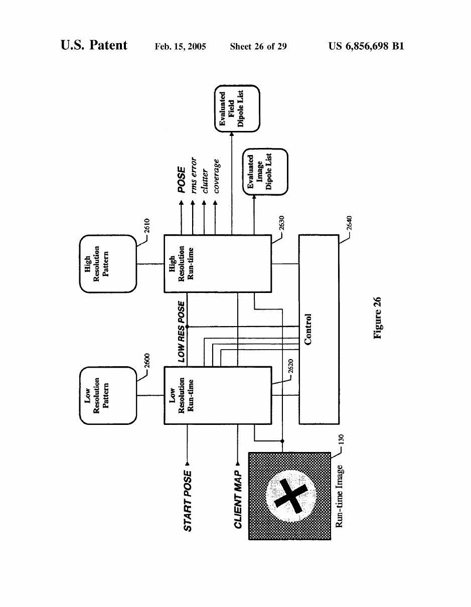
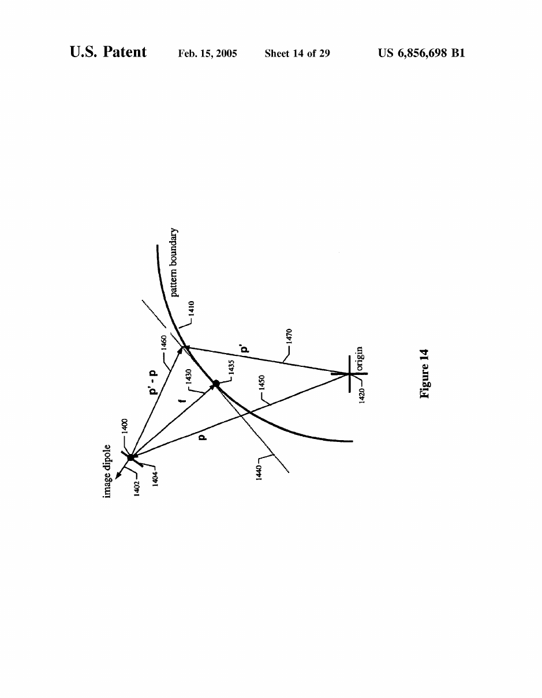
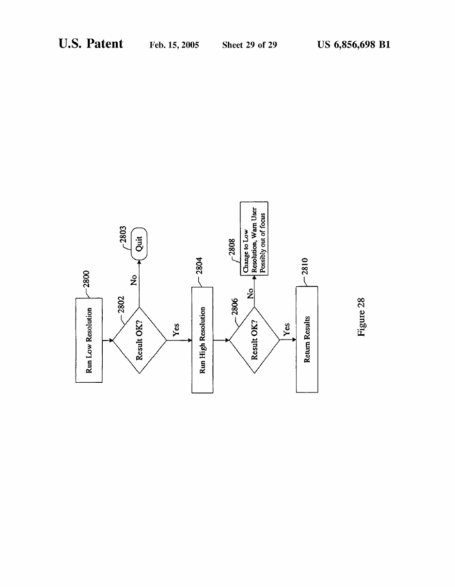

# 빠르고 정확한 다차원 패턴 위치 정밀화 (번역)

- 원제: Fast High-Accuracy Multi-Dimensional Pattern Localization
- 공보: US 6,856,698 B1 (등록 2005-02-15), 재심사 증명서 US 6,856,698 C1 (2012-08-14)
- 발명자: William Silver, Aaron Wallack, Adam Wagman
- 출원인(양수인): Cognex Corporation, Natick, MA, US
- 출원: 10/273,855, 2002-10-18 출원. 08/979,588 (1997-11-26 출원, 포기)의 계속 출원
- 번역 대상 파일: 같은 폴더의 `US6856698B1.pdf` (49쪽: 표지 2쪽, 도면 29장, 명세서와 청구항 16쪽, 재심사 증명서 2쪽)
- 번역 범위: 전문 (초록, 명세서 본문, 도면 설명, 청구항 1~20, 재심사 증명서). 인용 문헌 목록은 원문 그대로 둔다.

알아 둘 점

- PDF는 스캔 이미지에 문자 인식(OCR) 글자를 얹은 파일이다. pdftotext가 두 단 본문을 섞어 뽑아서, 문장 순서를 원문 쪽 이미지와 맞춰 다시 이었다.
- 수식 (2)~(15)는 글자 추출에서 기호가 빠져, 원문 쪽 이미지(본문 19~22단)를 보고 다시 적었다.
- 번역 안의 [역주]는 번역자가 붙인 설명이다. 원문에는 없다.
- 용어: dipole은 "쌍극자", field는 "필드", force는 "힘(벡터)", attraction step은 "끌어당김 단계", pose는 "자세", capture range는 "포착 범위", clutter는 "잡동사니", coverage는 "덮임률"로 옮겼다.

---

## 초록 (57)

주어진 패턴의 대략 위치를 빠르게 정밀화해 더 정확한 위치를 만드는 방법과 장치를 제공한다. 이 발명은 평행이동, 방향, 크기를 포함하는 다차원 공간을 쓴다. 이 발명은 패턴 위치를 찾는 어떤 거친-정밀(coarse-fine) 시스템에서도 정밀 해상도 단계를 대신할 수 있다. 패턴과 영상은 특징 기반 기술(description)로 나타낸다. 이 기술은 디지털 영상 재표본화보다 훨씬 빠르게, 화소 격자 양자화 오차 없이, 임의의 정밀도로 평행이동, 회전, 크기 변경할 수 있다. 따라서 정확도가 위치, 방향, 크기(또는 다른 자유도)의 작은 변화를 격자가 얼마나 잘 나타내는지에 묶이지 않는다. 이 발명은 대략적인 시작 자세에서 출발해, 적고 고정된 횟수의 증분으로 정확한 물체 자세를 정한다. 이 횟수는 공간의 차원 수와 무관하고, 시작 자세와 최종 자세 사이의 거리와도 무관하다. 단, 시작 자세가 참 자세의 "포착 범위(capture range)" 안에 있어야 한다. 따라서 실행 시간을 실용 수준으로 지키려고 정확도를 희생할 필요가 없다. 4차원 이상으로 위치를 정하면, 2차원 위치 시스템보다 패턴과 영상이 더 잘 맞는 경우가 많아 정확도가 좋아진다. 물체 일부가 빠지거나 가려지거나, 예상하지 않은 특징이 더 있어도 정확도가 떨어지지 않는다.

청구항 20개, 도면 29장.

## 관련 출원

이 출원은 1997년 11월 26일 출원한 미국 특허 출원 08/979,588(지금은 포기)의 계속 출원이다.

## 발명의 분야

이 발명은 기계 시각(machine vision)에 관한 것이며, 특히 영상 안에서 패턴의 위치를 정밀하게 정하는 시스템에 관한 것이다.

## 발명의 배경

디지털 영상은 많은 장치로 만들고 많은 실용 목적에 쓴다. 장치에는 가시광이나 적외선으로 동작하는 TV 카메라, 라인 스캔 센서, 비행 점 스캐너, 전자 현미경, CT 스캐너를 포함한 X선 장치, 자기 공명 영상 장치, 그 밖에 이 분야 사람이 아는 장치가 있다. 응용은 산업 자동화, 의료 진단, 군사와 민간과 과학 목적의 위성 영상, 사진 처리, 감시와 교통 감시, 문서 처리 등 많다.

이런 응용을 위해 여러 장치가 만든 영상을 디지털 장치로 분석해 필요한 정보를 뽑는다. 실용적으로 아주 중요한 분석 하나는, 촬영 장치 시야 안의 물체에 해당하는 패턴이 영상에서 어디에 있고, 어느 방향이며, 크기가 얼마인지 정하는 일이다. 패턴 위치 찾기는 산업 자동화에서 특히 중요하다. 반도체 제조, 전자 조립, 제약, 식품 가공, 소비재 제조 등에서 로봇과 자동화 장비를 안내하는 데 쓴다.

실용적으로 중요한 또 다른 디지털 영상 분석은, 물체 영상과 물체의 "이상적인" 모습을 나타내는 저장 패턴 사이의 차이를 찾는 일이다. 이런 차이를 찾는 방법을 보통 패턴 검사 방법이라 하며, 산업 자동화에서 조립, 포장, 품질 관리 등에 쓴다.

일찍부터 널리 쓴 위치 찾기와 검사 방법으로 블롭 분석(blob analysis)이 있다. 이 방법은 디지털 영상의 화소를 어떤 수단으로, 보통 화소 밝기를 문턱과 비교해 "물체"나 "배경"으로 나눈다. 물체로 나눈 화소는, 두 물체 화소가 이웃이면 같은 블롭이라는 규칙으로 묶는다. 이것을 연결성 분석이라 한다. 각 블롭마다 면적, 둘레, 질량 중심, 주 관성 모멘트, 주 관성 축 같은 성질을 구한다. 블롭의 위치, 방향, 크기는 각각 질량 중심, 첫 주 관성 축의 각도, 면적으로 본다. 이 값과 다른 블롭 성질을 알려진 이상값과 비교해 검사할 수 있다.

블롭 분석은 계산이 싸서 값싼 하드웨어에서도 빠르다. 이상적인 조건에서는 꽤 정확하고, 방향과 크기가 바뀌는 물체에 잘 맞는다. 한계 하나는 물체 일부가 빠지거나 가려지거나, 예상하지 않은 특징이 더 있으면 정확도가 크게 떨어진다는 것이다. 또 다른 한계는 검사에 쓸 수 있는 값이 물체의 거친 특징을 나타낼 뿐이라 미세한 차이를 찾지 못한다는 것이다. 가장 심한 한계는, 제한되고 잘 통제된 조건이 아니면 화소를 물체와 배경으로 믿을 만하게 나누는 방법이 일반적으로 없다는 것이다. 이런 한계 때문에 개발자들은 다른 위치 찾기와 검사 방법을 찾았다.

일찍 널리 쓰인 또 다른 방법은 이진 템플릿 정합(binary template matching)이다. 이 방법은 찾을 패턴의 예가 담긴 학습 영상을 쓴다. 학습 영상에서 그 예를 담은 부분을 문턱으로 이진 패턴으로 만들어 메모리에 저장한다. 실행 시에는 찾을 물체가 담긴 영상이 들어온다. 저장 패턴을 실행 영상의 같은 크기 부분과 모든 위치 또는 고른 위치에서 비교하고, 저장 패턴과 가장 잘 맞는 위치를 물체 위치로 본다. 어떤 위치에서 맞는 정도는 대응 영상 화소와 같은 패턴 화소의 비율이며, 이것이 검사 정보도 준다.

이진 템플릿 정합은 화소를 물체와 배경으로 나누는 데 기대지 않으므로, 블롭 분석보다 훨씬 다양한 문제에 쓸 수 있다. 패턴 특징이 빠지거나 더 있어도 정확도를 크게 잃지 않고 훨씬 잘 견디며, 패턴과 물체의 더 미세한 차이를 찾을 수 있다. 그러나 한계 하나는 이진화 문턱이 필요하다는 것이다. 이 문턱은 실제로 믿을 만하게 고르기 어렵다. 신호 대 잡음비가 나쁘거나 조명 세기나 물체 대비가 바뀌는 조건에서는 더 어렵다. 문턱 처리로 정보를 많이 잃어서, 정확도는 보통 약 1화소로 묶인다. 더 심각한 것은 이진 템플릿 정합이 물체의 방향과 크기를 재지 못한다는 점이다. 게다가 방향이나 크기가 조금만 바뀌어도 정확도가 빠르게 떨어지고, 변화가 더 크면 아예 쓸 수 없다.

이진 템플릿 정합보다 크게 나아진 것은, 위치 찾기와 검사에 밝기 정규화 상관(gray-level normalized correlation)을 비교적 싸게 쓰는 방법이 나오면서다. 방법은 비슷하지만 문턱을 쓰지 않아 영상 밝기 전 범위를 고려하고, 맞는 정도는 주어진 위치에서 저장 패턴과 영상 부분 사이의 상관 계수가 된다.

이진화 문턱이 필요 없고 상관이 원래 잡음에 강하므로, 신호 대 잡음비가 나쁘거나 조명 세기나 물체 대비가 바뀌어도 성능이 크게 떨어지지 않는다. 또 문턱 처리로 정보를 잃지 않으므로, 잘 알려진 보간법으로 약 1/4화소까지의 위치 정확도가 실용적이다. 그러나 방향과 크기에 관한 사정은 이진 템플릿 정합보다 크게 나아지지 않았다. 또 다른 한계는, 어떤 응용에서는 물체 영상 안에서 대비가 국소적으로 바뀌어 저장 패턴과의 상관이 나빠지고, 그 결과 위치를 바르게 찾지 못한다는 것이다.

최근에는 방향이나 크기가 크게 바뀌는 응용에도 쓸 수 있도록 밝기 상관이 개선되었다. 이 방법들은 영상과 맞춰 보기 전에 디지털 영상 재표본화로 저장 패턴을 회전하거나 크기를 바꾼다. 여러 각도, 크기, x-y 위치에 걸쳐 맞춰 보면 해당 다차원 공간에서 물체 위치를 찾을 수 있다. 이런 방법은 이진 템플릿 정합과는 잘 맞지 않는다. 이진 영상은 화소 양자화 오차가 훨씬 심하기 때문이다.

이 방법들의 문제 하나는 계산 비용이 아주 크다는 것이다. 디지털 재표본화도 비싸고, 2차원보다 많은 공간을 탐색하는 것도 비싸다. 이 비용을 감당하려고 탐색 방법은 문제를 둘 이상의 단계로 나눈다. 가장 앞 단계는 패턴의 거칠고 솎아 낸(subsampled) 판을 써서 탐색 공간 전체를 빠르게 훑고, n차원 공간에서 물체가 있을 만한 위치를 찾는다. 뒤 단계는 더 정밀한 판의 패턴을 써서 앞 단계가 정한 위치를 정밀화하고, 더 정밀한 해상도에서 패턴과 잘 상관되지 않는 것으로 드러난 위치를 버린다. 이런 거친-정밀 방법의 변형은 이진 템플릿 정합과 원래의 2차원 상관에도 써 왔지만, 차원이 높은 탐색 공간에서는 더욱 중요하다.

이 방법들의 위치 정확도는 두 가지에 묶인다. 하나는 다차원 공간을 얼마나 촘촘히 탐색하느냐이고, 다른 하나는 이산 화소 격자가 위치, 방향, 크기의 작은 변화를 얼마나 잘 나타내느냐이다. 탐색의 촘촘함은 응용에 맞게 고를 수 있지만, 계산 비용이 해상도와 차원 수에 따라 너무 빨리 늘어서 실제 응용은 높은 정확도를 얻는 데 드는 비용이나 시간을 견디지 못하는 경우가 많다. 이산 화소 격자의 한계는 더 근본적이다. 공간을 아무리 촘촘히 탐색해도, 보통의 패턴에서 위치 정확도는 약 1/4화소보다 크게 낫기 어렵고, 방향은 1도 안팎, 크기는 1퍼센트 안팎보다 낫기 어렵다.

밝기 화소 격자 기반 방법을 패턴 검사에 쓸 때도 사정이 비슷하다. 물체를 다차원 공간에서 찾고 나면 패턴의 화소를 대응하는 영상 화소와 비교해 차이를 찾을 수 있다. 그런데 어떤 차이는 재표본화 과정 자체에서 생긴다. 역시 화소 격자가 방향과 크기의 작은 변화를 정확히 나타내지 못하기 때문이다. 이런 차이는 물체 경계처럼 영상 밝기가 빠르게 바뀌는 곳에서 특히 심하다. 이런 곳이 흔히 검사에서 가장 중요한 곳이다. 일반적으로 재표본화로 생긴 차이와 물체 결함으로 생긴 차이를 구별할 수 없으므로 검사 성능이 떨어진다.

널리 쓰는 또 다른 위치 찾기 방법은 일반화 허프 변환(GHT)이다. 이 방법의 기원은 직선이나 원뿔 곡선 같은 매개변수 곡선을 찾는 방법을 기술한 미국 특허 3,069,654 (Hough, P. V. C., 1962)이다. 그 뒤 이 방법은 거의 임의의 패턴을 찾을 수 있게 일반화되었다. 위의 템플릿 정합과 상관 방법처럼 이 방법도 학습한 패턴에 기반한다. 다만 밝기를 직접 쓰지 않고, 잘 알려진 에지 검출로 물체 경계를 따라 있는 점을 찾는다. 허프 공간이라 부르는 큰 누산기 배열을 만들고, 탐색할 다차원 공간의 각 위치마다 누산기를 하나씩 둔다. 영상의 각 에지 점은 허프 공간에서 가능한 패턴 위치의 곡면 하나에 해당한다. 각 에지 점마다 해당 곡면을 따라 있는 누산기를 하나씩 올린다. 모든 에지 점을 처리한 뒤 값이 가장 큰 누산기를 패턴의 다차원 위치로 본다.

GHT의 일반적인 성능 특성은 상관과 아주 비슷하다. 계산 비용이 차원 수에 따라 매우 빠르게 늘고, 정확도는 허프 공간의 촘촘함과 격자 양자화 효과 둘 다에 묶인다. GHT의 성능을 높이려고 거친-정밀 방법이 개발되었지만, 높은 정확도에서는 계산이 비싸다. 에지 검출 단계는 물체 대비의 국소 변화로 생기는 문제를 대체로 없애지만, 잡음에 더 민감해진다.

## 발명의 요약

한 일반적인 측면에서, 이 발명은 주어진 패턴의 대략 위치를 정밀화해 더 정확한 위치를 만드는 방법과 장치다. 이 정밀화 과정을 위치 정밀화(localization)라 하며, x-y 위치(평행이동이라고도 한다), 방향, 크기를 포함할 수 있으나 그에 한정되지 않는 다차원 공간 안에서 일어난다. 이 위치 정밀화 방법은 빠르고 아주 정확하다. 다른 일반적인 측면에서, 이 발명은 저장 패턴과 그에 맞는 영상 부분 사이의 차이를 찾는 방법이며, 패턴의 위치, 방향, 크기 변화가 거짓 차이를 만들지 않는다. 차이를 찾는 이 과정을 검사(inspection)라 한다.

또 다른 일반적인 측면에서, 이 발명은 물체 영상 안에서 모델 패턴의 정확한 n차원 위치를 정하는 방법이다. 이 방법은 모델 패턴에서 패턴 경계를 나타내는 패턴 특징을 뽑는다. 이어서 패턴 특징으로 벡터 값 함수를 만들어 패턴 필드를 준다. 또 물체 영상에서 영상 특징을 뽑는다. 패턴 필드와, 영상 특징을 패턴 특징에 관련짓는 초기 n차원 변환을 함께 써서, 패턴 특징과 영상 특징 사이의 대응을 더 낫게 해 주는 더 나은 n차원 변환을 정한다. 이 더 나은 n차원 변환으로 물체 영상 안 학습 영상 패턴의 정확한 n차원 위치(즉 자리)를 준다.

모호함을 피하려고, 다차원 공간에서 패턴의 위치를 자세(pose)라 부른다. 더 정확히 말하면, 자세는 영상의 점을 저장 패턴의 대응 점으로 보내는 좌표 변환이다. 바람직한 실시예에서 자세는 자유도 6의 일반 선형 좌표 변환이다. 여섯 자유도는 2x2 행렬의 네 원소와, 두 평행이동 자유도에 해당하는 벡터의 두 원소로 나타낼 수 있다. 같은 내용을 다르게, 평행이동이 아닌 네 자유도를 방향, 크기, 가로세로비, 기울어짐(skew)으로, 또는 x 크기, y 크기, x축 각도, y축 각도로 나타낼 수도 있다.

이 발명은 위치 찾기와 검사를 위한 어떤 거친-정밀 방법에서도 정밀 해상도 단계를 대신할 수 있다. 앞에서 말한 종래의 상관이나 GHT가 그 예다. 이런 방법의 거친 위치 찾기 단계와 결합하면, 알려진 어떤 종래 방법보다 빠르고 정확한 전체 위치 찾기와 검사 방법이 된다. 이 발명은 대략 자세를 만드는 다른 어떤 방법과도 함께 쓸 수 있다. 블롭 분석, 기계적 추측 항법(dead reckoning), 사람이 손으로 위치를 잡는 것도 포함된다. 바람직한 실시예에서는 Cognex사(매사추세츠주 Natick)가 파는 PatQuick(TM) 도구로 대략 자세를 만든다.

이 발명은 찾을 물체의 이상적인 예를 나타내는 저장 패턴을 쓴다. 패턴은 학습 영상에서 만들 수도 있고, 기하 기술로 합성할 수도 있다. 이 발명에서 패턴과 영상은 특징 기반 기술로 나타낸다. 이 기술은 디지털 영상 재표본화보다 훨씬 빠르게, 화소 격자 양자화 오차 없이, 임의의 정밀도로 평행이동, 회전, 크기 변경할 수 있다. 따라서 정확도가 위치, 방향, 크기(또는 다른 자유도)의 작은 변화를 격자가 얼마나 잘 나타내는지에 묶이지 않는다. 게다가 재표본화를 하지 않으므로, 디지털 재표본화로 생기는 화소 양자화 오차가 패턴과 영상 사이에 거짓 차이를 만들어 검사 성능을 묶는 일도 없다.

정확도는 공간을 탐색하는 촘촘함에도 묶이지 않는다. 이 발명은 공간 안의 이산 위치를 시험해 가장 잘 맞는 자세를 정하지 않기 때문이다. 대신, 대략적인 시작 자세에서 출발해 적고 고정된 횟수의 증분으로 정확한 물체 자세를 정한다. 이 횟수는 공간의 차원 수(즉 자유도)와 무관하고, 시작 자세와 최종 자세 사이 거리와도 무관하다. 단, 시작 자세가 참 자세의 어떤 "포착 범위" 안에 있어야 한다. 따라서 실제 응용이 허용하는 시간 안에 실행 시간을 지키려고 정확도를 희생할 필요가 없다.

실행 시간이 자유도 수에 따라 빠르게 늘어나는 종래 방법과 달리, 이 발명의 방법은 실행 시간이 나빠도 아주 천천히 늘고, 어떤 실시예에서는 전혀 늘지 않는다. 따라서 실행 시간을 실용 범위에 두려고 자유도 측정을 포기할 필요가 없다. 또 네 개 이상의 자유도를 정밀화하게 하면 패턴과 영상이 더 잘 맞는 경우가 많고, 그만큼 정확도가 좋아진다.

이 발명은 특징 검출기로 영상을 처리해 화소 격자에 묶이지 않는 기술을 만든다. 이 기술은 물체 경계를 따라 있는 점을 나타내는, 쌍극자(dipole)라 부르는 원소의 목록이다. 쌍극자는 물체 경계 위 한 점의 좌표와, 그 점에서 경계에 거의 수직인 방향을 담는다. 바람직한 실시예에서 물체 경계는 영상 기울기(영상 각 점에서 밝기 변화의 빠르기와 방향을 나타내는 벡터)가 국소 최대가 되는 곳으로 정의한다. 다른 바람직한 실시예에서는 기울기를 조절 가능한 공간 해상도에서 추정한다. 또 다른 바람직한 실시예에서는 쌍극자 방향이 기울기 방향이다. 또 다른 바람직한 실시예에서는 쌍극자가 도면에서 더 설명하는 추가 정보를 담는다. 또 다른 바람직한 실시예에서는 쌍극자를 영상이 아니라 CAD 시스템에 있을 법한 물체의 기하 기술에서 만든다.

이 발명이 위치 정밀화와 검사에 쓸 저장 모델 패턴은, 물체 경계를 나타내 찾을 물체를 기술하는 쌍극자 목록을 만드는 바탕이다. 모델 패턴에서 얻은 쌍극자 목록을 필드 쌍극자 목록이라 한다. 이것은 예시 물체가 담긴 모델 학습 영상에서 특징 검출기로 만들거나, 기하 기술로 합성할 수 있다. 필드 쌍극자 목록으로 필드(field)라 부르는 2차원 벡터 값 함수를 만든다. 저장 모델 패턴 영역 안의 각 점마다, 필드는 모델 물체 경계 위 가장 가까운 점까지의 거리와 방향을 가리키는 벡터를 준다. 이 벡터를 저장 모델 패턴 안 그 점에서의 힘(force)이라 한다.

모델 물체 경계 위 가장 가까운 점이 반드시 필드 쌍극자가 나타내는 모델 물체 경계 점 가운데 하나는 아니며, 일반적으로 필드 쌍극자 위치들 사이에 있을 수 있다. 또 저장 모델 패턴 안의 점도 반드시 정수 격자 위치가 아니며, 일반적으로 계산 장치의 정밀도 한도 안에서 알려진 실수 위치다. 힘 벡터는 가장 가까운 경계 점을 가리키므로, 경계에 수직이어야 한다(불연속점은 빼고).

바람직한 실시예에서, 어떤 필드 위치에서 일정 거리 안에 모델 물체 경계 점이 하나도 없으면 힘 벡터 대신 특별 부호를 준다. 다른 바람직한 실시예에서는 힘과 함께 가장 가까운 필드 쌍극자의 정체(번호)를 준다. 또 다른 바람직한 실시예에서는, 힘이 가리키는 경계에서의 기울기 방향이 힘 방향과 같은지 180도 반대인지를 나타내는 정보 1비트를 더 준다(둘 다 경계에 수직이다). 또 다른 바람직한 실시예에서는 도면에서 더 설명하는 추가 정보를 준다. 또 다른 실시예에서는 필드가 패턴 안의 위치에 더해 방향도 입력으로 받고, 돌려주는 힘은 대략 그 방향에서 가장 가까운 모델 물체 경계 점까지의 거리와 방향이다.

이 발명이 쓰는 저장 모델 패턴은 필드 쌍극자 목록, 필드, 그리고 실시예에 맞는 동작 매개변수 집합을 담는다. 이는 명세서 전체에서 더 설명한다.

물체 영상과 대략적인 시작 자세가 주어지면 패턴 위치 정밀화는 다음과 같이 진행한다. 물체 영상을 특징 검출기로 처리해 영상 쌍극자 목록이라 부르는 쌍극자 목록을 만든다. 시작 자세는 끌어당김 단계(attraction step)라 부르는 증분 개선의 연속으로 정밀화된다. 각 단계는, 변할 수 있게 허용한 모든 자유도에서 훨씬 정확한 자세를 낸다. 이 연속은 정한 횟수 뒤에, 또는 마지막 단계에서 자세가 크게 바뀌지 않을 때, 또는 그 밖의 합당한 기준에 따라 끝낼 수 있다. 바람직한 실시예에서는 네 단계 뒤에 끝낸다.

각 끌어당김 단계에서 영상 쌍극자를 편한 순서대로 처리한다. 각 영상 쌍극자의 위치와 방향을 현재 자세 변환으로 사상해, 영상 좌표를 모델 패턴(필드) 좌표로 바꾼다. 필드로 영상 쌍극자가 사상된 점의 힘을 구한다. 각 영상 쌍극자는 물체 경계 위에 있다고 가정하고, 힘은 저장 모델 패턴의 가장 가까운 모델 물체 경계까지의 거리와 방향을 주므로, 사상된 위치에 영상 쌍극자가 있다는 것은 "영상 쌍극자가 힘 방향으로 힘 거리만큼 움직이도록 자세를 고쳐야 한다"는 증거로 받아들인다.

물체 경계는 일반적으로 경계에 수직인 방향, 즉 앞에서 말한 힘 방향의 위치 정보를 주지만, 경계를 따르는 방향으로는 정보를 주지 않는다는 점이 중요하다. 따라서 영상 쌍극자 하나가 주는 증거는 자유도 하나만, 곧 힘의 선을 따르는 위치만 제약하고, 힘에 수직인 방향으로는 증거를 주지 않는다.

현재 자세가 참 물체 위치에 꽤 가까우면, 많은 영상 쌍극자가 영상 경계를 저장 모델 패턴의 경계와 가장 잘 맞추려면 자세를 어떻게 고쳐야 하는지에 대해 좋은 증거를 준다. 그러나 여러 이유로 다른 많은 영상 쌍극자는 거짓이거나 오해를 부르는 증거를 줄 수 있다. 따라서 각 영상 쌍극자가 주는 증거를 평가하고, 증거의 상대적 신뢰도를 나타내는 가중치를 각 영상 쌍극자에 주는 것이 중요하다.

한 실시예에서는 영상 쌍극자의 방향(패턴 좌표계로 사상한 것)을 힘 방향과 비교하고, 그 결과를 180도 법으로 써서 영상 쌍극자의 가중치를 정한다. 두 방향이 어떤 지정 매개변수 안에서 맞으면 높은 가중치를 주고, 다른 지정 매개변수보다 더 어긋나면 가중치 0을 주며, 방향 차이가 두 매개변수 사이면 중간 가중치를 준다.

다른 실시예에서는 영상 쌍극자 방향을, 힘이 가리키는 모델 패턴 경계의 기울기 방향과 비교한다. 매개변수 하나로 비교를 180도 법으로 할지(기울기 극성을 사실상 무시), 360도 법으로 할지(극성을 고려) 고른다. 바람직한 실시예에서는 필드 자체가 저장 모델 패턴 안의 각 점에서 극성을 무시할지, 고려할지, 아니면 전역 매개변수에 맡길지를 나타낸다.

한 실시예에서는 힘 거리로 쌍극자 가중치를 정한다. 바람직한 실시예에서는 힘 거리가 어떤 지정 매개변수보다 크면, 쌍극자가 너무 멀어 유효한 증거가 아니라고 보고 가중치 0을 준다. 힘 거리가 다른 지정 매개변수보다 작으면 높은 가중치를 주고, 두 매개변수 사이면 중간 가중치를 준다.

바람직한 실시예에서는, 힘 거리에 따른 가중치를 정하는 매개변수를 끌어당김 단계마다 조정한다. 자세가 점점 정확해지므로, 유효한 증거를 나타내는 영상 쌍극자는 패턴 경계에 더 가까이 있을 것으로 기대해야 하기 때문이다.

한 실시예에서는 영상 쌍극자의 기울기 크기로 쌍극자 가중치를 정한다. 바람직한 실시예에서는 쌍극자 방향, 힘 거리, 기울기 크기를 조합해 가중치를 정한다.

각 끌어당김 단계에서 이 발명은 쌍극자 가중치를 고려하면서, 각 영상 쌍극자가 낸 증거를 가장 잘 설명하는 새 자세를 정한다. 바람직한 실시예에서는 최소제곱법으로 새 자세를 정한다.

각 영상 쌍극자를 평가해 가중치를 만드는 일은 검사 정보도 준다. 두 가지 서로 다른 오류를 찾는 것이 바람직하다. 하나는 빠진 특징, 곧 대응 영상 특징을 찾을 수 없는 패턴 특징이다. 다른 하나는 남는 특징, 흔히 "잡동사니(clutter)"라 부르는, 어떤 패턴 특징에도 대응하지 않는 영상 특징이다. 한 실시예에서는 가중치가 낮은 영상 쌍극자를 잡동사니로 본다. 바람직한 실시예에서는 아래 도면에서 더 설명하듯 각 영상 쌍극자마다 특정 잡동사니 값을 계산한다.

빠진 패턴 특징을 찾을 수 있는 실시예에서는, 필드가 각 점에서 힘 벡터에 더해 가장 가까운 필드 쌍극자(있다면)의 정체도 준다. 각 필드 쌍극자는 평가값을 담고, 이 값은 0으로 시작한다. 각 영상 쌍극자는 자기 평가값(가중치)을 필드가 가리키는 가장 가까운 필드 쌍극자로 넘긴다. 일반적으로 영상 쌍극자와 필드 쌍극자의 대응이 일대일이 아니므로, 어떤 필드 쌍극자는 영상 쌍극자 여럿에게서 평가를 받고, 어떤 것은 하나도 받지 못한다. 평가를 받지 못한 필드 쌍극자는 정말로 빠진 특징일 수도 있고, 양자화 효과로 넘김에 생긴 틈일 뿐일 수도 있다.

한 필드 쌍극자에 평가가 둘 이상 넘어오면 합당한 어떤 방법으로도 합칠 수 있다. 바람직한 실시예에서는 가장 큰 평가를 쓰고 나머지는 버린다. 넘김의 틈은 이웃 필드 쌍극자를 보고 메울 수 있다. 한 실시예에서는 이 분야에서 밝기 수리 형태학(gray-level mathematical morphology)이라 알려진 방법으로 틈을 메운다. 이 발명에서는 필드 쌍극자가 1차원 경계를 따라 있으므로 1차원 형태학 연산을 쓴다. 바람직한 실시예에서는 형태학 팽창 연산을 쓴다.

**시작 자세가 참 자세에서 너무 멀면, 영상 쌍극자가 주는 좋은 증거가 모자라 자세를 바른 방향으로 움직이지 못할 수 있다. 참 자세로 끌려가게 되는 시작 자세의 집합이 그 패턴의 포착 범위를 정한다. 포착 범위는 쓰는 패턴에 따라 다르며, 시작 자세를 정하는 데 쓰는 방법이 얼마나 정확해야 하는지를 정한다.**

**바람직한 실시예에서, 쌍극자를 만드는 특징 검출기는 넓은 공간 주파수 범위에서 조정할 수 있다. 특징 검출기를 비교적 높은 해상도에서 아주 미세한 특징을 찾도록 맞추면 정확도는 높지만 포착 범위는 비교적 작다. 반대로 비교적 낮은 해상도에서 거친 특징을 찾도록 맞추면 정확도는 낮지만 포착 범위는 비교적 크다. 이는 거칠고 낮은 해상도 단계 다음에 정밀하고 높은 해상도 단계를 두는 다중 해상도 방법을 시사한다. 이 방법에서 포착 범위는 거친 단계가 정하므로 비교적 크고, 정확도는 정밀 단계가 정하므로 높다.**

## 도면의 간단한 설명

다음 상세한 설명과 다음 도면을 함께 보면 이 발명을 더 잘 이해할 수 있다.

- 도 1은 이 발명의 한 실시예의 상위 블록도다.
- 도 1A는 가로세로비 2:1의 화소 배열을 보인다.
- 도 2는 도 1의 학습 블록의 블록도다.
- 도 3은 도 2의 특징 검출 블록의 블록도다.
- 도 4는 32비트 워드의 비트 배정과 선택적인 가장 가까운 쌍극자 비트를 보인다.
- 도 5는 필드 원소 배열과 그 테두리 필드 원소를 보인다.
- 도 6은 필드 씨뿌리기(seeding)를 보인다. 도 5의 필드 원소 일부, 패턴 경계의 직선 조각 여러 개, 그에 딸린 필드 쌍극자를 보인다.
- 도 7A는 필드 쌍극자 잇기를 보인다. 도 6의 필드 원소 일부, 패턴 경계의 직선 조각 여러 개, 그에 딸린 오른쪽과 왼쪽 연결을 보인다.
- 도 7B와 7C는 이웃 필드 원소를 살피는 순서를 보인다.
- 도 8은 도 2의 사슬 분할을 보인다. 도 5의 필드 원소 일부, 직선 조각 여러 개, 왼쪽과 오른쪽 연결 여러 개를 보인다.
- 도 9A, 9B, 9C는 도 2의 필드 생성 모듈의 전파 단계가 하는 분석의 일부를 보인다.
- 도 10은 도 2의 필드 생성 모듈의 전파 단계를 더 자세히 보인다.
- 도 11은 도 6에서 씨뿌리기 뒤에 보인 필드 배열의 같은 부분을, 한 번 전파해 생긴 새 힘 벡터와 함께 보인다.
- 도 12는 도 11과 같은 부분을 두 번 전파한 뒤 보인다.
- 도 13은 도 1의 바람직한 실시예의 실행 모듈 블록도다.
- 도 14는 각 끌어당김 단계에서 영상 쌍극자의 증거를 가장 잘 설명하는 자세를 최소제곱법으로 정하는 것을 보이는 그림이다.
- 도 15는 도 13의 끌어당김 모듈의 블록도다.
- 도 16은 도 15의 사상 모듈의 블록도다.
- 도 17은 도 15의 필드 모듈의 블록도다.
- 도 18은 도 15의 회전 모듈의 블록도다.
- 도 19A, 19B, 19C는 퍼지 논리 처리 요소 세 가지의 입력에 따른 출력을 보인다.
- 도 20A는 도 15의 평가 모듈 가운데 가중치와 평가값을 계산하는 바람직한 시스템 부분의 개략도다.
- 도 20B는 도 15의 평가 모듈 가운데 잡동사니를 계산하는 바람직한 시스템 부분의 개략도다.
- 도 21은 도 15의 합 모듈의 개략도다.
- 도 22A~D는 도 15의 풀이 모듈의 블록도로, 여러 자유도에서 움직임과 rms 오차를 내는 식과 입력을 보인다.
- 도 23은 도 15의 합성 모듈의 식을 보이는 블록도다.
- 도 24는 도 15의 법선 텐서 모듈의 식을 보이는 블록도다.
- 도 25는 영상 쌍극자 여러 개와 이어진 필드 쌍극자 여러 개를 그려 필드 쌍극자 평가를 보인다.
- 도 26은 이 발명의 다중 해상도 실시예의 상위 블록도다.
- 도 27A와 27B는 도 15의 모듈들이 하는 연산 순서를 보이는 흐름도다.
- 도 28은 이 발명의 다중 해상도 동작 방식을 보이는 흐름도다.

## 바람직한 실시예의 상세한 설명

아래 도면에서 "모듈"은 소프트웨어, 펌웨어, 하드웨어로 구현할 수 있다. 또 각 모듈은 하위 모듈, 곧 "단계"를 포함할 수 있고, 각 단계는 하드웨어, 소프트웨어, 또는 그 조합으로 구현할 수 있다.

도 1은 이 발명의 한 실시예의 상위 블록도다. 위치 정밀화나 검사에 쓸 패턴 105의 예를 담은 학습(모델) 영상 100이 주어진다. 학습 모듈 110이 학습 영상을 분석해 나중에 쓸 저장 모델 패턴 120을 만든다. 실행 영상 130이 하나 이상 주어지며, 각 영상은 학습(모델) 패턴 105와 모양은 비슷하지만 크기와 방향은 다를 수 있는 패턴 135를 0개 이상 담는다.

각 실행 영상 130에는 사용자가 응용에 맞게 고른 클라이언트 사상(client map) 131이 딸려 있다. 클라이언트 사상은 정규직교이지만 그 밖에는 임의인 좌표계의 점을 영상의 점으로 보내는(대응시키는) 좌표 변환이다. 정규직교 좌표계는 축이 서로 수직이고 각 축의 눈금이 단위 크기다. 클라이언트 사상은 방향 자유도와 기울어짐, 크기, 가로세로비 자유도를 바르게 다루는 데 필요한 정규직교 기준을 준다. 실제 응용에서 영상 자체는 거의 정규직교가 아니다. 실제 영상 센서의 화소가 완벽한 정사각형인 경우는 거의 없기 때문이다. 예를 들어 도 1A처럼 가로세로비 2:1인 화소도 있을 수 있다. 이 경우 클라이언트 사상은 2x2 행렬(원문 수식)이 된다. [역주: 원문 쪽 이미지의 행렬은 OCR로 깨져 있다. 가로 2배를 나타내는 대각 행렬로 보이나, 원소 배치를 확인하지 못했다.]

화소가 정사각형이면 클라이언트 사상은 항등 변환이다. 곧 변환 행렬의 대각 원소가 모두 1.0이고 비대각 원소가 0.0이다.

또 상당히 정규직교가 아닌 필드를 쓰는 것이 유용할 때가 있다. 예를 들어 정사각형 패턴에서 만든 필드로, 알맞은 시작 자세를 써서 직사각형이나 평행사변형 모양의 패턴 사례를 정밀화하고 검사할 수 있다. 이런 경우는 정규직교 기준이 있어야만 다룰 수 있다.

각 실행 영상마다 시작 자세 132를 적당한 방법으로 정한다. 방향과 크기 재표본화를 쓴 거친 밝기 상관, 거친 일반화 허프 변환, Cognex PatQuick(TM) 도구 등이 그 예다. 시작 자세 132는 패턴 105의 점을 실행 영상 130의 대략 대응하는 점 135로 보내는 자유도 6의 좌표 변환이다. 실행 모듈 140은 저장 패턴 120, 시작 자세 132, 클라이언트 사상 131을 써서 영상 130을 분석한다. 분석 결과로 실행 모듈 140은 패턴 점 105를 정확히 대응하는 영상 점 135로 보내는 자세 134를 낸다.

(위 그림은 뒤의 도 26이다. 도 1과 같은 입력, 출력 구조를 저해상도, 고해상도 두 실행 모듈로 이은 모습이라 여기 함께 보인다.)

실행 모듈 140은 패턴 105와 영상 130이 맞는 정도의 척도인 rms 오차값 136을 낸다. rms 오차값 136은 영상 쌍극자의 증거에 가장 잘 맞는 자세를 정하는 데 쓰는 최소제곱 풀이(또는 다른 오차 최소화 풀이)의 제곱평균제곱근 오차이며, 아래에서 더 자세히 설명한다. 0은 완벽히 맞음을 뜻하고, 값이 클수록 덜 맞는다.

실행 모듈 140은 패턴 105 가운데 대응 영상 특징을 찾은 비율의 척도인 덮임률(coverage) 값 138을 낸다. 덮임률 값 138은 필드 쌍극자 평가값을 모두 더해 필드 쌍극자 수로 나눠 계산하며, 아래에서 더 자세히 설명한다.

실행 모듈 140은 영상에서 찾았으나 패턴 특징에 대응하지 않는 남는 특징의 척도인 잡동사니 값을 낸다. 바람직한 실시예에서 잡동사니 값은 개별 영상 쌍극자의 잡동사니 값을 더해 필드 쌍극자 수로 나눠 계산한다.

실행 모듈 140은 평가된 영상 쌍극자 목록 150과 평가된 필드 쌍극자 목록 160을 낸다. 평가된 영상 쌍극자 목록 150은 패턴 105에는 없는데 영상 130에 있는 특징을 가리키고, 평가된 필드 쌍극자 목록 160은 영상 130에는 없는데 패턴 105에 있는 특징을 가리킨다. 이렇게 찾은 영상과 패턴의 차이를 검사에 쓸 수 있다.

### 학습 모듈 (도 2)

도 2는 학습 모듈 110과 패턴 관련 데이터 120의 블록도다. 위치 정밀화나 검사할 패턴 105의 예를 담은 학습 영상 100을 학습 모듈 110에 준다. 학습 모듈 110은 학습 영상 100을 분석해 나중에 쓸 저장 패턴 120을 만든다. 학습 모듈 110은 특징 검출 모듈 200과 필드 생성 모듈 210의 두 모듈로 이루어진다. 두 모듈 모두 응용에 맞게 동작을 제어하는 여러 매개변수 220을 쓴다. 이 매개변수와 뒤의 실행 모듈에 필요한 매개변수는 패턴에 따라 다르므로, 그림처럼 모아서 패턴 120에 저장한다.

특징 검출 모듈 200은 매개변수 220을 써서 학습 영상 100을 처리해 필드 쌍극자 집합 230을 만들고, 이것을 그림처럼 패턴 120에 저장한다. 필드 생성 모듈 210은 필드 쌍극자 집합 230과 매개변수 220으로 필드 240을 만들어 그림처럼 패턴 120에 저장한다.

위 요약에서 말했듯, 필드 240은 패턴 105 영역 안의 이론상 실수 값 위치의 함수로 정보를 낸다. 실제로는 모든 필드 값을 해석적으로 계산해 저장할 수 없으므로, 격자의 이산 점에서 필드 값을 저장하는 2차원 배열을 쓴다. (실시예의 세부 사항이 정하는 정밀도의) 실수 위치가 주어지면, 도 17의 방법 같은 보간법으로 격자 원소 사이 중간 점의 필드 값을 계산한다. 필드 격자는 절대 평행이동, 회전, 크기 변경하지 않으므로 재표본화가 필요 없고 격자 양자화 효과가 작다. 대신 격자에 묶이지 않은 영상 쌍극자를 도 16의 사상에 따라 고정된 필드 좌표로 사상한다.

따라서 필드 생성 모듈 210의 목적은 필드 240을 담는 2차원 배열의 원소를 계산하는 것이다. 필드 생성 모듈 210은 도 2처럼 여러 단계, 곧 하위 모듈로 이루어진다. 각 단계는 대개 앞 단계의 결과를 바탕으로 필드를 어떤 식으로 고친다. 일부 단계는 필드 쌍극자 집합 230에 정보를 더하기도 한다. 도 2의 단계 순서는 바람직한 실시예에 해당하며, 발명의 취지 안에서 다른 변형도 많이 가능하다. 핵심 요구는 저장 패턴 120이 패턴 105 영역 안 위치의 함수로 일정한 정보를 줄 수 있어야 한다는 것이다.

도 2의 바람직한 실시예에서 필드 생성 모듈 210은 다음 단계로 이루어진다. 초기화 단계 250은 도 5의 필드 배열 원소 520, 540에 미리 정한 부호를 넣는다. 씨뿌리기 단계 252는 필드 쌍극자 집합 230의 쌍극자에 해당하는 위치의 필드 배열 원소를 설정한다. 잇기 단계 254는 씨뿌린 필드 배열로 각 필드 쌍극자의 이웃 쌍극자를 찾는다. 찾으면, 패턴 경계를 따라 왼쪽과 오른쪽 이웃(있다면)의 정체를 저장해 필드 쌍극자를 이웃과 이어 사슬을 만든다. 사슬 단계 256은 이어진 필드 쌍극자를 훑어 개별 사슬을 찾고 목록으로 만든다. 각 사슬마다 시작과 끝 쌍극자, 길이, 총 기울기 크기, 열린 사슬인지 닫힌 사슬인지를 정해 저장한다.

거르기 단계 258은 약한 사슬이 담은 쌍극자를 필드 배열에서 지워(곧 그 쌍극자에 대해 씨뿌리기 252를 되돌려) 약한 사슬을 패턴에서 없앤다. 약한 사슬을 찾는 기준은 여러 가지가 있다. 바람직한 실시예에서는 총 기울기 크기나 평균 기울기 크기가 어떤 지정 매개변수보다 작은 사슬을 약하다고 본다.

분할 단계 260은 사슬을, 곡률이 낮은 조각들과 그 사이의 곡률이 높은 영역(모서리)으로 나눈다. 모서리 쌍극자는 뒤 도면에서 설명하는 용도로 필드 배열에 표시한다. 곡률은 여러 방법으로 정할 수 있다. 바람직한 실시예에서는, 예를 들어 도 8과 함께 더 설명하듯, 쌍극자 방향이 어느 한쪽 이웃과 어떤 지정 매개변수보다 더 다르면 그 쌍극자를 모서리로 본다.

0회 이상의 전파 단계 262가 씨뿌린 위치에서 필드를 바깥으로 넓힌다. 그 결과 패턴 경계를 가리키는 힘 벡터와 실행 단계에 필요한 다른 정보를 경계에서 어느 정도 떨어진 곳에서도 얻을 수 있다. **전파 단계 262의 횟수는 매개변수로 정하며, 필드가 유효한 힘 벡터를 담는, 패턴 경계로부터의 거리와 패턴 학습에 드는 계산 시간을 정한다. 바람직한 실시예에서는 전파 단계를 4번 쓴다.** 전파 범위 밖의 필드 원소는 초기화 단계 250에서 넣은 부호를 그대로 담는다.

### 특징 검출기 (도 3)

도 3은 이 발명을 실시하는 데 쓸 특징 검출기의 바람직한 실시예다. 특징 검출기는 원천 영상 300을 처리하며, 이것은 학습 영상일 수도 실행 영상일 수도 있다. 저역 통과 필터 310과 영상 솎기기(sub-sampler) 320으로, 여러 이유로 무시하고 싶은 원천 영상의 미세한 세부를 약하게 만든다. **예를 들어 잡음이나 미세한 질감을 약하게 하고 싶을 수 있고, 거친 패턴 특징에 집중해 패턴의 포착 범위를 넓히고 싶을 수 있다.** 또 영상 쌍극자 수를 줄여 처리 시간을 줄이고 싶을 수도 있다.

필터 310과 솎기기 320의 응답은 패턴에 저장된 매개변수 220(이 그림에는 안 보임)이 제어한다. 매개변수의 한 설정은 필터와 솎기기를 사실상 끄고, 최대 해상도를 위해 원천 영상 300을 고치지 않고 통과시킨다.

디지털 영상의 저역 통과 거르기와 솎기는 이 분야에 잘 알려져 있다. 바람직한 실시예에서는 미국 특허 출원 중인 "Efficient, Flexible Digital Filtering"에 기술된 상수 시간 2차 근사 가우스 필터를 쓴다.

거르고 솎은 영상을 기울기 추정 모듈 330이 처리해 각 화소에서 영상 기울기의 x(가로)와 y(세로) 성분 추정을 만든다. 직교-극좌표 변환 모듈 340은 기울기의 x, y 성분을 크기와 방향으로 바꾼다. 봉우리 검출 모듈 350은 기울기 크기가 잡음 문턱을 넘고, 대략 기울기 방향으로 놓인 1차원 단면을 따라 국소 최대인 점을 찾아, 각 점의 격자 좌표(행과 열 번호), 기울기 크기, 기울기 방향의 목록을 만든다.

부화소 보간 모듈 360은 그 1차원 단면을 따라 기울기 크기가 최대인 위치를 보간해, 점의 (어떤 정밀도의) 실수 좌표 (x, y)를 정한다. 결과는 영상의 경계를 따라 놓인 점의 목록이며, 각 점의 좌표, 방향, 크기를 담는다. 이 목록은 필드 쌍극자 목록이나 영상 쌍극자 목록의 바탕이 되며, 필요에 따라 정보를 더할 수 있다.

영상 경계 위의 점을 찾는 방법은 이 분야에 잘 알려져 있다. 기울기 추정에 기반하든 다른 기법에 기반하든, 그런 방법 어느 것이나 이 발명의 실시에 쓸 수 있다. 기울기 추정, 직교-극좌표 변환, 봉우리 검출, 보간 방법도 잘 알려져 있다. 바람직한 실시예에서는 미국 특허 출원 중인 "Method and Apparatus for Fast, Inexpensive, Subpixel Edge Detection"에 기술된 방법을 쓴다.

바람직한 실시예에서 원천 영상은 화소당 8비트 회색조다. 저역 통과 필터는 저역 통과 필터 고유의 잡음 감소 성질을 살려 16비트 영상을 낸다. 기울기 추정 모듈은 잘 알려진 소벨(Sobel) 커널을 쓰며, 매개변수가 필터 310을 켜도록 설정되면 16비트 필터 영상에서, 필터 310을 끄도록 설정되면 8비트 거르지 않은 영상에서 동작한다. 기울기의 x, y 성분은 정밀도를 잃지 않도록 늘 16비트로 계산하고, 기울기 크기와 방향은 잘 알려진 CORDIC 알고리즘으로 적어도 6비트로 계산하는 것이 바람직하다.

특징 추출에는 학습 모듈 110과 실행 모듈 140 모두에서 여러 매개변수 값이 필요하다. 일반적으로 저역 통과 필터 310의 응답을 제어하는 값, 솎기기 320이 쓰는 솎기 양, 봉우리 검출기 350이 쓰는 잡음 문턱이 포함된다. 이 발명을 실시하는 데 쓰는 특징 추출기의 정확한 세부에 따라 다른 값도 필요할 수 있다.

매개변수의 알맞은 설정은 분석할 패턴과 영상의 성질에 따라 다르다. 바람직한 실시예에서는 많은 경우에 잘 맞는 기본값을 쓰지만, 일반적으로 모든 경우에 잘 맞는 규칙은 줄 수 없다. 이 바람직한 실시예는 아래 도 26과 함께 더 설명한다.

### 필드 원소 (도 4)

도 4는 이 발명의 바람직한 실시예에서 쓰는 필드 배열의 원소 하나를 보인다. 메모리를 아끼고, 데이터 캐시에 들어가는 원소 수를 늘리고, 모든 원소가 알맞은 주소 경계에 맞게 정렬되는 워드 크기를 써서 보통 컴퓨터에서 접근을 빠르게 하려고, 정보를 32비트 워드 400에 묶어 넣는다. 힘 벡터에는 고정 소수점 표현을 쓴다. 부동 소수점보다 작고, Texas Instruments TMS320C80이나 Intel Pentium-MMX 같은 현대 프로세서의 신호 처리 능력을 가장 잘 쓰게 하기 때문이다.

바람직한 실시예에서 필드 원소는 패턴 경계 위 가장 가까운 점까지의 거리와 방향을 주는 힘 벡터와, 그 경계 점의 기울기 방향이 힘 벡터와 같은 방향인지 180도 반대인지를 나타내는 1비트를 저장한다. 이는 도 4처럼 부호 있는 힘 크기 410과 기울기 방향 420을 저장해 이룬다. 힘 방향이 기울기 방향과 같으면 힘 크기 410은 양수이고, 반대이면 음수다.

힘 벡터를 x-y 성분보다 크기-방향으로 나타내는 것이 좋은 까닭은, 길이가 0이지만 방향은 뚜렷한 벡터를 나타낼 수 있어야 하기 때문이다. 이런 벡터를 유사 영 벡터(pseudo-null vector)라 한다. 대응하는 x-y 성분은 잘 알려진 다음 식으로 계산할 수 있다.

$$\text{force}_x = \text{magnitude}\cdot\cos(\text{direction}),\qquad \text{force}_y = \text{magnitude}\cdot\sin(\text{direction})$$

저장된 크기는 힘 방향이 기울기 방향과 반대일 때 음수이므로, 위 식에 기울기 방향을 그대로 써도 된다.

보인 바람직한 실시예에서 **힘 크기 410은 필드 격자 간격 단위이며, 총 16비트의 2의 보수 표현을 쓴다. 그 가운데 아래 11비트는 이진 소수점 오른쪽이고, 가장 위 비트는 부호 비트다. 따라서 힘 벡터의 최대 길이는 16 필드 격자 단위에 조금 못 미치고, 분해능은 격자 단위의 1/2048이다.**

기울기 방향 420은 0~360도 범위의 12비트 이진 각도로 나타내는 것이 바람직하며, 분해능은 360/4096 = 0.088도다. 다른 실시예에서는 각 응용에 필요한 정밀도와 범위에 맞게 필드 원소 400의 비트를 힘 410과 방향 420 사이에 달리 나눈다.

4비트 깃발 원소 430도 필드 원소 400에 저장한다. 2비트 평가 부호 440은, 현재 자세가 영상 쌍극자를 이 원소 400이 덮는 영역 안의 필드 위치로 사상할 때 그 쌍극자를 어떻게 평가할지 정한다. "상관없음(don't care)" 부호는 영상 쌍극자를 무시하라는 뜻이다. "빈칸 기대(expect blank)" 부호는 패턴의 이 영역에 특징이 없을 것으로 기대하므로, 여기로 사상되는 영상 쌍극자는 검사용 평가를 낮게 주고, 잡동사니 등급을 높게 주며, 위치 정밀화의 증거로 쓰지 말라는 뜻이다. "평가만(evaluate only)" 부호는 영상 쌍극자를 보통 기준으로 검사용으로 평가하되, 위치 정밀화 증거로는 쓰지 말라는 뜻이다. "끌어당김(attract)" 부호는 영상 쌍극자를 평가하고 위치 정밀화와 검사 둘 다에 쓰라는 뜻이다.

평가 부호 440이 "상관없음"이나 "빈칸 기대"면 힘 벡터는 정의되지 않으며 무효라고 한다. 평가 부호가 "평가만"이나 "끌어당김"이면 힘 벡터는 유효하다고 한다.

1비트 모서리 부호 450은 힘 벡터가 가리키는 패턴 경계 점이 곡률이 높은 영역("모서리임")인지 곡률이 낮은 조각("모서리 아님")인지를 나타낸다. 힘 벡터가 무효면 모서리 부호는 "모서리 아님"으로 둔다.

1비트 극성 부호 460은, 요약 절에서 말했고 아래에서 더 설명하듯, 영상 쌍극자 평가가 기울기 방향을 고려할지 무시할지를 나타낸다. 매개변수 하나로 필드 원소 400에 저장된 극성 깃발을 덮어쓸지, 덮어쓴다면 극성을 반드시 고려할지 무시할지를 정한다.

바람직한 실시예에서 필드 원소 400은 힘 벡터에 더해 가장 가까운 필드 쌍극자의 정체 401도 나타낸다. 정체 401은 필드 쌍극자 목록의 색인으로 나타낼 수 있다. 바람직한 실시예에서는 16비트 색인을 쓰며, 보통 컴퓨터의 데이터 정렬 지침을 지키려고 별도 배열에 저장한다.

### 초기화와 씨뿌리기 (도 5, 6)

도 5는 필드 생성 단계 210의 초기화 단계 250을 자세히 보인다. 필드 원소 400의 2차원 배열 500을 쓴다. 어떤 합당한 격자 간격도 쓸 수 있으며, 바람직한 실시예에서는 격자 간격이 특징 검출기 200의 기울기 추정 모듈 330에 들어가는 영상의 격자 간격과 같다.

필드 원소 520(도 5에서 흰색, 필드 원소 400과 같은 구조)은 학습 패턴 105의 영역을 덮어 함께 "학습 영역"을 이룬다. 필드 원소 520은 평가 부호 440이 "빈칸 기대"가 되도록 초기화한다. 앞에서 말했듯 이 상태에서 힘 벡터는 무효로 보며 초기화할 필요가 없다. 다만 아래 도 20b와 함께 설명하는 한 실시예에서는, 이 필드 원소 520의 기울기 방향 필드 420을 학습 영상의 대응하는 기울기 방향과 같게 둔다. 추가 필드 원소 540의 테두리(도 5에서 회색, 필드 원소 400과 같은 구조)는 평가 부호 440이 "상관없음"이 되도록 초기화한다. 이는 일반적으로 학습 영역 경계 밖에 어떤 특징이 있을지 모른다는 사실을 반영한다. 이 "상관없음" 값은 각 전파 단계 262마다 안쪽으로 복제되어, 학습 패턴 105 바로 밖에 있는 영상 특징이 바로 안쪽의 패턴 특징으로 끌려가지 않게 한다.

흰 필드 원소 520과 크기가 같은, 필드 쌍극자 색인 401의 별도 대응 배열도 쓰지만 초기화할 필요는 없다. 이 배열의 값은 배열 500의 대응 필드 원소의 힘 벡터가 유효할 때만 유효하다고 본다.

도 6은 필드 생성 모듈 210의 씨뿌리기 단계 252를 자세히 보인다. 필드 배열 500의 필드 원소 520 일부를 보인다. 각 필드 쌍극자는 어떤 필드 원소 안에 있다. 예를 들어 점 600의 필드 쌍극자는 도 6에서 회색으로 보인 필드 원소 620 안에 있다. 점 600의 예시 필드 쌍극자에 해당하는 패턴 경계 660의 작은 직선 조각도 보인다. 이 경계 조각은 주로 그림 이해를 돕기 위한 것이다. 그 방향과, 그 방향에 수직인 선을 따른 위치는 의미가 있지만, 길이는 사실상 임의다.

필드 원소 620은 힘 벡터 640을 갖도록 설정한다. 힘 벡터는 원소 620의 중심에서 경계 조각 660 위의 한 점을 가리키며, 벡터 머리를 경계 660에 닿게 하는 데 필요한 쪽으로 쌍극자 방향과 같거나 반대 방향(곧 경계에 수직)이다. 보인 예에서 벡터가 가리키는 경계 위 점은 쌍극자 위치 600과 겹치지만, 일반적으로 그럴 필요는 없다. 도 6은 씨뿌린 힘 벡터의 다른 예도 몇 개 보인다.

필드 쌍극자 위치가 필드 원소의 정확히 중심에 떨어져 힘 벡터 길이가 0인 경우도 있다. 이때 힘 벡터는 유사 영 벡터이며, 방향은 뚜렷하므로 바르게 설정해야 한다.

바람직한 실시예에서는 씨앗 힘 벡터를 받는 각 필드 원소의 평가 부호를 "끌어당김", 모서리 부호를 "모서리 아님", 극성 부호를 "극성 고려"로 둔다. 특정 응용에 맞게 발명의 취지 안에서 다른 방식도 만들 수 있다.

씨앗 힘 벡터를 받는 각 필드 원소마다, 필드 쌍극자 색인 배열의 대응 원소 401을 그 원소의 씨앗에 쓴 필드 쌍극자를 가리키도록 둔다.

미국 특허 출원 중인 "Method and Apparatus for Fast, Inexpensive, Subpixel Edge Detection"에 더 설명된 도 3의 특징 검출기를 쓰고, 필드 격자가 기울기 추정 모듈 330에 들어가는 영상과 같은 기하를 갖는 바람직한 실시예에서는, 한 필드 원소 안에 필드 쌍극자가 하나보다 많이 떨어지지 않고, 격자 양자화 효과로 경계에 틈이 생기지도 않는다. 다른 특징 검출 방법을 쓰는 덜 바람직한 실시예에서는, 한 필드 원소에 떨어지는 쌍극자 여러 개나 양자화 효과로 생긴 경계 틈을 여러 방식으로 다룰 수 있다. 한 필드 원소에 쌍극자가 여러 개면 힘 벡터가 가장 짧은 것을 고르고 나머지를 버리는 것이 바람직하다. 경계의 틈은 아무것도 하지 않고 전파 단계가 메우게 두는 것이 바람직하다.

### 잇기와 분할 (도 7, 8)

도 7은 필드 생성 모듈 210의 잇기 단계 254를 자세히 보인다. 도 7a는 도 6과 같은 필드 배열 500의 필드 원소 520 일부를 보이며, 예시 필드 원소 620도 연회색으로 보인다.

각 필드 쌍극자마다, 씨뿌린 필드를 살펴 그 쌍극자와 이어야 할 쌍극자가 있는 이웃 위치를 찾는다. 예시 필드 원소 620의 이웃 위치 700을 중간 회색으로 보인다. 이웃 위치 700은 네 위치씩 두 단계로 살피며, 각 단계의 순서는 필드 원소 620에 해당하는 필드 쌍극자의 방향으로 정한다.

한 단계에서는 왼쪽 이웃 필드 원소 710을 찾고, 필드 원소 620에 해당하는 필드 쌍극자에 필드 원소 710에 해당하는 필드 쌍극자를 왼쪽 이웃으로 가리키는 왼쪽 연결 715를 저장한다. 다른 단계에서는 오른쪽 이웃 필드 원소 720을 찾고, 필드 쌍극자의 오른쪽 이웃을 가리키는 오른쪽 연결 725를 저장한다. 이웃을 찾지 못하면 빈 연결을 저장한다. "왼쪽"과 "오른쪽"은 쌍극자 기울기 방향을 따라 보는 가상의 관찰자를 기준으로 임의로, 그러나 일관되게 정한다.

도 7b는 쌍극자 방향이 화살표 740과 742 사이에 있을 때, 곧 패턴 경계가 점선 744와 746 사이에 있을 때 이웃 필드 원소를 살피는 순서를 보인다. 왼쪽 이웃을 찾는 순서는 +1, +2, +3, +4다. 이 순서에서 쌍극자를 담은(씨뿌린) 첫 이웃이 있으면 그것이 왼쪽 이웃이다. 마찬가지로 오른쪽 이웃을 찾는 순서는 -1, -2, -3, -4다.

도 7c는 쌍극자 방향이 화살표 760과 762 사이, 곧 패턴 경계가 점선 764와 766 사이에 있는 다른 예를 보인다. 이웃 순서는 그림과 같다. 다른 모든 쌍극자 방향의 순서는 도 7b와 7c 두 경우를 회전한 것일 뿐이다.

도 7b와 7c의 순서는, 대각 이웃이 패턴 경계 방향에 "더 가까울" 때도 대각 이웃보다 직교 이웃을 먼저 고른다. 이 선호 덕분에 격자 축과 맞지 않는 경계에서 사슬이 계단 무늬를 바르게 따라간다. 이 선호는 특징 검출기가 경계 위 점을 고르는 방식의 세부에 어느 정도 달려 있음이 분명하다.

모든 필드 쌍극자의 연결을 정한 뒤 일관성 검사를 한다. 곧 쌍극자의 왼쪽 이웃의 오른쪽 이웃은 그 쌍극자 자신이어야 하고, 오른쪽 이웃의 왼쪽 이웃도 그 쌍극자 자신이어야 한다. 이 조건이 맞지 않는 연결이 있으면 빈 연결로 바꿔 끊는다. 잇기 단계가 끝나면 일관된 사슬만 남는다.

발명의 취지와 범위 안에서 쌍극자를 잇는 다른 방법도 많이 쓸 수 있다. 어떤 실시예, 특히 검사를 하지 않는 경우에는 잇기 254를 아예 뺀다.

도 8은 필드 생성 단계 210의 분할 단계 260을 자세히 보인다. 중간 회색의 필드 원소 800은, 쌍극자 방향이 왼쪽이나 오른쪽 이웃과 어떤 지정 매개변수보다 더 달라 "모서리"로 판정된다. 바람직한 실시예에서 이 매개변수는 16.875도다. 이 원소들은 모서리 부호 450을 "모서리임"으로 둔다. 연회색의 다른 필드 원소 820은 한 사슬 조각을 따라 있고, 역시 연회색의 필드 원소 840은 다른 사슬 조각을 따라 있다. 이 원소들은 필드를 씨뿌릴 때 이미 "모서리 아님"으로 두었으므로 모서리 부호를 설정할 필요가 없다.

### 전파 (도 9~12)

도 9는 필드 생성 단계 210의 전파 단계 262가 하는 분석의 일부 예를 보인다. 도 9a의 예에서 필드 원소 900은 처음에 유효한 힘 벡터가 없다. 평가 부호는 초기화 단계 250이 둔 "빈칸 기대"다. 이웃 원소 902는 유효한 힘 벡터 904가 있으며, 이 벡터는 대략 직선이라고 가정하는 패턴 경계 조각 906을 가리킨다.

원소 900의 중심 916에서 이웃 902의 중심까지 벡터 908을 만든다. 벡터 908을 힘 벡터 904 위로 사영한 910을 만든다. 이웃의 힘 벡터 904에 사영 910을 더해, 필드 원소 900의 중심 916에서 경계 906까지의 새 힘 벡터 912를 만든다. 오프셋 값을 계산하는데, 그 크기는 벡터 908과 사영 910의 차이의 길이 914이고, 부호는 벡터 908을 사영 910과 겹치게 돌려야 하는 방향 918로 정한다. 그림처럼 반시계 방향이 양, 시계 방향이 음이다. 이 분석의 결과는 새 힘 벡터 912와, 크기 914와 부호 918의 오프셋 값이다.

도 9b는 원소 930의 대각 이웃 932에 대한 비슷한 예다. 벡터 938을 힘 벡터 934 위로 사영한 940을 만든다. 이웃의 힘 벡터 934에 사영 940을 더해, 필드 원소 930의 중심 946에서 경계 936까지의 새 힘 벡터 942를 만든다. 오프셋 값의 크기는 벡터 938과 사영 940의 차이의 길이 944이고, 벡터 938을 시계 방향 948로 돌려야 사영 940과 겹치므로 부호는 음이다.

도 9c는 경계 966이 필드 원소 960과 그 이웃 962 사이를 지나는 다른 예다. 벡터 968을 힘 벡터 964 위로 사영한 970을 만든다. 이웃의 힘 벡터 964에 사영 970을 더해, 필드 원소 960의 중심 976에서 경계 966까지의 새 힘 벡터 972를 만든다. 오프셋 값의 크기는 벡터 968과 사영 970의 차이의 길이 974이고, 벡터 968을 시계 방향 978로 돌려야 사영 970과 겹치므로 부호는 음이다.

필드 생성 단계 210의 전파 단계 262의 세부를 도 10에 더 보인다. 필드 배열의 각 원소를 살핀다. 평가 부호 440이 "빈칸 기대"인 원소는 그 원소로 필드를 전파할지 고려한다. 다른 모든 필드 원소는 이미 최종 상태이므로 건너뛴다. 이렇게 고려하는 각 필드 원소마다 여덟 이웃을 살핀다. 인접한 이웃 둘 이상이 유효한 힘 벡터를 갖거나 평가 부호가 "상관없음"이면 그 필드 원소로 필드를 전파한다. 그렇지 않으면 그 원소는 건너뛰고, 다음 전파 단계에서 다시 고려할 수도 있다.

인접 이웃 둘 이상이라는 규칙은 이웃 사이에서 필드를 보간할 만한 정보가 충분하도록 하려는 것이다. "인접"은 도 10의 원소 1010과 1012처럼 변을 공유하거나, 원소 1010과 1014처럼 꼭짓점을 공유하는 것을 뜻한다.

도 10에서 연회색 원소 1000은 평가 부호가 "빈칸 기대"이고, 중간 회색 이웃 1010, 1012, 1014는 유효한 힘 벡터가 있다(필드가 이웃에 씨뿌려졌거나 이미 전파되었다). 이웃 원소 1010은 힘 벡터 1030이 있고, 도 9의 방법을 따라 새 힘 벡터 1032와 양의 오프셋 1034를 계산한다. 이웃 원소 1012는 힘 벡터 1040이 있고, 도 9의 방법을 따라 새 힘 벡터 1042와 음의 오프셋 1044를 계산한다. 이웃 원소 1014는 힘 벡터 1050이 있고, 도 9의 방법을 따라 새 힘 벡터 1052와 음의 오프셋 1054를 계산한다.

필드 원소 1000의 이웃을 순서 1070으로 반시계 방향으로 훑는다. 순서 1070의 시작과 끝은 임의다. 인접 이웃 사이에서 양에서 음으로 바뀌는 오프셋 전환이 정확히 하나 발견되면, 새 힘 벡터 1032와 1042 사이를 보간해 힘 벡터 1080을 만들어 필드를 원소 1000으로 전파한다.

바람직한 실시예에서 보간은 벡터 1032와 1042의 가중 평균이다. 벡터 1032는 오프셋 1044의 크기로, 벡터 1042는 오프셋 1034의 크기로 가중한다. 효과는 벡터의 가중치가 다른 벡터의 오프셋에 비례하고 자기 오프셋에 반비례한다는 것이므로, 대응 이웃의 힘 벡터에 더 가까이 지나는 벡터가 더 크게 가중된다. 도 10에서 벡터 1032에 해당하는 오프셋이 크기가 더 작으므로 더 크게 가중되고, 따라서 힘 벡터 1080은 벡터 1042보다 벡터 1032에 더 가까이 지난다.

벡터의 가중 평균을 만드는 한 방법은, 각 벡터를 해당 가중치로 늘리고 더한 뒤 가중치 합의 역수로 늘리는 것이다. 이는 x, y 성분을 따로 가중 평균하는 것과 같다. 바람직한 실시예에서는 크기와 방향을 따로 가중 평균한다.

보간에 참여하는 벡터 1032와 1042가 패턴 경계 위의 먼 점을 가리키거나 서로 다른 경계를 가리키면, 원소 1000에서 필드가 정해지지 않는다고 보고 평가 부호를 "상관없음"으로 둔다. 바람직한 실시예에서는 두 벡터의 크기가 3 격자 단위보다 더 다르거나 방향이 135도보다 더 다르면 먼 점이나 다른 경계를 가리킨다고 본다.

바람직한 실시예에서는 열린 사슬의 끝에서 필드를 전파하는 특례 규칙을 쓴다. 유효한 힘을 가진 이웃 원소가 작은 양의 오프셋을 내고, 반시계 방향으로 인접한 이웃 가운데 유효한 힘을 가진 것이 없으면, 도 9의 방법으로 만든 새 힘 벡터를 써서 보간 없이 필드를 전파한다. 마찬가지로 유효한 힘을 가진 이웃 원소가 작은 음의 오프셋을 내고, 시계 방향으로 인접한 이웃 가운데 유효한 힘을 가진 것이 없으면, 도 9의 방법으로 만든 새 힘 벡터를 써서 보간 없이 필드를 전파한다. 바람직한 실시예에서 작은 오프셋은 크기가 격자 단위의 1/10보다 작은 것이다.

인접 이웃 사이의 양에서 음으로의 오프셋 전환(또는 특례 규칙 적용)이 하나보다 많이 발견되거나 하나도 발견되지 않으면, 원소 1000에서 필드가 정해지지 않는다고 보고 평가 부호를 "상관없음"으로 둔다. 전환이 발견되지 않는 한 가지 이유는, 이웃 필드 원소 자체가 "상관없음"으로 설정된 경우다. 예를 들어 초기화 단계 250이 설정한 테두리 원소 540이 그렇다.

원소 1000으로 유효한 힘이 전파되면, 모서리 부호 450, 극성 부호 460, 가장 가까운 필드 쌍극자 색인도, 보간에 참여한 이웃 원소 가운데 오프셋 크기가 가장 작은(가중치가 가장 큰) 원소에서 복사해 전파한다. 도 10의 예에서는 원소 1010에서 복사한다. 특례 규칙을 적용했으면 새 힘 벡터를 만드는 데 쓴 작은 오프셋의 이웃에서 복사한다.

발명의 취지 안에서 위 규칙의 여러 변형으로 비슷한 결과를 얻을 수 있다. 사실 패턴 경계 위 가장 가까운 점을 가리키는 힘 벡터를 만드는 어떤 방법이든 이 발명의 실시에 쓸 수 있다.

도 11은 도 6에서 씨뿌리기 뒤에 보인 필드 배열의 같은 부분을, 전파 단계 한 번으로 생긴 새 힘 벡터와 함께 보인다. 도 12는 같은 부분을 전파 단계 두 번 뒤에 보인다. 도 12의 필드 원소 1200은 인접 이웃 사이의 양에서 음으로의 오프셋 전환이 하나보다 많이 발견되어 평가 부호가 "상관없음"으로 설정되었다.

### 실행 모듈 (도 13)

도 13은 바람직한 실시예의 실행 모듈 140의 블록도다. 실행 모듈 140은 저장 패턴 120, 시작 자세 132, 클라이언트 사상 131을 써서 영상 130을 분석한다. 분석 결과로 실행 모듈은 패턴 점을 정확히 대응하는 영상 점으로 보내는 자세 134를 낸다.

실행 모듈 140은 패턴과 영상이 맞는 정도의 척도인 rms 오차값 136, 패턴 가운데 대응 영상 특징을 찾은 비율의 척도인 덮임률 값 138, 영상에서 찾았으나 패턴 특징에 대응하지 않는 남는 특징의 척도인 잡동사니 값 137을 낸다.

실행 모듈 140은 예를 들어 도 25처럼 평가된 영상 쌍극자 목록 150과 평가된 필드 쌍극자 목록 160을 낸다. 평가된 영상 쌍극자 목록 150의 잡동사니 값으로 패턴 105(도 1)에 없는 영상 130의 특징을 찾을 수 있다. 이 확률 값은 0~1 범위이며, 그 영상 특징이 패턴에 없을 가능성을 나타낸다. 평가된 필드 쌍극자 목록 160의 "eval2" 값(도 25)으로 영상 130에 없는 패턴 105의 특징을 찾을 수 있다. 이 확률 값은 0~1 범위이며, 그 패턴 특징을 영상에서 찾았을 가능성을 나타낸다.

실행 모듈 140은 특징 검출 모듈 200으로 영상 130을 처리해 영상 쌍극자 목록 1300을 만든다. 바람직한 실시예에서 특징 검출 모듈 200은 학습 모듈 110이 쓰는 것과 같고, 패턴 매개변수 220에 저장된 같은 매개변수 설정으로 제어하며, 도 26과 함께 더 설명한다. 다른 실시예에서는 특정 응용에 맞게 다른 방법이나 다른 매개변수 설정을 쓴다.

적어도 하나의 끌어당김 모듈 1350이 패턴 매개변수 220, 필드 쌍극자 집합 230, 필드 240, 영상 쌍극자 목록 1300, 시작 자세 132, 클라이언트 사상 131을 써서 시작 자세 132를 정밀화하고 다른 출력 136, 138, 160, 150을 만든다.

### 최소제곱 자세 갱신 (도 14)

도 14는 각 끌어당김 단계에서 영상 쌍극자의 증거를 가장 잘 설명하는 자세를 최소제곱법으로 정하는 바람직한 실시예의 수학적 바탕을 유도하는 데 쓰는 그림이다. 현재 자세로 필드 점 1400에 사상되고 방향이 1402인 영상 쌍극자를 생각한다. 그림 이해를 돕도록 영상 경계 1404의 작은 조각도 보인다.

필드는 사상된 영상 쌍극자 점 1400에서 힘 f 1430을 가지며, 이 힘은 패턴 경계 1410 위 가장 가까운 점 1435를 가리킨다. 힘 1430은 점 1435에서 패턴 경계 1410에 수직이고, 사상된 영상 쌍극자 방향 1402는 180도 법으로 힘의 방향과 비슷하지만 같지는 않다.

사상된 영상 쌍극자 점 1400은 필드 원점 1420에 대한 위치 벡터 p 1450을 갖는다. 힘 1430을 갖고 사상된 쌍극자 방향이 힘 방향과 비슷한(바람직한 실시예에서 180도 법으로 비슷한) 영상 쌍극자가 필드 점 1400에 있다는 것은, 영상 쌍극자가 점 1435에서 패턴 경계 1410에 접하는 선 1440 위 어딘가에 놓이도록 사상되게 현재 자세를 고쳐야 한다는 증거로 본다. 쌍극자는 힘에 수직인 방향, 곧 접선 1440을 따르는 위치에 대해서는 증거를 주지 않는다. 위치 벡터 p' 1470은 접선 1440 위의 점을 정하고, 차이 벡터 p'-p 1460은 힘의 결과로 사상된 쌍극자 위치가 어떻게 움직일 수 있는지를 나타낸다.

[C, t]를 현재 자세를 새로운, 더 정확하기를 바라는 자세로 보내는 자유도 6의 좌표 변환이라 하자. 이 변환은 필드의 힘의 영향 아래 영상 쌍극자가 필드에 대해 어떻게 움직일지를 알려 주므로 움직임 변환(motion transform)이라 한다. 여기서 C는 2x2 행렬이고 t는 평행이동 벡터다. 지금 보는 증거는 이 변환이 p를 p'로 보내야 함을 시사한다.

$$p' = Cp + t \qquad (1)$$

I를 단위 행렬이라 하고 다음을 정의한다.

$$f = |\mathbf{f}| \qquad (2)$$

$$\hat{f} = \frac{\mathbf{f}}{|\mathbf{f}|} \qquad (3)$$

$$\dot{C} = C - I \qquad (4)$$

도 14의 그림에서 다음을 알 수 있다.

$$f = (p' - p)\cdot\hat{f} \qquad (5a)$$
$$\;\;= (Cp + t - p)\cdot\hat{f} \qquad (5b)$$
$$\;\;= [(C - I)p + t]\cdot\hat{f} \qquad (5c)$$
$$\;\;= (\dot{C}p + t)\cdot\hat{f} \qquad (5d)$$

따라서 힘 $\mathbf{f} = f\hat{f}$ 인 필드 점 p로 사상되는 영상 쌍극자 하나가 주어지면, 현재 자세를 새 자세로 어떻게 보낼지 알려 주는, 미지수 여섯 개 [C, t]에 대한 식 하나를 얻는다. 쌍극자 여섯 개면 자유도 여섯을 풀 수 있지만, 실제로는 쌍극자 여섯 개의 증거만으로는 정확한, 아니 의미 있는 풀이도 얻기 어렵다. **실제로는 보통 수십에서 수천 개의 많은 쌍극자를 쓰고**, 과결정 연립방정식을 푸는 어떤 방법을 쓴다.

바람직한 실시예에서는 최소제곱법을 쓴다. i번째 쌍극자의 오차 항을 다음과 같이 정의할 수 있다.

$$e_i = (\dot{C}p_i + t)\cdot\hat{f}_i - f_i \qquad (6)$$

이 정의로 이 분야에 잘 알려진 방법으로 최소제곱 문제를 세우고 풀 수 있다. 각 쌍극자마다 가중치 $w_i$를 정하면 제곱 오차 합을 다음과 같이 쓸 수 있다.

$$E = \sum_i w_i\left[(\dot{C}p_i + t)\cdot\hat{f}_i - f_i\right]^2 \qquad (7)$$

실제로는 보통 자유도 여섯보다 적게 푸는 것이 바람직하다. 어떤 패턴은 특정 자유도를 넣으면 풀이가 특이하거나 불안정해진다. 예를 들어 원은 방향을 풀 수 없고, 모서리는 크기를 풀 수 없다. 다른 경우에는 풀이가 가능하지만, 몇몇 자유도, 특히 가로세로비와 기울어짐은 변하지 않는 것으로 알려져 있어 넣으면 문제를 일으킬 수 있다. 아마 가장 심각한 문제는, 모든 영상에 어느 정도 있는 믿을 수 없는 증거가 더 많은 자유도를 변하게 할수록 더 심각한 영향을 준다는 것이다. 또 다른 문제는 추가 자유도를 풀려면 계산이 조금 더 필요하다는 것이다.

바람직한 실시예에서는 x 평행이동, y 평행이동, 방향, 크기에 해당하는 자유도 4로 최소제곱 문제를 세운다. 자유도 4의 최소제곱 풀이에 필요한 합을 계산하고, 패턴 매개변수 220이 어떤 자유도를 풀지 지정한다.

정규직교 좌표계에서는 행렬 $\dot{C}$를 방향과 크기 변화로만 제한해 다음과 같이 쓸 수 있다.

$$\dot{C} = \begin{pmatrix} p & q \\ -q & p\end{pmatrix} \qquad (8a)$$
$$\;\;= pI + q\begin{pmatrix} 0 & 1 \\ -1 & 0\end{pmatrix} \qquad (8b)$$

그러나 실제 응용에서 영상 자체는 거의 정규직교가 아니다. 예를 들어 CCD 카메라는 보통 화소가 1퍼센트 안팎 정사각형이 아니다. 라인 스캔 카메라는 좌표축 사이 각도가 기계적 정렬에 달려 있어 좌표축이 완벽히 직교하지 않을 수 있다. 정사각형에서 벗어나는 정도는 작지만, 이 발명으로 얻을 수 있는 정확도에서는 쉽게 드러난다. 또 상당히 정규직교가 아닌 필드를 쓰는 것이 유용할 때가 있다. 예를 들어 정사각형 패턴에서 만든 필드로, 알맞은 시작 자세를 써서 직사각형이나 평행사변형 모양의 패턴 사례를 정밀화하고 검사할 수 있다.

이런 경우 일반적으로 방향 자유도를 영상 좌표나 필드 좌표가 아니라 정규직교인 실세계 좌표계로 정의하고 싶다. $\dot{C}$를 다음과 같이 다시 쓴다.

$$\dot{C} = pI + qN \qquad (9)$$

여기서 행렬 N의 원소는 필드 좌표계에서 법선 텐서(normal tensor)의 성분이다. 법선 텐서는 혼합 2계 텐서로, 비공식적으로 말하면 벡터를 90도 돌리는 법을 알려 주는 벡터의 벡터 값 함수다. 정규직교 좌표계에서 법선 텐서의 성분은 물론 다음과 같다.

$$\begin{pmatrix} 0 & 1 \\ -1 & 0\end{pmatrix}$$

법선 텐서의 성분은 현재 자세와, 클라이언트 사상이라 부르는 좌표 변환에서 계산한다. 클라이언트 사상은 정규직교이지만 그 밖에는 임의인 기준 좌표계의 점을 실행 영상의 점으로 보낸다.

이제 식 7의 제곱 오차 합을 다음과 같이 다시 쓸 수 있다.

$$E = \sum_i w_i\left[\left((pI + qN)p_i + t\right)\cdot\hat{f}_i - f_i\right]^2 \qquad (10a)$$
$$\;\;= \sum_i w_i\left[p\,p_i\cdot\hat{f}_i + q\,Np_i\cdot\hat{f}_i + t\cdot\hat{f}_i - f_i\right]^2 \qquad (10b)$$

이제 다음을 대입한다.

$$r_i = p_i\cdot\hat{f}_i \qquad (11)$$
$$s_i = Np_i\cdot\hat{f}_i \qquad (12)$$
$$t = \begin{pmatrix} x \\ y\end{pmatrix} \qquad (13)$$
$$\hat{f}_i = \begin{pmatrix} u_i \\ v_i\end{pmatrix} \qquad (14)$$

이를 식 10b에 넣으면 마침내 다음을 얻는다.

$$E = \sum_i w_i\left(x u_i + y v_i + p r_i + q s_i - f_i\right)^2 \qquad (15)$$

식 15에 기반한 최소제곱 문제는 잘 알려진 방법으로 x, y, p, q에 대해 쉽게 세우고 풀 수 있다. 원하는 움직임 변환 [C, t]는 그 풀이에서 식 4, 9, 13으로 얻는다. 현재 자세를 움직임 변환과 합성해 새 자세를 얻는다.

### 끌어당김 모듈 (도 15, 27)

도 15는 영상 쌍극자의 증거를 가장 잘 설명하는 최소제곱법에 기반한 바람직한 실시예의 끌어당김 모듈 1350의 블록도다. 또 도 15 모듈들의 바람직한 연산 순서를 더 분명히 하려고 도 27A와 27B에 흐름도를 준다. 흐름도의 단계에는 그림끼리 대조하기 쉽도록 도 15의 참조 번호를 괄호 안에 넣었다. 현재 자세 1500은 처음에 시작 자세로 두고(2702), 각 끌어당김 단계 끝에서 갱신한다(2724). 합 모듈 1535를 0으로 초기화한 뒤(2704), 법선 텐서 계산 모듈 1510이 현재 자세와 클라이언트 사상으로 현재 끌어당김 단계의 법선 텐서 N을 계산한다(2706).

영상 쌍극자 목록 1300(도 13)의 각 영상 쌍극자 1515를 처리한다(2708). 사상 모듈 1520이 현재 자세 1500으로 쌍극자 1515의 위치와 방향을 영상 좌표에서 필드 좌표로 사상한다(2710). 필드 모듈 1525가 사상된 위치로 힘, 깃발 430, 가장 가까운 필드 쌍극자 색인을 정한다(2712). 힘, 깃발, 색인은 나중에 쓰려고 영상 쌍극자 1515에 저장한다. 회전 모듈 1530이 법선 텐서, 힘, 필드 좌표의 영상 쌍극자 위치로 식 11과 12가 정하는 힘 좌표 (r, s)에서의 쌍극자 위치를 얻는다(2714).

평가 모듈 1545가 힘, 깃발, 필드 좌표의 영상 쌍극자 방향, 쌍극자 기울기 크기를 살펴, 끌어당김(위치 정밀화)용 가중치와 검사용 평가값과 잡동사니 값을 계산한다(2714). 어떤 실시예에서는 평가 모듈 1545가 가중치와 평가값을 정할 때 앞 끌어당김 단계의 rms 오차도 고려한다. 평가값과 잡동사니 값은 나중에 쓰려고 영상 쌍극자 1515에 저장한다.

합 모듈 1535가 힘, 힘 좌표의 쌍극자 위치, 가중치로 최소제곱 풀이에 필요한 합을 계산한다(2716). 쌍극자가 더 없으면(2718), 풀이 모듈 1540이 합과 법선 텐서로 움직임 변환을 풀고 rms 오차를 계산한다(2720). 합성 모듈 1505가 현재 자세를 움직임 변환과 합성해 새 자세를 만들고(2722), 이것이 다음 끌어당김 단계의 현재 자세가 되며, 마지막 끌어당김 단계면 최종 자세가 된다(2726).

검사를 하는 바람직한 실시예에서는 마지막 끌어당김 단계 끝에서, 필드 쌍극자 평가 모듈 1550이 평가 모듈 1545가 이미 평가한 영상 쌍극자 목록과 패턴 120에 저장된 필드 쌍극자 집합 230을 평가해(2728), 평가된 필드 쌍극자 목록, 덮임률 등급, 잡동사니 등급을 만든다(2730).

### 사상, 필드, 회전 모듈 (도 16~18)

도 16은 도 15의 사상 모듈 1520을 자세히 보인다. 입력은 영상 좌표의 영상 쌍극자 위치 1600, 영상 좌표에 대한 영상 쌍극자 방향 1610, 현재 자세 1620이다. 한 출력은 필드 좌표의 쌍극자 위치 1630이며, 그림처럼 계산한다. 다른 출력은 필드 좌표에 대한 쌍극자 방향 1640이며, 그림처럼 계산한다. 출력 dir(field) 1640의 식은, 벡터와 행렬 연산을 오른쪽에서 왼쪽으로 읽으면, 사실상 다음을 한다.

- 각도 θ의 코사인과 사인을 계산해, 영상 좌표에 대한 쌍극자 방향의 단위 벡터를 만든다.
- 단위 벡터를 90도 돌려, 쌍극자를 담은 경계를 따르는 방향을 얻는다.
- 돌린 단위 벡터를 C로 필드 좌표로 사상해 필드 좌표의 경계 방향을 얻는다.
- 사상하고 돌린 단위 벡터를 -90도 돌려, 필드 좌표에서 경계에 수직인 방향을 얻는다.
- 자세 행렬의 행렬식이 음수면 변환이 좌표계의 왼손, 오른손 성질을 바꾼 것이므로, 앞 단계의 -90도가 +90도였어야 하니 벡터를 180도 돌린다.
- 결과 벡터의 각도를, 결과 범위가 0~360도인 잘 알려진 두 인자 역탄젠트 함수로 계산한다.

출력 dir(field) 1640에 보이듯 이 계산은 상당히 간단해질 수 있다. 바람직한 실시예에서는 각 끌어당김 단계 시작에 간단해진 식으로, 8비트 이진 각도로 색인하는 256원소 조회표를 계산해 사상 블록 1520이 쓴다. 이렇게 하면 각 쌍극자마다 방향 사상 연산을 빠르게 할 수 있다.

조회표를 계산할 때 식의 대칭성 때문에 표의 128원소만 계산하면 된다. 나머지는 계산한 값의 음수다. 계산 시간을 더 줄이려고 짝수 색인 원소 64개를 계산하고, 홀수 색인 원소는 짝수 색인 원소에서 보간해 정한다. 따라서 식은 64번만 적용하면 된다. 역탄젠트 함수는 잘 알려진 CORDIC 방법으로 계산한다.

출력 dir(field) 1640을 계산할 때 쌍극자 방향이 아니라 경계 방향을 사상한다는 점에 주의한다. 여기 기술한 실시예에서 방향은 정사각형 화소를 가정하는 기울기 추정 방법 330과 직교-극좌표 변환 방법 340으로 정하기 때문이다. 이는 정규직교가 아닌 좌표계 사이에서 방향을 사상할 때만 문제가 된다. 그 경우에는 경계 방향을 써야 한다.

도 17은 도 15의 필드 모듈 1525의 블록도와, 하는 계산을 보이는 기하 그림이다. 필드 좌표의 영상 쌍극자 위치 1754를 필드 블록 1525에 넣는다. 좌표 1754는 필드 격자 칸 1750 안에 있다. 정수 반올림 모듈 1700이 좌표를 정수 필드 격자 위치 1758로 반올림한다. 주소 생성 모듈 1704가 정수 필드 격자 좌표 1758로, 격자 칸 1750에 해당하는 필드 원소 1708을 찾는 메모리 주소를 만든다. 보인 실시예에서는 가장 가까운 필드 쌍극자 색인을 다른 필드 정보와 함께 저장하지만, 여기 기술한 어떤 실시예에서는 색인을 별도 배열에 둔다.

필드 원소 1708에서 얻은 힘 방향 θ, 깃발, 색인은 필드 모듈 1525의 직접 출력이다. 그러나 힘 크기 1774는 보간해, 힘 벡터가 필드 안 실수 위치의 꽤 매끄러운 함수가 되게 한다.

힘 보간은, 정수 격자 위치 1758에 해당하는 필드 원소 1708에 저장된 힘이 패턴 경계 1782의 대략 직선인 조각을 가리킨다는 가정에 기반한다. 이것은 가진 정보로 쓸 수 있는 빠르고 정확한 보간이다. 계산이 더 많은 보간이라면 이웃 필드 원소도 쓸 수 있다.

힘 크기를 보간하려고 모듈 1712가 실수 위치 1754에서 정수 위치 1758을 빼 부격자 위치 벡터 1762를 만든다. 코사인/사인 모듈 1716(바람직한 실시예에서는 조회표로 구현)이 힘 방향의 단위 벡터 1766을 만든다. 내적 모듈 1720이 부격자 위치 벡터 1762와 단위 벡터 1766의 내적 1770을 계산한다. 뺄셈 모듈 1724가 힘 크기 1774에서 내적 1770을 빼 보간된 힘 크기 1778을 만든다.

보간된 힘 크기 1778, 힘 방향 단위 벡터 1766, 필드 원소 1708에 저장된 힘 방향 각도를 출력 모듈 1728에서 모아, 필드 모듈 1525가 내는 힘 벡터 1526의 일부로 만든다.

보이지 않은 다른 실시예에서는 각 필드 원소에 적어도 하나의 패턴 경계 위 가장 가까운 점을 가리키는 힘 벡터를 적어도 하나 저장한다. 필드 모듈 1525는 위치에 더해 영상 쌍극자 방향도 살피고, 쌍극자 방향에 가장 가까운 저장 힘 벡터를 보간과 뒤 단계 출력에 쓴다.

도 18은 도 15의 회전 모듈 1530을 자세히 보인다. 입력은 법선 텐서 1800, 힘 1810, 필드 좌표의 영상 쌍극자 위치 1820이다. 출력은 힘 좌표의 영상 쌍극자 위치 pos(force) 1830이며, 그림처럼, 그리고 앞의 식 11과 12처럼 계산한다.

### 평가 모듈과 퍼지 문턱 (도 19, 20)

도 19는 도 20에 보인 바람직한 실시예의 평가 모듈 1545에서 쓰는 여러 바람직한 퍼지 논리 처리 모듈을 보인다.

도 19a는 퍼지 "보다 큼" 모듈이다. 실수 입력 1900과 퍼지 문턱 1904를 받아 퍼지 논리 값 1912를 낸다. 퍼지 문턱 1904는 그래프 1908의 x축 위 점을 정하는 순서쌍 $(t_0, t_1)$이다. 그래프 1908은 입력 1900에 따른 퍼지 논리 출력 1912를 보인다. 보듯이 퍼지 논리 값은 0.0~1.0 범위(양끝 포함)다.

도 19b는 퍼지 "보다 작음" 모듈이다. 실수 입력 1930과 퍼지 문턱 1934를 받아 퍼지 논리 값 1942를 낸다. 퍼지 문턱 1934는 그래프 1938의 x축 위 점을 정하는 순서쌍이다. 그래프 1938은 입력 1930에 따른 퍼지 논리 출력 1942를 보인다. 퍼지 논리 값은 0.0~1.0 범위(양끝 포함)다.

도 19c는 퍼지 "아님" 모듈이다. 퍼지 논리 값 입력 1960을 1에서 빼 뒤집어 퍼지 논리 값 출력 1964를 낸다.

도 20은 도 15의 평가 모듈 1545의 바람직한 실시예 블록도다. 도 20a는 가중치와 평가값을 계산하는 부분, 도 20b는 잡동사니 값을 계산하는 부분이다.

도 20a에서 가중치와 평가값 계산은 힘 크기 $f$, 힘 방향 $\theta_f$와 영상 쌍극자 방향 dir(field)의 비교, 영상 쌍극자의 기울기 크기 mag에 기반한다. 평가의 이 세 요인마다, 퍼지 논리 모듈 2004, 2040, 2064가 각각 평가 중인 영상 쌍극자가 주는 증거의 신뢰도에 대한 확신을 나타내는 퍼지 논리 값을 낸다. 이렇게 만든 세 퍼지 확신 요인을 조합 모듈 2080이 0.0~1.0 범위의 확신 점수 하나로 합친다. 가중치와 평가값 출력은 평가 부호 440(도 4)으로 확신 점수와 0.0 가운데 하나를 골라 얻는다.

절댓값 모듈 2002가 힘 크기 $f$에서 힘 벡터의 길이를 계산한다. 이 바람직한 실시예에서 $f$는 힘과 기울기 방향이 다르면 음수일 수 있다. 퍼지 "보다 작음" 모듈 2004가 힘 길이를 필드 세기 문턱 2000과 비교해, 힘 길이가 필드 세기 문턱 "아래"일 때 높은 확신을 나타내는 세기 확신 요인을 만든다.

**필드 세기 문턱 2000은 첫 끌어당김 단계에서는 패턴 매개변수 220으로 정한다. 바람직한 실시예에서 첫 끌어당김 단계는 필드 세기 문턱 값 $t_0$ = 2.0 필드 격자 단위, $t_1$ = 3.0 필드 격자 단위를 쓴다.**

도 20에 보인 실시예에서는 각 끌어당김 단계 뒤에 앞 단계의 rms 오차를 바탕으로 필드 세기 문턱 2000을 고친다. 덧셈 모듈 2012가 rms 오차를 필드 세기 여유 매개변수 2008의 $t_0$, $t_1$ 성분 모두에 더해 새 필드 세기 문턱 2000을 만든다. 그 결과 필드 세기 문턱 2000은 분석 중인 실행 영상이 각 끌어당김 단계에서 저장 패턴에 얼마나 잘 맞는지에 맞춰진다.

**앞 단계의 rms 오차로 필드 세기 문턱을 조정하는 방법은 어떤 응용에서는 효과가 있지만, 다른 경우에는 한 풀이로 수렴하지 않고 끌어당김이 다소 진동하는 것이 관찰되었다. 보이지 않은 바람직한 실시예에서는 각 끌어당김 단계 뒤에 필드 세기 문턱을 같은 간격으로 줄인다. 따라서 끌어당김이 풀이로 수렴할수록, 영상 쌍극자가 높은 확신을 받으려면 패턴 경계에 더 가까워야 한다.**

빼기 모듈 2024가 영상 쌍극자 방향 dir(field)을 패턴 경계 기울기 방향과 비교한다. 기술 중인 실시예에서 필드가 알려 주는 "힘" 방향 $\theta_f$는 사실 경계 기울기 방향이며, 참 힘 방향과 같거나 반대라는 점을 떠올리자. 패턴 매개변수 220과 깃발 430의 극성 부호 460이 기울기 극성을 무시하라고 하면, 빼기 모듈 2024의 각도 차이를 180도 법 모듈 2028이 -90~+90도 범위로 제한한다. 그렇지 않으면 각도 θ를 고치지 않고 넘긴다. 절댓값 모듈 2032가 결과 각도 차이의 크기를 정한다.

퍼지 "보다 작음" 모듈 2040이 각도 차이 크기를 두 퍼지 문턱 가운데 하나와 비교해 방향 확신 요인을 만든다. 깃발 430의 모서리 부호 450이 "모서리 아님"이면 선택 모듈 2036이 필드 방향 문턱 2044를 고른다. 모서리 부호가 "모서리임"이면 필드 모서리 문턱 2048을 고른다. **바람직한 실시예에서 필드 방향 문턱 2044는 $t_0$ = 11.25도, $t_1$ = 22.5도이고, 필드 모서리 문턱 2048은 $t_0$ = 39.375도, $t_1$ = 50.625도다.** 이는 더 넓은 범위의 영상 쌍극자 방향이 패턴 경계 모서리에 합당하게 대응할 수 있다는 사실을 반영한다. 다른 실시예에서는 이진 "모서리임" 부호 대신 곡률의 실수 척도를 쓰고, 필드 방향 문턱 값을 여러 개 쓸 수 있다.

퍼지 "보다 큼" 모듈 2064가 영상 쌍극자의 기울기 크기 mag를 퍼지 크기 문턱 2060과 비교해 크기 확신 요인을 만든다. 크기 문턱은 영상 잡음이나 다른 인공물에서 나왔을 가능성이 큰 아주 약한 쌍극자를 버리려는 것이지만, 퍼지 문턱을 쓰면 더 전통적인 딱딱한 문턱보다 결과가 안정적이다. 바람직한 실시예에서 크기 문턱 2060은 $t_0$에 봉우리 검출기 350에 고른 잡음 문턱과 같은 값을 쓰고, $t_1$에 $t_0$의 두 배를 쓴다.

곱셈 모듈 2080이 세기, 방향, 크기 확신 요인을 곱해 0~1 범위의 전체 확신 점수를 만든다. 깃발 430의 평가 부호 440에 따라 선택 모듈 2084가 가중치 값을, 선택 모듈 2088이 평가값을 고른다. 평가 부호가 "끌어당김"이면 확신 점수를 가중치로 고르고, 그렇지 않으면 상수 0을 골라 그 쌍극자를 위치 정밀화에서 무시한다. 평가 부호가 "끌어당김"이나 "평가만"이면 확신 점수를 평가값으로 고르고, 그렇지 않으면 상수 0을 골라 그 쌍극자가 패턴 어느 부분에도 대응하지 않음을 나타낸다.

도 20b는 잡동사니 값 계산의 바람직한 실시예다. 퍼지 "보다 작음" 모듈 2040이 만든 방향 확신 요인을 퍼지 "아님" 요소 2042가 뒤집는다. 퍼지 "보다 큼" 모듈 2074가 영상 쌍극자의 기울기 크기를 퍼지 잡동사니 문턱 2070과 비교해 잡동사니 확신 요인 2075를 만든다. 곱셈기 2090이 잡동사니 확신 요인 2075와 뒤집은 방향 확신 요인을 곱해 잠정 잡동사니 값 2091을 만든다. 평가 부호 440이 "상관없음"이 아니면 선택 모듈 2092가 이 잠정 잡동사니 값 2091을 쌍극자의 잡동사니 값으로 고르고, 그렇지 않으면 상수 0을 고른다.

평가 부호 440이 "빈칸 기대"면 힘 크기 $f$는 의미가 없지만, 바람직한 실시예에서는 도 5와 함께 앞에서 말했듯 힘 방향 $\theta_f$가 학습 영상의 기울기 방향을 담는다. 이때 잡동사니 계산은 이 방향을 힘 방향 $\theta_f$처럼 쓴다. 이 동작 방식은 거짓 경보를 줄이고 싶을 때 알맞다. 반대로 잡동사니를 놓칠 가능성을 줄이는 것이 알맞으면, 평가 부호가 "빈칸 기대"일 때 잡동사니 확신 요인 2075만 고려할 수 있다.

바람직한 실시예에서 잡동사니 문턱 2070은 $t_0$, $t_1$ 값을 가지며, 각각 크기 문턱 2060에 쓴 $t_0$, $t_1$ 값의 1.5배다.

바람직한 실시예에서 모든 영상 쌍극자의 크기 확신 요인과 잡동사니 확신 요인은 끌어당김 단계마다 다시 계산하지 않고 한 번 계산해 영상 쌍극자 목록 1300에 저장한다. 이 확신 요인들은 현재 자세 1500과 무관하므로 그렇게 할 수 있다.

### 합, 풀이, 합성, 법선 텐서 모듈 (도 21~24)

도 21은 도 15의 합 모듈 1535의 블록도다. 이 모듈은 식 15의 최소제곱 문제 풀이에 필요한 가중 합을 누적한다. 곱셈 모듈 다섯 개 2100이 가중을 하고, 곱셈-누적 모듈 열다섯 개 2130과 누적 모듈 하나 2160이 필요한 합을 계산해 저장한다. 누산기 열여섯 개는 각 끌어당김 단계 시작에 0으로 둔다. 이 자유도 4 경우는 예시 실시예이며, 다른 수의 자유도도 가능하다.

도 22a~d는 움직임 변환과 rms 오차값을 내는 도 15의 풀이 모듈 1540을 자세히 보인다. 보인 식은 식 15의 최소제곱 문제 풀이에 기반한다. 패턴 매개변수 220이 어떤 자유도를 정할지 지정한다. 도 22a는 평행이동 두 자유도만의 풀이다. 크기와 방향은 시작 자세에서 지정한 대로다. 도 22b는 평행이동과 방향의 풀이다. **이 바람직한 풀이는 회전 각이 작다고 가정하는 근사에 기반한다. 가정이 어긋나면 크기 변화가 조금 들어간다.** 도 22c는 방향을 고정하고 평행이동과 크기를 푸는 풀이이고, 도 22d는 네 자유도 모두의 풀이다.

도 23은 도 15의 합성 모듈 1505를 자세히 보인다. 이 모듈은 현재 자세 2300을 풀이 모듈 1540이 계산한 움직임 변환 2330과 합성해 새 자세 2360을 만든다.

도 24는 도 15의 법선 텐서 모듈 1510을 자세히 보인다. 이 모듈은 현재 자세 2400과 클라이언트 사상 2430으로 법선 텐서 2460을 계산한다.

### 필드 쌍극자 평가 (도 25)

도 25는 도 15의 필드 쌍극자 평가 모듈 1550의 일부로 하는 필드 쌍극자 평가의 예를 보인다. 이 예에서 첫째 영상 쌍극자 2500, 둘째 영상 쌍극자 2510, 셋째 영상 쌍극자 2520은 각각 평가 0.85, 0.93, 0.88을 받았다. 2540, 2550, 2560, 2570으로 표시한 필드 쌍극자 네 개는 학습 모듈 110의 잇기 단계 254가 정한 사슬을 따라 있다. 사슬은 왼쪽 연결 2580과 오른쪽 연결 2585로 정의된다.

영상 쌍극자 2500에 대해 필드 모듈 1525가 색인 2505를 정해 가장 가까운 필드 쌍극자 2540을 가리켰다. 평가 0.85가 영상 쌍극자 2500에서 필드 쌍극자 2540의 "eval1" 칸으로 넘어간다.

어떤 영상 쌍극자도 필드 쌍극자 2550을 가장 가깝다고 가리키지 않았으므로, 그 "eval1" 칸은 초깃값 0을 담는다.

영상 쌍극자 2510에 대해 색인 2515가 정해져 가장 가까운 필드 쌍극자 2560을 가리켰다. 영상 쌍극자 2520에 대해서도 같은 색인 2515가 정해져 가장 가까운 필드 쌍극자 2560을 가리켰다. 영상 쌍극자 2510의 평가 0.93과 영상 쌍극자 2520의 평가 0.88 가운데 큰 값이 필드 쌍극자 2560의 "eval1" 칸으로 넘어간다.

필드 쌍극자 2570은 보이지 않은 어떤 영상 쌍극자에서 평가 0.90을 받았다.

필드 쌍극자 2550의 틈을 메우려고 팽창 연산을 한다. 모든 필드 쌍극자가 자기 평가와 왼쪽, 오른쪽 이웃의 평가 가운데 최댓값을 받는다. 팽창된 평가는 각 필드 쌍극자의 "eval2" 칸에 보인다. "eval1"과 "eval2"를 둘 다 저장할 필요는 실제로 없으며, 도 25는 알기 쉽게 둘 다 보였다.

필드 쌍극자를 평가하고 나면, 필드 쌍극자 평가 모듈 1550이 내는 덮임률 값은 모든 필드 쌍극자 평가를 평균해 계산한다. 바람직한 실시예에서 필드 쌍극자 평가와 덮임률 계산은 마지막 끌어당김 단계 뒤에만, 그리고 패턴 검사를 원할 때만 한다.

### 다중 해상도 방식 (도 26, 28)

**도 26은 정확도를 희생하지 않고 포착 범위를 넓히도록 설계한 다중 해상도 방식으로 이 발명을 동작시키는 방법을 보인다. 패턴 학습 모듈 두 개(보이지 않음)를, 저역 통과 필터 모듈 310과 영상 솎기 모듈 320의 설정을 달리해 학습 영상 하나에 돌린다. 미세한 세부를 약하게 하도록 설계한 첫 설정으로 저해상도 패턴 2600을 만든다. 미세한 세부를 통과시키도록 설계한 둘째 설정으로 고해상도 패턴 2610을 만든다.**

**저해상도 실행 모듈 2620은 저해상도 패턴 2600과 시작 자세, 클라이언트 사상을 써서 실행 영상 130을 분석해, 시작 자세보다 훨씬 정확하지만 높은 해상도에서 얻을 수 있는 만큼은 정확하지 않은 저해상도 자세를 만든다. 고해상도 실행 모듈 2630은 고해상도 패턴 2610과, 저해상도 자세를 시작 자세로, 그리고 같은 클라이언트 사상을 써서 실행 영상 130을 분석해 최종 자세, rms 오차, 덮임률, 평가된 쌍극자 목록을 만든다.**

다중 해상도 방식은 도 28의 흐름도처럼 전체 제어 모듈 2640이 감독한다. 동작의 일부로(2800) 저해상도 rms 오차, 덮임률, 잡동사니 값을 살피고, 이 값들이 영상과 저장 패턴이 합당하게 맞음을 나타내지 않으면(2802) 고해상도 모듈을 돌려 보지 않고 동작을 중단한다(2803). 저해상도 모듈이 잘 맞음을 내면 고해상도 모듈을 돌린다(2804). 고해상도 모듈이 좋은 결과를 내지 못하면(2806), 대개 영상의 초점이 맞지 않았다는 뜻이며 사용자에게 그렇게 경고한다. 어떤 실시예에서는 이때 고해상도 결과 대신 저해상도 결과를 쓴다(2808). 고해상도 모듈의 결과가 받아들일 만하면, 특정 응용에 따라 해석이나 추가 처리를 위해 고해상도 모듈의 결과를 사용자에게 준다(2810).

[도 28 속 글자: Run Low Resolution(저해상도 실행) 2800, Result OK?(결과 괜찮은가) 2802, No이면 Quit(중단) 2803, Yes이면 Run High Resolution(고해상도 실행) 2804, Result OK? 2806, No이면 Change to Low Resolution, Warn User Possibly out of focus(저해상도로 바꾸고, 초점이 안 맞았을 수 있다고 사용자에게 경고) 2808, Yes이면 Return Results(결과 반환) 2810.]

**바람직한 실시예에서는 각 해상도 단계마다 덮임률 값에서 잡동사니 값의 절반을 뺀 전체 맞음 점수를 계산한다. 고해상도 맞음 점수가 저해상도 맞음 점수의 어떤 비율보다 작으면 고해상도 결과 대신 저해상도 결과를 쓴다. 바람직한 실시예에서 그 비율은 0.9다.**

바람직한 실시예에서는 특징 추출에 미국 특허 6,457,032(2002-09-24 등록, "Efficient, Flexible Digital Filtering")와 미국 특허 6,408,109(2002-06-18 등록, "Apparatus and method for detecting and sub-pixel location of edges in a digital image")의 방법을 쓰고, 시작 자세는 Cognex사의 PatQuick(TM) 도구로 정하며, 도 26의 다중 해상도 방식을 쓴다. 특징 추출에는 기본으로 다음 매개변수 설정을 쓴다. 특정 응용에 맞는 다른 전략도 많이 만들 수 있다.

**저해상도 패턴 2600과 대응 실행 모듈 2620을 학습시킬 때는, 솎기기 320이 x와 y로 같은 양만큼 다음 식으로 영상을 솎는다.**

$$\left\lfloor \sqrt{\frac{\sqrt{wh}}{8}} \right\rfloor$$

**여기서 w와 h는 패턴 100의 화소 단위 너비와 높이이고, floor 함수는 인자보다 작거나 같은 가장 큰 정수를 준다.** n으로 솎는다는 것은 n번째 화소마다 하나를 취한다는 뜻이다. 저역 통과 필터 310은 계산한 솎기 양보다 하나 작은 필터 크기 매개변수(미국 특허 6,457,032의 "s")를 쓴다. 직교-극좌표 변환 모듈 340은 대부분의 기울기 값이 있는 낮은 쪽의 정밀도를 높이려고 기울기 크기 값에 2.0을 곱한다.

고해상도 패턴 2610과 대응 실행 모듈 2630을 학습시킬 때는 저역 통과 필터 310과 솎기기 320이 원천 영상 300을 고치지 않고 통과시키도록 설정한다.

PatQuick(TM) 도구는 동작의 일부로, 돌린 영상에서 학습 패턴에 대응하는 화소의 기울기 크기 중앙값인 "대비(contrast)" 값을 회색 단계 단위로 알려 준다. 바람직한 실시예에서는 이 대비 값으로 봉우리 검출기 350의 기본 잡음 문턱을 정한다. 같은 결과를 얻는 데 쓸 수 있는 잡음 문턱 설정 방식은 이 분야에 다른 것도 많이 알려져 있다.

그 바람직한 실시예에서는 학습 영상 100에 PatQuick(TM)을 돌리고, 도구가 알려 준 대비 값을 패턴 매개변수 220의 일부로 저장한다. 저해상도 패턴 2600을 학습시킬 때 봉우리 검출 모듈 350은 회색 단계 10과 같은 잡음 문턱을 쓴다. 고해상도 패턴 2610을 학습시킬 때 봉우리 검출 모듈 350은 저장한 대비의 1/4과 같은 잡음 문턱을 쓴다.

실행 영상 130에서 PatQuick(TM) 도구로 시작 자세를 정할 때, 도구가 알려 주는 대비 값을 살핀다. 저해상도 실행 모듈 2620과 고해상도 실행 모듈 2630 모두에서, 봉우리 검출 모듈 350은 대응 패턴 2600이나 2610에 쓴 잡음 문턱에, 각 경우 실행 시 대비와 저장한 학습 시 대비의 비를 곱한 값을 잡음 문턱으로 쓴다.

### 다른 구성

여기 기술한 바람직한 실시예는 영상의 점과 패턴의 점 사이 사상(곧 자세)을 나타내려고 자유도 6의 좌표 변환을 쓰고, 필드가 주는 정보로 주어진 자세를 고쳐 영상과 패턴 특징 사이의 대응이 더 나은 새 자세를 만드는 방법을 정하려고 최소제곱 맞춤을 쓴다.

이 분야의 통상의 기술자는 발명의 범위 안에서 비슷한 결과를 얻는 다른 구성도 많이 만들 수 있다. 이런 다른 구성이 특정 응용에서 장점이 있을 수 있다.

예를 들어 자유도 6의 좌표 변환을 영상의 점과 패턴의 점 사이 사상의 다른 해석적 모형으로 바꿀 수 있다. 유용한 모형 하나는 잘 알려진 원근 변환이다. 다른 유용한 모형은 이른바 "어안(fisheye)" 렌즈가 만드는 것 같은 렌즈 왜곡을 보정하는 것이다. 이런 경우에는 다른 최소제곱 풀이를 쓰고, 자세 요소 1500, 합성 모듈 1505, 법선 텐서 모듈 1510, 사상 모듈 1520, 회전 모듈 1530, 합 모듈 1535, 풀이 모듈 1540에 알맞은 변경을 한다. 영상 쌍극자 1515, 필드 모듈 1525, 평가 모듈 1545, 필드 쌍극자 평가 모듈 1550은 바꿀 필요가 없다.

다른 구성에서는 최소제곱법을 잘 알려진 다른 데이터 맞춤 방법으로 바꿀 수 있다. 이런 구성에서는 회전 모듈 1530, 합 모듈 1535, 풀이 모듈 1540에 알맞은 변경을 할 수 있다. 또는 이 모듈 가운데 하나 이상을, 쓸 맞춤 방법에 필요한 다른 모듈로 바꿀 수 있다.

또 다른 구성에서는 영상의 점과 패턴의 점 사이에 보간을 곁들인 2차원 조회표 같은 비해석적 사상을 쓸 수 있다. 이런 구성에서 자세 1500은 영상 점을 패턴 점으로 보내는 조회표이고, 사상 모듈 1520이 조회와 보간을 한다. 필드 모듈 1525와 평가 모듈 1545는 고치지 않고 쓸 수 있다. 합성 모듈 1505, 법선 텐서 모듈 1510, 회전 모듈 1530, 합 모듈 1535, 풀이 모듈 1540은 쓰지 않는다. 대신 다음과 같이 중간 조회표를 만든다. 모든 영상 쌍극자 1515마다, 사상 모듈 1520의 사상된 위치에 필드 모듈 1525의 힘 벡터를 더해 중간 조회표에 항목을 만든다. 이 필드로 보정한 위치와 함께 평가 모듈 1545의 가중치도 중간 표 항목에 저장한다.

이렇게 만든 중간 표는 많은 점이 채워지지 않아 듬성할 수 있고, 가끔 있는 믿을 수 없는 영상 쌍극자로 오류가 있을 수 있다. 그러나 매끄러움 제약을 걸어 새 자세 1500을 만드는 데 쓸 수 있다. 예를 들어 새 자세의 각 원소를, 중간 표의 대응 원소의 어떤 이웃의 가중 평균이나 중앙값으로 정할 수 있다. 매끄러움을 제약으로 쓰는 다른 방법도 기계 시각 문헌에 잘 알려져 있다.

이 분야 기술자에게는 청구한 발명의 취지와 범위를 벗어나지 않는 다른 변형과 구현이 떠오를 것이다. 따라서 위 설명은 다음 청구항에 나타낸 것 말고는 발명을 한정하려는 것이 아니다.

## 청구항

[역주: 2012-08-14 재심사 증명서(C1)로 청구항 1~6은 취소되었다. 아래는 2005년 등록 당시의 전문이다.]

1. 영상 안 물체의 대략 자세를 정밀화하는 방법으로서, 물체는 예상 모양과 영상 안의 참 자세를 가지며, 방법은 다음을 포함한다.
   - 모델 패턴을 저장한다. 모델 패턴은 물체의 예상 모양의 기하 기술을 담고, 기하 기술은 패턴 경계 점 여러 개를 담는다.
   - 영상 안 물체의 참 자세의 초기 추정을 나타내는 모델 패턴의 시작 자세를 준다.
   - 영상에서 영상 경계 점 여러 개를 검출한다.
   - 모델 패턴의 시작 자세와 모델 패턴을 써서, 영상 경계 점 가운데 적어도 일부의 각 영상 경계 점에 대해 신뢰도 평가를 나타내는 영상 경계 점 가중치를 정하고, 영상 경계 점 가운데 적어도 일부의 각 영상 경계 점에 대응하는 모델 패턴 경계 위의 대응 위치를 정한다.
   - 모델 패턴의 시작 자세, 영상 경계 점 여러 개, 적어도 일부 영상 경계 점 각각의 영상 경계 점 가중치, 적어도 일부 영상 경계 점 각각에 대한 모델 패턴 경계 위의 대응 위치를 써서 모델 패턴의 새 자세를 계산한다. 모델 패턴의 새 자세는 영상 안 물체의 참 자세의 더 정밀한 추정을 나타낸다.
2. 청구항 1의 방법으로서, 영상 경계 점의 영상 경계 점 가중치는 그 영상 경계 점이 "믿을 만함"과 "믿을 수 없음" 가운데 하나라는 표시를 담고, 새 자세는 영상 경계 점 가중치가 "믿을 만함" 표시를 담은 영상 경계 점만으로 계산한다.
3. 청구항 1의 방법으로서, 새 자세는 영상 경계 점 각각이 그 영상 경계 점 가중치의 수치에 따라 새 자세 계산에 영향을 주도록 계산한다.
4. 청구항 2의 방법으로서, 영상 경계 점의 영상 경계 점 가중치는 그 영상 경계 점과 모델 패턴 경계 위 대응 위치 사이 거리의 영향을 받는다.
5. 청구항 3의 방법으로서, 영상 경계 점의 영상 경계 점 가중치는 그 영상 경계 점과 모델 패턴 경계 위 대응 위치 사이 거리의 영향을 받는다.
6. 청구항 4의 방법으로서, 영상 경계 점 가중치의 표시는 그 거리가 매개변수보다 크면 "믿을 수 없음"이고, 매개변수보다 작으면 "믿을 만함"이다.
7. 청구항 5의 방법으로서, 영상 경계 점 가중치는 그 거리가 첫째 매개변수보다 크면 0이고, 둘째 매개변수보다 작으면 양의 상수이며, 첫째와 둘째 매개변수 사이면 0과 그 양의 상수 사이의 값을 가진다.
8. 청구항 2의 방법으로서, 각 영상 경계 점은 영상 기울기 방향 추정을 담고, 영상 경계 점 가중치는 각 영상 경계 점의 영상 기울기 방향 추정의 영향을 받는다.
9. 청구항 3의 방법으로서, 각 영상 경계 점은 영상 기울기 방향 추정을 담고, 영상 경계 점 가중치는 각 영상 경계 점의 영상 기울기 방향 추정의 영향을 받는다.
10. 청구항 8의 방법으로서, 영상 기울기 방향 추정과, 그 영상 경계 점의 모델 패턴 경계 위 대응 위치로 향하는 방향 사이의 각도를 계산하고, 영상 경계 점 가중치의 표시는 그 각도가 매개변수보다 크면 "믿을 수 없음"이고, 매개변수보다 작으면 "믿을 만함"이다.
11. 청구항 9의 방법으로서, 영상 기울기 방향 추정과, 그 영상 경계 점의 모델 패턴 경계 위 대응 위치로 향하는 방향 사이의 각도를 계산하고, 영상 경계 점 가중치는 그 각도가 첫째 매개변수보다 크면 0이고, 둘째 매개변수보다 작으면 양의 상수이며, 첫째와 둘째 매개변수 사이면 0과 그 양의 상수 사이의 값을 가진다.
12. 청구항 1의 방법으로서, 각 영상 경계 점은 영상 기울기 방향 추정을 담고, 각 패턴 경계 점은 물체의 예상 모양과 극성을 나타내는 기울기 방향 추정을 담으며, 방법은 영상 경계 점 가중치를 정할 때 극성을 고려할지 무시할지 고르는 것을 더 포함한다.
13. 청구항 12의 방법으로서, 극성을 고려할지 무시할지 고르는 것은 영상 경계 점 가중치를 정할 때마다 같은 선택을 하는 것을 포함한다.
14. 청구항 12의 방법으로서, 모델 패턴은 모델 패턴 경계의 여러 부분 각각에 대해, 그 부분에 대응하는 영상 경계 점이 영상 경계 점 가중치를 정할 때 극성을 고려할지 무시할지를 나타내는 정보를 담고, 극성을 고려할지 무시할지 고르는 것은 그 정보에 따라 영상 경계 점 가중치를 정할 때마다 따로 선택하는 것을 포함한다.
15. 청구항 2의 방법으로서, 각 영상 경계 점은 크기 추정을 담고, 영상 경계 점 가중치는 각 영상 경계 점의 크기 추정의 영향을 받는다.
16. 청구항 3의 방법으로서, 각 영상 경계 점은 크기 추정을 담고, 영상 경계 점 가중치는 각 영상 경계 점의 크기 추정의 영향을 받는다.
17. 청구항 15의 방법으로서, 영상 경계 점 가중치의 표시는 크기가 매개변수보다 작으면 "믿을 수 없음"이고, 매개변수보다 크면 "믿을 만함"이다.
18. 청구항 16의 방법으로서, 영상 경계 점 가중치는 크기가 첫째 매개변수보다 작으면 0이고, 둘째 매개변수보다 크면 양의 상수이며, 첫째와 둘째 매개변수 사이면 0과 그 양의 상수 사이의 값을 가진다.
19. 청구항 1의 방법으로서, 모델 패턴은 모델 패턴의 여러 영역에 해당하는 여러 부호를 담고, 모델 패턴의 시작 자세와 모델 패턴으로 영상 경계 점 각각에 부호를 연관짓고, 영상 경계 점 가중치는 그 부호의 영향을 받는다.
20. 청구항 19의 방법으로서, 부호는 가중치 수정자를 담고, 영상 경계 점 가중치는 그 가중치 수정자에 따라 수정되며, 새 자세는 영상 경계 점 각각이 그 영상 경계 점 가중치의 수치에 따라 영향을 주도록 계산한다.

## 재심사 증명서 (US 6,856,698 C1)

- 당사자계 재심사 증명서 (0423번째), 35 U.S.C. 316에 따라 발행, 발행일 2012-08-14
- 재심사 청구: 95/001,182, 2009-06-10
- 심사관: Colin LaRose
- 초록과 도 1은 등록 공보와 같다.
- 재심사 결과: 청구항 1~6은 취소되었다. 청구항 7~20은 재심사하지 않았다. 특허는 위와 같이 수정된다.

## 인용 문헌 (원문 그대로)

U.S. PATENT DOCUMENTS

3,069,654 A 12/1962 Hough et al.; 3,986,007 A 10/1976 Ruoff, Jr.; 4,146,924 A 3/1979 Birk et al.; 4,581,762 A * 4/1986 Lapidus et al. 382/263; 4,618,989 A 10/1986 Tsukune et al.; 4,707,647 A 11/1987 Coldren et al.; 4,972,359 A 11/1990 Silver et al.; 5,245,674 A 9/1993 Cass et al.; 5,343,390 A 8/1994 Doi et al.; 5,351,310 A 9/1994 Califano et al.; 5,406,642 A * 4/1995 Maruya 382/218; 5,459,636 A * 10/1995 Gee et al. 706/20; 5,515,453 A 5/1996 Hennessey et al.; 5,524,064 A 6/1996 Oddou et al. 382/180; 5,557,684 A * 9/1996 Wang et al. 382/107; 5,559,901 A * 9/1996 Lobregt 382/256; 5,570,430 A * 10/1996 Sheehan et al. 382/128; 5,631,975 A * 5/1997 Riglet et al. 382/173; 5,694,482 A 12/1997 Maali et al.; 5,703,960 A 12/1997 Soest; 5,862,245 A 1/1999 Renouard et al. 382/113; 5,881,170 A 3/1999 Araki et al. 382/199; 5,930,391 A * 7/1999 Kinjo 382/173; 5,995,953 A * 11/1999 Rindtorff et al. 706/20; 6,061,086 A 5/2000 Reimer et al. 348/125; 6,363,173 B1 * 3/2002 Stentz et al. 382/195; 6,453,069 B1 * 9/2002 Matsugu et al. 382/173

OTHER PUBLICATIONS

Huttenlocher, et al., "Comparing Images Using the Hausdorff Distance," IEEE Transactions on Pattern Analysis and (Machine) Intelligence, Sep. 1993, pp. 850-863, vol. 15, No. (호수는 OCR에서 잘려 판독 못함).
Cognex Corporation, "Description Sobel Search," Natick, MA, USA, 1998 but public before the above-referenced filing date.
Cognex Corporation, "Chapter 7 CONLPAS," Cognex 3000/4000/5000 Programmable Vision Engines, Vision Tools, 1996, pp. 307-340, Revision 7.4 590-0136, Natick, MA USA.
Hu, Yu Hen, "CORDIC-Based VLSI Architectures for Digital Signal Processing," IEEE Signal Processing Magazine, Jul. 1992, pp. 16-35, 1053-5888/92, USA.
Hu, et al., "Expanding the Range of Convergence of the CORDIC Algorithm," IEEE Transactions on Computers, Jan. 1991, pp. 13-21, vol. 40, No. 1, USA.
Ballard, D.H., "Generalizing the Hough Transform to Detect Arbitrary Shapes," Pattern Recognition, 1981, pp. 111-122, vol. 13, No. 2, Pergamon Press Ltd., UK.
Lin, et al., "On-Line CORDIC Algorithms," IEEE Transactions on Computers, pp. 1038-1052, vol. 39, No. 8, USA.
Wallack, Aaron Samuel, "Chapter 4 Robust Algorithms for Object Localization," Algorithms and Techniques for Manufacturing, 1995, pp. 97-148 (and Bibliography pp. 324-335) PhD thesis, University of California at Berkeley, USA.
James D. Foley, Andries Van Dam, Steven K. Feiner, John F. Hughes, Second Edition in C, Computer Graphics Principles and Practice, Programming in the Simple Raster Graphics Package, pp. 48-50, Addison-Wesley Publishing Company, 1996, USA.

[역주: 인용 목록은 OCR 글자에서 옮겼다. OCR 오류로 보이는 철자(예: "Huttenlocker", "Birket al.")는 원문 쪽 이미지 기준으로 바로잡았다.]
