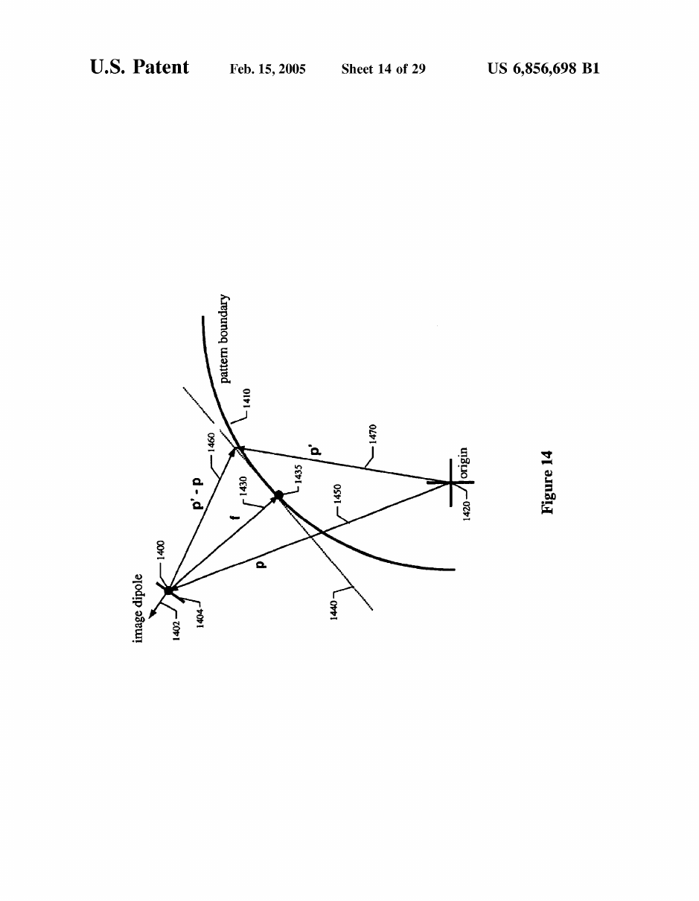
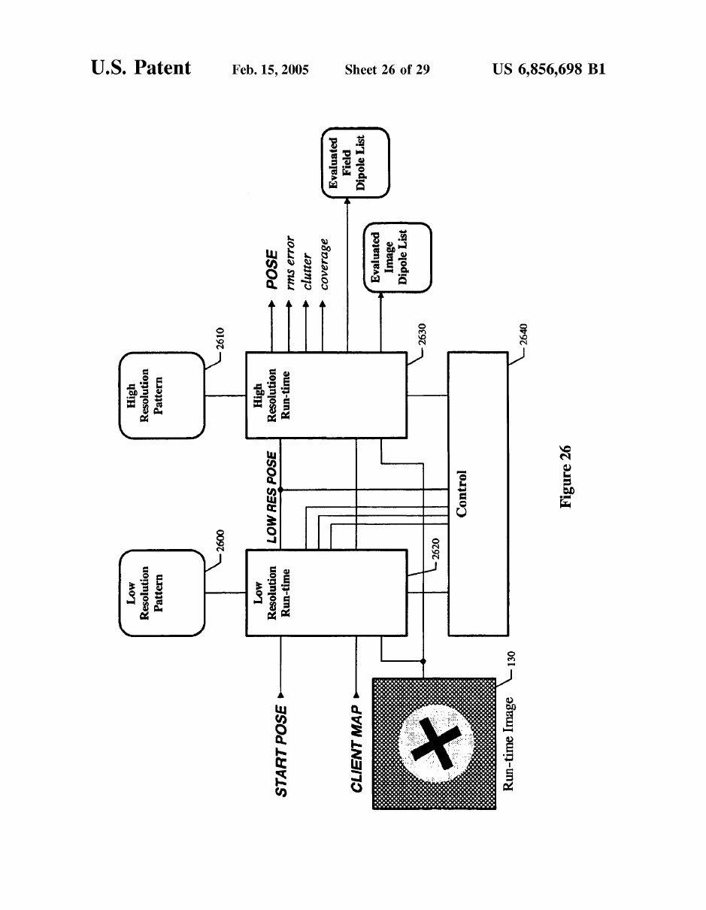

# US6856698 Cognex, 대략 위치를 정밀화하는 다차원 패턴 위치 찾기와 포착 범위

- 원제: Fast High-Accuracy Multi-Dimensional Pattern Localization
- 원문 파일: 같은 폴더의 `US6856698B1.pdf` (49쪽, 등록 공보와 2012년 재심사 증명서 포함). 번역은 [번역.md](번역.md)
- 발명자: William Silver, Aaron Wallack, Adam Wagman
- 출원인: Cognex Corporation (Natick, MA, US)
- 서지: US 6,856,698 B1, 출원 10/273,855 (2002-10-18), 등록 2005-02-15. 08/979,588 (1997-11-26 출원, 포기)의 계속 출원. 재심사 증명서 US 6,856,698 C1 (2012-08-14)로 청구항 1~6 취소, 7~20은 재심사 안 함. 서지는 공보 PDF 첫 장과 마지막 두 쪽에서 확인했다.
- 핵심 (원문 확인)
  - 거친-정밀 시스템의 **정밀 단계만** 대신하는 발명이다. 시작 자세(대략 위치)는 거친 상관, 거친 허프 변환, PatQuick, 블롭 분석, 기계적 추측, 사람 손 위치 등 무엇으로 정해도 된다.
  - 모델의 에지 점(쌍극자)으로, 각 점에서 가장 가까운 모델 경계까지의 거리와 방향을 미리 담은 "필드"를 만든다. 실행 때는 영상 에지 점을 현재 자세로 필드에 사상하고, 힘(경계까지 수직 거리)을 증거로 4자유도(x, y, 방향, 크기) 가중 최소제곱을 푼다. 이를 **고정 4회** 반복한다(끌어당김 단계).
  - 반복 횟수는 차원 수와 시작-최종 자세 거리와 무관하다. 단, **시작 자세가 참 자세의 "포착 범위(capture range)" 안에 있어야** 한다. 시작 자세가 너무 멀면 좋은 증거가 모자라 바른 방향으로 못 움직인다.
  - 포착 범위는 **패턴마다 다르고**, 시작 자세를 정하는 방법에 필요한 정확도를 정한다. 특징 검출 해상도가 높으면 정확도는 높고 포착 범위는 작으며, 해상도가 낮으면 그 반대다. 그래서 **저해상도 단계로 포착 범위를 넓히고, 그 결과를 고해상도 단계의 시작 자세로 쓰는** 다중 해상도 방식(도 26, 28)을 둔다.
  - 증거 가중치는 퍼지 문턱 세 개의 곱이다: 힘 길이(멀면 0), 에지 방향 차이(크면 0), 기울기 크기(약하면 0). 첫 단계의 힘 길이 문턱은 2.0~3.0 격자 단위이고, 단계마다 같은 간격으로 줄인다(rms로 조정하면 진동한 사례가 있었다고 적었다).
  - 방향 자유도는 작은 회전각 근사로 푼다(도 22b). 가정이 어긋나면 크기 변화가 조금 섞인다.
  - 품질 판정: 덮임률 - 잡동사니/2 를 맞음 점수로 쓴다. 저해상도 결과가 나쁘면 고해상도를 돌리지 않고 중단한다. 고해상도 점수가 저해상도 점수의 0.9배보다 작으면 저해상도 결과를 쓰고 "초점이 안 맞았을 수 있다"고 경고한다.
- 정량 수치 (원문 확인, 문헌의 실험 결과가 아니라 바람직한 실시예의 설정값이다)
  - 종래 격자 방법의 한계: 위치 약 1/4 px, 방향 약 1도, 크기 약 1%보다 낫기 어렵다(배경 절). 이진 템플릿은 약 1 px.
  - 끌어당김 단계 4회. 필드 전파 4회. 힘 크기 표현은 16비트(분해능 1/2048 격자, 최대 16 격자 미만). 방향 12비트(0.088도).
  - 첫 끌어당김 단계 힘 길이 문턱 t0 = 2.0, t1 = 3.0 필드 격자 단위.
  - 에지 방향 문턱: 일반 11.25도(전 가중)~22.5도(0), 모서리 39.375~50.625도. 모서리 판정 16.875도.
  - 저해상도 솎기 양 = floor( sqrt( sqrt(w*h)/8 ) ), w, h는 패턴 크기(px). 저역 필터 크기 = 솎기 양 - 1.
  - 잡음 문턱: 저해상도 학습 10 회색 단계, 고해상도 학습 대비의 1/4. 실행 때 대비 비로 비례 조정.
  - 쓰는 쌍극자 수는 보통 수십~수천 개.
  - 정확도, 포착 범위 자체를 px나 도로 잰 실험 결과는 **없다**.
- 우리와의 관계: ◎ 질문 4(정밀 단계가 맞게 수렴하려면 대략 위치가 몇 px 안이어야 하나), ○ 질문 7(회전을 모르는 NCC 뒤에 회전까지 정밀화해야 하나), △ 질문 6(점수로 실패 판정)
  - 질문 4에 대한 이 특허의 답은 "포착 범위는 패턴과 특징 해상도에 달려 있으니 재야 한다"이다. 숫자 답은 주지 않는다. 다만 실시예 설정에서 **고해상도 단계의 유효 끌어당김 거리는 약 2~3 격자(= 원 해상도 2~3 px)** 이고, 저해상도 단계가 그 안으로 데려다 놓는 구조라는 것을 읽을 수 있다(우리 추론. 원문은 문턱값만 적었다).
  - 질문 7에 대해서는, 대략 위치는 회전을 몰라도 되고 정밀 단계가 방향을 함께 푼다는 설계다. 정밀 단계는 에지 방향이 11.25도 안이면 증거를 전부 쓴다. 회전을 모르는 NCC가 몇 도까지 버티는지는 적지 않았다.
- 링크
  - Google Patents: https://patents.google.com/patent/US6856698B1/en
  - 공보 PDF: https://patentimages.storage.googleapis.com/ea/e8/9b/5ccfb2ba303e05/US6856698.pdf
  - 같은 단계의 관련 특허: [01 US7016539 Cognex 거친 탐색](../01_US7016539_Cognex_거친탐색_다차원패턴인식/) (이 특허의 앞 단계, 시작 자세를 만드는 쪽)

---

## 상세 요약 (원문 기반)

### 1. 문제

- 상관이나 허프 변환은 탐색 격자가 촘촘할수록 계산이 폭증한다. 또 화소 격자 재표본화 때문에 아무리 촘촘히 훑어도 1/4 px, 1도, 1%의 벽이 있다.
- 그래서 탐색(어디쯤인가)과 정밀화(정확히 어디인가)를 나누고, 정밀화는 격자를 훑지 않고 반복 갱신으로 한다.

### 2. 방법

- 학습: 학습 영상에서 소벨 기울기, 기울기 방향 단면의 국소 최대, 부화소 보간으로 에지 점을 얻는다. 각 필드 칸에 가장 가까운 경계까지의 힘 벡터를 씨뿌리고, 4회 전파해 경계 주변까지 넓힌다. 학습 영역 밖 테두리는 "상관없음"으로 막아 바깥 특징이 끌려 들어오지 않게 한다.
- 실행: 영상 에지 점마다 현재 자세로 필드 좌표에 사상, 힘 f와 방향을 읽고, 식 15

  $E=\sum_i w_i (x u_i + y v_i + p r_i + q s_i - f_i)^2$

  를 x, y, p, q에 대해 푼다. 에지 점 하나는 경계 수직 방향 1자유도만 제약한다.
- 가중치 w는 세 퍼지 확신의 곱. 단계가 진행될수록 힘 길이 문턱을 줄여, 수렴할수록 경계에 가까운 점만 믿는다.

### 3. 다중 해상도와 판정

- 같은 학습 영상으로 저해상도 패턴(저역 필터 + 솎기)과 고해상도 패턴(그대로)을 만든다.
- 저해상도로 시작 자세를 끌어당기고, 그 결과를 고해상도의 시작 자세로 쓴다. 포착 범위는 저해상도가, 정확도는 고해상도가 정한다.
- 저해상도 결과가 나쁘면 중단, 고해상도 결과가 저해상도의 0.9배 점수보다 나쁘면 저해상도 결과를 쓰고 경고한다.

### 4. 근거 수준

- 문헌의 실험 결과: 없다. 특허는 설정값과 설계 이유만 준다.
- 저자 해석: "해상도가 낮을수록 포착 범위가 크고 정확도가 낮다", "rms로 문턱을 조정하면 진동한 경우가 있다", "고해상도가 나쁘면 대개 초점 문제".
- 우리 추론: 아래 리뷰 카드의 px 환산은 모두 우리 계산이며 검증 전 가설이다.

## 리뷰 카드

- **어떻게 해결했나**: 대략 위치(시작 자세)를 받아, 에지 점과 미리 계산한 "가장 가까운 경계까지의 거리장"으로 4자유도 가중 최소제곱을 4회 반복한다. 시작 자세가 포착 범위 밖이면 실패하므로, 저해상도 단계(솎기 floor(sqrt(sqrt(wh)/8)))로 포착 범위를 넓힌 뒤 고해상도로 정밀화하고, 덮임률과 잡동사니 점수로 두 단계 결과를 판정한다.
- **같은 점**: 우리도 "대략 위치(NCC 정수 봉우리) 다음에 반복 정밀화(joint는 ECC 호모그래피, control은 LK15와 17x17 스플라인 GN)"의 2단 구조다. 정밀 단계의 성패가 시작점이 수렴 범위 안에 있느냐에 달린 점, 점수 문턱(joint의 NCC 0.6)으로 실패를 거르는 점도 같다. 반복 횟수를 고정하는 점(특허 4회)도 우리 실시간 요구와 맞는다.
- **다른 점**: 특허는 에지 거리장 기반이고 우리 정밀 단계는 밝기(화소값) 기반이다. 밝기 기반 반복법의 수렴 범위는 대략 영상의 상관 길이(흐림 정도)에 묶이며 에지 거리장과 수치가 같다고 볼 근거는 없다. 특허는 회전, 크기까지 정밀 단계에서 풀지만, 우리 joint의 NCC는 평행이동만 찾고 회전은 ECC 호모그래피가 맡는다. 특허는 포착 범위를 숫자로 재지 않았고, 우리는 0.65 px(Y 허용 ±0.045) 수준의 정확도와 0.009~0.015 px 점 잡음을 다루므로 요구 정밀도가 훨씬 높다. 우리 자료는 모두 정지 사진이라 초점, 흔들림 실패 사례가 거의 없다.
- **가져올 해결책**:
  1. 질문 4 실험: 정밀 단계(ECC, LK15, GN)에 시작점을 일부러 0, ±1, ±2, ±4, ±8, ±12 px(가로, 세로 따로) 어긋나게 주고, 참값으로 돌아오는 비율을 QR별로 잰다. 이것이 우리 장비의 포착 범위다. 특허 설정으로 환산하면 우리 QR(184x198 px)의 저해상도 솎기 양은 floor(sqrt(sqrt(184*198)/8)) = floor(4.88) = 4, 첫 단계 힘 문턱 2~3 격자는 원 해상도 약 8~12 px다. 이 값은 joint의 ECC 읽기 창 여유 ±12 px와 같은 크기라, 지금 창이 포착 범위 근처에 있다는 가설을 세울 수 있다(검증 필요).
  2. 피라미드 사이 넘김: control의 탐색 ±110 px는 그대로 두되, 1/4 축소 영상의 NCC로 4 px 격자 근처까지 좁히고, 원 해상도 NCC는 ±4~8 px 창에서만 돌린다. 시간 이득과 정답률을 같은 575장에서 비교한다(341장은 개발 노출 자료로 따로 표시).
  3. 질문 7: T 1단위 = 1.0187도(d=0 가정)이고 자료의 T 범위가 ±2단위라면 영상 회전이 최대 약 2도일 수 있다. QR 중심에서 모서리까지 약 135 px이므로 2.04도(0.0356 rad)에서 모서리가 약 4.8 px 밀린다. 회전을 모르는 NCC는 이 정도에서 봉우리가 낮아지지만 위치는 대체로 남는다는 가설이다. 회전 사진(T ±1, ±2)에서 NCC 점수와 봉우리 위치 오차를 재고, 정밀 단계가 회전을 푸니 대략 단계는 회전 없이 둬도 되는지 판단한다. 특허의 정밀 단계 방향 허용(11.25도)과 비교하면 2도는 작다.
  4. 판정: 특허의 "저해상도 점수가 나쁘면 중단, 고해상도가 0.9배보다 나쁘면 저해상도로 되돌림"을 본떠, NCC 점수와 ECC 상관값(또는 GN 잔차 rms)을 함께 보고 재촬영 판정에 넣는다. 실패를 (0,0)으로 숨기지 않는다.
  5. 고정 반복 횟수와 문턱 감소: GN, ECC의 반복 수를 고정하고 반복마다 이상점 가중 문턱을 줄이는 방식이 진동 없이 수렴하는지 확인한다(특허는 rms 기반 조정이 진동했다고 적음).

## 이 단계 후보 방법으로서

- **방법 이름**: 거친-정밀 2단 위치 정밀화, 저해상도로 포착 범위를 넓힌 뒤 고해상도로 정밀화 (Cognex US6856698의 다중 해상도 끌어당김. 이 단계에서 쓰는 것은 "포착 범위 확인과 해상도 사이 넘김 규칙"이다)
- **전제 조건**:
  - 대략 위치를 따로 정할 방법(NCC 등)이 있다.
  - 대상에 경계(에지)가 충분하고, 경계 방향이 다양해 각 자유도가 풀린다(원은 방향, 모서리는 크기를 못 푼다).
  - 정밀 단계의 포착 범위를 미리 재 둘 수 있다.
- **장점**:
  - 반복 횟수가 고정이라 처리 시간이 예측된다.
  - 포착 범위와 정확도를 해상도 두 개로 나눠 맡긴다.
  - 덮임률, 잡동사니, rms로 실패를 판정하고 되돌림 규칙이 있다.
  - 정밀 단계가 회전과 크기를 함께 풀어 대략 단계는 평행이동만 찾아도 된다.
- **단점**:
  - 포착 범위를 숫자로 주지 않는다. 우리 장비에서 직접 재야 한다.
  - 실험 결과가 없는 특허라 정확도 주장(격자 한계를 넘는다)은 검증되지 않았다.
  - 에지 거리장 기반이라 우리 밝기 기반 ECC, GN과 수렴 성질이 다를 수 있다.
  - 바람직한 설정값(2~3 격자, 11.25도, 0.9 등)은 일반 산업 패턴용이며 우리 QR과 뒷벽 가로선에 맞는지 모른다.
  - 재심사로 청구항 1~6이 취소되어 권리 범위는 줄었다(기술 내용 참고에는 지장 없음).
- **우리 적용 조건**:
  - QR 3개(약 184x198 px)마다 정밀 단계 시작점 오차를 0~±12 px로 흔들어 수렴 비율을 재고, 95% 이상 수렴하는 반경을 포착 범위로 정한다. 대략 단계의 오차(정수 NCC면 ±0.5 px, 피라미드 1/4이면 ±2 px 안팎)가 그 반경의 절반 안이어야 한다.
  - 가로선(세로 프로파일 ±12 px 창)도 같은 방식으로 세로 시작점 오차를 흔들어 잰다.
  - 피라미드를 쓰면 축소 배율은 포착 범위로 정한다. 예: 포착 범위가 원 해상도 8 px이면 1/4 축소(격자 4 px)까지 허용, 2 px이면 1/2 축소까지.
  - 회전은 T ±2단위(약 2도, d=0 가정) 범위에서 NCC 점수 하락과 위치 오차를 재고, 정밀 단계가 받아 줄 수 있으면 대략 단계에 회전 탐색을 넣지 않는다.
  - 판정은 NCC 점수, 정밀 단계 상관값, 잔차를 함께 써서 "신뢰/재촬영"을 내고, 같은 사진, 같은 분할, 날짜별 분할(1014, 1020, 1029)에서 기존 final과 비교한다.
