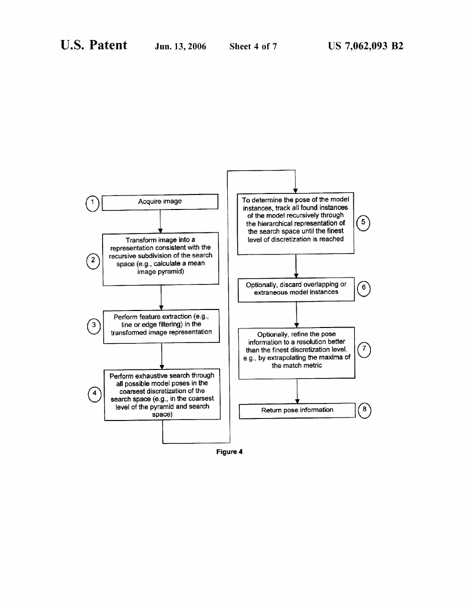
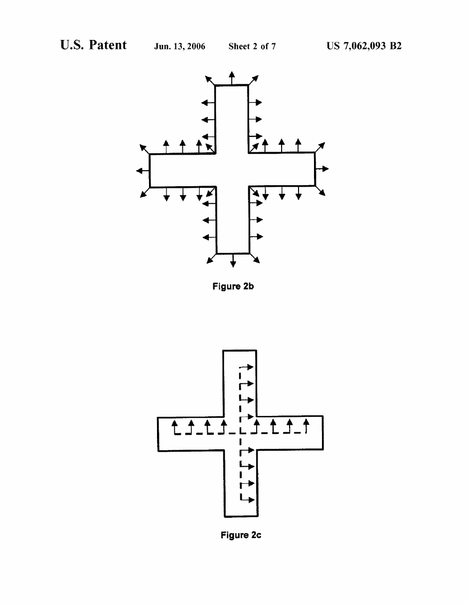
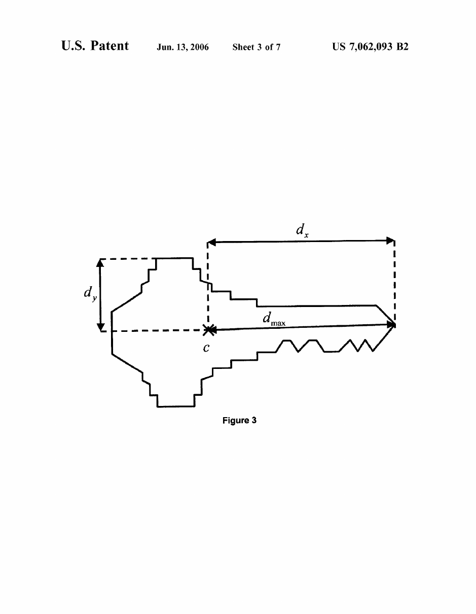

# 물체 인식 시스템과 방법 (US 7,062,093 B2, 번역)

- 원제: System and method for object recognition
- 공보: US 7,062,093 B2, 등록 2006-06-13
- 출원: 09/965,236, 출원일 2001-09-26. 공개 US 2002/0057838 A1 (2002-05-16)
- 우선권: EP 00120269 (2000-09-27), EP 00124295 (2000-11-14)
- 발명자: Carsten Steger, Eching (DE). 공보 첫 장에는 "Carstan Steger"로 인쇄되어 있다.
- 권리자: MVTec Software GmbH, Munich (DE). 공보 첫 장에는 "MVTECH Software GmbH"로 인쇄되어 있다.
- 분류: Int. Cl. G06K 9/62. U.S. Cl. 382/216, 382/218
- 원문 파일: [US7062093B2.pdf](US7062093B2.pdf) (22쪽, 2026-11-04 patentimages.storage.googleapis.com에서 받음)
- 번역 범위: 전문 (서지, 요약, 배경, 발명의 요약, 도면 설명, 상세 설명, 청구항 1~20, 도면 글자). 인용 문헌 목록은 원문 그대로.
- 번역 메모
  - 원문 PDF는 쪽 이미지에 글자층이 덧붙은 판이다. 글자층이 두 단을 섞어 읽어서, 문단 순서는 쪽 이미지를 보고 맞췄다. 수식은 쪽 이미지를 보고 다시 적었다.
  - Google Patents 본문 페이지는 2026-11-04 접속 시 503(자동 접근 차단)이 나와 쓰지 않았다. 우회하지 않았다.
  - 원문의 단 번호(column)는 [단 N]으로 적었다. [ ] 안은 번역자 주석이다.
  - "match metric"은 "정합 척도", "score"는 "점수", "pose"는 "자세", "discretization level"은 "이산화 층"으로 옮겼다.

---

## 요약 (57)

이 시스템과 방법은 사용자가 정한 모델 물체를 영상 안에서 인식한다. 찾으려는 모델 물체가 일부만 보이는 가림(occlusion)이 있어도 인식한다. 영상 안에, 심지어 모델 물체 안에 다른 물체가 있는 어지러움(clutter)이 있어도 인식한다. 비선형 조명 변화와, 전역 또는 국소 명암 반전이 있어도 인식한다. 찾으려는 모델 물체는 사용자가 정한 모델 물체와 비교해 어떤 부류의 기하 변환으로 일그러져 있을 수 있다. 예를 들어 평행이동, 평행이동과 회전으로 된 강체 변환, 임의의 아핀 변환, 평행이동과 회전과 크기 변화로 된 닮음 변환이다.

청구항 20개, 도면 7장.

[대표 도면은 그림 4와 같다.]

## 인용 문헌 (원문 그대로)

U.S. PATENT DOCUMENTS

- 4,799,270 A * 1/1989 Kim et al. 382/205
- 4,972,359 A 11/1990 Silver et al. 364/728.05
- 5,323,470 A 6/1994 Kara et al. 382/103
- 5,550,933 A 8/1996 Stetten 382/199
- 5,631,981 A 5/1997 Rao 382/278
- 6,005,978 A 12/1999 Garakani 382/218
- 6,023,530 A 2/2000 Wilson 382/219
- 6,272,247 B1 * 8/2001 Manickam et al. 382/217
- 6,546,137 B1 4/2003 Lai et al. 382/217

OTHER PUBLICATIONS

- Cootes et al. "Multi-Resolution Search with Active Shape Models." Proc. 12th IAPR Int. Conf. on Pattern Recognition, Vol. 1, conference A: Computer Vision & Image Processing, vol. 1, Oct. 9, 1994, pp. 610-612.*
- Toyama et al. "Model-Based Pose Estimation Using Genetic Algorithm." Proc. 14th Int. Conf. on Pattern Recognition, vol. 1, Aug. 16, 1998, pp. 198-201.*
- EPO Office Letter/Search Report, Mar. 7, 2001.
- Hashimoto: High-Speed Template Matching Algorithm Using Information of Contour Points Systems & Computers in Japan, US, Scripta Technical Journals. New York Vol. 23, No. 9, 1992, pp. 78-87, XP000334342 ISSN: 0882-1666, Chapters 2.5.
- Cambridge University Press Numerical Recipes. In C: The Art of Scientific Computing (ISSN-521-43108-5), 1988 92.
- Shang-Hong Lai & Ming Fang An accurate and Fast Pattern Localization Algorithm for Automated Visual Inspection; Real Time Imaging 5. 3-14 (1999).
- Carsten Steger An Unbiased Detector of Curvilinear Structures, Feb. 1998.
- Lisa Gottesfeld Brown A Survey of Image Registration Techniques; Department of Computer Science, Columbia University, New York, NY 10027; Dec. 1992.
- Steven L. Tanimoto, Template Matching in Pyramids; Dept. Computer Science, University of Washington, Seattle, Washington 98195; Jun. 11, 1980.
- William J. Rucklidge Efficiently Locating Objects Using the Hausdorff Distance: Int'l Journal of Computer Vision 24(3), pp. 251-270.
- D.H. Ballard Generalizing The Hough Transform To Detect arbitrary Shapes; Pattern Recognition, Sep. 23, 1980.
- Olson, Clark F. & Huttenlocher, Daniel P. Automatic Target Recognition by Matching Oriented Edge Pixels; IEEE Transaction on Image Processing, Jan. 1997.
- Hartley, Richard & Zisserman, Andrew Multiple View Geometry in Computer Vision; Cambridge Press.
- Canny, John A Computational Approach to Edge Detection; reprinted from IEEE Transactions on Pattern Analysis and Machine Intelligence, Nov. 1986.
- Andreas Busch Fast Recognition of Lines in Digital Images Without User Supplied Parameters; Institut fur Angewandte Geodosiei.
- Gunilla Borgefors Hierarchical Chamfer Matching: A Parametric Edge Matching Algorithm.; Transactions on Analysis and Machine Intelligence, vol. 10, No. 6, Nov. 1988.
- 15.5 Nonlinear Models; Recipes in Numerical C Cambridge University Press 1988-1992.
- Wolfgang Forstner A Framework for Low Level Feature Extraction Lecture Note in Computer Science vol. 801.
- Wallack, A. and Mahocha, D. Robust Algorithms for Object Localization International Journal of Computer Vision 27(3), 243-263 (1998).
- Carsten Steger Subpixel Precise Extraction of Lines and Edges: ISPRS, vol. XXXIII 2000.
- \* cited by examiner

---

## 발명의 분야 [단 1]

이 발명은 머신 비전 시스템에 관한 것이다. 특히 부분 가림, 어지러움, 비선형 명암 변화가 있을 때 물체를 시각적으로 인식하는 것에 관한 것이다.

## 발명의 배경

물체 인식, 특히 많은 머신 비전 작업에서는 사용자가 정한 모델 물체를 영상 안에서 찾는 일에 관심이 있다. 영상 안의 물체는 어떤 부류의 기하 변환을 임의로 겪었을 수 있다.

- 변환 부류가 평행이동이면, 영상 안 모델의 위치를 얻고자 한다. 평행이동 부류는 보통 모델이 영상 안에서 늘 같은 회전과 크기로 나타난다고 보장할 수 있을 때 쓴다. 예를 들어 물체가 X-Y 스테이지에 고정 각도로 놓이고, 카메라가 스테이지에 수직으로 고정되어 있을 때다.
- 변환 부류가 강체 변환이면, 영상 안 물체의 회전도 함께 얻고자 한다. 예를 들어 카메라는 스테이지에 수직으로 달려 있지만 물체의 각도를 고정할 수 없을 때 쓴다.
- 변환 부류가 닮음 변환이면, 영상 안 물체의 크기도 바뀔 수 있다. 카메라와 물체 사이 거리를 고정할 수 없거나, 물체 자체의 크기가 바뀔 때 생긴다.
- 물체에 대한 카메라의 위치와 3차원 회전을 모두 고정할 수 없으면, 물체는 영상에서 일반 원근 변환을 겪는다. 카메라 내부 표정(interior orientation)을 모르면, 두 평면(물체 표면과 영상면) 사이의 원근 투영은 동차 좌표의 3×3 행렬로 쓸 수 있다.

$$
\begin{pmatrix} x' \\ y' \\ t' \end{pmatrix} =
\begin{pmatrix} p_{11} & p_{12} & p_{13} \\ p_{21} & p_{22} & p_{23} \\ p_{31} & p_{32} & p_{33} \end{pmatrix}
\begin{pmatrix} x \\ y \\ t \end{pmatrix}
$$

이 행렬과 벡터는 전체 배율 하나만큼은 정해지지 않는다 (Hartley and Zisserman (2000), 1.1~1.4장 참조). 그래서 물체의 자세를 정하는 행렬의 자유도는 8이다. 카메라 내부 표정을 알면 이 8 자유도는 카메라에 대한 물체 자세의 6 자유도(평행이동 3, 회전 3)로 줄어든다.

이런 변환은 흔히 일반 2차원 아핀 변환으로 근사한다. 즉 출력점 $(x', y')^T$를 입력점 $(x, y)^T$로부터 다음 식으로 얻는다.

$$
\begin{pmatrix} x' \\ y' \end{pmatrix} =
\begin{pmatrix} a_{11} & a_{12} \\ a_{21} & a_{22} \end{pmatrix}
\begin{pmatrix} x \\ y \end{pmatrix} +
\begin{pmatrix} t_x \\ t_y \end{pmatrix}
$$

[단 2] 일반 아핀 변환은 기하적으로 알기 쉬운 다음 변환들로 나눌 수 있다. 원래 x축과 y축을 서로 다른 배율 $s_x$, $s_y$로 늘이기. x축에 대한 y축의 기울임, 즉 x축은 그대로 두고 y축만 각도 $\theta$만큼 돌리기. 두 축을 함께 각도 $\varphi$만큼 돌리기. 끝으로 벡터 $(t_x, t_y)^T$만큼 평행이동하기. 그래서 임의의 아핀 변환은 다음처럼 쓸 수 있다.

$$
\begin{pmatrix} x' \\ y' \end{pmatrix} =
\begin{pmatrix} \cos\varphi & -\sin\varphi \\ \sin\varphi & \cos\varphi \end{pmatrix}
\begin{pmatrix} 1 & -\sin\theta \\ 0 & \cos\theta \end{pmatrix}
\begin{pmatrix} s_x & 0 \\ 0 & s_y \end{pmatrix}
\begin{pmatrix} x \\ y \end{pmatrix} +
\begin{pmatrix} t_x \\ t_y \end{pmatrix}
$$

그림 1은 일반 아핀 변환의 매개변수를 그림으로 보여 준다. 한 변이 1인 정사각형이 평행사변형으로 바뀐다. 닮음 변환은 기울임 각도 $\theta$가 0이고 두 배율이 같은 ($s_x = s_y = s$) 아핀 변환의 특수한 경우다. 마찬가지로 강체 변환은 배율이 1인 ($s = 1$) 닮음 변환의 특수한 경우다. 끝으로 평행이동은 $\varphi = 0$인 강체 변환의 특수한 경우다. 선택한 기하 변환 부류의 해당 매개변수를 영상 안 물체의 자세(pose)라고 부른다. 예를 들어 강체 변환에서 자세는 회전 각도 $\varphi$와 평행이동 벡터 $(t_x, t_y)^T$다. 따라서 물체 인식은 영상 안에 있는 모든 모델 사례(instance)의 자세를 정하는 일이다.

영상에서 물체를 인식하는 여러 방법이 이 분야에 제안되었다. 대부분은 모델이 가려지거나 다른 어지러운 물체로 훼손되면 영상에서 모델을 찾지 못한다는 한계가 있다. 또 대부분의 기존 방법은 영상에 비선형 명암 변화, 예를 들어 조명 변화가 있으면 모델을 찾지 못한다.

알려진 모든 물체 인식 방법은 모델을 만들 때 모델의 내부 표현을 메모리에 만든다. 영상에서 모델을 인식하려고 대부분의 방법은, 선택한 변환 부류가 허용하는 모든 자유도를 써서 모델을 영상과 체계적으로 비교한다 (예: Borgefors (1988) Gunilla Borgefors. Hierarchical chamfer matching: A parametric edge matching algorithm. IEEE Transactions on Pattern Analysis and Machine Intelligence, 10(6):849-865, November 1988; Brown (1992) Lisa Gottesfeld Brown. A survey of image registration techniques. ACM Computing Surveys, 24(4):325-376, December 1992; Rucklidge (1997) William J. Rucklidge. Efficiently locating objects using the Hausdorff distance. International Journal of Computer Vision, 24(3):251-270, 1997). 자세 매개변수의 각 조합마다 정합 척도를 계산한다. 정합 척도는 그 자세에서 모델이 영상에 얼마나 잘 맞는지를 나타낸다. 허용된 변환 공간의 탐색을 빠르게 하려고, 보통 모델과 영상 모두에 영상 피라미드를 써서 살펴볼 데이터 양을 줄인다 (예: Tanimoto (1981) Steven L. Tanimoto. Template matching in pyramids. Computer Graphics and Image Processing, 16:356-369, 1981; Borgefors (1988); Brown (1992)).

가장 단순한 물체 인식 방법은 모델과 영상 자체의 회색값을 쓰고, 정합 척도로 정규화 상호상관을 쓴다 (예: U.S. Pat. No. 4,972,359, 5,222,155, 5,583,954, 5,943,442, 6,088,483, 그리고 Brown (1992)). 정규화 상호상관은 선형 밝기 변화에 불변이라는 장점이 있다. 즉 물체가 선형 조명 변화를 겪어도 인식할 수 있다. [단 3] 그러나 정규화 상호상관에는 뚜렷한 단점이 몇 가지 있다.

- 첫째, 계산이 매우 비싸다. 그래서 이 척도에 기반한 방법은 매우 느리다. 이 때문에 보통 변환 부류를 평행이동으로만 고른다. 그렇지 않으면 영상 피라미드를 써도 실시간 응용에서는 탐색에 시간이 너무 걸린다.
- 둘째, 물체의 가림에 강건하지 않다. 영상에서 물체의 작은 부분만 가려져도 보통 물체를 찾지 못한다.
- 셋째, 어지러움에 강건하지 않다. 물체 위나 가까이에 방해물이 있으면 보통 물체를 찾지 못한다.

다른 부류의 알고리즘도 모델과 영상 자체의 회색값을 쓰지만, 정합 척도로 회색값 차이의 제곱합이나 절대값 합을 쓴다 (예: U.S. Pat. No. 5,548,326과 Brown (1992)). 이 척도는 선형 밝기 변화에 불변하게 만들 수 있다 (Lai and Fang (1999) Shang-Hong Lai and Ming Fang. Accurate and fast pattern localization algorithm for automated visual inspection. Real-Time Imaging, 5:3-14, 1999). 제곱합이나 절대값 합은 정규화 상호상관만큼 계산이 비싸지 않아서, 보통 더 큰 변환 부류(예: 강체 변환)를 허용한다. 그러나 이 척도도 상관 기반 방법과 같은 단점, 즉 가림이나 어지러움에 강건하지 않다는 단점이 있다.

더 복잡한 부류의 물체 인식 방법은 모델이나 물체의 회색값 자체가 아니라 물체의 에지를 정합에 쓴다. 모델을 만들 때 모델 영상과 그로부터 만든 영상 피라미드에서 에지를 추출한다 (예: Borgefors (1988), Rucklidge (1997), U.S. Pat. No. 6,005,978). 에지 추출은 회색 영상을 이진 영상으로 바꾸는 과정이다. 에지에 해당하는 점만 값 1이 되고 나머지 화소는 값 0이 된다. 즉 영상이 실제로 에지 영역으로 분할된다. 물론 분할한 에지 영역을 꼭 이진 영상으로 저장할 필요는 없고, 다른 방법(예: 런렝스 부호화)으로 저장할 수도 있다. 보통 에지 화소는 기울기 방향으로 기울기 크기가 최대인 화소로 정의한다. 모델을 찾을 영상과 그로부터 만든 영상 피라미드에서도 에지를 추출한다. 그러고 나서 여러 정합 척도로 모델과 영상을 비교할 수 있다.

- 한 부류의 정합 척도는 그 자세에서 모델 에지와 영상 에지 사이의 거리를 잰다. 에지 거리 계산을 쉽게 하려고 영상 피라미드에 거리 변환을 계산한다. Borgefors (1988)의 정합 척도는 모델 에지와 영상 에지의 평균 거리를 계산한다. 이 척도는 어지러운 에지에는 강건하다. 그런 에지는 모델에 없으므로 모델에서 영상 에지까지의 평균 거리를 줄일 수만 있기 때문이다. 단점은 가림에 강건하지 않다는 것이다. 모델 에지 일부가 영상에 없으면 가장 가까운 에지까지의 거리가 크게 늘기 때문이다. Rucklidge (1997)의 정합 척도는 모델 에지에서 영상 에지까지 거리 중 k번째로 큰 값을 계산해 이 단점을 고치려 한다. 모델에 점이 n개 있으면 이 척도는 100×k/n % 가림에 강건하다.
- 다른 부류의 정합 척도는 단순 이진 상관에 기반한다. 즉 정합 척도는 그 자세에서 모델과 영상이 모두 에지 화소를 가진 점의 평균이다 (예: U.S. Pat. No. 6,005,978과 6,111,984). [단 4] 모델의 가능한 사례 탐색을 빠르게 하려고 U.S. Pat. No. 6,005,978에서는 일반화 허프 변환(Ballard (1981) D. H. Ballard. Generalizing the Hough transform to detect arbitrary shapes. Pattern Recognition, 13(2):111-122, 1981)을 쓴다. 이 정합 척도의 단점은, 그 자세에서 맞는 척도 값을 얻으려면 모델 에지와 영상 에지의 정렬이 매우 좋아야 한다는 것이다. 맞는 척도 값을 얻으려고 영상의 에지를 넓게 만드는 복잡한 방식을 쓴다.
- 끝으로, 에지를 상관 기반 방법에 쓸 점을 정하는 데 쓰기도 한다 (U.S. Pat. Nos. 6,023,530과 6,154,567 참조). 분명히 이 방법들은 정합 척도가 같거나 매우 비슷하므로 위의 상관 기반 방식과 같은 단점이 있다.

이 모든 정합 척도는 에지 방향을 고려하지 않는다는 단점이 있다. U.S. Pat. No. 6,005,978에서는 일반화 허프 변환을 통해 에지 방향이 방법에 들어가지만, 정합 척도에서는 무시된다. 그런데 에지 방향 정보를 무시하면 영상에서 모델의 거짓 양성 사례, 즉 모델의 참 사례가 아닌 것을 찾은 경우가 많이 생긴다는 것이 잘 알려져 있다 (Olson and Huttenlocher (1997) Clark F. Olson and Daniel P. Huttenlocher. Automatic target recognition by matching oriented edge pixels. IEEE Transactions on Image Processing, 6(1):103-113, January 1997). 이 때문에 일부 방법은 에지 방향 정보를 정합 척도에 넣는다 (예: U.S. Pat. Nos. 5,550,933, 5,631,981, 6,154,566, 그리고 Hashimoto et al. (1992) Manabu Hashimoto, Kazuhiko Sumi, Yoshikazu Sakaue, and Shinjiro Kawato. High-Speed Template Matching Algorithm Using Information of Contour Points. Systems and Computers in Japan, 23(9):78-87, 1992). 그러나 이 방법들은 탐색을 빠르게 하는 영상 피라미드를 쓰지 않는다 (그래서 실행 시간이 감당할 수 없을 만큼 길다). 또 모델의 평행이동만 계산한다. 위의 모든 방법은 영상 자체를 이진화하므로, 정합 척도가 좁은 범위의 조명 변화에만 불변이다. 영상 명암이 낮아지면 분할되는 에지 점이 점점 줄어든다. 이는 가림이 점점 커지는 것과 같은 효과를 낸다.

분명히 기존 물체 인식 방법에는 여러 결점이 있다. 어떤 방법도 가림, 어지러움, 비선형 명암 변화에 동시에 강건하지 않다. 또 물체 인식을 쉽게 하려고 거리 변환이나 일반화 허프 변환 같은 계산이 비싼 전처리가 필요한 경우가 많다. 많은 응용에서 물체 인식 단계는 위에서 말한 변화들에 강건해야 한다. 예를 들어 인쇄 품질 검사에서 모델 영상은 이상적인 인쇄물(예: 로고)이다. 검사에서는 현재 인쇄가 이상적인 인쇄에서 벗어났는지를 알고 싶다. 그러려면 영상의 인쇄물을 모델에 맞춰 정렬해야 한다 (보통 강체 변환으로). 분명히 물체 인식(즉 인쇄물의 자세 결정)은 빠진 글자나 글자 일부(가림)와 여분의 잉크(어지러움)에 강건해야 한다. 시야 전체에서 조명을 일정하게 유지할 수 없으면, 물체 인식은 비선형 조명 변화에도 강건해야 한다.

그러므로 이 발명의 목적은 가림과 어지러움에 불변한 물체 인식을 위한 개선된 시각 인식 시스템과 방법을 제공하는 것이다. [단 5] 또 다른 목적은 가림, 어지러움, 조명에 불변한 물체 인식을 위한 시각 인식 시스템과 방법을 제공하는 것이다.

이 목적들은 청구항의 특징으로 이룬다.

## 발명의 요약

이 발명은 가림, 어지러움, 비선형 명암 변화에 강건한 물체 인식 시스템과 방법을 제공한다.

이 발명은 첫 영상에서 모델 물체를 인식하는 방법을 포함하며, 그 방법은 다음 단계로 이루어진다.

- (a) 모델 물체의 첫 영상을 전자 메모리에 얻는다.
- (b) 모델 물체의 첫 영상을, 탐색 공간의 재귀 세분과 맞는 다층 표현으로 바꾼다. 다층 표현은 적어도 첫 영상을 포함한다.
- (c) 탐색 공간의 각 이산화 층마다 모델 물체의 미리 계산한 모델을 적어도 하나 만든다. 미리 계산한 모델은 방향 벡터가 딸린 여러 모델 점으로 이루어진다. 모델 점과 방향 벡터는 적어도 각 모델 점마다 방향 벡터를 돌려주는 영상 처리 연산으로 만든다.
- (d) 현재 영상을 전자 메모리에 얻는다.
- (e) 현재 영상을, 탐색 공간의 재귀 세분과 맞는 다층 표현으로 바꾼다. 다층 표현은 적어도 현재 영상을 포함한다.
- (f) 다층 표현의 각 변환 영상에 영상 처리 연산을 한다. 이 연산은 현재 영상 안에서, 미리 계산한 모델을 탐색해야 할 평행이동 범위에 해당하는 모델 점 부분집합에 대해 방향 벡터를 돌려준다.
- (g) 탐색 공간의 가장 거친 이산화 층에서, 미리 계산한 모델의 가능한 모든 모델 자세에 대해, 미리 계산한 모델과 변환 영상의 방향 정보를 쓰는 정합 척도를 계산한다.
- (h) 정합 척도가 사용자가 고를 수 있는 문턱을 넘고 국소 최대인 모델 자세를 정한다. 그 자세와 정합 척도로, 탐색 공간의 가장 거친 이산화 층에 있는 미리 계산한 모델의 사례 목록을 만든다.
- (i) 가장 거친 이산화 층의 사례를, 탐색 공간의 재귀 세분을 따라 가장 고운 이산화 층에 이를 때까지 추적한다.
- (j) 가장 고운 이산화 층에서 모델 물체 사례의 모델 자세를 내놓는다.

이 발명은 첫 영상에서 모델 물체를 인식하는 시스템을 포함하며, 그 시스템은 다음으로 이루어진다.

- (a) 모델 물체의 첫 영상을 전자 메모리에 얻는 수단
- (b) 모델 물체의 첫 영상을, 탐색 공간의 재귀 세분과 맞는 다층 표현으로 바꾸는 수단. 다층 표현은 적어도 첫 영상을 포함한다.
- (c) 탐색 공간의 각 이산화 층마다 모델 물체의 미리 계산한 모델을 적어도 하나 만드는 수단. 미리 계산한 모델은 방향 벡터가 딸린 여러 모델 점으로 이루어진다. 모델 점과 방향 벡터는 적어도 각 모델 점마다 방향 벡터를 돌려주는 영상 처리 연산으로 만든다.
- (d) 현재 영상을 전자 메모리에 얻는 수단
- (e) 현재 영상을, 탐색 공간의 재귀 세분과 맞는 다층 표현으로 바꾸는 수단. 다층 표현은 적어도 현재 영상을 포함한다.
- (f) 다층 표현의 각 변환 영상에 영상 처리 연산을 하는 수단. 이 연산은 현재 영상 안에서, 미리 계산한 모델을 탐색해야 할 평행이동 범위에 해당하는 모델 점 부분집합에 대해 방향 벡터를 돌려준다.
- (g) 탐색 공간의 가장 거친 이산화 층에서, 미리 계산한 모델의 가능한 모든 모델 자세에 대해, 미리 계산한 모델과 변환 영상의 방향 정보를 쓰는 정합 척도를 계산하는 수단
- (h) 정합 척도가 사용자가 고를 수 있는 문턱을 넘고 국소 최대인 모델 자세를 정하고, 그 자세와 정합 척도로 가장 거친 이산화 층의 사례 목록을 만드는 수단
- (i) 가장 거친 이산화 층의 사례를, 탐색 공간의 재귀 세분을 따라 가장 고운 이산화 층에 이를 때까지 추적하는 수단
- (j) 가장 고운 이산화 층에서 모델 물체 사례의 모델 자세를 내놓는 수단

인식할 물체의 모델은 방향 벡터가 딸린 여러 점으로 이루어진다. 이 점과 벡터는 표준 영상 전처리 알고리즘, 예를 들어 선 검출이나 에지 검출로 얻을 수 있다. 모델을 만들 때, 모델이 일그러질 수 있는 기하 변환 부류(예: 강체 변환)의 여러 변환으로 모델 영상을 바꾸어 모델을 메모리에 저장한다. 영상에서 모델을 인식하려면, 모델을 만들 때 쓴 것과 같은 전처리 연산을 모델을 찾을 영상에 적용한다. 예를 들어 모델을 만들 때 선 검출을 썼다면, 살펴볼 영상에도 선 필터를 쓴다. 물체는 영상 안에서 모델의 가능한 모든 변환에 대해 정합 척도를 계산해 인식한다. 정합 척도는 모델과 영상의 기하 정보, 즉 모델과 영상에 있는 점의 위치와 방향을 고려한다. 정합 척도는 예를 들어 (미리 계산한) 변환 모델 하나와 전처리한 영상의 내적 합일 수 있다. 또는 다른 실시예에서는 정규화한 내적의 합일 수 있다. 정규화하지 않은 내적은 기하 정보에만 의존하므로, 모델 영상과 모델을 찾을 영상을 분할(이진화)할 필요가 없다. 이 덕분에 방법이 가림과 어지러움에 강건하다. 정규화한 내적을 정합 척도로 쓰면, 방향 정보가 믿을 만한 점을 얻으려고 모델 영상을 분할하는 것이 좋다. 이때도 모델을 찾을 영상은 분할하지 않는다. 그래서 임의의 조명 변화와 가림, [단 7] 어지러움에 참으로 강건하다. 영상 안 모델의 위치는, 정합 척도가 사용자가 고를 수 있는 일정 문턱보다 높고 선택한 변환 부류 안에서 국소 최대인 변환(자세)의 집합으로 주어진다.

물체 인식 과정을 빠르게 하려고, 허용된 변환 공간을 재귀적인 거친-고운(coarse-to-fine) 전략으로 탐색하는 것이 좋다.

영상에서 찾은 모델 사례의 매개변수(예: 평행이동과 회전)는 로봇이나 그런 기하 정보를 쓰는 다른 장치를 제어하는 데 쓸 수 있다.

## 도면의 간단한 설명

다음 설명은 이 분야의 통상의 기술자가 발명을 만들고 쓸 수 있게 하려고 제시한다. 구체적인 응용의 설명은 예로만 든 것이다.

- 그림 1은 일반 아핀 변환의 매개변수를 그림으로 보여 준다.
- 그림 2a는 인식할 물체의 예시 영상이다.
- 그림 2b는 에지 필터로 만든 물체의 모델이다.
- 그림 2c는 선 추출로 만든 물체의 모델이다.
- 그림 3은 열쇠의 예시 모델과, 이산화 길이를 정하는 데 쓰는 매개변수를 보여 준다.
- 그림 4는 이 발명에 따른 재귀 물체 인식 방법의 바람직한 실시예다.
- 그림 5는 이 발명에 따른 모델 생성 방법의 바람직한 실시예다.
- 그림 6은 이 발명에 따른 모델 생성 방법의 다른 바람직한 실시예다.
- 그림 7은 그림 1~6의 모델 생성 방법을 구현하는 물체 인식 시스템의 개략 블록도다.
- 그림 8은 그림 1~6의 모델 생성 방법을 구현하려고 컴퓨터 판독 매체를 쓰는 컴퓨터의 개략 블록도다.

## 발명의 바람직한 실시예에 대한 상세 설명

이 발명은 가림, 어지러움, 비선형 명암 변화에 강건한 물체 인식 방법을 제공한다.

이 발명은 또 그림 8의 컴퓨터와 함께 쓰여, 그림 1~6과 함께 여기 적은 방법을 구현하는 그림 7의 물체 인식 시스템을 제공한다.

그림 7의 첫 영상에서 모델 물체를 인식하는 시스템은 다음을 포함한다. [이어지는 (a)~(j)는 앞 "발명의 요약"의 시스템 항목과 글자 그대로 같다. 같은 내용을 다시 옮긴다.]

- (a) 모델 물체의 첫 영상을 전자 메모리에 얻는 수단
- (b) 모델 물체의 첫 영상을, 탐색 공간의 재귀 세분과 맞는 다층 표현으로 바꾸는 수단. 다층 표현은 적어도 첫 영상을 포함한다.
- (c) 탐색 공간의 각 이산화 층마다, 방향 벡터가 딸린 여러 모델 점으로 이루어진 미리 계산한 모델을 적어도 하나 만드는 수단. 모델 점과 방향 벡터는 적어도 각 모델 점마다 방향 벡터를 돌려주는 영상 처리 연산으로 만든다.
- (d) 현재 영상을 전자 메모리에 얻는 수단
- (e) 현재 영상을, 탐색 공간의 재귀 세분과 맞는 다층 표현으로 바꾸는 수단. 다층 표현은 적어도 현재 영상을 포함한다.
- (f) 다층 표현의 각 변환 영상에서, 미리 계산한 모델을 탐색해야 할 평행이동 범위에 해당하는 모델 점 부분집합에 대해 방향 벡터를 돌려주는 영상 처리 연산을 하는 수단
- (g) 가장 거친 이산화 층에서 가능한 모든 모델 자세에 대해, 방향 정보를 쓰는 정합 척도를 계산하는 수단
- (h) 정합 척도가 사용자가 고를 수 있는 문턱을 넘고 국소 최대인 모델 자세를 정하고, 가장 거친 층의 사례 목록을 만드는 수단
- (i) 가장 거친 층의 사례를 탐색 공간의 재귀 세분을 따라 가장 고운 층에 이를 때까지 추적하는 수단
- (j) 가장 고운 층에서 모델 물체 사례의 모델 자세를 내놓는 수단

그림 1~6의 방법을 구현하는 그림 7의 물체 인식 시스템은, 그림 8처럼 컴퓨터 판독 매체에 저장된 프로그램 코드 수단을 포함하는 컴퓨터 프로그램 제품으로 제공할 수 있다. 이 프로그램 제품을 그림 8의 컴퓨터에서 실행하면 여기 적은 방법을 수행한다.

그림 1~6의 방법을 구현하는 그림 7의 물체 인식 시스템은, 그림 8처럼 컴퓨터 프로그램으로 제공할 수 있다. 이 프로그램은 그림 8의 컴퓨터에서 실행할 때 여기 적은 방법의 모든 단계를 수행하는 프로그램 코드 수단을 포함한다.

### 정합 척도

물체의 모델은 방향 벡터가 딸린 여러 점으로 이루어진다. 보통 모델은 물체 영상에서 만든다. 이때 임의의 관심 영역(ROI)으로 영상 안에서 물체가 있는 부분을 지정한다. ROI는 예를 들어 시스템 사용자가 대화식으로 지정할 수 있다. 또는 머신 비전 방법, 예를 들어 문턱 처리나 형태학 연산 같은 여러 분할 연산으로 ROI를 만들 수도 있다. 모델 생성 방법의 자세한 내용은 아래에서 다룬다.

그림 2a는 인식할 물체의 예시 영상이다. 밝은 배경 위의 어두운 십자다. 그림 2b는 물체의 모델이며, 이 경우 에지 필터로 만들었다 (아래 모델 생성 절 참조). 모델의 점은 화살표 꼬리로, 방향은 화살표 방향으로 나타냈다. 물체를 모델로 나타내는 다른 방법이 그림 2c에 있다. 여기서는 선 추출로 모델 점을 정했다. 그래서 모델이 [단 9] 십자의 중심선을 나타낸다. 모델을 만드는 다른 방법, 예를 들어 모서리 검출은 아래 모델 생성 절에서 다룬다. 모든 특징 추출 방법에서 점은 화소 정밀도일 수도 있고 부화소 정밀도일 수도 있다.

[그림 2b: 에지 필터로 만든 모델. 화살표 꼬리가 모델 점, 화살표 방향이 방향 벡터다. 그림 2c: 선 추출로 만든 모델. 점선이 십자의 중심선이다.]

이렇게 해서 모델은 점 $p_i = (p_i^x, p_i^y)^T$와 그에 딸린 방향 벡터 $d_i = (d_i^x, d_i^y)^T$ ($i = 1, \dots, n$)로 이루어진다. 여기서 n은 모델의 점 수다. 점 $p_i$는 ROI의 무게중심, 또는 n개 점 자체의 무게중심에 대한 상대 좌표로 두는 것이 좋다. 즉 무게중심이 모델의 원점이자 기준점이다. 마찬가지로 모델을 인식할 영상도, 각 영상점 $(x, y)^T$마다 방향 벡터 $e_{x,y} = (e_{x,y}^x, e_{x,y}^y)^T$를 얻는 표현으로 바꿀 수 있다. 정합 과정에서는 변환한 모델을 영상의 특정 위치에서 비교해야 한다. 가장 일반적인 경우 변환은 원근 변환이다. 알고리즘 설명을 단순하게 하려고, 이후 논의에서는 아핀 변환을 쓴다. 그렇다고 알고리즘이 이 변환 부류에 한정된다고 해석해서는 안 된다. 아핀 변환의 평행이동 부분을 선형 부분과 떼어 두면 편하다. 그래서 선형 변환한 모델은 점 $p'_i = A p_i$와 그에 맞게 변환한 방향 벡터 $d'_i = A d_i$로 주어진다. 여기서

$$
A = \begin{pmatrix} a_{11} & a_{12} \\ a_{21} & a_{22} \end{pmatrix}
$$

앞서 말했듯이, 변환 모델을 영상 내용과 비교하는 정합 척도는 가림, 어지러움, 조명 변화에 강건해야 한다. 이 발명의 한 실시예에 따라 이 목표를 이루는 척도 하나는, 모델의 모든 점에 걸쳐 변환 모델과 영상의 방향 벡터의 (정규화하지 않은) 내적을 더해, 영상의 특정 점 $(x, y)^T$에서 정합 점수를 계산하는 것이다. 즉 아핀 변환의 평행이동 부분에 해당하는 점 $(x, y)^T$에서 변환 모델의 정합 척도를 다음처럼 계산한다.

$$
m = \frac{1}{n}\sum_{i=1}^{n} \left\langle d'_i,\ e_{x+p'^x_i,\ y+p'^y_i} \right\rangle
= \frac{1}{n}\sum_{i=1}^{n} \left( d'^x_i\, e^x_{x+p'^x_i,\ y+p'^y_i} + d'^y_i\, e^y_{x+p'^x_i,\ y+p'^y_i} \right)
$$

이 정합 척도의 장점은 모델 영상도, 모델을 인식할 영상도 분할(이진화)할 필요가 없다는 것이다. 즉 영상을 분할까지 하는 추출 연산 대신, 방향 벡터만 돌려주는 필터 연산으로 충분하다. 그래서 모델을 에지 필터나 선 필터로 만들고 영상도 같은 방식으로 전처리하면, 이 척도는 가림과 어지러움에 대한 강건성 요구를 채운다. 영상에서 물체 일부가 없으면, 모델의 해당 위치에 선이나 에지가 없다. 즉 방향 벡터 $e_{x+p'^x_i,\ y+p'^y_i}$의 길이가 작아서 합에 거의 기여하지 않는다. 마찬가지로 영상에 어지러운 선이나 에지가 있으면, 그 위치에 모델 점이 없거나 그 길이가 작아서 합에 거의 기여하지 않는다. 그래서 이 척도는 서로 대응하는 영상과 모델의 점이 기하적으로 얼마나 잘 맞는지를 나타낸다.

그러나 이 척도에서는 영상 밝기가 바뀌면 (예: 상수배) 척도도 같은 비율로 바뀐다. 그래서 [단 10] 정합 척도를 고치는 것이 좋다. 모델의 모든 점에 걸쳐 변환 모델과 영상의 방향 벡터의 정규화 내적을 더한다. 즉

$$
m = \frac{1}{n}\sum_{i=1}^{n} \frac{\left\langle d'_i,\ e_{x+p'^x_i,\ y+p'^y_i} \right\rangle}{\lVert d'_i \rVert \cdot \lVert e_{x+p'^x_i,\ y+p'^y_i} \rVert}
= \frac{1}{n}\sum_{i=1}^{n} \frac{d'^x_i\, e^x_{x+p'^x_i,\ y+p'^y_i} + d'^y_i\, e^y_{x+p'^x_i,\ y+p'^y_i}}{\sqrt{(d'^x_i)^2 + (d'^y_i)^2}\cdot\sqrt{\left(e^x_{x+p'^x_i,\ y+p'^y_i}\right)^2 + \left(e^y_{x+p'^x_i,\ y+p'^y_i}\right)^2}}
$$

방향 벡터를 정규화했으므로 이 척도는 임의의 조명 변화에도 불변이다. 이 바람직한 실시예에서 모든 벡터는 길이 1로 맞춘다. 이 척도를 가림과 어지러움에 강건하게 만드는 것은, 모델이나 영상에서 에지나 선이 없으면 잡음이 무작위 방향 벡터를 만들고, 그것이 평균적으로 합에 아무것도 기여하지 않는다는 사실이다.

위 척도는 모델과 영상의 모든 방향 벡터가 맞으면, 즉 같은 방향을 가리키면 높은 점수를 낸다. 에지로 모델 벡터와 영상 벡터를 만들면, 모델과 영상이 에지마다 같은 명암 방향을 가져야 한다는 뜻이다. 예를 들어 배경보다 어두운 십자로 모델을 만들면, 이 척도는 배경보다 어두운 십자만 인식할 수 있다. 때로는 명암이 뒤집혀도 물체를 찾고 싶다. 이런 전역 명암 변화에 척도를 강건하게 하려고, 이 발명의 다른 바람직한 실시예에 따라 정규화 내적 합의 절대값을 쓸 수 있다. 즉 정합 척도는 다음과 같다.

$$
m = \left| \frac{1}{n}\sum_{i=1}^{n} \frac{\left\langle d'_i,\ e_{x+p'^x_i,\ y+p'^y_i} \right\rangle}{\lVert d'_i \rVert \cdot \lVert e_{x+p'^x_i,\ y+p'^y_i} \rVert} \right|
$$

이 척도는 기하적으로, 영상의 모든 방향 벡터가 (전체로서) 모델의 방향 벡터와 같은 방향이거나 모두 반대 방향이어야 한다는 뜻이다.

드물게는 국소 명암 변화까지 무시해야 할 때가 있다. 예를 들어 인식할 물체가 중간 회색 몸체에 더 어둡거나 더 밝은 인쇄가 있는 경우다. 이때는 다른 바람직한 실시예에 따라, 정합 척도를 정규화 내적의 절대값의 합으로 바꿀 수 있다.

$$
m = \frac{1}{n}\sum_{i=1}^{n} \frac{\left|\left\langle d'_i,\ e_{x+p'^x_i,\ y+p'^y_i} \right\rangle\right|}{\lVert d'_i \rVert \cdot \lVert e_{x+p'^x_i,\ y+p'^y_i} \rVert}
$$

이 척도는 기하적으로, 영상의 각 방향 벡터가 하나하나 모델의 대응 방향 벡터와 같은 방향이거나 반대 방향이어야 한다는 뜻이다.

위 세 정규화 척도는, 물체가 가려져도 찾는다는 뜻에서 가림에 강건하다. 앞서 말했듯이 이는 영상의 모델 사례에서 빠진 물체 점들이 [단 11] 평균적으로 합에 아무것도 기여하지 않기 때문이다. 그런데 영상 안의 특정 사례에서는 이것이 맞지 않을 수 있다. 예를 들어 영상의 잡음이 서로 상관되어 있으면 그렇다. 그러면 모델이 영상에서 움직이지 않아도, 영상마다 모델 사례가 다른 자세에서 찾아지는 바라지 않는 일이 생긴다. 특정 모델 영상에서 무작위 방향 벡터가 합에 조금씩 다른 양을 기여해서, 정합 척도의 최댓값이 무작위로 바뀌기 때문이다. 모델 위치를 더 정밀하게 하려면, 영상에서 빠진 모델 점의 기여를 0으로 두는 것이 좋다. 가장 쉬운 방법은, 영상 방향 벡터의 길이 $\lVert e_{x+p'^x_i,\ y+p'^y_i} \rVert$가 문턱보다 작으면 그 역길이 $1/\lVert e_{x+p'^x_i,\ y+p'^y_i} \rVert$를 0으로 두는 것이다. 이 문턱은 영상의 잡음 수준과, 영상에서 방향 벡터를 추출하는 전처리 연산에 따라 정한다. 이 문턱은 사용자가 지정한다. 이렇게 척도를 고치면, 가려진 모델 사례가 영상에서 움직이지 않을 때 늘 같은 자세에서 찾아진다고 보장할 수 있다.

세 정규화 척도는 모두 가능한 정합의 점수로 1보다 작은 수를 돌려준다는 성질이 있다. 어느 경우든 점수 1은 모델과 영상이 완전히 맞는다는 뜻이다. 또 점수는 대략 영상에서 보이는 모델 부분의 비율에 해당한다. 예를 들어 물체가 50% 가려지면 점수는 0.5를 넘을 수 없다. 이는 물체를 인식한 것으로 볼 문턱을 사용자가 직관적으로 고를 수 있게 해 주므로 매우 바람직한 성질이다.

방향 벡터의 내적은 아크코사인 함수를 통해 두 방향 벡터가 이루는 각과 관련되므로, 위 척도의 기하적 의미를 담는 다른 척도도 정의할 수 있다. 그런 척도 하나는 모델의 방향 벡터와 영상의 방향 벡터가 이루는 각의 절대값을 더하는 것이다. 이 경우 척도는 0 이상의 값을 돌려주며, 0이 완전한 정합이다. 이 경우 모델의 자세는 척도의 최솟값에서 정해야 한다.

### 물체 인식 방법

영상에서 물체를 찾으려면, 처음에 제한 없는 탐색 공간에 경계를 두어야 한다. 이는 사용자가 탐색 공간의 매개변수에 문턱을 정해서 이룬다. 그래서 아핀 변환의 경우, 사용자는 두 배율, 기울임 각도, 회전 각도에 대한 문턱을 지정한다.

$$
s_{x,\min} \le s_x \le s_{x,\max},\quad
s_{y,\min} \le s_y \le s_{y,\max},\quad
\theta_{\min} \le \theta \le \theta_{\max},\quad
\varphi_{\min} \le \varphi \le \varphi_{\max}
$$

평행이동 매개변수의 경계도 각각 문턱 두 개로 지정할 수 있다. 그러나 그러면 평행이동 공간이 직사각형으로 한정된다. 그래서 이 발명의 방법에서는 평행이동 매개변수의 경계를, 모델을 인식할 영상 안의 임의의 관심 영역으로 지정하는 것이 더 편하다.

가장 단순한 정합은 경계 지은 탐색 공간을 (예: 아래처럼) 이산화하고, 그렇게 얻은 변환 매개변수의 모든 조합으로 모델을 변환하고, 그 결과 변환 모델 모두에 대해 정합 척도를 계산하는 것이다. 이렇게 하면 [단 12] 가능한 모든 매개변수 조합에 대한 점수가 나온다. 그다음, 해당 매개변수 조합의 점수가 사용자가 고른 최소 문턱 $m_{\min}$보다 높고, 그 점수가 변환 공간에서 정합 척도의 국소 최대라는 조건으로 유효한 물체 사례를 모두 고를 수 있다.

인식할 물체에 대칭이 있으면, 예를 들어 그림 2a 십자의 회전 대칭과 반사 대칭이 있으면, 물체 사례가 여러 개 찾아진다. 이들은 회전과 배율 매개변수는 다르지만 평행이동 매개변수는 매우 가깝다. 즉 인식한 물체들이 겹친다. 대부분의 경우, 점수가 가장 좋은 사례 하나만 남기고 겹치는 사례를 모두 지우는 것이 좋다. 그러려고, 찾은 사례들의 임의 방향 최소 외접 직사각형의 교집합 넓이를 두 직사각형 중 작은 것의 넓이와 비교해 서로 겹친 정도를 계산한다. 겹침이 사용자가 고를 수 있는 비율보다 크면, 점수가 작은 사례를 버린다.

보통 동작 방식에서는 점수와 겹침 조건을 채우는 모든 사례를 이 발명의 방법이 돌려준다. 때로는 영상에서 찾아야 할 모델 사례 수를 미리 안다. 그래서 사용자는 영상에서 찾을 모델 사례 수 o를 지정할 수 있다. 이 경우 겹치는 사례를 지운 뒤 가장 좋은 o개만 돌려준다.

### 탐색 공간의 이산화

이 발명에 공개된 모든 정합 척도는, 맞는 점수를 계산하려면 변환 모델과 영상 안 물체가 크게 겹쳐야 한다. 겹침 정도는 방향 정보를 얻는 전처리 단계의 영향을 받는다. 선이나 에지 필터로 방향 정보를 얻으면, 모델과 영상 안 사례의 겹침 정도는 선이나 에지 필터에 쓴 평활의 정도에 바로 달려 있다. 평활이 적은 필터, 예를 들어 Sobel 에지 필터를 쓰면, 맞는 점수를 얻으려면 변환 모델의 모든 점이 영상 안 사례에서 약 1 화소 안에 있어야 한다 (카메라 광학계 때문에 물체 에지가 영상에서 얼마나 흐린지에 따라 다르다). 에지나 선 추출 전에 영상을 평활하면, 이 거리는 평활 양에 비례해 커진다. 평활이 에지나 선을 넓히기 때문이다. 예를 들어 특징 추출(예: 선이나 에지 필터) 전이나 도중에 k×k 크기의 평균 필터를 쓰면, 모델 점은 사례에서 k 화소 안에 있어야 한다. 다른 평활 필터, 예를 들어 Canny 에지 추출기와 Steger 선 검출기에 쓰는 가우시안 필터에도 비슷한 결과가 성립한다.

변환 공간은, 모든 모델 점이 영상 안 사례에서 최대 k 화소 안에 있다는 위 요구를 보장하도록 이산화해야 한다. 그림 3은 열쇠의 예시 모델과, 이산화 간격을 정하는 데 쓰는 매개변수를 보여 준다. 점 c는 모델의 기준점, 예를 들어 무게중심이다. 거리 $d_{\max}$는 기준점에서 모든 모델 점까지의 거리 중 가장 큰 값이다. 거리 $d_x$는 x 방향으로만 잰, 기준점에서 모든 모델 점까지의 거리 중 가장 큰 값이다. 즉 거리를 잴 때 모델 점의 x 좌표만 쓴다. 마찬가지로 거리 $d_y$는 y 방향으로만 잰, 기준점에서 모든 모델 점까지의 가장 큰 거리다.

[그림 3: 열쇠 모델. c는 기준점, $d_{\max}$는 c에서 가장 먼 모델 점까지 거리, $d_x$, $d_y$는 x, y 방향으로만 잰 가장 큰 거리다.]

x 방향으로 모델 크기를 바꿔 만든 모든 모델 점이 영상 안 사례에서 k 화소 안에 있게 하려면, 간격 $\Delta s_x$를 [단 13] $\Delta s_x = k/d_x$로 골라야 한다. 마찬가지로 $\Delta s_y = k/d_y$로 골라야 한다. 기울임 각도의 이산화는 거리 $d_y$에만 달려 있다. 기울임 연산에서 x축은 그대로 있기 때문이다. 그래서 기울임 각도의 간격은 $\Delta\theta = \arccos\!\left(1 - k^2/(2 d_y^2)\right)$로 골라야 한다. 마찬가지로 회전 각도의 간격은 $\Delta\varphi = \arccos\!\left(1 - k^2/(2 d_{\max}^2)\right)$로 골라야 한다. 끝으로 평행이동 매개변수의 간격은 둘 다 k와 같아야 한다. 즉 $\Delta t_x = \Delta t_y = k$다.

### 인식 방법의 가속

위의 전수 탐색 알고리즘은 물체가 영상에 있으면 찾는다. 그러나 실행 시간이 꽤 길다. 이 발명의 바람직한 실시예에서는 인식 과정을 빠르게 하려고 여러 방법을 쓴다.

첫째, 내적 합을 끝까지 다 계산하지 않는 것이 좋다. 가능한 사례가 되려면 점수가 최소 점수 $m_{\min}$보다 높아야 하기 때문이다. $m_j$를 모델의 j번째 원소까지의 내적 부분합이라 하자. 정규화 내적의 합을 쓰는 척도에서는 다음과 같다.

$$
m_j = \frac{1}{n}\sum_{i=1}^{j} \frac{\left\langle d'_i,\ e_{x+p'^x_i,\ y+p'^y_i} \right\rangle}{\lVert d'_i \rVert \cdot \lVert e_{x+p'^x_i,\ y+p'^y_i} \rVert}
$$

분명히 합의 나머지 n−j개 항은 모두 1 이하다. 그래서 $m_j < m_{\min} - 1 + j/n$이면 부분 점수 $m_j$는 결코 필요한 점수 $m_{\min}$에 이를 수 없다. 따라서 이 조건이 채워지면 j번째 원소 뒤에서 합 계산을 멈출 수 있다. 이 기준은 인식 과정을 크게 빠르게 한다. 그래도 더 빠르게 하는 것이 매우 바람직하다. 또 다른 기준은 모든 부분합이 $m_{\min}$보다 좋은 점수를 갖도록, 즉 $m_j \ge m_{\min}$이도록 요구하는 것이다. 이 기준을 쓰면 탐색은 매우 빠르다. 그러나 모델의 빠진 부분을 먼저 검사하면 부분 점수가 필요한 점수 아래로 떨어지므로, 방법이 모델의 맞는 사례를 찾는다고 더는 보장할 수 없다. 영상에 물체가 보이는데도 찾지 못할 확률을 매우 낮게 유지하면서 인식을 빠르게 하려고, 다음 경험 규칙을 쓸 수 있다. 모델 점의 앞부분은 비교적 안전한 멈춤 기준으로 검사하고, 나머지 모델 점은 엄격한 문턱 $m_{\min}$으로 검사한다. 사용자는 매개변수 g로 모델 점 중 몇 비율을 엄격한 문턱으로 검사할지 정할 수 있다. g = 1이면 모든 점을 엄격한 문턱으로 검사하고, g = 0이면 모든 점을 안전한 멈춤 기준으로 검사한다. 이때 부분합 계산은 $m_j < \min\!\left(m_{\min} - 1 + f j/n,\ m_{\min}\right)$일 때 멈춘다. 여기서 $f = (1 - g\,m_{\min})/(1 - m_{\min})$이다. 보통 매개변수 g는 영상의 사례를 놓치지 않으면서 0.9까지 높게 둘 수 있다. 분명히 같은 취지의 다른 멈춤 기준도 정의할 수 있다.

둘째, 모델 점의 기울기 길이 정규화는 모델을 만들 때 하는 것이 분명히 가장 좋다. 즉 모델 점을 길이 1의 방향 벡터와 함께 저장한다. 영상점의 기울기 역길이 $1/\lVert e_{x+p'^x_i,\ y+p'^y_i} \rVert$는, 방향 벡터 성분이 가질 수 있는 값의 범위가 한정되어 있으면 미리 계산할 수 있다. 이 경우 한 번만 계산해 방향 벡터의 두 성분으로 색인하는 행렬에 저장한다. 예를 들어 방향 벡터를 부호 있는 1바이트 값으로 부호화하면 행렬 크기는 256×256이다. 방향 벡터의 역길이를 저장하면 나눗셈이 곱셈으로 바뀌는 추가 장점이 있다. [단 14] 곱셈은 거의 모든 마이크로프로세서에서 훨씬 빠르다. 역길이를 저장하는 마지막 장점은, 앞에서 말한 빠진 물체 점의 기여 버리기를 표에서 일정 길이 아래의 역길이를 모두 0으로 두는 것만으로 할 수 있다는 것이다.

또 하나의 큰 가속은 허용된 변환 공간을 재귀적인 거친-고운 전략으로 탐색해서 얻는다. 위의 물체 인식 방법은 가능한 가장 고운 이산화, 즉 k = 1로 둔 간격 값의 탐색 공간에서의 탐색에 해당한다. 이는 비교적 느린 전수 탐색이 된다. 탐색을 빠르게 하려고, 간격이 가장 고운 층 간격의 배수인 탐색 공간에서 전수 탐색을 할 수 있다. 이 거칠게 이산화한 탐색 공간에서 찾은 정합은, 가장 고운 이산화 층에서 정합을 찾을 때까지 점점 더 곱게 이산화한 탐색 공간을 따라 추적해야 한다. 모든 이산화 층에서 탐색 공간의 이산화 절에 적은 평활에 관한 주의를 지켜야 한다. 즉 각 이산화 층마다 임시 영상을 만들어야 하며, 물체를 늘 찾도록 보장하려면 각 영상을 해당 이산화 층의 간격에 맞는 양만큼 평활해야 한다. 이산화 층마다 간격 매개변수를 고르는 좋은 방법은, $k = 2^l$ ($l = 0, \dots, l_{\max}$)일 때 얻는 값으로 두는 것이다. 이산화 층의 수 ($l_{\max} + 1$)는, $k = 2^{l_{\max}}$에 필요한 평활을 해도 물체를 여전히 알아볼 수 있도록 사용자가 골라야 한다. 예를 들어 탐색 공간이 강체 변환 공간이고, 모델의 $d_{\max} = 100$이며, 사용자가 $l_{\max} = 3$을 고르면, "탐색 공간의 이산화" 절의 방법에 따라 탐색 공간의 이산화 층마다 다음 간격을 얻는다.

| l | $\Delta t_x$ | $\Delta t_y$ | $\Delta\varphi$ |
|---|---|---|---|
| 0 | 1 | 1 | 0.573 |
| 1 | 2 | 2 | 1.146 |
| 2 | 4 | 4 | 2.292 |
| 3 | 8 | 8 | 4.585 |

[표: 원문에 이름과 단위가 없다. $\Delta\varphi$는 값으로 보아 도(°) 단위다. 예: $\arccos(1 - 1/(2\times 100^2))$ = 0.573°. 번역자 계산.]

더 빠르게 하려고, 이산화 층마다 모델의 점 수도 $k = 2^l$배로 줄이는 것이 좋다 (아래 모델 생성 절 참조). 필요한 평활은 평균 필터로 하는 것이 좋다. 평균 필터는 재귀적으로 구현할 수 있어서, 평활 실행 시간이 평활 매개변수에 의존하지 않기 때문이다. 또는 가우시안 평활 필터의 재귀 구현을 쓸 수 있다. 이 이산화와 평활 방법만으로도 받아들일 만한 실행 시간을 얻지만, 각 이산화 층에서 평행이동 간격 $\Delta t_x$, $\Delta t_y$와 같은 배율로 영상을 솎아내면(subsampling) 더 빠르게 할 수 있다. 이 경우 물론 각 층에서 평행이동 매개변수의 간격을 1로 두어야 한다. 이제는 이산화 층을 따라 맞는 평행이동 매개변수를 전달하도록 주의해야 한다. 위처럼 이산화 공간의 층마다 평행이동 간격이 두 배가 되면, 찾은 물체의 평행이동 매개변수를 두 배로 한 다음 다음 고운 이산화 층을 탐색해야 한다. 분명히 영상 솎아내기는 아핀 변환의 다른 네 매개변수에는 영향을 주지 않는다. [단 15] 평균 필터를 쓰면, 이 솎아내기와 평활 과정은 평균 영상 피라미드에 해당한다 (Tanimoto (1981)). 평활에 가우시안 필터를 쓰면 가우시안 영상 피라미드를 얻는다.

변환 공간이 평행이동 공간이나 강체 변환 공간이면, 위 방법은 이미 최적에 가까운 실행 시간을 낸다. 변환 공간이 더 크면, 예를 들어 닮음 변환이나 아핀 변환 공간이면, 일반화 허프 변환(Ballard (1981))이나 Rucklidge (1997)의 방법처럼 변환 공간의 큰 부분을 빨리 배제할 수 있는 방법으로, 가장 거친 이산화 층에서 가능한 정합을 더 빨리 찾아 탐색을 빠르게 할 수 있다. 이 방법들은 거짓 정합 가능성이 더 높으므로, 가능한 정합을 이산화 공간의 층을 따라 검증하고 추적하는 데 여기 공개한 방법을 쓰는 것이 필수다. 또 가능한 정합의 정확도가 낮으므로, 전처리 단계가 돌려준 자세를 변환 공간의 영역으로 충분히 넓혀서, 여기 공개한 방법에 따른 참 정합을 찾도록 보장해야 한다.

이런 설명을 바탕으로, 바람직한 물체 인식 방법을 그림 4에서 볼 수 있다.

- 첫 단계 (1)에서, 모델을 찾을 영상을 외부 장치(예: 카메라나 스캐너)에서 얻는다.
- 그다음 영상을 탐색 공간의 재귀 세분과 맞는 표현으로 바꾼다 (단계 2). 바람직한 실시예에서 사용자는 매개변수 $l_{\max}$를 지정해 탐색 공간의 가장 거친 세분을 고른다. 그러면 원 영상에 더해 $l_{\max}$개의 임시 영상을 만든다. 이 $l_{\max} + 1$개 영상은 원 영상의 평균 영상 피라미드를 이루도록 전처리하는 것이 좋다. 즉 피라미드 각 층 l의 영상은 바로 아래 층 영상의 변 길이의 절반이며, 그 회색값은 바로 아래 층의 해당 위치 2×2 블록 회색값의 평균이다. 또는 솎아내기 단계를 빼고, 각 이산화 층에 맞는 마스크 크기의 평균 필터를 원 영상에 써서 임시 영상을 만든다.
- 이 단계 뒤, $l_{\max} + 1$개 영상 각각에서 특징을 추출한다 (단계 3). 특징 추출은 예를 들어 영상에 에지나 선 필터를 써서 영상의 방향 벡터를 얻는 방식으로 할 수 있다. 이런 필터 연산을 쓰면 분할(이진화) 연산은 하지 않는다. 영상 피라미드를 쓰면, 방향 벡터를 임의의 영역 분할 절차로도 얻을 수 있다. 예를 들어 영상에서 (히스토그램 분석 등으로) 정한 문턱으로 영상을 문턱 처리하고, 분할 영역 경계의 법선을 계산한다. 예를 들어 특정 경계점 둘레의 일정 수 경계점에 최소제곱 직선을 맞추고, 그 직선의 법선을 그 경계점의 방향으로 쓴다.
- 이어서 가장 거친 이산화 층 $l_{\max}$에서 전수 탐색을 한다 (단계 4). 즉 매개변수 값의 모든 조합마다, 그 매개변수 값으로 변환한 모델의 정합 척도를 위 척도 중 하나로 계산한다. 아래 모델 생성 절에서 말하듯이, 변환 모델은 모델을 만들 때 미리 계산해 둘 수 있다. 그렇게 하지 않았다면, 이 단계에서 아핀 변환 매개변수를 모델 점에 적용하고 [단 16] 선형 변환 매개변수를 모델의 방향 벡터에 적용해 모델을 변환해야 한다. 그러면 가능한 매개변수 값 조합마다 점수가 나온다. 그다음 점수를 사용자가 고른 문턱 $m_{\min}$과 비교한다. 이 문턱을 넘는 점수는 모두 탐색 공간의 영역으로 묶는다. 이 영역들 안에서, 어떤 매개변수 조합의 점수를 이웃 변환 매개변수의 점수와 비교해 정합 척도의 국소 최대를 계산한다. 그 결과 국소 최대가 탐색 공간의 가장 거친 이산화에서 찾은 모델 사례다. 찾은 사례는 사례 목록에 넣으며, 목록은 사례 점수 순으로 정렬한다.
- 가장 거친 이산화 층의 전수 정합이 끝나면, 찾은 사례를 이산화 공간의 가장 낮은 층에서 찾을 때까지 더 고운 층을 따라 추적한다 (단계 5). 추적은 다음처럼 한다. 사례 목록에서 처리하지 않은 첫 모델 사례를 꺼낸다. 목록이 점수 순이므로 이는 처리하지 않은 사례 중 점수가 가장 좋은 것이다. 그다음 이 사례의 자세 매개변수로 다음 아래 이산화 층의 탐색 공간을 정한다. 이상적으로는 모델이 자세 매개변수를 알맞게 변환한 위치에 있다. 즉 배율 $s_x$, $s_y$와 각도 $\varphi$, $\theta$는 다음 고운 층의 가장 가까운 매개변수로 반올림하고, 평행이동 매개변수는 영상 피라미드를 쓰면 2배로, 솎아내기를 쓰지 않으면 그대로 넘긴다. 그러나 사례는 다음 고운 층보다 두 배 평활된 거친 층에서 찾았으므로, 다음 아래 층의 탐색 공간을 만들 때 자세 매개변수의 불확실성을 고려해야 한다. 좋은 탐색 공간은 넘겨받은 평행이동 매개변수 둘레에 5×5 크기의 직사각형을 만들어 얻는다. 또 다른 네 매개변수의 탐색 공간은, 더 고운 층에서 그 매개변수의 바로 아래 값과 바로 위 값을 포함해 만든다. 예를 들어 변환 공간이 강체 변환이고, 영상 피라미드를 썼으며, 사례를 이산화 층 l = 3에서 자세 $(t_x, t_y) = (34, 27)$, $\varphi = 55.020°$로 찾았다고 하자. 그러면 더 고운 층 l = 2의 탐색 공간은 $66 \le t_x \le 70$, $52 \le t_y \le 56$, $52.716° \le \varphi \le 57.300°$다 (위의 이산화 간격 표를 함께 보라). 그다음 더 고운 층의 탐색 공간 안 모든 변환으로, 가장 거친 층의 전수 정합과 같은 방식으로 정합 척도를 계산해 모델을 탐색한다. 탐색 공간 안의 최고 점수를 찾는다. 그 자세가 탐색 공간의 경계에 있으면, 최고 점수 자세가 경계가 아닌 탐색 공간 안쪽에 완전히 들어올 때까지 그 경계 쪽으로 탐색 공간을 되풀이해 넓힌다. 이렇게 얻은 최고 점수가 사용자가 고른 문턱 $m_{\min}$을 넘으면, 그 사례를 점수에 맞는 자리에 찾은 사례 목록에 넣는다.
- 이산화 공간의 가장 고운 층에서는, 사례를 목록에 넣을 때 다른 사례와 너무 많이 겹치는지 검사한다 (단계 6). 앞서 말했듯이 사례 사이 겹침은, 사례 쌍 각각을 둘러싼 임의 방향 최소 외접 직사각형의 교집합 넓이와 두 직사각형 중 작은 것의 넓이의 비로 계산한다. 겹침이 사용자가 준 비율보다 크면, [단 17] 점수가 더 좋은 사례만 목록에 남긴다. 사용자가 찾을 사례의 최대 수를 지정하지 않았으면, 찾은 모든 사례가 가장 고운 층에 있을 때 재귀 추적을 멈춘다. 사용자가 찾을 사례의 최대 수 o를 지정했으면, 가장 고운 층에서 찾은 사례 수가 o보다 적고 찾은 모든 사례가 가장 고운 층에 있을 때, 즉 영상 안 사례가 사용자가 지정한 수보다 적을 때 재귀 추적을 멈춘다. 또는 가장 고운 층에서 o개 사례를 찾으면 탐색을 멈춘다. 그러면 추적 방법은 더 거친 층의 처리하지 않은 모든 사례를 검사해, 그 점수가 가장 고운 층에서 찾은 가장 나쁜 사례의 점수에 충분히 가까운지 본다. 이런 사례는 더 고운 층에서 지금까지 찾은 가장 좋은 o개보다 더 좋은 점수로 이어질 수 있기 때문이다. 처리하지 않은 사례의 점수가 가장 고운 층에서 찾은 가장 나쁜 점수의 상수배(예: 0.9배)보다 좋으면, 이 사례도 위 방식으로 탐색 공간을 따라 재귀 추적해, 가장 좋은 o개 정합을 찾도록 보장한다. 즉 o개 한계를 넘어 찾은 여분 사례는 모두 이 단계 6에서 지운다.
- 사용자가 가장 고운 이산화 층보다 더 좋은 분해능으로 자세를 돌려받기를 지정했으면, 찾은 각 사례에 해당하는 정합 척도의 최댓값을 부화소 분해능으로 외삽한다 (단계 7). 이는 예를 들어 선택한 변환 공간의 매개변수에 대한 정합 척도의 1차와 2차 도함수를 계산해서 할 수 있다. 1차와 2차 도함수는 예를 들어 최고 점수 이웃의 점수에 알맞은 1차, 2차 도함수 마스크(예: n차원 facet 모델 마스크)를 합성곱해 얻는다 (2차원판 마스크는 Steger (1998) Carsten Steger. An unbiased detector of curvilinear structures. IEEE Transactions on Pattern Analysis and Machine Intelligence, 20(2):113-125, February 1998 참조. n차원으로 바로 일반화된다). 그러면 이산 탐색 공간의 최고 점수 칸에서 테일러 다항식을 얻고, 그로부터 선형 연립방정식을 풀어 최댓값을 쉽게 계산할 수 있다.

[그림 4 글자: (1) 영상 얻기. (2) 영상을 탐색 공간의 재귀 세분과 맞는 표현으로 바꾸기 (예: 평균 영상 피라미드 계산). (3) 변환한 영상 표현에서 특징 추출 (예: 선이나 에지 필터). (4) 탐색 공간의 가장 거친 이산화에서 가능한 모든 모델 자세를 전수 탐색 (예: 피라미드와 탐색 공간의 가장 거친 층에서). (5) 모델 사례의 자세를 정하려고, 찾은 모든 사례를 탐색 공간의 계층 표현을 따라 가장 고운 이산화 층에 이를 때까지 재귀 추적. (6) 선택: 겹치거나 여분인 모델 사례 버리기. (7) 선택: 정합 척도의 최댓값 외삽 등으로 가장 고운 이산화 층보다 좋은 분해능으로 자세 정보 다듬기. (8) 자세 정보 돌려주기.]

정합 척도 최댓값의 외삽으로 가장 고운 층보다 좋은 분해능의 자세를 뽑으면, 거의 모든 응용에 충분히 정확한 자세를 얻는다 (예를 들어 보통 위치는 1/20 화소보다, 회전은 1/10°보다 좋다). 드물게 더 높은 정확도로 자세를 뽑아야 할 수 있다. 이는 모델의 점을 영상에서 찾은 모델 사례의 점에 최소제곱으로 맞춰서 할 수 있다. 이를 하려면 영상에서 점을 추출해야 하는데, 지금까지는 필요 없던 일이다. 이 점은 아래에서 다룬다. 전통적으로 최소제곱 맞춤은, 모델 점마다 영상의 대응점을 찾고 모델 점과 영상점 사이 평균 거리를 최소로 해서 한다. 물론 모든 모델 점이 영상에 대응점을 가질 필요는 없다 (예: 가림 때문에). 그래서 대응의 결과는 모델 점 $p_i$의 부분집합 $q_j$ ($j = 1, \dots, m$)이며, 이는 영상점 집합 $r_j$에 대응한다. 전통적인 최소제곱 맞춤은 변환한 모델 점과 대응 영상점 사이 거리를 최소로 해 자세를 계산한다. 즉

[단 18]

$$
\frac{1}{m}\sum_{j=1}^{m} \lVert A q_j + t - r_j \rVert_2 \to \min
$$

이 방법에서는 모델 점과 영상점을 부화소 정밀도로 추출해야 한다. 화소 정밀도로만 추출하면, 모델 점과 영상점의 이산성 때문에 모델 점을 평균적으로 약 0.25 화소보다 영상점에 더 가깝게 옮길 수 없다. 그래서 자세 정확도가 나아지지 않는다. 그러나 모델 점과 영상점을 부화소 정밀도로 추출해도, 보통 영상점과 모델 점이 옆으로 어긋나 있어서 모델과 영상을 완전히 맞출 수 없다. 그래서 모델과 찾은 사례가 완전히 맞더라도 평균 거리가 보통 0이 아니다. 또 전통적인 최소제곱 방법은 모델과 영상에 들어 있는 방향 정보를 무시한다. 이 결점은, 모델에 저장한 방향에 수직이고 대응 모델 점을 지나는 직선에서 영상점까지의 거리를 최소로 해서 극복할 수 있다. 에지와 선에서는 이 직선이 모델 에지나 선과 평행하다. 모델 방향 벡터에 수직이고 모델 점을 지나는 직선은 $d_j^T(p - p_j) = d_j^x(x - p_j^x) + d_j^y(y - p_j^y) = 0$이다. 그래서 다음 거리를 최소로 해야 한다.

$$
\frac{1}{m}\sum_{j=1}^{m} \left(A d_j^T\left(r_j - (A q_j + t)\right)\right)^2
= \frac{1}{m}\sum_{j=1}^{m} \left(d'^x_j\left(r^x_j - q'^x_j - t_x\right) + d'^y_j\left(r^y_j - q'^y_j - t_y\right)\right)^2 \to \min
$$

강체 변환을 정하는 이런 종류의 방법이 Wallack and Manocha (1998) [Aaron Wallack and Dinesh Manocha. Robust Algorithms for Object Localization. International Journal of Computer Vision, 27(3):243-262, 1998]에 적혀 있다. 이 방법은 대응 문제가 이미 풀렸다고 가정한다. 또 모델 특징이 점과 방향 벡터가 아니라 선분과 원호다. 그러나 이 방법은 모델 점과 방향 벡터를 모두 변환해야 하므로 계산 효율이 낮다. 최소제곱 맞춤에서 영상점에서 모델 점으로의 변환을 대신 계산하면 연산의 약 절반을 줄일 수 있다. 즉

$$
\frac{1}{m}\sum_{j=1}^{m} \left(d_j^T\left(A' r_j + t' - q_j\right)\right)^2 \to \min
$$

원하는 자세 매개변수 A와 t는, 이렇게 계산한 자세 매개변수 A'과 t'과 해당 사상을 뒤집어 관련된다. 즉 $A = A'^{-1}$, $t = -A'^{-1} t'$다. 위 최소제곱 문제는 비선형일 수 있다 (예: 평행이동과 회전만 정할 때). 이는 Press et al. (1992) [William H. Press, Saul A. Teukolsky, William T. Vetterling, and Brian P. Flannery. Numerical Recipes in C: The Art of Scientific Computing: 2nd Edition. Cambridge University Press, 1992] 15.5장의 방법과 비슷한 방법으로 풀 수 있다. Press et al. (1992)의 방법과 달리, 여기서는 보통 최소화를 한 번만 반복하면 된다. [단 19] 앞에서 말한 정합 척도의 부화소 외삽에서 매우 좋은 최적화 시작값을 얻기 때문이다.

앞에서 말했듯이 모델 점과 영상점은 부화소 정밀도로 추출해야 한다. 이는 잘 알려진 방법으로 할 수 있다. 예를 들어 선과 에지에는 Steger (2000) [Carsten Steger. Subpixel-Precise Extraction of Lines and Edges. International Archives of Photogrammetry and Remote Sensing, volume XXXIII, part B3, pages 141-156, 2000], 모서리에는 Förstner (1994) [Wolfgang Förstner. A framework for low level feature extraction. In Jan-Olof Eklundh, editor, Third European Conference on Computer Vision, volume 801 of Lecture Notes in Computer Science, pages 383-394, Berlin, 1994. Springer-Verlag]의 방법이 있다. 이 방법들은 모두 특징 추출에 문턱이 필요하다. 이 문턱 때문에 방법이 명암 변화에 민감해진다. 그러나 영상점의 위치는 특정 측도(예: 기울기 크기)가 국소 최대라는 것에만 달려 있다 (때로는 특정 방향, 예를 들어 기울기 방향으로만). 그래서 이 발명의 바람직한 실시예에서는 문턱 단계를 빼고, 이런 국소 최대만으로 영상점을 추출한다. 예를 들어 에지에서는 기울기 크기에 어떤 제약도 두지 않고, 기울기 방향으로 기울기 크기가 국소 최대인 점을 찾아 영상점을 추출한다. 물론 특징 추출은, 정합 척도 최댓값의 부화소 외삽으로 찾은 자세로 변환한 모델에 해당하는 관심 영역을 알맞게 넓힌 영역(예: 5×5 직사각형 마스크로 팽창)에서만 한다.

마지막으로 풀어야 할 문제는 모델 점과 영상점 사이의 대응이다. 특징 추출에 문턱이 없고 영상에 가림과 어지러움이 있을 수 있으므로, 대응 알고리즘은 이상치에 강건해야 한다. 이 발명의 바람직한 실시예에서는, 정합 척도의 부화소 외삽으로 얻은 자세로 모델 점과 방향 벡터를 변환한다. 변환한 모델 점은 이미 영상점에 매우 가까우므로, 변환한 모델 점마다 영상의 해당 화소에 특징점이 있는지 검사한다. 있으면 대응을 찾은 것이다. 없으면, 변환한 모델 방향 벡터 방향과 그 방향 +180°에 있는 가장 가까운 두 화소에 특징점이 있는지 검사한다. 특징점이 하나 있으면 그것을 대응점으로 쓴다. 두 화소 모두에 특징점이 있으면, 더 가까운 것(위에서 말한, 모델 점과 그 방향으로 정한 직선까지 특징점의 거리로 잰다)을 대응점으로 쓴다. 이 세 점을 검사해도 대응이 없으면, 방향 벡터 ±45°와 ±135°에 해당하는 네 점을 더 검사해, 가장 가까운 특징점이 있으면 대응점으로 쓴다. 대응을 이상치에 강건하게 하려고, 모델 점과 영상점 사이 거리의 중앙값 절대편차를 계산한다. 이는 거리의 표준편차의 강건한 추정이 된다. 거리가 강건 표준편차의 일정 배(예: 2배)보다 큰 대응은 모두 이상치로 버린다. 남은 강건한 대응을 최소제곱 맞춤의 입력으로 쓴다. 특징 추출, 대응 찾기, 최소제곱 맞춤에는 처리 시간이 들므로, 자세 다듬기는 사용자가 지정할 때만 실행한다.

마지막으로, 찾은 사례의 추출된 자세를 사용자에게 돌려준다 (단계 8).

### 모델 생성

모델은 위에서 말한 정합 전략에 맞게 만들어야 한다. 모델 생성의 핵심은 모델 점과 그에 대응하는 방향 벡터를 계산하는 특징 추출이다. 이는 여러 영상 처리 알고리즘으로 할 수 있다.

- 이 발명의 한 바람직한 실시예에서 방향 벡터는 모델 영상의 기울기 벡터다. 이는 표준 에지 필터, 예를 들어 Sobel, Canny (Canny (1986) John Canny. A computational approach to edge detection. IEEE Transactions on Pattern Analysis and Machine Intelligence, 8(6):679-698, June 1986), Deriche (Deriche (1987) Rachid Deriche. Using Canny's criteria to derive a recursively implemented optimal edge detector. International Journal of Computer Vision, 1:167-187, 1987) 필터로 얻을 수 있다. 영상을 분할하지 않으면 ROI의 모든 점이 모델에 들어간다. 방향 정보는 기울기 크기가 큰 곳에서 가장 정확하고 믿을 만하며, ROI의 점 수는 보통 매우 많으므로 (그래서 탐색이 느리다), 기울기 영상의 표준 분할 알고리즘으로 모델 영상의 점 수를 줄인다. 예를 들어 기울기 크기 문턱 처리, 또는 히스테리시스 문턱 처리, 비최대 억제, 골격 계산의 조합이다 (Canny (1986)).
- 다른 바람직한 실시예에서 방향 벡터는 선 검출 알고리즘으로 얻을 수 있다. 예를 들어 영상의 헤세 행렬(2차 편도함수로 된 행렬)의 절대값이 가장 큰 고유값에 대응하는 고유벡터다 (Steger (1998) 또는 Busch (1994) Andreas Busch. Fast recognition of lines in digital images without user-supplied parameters. In International Archives of Photogrammetry and Remote Sensing, volume XXX, part 3/1, pages 91-97, 1994 참조). 인용한 두 알고리즘은 에지 검출의 비최대 억제와 골격 연산처럼 이미 영상을 분할한다. 즉 폭 1 화소의 선을 돌려준다.
- 다른 바람직한 실시예에서 방향 정보는 모서리 검출기, 예를 들어 Förstner (1994)의 방법으로 얻을 수 있다. 이 방법은 모델에 점이 매우 적게 생긴다는 장점이 있다.
- 다른 바람직한 실시예에서 방향 정보는 임의의 영역 분할 절차로 얻을 수 있다. 예를 들어 영상을 문턱 처리하고, 분할 영역 경계의 법선을 계산한다. 예를 들어 특정 경계점 둘레의 일정 수 경계점에 최소제곱 직선을 맞추고, 그 직선의 법선을 그 경계점의 방향으로 쓴다.

위의 물체 인식 절에서 말했듯이, 최소제곱 맞춤으로 자세를 탐색 공간 이산화보다 좋은 분해능으로 다듬으려면 모델 점을 부화소 정밀도로 추출해야 한다.

전체 모델 생성 방법은 그림 5에 있다.

- 먼저 (단계 1) 모델로 쓸 물체가 담긴 영상을 외부 장치(예: 카메라나 스캐너)에서 얻는다. 이 단계에는 영상에서 모델이 놓인 관심 영역 선택이 들어간다. ROI는 사용자가 대화식으로 지정할 수 있다. 또는 영상 처리 프로그램이 자동으로 ROI를 만들 수 있다. 예를 들어 알맞은 방법(예: 문턱 연산)으로 물체를 분할하고, 형태학 연산으로 분할 영역을 넓혀 특징 추출이 ROI 안의 관련 물체 점을 모두 찾도록 보장한다.
- 그다음 (단계 2) 영상을 탐색 공간의 재귀 세분과 맞는 표현으로 바꾼다. [단 21] 바람직한 실시예에서 사용자는 매개변수 $l_{\max}$를 지정해 탐색 공간의 가장 거친 세분을 고른다. 그러면 원 영상에 더해 $l_{\max}$개의 임시 영상을 만든다. 이 $l_{\max} + 1$개 영상은 원 영상의 평균 영상 피라미드를 이루도록 전처리하는 것이 좋다. 또는 솎아내기 단계를 빼고, 각 이산화 층에 맞는 마스크 크기의 평균 필터를 원 영상에 써서 임시 영상을 만든다.
- 이 뒤, 각 이산화 층마다 알맞은 모델을 만든다 (단계 3). 즉 그림 5의 단계 (4)~(7)을 각 이산화 층마다 한다. 이산화 층마다 모델을 만드는 이유는, 탐색 공간 각 층의 평행이동 매개변수 간격에 맞춰 데이터 양을 줄이기 위해서다. 단계 (2)에서 영상 피라미드로 영상을 바꿨으면 모델 점 수 줄이기가 저절로 된다. 솎아내기를 하지 않았으면 아래 단계 (6)의 특징 추출 뒤에 데이터 점 수를 줄인다.
- 각 이산화 층마다, 위 물체 인식 방법의 논의에 따라 선형 변환 매개변수에 대한 사용자 지정 경계를 써서 탐색 공간을 표본 추출한다.

$$
s_{x,\min} \le s_x \le s_{x,\max},\quad
s_{y,\min} \le s_y \le s_{y,\max},\quad
\theta_{\min} \le \theta \le \theta_{\max},\quad
\varphi_{\min} \le \varphi \le \varphi_{\max}
$$

평행이동 매개변수는 표본 추출하지 않는다. 즉 고정 평행이동 매개변수 $t_x = t_y = 0$을 쓴다. 평행이동 매개변수는 모델의 모양을 바꾸지 않기 때문이다. 단계 (5)~(7)은 현재 이산화 층의 표본 탐색 공간의 각 매개변수 조합마다 한다. 탐색 공간을 표본 추출하는 이유는, 허용 변환 아래 모델의 가능한 모든 모양을 미리 계산해 메모리에 저장해서, 물체 인식 단계의 실행 시간을 크게 줄이기 위해서다.

- 단계 (5)에서, 현재 이산화 층의 변환 영상, 즉 단계 (2)에서 만든 피라미드 현재 층 영상이나 알맞게 평활한 영상을 현재 변환 매개변수로 변환한다. 이때 영상 변환 뒤에도 물체가 영상 안에 완전히 남도록 주의해야 한다. 필요하면 이를 위해 변환에 평행이동을 더하며, 이는 단계 (7)에서 추출한 모델 점을 모델에 넣을 때 반영한다. 영상은 알맞은 앨리어싱 방지 방법(예: 쌍선형 보간)으로 변환해야 한다.
- 영상을 변환한 뒤, 고른 특징 추출 알고리즘을 변환 영상에 적용한다 (6). 위에서 말했듯이 특징 추출 알고리즘은 예를 들어 선, 에지, 모서리 검출, 또는 영역 기반 분할 방법일 수 있다. 그러면 특징점과 그에 대응하는 방향 벡터의 목록이 나온다. 현재 이산화 층의 영상을 만드는 데 솎아내기를 쓰지 않았으면, 이제 모델 점을 솎아낸다. 예를 들어 모델의 k번째 점마다 하나씩 고른다 (k는 현재 이산화 층의 평행이동 매개변수 간격). 또는 모델 점을, 현재 이산화 층의 평행이동 매개변수 간격에 해당하는 한 변 k의 정사각형마다 들어가는 점들로 묶는다. 즉 추출한 특징점을 [단 22] 바둑판으로 나눈다. 그다음 모델 점이 하나라도 있는 각 바둑판 칸에서 칸 중심에 가장 가까운 모델 점을 그 칸의 대표 모델 점으로 고른다. 선택으로, 이 단계에서 모델 점 수를 더 줄여 이후 물체 인식 과정을 빠르게 할 수 있다. 이는 주로 특징 화소의 사슬을 돌려주는 특징 추출기(예: 선, 에지, 영역 경계 분할 절차)에 쓸모가 있다. 그런 방법 하나는, 추출한 화소를 연결된 화소의 사슬로 잇는 것이다 (단계 (2)에서 솎아내기를 쓰지 않았으면 필요에 따라 특징점의 바둑판 나눔을 고려한다). 그러면 물체의 연결된 윤곽이 나온다. 그다음 윤곽을 다각형으로 근사할 수 있으며, 이는 데이터 양을 크게 줄인다. 이 경우 모델 점은 다각형 제어점이다. 또는 물체 윤곽을 솎아내 모델 점이 더 적은 모델을 만들 수 있다. 즉 윤곽의 k번째 점마다 하나씩만 모델에 넣는다.
- 끝으로, 단계 (6)에서 얻은 모델 점을, 변환 모델을 만드는 데 쓴 변환 매개변수와 함께 현재 이산화 층의 모델 모음에 넣는다. 탐욕 탐색 전략을 쓸 때 정합을 더 강건하게 하려면, 모델의 처음 몇 점이 모델 전체에 고루 퍼지는 순서로 점을 모델에 넣는 것이 좋다. 탐욕 전략에서는, 모델 앞부분의 점들이 모두 가려지고 나머지 점이 모두 있으면 정합 전략이 모델 사례를 찾지 못할 수 있기 때문이다. 처음 모델 점을 고루 퍼지게 하는 가장 간단한 방법은 모델 점을 무작위 순서로 모델에 넣는 것이다.

[그림 5 글자 (도면 5장, PDF 7쪽, 이미지는 넣지 않았다): (1) 모델 영상 얻기, ROI 선택. (2) 영상을 탐색 공간의 재귀 세분과 맞는 표현으로 바꾸기 (예: 평균 영상 피라미드 계산). (3) 각 이산화 층마다: (4) 현재 이산화 층의 이산화된 탐색 공간의 각 변환마다: (5) 현재 층의 영상을 현재 변환으로 앨리어싱 방지 방법을 써서 변환. (6) 변환한 영상에서 특징 추출 (예: 선이나 에지 필터와 분할). (7) 분할한 모든 특징점을 방향 벡터와 함께 변환 모델 목록에 넣기.]

위의 모델 생성 전략은, 허용 변환의 탐색 공간이 크면 미리 계산한 모델을 매우 많이 만들 수 있다. 그러면 미리 계산한 모델을 저장하는 데 필요한 메모리가 매우 커진다. 즉 모델을 메모리에 저장할 수 없거나, 가상 메모리를 지원하는 시스템에서는 디스크로 내보내야 한다. 후자의 경우 인식 단계에서 필요한 모델 부분을 디스크에서 주 메모리로 다시 불러와야 하므로 물체 인식이 느려진다. 그래서 미리 계산한 모델을 저장하는 데 필요한 메모리가 너무 커지면, 다른 모델 생성 전략으로 위 방법의 단계 (4)를 빼고, 대신 각 이산화 층마다 물체를 바꾸지 않는 변환 매개변수, 즉 $s_x = s_y = 1$, $\varphi = \theta = 0°$에 해당하는 미리 계산한 모델 하나만 계산한다. 이 경우 위 물체 인식 방법에서 말한 것처럼, 모델을 영상에 정합할 때 즉석에서 모델을 변환해야 한다.

위 모델 생성 전략은 각 이산화 층에서 변환 집합의 모든 허용 변환으로 영상을 변환한다. 특징 추출기의 이방성 결과, 즉 특징 추출기가 돌려주는 방향 벡터가 영상 안 특징의 방향에 따라 치우쳐 달라질 수 있다는 사실을 고려하려는 것이다. 특징 추출기가 등방성이라는 것, 즉 특징 추출기가 돌려주는 방향 벡터가 영상에서 어떤 방향으로 나타나든 맞다는 것을 알면, 영상 변환 단계를 뺄 수 있다. 대신 추출한 특징점과 방향 벡터 자체를 변환해, 가능한 모든 변환에 대해 미리 계산한 모델 집합을 얻을 수 있다. 이 모델 생성 방법은 그림 6에 있다. 다른 모델 생성 방법의 단계 (1)~(3)은 그림 5의 보통 모델 생성 방법과 같다. [단 23] 차이는 특징 추출을 이제 각 이산화 층마다 한 번만 한다는 것이다 (4). 그다음 단계 (5)~(7)에서, 모델 점과 방향 벡터를 현재 이산화 층의 가능한 모든 변환으로 변환해 메모리에 저장한다.

[그림 6 글자: (1) 모델 영상 얻기, ROI 선택. (2) 영상을 탐색 공간의 재귀 세분과 맞는 표현으로 바꾸기 (예: 평균 영상 피라미드 계산). (3) 각 이산화 층마다: (4) 현재 이산화 층의 영상에서 특징 추출. (5) 현재 이산화 층의 이산화된 탐색 공간의 각 변환마다: (6) 추출한 모델 점과 방향 벡터를 현재 변환으로 변환. (7) 변환한 모든 모델 점을 변환한 방향 벡터와 함께 변환 모델 목록에 넣기.]

[그림 7 글자: 물체 인식 시스템. 첫 영상 얻는 수단, 전자 메모리, 첫 영상 변환 수단, 모델 생성 수단, (현재 영상 얻는 수단, 현재 영상 변환 수단, 영상 처리 수단, 정합 척도 계산 수단 등), 모델 자세 결정 수단, 사례 추적 수단, 자세 제공 수단. 일부 상자 글자는 원문 글자층에서 읽히지 않았다.]

[그림 8 글자: 컴퓨터, 컴퓨터 판독 매체, 프로그램 코드 수단.]

이 발명의 여러 특정 실시예를 자세히 설명했지만, 발명의 범위를 벗어나지 않고 바람직한 실시예를 여러 가지로 바꿀 수 있다.

## 청구항

1. 첫 영상에서 모델 물체를 인식하는 방법으로, 다음 단계로 이루어진다.
   - (a) 모델 물체의 첫 영상을 전자 메모리에 얻는다.
   - (b) 모델 물체의 첫 영상을, 탐색 공간의 재귀 세분과 맞는 다층 표현으로 바꾼다. 다층 표현은 적어도 첫 영상을 포함한다.
   - (c) 탐색 공간의 각 이산화 층마다 모델 물체의 미리 계산한 모델을 적어도 하나 만든다. 미리 계산한 모델은 방향 벡터가 딸린 여러 모델 점으로 이루어진다. 모델 점과 방향 벡터는 적어도 각 모델 점마다 방향 벡터를 돌려주는 영상 처리 연산으로 만든다.
   - (d) 현재 영상을 전자 메모리에 얻는다.
   - (e) 현재 영상을, 탐색 공간의 재귀 세분과 맞는 다층 표현으로 바꾼다. 다층 표현은 적어도 현재 영상을 포함한다.
   - (f) 다층 표현의 각 변환 영상에, 현재 영상 안에서 미리 계산한 모델을 탐색해야 할 평행이동 범위에 해당하는 모델 점 부분집합에 대해 방향 벡터를 돌려주는 영상 처리 연산을 한다.
   - (g) 탐색 공간의 가장 거친 이산화 층에서, 미리 계산한 모델의 가능한 모든 모델 자세에 대해, 미리 계산한 모델과 변환 영상의 방향 정보를 쓰는 정합 척도를 계산한다.
   - (h) 정합 척도가 사용자가 고를 수 있는 문턱을 넘고 국소 최대인 모델 자세를 정하고, 그 자세와 정합 척도로 가장 거친 이산화 층의 미리 계산한 모델의 사례 목록을 만든다.
   - (i) 가장 거친 이산화 층의 사례를 탐색 공간의 재귀 세분을 따라 가장 고운 이산화 층에 이를 때까지 추적한다.
   - (j) 가장 고운 이산화 층에서 모델 물체 사례의 모델 자세를 내놓는다.
2. 첫 영상에서 모델 물체를 인식하는 방법으로, 청구항 1의 단계 (a)~(j)와 같은 단계로 이루어지며 [원문은 (a)~(j)를 글자 그대로 다시 적는다], 단계 (c)에서 단계 (b)에 따른 각 이산화 층마다, 그리고 현재 이산화 층의 이산화된 탐색 공간의 각 변환마다 다음 단계를 한다.
   - (c1) 현재 이산화 층의 첫 영상을 앨리어싱 방지 방법을 써서 현재 변환으로 변환한다.
   - (c2) 변환한 영상에서 특징을 추출해 적어도 하나의 특징점을 만든다.
   - (c3) 분할한 특징점을 방향 벡터와 함께 미리 계산한 모델의 사례 목록에 넣는다.
3. 청구항 1의 방법으로, 단계 (b)에 따른 각 이산화 층마다 다음 단계를 한다.
   - (c1) 현재 이산화 층의 첫 영상에서 특징을 추출하고, 현재 이산화 층의 이산화된 탐색 공간의 각 변환마다
   - (c2) 추출한 모델 점과 방향 벡터를 현재 변환으로 변환하고,
   - (c3) 변환한 모든 모델 점을 변환한 방향 벡터와 함께 미리 계산한 모델의 사례 목록에 넣는다.
4. 청구항 2의 방법으로, 단계 (i) 다음에 다음 단계가 이어진다. (i') 사례 목록에서 겹치거나 여분인 사례를 버린다.
5. 청구항 3의 방법으로, 단계 (i) 다음에 다음 단계가 이어진다. (i') 사례 목록에서 겹치거나 여분인 사례를 버린다.
6. 청구항 4의 방법으로, 단계 (i') 다음에 다음 단계가 이어진다. (ii'') 자세 정보를 가장 고운 이산화 층보다 높은 분해능으로 다듬는다.
7. 청구항 6의 방법으로, (ii'')는 정합 척도의 최댓값을 외삽하는 단계를 더 포함한다.
8. 청구항 7의 방법으로, 모델 자세를 더 다듬으려고 (ii'') 다음에 다음 단계가 이어진다.
   - (iii'') 적어도 첫 영상에서 특징점을 추출한다.
   - (iv'') 모델 점과 특징점 사이 대응을 강건하게 찾는다.
   - (v'') 최소제곱 맞춤 알고리즘으로 모델 점과 특징점의 평균 거리를 최소로 한다.
9. 청구항 7의 방법으로, 단계 (c)와 (f) 각각은 변환한 영상 표현에서 특징을 추출하는 단계를 더 포함한다.
10. 청구항 9의 방법으로, 특징 추출에 선 필터, 에지 필터, 모서리 검출, 영역 기반 분할 중 적어도 하나를 쓴다.
11. 청구항 10의 방법으로, 단계 (g)에서 정합 척도 계산에, 미리 계산한 모델의 모든 모델 점에 걸친 변환 모델과 첫 영상의 방향 벡터 내적의 합을 쓴다.
12. 청구항 10의 방법으로, 정합 척도 계산에, 미리 계산한 모델의 모든 모델 점에 걸친 변환 모델과 첫 영상의 방향 벡터 정규화 내적의 합을 쓴다.
13. 청구항 10의 방법으로, 정합 척도 계산에 정규화 내적 합의 절대값을 쓴다.
14. 청구항 10의 방법으로, 정합 척도 계산에 여러 정규화 내적의 절대값의 합을 쓴다.
15. 청구항 10의 방법으로, 단계 (g)에서 정합 척도 계산에, 미리 계산한 모델의 방향 벡터와 첫 영상의 방향 벡터가 이루는 각의 절대값의 합을 쓰며, 자세 정보를 뽑는 데 정합 척도의 국소 최대 대신 국소 최소를 쓴다.
16. 청구항 12의 방법으로, 잡음으로 생긴 방향 벡터의 기여를 버린다.
17. 청구항 13의 방법으로, 잡음으로 생긴 방향 벡터의 기여를 버린다.
18. 청구항 14의 방법으로, 잡음으로 생긴 방향 벡터의 기여를 버린다.
19. 첫 영상에서 모델 물체를 인식하는 시스템으로, 다음으로 이루어진다. [원문은 "발명의 요약"의 시스템 항목 (a)~(j)와 같은 수단을 다시 적는다.]
   - (a) 모델 물체의 첫 영상을 전자 메모리에 얻는 수단
   - (b) 모델 물체의 첫 영상을, 탐색 공간의 재귀 세분과 맞는 다층 표현으로 바꾸는 수단. 다층 표현은 적어도 첫 영상을 포함한다.
   - (c) 탐색 공간의 각 이산화 층마다, 방향 벡터가 딸린 여러 모델 점으로 이루어진 미리 계산한 모델을 적어도 하나 만드는 수단. 모델 점과 방향 벡터는 적어도 각 모델 점마다 방향 벡터를 돌려주는 영상 처리 연산으로 만든다.
   - (d) 현재 영상을 전자 메모리에 얻는 수단
   - (e) 현재 영상을, 탐색 공간의 재귀 세분과 맞는 다층 표현으로 바꾸는 수단. 다층 표현은 적어도 현재 영상을 포함한다.
   - (f) 다층 표현의 각 변환 영상에, 현재 영상 안에서 미리 계산한 모델을 탐색해야 할 평행이동 범위에 해당하는 모델 점 부분집합에 대해 방향 벡터를 돌려주는 영상 처리 연산을 하는 수단
   - (g) 가장 거친 이산화 층에서 가능한 모든 모델 자세에 대해, 미리 계산한 모델과 변환 영상의 방향 정보를 쓰는 정합 척도를 계산하는 수단
   - (h) 정합 척도가 사용자가 고를 수 있는 문턱을 넘고 국소 최대인 모델 자세를 정하고, 그 자세와 정합 척도로 가장 거친 층의 사례 목록을 만드는 수단
   - (i) 가장 거친 층의 사례를 탐색 공간의 재귀 세분을 따라 가장 고운 층에 이를 때까지 추적하는 수단
   - (j) 가장 고운 층에서 모델 물체 사례의 모델 자세를 내놓는 수단
20. 컴퓨터 판독 매체에 저장된 프로그램 코드 수단을 포함하는 컴퓨터 프로그램 제품으로, 이 제품을 컴퓨터에서 실행하면 청구항 1의 방법을 수행한다.
