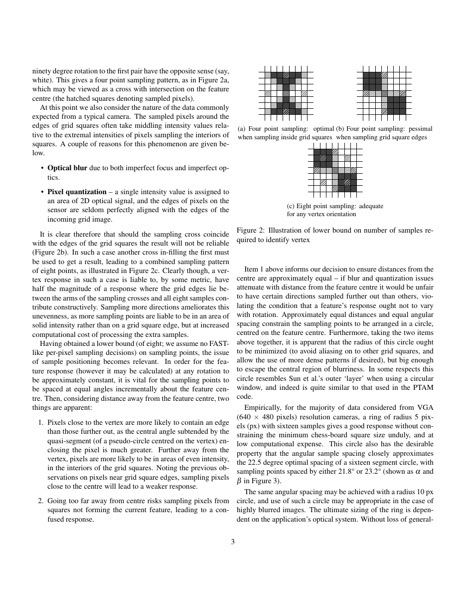
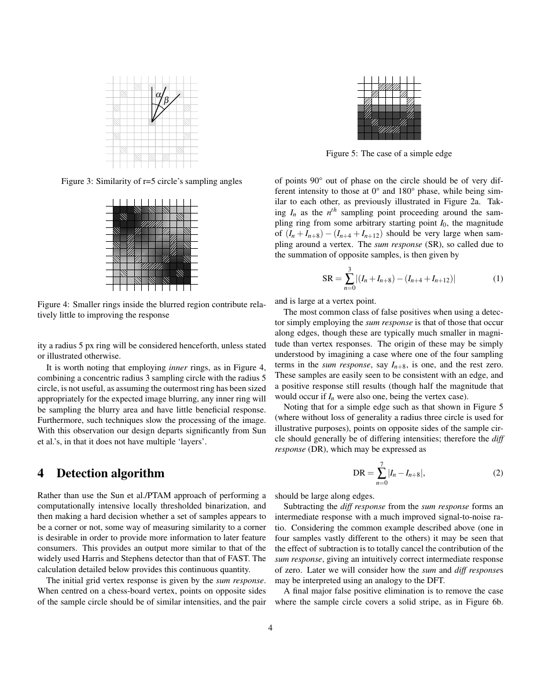
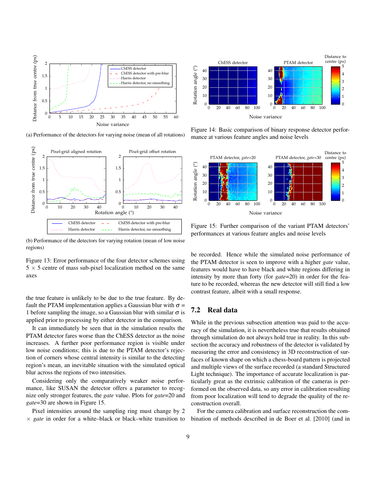

# ChESS: 체스판 특징의 빠르고 강건한 검출 (번역)

- 원문: 같은 폴더의 `Bennett2013_ChESS_arXiv1301.5491.pdf` (arXiv 1301.5491v1, 2013-01-23 게시, 원고 날짜 2012-12-05)
- 출판본: Computer Vision and Image Understanding 118, 197-210, DOI 10.1016/j.cviu.2013.10.008. 번역은 arXiv 원고 기준이다. 출판본과 쪽수, 문구가 다를 수 있다.
- 번역 범위: 전문(초록, 본문, 그림 캡션, 표, 사사). 참고문헌은 원문 그대로 둔다.
- 그림은 `pdftoppm -r 110`으로 쪽 단위 이미지를 만들어 넣었다. 수식은 원문 기호를 따른다.

Stuart Bennett, Joan Lasenby (케임브리지 대학교 공학과, Trumpington Street, Cambridge, CB2 1PZ, 영국. email: {sb476, jl221}@cam.ac.uk)

## 초록

체스판 꼭짓점의 위치를 찾는 일은 컴퓨터 비전에서 흔한 작업이고 많은 응용의 바탕이 된다. 그런데 빠르고, 정확하고, 강건한 전용 특징 검출기를 설계하는 연구는 비교적 적다. 이 논문은 체스판 꼭짓점에만 반응하도록 설계한 "뺄셈과 덧셈에 의한 체스판 추출(Chess-board Extraction by Subtraction and Summation, ChESS)" 특징 검출기를 제안한다. 제안 방법은 잡음, 나쁜 조명, 낮은 대비에 강하다. 체스판 무늬가 영상의 어디까지 펼쳐져 있는지 미리 알 필요가 없다. 계산이 매우 효율적이다. 검출한 특징의 강도 값을 준다. 이런 검출기는 카메라 보정이라는 핵심 분야와 구조광 3차원 복원 모두에 쓸모가 크다. 시뮬레이션과, 평판과 원통 물체의 3차원 복원 실험 양쪽에서, 흔히 쓰는 다른 검출기와 비교하여 강건성, 정확도, 효율의 근거를 제시한다.

핵심어: 체스판 코너 검출, 특징 추출, 패턴 인식, 카메라 보정, 구조광 표면 측정, 사진측량 표식 검출

## 1 서론

머신 비전의 많은 응용은 체스판 무늬 꼭짓점의 위치를 정확히 아는 데 기대고 있다. 이런 무늬가 카메라 보정에 흔히 쓰이기 때문이다. 기존 방법은 심한 광학 왜곡과 원근 효과에 약하고, 조명과 무늬 크기에 따라 파라미터를 손으로 맞춰야 하는 경우가 많다. 사람이 개입하면 시간이 들고, 숙련된 작업자가 필요하며, 자동화가 막힌다.

정밀한 꼭짓점 검출이 필요한 또 다른 응용은 3차원 표면 복원이다. 여기서는 단순하지만 정확한 구조광 프로젝터와 카메라 시스템의 일부로 체스판 무늬를 쓴다. 이런 용도에서는 특징 추출이 고도로 자동화되고 빨라야 한다.

우리는 체스판 무늬 꼭짓점 검출만을 겨냥한 강건한 처리를 제시한다. 이 처리는 꼭짓점인지 아닌지를 이진 문턱으로 정하지 않고, 같은 문제에서 널리 쓰이는 Harris and Stephens [1988] 코너 검출기와 비슷한 형태의 강도 값을 낸다. 그래서 포함 여부의 결정을, 공간과 기하 조건을 더 잘 활용할 수 있는 뒷단계로 미룰 수 있다.

이 처리는 계산 효율이 좋고 여러 병렬 처리 기법에 잘 맞는다. 기준 구현은 일반 PC에서 VGA 해상도 프레임을 초당 700장 넘게 처리한다.

## 2 관련 연구

체스판 무늬의 교차점을 찾는 기법은 여러 가지가 발표되었고, 보통 카메라 보정 절차 안에서 쓰인다. 그러나 이렇게 흔히 쓰는 특징에 맞는 최적 검출기에 집중한 연구는 비교적 적다. Soh et al. [1997]은 카메라 보정에 대해 "검출이 쉽도록 설계한 보정판이나 표식의 검출은 사소하다고 흔히 가정한다"고 지적했다. 이어서 이 가정이 바람직하지 않다고 했다. Canny [1986] 같은 일반 방법은 특징의 고유한 성질을 활용하지 않으므로 조명과 물체 자세가 좋지 않을 때 나빠지기 쉽다. 또한 "넓은 커널 필터링처럼, 중요한 특징의 위치 정보와 모양을 망가뜨리는 것으로 악명 높은" 손실 있는 "처방"을 쓰는 위험을 강조했다.

Soh et al.은 이어서 Sobel 연산자 연쇄, 국소 문턱화, 비최대 억제, 에지 잇기, 기하 제약, 그리고 마지막으로 찾은 사각형들의 무게중심을 쓰는 격자 처리 방식을 설명한다. de la Escalera and Armingol [2010]이 지적했듯이, 원근 효과 때문에 무게중심이 사각형 중심과 일치하지 않아서 이런 위치 결정 방식은 버려졌다. de la Escalera와 Armingol도 Soh et al.과 비슷하게, 보정 알고리즘 자체보다 보정에 쓰는 점의 위치를 찾는 알고리즘에 관심이 덜 쏠렸다고 지적한다. 이 연구는 그 공백을 메우려 한다.

de la Escalera와 Armingol의 검출 방식은 Harris and Stephens 코너 검출기로 격자를 찾은 다음, 영상에 Hough 변환을 써서 직선성 제약을 걸고, 강한 직선 특징 위에 있지 않은 코너 검출기 응답을 버린다. 이 때문에 광학 왜곡이나 평면이 아닌 표면 때문에 격자가 휘어질 수 있는 경우에는 쓰기 어렵다. 그들은 (격자 경계를 모르는 상황에서) 코너 위치만 쓰는 방법은 배제했다. Harris and Stephens 같은 범용 알고리즘이 장면의 다른 곳에서 격자가 아닌 코너를 지나치게 많이 찾을 것이기 때문이다.

Yu and Peng [2006]은 교차점의 작은 영상을 패턴 정합하는 대안을 설명한다. 이 작은 패턴의 상관을 촬영 영상 전체에서 잰다. 그러나 이런 작은 영상을 여러 개 시험하지 않는 한, 격자가 패턴에 저장된 교차점 모양에 비해 회전되어 있으면 이 방법은 분명히 불리하다.

마지막으로 Sun et al. [2008]은 사각형 또는 원형 창을 촬영 영상 위로 옮기며, 각 위치에서 창 둘레를 따라 놓인 2차원 점 분포를 1차원 벡터로 바꾸는 방법을 자세히 설명한다. 둘레와 같은 중심을 갖는 각 고리에서도 비슷하게 벡터를 만들고, 각 벡터를 '층'이라 부른다. 층 번호는 그림 1a와 같고, 1차원으로 편 모습은 그림 1b와 같다. 층은 국소 적응 문턱으로 이진화하고, 열림과 닫힘 형태학 연산을 적용한다(Haralick et al. 1987). 그리고 층 가운데 일정 비율이 (각 층을 고리로 볼 때) 네 영역을 갖는 위치를 체스판 꼭짓점으로 정한다. Sun et al.은 이 기법이 잘 동작한다고 주장하지만, 잡음 때문에 가짜 코너가 생기고 상당히 느리다고 적었다. 이 방식은 문턱화가 받아들일 만한 이진 결과를 내는지에도 기대고 있다.

그림 1: Sun et al. [2008]의 표본 창과 층 방식 설명. (a) 층 번호를 적은 사각 표본 창. (b) 1~3층을 편 모습. 맨 윗줄에서 시작해 시계 방향으로 진행한다.

비슷한 방법이 세부 내용은 발표되지 않은 채 PTAM(Parallel Tracking and Mapping for Small AR Workspaces) 기준 구현(Klein and Murray 2007)에 들어 있다. 여기서는 FAST 검출기(Rosten and Drummond 2005; Rosten and Drummond 2006)의 원형 표본 고리를 쓰고, 열여섯 표본점 평균에서 일정한 밝기 거리만큼 떨어진 위 문턱과 아래 문턱을 만든다. 고리를 따라 돌며 이 문턱을 넘는 전이 횟수를 세고, 전이가 네 번이면 중심점을 격자 코너 후보로 표시한다.

여러 기본 검출과 정밀화 방식의 결과가 많은 카메라 보정 논문에서 쓰인다. 잘 알려진 예가 Zhang [2000]이다. 그러나 이런 논문의 검토는 이 연구의 범위를 넘는다.

대체로 문헌에서 가장 자주 만나는 것은 Harris and Stephens 검출기이고, 이를 쓰는 다른 주목할 논문으로 Shu et al. [2003], Douskos et al. [2007]이 있다. Lucchese and Mitra [2002] 같은 여러 논문이 있지만, 이들은 Harris and Stephens 검출기가 준 특징을 정밀화하는 전략을 자세히 다룬다. 이 논문은 체스판 응용에서 Harris and Stephens 검출기를 대신할, 본질적으로 더 정확한 해법을 제시하려 한다(응용이 요구하면 비슷한 후속 정밀화 전략도 그대로 쓸 수 있다).

## 3 표본 추출 전략

효율적인 체스판 코너 검출기의 윤곽을 생각할 때, 무늬의 사각형이 카메라 센서 축과 거의 나란하다고 가정하면 매우 단순한 설계가 나온다. 그러나 이는 분명히 지나친 제약이다. 한 단계 더 복잡하게는 영상 전체의 특징 방향을 분석한 뒤, 찾은 전체 방향에 축을 맞춘 검출기를 쓰는 방법이 있다. 어떤 면에서 de la Escalera와 Armingol의 방식과 비슷하다. 그러나 앞서 말했듯이 광학 왜곡이나 평면이 아닌 무늬 표면 때문에 격자가 크게 휠 수 있다. 그러면 강한 전체 방향을 찾지 못할 수 있을 뿐 아니라, 더 넓게 보면 범용 검출기는 모든 방향의 특징을 다룰 수 있어야 한다. 일관성을 위해, 이런 검출기는 방향만 다르고 나머지가 모두 같은 특징에 (어떤 의미에서든) 같은 강도를 주도록 애써야 한다.

회전에 불변인 검출기를 만들려면, 특징 중심에서 바깥으로 충분히 많은 방향을 표본해야 어떤 각도에서도 믿을 만한 결과가 나온다. 체스판 꼭짓점의 경우 특징을 가장 적게 기술하면, 특징 중심에서 서로 반대 방향으로 잡은 두 표본이 한 색(예를 들어 검정)이고, 그와 90도 돌린 두 표본이 반대 색(예를 들어 흰색)인 점을 찾는 것이다. 이렇게 하면 그림 2a처럼 네 점 표본 무늬가 된다. 특징 중심에서 교차하는 십자로 볼 수 있다(빗금 친 사각형이 표본 화소다).

여기서 일반 카메라에서 흔히 기대되는 자료의 성질도 생각한다. 격자 사각형 가장자리 근처의 표본 화소는, 사각형 내부를 표본한 화소의 극단 밝기에 비해 중간 밝기를 띠는 경우가 많다. 그 이유 몇 가지는 다음과 같다.

- 초점이 완벽하지 않고 광학계가 완벽하지 않아서 생기는 광학 블러
- 화소 양자화. 2차원 광 신호의 한 영역에 밝기 값 하나가 배정되고, 센서 화소의 경계가 들어오는 격자 상의 경계와 완벽히 맞는 일은 드물다.

그림 2: 꼭짓점을 알아보는 데 필요한 표본 수의 하한 설명. (a) 네 점 표본: 격자 사각형 내부를 표본할 때 최적. (b) 네 점 표본: 격자 사각형 가장자리를 표본할 때 최악. (c) 여덟 점 표본: 어떤 꼭짓점 방향에도 충분.

따라서 표본 십자가 격자 사각형의 가장자리와 겹치면 결과를 믿을 수 없음이 분명하다(그림 2b). 이 경우 첫 십자 사이를 채우는 두 번째 십자를 써야 결과가 나오고, 합치면 그림 2c와 같은 여덟 점 표본 무늬가 된다. 그래도 이런 경우의 꼭짓점 응답은, 격자 가장자리가 표본 십자의 팔 사이에 놓여 여덟 표본이 모두 보강적으로 기여하는 경우의 절반 정도 크기가 되기 쉽다. 더 많은 방향을 표본하면 이 고르지 않음이 줄어든다. 표본점이 많을수록 격자 사각형 가장자리가 아닌 고른 밝기 영역에 놓일 가능성이 커지기 때문이다. 대신 추가 표본을 처리하는 계산 비용이 늘어난다.

표본점 수의 하한(여덟 개. FAST처럼 화소마다 표본 결정을 하지는 않는다고 가정한다)을 얻었으니, 이제 표본 위치가 문제다. 어떤 회전에서도 특징 응답(어떻게 계산하든)이 거의 일정하려면, 표본점이 특징 중심 둘레에 같은 각도 간격으로 놓여야 한다. 그리고 특징 중심에서의 거리를 생각하면 두 가지가 분명하다.

1. 꼭짓점에 가까운 화소일수록 에지를 포함할 가능성이 크다. 꼭짓점을 중심으로 한 근사 원에서 그 화소를 둘러싼 준부채꼴이 이루는 중심각이 훨씬 크기 때문이다. 꼭짓점에서 멀어질수록 화소는 격자 사각형 내부의 고른 밝기 영역에 놓이기 쉽다. 격자 사각형 가장자리 근처 화소에 대한 앞의 관찰을 생각하면, 중심 가까이를 표본하면 응답이 약해진다.
2. 중심에서 너무 멀리 가면 현재 특징을 이루지 않는 다른 사각형의 화소를 표본할 위험이 있고, 응답이 혼란스러워진다.

위 1번 때문에 우리는 중심에서의 거리를 거의 같게 한다. 블러와 양자화 문제가 특징 중심에서 멀어질수록 약해진다면, 어떤 방향은 더 멀리 표본하는 것은 공정하지 않고, 특징의 응답이 회전에 따라 변하면 안 된다는 조건을 어긴다. 거리가 거의 같고 각도 간격이 같으면, 표본점은 특징 중심을 중심으로 한 원 위에 놓인다. 더 나아가 위 두 항목을 함께 보면, 이 원의 반지름은 (다른 격자 사각형으로의 겹침을 피하고, 원하면 더 촘촘한 무늬도 쓸 수 있도록) 최소로 하되, 가운데 블러 영역을 벗어날 만큼은 커야 한다. 어떤 면에서 이 원은 Sun et al.이 원형 창을 쓸 때의 바깥 '층'과 닮았고, 실제로 PTAM 코드에서 쓰는 것과 꽤 비슷하다.

경험적으로, VGA(640 × 480 화소) 해상도 카메라에서 얻은 자료 대부분에서는 반지름 5 화소(px)에 표본 열여섯 개인 고리가 좋은 응답을 준다. 이 고리는 체스판 사각형의 최소 크기를 지나치게 제한하지 않고 계산 비용도 낮다. 이 원은 각도 표본 간격이 열여섯 조각 원의 최적 간격 22.5도에 가깝다는 바람직한 성질도 있다. 표본점 간격은 21.8도 또는 23.2도이다(그림 3의 α와 β).

그림 3: 반지름 5 원의 표본 각도가 고른 정도

같은 각도 간격은 반지름 10 px 원으로도 얻을 수 있고, 블러가 심한 영상에서는 이런 원이 적합할 수 있다. 고리 크기는 결국 응용의 광학계에 달려 있다. 일반성을 잃지 않고, 따로 말하거나 그림으로 보이지 않는 한 이후로는 반지름 5 px 고리를 다룬다.

그림 4처럼 반지름 3 표본 원을 반지름 5 원과 함께 쓰는 *안쪽* 고리는 쓸모가 없다는 점을 짚어 둔다. 가장 바깥 고리가 예상 영상 블러에 맞게 크기가 정해졌다면, 안쪽 고리는 어느 것이든 블러 영역을 표본하게 되어 이득이 거의 없다. 게다가 이런 기법은 영상 처리를 느리게 한다. 이 관찰로 우리 설계는 여러 '층'을 두지 않는다는 점에서 Sun et al.의 설계와 크게 다르다.

그림 4: 블러 영역 안의 작은 고리는 응답 개선에 비교적 적게 기여한다

## 4 검출 알고리즘

Sun et al.이나 PTAM처럼 계산량이 큰 국소 문턱 이진화를 하고 나서 표본 묶음이 코너처럼 보이는지 아닌지를 딱 잘라 정하는 대신, 코너와의 닮음 정도를 재는 방법이 바람직하다. 그래야 뒤에서 특징을 쓰는 쪽에 더 많은 정보를 줄 수 있다. 이렇게 하면 출력이 FAST보다는 널리 쓰이는 Harris and Stephens 검출기의 출력과 더 비슷해진다. 아래 계산은 이런 연속량을 준다.

격자 꼭짓점의 초기 응답은 *합 응답(sum response)*으로 준다. 체스판 꼭짓점에 중심을 두면, 표본 원의 반대편에 있는 점들은 밝기가 비슷해야 한다. 그리고 원 위에서 90도 위상이 어긋난 점 쌍은 0도와 180도 위상의 점과 밝기가 매우 달라야 하고, 서로는 비슷해야 한다. 이는 앞의 그림 2a에서 보인 대로다. 임의의 시작점 I_0에서 표본 고리를 따라 돌며 n번째 표본점을 I_n이라 하면, 꼭짓점 둘레를 표본할 때 (I_n + I_{n+8}) − (I_{n+4} + I_{n+12})의 크기가 매우 커야 한다. 반대편 표본을 더하기 때문에 이름 붙인 합 응답(SR)은 다음과 같다.

SR = Σ_{n=0}^{3} |(I_n + I_{n+8}) − (I_{n+4} + I_{n+12})|   (1)

이는 꼭짓점에서 크다.

합 응답만 쓰는 검출기에서 가장 흔한 거짓 양성은 에지를 따라 생기는 것이다. 다만 이는 보통 꼭짓점 응답보다 크기가 훨씬 작다. 원인은 합 응답의 네 표본 항 가운데 하나, 예를 들어 I_{n+8}이 1이고 나머지가 0인 경우를 떠올리면 쉽게 이해된다. 이런 표본은 에지와 들어맞고, 그래도 양의 응답이 나온다(다만 I_n도 1인 꼭짓점 경우의 절반 크기다).

그림 5: 단순 에지의 경우

그림 5와 같은 단순 에지에서는(설명을 위해 일반성을 잃지 않고 반지름 3 원을 썼다) 표본 원의 반대편 점은 대체로 밝기가 달라야 한다는 점에 주목하면, 다음과 같이 쓸 수 있는 *차 응답(diff response)*(DR)은

DR = Σ_{n=0}^{7} |I_n − I_{n+8}|   (2)

에지를 따라 커야 한다.

합 응답에서 차 응답을 빼면 신호 대 잡음비가 크게 좋아진 중간 응답이 된다. 위에서 말한 흔한 예(네 표본 가운데 하나만 크게 다른 경우)를 보면, 뺄셈은 합 응답의 기여를 완전히 지워서 직관적으로 맞는 중간 응답 0을 준다. 합 응답과 차 응답을 DFT에 빗대어 해석하는 방법은 뒤에서 다룬다.

마지막 주요 거짓 양성 제거는, 그림 6b처럼 표본 원이 꽉 찬 줄무늬를 덮는 경우를 없애는 것이다.

그림 6: 표본 고리에서 같은 응답을 내는 매우 다른 두 특징. (a) 코너: 높은 응답이 바람직. (b) 줄무늬: 제거가 필요.

그림 6a의 코너 특징에서 얻는 원 표본은 줄무늬에서 얻는 것과 정확히 같다는 점을 보라. 두 경우는 다른 곳에서 표본을 더 잡아야만 구별된다. 좋은 위치는 고리의 중심이다. 앞서 말한, 블러 때문에 중간 밝기 영역이 있으리라는 기대를 이용한다. 원 중심의 몇 화소(반지름 5 px 원이면 예컨대 5개)를 쓰는 국소 밝기 평균(*국소 평균*)과, 고리의 모든 표본을 쓰는 더 넓은 공간 평균(*이웃 평균*)을 계산하면, 평균의 절대 차인 *평균 응답(mean response)*을 얻는다.

mean response = |neighbour mean − local mean|   (3)

이 값은 줄무늬 경우에 크다. 그림 6을 예로 들면, 이웃 평균은 두 경우 모두 밝은 회색이고, (a)의 국소 평균도 그렇다. 그래서 평균 응답이 작다. 반면 (b)는 국소 평균이 훨씬 어두워서 절대 차가 크다. 평균 응답에 표본 화소 수(16)를 곱해 기존 응답에서 빼면 전체 응답 R을 얻는다.

R = sum response − diff response − 16 × mean response   (4)

16을 곱하면 바람직하지 않은 경우, 즉 표본 I_n과 I_{n+8}이 1이고 I_{n+4}와 I_{n+12}가 0이며 원 중심 화소의 평균도 0인 경우(그림 6b의 경우)에 전체 응답이 0이 된다.

이 전체 응답은 원근 불변이라고 주장하지 않는다. 그런 주장은 말이 되지 않는다. 검출기는 영상이 원근으로 왜곡된 체스판 교차점을 담고 있는지, 원근으로 왜곡된 체스판 교차점처럼 보이는 특징을 담고 있는지 알지 못한다. 그래서 원근 효과든 다른 원인이든 크게 왜곡된 교차점에도 강도는 주어진다. 다만 후보 꼭짓점을 '정면'에서 볼 때보다 낮다.

영상의 어두운 영역에서 국소 대비나 응답을 높이는 추가 단계, 예를 들어 화소마다 이웃 평균으로 나누는 것은 이 검출기에 쓰지 않는다. 낮은 밝기 영역에서 잡음 증폭이 너무 크기 때문이다.

이 알고리즘을 ChESS(Chess-board Extraction by Subtraction and Summation) 검출기라 부른다.

### 4.1 ChESS 검출기의 DFT 기반 해석

표본 원이 잡은 열여섯 표본을 1차원 자료 벡터로 펴면, 원이 격자 교차점에 중심을 두었을 때 이 벡터의 FFT는 두 번째 계수의 절댓값이 크다. 에지 위에 중심을 두었을 때는 첫 번째 계수가 크다(0번째 항은 직류 항이다).

그림으로 보면 직관적으로 이해된다. 그림 7a에서 코너 특징을 왼쪽 위 표본부터 시계 방향으로 펴면, 밝기 값이 어떤 위상의 코사인파 두 주기와 잘 상관한다. 이는 DFT의 두 번째 진동 항과 비슷하다. 마찬가지로 그림 7b에서는 코사인 한 주기가 에지에서 만든 밝기 벡터와 비슷하다. 보기만 해도, 이 특징을 어떻게 회전시켜도 맞는 코사인의 위상만 바뀐다는 것이 분명하다.

그림 7: 표본 원 벡터와 1차원 DFT의 상관. (a) 두 번째 DFT 계수와 코너의 상관. (b) 첫 번째 DFT 계수와 에지의 상관.

이제 합 응답은 네 위상에 걸쳐 누적하면서 두 주기 코사인과 비슷한 정합으로 격자 교차점을 찾으려는 것임을 알 수 있다. 비슷하게 차 응답은 한 주기 코사인을 여덟 위상에 걸쳐 맞추는 것과 크게 다르지 않은 방식으로 에지를 맞춘다.

## 5 특징 선택

서론에서 말했듯이, 어느 응답을 참 특징으로 다룰지는 응용별 제약으로 정하도록 남겨 둔다. 그래도 대부분의 경우에 쓸모 있는 몇 가지 단계가 있다. 이들은 더 큰 규모의 공간 제약을 이용해 거짓 양성 특징을 없애며, 아래와 같다.

- 양의 응답 문턱: 응답이 0이거나 음인 화소를 버린다(응답 값은 체스판 교차점만 양의 값을 갖도록 설계했기 때문이다).
- 비최대 억제: 응답 영상의 각 화소 둘레 작은 영역에서 최대가 아닌 응답을 버리는 표준 기법. 후보 특징의 정수 화소 좌표를 정하는 데 쓸 수 있다.
- 응답 연결성: 참 체스판 꼭짓점 응답은 보통 여러 화소에 걸친다. 완전히 고립된 양의 응답 화소는 버릴 수 있다.
- 이웃 비교: 넓은 영역에서 최대 응답의 크기를 비교하여, 가장 큰 응답(참 체스판 특징의 응답)의 일정 비율보다 작은 것은 거짓 특징으로 보고 버린다. 여러 면에서 이것이 검출기에 밝기와 대비 정규화가 없는 점을 보완한다.

여러 특징 회전에 대한 전형적인 응답 무늬를 그림 8에 보였다. 응답이 특징 중심에 대해 대칭이므로, 부화소 위치 결정에는 무게중심 기법이 합리적인 결과를 준다는 것을 알 수 있다. 구체적인 예는 최대 화소에 중심을 둔 5 × 5 조각이다. 이 방법은 빠르고 흔히 쓰인다. de la Escalera and Armingol [2010]은 Harris 검출에서 나온 각 점의 무게중심을 찾고, Sun et al. [2008]도 응답 묶음의 무게중심을 찾는다. Harris and Stephens 검출기로 검출한 특징을 후처리할 때 흔히 쓰는 더 복잡한 정밀화 기법도 쓸 수 있지만, 특징을 처음 검출한다는 이 연구의 목적을 벗어난다.

그림 8: 특징 회전 0°, 11.25°, 22.5°, 33.75°, 45°에서의 응답

## 6 방향 표지 붙이기

합 응답은 또 다른 쓰임이 있다. 표본 고리를 따라 돌며 합 응답이 최대가 되는 회전을 찾으면, 각 특징에 화소 축을 기준으로 여덟 방향 가운데 하나를 붙일 수 있다(앞의 DFT 비유로 돌아가면, 이는 두 주기 코사인 위상의 양자화 값을 정하는 것이다). 이 표지에는 쓸모가 많지만, 간단한 예로 체스판 꼭짓점을 찾을 때 연결된 꼭짓점들의 방향 표지는 대략 반대 위상이어야 한다. 이 표지 붙이기를 주 검출기와 따로 아래에 설명한다. 두 처리를 동시에 할 수도 있지만, 후보 특징 묶음을 고른 뒤에만 표지를 붙이는 것이 대개 더 효율적이기 때문이다.

검출기의 합 응답에 쓴 것과 같은 측정량(M)을 쓴다. M_n = (I_n + I_{n+8}) − (I_{n+4} + I_{n+12}). 16점 표본 원을 따라 돌리면 |M|은 서로 다른 값 네 개를 준다. 대칭 때문에 중복이 생기기 전까지 M은 서로 다른 값 여덟 개를 갖고, 그 가운데 절반은 네 표본점의 마주 보는 쌍이 "검은" 격자 사각형에 있는지 "흰" 사각형에 있는지에 따라 부호만 다르기 때문이다.

방향 구간 나누기의 첫 단계로, 각 측정량에 대해 현재 측정량의 양옆 한 방향씩을 함께 평균한 값(AM)을 구한다. 더 명시적으로, 3AM_n = M_{n−1} + M_n + M_{n+1}, n ∈ {0, 1, 2, 3}이다(n − 1이 −1이거나 n + 1이 4일 때는 3이나 0으로 순환하고, 해당 M의 부호를 뒤집는 데 주의한다). 평균 측정량의 절댓값이 가장 큰 방향의 번호 i, 즉 i = arg max_n |AM_n|을 취한다. 최종 방향 구간 번호를 찾으려면 M_i의 부호를 본다. M_i가 양인 특징은 M_i가 음인 특징과 다른 네 방향 구간에 넣는다.

검정 둘, 흰색 둘의 사각형이 만나는 격자 교차점은 2차 회전 대칭을 가지므로, 이 여덟 구간은 22.5°씩 증가하는 방향에 대응한다.

체스판 해독에 관해서는, 이 정도의 세분이면 번갈아 놓인 체스판 꼭짓점 사이에 충분한 거리가 확보된다. 이들은 90° 위상이 어긋난 것으로 볼 수 있다. 여기서 쓸 수 있는 22.5° 구분이면, 반대 성질의 두 특징 방향은 거리 1(구간 단위)의 방향 표지 오류를 견디면서도 구별된다.

## 7 실험 결과

체스판 꼭짓점 검출의 강건성 주장을 입증하려면, 같은 문제에 쓰이는 다른 검출기와 ChESS 검출기를 비교해야 한다.

### 7.1 합성 자료

잡음에 대한 내성과 회전에 대한 응답 크기의 불변성은 둘 다 다음과 같이 수치로 잴 수 있다. 여러 회전과 잡음 수준에서 특징점을 시뮬레이션하고, 생성 영상에서 특징 검출을 한 뒤, 여러 전략으로 가장 큰 특징 응답의 위치를 정하고, 이 점과 원래 시뮬레이션한 점 좌표 사이의 거리를 잰다.

아래에서 Harris and Stephens [1988] 알고리즘, 그리고 SUSAN 방법(Smith and Brady 1997)과 비교한다. SUSAN 검출기는 특징 응답 강도를 수치로 주고 기준 구현이 공개된 또 다른 범용 코너 검출기다. PTAM 검출기와도 비교하지만, 이 검출기는 이진 응답만 주므로 따로 평가한다.

#### 7.1.1 시뮬레이션 생성

결과가 의미 있으려면 시뮬레이션 영상이 실제 자료와 상당히 닮아야 한다. 그래서 시뮬레이션 영상은 두 색의 같은 크기 사각형 네 개를 교차점이 생기도록 배치해 만든다. 카메라 출력의 흔한 영상 형식이 8비트 1채널이므로 두 색은 64와 191로 정했다. 포화와 밝기 범위 중앙에서 대략 같은 거리다.

다음으로 영상을 교차점 좌표 둘레로 어떤 각도만큼 회전한다. ImageMagick 라이브러리를 쓰고 쌍선형 보간을 지정한다. 그런 다음 영상을 VGA 해상도로 자르고, 3 × 3 가우시안 블러를 적용한다. 1차원 필터 (1/5)[1 3 1]을 두 번 통과시키며, 분산 약 0.675에 해당한다. 이렇게 하면 초점이 잘 맞은 VGA 해상도 카메라로 찍은 영상과 비슷한 영상이 나온다.

마지막으로, 지정한 분산의 가우시안 분포에서 무작위로 뽑은 잡음을 각 화소에 더한다. 화소 밝기 0과 255에서 포화된다.

이 방법의 변형도 시뮬레이션할 수 있다. 위 방법은 (회전 전) 실제 세계의 에지가 카메라 센서 소자의 경계에 정확히 걸리는 경우를 흉내 낸다고 볼 수 있다. 그러나 에지가 소자의 한가운데에 걸리는 경우도 똑같이 일어날 수 있다. 사각형 경계에 중간 밝기(128)의 전이 행과 열을 넣고, 중심에서 x와 y로 반 화소 어긋난 점을 기준으로 회전하면 이 경우도 시험할 수 있다. 물론 실제로는 들어오는 에지의 중심이 이 두 경우 사이에 놓이겠지만, 두 경우를 함께 보면 이 극단 경우들에 있는 바람직하지 않은 병적 거동이 드러날 것이다.

그림 9b는 회전 각도 32.5°, 잡음 분산 1로 시뮬레이션한 영상의 일부다. 그림 9a는 실제 카메라로 찍은 흑백 교차점의 비슷한 부분이다. 둘은 눈으로 보기에 비슷하다.

그림 9: 회전된 점의 실제 영상과 시뮬레이션 영상. (a) 촬영 영상. (b) 시뮬레이션 영상.

비슷하게, 짧은 노출로 찍어 잡음이 더 많은 그림 10a를, 회전 없음, 반 화소 어긋남, 잡음 분산 5로 시뮬레이션한 영상 일부인 그림 10b와 비교할 수 있고, 역시 눈으로 보기에 비슷하다.

그림 10: 화소 격자에 맞춘 점의 잡음 있는 실제 영상과 시뮬레이션 영상. (a) 촬영 영상. (b) 시뮬레이션 영상.

#### 7.1.2 잡음과 회전이 검출에 주는 영향

거친 수준에서는 부화소 위치 결정이 필요 없다. 가장 큰 응답의 정수 화소 좌표만 취해도 전체 거동을 보기에 충분하다. 5절에서 설명한 것과 비슷한 연결성 방법을 써서 최소한의 걸러 내기를 한다. 인접 여덟 화소(가로, 세로, 대각)에 하나도 연결되지 않은 응답은 버린다.

그림 11은 시험한 세 검출기의 성능을 보인다. "ChESS 검출기"는 앞 절들에서 설명한 것이다. "Harris 검출기"는 5 × 5 Sobel 구경, 뒤따르는 상자 필터의 3 × 3 블록 크기, 자유 파라미터 k = 0.04를 쓴다. "SUSAN 검출기"는 Smith의 이 알고리즘 구현(각주 2: http://users.fmrib.ox.ac.uk/~steve/susan/susan2l.c 에서 받을 수 있다)을 밝기 문턱 20으로 쓴다. Harris 파라미터는 실제 자료에서 강한 응답을 준다는 것을 경험적으로 확인한 값이고, SUSAN 문턱은 기본값이다. 그림의 색은 가장 큰 응답이 검출된 위치와 참 특징 위치 사이의 거리(화소)다. 즉 색이 파랑에서 빨강으로 갈수록 측정 오차가 커진다.

그림 11: 여러 특징 각도와 잡음 수준에서 검출기 성능의 기본 비교 (가로축: 잡음 분산 0~100, 세로축: 회전 각도 0~45°, 위: 중심 어긋남 없음, 아래: 반 화소 어긋난 중심, 색: 중심까지 거리 px)

새 검출기가 모든 잡음 수준과 회전에서 Harris 검출기만큼 또는 더 잘 동작한다는 것을 바로 볼 수 있다. 예상대로 새 검출기의 응답은 3절에서 다룬 표본 고리의 각도 간격 때문에 약 22.5° 주기성을 보인다. 또한 Harris 검출기의 정확도는 회전에 따라 달라져서, 회전 0일 때가 45° 가까이일 때보다 눈에 띄게 낫다.

SUSAN 검출기는 잡음이 늘어나는 이 시험에서 다른 검출기만큼 잘하지 못했다. 기본 밝기 문턱이 낮아서 아주 낮은 잡음 수준에서도 잡음 특징이 지배한다. 회전에 따른 응답이 고르지 않다는 것도 볼 수 있다.

검출기들을 더 자세히 보려면, 더 직접적인 비교를 위해 몇 가지 변형을 시뮬레이션에 넣어야 한다. Harris 검출기 구현에 쓴 5 × 5 Sobel 연산은 입력 영상을 5 × 5 가우시안 커널로 평활하는 효과가 있다. ChESS 검출기에는 이런 평활 단계가 없으므로, 두 변형을 더 시뮬레이션하면 도움이 된다. 하나는 5 × 5 가우시안 커널(1차원 (1/16)[1 4 6 4 1] 두 번, σ ≈ 1.04)로 평활한 영상을 처리하는 ChESS 검출기이고, 다른 하나는 처음 평활을 하지 않는 수정 Harris 검출기다. SUSAN 검출기를 더 높은 밝기 문턱(40)으로 시뮬레이션해 강한 특징만 검출할 때의 성능도 확인할 만하다.

이 변형들의 시뮬레이션 결과를 그림 12에 그렸다. 이번에도 색은 거리 오차다. 입력 자료를 블러하면 새 검출기의 잡음 내성이 크게 좋아져서, 큰 오차가 생기기 전까지 견디는 잡음 분산이 대략 두 배가 된다. 반대로 사전 블러 단계가 없는 Harris 검출기는 방향 의존성이 더 커지고 잡음 성능이 매우 나쁘다.

그림 12: 여러 특징 각도와 잡음 수준에서 변형 검출기 성능의 추가 비교 (사전 블러한 ChESS 검출기, 평활 없는 Harris 검출기, 문턱 40인 SUSAN 검출기)

SUSAN 검출기의 밝기 문턱을 더 큰 값으로 하면 기본 문턱보다 잡음 내성이 조금 나아지지만, 여전히 다른 두 검출기와 경쟁이 되지 않는다. 실제로 쓰면 약한 특징을 놓치게 된다. SUSAN 원리는 잡음 줄이기가 필요 없도록 의도되었지만, 완전을 위해 덧붙이면 여기 싣지 않은 시뮬레이션에서 ChESS 검출기에 쓴 것과 같은 사전 블러를 쓰고(밝기 문턱 40 유지) 잡음 성능이 평활한 Harris 검출기보다 조금 나쁜 정도까지만 나아졌다. 큰 개선은 아니다. 이런 이유로 SUSAN 검출기는 이 정확도 비교에서 더 다루지 않는다.

낮은 잡음 수준에서의 위치 정밀도를 더 자세히 보기 위해, 그림 13a와 그림 13b는 남은 네 검출기 방식의 오차 성능을 앞서 설명한 5 × 5 무게중심 부화소 위치 결정 방법으로 같은 축 위에 그린다. 13a는 잡음을 바꿀 때(모든 회전의 평균), 13b는 회전을 바꿀 때(낮은 잡음 영역의 평균)다. 다른 위치 결정 방식도 쓸 수 있지만, 추가 복잡 정밀화 없이 원래 검출 방법의 능력을 비교하는 것이 유익하다. 무엇보다 광범위한 후처리가 실제로 필요한지 판단할 수 있기 때문이다.

그림 13: 같은 축에서 5 × 5 무게중심 부화소 위치 결정을 쓴 네 검출기 방식의 오차 성능. (a) 잡음을 바꿀 때 검출기 성능(모든 회전의 평균). (b) 회전을 바꿀 때 검출기 성능(낮은 잡음 영역의 평균). 왼쪽은 화소 격자에 맞춘 회전, 오른쪽은 화소 격자에서 어긋난 회전.

그림 13은 ChESS 검출기 변형들이 모든 잡음 수준에서 Harris 검출기들보다 낫고, 모든 특징 회전에서 성능이 좋고 고르다는 것을 분명히 보인다. 두 새 검출기 변형의 각도 성능은 비슷하지만, 사전 블러 변형이 영상 잡음에 더 강하다.

(번역자 주: 그림 13을 눈으로 읽으면, 낮은 잡음에서 ChESS 계열의 위치 오차는 약 0.1~0.25 px, Harris 계열은 약 0.2~1.9 px이다. 사전 블러 ChESS는 잡음 분산 약 45까지 0.5 px 아래에 머문다. 그래프 판독값이므로 근사다.)

화소마다 코너 특징인지를 참 거짓으로 출력하는 PTAM 검출기와 비교하기 위해, ChESS 검출기의 출력에 문턱을 걸었다. 문턱은 양의 응답의 약 1.5퍼센트로 정했다. 그림 14는 화소 격자에 맞춘 특징만을 써서, 가장 가까운 검출 코너 특징과 참 코너 위치 사이의 거리를 보인다. 그림의 색은 5 화소 거리에서 포화된다. 참 특징에서 그보다 멀리 검출된 양의 결과는 참 특징 때문일 가능성이 낮다. 기본값으로 PTAM 구현은 영상을 표본하기 전에 σ = 1 가우시안 블러를 적용하므로, 비교에서는 두 검출기 모두 처리 전에 비슷한 σ의 가우시안 블러를 적용한다.

그림 14: 여러 특징 각도와 잡음 수준에서 이진 응답 검출기 성능의 기본 비교

시뮬레이션 결과에서 잡음이 늘수록 PTAM 검출기가 ChESS 검출기보다 나쁘다는 것을 바로 볼 수 있다. 낮은 잡음 조건에서도 또 다른 나쁜 성능 영역이 보인다. 이는 PTAM 검출기가 중심 밝기가 검출 영역 평균과 비슷한 코너를 버리기 때문이다. 두 밝기 영역에 걸친 시뮬레이션 광학 블러에서는 피할 수 없는 상황이다.

비교적 약한 잡음 성능만 보면, 이 검출기도 SUSAN처럼 강한 특징만 알아보는 파라미터인 gate 값을 제공한다. gate=20과 gate=30의 그림을 그림 15에 보였다.

그림 15: 여러 특징 각도와 잡음 수준에서 PTAM 변형 검출기 성능의 추가 비교

흰색에서 검정, 또는 검정에서 흰색 전이가 기록되려면 표본 고리 둘레의 화소 밝기가 2 × gate만큼 바뀌어야 한다. 그래서 gate 값을 높이면 PTAM 검출기의 시뮬레이션 잡음 성능은 좋아지지만, 특징이 기록되려면 검정과 흰 영역의 밝기 차가 (gate=20일 때) 40보다 커야 한다. 반면 새 검출기는 대비가 낮은 특징도 응답은 작지만 여전히 찾는다.

### 7.2 실제 자료

앞 소절에서 시뮬레이션의 정확성에 주의를 기울였지만, 시뮬레이션으로 얻은 결과가 실제에서 늘 성립하지는 않는 것도 사실이다. 이 소절에서는 알려진 모양의 표면에 체스판 무늬를 투사하고 여러 시점에서 기록한 뒤(표준 구조광 기법), 표면 3차원 복원의 오차와 일관성을 재서 검출기의 정확도와 강건성을 검증한다. 카메라의 외부 보정이 관측 자료로 수행되므로 정확한 위치 결정이 특히 중요하다. 나쁜 위치 결정으로 생긴 보정 오차는 복원 품질 전체를 떨어뜨리는 경향이 있다.

카메라 보정과 표면 복원에는 de Boer et al. [2010](더 자세히는 de Boer [2010])에 설명된 방법 조합을 쓰며, Lasenby and Stevenson [2001]에 크게 기댄다. 이 방법들은 이전 연구에서 여러 자료에 대해 믿을 만하고 정확하다고 확인되었다.

복원 시험은 ChESS 특징 검출기를 다른 검출 방식과 비교하는 것과, ChESS 검출기 변형끼리 비교하는 것을 모두 가능하게 한다. 또한 이 연구의 가장 유력한 두 응용, 즉 카메라 보정과 3차원 복원을 시험하도록 실험이 짜여 있다. 각 경우 5 × 5 무게중심 부화소 보간 방법을 쓰며, 시험한 변형은 다음과 같다.

- Harris 검출기 (시뮬레이션과 같은 파라미터)
- 사전 블러 없는 ChESS 검출기
- 사전 블러 있는 ChESS 검출기

PTAM 검출기는 출력이 부화소 특징 위치 결정에 잘 맞지 않아 여기서는 다루지 않는다.

#### 7.2.1 평판 비교

복원한 표면이 평면인지 쉽게 확인하기 위해 평판을 쓴다. 시험에서는 위치를 언제나 정확히 아는 이동 플랫폼이 판을 카메라 쪽으로 다가가고 멀어지게 약 95 mm 거리를 움직였다. 판과 카메라의 거리는 약 1 m였다. 이동 기간 뒤에는 판을 일정한 변위에 멈춰 두었다. 이를 "정지" 기간이라 한다. 기록한 전체 기간 동안 투사된 격자점 500개 이상이 보였고, 이 점들을 이후 보정에 썼다.

비교적 큰 움직임은 카메라 외부 파라미터의 보정을 좋게 하려는 것이고, 정지 기간에는 실제 움직임이 없으므로 많은 프레임에 걸쳐 복원 평탄도를 비교할 수 있다.

첫 자료 묶음은 조명과 초점이 최적인 장면, 즉 고품질 자료라 할 만한 것을 담는다. 그림 16은 시험한 각 검출 방법이 (정확한 위치와 상관없이) 찾아낸 격자점의 백분율을 그린 것이고, 잘 밝힌 이 자료의 결과는 엑스(×) 표시로 주었다. 이 "깨끗한" 자료에서는 모든 검출기가 성공한다는 것을 바로 볼 수 있다.

그림 16: 평판 자료에서 검출기의 성능 (세로축: 검출 성공 점 비율 %, 가로축: Harris 검출기, ChESS 검출기, ChESS 검출기+블러, ×: 깨끗한 자료, ○: 잡음 자료)

정지 기간 동안 각 프레임의 복원 표면에 평면을 맞추었다. 방법은 MATLAB 문서(The MathWorks Inc.)에 설명된 것으로, 주성분 분석(PCA)을 써서 자료에서 맞춘 모델까지의 수직 거리를 최소화하는 선형 회귀, 즉 총 최소제곱의 선형 경우다. 이렇게 하면 평면의 법선 단위 벡터가 나오고, 자료에서 맞춘 평면까지 수직 거리의 제곱을 합해 맞춤 품질을 나타내는 제곱오차합(SSE)을 계산한다. 이상치는 맞춤 품질을 떨어뜨리지만, 이상치가 거의 또는 전혀 없는 검출기를 목표로 하므로 이를 따로 빼려고 특별히 노력하지 않는 것이 공정하다.

이 상황을 그림 17에 보였다. 정지 기간에 찍은 여러 프레임에 맞춘 평면들과 그 법선 단위 벡터를 그렸다. 점선 화살표는 평균 법선 단위 벡터다.

그림 17: 정지한 평판에 대한 여러 맞춤과 맞춘 평면의 법선 벡터

맞춤이 좋고 안정하다면 각 프레임 벡터와 이 평균 벡터 사이의 거리가 매우 작아야 한다. 그림 18에 시험한 모든 방법에 대해 이 거리의 평균과 분산을 그렸다. 각 프레임 맞춤의 SSE에 대한 모든 프레임의 평균과 분산도 함께 주었다. 값은 사전 블러 없는 ChESS 검출기를 1로 정규화한 상대값으로 그렸다. 크기 감각을 주기 위해, 이 정규화 기준의 계산값을 적는다. 평균 법선 단위 벡터로부터의 평균 거리(거리가 매우 작아 각도로 나타냄)는 0.131 µrad, 분산은 0.0335 µrad²이다. 평균 맞춤 SSE는 6.70 mm², 분산은 0.357 mm⁴이고, 프레임당 100점 조각에 대한 값이다. 이로부터 절대값으로 오차가 매우 작다, 즉 밀리미터 이하라는 것을 알 수 있다.

검출 성공률에 비해, 맞춤 결과는 검출기 사이의 성능 차이가 더 크다. Harris 검출기에서 나온 위치 결정이 더 나쁘다는 점을 강조하고, 새 검출기를 쓸 때 사전 블러가 이로울 수 있다는 시뮬레이션의 결론을 뒷받침한다.

그림 18: 깨끗한 자료의 정지 기간 동안 평판 맞춤 통계 비교. 사전 블러 없는 ChESS 검출기 대비 상대값 (낮을수록 좋음. 항목: 단위 벡터로부터의 평균 거리, 그 거리의 분산, 평균 맞춤 오차(SSE), 맞춤 오차(SSE)의 분산)

그림 16과 그림 19의 동그라미(○) 표시는 더 어려운 자료에 대해 같은 정보를 보인다. 이 자료는 조명이 매우 낮아 영상 잡음 수준이 훨씬 높다. 두 자료의 조명 차이는 그림 20에서 볼 수 있다. 다만 어두운 촬영의 더 큰 잡음은 정지 영상으로는 잘 드러나지 않는다.

그림 19: 잡음 자료의 정지 기간 동안 평판 맞춤 통계 비교. 사전 블러 없는 ChESS 검출기 대비 상대값

그림 20: 깨끗한 촬영과 잡음 촬영의 조명 수준을 눈으로 비교

ChESS 검출기 변형들의 성능 양상은 깨끗한 자료에서 본 것과 비슷하지만, 블러를 쓴 개선이 조금 더 뚜렷하다. 사전 블러 없는 ChESS 검출기의 기준값은 평균 법선 단위 벡터로부터의 평균 거리 9.13 µrad, 분산 181 µrad², 평균 맞춤 SSE 100 mm², 분산 328 mm⁴이고, 프레임당 100점 조각에 대한 값이다. 이 수치는 깨끗한 자료의 경우보다 대략 한 자릿수 크지만, 촬영 자료의 품질이 매우 나빴다.

#### 7.2.2 원통 비교

원통은 평판보다 복잡한 표면이지만(검증을 위해 꽤 쉽게 매개변수화할 수 있다), 원근 효과 때문에 투사된 체스판을 크게 왜곡하는 경향이 있다. 그래서 더 어려운 복원 시험으로 자연스러운 선택이다. 원통 시험에는 평판과 같은 실험 절차를 쓰고, 투사 표면만 원통으로 바꾸었다.

그림 21을 보면 잡음이 낮은 자료(이번에도 × 표시)에서 시험한 모든 방법이 검출에 성공하고, Harris 검출기만 완벽하지 않은 성능을 보인다.

그림 21: 원통 자료에서 검출기의 성능

위치, 회전, 반지름이 임의인 원통에 맞추는 것은 평판에 맞추는 것보다 상당히 어렵다. Eberly [2008]에 설명된 방식을 따르면, 원통 맞춤의 비용 함수는 다음과 같이 쓸 수 있다.

E(C, V, s) = Σ_{i=1}^{n} [ s (X_i − C)^T (|V|² I − V V^T)(X_i − C) − 1 ]²   (5)

여기서 C는 원통 축 위의 한 점이고, 축은 V로 기술된다(단위 벡터가 아니어서 성분이 독립적으로 변할 수 있다). s는 원통 반지름 r과 s = 1/(r|V|)²로 연결되고, {X_i}_{i=1}^{n}은 관측한 표면 점 집합이다. 이렇게 하면 문제를 일곱 파라미터에 대해 최소화할 수 있고, 적당한 초기 파라미터를 주면 수렴까지 반복이 많지 않다.

다시, 정지 기간 프레임들에 걸친 맞춤 오차의 평균과 분산, 그리고 평균 축 단위 벡터로부터의 평균 거리와 그 분산을 계산할 수 있다(평판의 맞춤 법선 벡터에 쓴 방법과 비슷하다). 이를 사전 블러 없는 ChESS 검출기 결과 대비 상대값으로 그림 22에 그렸다(축 벡터 거리의 기준값은 평균 0.154 µrad, 분산 0.0476 µrad²). 그림 양상은 깨끗한 평판 자료와 거의 같지만, 잘 밝힌 대상에서는 새 검출기에 사전 블러를 쓰는 경험적 근거가 덜 분명하다.

그림 22: 깨끗한 자료의 정지 기간 동안 원통 맞춤 통계 비교. 사전 블러 없는 ChESS 검출기 대비 상대값

그림 21(○ 표시)과 그림 23은 잡음 자료의 값으로 같은 측정량을 그린 것이고, 기준 거리값은 평균 9.27 µrad, 분산 184 µrad²이다.

그림 23: 잡음 자료의 정지 기간 동안 원통 맞춤 통계 비교. 사전 블러 없는 ChESS 검출기 대비 상대값

블러 변형의 효과가 잡음 자료에서 더 크다는 것을 볼 수 있다. 이는 예상과 맞다. 블러는 어둡게 찍힌 영상에서 잡음의 해로운 영향을 줄인다.

전체적으로, ChESS 검출기를 쓰면 시험한 Harris 검출기로 만든 것보다 나은 복원이 가능하고, 사전 블러는 실제 자료에서 상당한 이득이 될 수 있다.

### 7.3 계산 효율

정확도와 강건성이 시스템의 핵심 요구지만, 영상을 실시간으로 처리하려면 쓰는 방법이 빨라야 한다.

코너 검출의 영상 처리 단계, 즉 카메라 영상을 표본하고 응답 영상을 계산하는 단계는 계산량이 매우 크고, 그 출력을 쓰는 응용의 실행 시간을 쉽게 지배할 수 있다. 이 절에서는 VGA 해상도 자료의 한 프레임을 5000번 처리하는 실제 경과 시간을, (따로 적지 않으면) Intel Core i5-750 프로세서에서 비교한다. 7.1.2절에서 다룬 알고리즘 가운데 세 가지, 즉 ChESS 검출기, Harris and Stephens 검출기, PTAM 검출기를 쓴다.

검출기는 모두 C 언어로 신중히 구현했다. Harris 알고리즘 파라미터는 이번에도 5 × 5 Sobel 구경, 상자 필터의 3 × 3 블록 크기, 자유 파라미터 k = 0.04이고, PTAM gate=10이다. 둘 다 7.1.2절에서 처음 쓴 값이다. 알고리즘들의 출력은 직접 비교할 수 있는 형태가 아니지만(특히 PTAM 결과는 특징 위치를 부화소 정확도로 정밀화하는 후속 처리 단계가 필요하다), 표준 추적 응용에서는 하나를 다른 것으로 비교적 쉽게 바꿔 쓸 수 있다.

시간 결과를 표 1에 보였다. 이런 결과는 코드 최적화에 들인 노력에 영향을 받지만, 새 검출기 알고리즘이 기존 방법과 충분히 경쟁력이 있다는 것은 분명하다. Harris and Stephens 알고리즘보다 시간이 약 40% 적게 들고, PTAM 코드보다 약 25% 적게 든다.

ChESS 검출기 알고리즘은 대부분의 최신 CPU에 있는 단일 명령 다중 자료(SIMD) 벡터 명령으로 더 최적화하기에 잘 맞는다는 점이 중요하다. 이를 쓰면 여러 화소의 응답을 병렬로 처리할 수 있고, 표에는 이 명령을 쓴 구현의 실행 시간도 있다. 따라서 이 검출기는 VGA 해상도 프레임을 초당 700장(fps) 넘게 처리할 수 있고, 많은 응용에서 실시간 사용에 충분하다.

표 1: 여러 코너 검출 알고리즘의 수행 시간

| 알고리즘 | 5000회 반복 시간 (s) |
|---|--:|
| ChESS 검출기 | 29.1 |
| Harris and Stephens 코너 검출기 | 47.9 |
| PTAM 코너 검출기 | 39.8 |
| SIMD 최적화 ChESS | 9.6 |
| Intel i7-3770 CPU에서 SIMD 판 | 7.0 |

#### 7.3.1 사전 블러

사전 블러 처리가 잡음 자료에 이롭다는 7.1절과 7.2절의 결과를 생각하면, 5 × 5 가우시안 블러를 하는 부담을 살펴볼 필요가 있다. 블러 구현에도 비슷한 수준의 노력을 들이면 실행 시간 추가는 부담스럽지 않다. 기본 C 언어 구현은 순수 C로 쓴 ChESS 검출기에 약 15%를 더하고, 벡터화한 합성곱은 훨씬 효율적이어서 SIMD 검출기 실행 시간에 10%만 더한다. 어느 경우든 부담은 비교적 작고, 잡음 자료가 있는 상황에서는 분명히 할 만하다.

## 8 논의

위 결과 절에서 보였듯이, ChESS 검출기는 빠르고, 정확하고, 강건하므로 평면이나 매끈한 체스판 무늬 표면을 찾는 일보다 더 다양한 응용에 자신 있게 쓸 수 있다. 체스판 무늬를 더 다양하게 쓰는 일은 흔하다. 예를 들어 Sun et al. [2008]은 인쇄한 비평면 종이와 방 모서리에 투사한 무늬에서 무늬 찾기를 보였다.

검출기 개발의 원래 동기는 구조광 환경에 있다. 체스판 무늬를 3차원 물체에 투사하고, 여러 시점에서 투사 격자 꼭짓점의 위치를 찾은 뒤 물체 표면을 복원한다. 다른 연구자들도 이 목적으로 체스판 무늬를 써 왔다. 한 예가 Dao and Sugimoto [2010]로, 얼굴 형상 복원에 Sun et al.의 방법을 썼다.

우리가 검출기를 쓰는 구체적 용도는 사람의 폐 기능을 실시간으로 재는 것이다. de Boer et al. [2010]에 설명했듯이, 다른 부분은 움직이지 않는 피험자의 가슴 표면이 시간에 따라 바뀌는 것을 관측한다. 그림 24의 영상 프레임이 보이듯, 검출은 변하는 조명, 대비가 낮은 표면, 큰 원근 왜곡, 그리고 체스판 꼭짓점과 겹칠 수 있는 표면 불연속을 견뎌야 한다. 제시한 검출기는 이런 어려움을 일상적으로 해낸다.

그림 24: 구조광 폐 기능 측정 응용의 영상 한 프레임. 후보 특징이 흰 원 아래에 있다.

다른 연구 방향은 다음 점에 주목했다. 꼭 체스판 무늬가 아니어도 체스판 꼭짓점 같은 특징이면 무엇이든 강한 응답이 나오므로, 체스판 꼭짓점들의 무늬도 똑같이 검출된다. 그래서 그림 25의 기호를 여러 회전으로 타일처럼 깔아 꼭짓점의 부호화 격자를 만들면, 같은 격자를 여러 시점에서 볼 때 대응을 자동으로 쉽게 정할 수 있다. 이 기법을 쓴 결과는 Maldonado and Lasenby [2011]에 있다.

그림 25: 검출에 최적인 특징

### 8.1 고차 교차 특징으로의 확장

여기서 체스판 무늬 꼭짓점의 맥락으로 제시한, 펴 놓은 특징 이웃을 임의 위상의 주기 함수와 맞추는 방법은 고차 교차 특징에도 쓸 수 있다. 다만 체스판 특징 검출기에서 본 정도의 등방성을 유지하려면 더 높은 해상도 영상과 더 많은 표본이 필요하다는 비용이 분명히 따른다. 세 선과 네 선 교차 특징의 최소 표본 방식을 그림 26에 보였다.

그림 26: 고차 교차 특징의 표본 무늬 예. (a) 세 선의 교차로 생기는 특징. (b) 네 선의 교차로 생기는 특징.

두 예의 무늬는 쉽게 타일처럼 깔 수 있다. 그림 26a의 무늬는 같은 교차점으로 된 격자를 주어 모호하지 않은 삼각분할을 가능하게 하고, 그림 26b의 무늬는 그림 26b 방식과 체스판 방식의 교차점이 번갈아 끼워진 격자를 준다.

이런 무늬의 활용 분석은 앞으로의 연구 과제로 남는다.

## 9 결론

이 논문에서는 흔한 광학과 센서 제약 아래에서 어떤 방향의 체스판 무늬 꼭짓점이든 그것만을, 그리고 고르게 검출하는 데 필요한 성질을 제안하고 정당화했다. 이 성질들로부터 단순한 검출기 설계를 제시했다. 이 검출기는 검출한 특징의 강도 값을 주고, 다른 경우 흔한 거짓 양성에 벌점을 주어 다양한 장면에 대한 응답을 강건하게 하며, 그러면서도 비교적 가벼운 표본 추출을 쓴다.

시뮬레이션 자료와 실제 자료에서의 평가는, 체스판 꼭짓점 검출에 흔히 쓰이는 공개 검출기들과 비교해 이 검출기의 효과를 입증했다. 특히 응답의 등방성, 영상 잡음에 대한 내성, 특징 위치 결정의 정확도에서 뛰어난 기능이 관찰되었다.

경제적인 표본 추출과 표본 자료에 대한 연산의 단순함 덕분에 검출 알고리즘은 매우 효율적이고, 덜 강건하고 덜 정확한 다른 방식들보다 처리 속도가 빠른 것으로 확인되었다.

실제 자료에서 성능을 잰 결과, 이 검출기는 카메라 보정 문제에 아주 잘 맞을 뿐 아니라, 그 이점들이 합쳐져 평면 체스판 무늬 검출보다 더 다양한 응용에 쓸 수 있음을 보였다. 특히 구조광 3차원 복원에 쓸모가 있고, 실시간 처리를 가능하게 할 수 있으며, 일반적으로 크게 왜곡된 체스판 무늬의 검출에 쓸 수 있다.

다른 연구자들이 ChESS 검출기를 평가하고 쓸 수 있도록, 알고리즘 구현을 연구 목적으로 http://www-sigproc.eng.cam.ac.uk/~sb476/ChESS/ 에서 제공한다.

## 사사

DFT 비유를 제안해 준 Richard J. Wareham에게 감사한다.

## 참고문헌 (원문 그대로)

J. F. Canny. A computational approach to edge detection. IEEE Transactions on Pattern Analysis and Machine Intelligence, 8:679–698, November 1986. ISSN 0162-8828. doi: 10.1109/TPAMI.1986.4767851. URL http://portal.acm.org/citation.cfm?id=11274.11275.

V. N. Dao and M. Sugimoto. A robust recognition technique for dense checkerboard patterns. In 2010 20th International Conference on Pattern Recognition, ICPR 2010, pages 3081–3084, Washington, DC, USA, Aug. 2010. IEEE Computer Society. ISBN 978-0-7695-4109-9. doi: 10.1109/ICPR.2010.755.

W. de Boer, J. Lasenby, J. Cameron, R. Wareham, S. Ahmad, C. Roach, W. Hills, and R. Iles. SLP: A zero-contact non-invasive method for pulmonary function testing. In Proceedings of the British Machine Vision Conference, pages 85.1–85.12. BMVA Press, 2010. ISBN 1-901725-40-5. doi: doi:10.5244/C.24.85. URL http://www.bmva.org/bmvc/2010/conference/paper85/paper85.pdf.

W. H. de Boer. Structured Light Plethysmography: A non-invasive method for pulmonary function testing using visible light. Master's thesis, Signal Processing and Communications Group, Cambridge University Engineering Department, August 2010.

A. de la Escalera and J. M. Armingol. Automatic chessboard detection for intrinsic and extrinsic camera parameter calibration. Sensors, 10 (3):2027–2044, 2010. ISSN 1424-8220. doi: 10.3390/s100302027. URL http://www.mdpi.com/1424-8220/10/3/2027/.

V. Douskos, I. Kalisperakis, and G. Karras. Automatic calibration of digital cameras using planar chess-board patterns. In Proceedings of the 8th Conference on Optical 3D Measurement Techniques, volume 1, pages 132–140. Wichman Verlag, 2007. URL http://citeseerx.ist.psu.edu/viewdoc/summary?doi=10.1.1.99.5535.

D. Eberly. Fitting 3D data with a cylinder, February 2008. URL http://www.geometrictools.com/Documentation/CylinderFitting.pdf.

R. M. Haralick, S. R. Sternberg, and X. Zhuang. Image analysis using mathematical morphology. IEEE Transactions on Pattern Analysis and Machine Intelligence, 9:532–550, July 1987. ISSN 0162-8828. doi: 10.1109/TPAMI.1987.4767941.

C. Harris and M. Stephens. A combined corner and edge detector. In Proceedings of The Fourth Alvey Vision Conference, volume 15, pages 147–151. Manchester, UK, 1988. URL http://www.assembla.com/spaces/robotics/documents/abzMnAOEer3zB7ab7jnrAJ/download/harris88.pdf.

G. Klein and D. Murray. Parallel tracking and mapping for small AR workspaces. In Proceedings of the Sixth IEEE and ACM International Symposium on Mixed and Augmented Reality, ISMAR '07, pages 1–10, Washington, DC, USA, November 2007. IEEE Computer Society. ISBN 978-1-4244-1749-0. doi: 10.1109/ISMAR.2007.4538852. URL http://www.robots.ox.ac.uk/~gk/publications/KleinMurray2007ISMAR.pdf.

J. Lasenby and A. X. S. Stevenson. Using geometric algebra for optical motion capture. In E. B. Corrochano and G. Sobczyk, editors, Geometric Algebra with Applications in Science and Engineering, pages 147–167. Birkhäuser, Boston, MA, USA, 2001. ISBN 0817641998.

L. Lucchese and S. K. Mitra. Using saddle points for subpixel feature detection in camera calibration targets. In 2002 Asia-Pacific Conference on Circuits and Systems, volume 2 of APCCAS '02, pages 191 – 195 vol.2, 2002. doi: 10.1109/APCCAS.2002.1115151.

T. J. Maldonado and J. Lasenby. Simulation of breathing for medical applications. In ACM SIGGRAPH 2011 Posters, SIGGRAPH '11, pages 7:1–7:1, New York, NY, USA, 2011. ACM. ISBN 978-1-4503-0971-4. doi: http://doi.acm.org/10.1145/2037715.2037723. URL http://doi.acm.org/10.1145/2037715.2037723.

E. Rosten and T. Drummond. Fusing points and lines for high performance tracking. In Proceedings of the Tenth IEEE International Conference on Computer Vision, volume 2 of ICCV 2005, pages 1508–1511, October 2005. doi: 10.1109/ICCV.2005.104. URL http://mi.eng.cam.ac.uk/~er258/work/rosten_2005_tracking.pdf.

E. Rosten and T. Drummond. Machine learning for high-speed corner detection. In Proceedings of the 9th European Conference on Computer Vision, volume 1 of ECCV 2006, pages 430–443, May 2006. doi: 10.1007/11744023 34. URL http://mi.eng.cam.ac.uk/~er258/work/rosten_2006_machine.pdf.

C. Shu, A. Brunton, and M. Fiala. Automatic grid finding in calibration patterns using Delaunay triangulation. Technical Report NRC-46497/ERB-1104, National Research Council Canada, Aug. 2003. URL http://www.scs.carleton.ca/~c_shu/Research/Projects/CAMcal/gridfind_report.pdf.

S. M. Smith and J. M. Brady. SUSAN–A new approach to low level image processing. International Journal of Computer Vision, 23:45–78, May 1997. ISSN 0920-5691. doi: 10.1023/A:1007963824710. URL http://portal.acm.org/citation.cfm?id=258049.258056.

L. Soh, J. Matas, and J. Kittler. Robust recognition of calibration charts. In Sixth International Conference on Image Processing and its Applications, 1997, volume 2 of IPA '97, pages 487 –491. IEE, July 1997. doi: 10.1049/cp:19970941.

W. Sun, X. Yang, S. Xiao, and W. Hu. Robust checkerboard recognition for efficient nonplanar geometry registration in projector-camera systems. In Proceedings of the 5th ACM/IEEE International Workshop on Projector Camera Systems, PROCAMS '08, pages 1–7, New York, NY, USA, 2008. ACM. ISBN 978-1-60558-272-6. doi: 10.1145/1394622.1394625.

The MathWorks Inc. Statistics toolbox – fitting an orthogonal regression using principal components analysis. URL http://www.mathworks.com/products/statistics/demos.html?file=/products/demos/shipping/stats/orthoregdemo.html.

C. Yu and Q. Peng. Robust recognition of checkerboard pattern for camera calibration. Optical Engineering, 45(9):093201, 2006. doi: 10.1117/1.2352738. URL http://link.aip.org/link/?JOE/45/093201/1.

Z. Zhang. A flexible new technique for camera calibration. IEEE Transactions on Pattern Analysis and Machine Intelligence, 22(11):1330–1334, Nov. 2000. ISSN 0162-8828. doi: 10.1109/34.888718. URL http://dx.doi.org/10.1109/34.888718.
