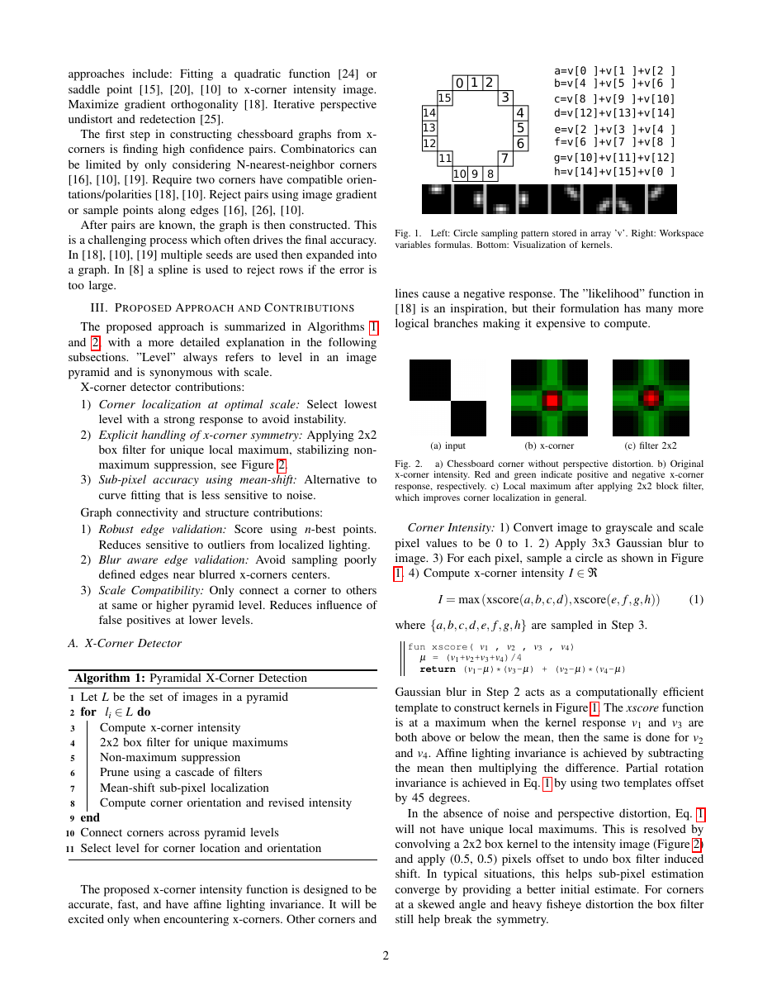
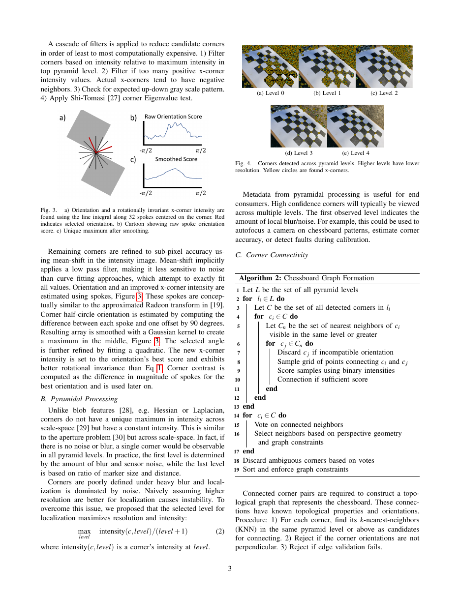
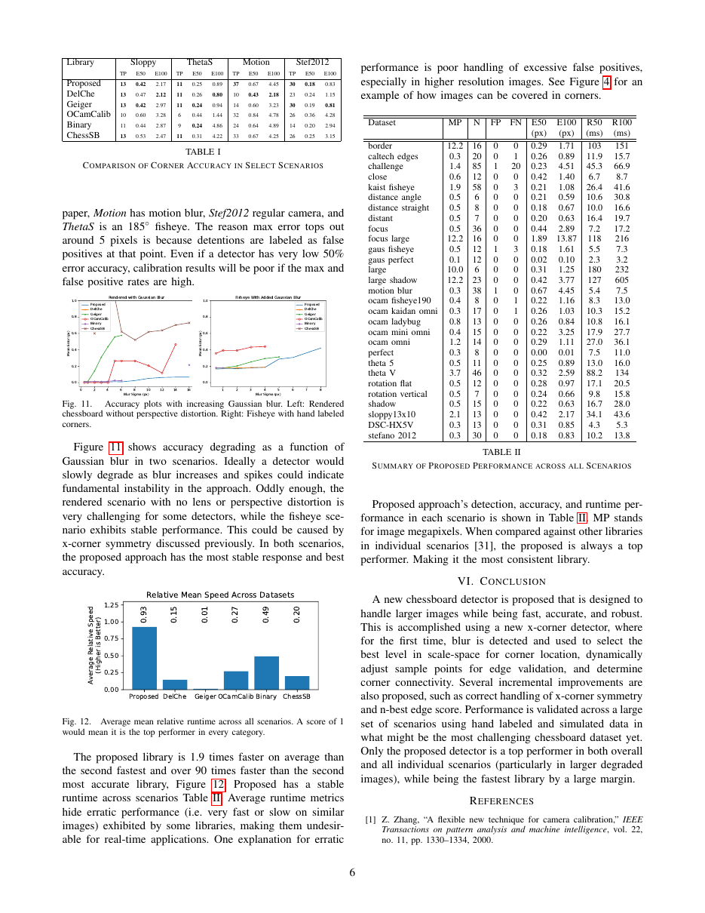

# 번역: 피라미드 기반 블러 인지 X 코너 체커보드 검출기

- 원제: Pyramidal Blur Aware X-Corner Chessboard Detector
- 저자: Peter Abeles (NINOX 360, Redwood City, CA, USA)
- 서지: arXiv 2110.13793v1 [cs.CV], 2021-10-26
- 원문: 같은 폴더의 `Abeles2021_PyramidalBlurAwareXCorner.pdf` (7쪽)
- 번역 범위: 전문 (초록, 본문, 그림과 표 캡션). 참고문헌은 원문 그대로 둔다.
- 번역 방식: `pdftotext -layout`과 읽기 순서 추출본으로 본문을 뽑고, 표와 그림 수치는 쪽 이미지로 대조했다. 번역자 주석은 [역주]로 표시한다.

---

## 초록

카메라 해상도는 계속 높아지고, 좋지 않은 환경에서 로봇 플랫폼을 빠르게 다시 보정해야 하는 일이 늘고 있다. 그래서 더 빠르고 더 강건한 체커보드 기준 표지 검출기가 필요하다.
이 논문은 다음 조건을 위해 특별히 설계한 새 체커보드 검출기를 제안한다.
- 고해상도 영상
- 초점 흐림과 움직임 흐림
- 가혹한 조명 조건
- 복잡한 배경

이를 위해 새 X 코너 검출기를 쓴다. 이 검출기에서 처음으로 블러를 추정하고, 그 값을 새로운 방식으로 써서 코너 위치 추정, 에지 검증, 연결성을 개선한다.
성능은 여러 제3자 자료를 합치고, 최신 기법을 시험하도록 특별히 만든 새 상황을 더한 다양한 영상 묶음으로 측정하고 다른 라이브러리와 비교한다.
제안한 검출기는 F1 점수 0.97로 가장 좋았고, 다음으로 빠른 것보다 1.9배 빠르며, 코너 정확도에서도 최상위였다. 또한 모든 상황에서 꾸준히 좋은 성능을 낸 유일한 검출기였다.

## I. 서론

카메라 보정은 영상의 2D 화소 좌표와 3D 세계 사이의 대응을 정하는 데 꼭 필요한 일이다. 보정 표지를 관측하면 카메라 내부 특성(예: 초점거리, 렌즈 왜곡)을 높은 정밀도로 추정할 수 있다 [1].
체커보드(체스판) 무늬는 카메라 보정에 가장 널리 쓰이는 무늬라고 할 만하다. 그럴 만한 이유가 있다 [2]. 검출이 쉽고, 대칭 덕분에 블러에 강하다. 단독으로 쓰거나, CALTag [4]와 ChArUco [5]처럼 스스로 식별되는 무늬 [3]와 함께 쓴다.

이 연구는 다양한 환경에서 체커보드 무늬를 완전 자동으로 검출하는 데 초점을 둔다. 야외와 공장 안에서 하는 보정은 점점 중요해지고 있다. 동시에 어렵다. 조명이 나쁘고 일정하지 않으며, 움직임 흐림, 초점 불량, 강한 그림자, 복잡한 배경이 있다. 또 과거 연구 대부분이 나온 뒤로 일반 카메라 해상도가 크게 높아졌다. 이제 흔해진 12 메가화소 이상의 영상을 다룰 새 기법이 필요하다.

여러 새로운 점을 묶은 새 체커보드 검출기를 제안한다.
- 새 X 코너 검출기
- 블러 추정기
- 블러를 인지하는 강건한 에지 검증
- 전체를 아우르는 다중 스케일 접근

뒤의 세 가지는 과거 연구와 크게 다르다. 코너 위치를 잴 최적 스케일을 추정하고, 그 스케일로 에지를 동적으로 샘플링하고 코너 연결성을 정하는 기준 표지 검출기로는 처음으로 알려진 것이다. 이 덕분에 심하게 흐린 영상과 어안 영상도 처리할 수 있다.
최종 출력은 찾은 무늬를 모두 돌려주도록 하거나, 사전 정보를 써서 알려진 표적 하나만 찾도록 설정할 수 있다. 결과에는 메타데이터가 함께 나온다. 이것은 카메라 진단, 자동 초점, 코너 정밀도 추정에 쓸모가 있다.

성능을 검증하려고, 여러 저자의 자료와 실제 상황에서 검출기를 괴롭히고 깨뜨리도록 새로 설계한 자료를 모아, 지금까지 가장 다양하다고 할 만한 체커보드 장면 묶음으로 연구했다. 정확도는 손으로 표시한 코너와, 코너 위치를 아는 합성 영상으로 잰다.
이 연구에서 제안한 검출기는 모든 상황에서 강건성, 정확도, 속도를 보였다. 시험한 라이브러리 가운데 꾸준히 좋은 결과를 낸 것은 이것뿐이었다. 소스 코드와 자료는 모두 온라인에서 무료로 받을 수 있다(각주 1).

각주 1: 검출기와 소스 코드는 2019년부터 BoofCV에 있었고, v0.39에서 작은 개선이 있었다. https://boofcv.org

## II. 관련 연구

평면 표적은 쓰기 쉬워 카메라 보정에 널리 쓰이며 [1], 이를 위한 도구가 많다. OpenCV [6], Bouguet의 Matlab [7], CamOdoCal [8], BoofCV [9] 등이 있다. 초기 방법은 코너를 찾는 데 사람의 손이 필요했다. 최근 방법은 대부분의 코너를 자동으로 찾지만, 정확도와 신뢰도는 저마다 다르다. 블러와 왜곡을 더 잘 다루려고 체커보드 대신 Deltille 무늬가 제안되기도 했다 [10].

체커보드 검출의 한 방법은 사각형 둘레의 윤곽선을 쓰는 것이다. OpenCV의 findChessboardCorners [11]는 영상을 적응 이진화하고, 침식으로 사각형(사변형)을 서로 떼어 낸 뒤, 윤곽선으로 사각형을 찾는다. 사변형의 꼭짓점을 이어 체커보드 격자를 만든다. 영상 경계는 어렵다. 사각형이 잘리거나 크게 일그러지기 때문이다. 이 일반 방법의 개선이 [12], [8]에서 제안되었다. 최근에는 코너 검출에 딥러닝도 시도되었다 [13].

사각형 윤곽 대신 X 코너(두 사각형이 맞닿는 곳이라 붙은 이름)를 바로 검출하면 영상 경계 문제를 피할 수 있다. Harris [14] 코너 검출기는 많은 X 코너 검출기 [15], [16], [17]의 바탕이다. Harris는 X 코너 검출에 뛰어나지만, 코너처럼 보이는 다른 모양도 검출한다.

여러 논문이 X 코너 전용 강도 함수를 제안했다 [18], [17], [10], [19]. [20]에서는 이진 중심선 [21]을 보고 X 코너를 찾는다. 검출 뒤에 코너를 거르는 것은 흔한 일이다. [16], [18]은 국소 기울기 히스토그램 통계로, [17]은 국소 밝기 무늬로 거른다.

후보 코너를 화소 수준 정밀도로 찾은 뒤에는 부화소 정확도로 정밀화한다 [22], [23]. 구체적인 방법은 다음과 같다.
- X 코너 강도 영상에 2차 함수 [24] 또는 안장점 [15], [20], [10]을 맞춤
- 기울기 직교성 최대화 [18]
- 원근 왜곡을 반복해서 펴고 다시 검출 [25]

X 코너로 체커보드 그래프를 만드는 첫 단계는 신뢰도 높은 짝을 찾는 것이다. 조합 수는 N개 최근접 이웃 코너만 보는 것으로 줄일 수 있다 [16], [10], [19]. 두 코너의 방향과 극성이 맞아야 한다고 요구하기도 한다 [18], [10]. 영상 기울기를 쓰거나 에지를 따라 점을 샘플링해 짝을 버린다 [16], [26], [10].

짝을 알면 그래프를 만든다. 이것은 어려운 과정이며 최종 정확도를 좌우하는 경우가 많다. [18], [10], [19]에서는 여러 씨앗에서 시작해 그래프로 키운다. [8]에서는 스플라인을 써서 오차가 너무 큰 행을 버린다.

## III. 제안 방법과 기여

제안 방법은 알고리즘 1과 2에 요약했고, 아래 하위 절에서 더 자세히 설명한다. "층(level)"은 언제나 영상 피라미드의 층을 뜻하며 스케일과 같은 말이다.

X 코너 검출기의 기여
1) 최적 스케일에서 코너 위치 추정: 불안정을 피하려고, 응답이 강한 가장 낮은 층을 고른다.
2) X 코너 대칭을 명시적으로 처리: 2x2 상자 필터를 걸어 국소 최댓값을 하나로 만들고, 비최대 억제를 안정시킨다. 그림 2 참고.
3) 평균 이동(mean-shift)으로 부화소 정확도: 곡선 맞춤의 대안이며 잡음에 덜 민감하다.

그래프 연결성과 구조의 기여
1) 강건한 에지 검증: n개의 가장 좋은 점으로 점수를 매긴다. 국소 조명으로 생기는 이상값에 덜 민감하다.
2) 블러를 인지하는 에지 검증: 흐린 X 코너 중심 근처의 잘 정의되지 않은 에지를 샘플링하지 않는다.
3) 스케일 호환성: 한 코너는 같은 층이나 더 높은 층의 코너하고만 잇는다. 낮은 층의 오검출 영향을 줄인다.

### A. X 코너 검출기

알고리즘 1: 피라미드 X 코너 검출
```
1  L을 피라미드의 영상 집합이라 하자
2  각 층 l_i ∈ L 에 대해
3      X 코너 강도를 계산한다
4      국소 최댓값을 하나로 만들려고 2x2 상자 필터를 건다
5      비최대 억제
6      여러 단계 필터로 후보를 줄인다
7      평균 이동으로 부화소 위치를 정한다
8      코너 방향과 수정된 강도를 계산한다
9  끝
10 피라미드 층 사이에서 코너를 잇는다
11 코너 위치와 방향을 정할 층을 고른다
```

제안한 X 코너 강도 함수는 정확하고, 빠르고, 조명의 아핀 변화(이득과 오프셋)에 불변하도록 설계했다. X 코너를 만났을 때만 반응한다. 다른 코너와 선에는 음의 응답이 나온다. [18]의 "우도" 함수에서 착안했지만, 그 식은 논리 분기가 훨씬 많아 계산이 비싸다.



그림 1. 왼쪽: 배열 'v'에 저장하는 원형 샘플링 무늬. 오른쪽: 작업 변수 식. 아래: 커널 시각화.
(작업 변수 식: a=v[0]+v[1]+v[2], b=v[4]+v[5]+v[6], c=v[8]+v[9]+v[10], d=v[12]+v[13]+v[14], e=v[2]+v[3]+v[4], f=v[6]+v[7]+v[8], g=v[10]+v[11]+v[12], h=v[14]+v[15]+v[0])

그림 2. a) 원근 왜곡이 없는 체커보드 코너. b) 원래의 X 코너 강도. 빨강과 초록은 각각 양과 음의 X 코너 응답이다. c) 2x2 블록 필터를 건 뒤의 국소 최댓값. 일반적으로 코너 위치 추정이 좋아진다.

코너 강도 계산 순서
1) 영상을 회색조로 바꾸고 화소값을 0~1로 맞춘다.
2) 영상에 3x3 가우시안 블러를 건다.
3) 화소마다 그림 1처럼 원 위를 샘플링한다.
4) X 코너 강도 I ∈ ℜ 를 계산한다.

  I = max( xscore(a, b, c, d), xscore(e, f, g, h) )   (1)

여기서 {a, b, c, d, e, f, g, h}는 3단계에서 샘플링한 값이다.

```
fun xscore(v1, v2, v3, v4)
    µ = (v1 + v2 + v3 + v4) / 4
    return (v1 - µ)*(v3 - µ) + (v2 - µ)*(v4 - µ)
```

2단계의 가우시안 블러는 그림 1의 커널을 만드는 계산 효율 좋은 틀 역할을 한다. xscore 함수는 커널 응답 v1과 v3이 둘 다 평균보다 크거나 둘 다 작을 때 최대가 되고, v2와 v4도 마찬가지다. 평균을 빼고 차를 곱하므로 조명의 아핀 변화에 불변이다. 식 (1)에서 45도 어긋난 두 틀을 쓰므로 회전에 부분적으로 불변이다.

잡음과 원근 왜곡이 없으면 식 (1)의 국소 최댓값은 하나로 정해지지 않는다. 강도 영상에 2x2 상자 커널을 합성곱하고(그림 2), 상자 필터가 만든 이동을 되돌리려고 (0.5, 0.5) 화소 보정을 하여 이 문제를 푼다. 보통 상황에서는 이것이 더 좋은 초기값을 주어 부화소 추정의 수렴을 돕는다. 비스듬한 각도의 코너나 심한 어안 왜곡에서도 상자 필터는 대칭을 깨는 데 도움이 된다.

여러 단계 필터를 계산 비용이 싼 것부터 비싼 것 순서로 걸어 후보 코너를 줄인다.
1) 맨 위 피라미드 층의 최대 강도에 대한 상대 강도로 거른다.
2) 양의 X 코너 강도 값이 너무 많으면 거른다. 실제 X 코너는 이웃이 음인 경향이 있다.
3) 기대하는 위아래 회색조 무늬를 확인한다.
4) Shi-Tomasi [27] 코너 고윳값 검사를 한다.



그림 3. a) 코너를 중심으로 한 32개 바큇살을 따라 선적분하여 방향과 회전 불변 X 코너 강도를 구한다. 빨강은 고른 방향이다. b) 바큇살 방향 점수의 원값을 보인 개념도. c) 평활 뒤의 유일한 최댓값.

남은 코너는 강도 영상에서 평균 이동으로 부화소 정확도까지 정밀화한다. 평균 이동은 암묵적으로 저역 통과 필터를 걸므로, 모든 값을 정확히 맞추려는 곡선 맞춤 방식보다 잡음에 덜 민감하다.
방향과 개선된 X 코너 강도는 바큇살로 추정한다(그림 3). 바큇살은 [19]의 근사 라돈 변환과 개념이 비슷하다. 코너의 반원 방향은 각 바큇살과 90도 어긋난 바큇살의 차를 계산해 추정한다. 그 배열을 가우시안 커널로 평활해 가운데에 최댓값이 생기게 한다(그림 3). 고른 각도는 2차식을 맞춰 더 정밀화한다. 새 X 코너 강도는 그 방향의 최고 점수로 정하며, 식 (1)보다 회전 불변성이 좋다. 코너 대비는 최적 방향에서 바큇살 크기의 차로 계산하고, 뒤에서 쓴다.

### B. 피라미드 처리

블롭 특징 [28](예: 헤시안, 라플라시안)과 달리, 코너는 스케일 공간에서 강도의 유일한 최댓값을 갖지 않고 강도가 일정하다 [29]. 이것은 조리개 문제 [30]와 비슷하지만 스케일 공간에서 생긴다. 사실 잡음이나 블러가 없으면 코너 하나는 모든 피라미드 층에서 보인다. 실제로는 첫 층은 블러와 센서 잡음의 양으로 정해지고, 마지막 층은 표지 크기와 거리의 비로 정해진다.

블러가 심하면 코너가 잘 정의되지 않고 위치 추정은 잡음이 지배한다. 해상도가 높을수록 위치 추정에 좋다고 단순히 가정하면 불안정해진다. 이 문제를 넘으려고, 위치 추정에 쓸 층을 해상도와 강도를 함께 최대로 하는 층으로 고르자고 제안한다.

  max over level of  intensity(c, level) / (level + 1)   (2)

여기서 intensity(c, level)은 그 층에서 코너의 강도다.

그림 4. 피라미드 층별로 검출한 코너. 높은 층일수록 해상도가 낮다. 노란 원이 찾은 X 코너다. (a) 0층 (b) 1층 (c) 2층 (d) 3층 (e) 4층

피라미드 처리에서 나온 메타데이터는 최종 사용자에게 쓸모가 있다. 신뢰도 높은 코너는 보통 여러 층에서 보인다. 처음 보이는 층은 국소 블러와 잡음의 양을 나타낸다. 예를 들어 체커보드 무늬에 카메라 초점을 자동으로 맞추거나, 코너 정확도를 추정하거나, 보정 중 고장을 찾는 데 쓸 수 있다.

### C. 코너 연결성

알고리즘 2: 체커보드 그래프 만들기
```
1  L을 모든 피라미드 층의 집합이라 하자
2  각 층 l_i ∈ L 에 대해
3      C를 l_i에서 검출한 모든 코너의 집합이라 하자
4      각 c_i ∈ C 에 대해
5          C_n을 같은 층 또는 더 높은 층에서 보이는 c_i의 최근접 이웃 집합이라 하자
6          각 c_j ∈ C_n 에 대해
7              방향이 맞지 않으면 c_j를 버린다
8              c_i와 c_j를 잇는 격자 점들을 샘플링한다
9              이진 강도로 샘플에 점수를 매긴다
10             점수가 충분하면 연결한다
11         끝
12     끝
13 끝
14 각 c_i ∈ C 에 대해
15     연결된 이웃에 대해 투표한다
16     원근 기하와 그래프 제약으로 이웃을 고른다
17 끝
18 투표로 모호한 코너를 버린다
19 정렬하고 그래프 제약을 강제한다
```

체커보드를 나타내는 위상 그래프를 만들려면 연결된 코너 짝이 필요하다. 이 연결은 위상 성질과 방향이 알려져 있다.
절차
1) 각 코너에 대해 같은 피라미드 층이나 그 위에서 k개 최근접 이웃(KNN)을 연결 후보로 찾는다.
2) 코너 방향이 직교하지 않으면 버린다.
3) 에지 검증에 실패하면 버린다.

그림 5. 어안 왜곡에서 코너 방향(청록)과 코너 연결(주황)을 보인 그림.

그림 6. 에지 검증의 구성 요소를 보인 그림. 샘플 위치는 블러를 피하도록 코너 층에 따라 동적으로 정해진다.

에지 검증은 선의 양쪽에 격자 모양으로 점을 샘플링해서 한다(그림 6). {c1, c2}는 국소 블러 양이 서로 다른 코너다. 간격 s_i는 c_i의 피라미드 층에 따라 정해진다. 층에 따라 간격을 바꾸는 이 새 방식은 흐린 코너 근처의 잘 정의되지 않은 에지를 샘플링하지 않게 한다. 수직 오프셋 s3은 c1과 c2 사이 거리로 정한다.
수직 오차 E⊥ = I_i − I_j 는 에지를 가로질러 이웃한 점들을 샘플링해서 구하며, 대비가 높을수록 커진다. 길이 방향 오차 E∥ = |I_i − I_j| 는 유사성을 잰다. 이 점수들을 정렬하고 가장 나쁜 값을 버려서, 잡음과 강한 그림자로 생긴 이상값이 결과를 지배하지 않게 한다. 에지 강도 점수는 아래와 같고, 값이 문턱 아래인 에지는 잘라 낸다.

  L_ij = Σ_k ( E⊥_k − E∥_k ) / ( contrast(c_i) + contrast(c_j) )   (3)

코너 대비 contrast(c)는 III-A절에서 정의했고, 조명 불변을 위한 나눗수로 쓴다.

### D. 격자 그래프 만들기

올바르게 만든 체커보드 위상 그래프는 다음 성질을 갖는다.
1) 모든 코너가 서로 이어져 있어야 한다.
2) 모든 코너의 이웃은 2, 3, 4개 가운데 하나여야 한다.
3) 서로 이웃인 두 이웃 사이에는 공통 코너가 정확히 하나 있어야 한다.

이 조건을 만족하지 않는 연결이나 코너는 잘라 낸다. 연결이 너무 많고 모호한 코너가 확인되면, 국소 이웃이 투표한다. 각 코너는 에지 강도와 기대 기하를 바탕으로 어느 연결이 가장 잘 맞는지 독립적으로 정한다. 진 코너는 제거한다.

### E. 격자 그래프에서 체커보드 그래프로

격자 그래프는 코너 방향 정보를 써서 코너를 표준 반시계 방향 순서로 놓고, 코너 (0,0)이 모서리 사각형에 이어지도록 하여 올바른 체커보드 그래프로 바꾼다. 선택적으로, 남는 연결을 지워 완전한 격자 하나만 남기게 할 수 있다. 빠진 코너가 있는 바깥 행과 열을 지우고, 필요하면 되풀이한다. 체커보드 모양을 미리 알면 그 모양에 맞는 그래프만 돌려준다. 체커보드가 하나만 있다고 보면 영상에서 가장 크게 보이는 무늬를 돌려준다. 정리하면, 출력은 임의 개수의 체커보드일 수도 있고, 더 강한 가정으로 오검출을 잘라 낸 알려진 체커보드 하나일 수도 있다.

간결하게 하려고 이 절의 알고리즘 세부는 단순화했다. 자세한 내용은 소스 코드를 참고하기 바란다.

## IV. 성능 연구

그림 7. 24개 상황 가운데 8개 상황의 예시 영상. 다양한 환경, 조명 조건, 센서를 시험했다. (예시 이름: Caltech Edges, Border, Large Shadow, Distant, Gaussian, OCam Fisheye190, Perfect, Rotation Vertical)

여러 저자의 자료를 합치고, 검출기를 괴롭히도록 특별히 설계한 새 상황을 더해 다양한 성능 연구를 했다(그림 7). 상황마다 카메라 종류, 영상 크기(0.3 MP ~ 12 MP), 조명 조건, 잡음 수준, 움직임 흐림, 초점, 배경 복잡도가 크게 다르다. 코너 정확도는 손으로 표시한 코너와 코너 위치를 아는 합성 영상으로 잰다. 모든 영상에는 체커보드 무늬가 정확히 하나 있고 모든 코너가 보인다. 이는 단일 카메라 보정에서 흔한 조건이다. 모든 상황에 대한 더 완전한 설명은 기술 보고서 [31]을 보라.

성능은 체커보드 검출, 코너 위치 정확도, 실행 시간으로 잰다. 검출 정확도는 F1 점수 통계로 잰다.
- 참 양성 TP: 검출한 체커보드의 모든 코너가 정답에서 t_c 화소 안에 있는 경우
- 거짓 양성 FP: 기대한 격자 모양을 갖추었으나 코너 하나 이상이 t_c 밖에 있는 검출
- 모양이 틀리거나 코너가 빠진 검출은 무시한다.

단순하게 하려고, 그리고 체커보드 방향이 모호할 수 있으므로, 코너 오차는 정답에서 가장 가까운 짝으로 계산한다. 가능하면 알려진 표적 모양을 라이브러리에 준다.



흔히 쓰는 보정 후 재투영 오차 대신 코너 표시(정답)를 쓴다. 재투영 오차는 검출기의 정확도를 직접 재지 않기 때문이다. 재투영 오차는 보정 시스템 전체를 재며, 계통 편향을 숨기고, 카메라 모델의 과매개변수화 때문에 낙관적인 결과를 낼 수 있다. 예를 들어 체커보드 검출기가 5 화소 편향되어 있으면, 보정 시스템은 카메라를 평행 이동해 이를 보상하고 완벽한 결과를 보고한다.

손으로 표시한 X 코너의 정확도는 영상이 초점이 맞을 때 약 0.2 화소로 추정한다. 심하게 흐린 영상은 표시하기 어렵거나 불가능하다. 그래서 Gaussian 상황은 정확한 정답이 있는 모의 영상으로 만들었고, Gaussian Fisheye는 실제 어안 영상에 가우시안 블러를 더했다. 기본으로 t_c는 넉넉하게 5 화소로 두었고, focus large는 표시 정확도 때문에 t_c = 20으로 두었다. 각 라이브러리의 상대 순위는 t_c 선택에 민감하지 않다(그림 8). 화소 (1, 1)을 x, y ∈ (0.5, 1.5] 범위로 정의하는 라이브러리는 (0.5, 0.5) 화소만큼 보정했다.

실행 시간은 입출력을 빼고 코드 안의 시스템 시계로 쟀다. C/C++ 라이브러리는 GCC 9.3.0으로 릴리스 모드 빌드했다. Java 라이브러리는 JVM 15.0.3을 쓰고 예열 뒤에 쟀다. Matlab 라이브러리는 R2021a를 화면 없는 모드로 돌렸다.

라이브러리와 버전
- Proposed(제안): [9] BoofCV v0.39
- DelChe: [10] SHA eed7e86
- Geiger: [18] libomnical과 libcbdetect, 2021년 8월 15일 웹사이트 판
- OCamCalib: [32] v3.0
- Binary: OpenCV 4.5.3 findChessboardCorners와 cornerSubPix
- ChessSB: [19] OpenCV 4.5.3 findChessboardCornersSB

분명히 하자면, DelChe는 deltille 무늬 검출기를 고쳐 만든 체커보드 검출기다.

외부 자료: caltech edges [7], ocam [32], stefano 2012 [33], challenge [34], kaist fisheye [10].

## V. 결과

코너 위치 정확도는 50 % 오차 E50과 최대 오차 E100으로 보고한다. 실행 시간도 같게 R50, R100으로 보고한다. 중앙값(50 %) 통계는 이상값을 뺀 "기대" 또는 보통 성능을 나타내려는 것이다. 최대 통계는 최악의 성능이며 변동이 크다. N은 상황별 영상 수다. 이 결과에 대한 더 완전한 논의는 기술 보고서 [31]을 보라.

멈추거나, 얼거나, 지나치게 느린 라이브러리는 요약 결과를 내는 데 어려움을 주었다. 더 나은 방법이 없어, 그 라이브러리가 처리하지 못한 상황은 빼고 요약 성능을 계산했다. 그래서 일부 라이브러리는 가장 어려운 상황이 빠져 크게 유리해진다. 뺀 상황 수는 DelChe 2개, OCamCalib 1개다.

모든 상황을 합쳐 참 양성 문턱에 따른 검출 성능을 그림 8에 보였다. 제안 방법이 가장 좋았고, 5 화소 문턱에서 F1 점수 0.97이었다. 다음은 Geiger로 F1 점수 0.92였다. 제안 방법과 Geiger는 보통 상황에서는 비슷하지만, 나빠진 상황에서는 제안 방법이 Geiger보다 낫다.

그림 8. 문턱을 바꾸며 모든 상황을 합친 F1 점수. (가로축 문턱 0~3 px, 세로축 F1 점수)

그림 9. 어려운 일부 상황의 F1 점수. (막대 위 값을 쪽 이미지에서 읽어 아래 표로 옮김)

| 상황 | Proposed | DelChe | Geiger | OCamCalib | Binary | ChessSB |
|---|--:|--:|--:|--:|--:|--:|
| focus | 1.00 | 0.94 | 0.78 | 0.99 | 0.87 | 0.96 |
| focus large | 1.00 | 0.00 | 0.32 | 0.32 | 0.32 | 0.32 |
| gaus fisheye | 0.80 | 0.59 | 0.67 | 0.59 | 0.29 | 0.00 |
| shadow | 1.00 | 0.70 | 0.97 | 0.97 | 0.97 | 0.97 |
| large shadow | 1.00 | 0.00 | 0.56 | 0.00 | 0.16 | 0.72 |
| motion blur | 0.99 | 0.42 | 0.54 | 0.91 | 0.77 | 0.93 |

그림 9는 블러나 나쁜 환경 조건이 있는 일부 상황의 성능을 보인다. 이 상황들에서 제안 방법이 최상위이며, 차이가 큰 경우가 많다. 예를 들어 "focus large"에서는 3배다. 성능 차이는 큰 영상(10 메가화소 이상, 표 II 참고)에서 가장 크게 나는 경향이 있다. 이는 블러를 인지하는 피라미드 접근이 옳다는 것을 보여 준다.

그림 10. 전체 코너 위치 정확도. (50 % 화소 오차, 낮을수록 좋음)

| Proposed | DelChe | Geiger | OCamCalib | Binary | ChessSB |
|--:|--:|--:|--:|--:|--:|
| 0.24 | 0.27 | 0.25 | 0.41 | 0.26 | 0.33 |

그림 10은 모든 상황의 모든 참 양성 검출에서 50 % 오차로 본 보통 코너 위치 정확도다. 50 % 오차를 쓰면 이상값이 빠지므로, 검출을 더 많이 한 라이브러리가 불리해지지 않는다. 제안한 검출기는 사실상 보통 정확도 1위 동률이다. 모든 라이브러리가 그럴듯한 보통 정확도를 보인다.

전체 보통 성능은 현실보다 지나치게 낙관적인 모습을 보이므로, 특정 상황 몇 개를 따로 본다. 표 I은 대부분의 검출기가 "좋은" 검출률을 보인 상황에서 참 양성 수, 50 % 코너 오차, 최대 코너 오차를 보인다. Sloppy는 물결진 종이에 인쇄한 것이고, Motion은 움직임 흐림이 있으며, Stef2012는 일반 카메라, ThetaS는 185도 어안이다. 최대 오차가 5 화소 근처에서 멈추는 까닭은 그 지점에서 검출이 거짓 양성으로 분류되기 때문이다. 50 % 오차가 아무리 작아도, 최대 오차와 거짓 양성률이 높으면 보정 결과는 나쁘다.

표 I. 일부 상황의 코너 정확도 비교 (E50, E100 단위 px)

| 라이브러리 | Sloppy TP | E50 | E100 | ThetaS TP | E50 | E100 | Motion TP | E50 | E100 | Stef2012 TP | E50 | E100 |
|---|--:|--:|--:|--:|--:|--:|--:|--:|--:|--:|--:|--:|
| Proposed | 13 | 0.42 | 2.17 | 11 | 0.25 | 0.89 | 37 | 0.67 | 4.45 | 30 | 0.18 | 0.83 |
| DelChe | 13 | 0.47 | 2.12 | 11 | 0.26 | 0.80 | 10 | 0.43 | 2.18 | 23 | 0.24 | 1.15 |
| Geiger | 13 | 0.42 | 2.97 | 11 | 0.24 | 0.94 | 14 | 0.60 | 3.23 | 30 | 0.19 | 0.81 |
| OCamCalib | 10 | 0.60 | 3.28 | 6 | 0.44 | 1.44 | 32 | 0.84 | 4.78 | 26 | 0.36 | 4.28 |
| Binary | 11 | 0.44 | 2.87 | 9 | 0.24 | 4.86 | 24 | 0.64 | 4.89 | 14 | 0.20 | 2.94 |
| ChessSB | 13 | 0.53 | 2.47 | 11 | 0.31 | 4.22 | 33 | 0.67 | 4.25 | 26 | 0.25 | 3.15 |

그림 11. 가우시안 블러가 커질 때의 정확도 그래프. 왼쪽: 원근 왜곡 없이 렌더링한 체커보드(블러 시그마 0~16 px). 오른쪽: 손으로 표시한 코너가 있는 어안 영상(블러 시그마 1~8 px). 세로축은 평균 오차(px).

그림 11은 두 상황에서 가우시안 블러에 따라 정확도가 나빠지는 모습을 보인다. 이상적인 검출기는 블러가 커질수록 천천히 나빠져야 하며, 튀는 값은 방법의 근본적인 불안정을 뜻할 수 있다. 이상하게도, 렌즈 왜곡과 원근 왜곡이 없는 렌더링 상황이 일부 검출기에게는 매우 어렵고, 어안 상황은 안정된 성능을 보인다. 앞에서 말한 X 코너 대칭 때문일 수 있다. 두 상황 모두에서 제안 방법이 가장 안정된 응답과 가장 좋은 정확도를 보인다.

[역주] 그림 11 쪽 이미지에서 눈으로 읽은 대략값: 왼쪽(렌더링)에서 제안 방법의 평균 오차는 시그마 0~16 전 구간에서 약 0.0~0.07 px로 가장 낮고 평탄하다. 다른 몇몇 라이브러리는 시그마 4~6 부근부터 0.2~0.6 px로 튄다. 오른쪽(어안)에서 제안 방법은 시그마 1에서 약 0.18 px, 시그마 8에서 약 0.42 px다. 이 값은 그래프 판독치이며 원문 표의 수치가 아니다.

그림 12. 모든 상황에 걸친 평균 상대 실행 속도. 1점이면 모든 범주에서 가장 빠르다는 뜻이다. (높을수록 좋음)

| Proposed | DelChe | Geiger | OCamCalib | Binary | ChessSB |
|--:|--:|--:|--:|--:|--:|
| 0.93 | 0.15 | 0.01 | 0.27 | 0.49 | 0.20 |

제안 라이브러리는 평균으로 두 번째로 빠른 것보다 1.9배 빠르고, 두 번째로 정확한 라이브러리보다 90배 넘게 빠르다(그림 12). 제안 방법은 상황 사이에 실행 시간이 안정적이다(표 II). 평균 실행 시간은 들쭉날쭉한 성능(비슷한 영상에서 매우 빠르거나 매우 느린 것)을 가린다. 일부 라이브러리가 이런 모습을 보여 실시간 응용에 맞지 않는다. 들쭉날쭉한 성능의 한 가지 설명은, 특히 고해상도 영상에서 지나치게 많은 거짓 양성을 잘 처리하지 못하는 것이다. 영상이 코너로 뒤덮이는 예는 그림 4를 보라.

제안 방법의 상황별 검출, 정확도, 실행 시간 성능을 표 II에 보였다. MP는 영상의 메가화소 수다. 개별 상황에서 다른 라이브러리와 비교하면 [31], 제안 방법은 언제나 최상위권이다. 그래서 가장 일관된 라이브러리다.

표 II. 모든 상황에서 제안 방법의 성능 요약

| 자료(상황) | MP | N | FP | FN | E50 (px) | E100 (px) | R50 (ms) | R100 (ms) |
|---|--:|--:|--:|--:|--:|--:|--:|--:|
| border | 12.2 | 16 | 0 | 0 | 0.29 | 1.71 | 103 | 151 |
| caltech edges | 0.3 | 20 | 0 | 1 | 0.26 | 0.89 | 11.9 | 15.7 |
| challenge | 1.4 | 85 | 1 | 20 | 0.23 | 4.51 | 45.3 | 66.9 |
| close | 0.6 | 12 | 0 | 0 | 0.42 | 1.40 | 6.7 | 8.7 |
| kaist fisheye | 1.9 | 58 | 0 | 3 | 0.21 | 1.08 | 26.4 | 41.6 |
| distance angle | 0.5 | 6 | 0 | 0 | 0.21 | 0.59 | 10.6 | 30.8 |
| distance straight | 0.5 | 8 | 0 | 0 | 0.18 | 0.67 | 10.0 | 16.6 |
| distant | 0.5 | 7 | 0 | 0 | 0.20 | 0.63 | 16.4 | 19.7 |
| focus | 0.5 | 36 | 0 | 0 | 0.44 | 2.89 | 7.2 | 17.2 |
| focus large | 12.2 | 16 | 0 | 0 | 1.89 | 13.87 | 118 | 216 |
| gaus fisheye | 0.5 | 12 | 1 | 3 | 0.18 | 1.61 | 5.5 | 7.3 |
| gaus perfect | 0.1 | 12 | 0 | 0 | 0.02 | 0.10 | 2.3 | 3.2 |
| large | 10.0 | 6 | 0 | 0 | 0.31 | 1.25 | 180 | 232 |
| large shadow | 12.2 | 23 | 0 | 0 | 0.42 | 3.77 | 127 | 605 |
| motion blur | 0.3 | 38 | 1 | 0 | 0.67 | 4.45 | 5.4 | 7.5 |
| ocam fisheye190 | 0.4 | 8 | 0 | 1 | 0.22 | 1.16 | 8.3 | 13.0 |
| ocam kaidan omni | 0.3 | 17 | 0 | 1 | 0.26 | 1.03 | 10.3 | 15.2 |
| ocam ladybug | 0.8 | 13 | 0 | 0 | 0.26 | 0.84 | 10.8 | 16.1 |
| ocam mini omni | 0.4 | 15 | 0 | 0 | 0.22 | 3.25 | 17.9 | 27.7 |
| ocam omni | 1.2 | 14 | 0 | 0 | 0.29 | 1.11 | 27.0 | 36.1 |
| perfect | 0.3 | 8 | 0 | 0 | 0.00 | 0.01 | 7.5 | 11.0 |
| theta 5 | 0.5 | 11 | 0 | 0 | 0.25 | 0.89 | 13.0 | 16.0 |
| theta V | 3.7 | 46 | 0 | 0 | 0.32 | 2.59 | 88.2 | 134 |
| rotation flat | 0.5 | 12 | 0 | 0 | 0.28 | 0.97 | 17.1 | 20.5 |
| rotation vertical | 0.5 | 7 | 0 | 0 | 0.24 | 0.66 | 9.8 | 15.8 |
| shadow | 0.5 | 15 | 0 | 0 | 0.22 | 0.63 | 16.7 | 28.0 |
| sloppy13x10 | 2.1 | 13 | 0 | 0 | 0.42 | 2.17 | 34.1 | 43.6 |
| DSC-HX5V | 0.3 | 13 | 0 | 0 | 0.31 | 0.85 | 4.3 | 5.3 |
| stefano 2012 | 0.3 | 30 | 0 | 0 | 0.18 | 0.83 | 10.2 | 13.8 |

## VI. 결론

크기가 큰 영상을 다루면서도 빠르고, 정확하고, 강건하도록 설계한 새 체커보드 검출기를 제안했다. 이를 새 X 코너 검출기로 이루었다. 여기서 처음으로 블러를 검출하고, 그 값으로 코너 위치를 정할 스케일 공간의 최적 층을 고르고, 에지 검증의 샘플 점을 동적으로 조정하고, 코너 연결성을 정했다. X 코너 대칭의 올바른 처리, n개 최고 에지 점수 같은 점진적 개선도 함께 제안했다. 손으로 표시한 자료와 모의 자료를 써서, 지금까지 가장 어려울 수 있는 체커보드 자료 묶음의 넓은 상황에서 성능을 검증했다. 전체 성능과 모든 개별 상황(특히 더 큰 열화 영상)에서 모두 최상위인 것은 제안 검출기뿐이었고, 동시에 큰 차이로 가장 빠른 라이브러리였다.

## 참고문헌 (원문 그대로)

[1] Z. Zhang, "A flexible new technique for camera calibration," IEEE Transactions on pattern analysis and machine intelligence, vol. 22, no. 11, pp. 1330–1334, 2000.
[2] J. Mallon and P. F. Whelan, "Which pattern? biasing aspects of planar calibration patterns and detection methods," Pattern recognition letters, vol. 28, no. 8, pp. 921–930, 2007.
[3] M. Fiala and C. Shu, "Self-identifying patterns for plane-based camera calibration," Machine Vision and Applications, vol. 19, no. 4, pp. 209–216, 2008.
[4] B. Atcheson, F. Heide, and W. Heidrich, "Caltag: High precision fiducial markers for camera calibration." in VMV, vol. 10, 2010, pp. 41–48.
[5] S. Garrido, "Charuco: Chessboard + aruco," https://opencv.org/, 2015.
[6] Various, "Opencv library," https://opencv.org, 2000.
[7] J.-Y. Bouguet, "Camera calibration toolbox for matlab," 2001.
[8] L. Heng, B. Li, and M. Pollefeys, "Camodocal: Automatic intrinsic and extrinsic calibration of a rig with multiple generic cameras and odometry," in 2013 IEEE/RSJ International Conference on Intelligent Robots and Systems. IEEE, 2013, pp. 1793–1800.
[9] P. Abeles, "Boofcv's camera calibration tools," http://boofcv.org/, 2011-2021.
[10] H. Ha, M. Perdoch, H. Alismail, I. So Kweon, and Y. Sheikh, "Deltille grids for geometric camera calibration," in Proceedings of the IEEE International Conference on Computer Vision, 2017, pp. 5344–5352.
[11] V. Vezhnevets and P. Gruebele, "Part of the opencv image processing library: findchessboardcorners()," https://opencv.org/, 2010.
[12] M. Rufli, D. Scaramuzza, and R. Siegwart, "Automatic detection of checkerboards on blurred and distorted images," in 2008 IEEE/RSJ International Conference on Intelligent Robots and Systems. IEEE, 2008, pp. 3121–3126.
[13] S. Donné, J. De Vylder, B. Goossens, and W. Philips, "Mate: Machine learning for adaptive calibration template detection," Sensors, vol. 16, no. 11, p. 1858, 2016.
[14] C. G. Harris and M. Stephens, "A combined corner and edge detector." in Alvey vision conference, vol. 15, no. 50, 1988.
[15] L. Lucchese and S. K. Mitra, "Using saddle points for subpixel feature detection in camera calibration targets," in Asia-Pacific Conference on Circuits and Systems, vol. 2. IEEE, 2002, pp. 191–195.
[16] A. Kassir and T. Peynot, "Reliable automatic camera-laser calibration," in Proceedings of the 2010 Australasian Conference on Robotics & Automation. ARAA, 2010.
[17] Y. Liu, S. Liu, Y. Cao, and Z. Wang, "Automatic chessboard corner detection method," IET Image Processing, vol. 10, no. 1, pp. 16–23, 2016.
[18] A. Geiger, F. Moosmann, Ö. Car, and B. Schuster, "Automatic camera and range sensor calibration using a single shot," in 2012 IEEE International Conference on Robotics and Automation. IEEE, 2012, pp. 3936–3943.
[19] A. Duda and U. Frese, "Accurate detection and localization of checkerboard corners for calibration." in BMVC, 2018, p. 126.
[20] S. Placht, P. Fürsattel, E. A. Mengue, H. Hofmann, C. Schaller, M. Balda, and E. Angelopoulou, "Rochade: Robust checkerboard advanced detection for camera calibration," in European Conference on Computer Vision. Springer, 2014, pp. 766–779.
[21] C. W. Niblack, P. B. Gibbons, and D. W. Capson, "Generating skeletons and centerlines from the distance transform," CVGIP: Graphical Models and image processing, vol. 54, no. 5, pp. 420–437, 1992.
[22] J.-M. Lavest, M. Viala, and M. Dhome, "Do we really need an accurate calibration pattern to achieve a reliable camera calibration?" in European Conference on Computer Vision. Springer, 1998, pp. 158–174.
[23] W. Sun and J. R. Cooperstock, "Requirements for camera calibration: Must accuracy come with a high price?" in 2005 Seventh IEEE Workshops on Applications of Computer Vision (WACV/MOTION'05)-Volume 1, vol. 1. IEEE, 2005, pp. 356–361.
[24] W. Förstner and E. Gülch, "A fast operator for detection and precise location of distinct points, corners and centres of circular features," in Proc. ISPRS intercommission conference on fast processing of photogrammetric data, 1987, pp. 281–305.
[25] A. Datta, J.-S. Kim, and T. Kanade, "Accurate camera calibration using iterative refinement of control points," in 2009 IEEE 12th International Conference on Computer Vision Workshops, ICCV Workshops. IEEE, 2009, pp. 1201–1208.
[26] V. N. Dao and M. Sugimoto, "A robust recognition technique for dense checkerboard patterns," in 2010 20th International Conference on Pattern Recognition. IEEE, 2010, pp. 3081–3084.
[27] J. Shi and C. Tomasi, "Good features to track," in 1994 Proceedings of IEEE conference on computer vision and pattern recognition. IEEE, 1994, pp. 593–600.
[28] D. G. Lowe, "Object recognition from local scale-invariant features," in Proceedings of the seventh IEEE international conference on computer vision, vol. 2. IEEE, 1999, pp. 1150–1157.
[29] A. P. Witkin, "Scale-space filtering," in Readings in Computer Vision. Elsevier, 1987, pp. 329–332.
[30] J. Shi and C. Tomasi, "Good features to track," in Proceedings of IEEE conference on computer vision and pattern recognition, 1994, pp. 593–600.
[31] P. Abeles, "Yet to be published detailed technical report," in TBD, 2021.
[32] D. Scaramuzza, A. Martinelli, and R. Siegwart, "A toolbox for easily calibrating omnidirectional cameras," in 2006 IEEE/RSJ International Conference on Intelligent Robots and Systems. IEEE, 2006, pp. 5695–5701.
[33] S. Mattoccia, "Stereo images from videredesign monochrome megad," http://vision.deis.unibo.it/ smatt/stereo/Calibration.html, 2006.
[34] T. Peynot, S. Scheding, and S. Terho, "The marulan data sets: Multi-sensor perception in a natural environment with challenging conditions," The International Journal of Robotics Research, vol. 29, no. 13, pp. 1602–1607, 2010.
