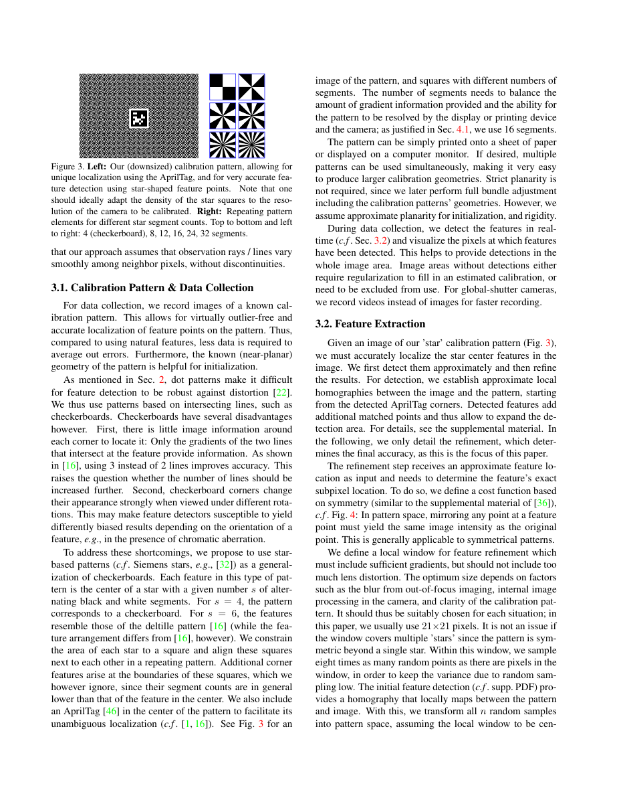
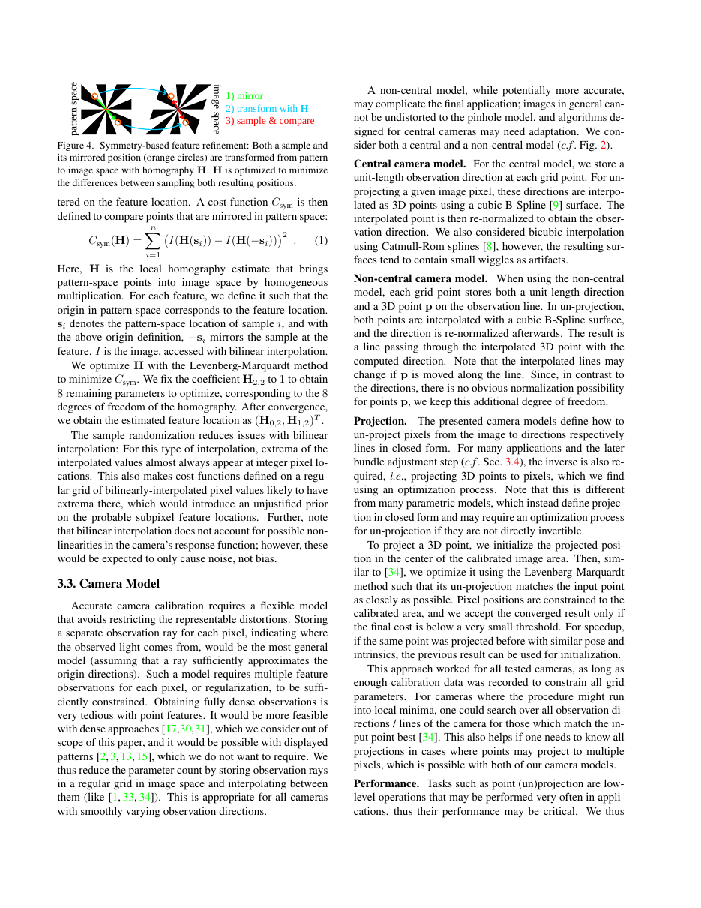
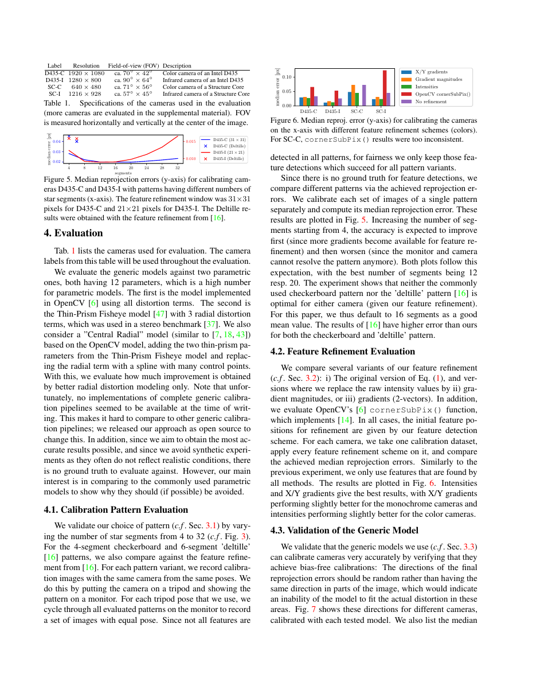

# 카메라 모델에 파라미터가 12개보다 10,000개 있는 편이 나은 이유 (번역)

- 원제: Why Having 10,000 Parameters in Your Camera Model Is Better Than Twelve
- 저자: Thomas Schöps(ETH Zürich), Viktor Larsson(ETH Zürich), Marc Pollefeys(ETH Zürich, Microsoft Mixed Reality & AI Zurich Lab), Torsten Sattler(Chalmers University of Technology)
- 원문: 같은 폴더의 `Schops2020_CVPR_10000params_arXiv1912.02908v3.pdf` (arXiv 1912.02908v3, 2020-06-23, 본문 8쪽과 보충자료 포함 15쪽)
- 번역 범위: 전문(초록, 본문, 그림과 표 캡션, 보충자료). 참고문헌은 원문 그대로 둔다.
- 번역 원칙: 뜻을 살린 번역이다. 수식 기호는 원문을 따른다. 번역자 주는 [역주]로 표시한다.

---

## 초록

카메라 보정은 3차원 컴퓨터 비전 시스템을 세우는 첫 단계로 꼭 필요하다.
흔히 쓰는 파라메트릭 카메라 모델은 자유도가 몇 개뿐이다.
그래서 복잡한 실제 렌즈 왜곡에 최적으로 맞지 않는 경우가 많다.
반면 일반(generic) 카메라 모델은 유연해서 매우 정확하게 보정할 수 있다.
그런데도 실제로는 거의 쓰이지 않았다.
이 논문에서 우리는 이것이 바뀌어야 한다고 주장한다.
우리는 일반 모델을 위한 보정 파이프라인을 제안한다.
이 파이프라인은 완전 자동이고, 쓰기 쉽고, 파라메트릭 보정을 그대로 대신할 수 있으며, 정확도에 초점을 둔다.
우리 결과를 파라메트릭 보정과 비교한다.
스테레오 깊이 추정과 카메라 자세 추정을 예로 들어, 보정 오차가 결과에 편향(bias)으로 작용함을 보인다.
따라서 지금의 흔한 관행과 달리, 가능하면 언제나 일반 모델을 파라메트릭 모델보다 우선해야 한다고 주장한다.
이를 돕기 위해 보정 파이프라인을 https://github.com/puzzlepaint/camera_calibration 에 공개했다.
누구나 쉽고 정확하게 카메라를 보정할 수 있다.

> 그림 1. 휴대전화 카메라에 파라메트릭 카메라 모델 두 개(왼쪽, 가운데)와 일반 모델 하나(오른쪽)를 맞춘 뒤 남은 왜곡 무늬. 일반 모델은 대부분 무작위 잡음만 보인다. 파라메트릭 모델은 강한 계통적 모델링 오차를 보인다.

> 그림 2. 이 논문에서 다루는 두 일반 카메라 모델의 2차원 개념도. (a) 영상 공간(검은 사각형)에 제어점 격자를 정의한다. 격자는 보정 영역(분홍 점선 사각형)에 맞춰 놓고, 그 바깥으로 한 칸 더 넓힌다. 한 점(빨강)을 역투영할 때는 주변 4x4 점(파랑)에 저장된 값을 B-스플라인 곡면으로 보간한다. 보간 대상은 (b) 중심 모델에서는 투영 중심(검은 점)에서 출발하는 방향(회색과 파랑 화살표)이고, (c) 비중심 모델에서는 임의의 직선(회색과 파랑 화살표)이다.

## 1. 서론

기하 카메라 보정은 카메라의 각 화소에 기록된 빛이 어디서 왔는지 정하는 과정이다.
3차원 컴퓨터 비전 시스템의 필수 전제 조건이다.
흔한 파라메트릭 카메라 모델은 자유도가 몇 개뿐이다.
그래서 복잡한 실제 렌즈 왜곡에 최적으로 맞기 어렵다(그림 1 참고).
예를 들어 자율주행에서 카메라를 앞유리 뒤에 두면 문제가 더 커진다 [1].
그런데 정확한 보정은 매우 중요하다.
보정 오차는 이후의 모든 계산에 영향을 주기 때문이다.
최종 응용에서 특징 추출 등이 만드는 잡음은 카메라 보정 오차보다 훨씬 클 가능성이 높다.
그래도 보정 오차는 여전히 매우 중요할 수 있다.
**평균으로 없앨 수 없는 편향으로 작용할 수 있기 때문이다.**

일반 카메라 모델 [15]은 화소와, 카메라 광학계 바깥의 3차원 관측 직선 또는 광선을 순수하게 수학적으로 연결한다.
물리적 해석은 주지 않는다.
일반 모델은 화소마다 관측 직선이나 광선을 촘촘히 대응시킨다.
극단적인 경우 카메라 영상의 화소마다 직선을 하나씩 따로 저장한다.
자유도가 많아서 모든 종류의 카메라에 맞을 수 있다.
그래서 정확하고 편향 없는 보정을 얻을 수 있다.
그림 2는 이 논문에서 다루는 모델을 보여 준다.

기존 일반 보정 방법들(2절 참고)은 실제로 거의 쓰이지 않았다.
한편으로는 기존 방법 어느 것에도 바로 쓸 수 있는 구현이 없었기 때문일 수 있다.
다른 한편으로는 연구계 전반이 파라메트릭 모델보다 일반 보정이 실용적으로 유리하다는 점을 잘 모르는 듯하다.

그래서 우리의 기여는 다음과 같다.
1) 정확도를 높이기 위해 카메라 보정을 개선한다. 특히 보정 무늬와 특징 추출을 개선한다.
2) 정확한 일반 보정이 파라메트릭 모델보다 나은 점을 보인다. 특히 스테레오 깊이와 카메라 자세 추정을 예로 든다.
3) 쓰기 쉬운 보정 파이프라인과 일반 카메라 모델을 오픈소스로 공개한다.

## 2. 관련 연구

이 절에서는 일반 카메라 모델을 쓰는 보정 관련 연구를 정리한다.
보정 초기화는 다루지 않는다. 잘 동작하는 [27]을 그대로 쓰기 때문이다.

**무늬 설계와 특징 검출.**
전통적으로 카메라 보정에는 체커보드 [5, 6]와 점(dot) 무늬 [19]를 써 왔다.
그러나 점 무늬의 특징 검출은 원근과 렌즈 왜곡에 취약하다 [22].
최근 연구로는 체커보드용 더 강건한 검출기 [11, 25], 초점 흐림에 강하도록 능선(ridge line)을 쓰는 방법 [10], 저계수(low-rank) 질감을 쓰는 보정 [49]이 있다.
Ha 외 [16]는 삼각형 무늬를 제안했다.
삼각형 무늬는 체커보드보다 코너 정밀화에 쓸 기울기 정보를 더 많이 준다.
우리가 제안하는 보정 무늬도 비슷하게 쓸 수 있는 기울기를 늘린다.
다만 흑백 조각 수를 바꿀 수 있어서, [16]보다 더 나은 특징을 설계할 수 있다.

**비중심 일반 모델.**
Grossberg와 Nayar [15]가 처음으로 각 화소를 3차원 관측 직선 하나에 대응시키는 일반 카메라 모델을 도입했다.
직선은 방향과 직선 위의 한 점으로 정의한다.
이 모델은 중심 카메라(투영 중심이 하나뿐인 카메라)와 비중심 카메라를 모두 표현한다.
[27, 40]은 [15]의 일반 모델을 위한 기하 보정 방법을 제안했다. 영상 사이의 상대 자세를 미리 알 필요가 없다.
[27]은 전체 보정 파이프라인보다 초기화에 집중한다.
우리 방법은 [27]을 확장해, 보정 무늬와 검출기를 개선하고 전체 번들 조정을 더한다.

**중심 일반 모델.**
비중심 카메라는 응용을 복잡하게 만들 수 있다.
예를 들어 화소 깊이를 모르면 핀홀 영상으로 왜곡을 펴는 것이 불가능하다 [42].
그래서 보정을 중심 모델로 제한하는 모델도 제안되었다 [1, 3, 13, 24].
중심 카메라에서는 모든 관측 직선이 투영 중심에서 만난다.
그래서 관측 직선은 관측 광선, 곧 방향으로 단순해진다.

**화소별 모델과 보간.**
화소마다 관측 직선이나 광선을 하나씩 쓰면 [13, 15] 유연성이 가장 크다.
그러나 파라미터 수가 극단적으로 많아져 보정이 어렵다.
특히 전통적인 성긴 보정 무늬는 측정을 충분히 주지 못한다.
그래서 이런 모델을 쓰는 연구들은 화소 위치를 부호화해 보여 주는 디스플레이로 조밀한 대응을 얻거나 [2, 3, 13, 15], 성긴 특징 사이를 보간한다 [27].

인쇄한 무늬가 디스플레이보다 실용적일 때가 있다.
또 특징을 보간하면 부정확해진다 [13].
그래서 보정 자료를 덜 요구하는 모델들이 제안되었다.
이 모델들은 성기게 저장한 관측 직선이나 광선 사이를 보간한다.
예를 들어 [23]은 임의로 놓은 제어점을 방사 기저 함수로 보간한다.
다른 연구들은 보간이 편한 규칙 격자를 쓴다.
[1]은 화소에서 관측 방향으로 가는 대응을 B-스플라인 곡면으로 표현한다.
[33, 34]는 스플라인 곡면 두 개로 비슷하게 비중심 모델도 정의한다.
이 논문은 이 방법들을 따른다.

위 연구들은 카메라 모델과 보정 면에서 우리와 가장 비슷하다.
우리는 실제 응용 맥락에서 평가하는 것 말고도, 더 정확한 결과를 얻는 것을 목표로 한다.
그래서 보정 과정이 다음 점에서 다르다.
1) 보정 무늬와 특징 검출을 정확도에 맞춰 특별히 설계한다(3.1절, 3.2절 참고).
2) [1, 34]는 번들 조정에서 재투영 오차를 근사한다. 우리는 이 근사를 피한다. 특징에 가우스 잡음이 있으면 근사를 피하는 편이 더 좋은 해를 주기 때문이다.
3) [1, 34]는 보정 무늬가 평면이라고 가정한다. 무늬가 완벽하지 않으면 문제가 된다. 우리는 실제 결함을 반영해 번들 조정에서 무늬 기하도 함께 최적화한다 [38].
4) [1, 34]보다 촘촘한 제어점 격자를 쓴다. 그래서 흥미로운 미세 구조를 관측하고 모델링할 수 있다(그림 7 참고).

**사진측량.**
유리 다항 계수(RPC) 모델 [20]은 3차원 점을 그 3차원 좌표의 다항식 비로 화소에 대응시킨다.
파라미터가 80개이며, 항공 사진측량에서 일반 카메라 모델로 흔히 쓴다.
위의 모델들과 달리 이 모델의 파라미터는 보정 전체에 전역적으로 영향을 준다.
그래서 파라미터를 더 늘리기 어렵다.
또 이 모델은 관측하는 3차원 점이 모두 알려진 유한 영역 안에 있을 때만 가장 잘 동작한다.

**평가와 비교.**
Dunne 외 [12]는 Ramalingam과 Sturm의 연구 시리즈 [26-29, 39, 40] 가운데 초기 변형 [39]을 고전 파라메트릭 보정 [41, 48]과 비교했다.
그들은 일반 방법이 왜곡이 큰 카메라에서는 더 낫고, 왜곡이 작거나 중간인 카메라에서는 더 나쁘다고 결론지었다.
반대로 Bergamasco 외 [2]는 자기 방법에서 거의 핀홀인 카메라도 비중심 일반 모델의 덕을 본다고 결론지었다.
우리 결과도 일반 모델이 보통의 파라메트릭 모델보다 대체로 낫다는 것을 보인다.
여기에 더해, 이것이 응용에서 어떤 실용적 이점이 되는지 평가한다.

## 3. 정확한 일반 카메라 보정

파이프라인의 첫 단계는 하나 또는 여러 보정 무늬를 사진 여러 장이나 동영상으로 찍는 것이다.
조밀한 보정에 충분한 자료를 얻기 위해서다(3.1절).
우리는 매우 정확한 특징 검출이 가능한 무늬를 제안한다.
다음 단계는 영상에서 특징을 검출하는 것이다(3.2절).
중심 모델과 비중심 모델 가운데 하나를 정한 뒤(3.3절) 카메라를 보정한다.
먼저 [27]로 화소별 조밀한 초기값을 얻는다.
그다음 최종 모델을 여기에 맞추고 번들 조정으로 정밀화한다(3.4절).

모든 구성 요소는 아래에 밝힌 것처럼 기존 연구에 꽤 가깝게 기대고 있다.
우리의 기여는 전체 파이프라인에서 정확도에 집중한 것, 그리고 이것으로 자세한 실험에서 파라메트릭 모델의 한계를 보인 것이다.
우리 방법은 관측 광선이나 직선이 이웃 화소 사이에서 매끄럽게 변하고 불연속이 없다고 가정한다는 점에 유의한다.

### 3.1. 보정 무늬와 자료 수집

자료 수집에서는 알려진 보정 무늬를 찍는다.
이렇게 하면 무늬 위 특징점을 사실상 이상치 없이 정확하게 찾을 수 있다.
그래서 자연 특징을 쓸 때보다 오차를 평균으로 줄이는 데 필요한 자료가 적다.
또 무늬의 알려진 (거의 평면인) 기하는 초기화에 도움이 된다.

2절에서 말했듯이 점 무늬는 왜곡에 강건한 특징 검출을 어렵게 한다 [22].
그래서 우리는 체커보드처럼 직선이 교차하는 무늬를 쓴다.
그러나 체커보드에는 몇 가지 단점이 있다.
첫째, 코너 주변에 위치를 정할 영상 정보가 적다.
특징에서 교차하는 두 직선의 기울기만 정보를 준다.
[16]이 보였듯이 직선 2개 대신 3개를 쓰면 정확도가 좋아진다.
그러면 직선 수를 더 늘려야 하느냐는 질문이 생긴다.
둘째, 체커보드 코너는 회전에 따라 겉모습이 크게 바뀐다.
그래서 특징 검출기가 특징의 방향에 따라 서로 다르게 편향된 결과를 낼 수 있다.
색수차가 있을 때가 그 예다.

이 단점을 해결하려고 우리는 체커보드를 일반화한 별 무늬(지멘스 별, 예: [32])를 제안한다.
이 무늬의 각 특징은 흑백 조각이 번갈아 s개 있는 별의 중심이다.
s = 4이면 체커보드와 같다.
s = 6이면 특징이 deltille 무늬 [16]의 특징과 비슷하다(다만 특징 배치는 [16]과 다르다).
각 별의 영역을 정사각형으로 제한하고, 이 정사각형들을 반복 무늬로 나란히 붙인다.
정사각형 경계에 코너 특징이 추가로 생기지만 무시한다.
조각 수가 대체로 중심 특징보다 적기 때문이다.
무늬를 모호함 없이 찾을 수 있도록 가운데에 AprilTag [46]도 넣는다([1, 16] 참고).
무늬 영상과 조각 수가 다른 정사각형 예시는 그림 3을 본다.
조각 수는 주는 기울기 정보의 양과, 디스플레이나 인쇄 장치와 카메라가 무늬를 분해할 수 있는 능력 사이에서 균형을 맞춰야 한다.
4.1절에서 근거를 보이듯이 우리는 16조각을 쓴다.

> 그림 3. 왼쪽: 우리의 (축소한) 보정 무늬. AprilTag로 무늬 위치를 하나로 정하고, 별 모양 특징점으로 매우 정확하게 특징을 검출한다. 별 정사각형의 밀도는 보정할 카메라의 해상도에 맞추는 것이 이상적이다. 오른쪽: 별 조각 수에 따른 반복 무늬 요소. 위에서 아래, 왼쪽에서 오른쪽으로 4(체커보드), 8, 12, 16, 24, 32조각.

무늬는 종이에 인쇄하거나 컴퓨터 모니터에 띄우면 된다.
원하면 여러 무늬를 동시에 써서 큰 보정 기하를 아주 쉽게 만들 수 있다.
엄격한 평면성은 필요 없다.
나중에 보정 무늬의 기하까지 포함한 전체 번들 조정을 하기 때문이다.
다만 초기화를 위해 근사적 평면성과 강체성은 가정한다.

자료를 모으는 동안 실시간으로 특징을 검출하고(3.2절 참고), 특징이 검출된 화소를 화면에 보여 준다.
이렇게 하면 영상 전체 영역에서 검출을 얻는 데 도움이 된다.
검출이 없는 영상 영역은 정칙화로 보정을 추정해 채우거나, 사용에서 빼야 한다.
글로벌 셔터 카메라는 더 빨리 기록하려고 사진 대신 동영상을 찍는다.

### 3.2. 특징 추출

'별' 보정 무늬 영상이 주어지면(그림 3), 영상에서 별 중심 특징을 정확하게 찾아야 한다.
먼저 대략 검출하고 그다음 결과를 정밀화한다.
검출에서는 검출한 AprilTag 코너에서 시작해 영상과 무늬 사이의 근사 국소 호모그래피를 세운다.
검출한 특징은 대응점을 더 보태므로 검출 영역을 넓힐 수 있다.
자세한 내용은 보충자료에 있다.
아래에서는 정밀화만 자세히 설명한다.
**정밀화가 최종 정확도를 정하고**, 이 논문의 초점이기 때문이다.

정밀화 단계는 대략의 특징 위치를 입력으로 받아 특징의 정확한 부화소 위치를 정해야 한다.
이를 위해 대칭에 기반한 비용 함수를 정의한다([36]의 보충자료와 비슷하다). 그림 4를 본다.
무늬 공간에서 특징점을 중심으로 어떤 점을 대칭 이동해도, 원래 점과 같은 영상 밝기가 나와야 한다.
이것은 대칭인 무늬에 일반적으로 적용된다.

특징 정밀화용 국소 창을 정한다.
창에는 기울기가 충분히 들어 있어야 하지만, 렌즈 왜곡은 너무 많이 들어 있으면 안 된다.
최적 크기는 초점 흐림에서 오는 블러, 카메라 내부 영상 처리, 보정 무늬의 선명도 같은 요인에 달려 있다.
그래서 상황마다 알맞게 골라야 한다.
이 논문에서는 보통 21x21 화소를 쓴다.
창이 '별' 여러 개를 덮어도 문제없다. 무늬는 별 하나를 넘어서도 대칭이기 때문이다.
이 창 안에서 창의 화소 수의 8배만큼 무작위 점을 뽑는다.
무작위 표본에서 오는 분산을 낮게 유지하기 위해서다.
초기 특징 검출(보충자료 참고)은 무늬와 영상 사이를 국소적으로 대응시키는 호모그래피를 준다.
이것으로 n개의 무작위 표본을 모두 무늬 공간으로 옮긴다. 이때 국소 창의 중심이 특징 위치에 있다고 가정한다.
그다음 무늬 공간에서 대칭인 점끼리 비교하는 비용 함수 Csym을 정의한다.

$$C_{sym}(H) = \sum_{i=1}^{n} \left( I(H(s_i)) - I(H(-s_i)) \right)^2 \qquad (1)$$

> 그림 4. 대칭 기반 특징 정밀화. 표본 하나와 그 대칭 위치(주황 원)를 호모그래피 H로 무늬 공간에서 영상 공간으로 옮긴다. 두 결과 위치에서 뽑은 값의 차이가 최소가 되도록 H를 최적화한다. (그림 안 글자: pattern space 무늬 공간, image space 영상 공간, 1) mirror 대칭 이동, 2) transform with H H로 변환, 3) sample & compare 표본 추출과 비교)

여기서 H는 무늬 공간 점을 동차 곱셈으로 영상 공간에 보내는 국소 호모그래피 추정값이다.
각 특징마다 무늬 공간의 원점이 특징 위치가 되도록 H를 정의한다.
s_i는 표본 i의 무늬 공간 위치다.
위 원점 정의에 따라 -s_i는 특징을 중심으로 표본을 대칭 이동한 위치다.
I는 영상이며 쌍선형 보간으로 값을 읽는다.

Csym을 최소화하도록 Levenberg-Marquardt 방법으로 H를 최적화한다.
계수 H_{2,2}를 1로 고정해서, 호모그래피의 자유도 8개에 해당하는 나머지 8개 파라미터를 최적화한다.
수렴한 뒤 특징 위치 추정값은 (H_{0,2}, H_{1,2})^T이다.

표본을 무작위로 뽑으면 쌍선형 보간의 문제가 줄어든다.
쌍선형 보간에서는 보간 값의 극값이 거의 언제나 정수 화소 위치에 나타난다.
그래서 쌍선형 보간한 화소값을 규칙 격자에서 읽어 정의한 비용 함수도 그 위치에 극값을 가지기 쉽다.
**이것은 부화소 특징 위치가 어디일지에 대해 근거 없는 사전 분포를 들여오게 된다.**
또 쌍선형 보간은 카메라 응답 함수의 비선형성을 고려하지 않는다.
그러나 이것은 잡음만 만들고 편향은 만들지 않을 것으로 예상한다.

[역주] 쌍선형 보간 극값이 정수 화소에 몰리는 현상은 부화소 위치에 따라 바뀌는 계통 편향(이른바 pixel locking)의 원인이다. 무작위 표본은 이 편향을 줄이려는 장치다.

### 3.3. 카메라 모델

정확한 카메라 보정에는 표현할 수 있는 왜곡을 제한하지 않는 유연한 모델이 필요하다.
화소마다 관측 광선을 따로 저장해 관측된 빛이 어디서 오는지 나타내는 것이 가장 일반적인 모델이다(광선이 빛이 온 방향을 충분히 근사한다고 가정할 때).
이런 모델이 충분히 제약되려면 화소마다 여러 특징 관측이 있거나 정칙화가 필요하다.
점 특징으로 완전히 조밀한 관측을 얻는 것은 매우 번거롭다.
조밀한 방법 [17, 30, 31]이면 더 쉽겠지만 이 논문의 범위 밖이다.
디스플레이 무늬 [2, 3, 13, 15]로도 가능하지만 우리는 그것을 요구하고 싶지 않다.
그래서 관측 광선을 영상 공간의 규칙 격자에 저장하고 그 사이를 보간해 파라미터 수를 줄인다([1, 33, 34]처럼).
이것은 관측 방향이 매끄럽게 변하는 모든 카메라에 알맞다.

비중심 모델은 잠재적으로 더 정확하지만 최종 응용을 복잡하게 할 수 있다.
일반적으로 영상을 핀홀 모델로 왜곡 보정할 수 없고, 중심 카메라용으로 설계한 알고리즘을 고쳐야 할 수 있다.
우리는 중심 모델과 비중심 모델을 모두 다룬다(그림 2 참고).

**중심 카메라 모델.**
중심 모델에서는 격자점마다 길이 1인 관측 방향을 저장한다.
주어진 영상 화소를 역투영할 때는 이 방향들을 3차원 점으로 보고 3차 B-스플라인 [9] 곡면으로 보간한다.
보간한 점을 다시 정규화해 관측 방향을 얻는다.
Catmull-Rom 스플라인 [8]을 쓴 쌍3차 보간도 검토했다.
그러나 그 결과 곡면에는 작은 출렁임이 인공물로 생기는 경향이 있었다.

**비중심 카메라 모델.**
비중심 모델에서는 격자점마다 길이 1인 방향과 관측 직선 위의 3차원 점 p를 함께 저장한다.
역투영에서는 두 점을 모두 3차 B-스플라인 곡면으로 보간하고, 그 뒤 방향을 다시 정규화한다.
결과는 보간한 3차원 점을 지나고 계산한 방향을 가진 직선이다.
p를 직선을 따라 옮기면 보간한 직선이 바뀔 수 있다는 점에 유의한다.
방향과 달리 점 p에는 뚜렷한 정규화 방법이 없으므로, 이 추가 자유도를 그대로 둔다.

**투영.**
제시한 카메라 모델은 영상 화소를 방향이나 직선으로 역투영하는 법을 닫힌 형태로 정의한다.
여러 응용과 이후의 번들 조정 단계(3.4절 참고)에는 반대 방향, 곧 3차원 점을 화소로 투영하는 것도 필요하다.
이것은 최적화 과정으로 구한다.
이는 투영을 닫힌 형태로 정의하고, 직접 역변환이 안 되면 역투영에 최적화가 필요한 많은 파라메트릭 모델과 다르다.

3차원 점을 투영할 때는 투영 위치를 보정된 영상 영역의 중심으로 초기화한다.
그다음 [34]와 비슷하게, 그 역투영이 입력 점과 최대한 맞도록 Levenberg-Marquardt 방법으로 최적화한다.
화소 위치는 보정 영역 안으로 제한하고, 최종 비용이 매우 작은 문턱값보다 작을 때만 수렴 결과를 받아들인다.
속도를 높이려고, 같은 점을 비슷한 자세와 내부 파라미터로 전에 투영한 적이 있으면 이전 결과로 초기화할 수 있다.

이 방법은 모든 보정 파라미터를 제약할 만큼 보정 자료를 충분히 기록했을 때, 시험한 모든 카메라에서 동작했다.
이 과정이 국소 최솟값에 빠질 수 있는 카메라라면, 카메라의 모든 관측 방향이나 직선을 뒤져 입력 점과 가장 잘 맞는 것을 찾을 수 있다 [34].
이것은 점이 여러 화소에 투영될 수 있는 경우 모든 투영을 알아야 할 때도 도움이 된다. 두 모델 모두 그런 경우가 가능하다.

**성능.**
점 투영과 역투영 같은 작업은 응용에서 매우 자주 수행될 수 있는 저수준 연산이다.
그래서 성능이 중요할 수 있다.
우리 카메라 모델의 성능을 짧게 논의한다.
중심 카메라에서는 영상을 다른 카메라 모델, 보통 핀홀 모델로 '왜곡 보정'할 수 있다.
보정한 카메라에 대해 이 변환은 캐시할 수 있다.
변환용 조회표를 한 번 계산하면, 원래 카메라 모델의 선택은 더 이상 실행 시간에 영향을 주지 않는다.
어안 카메라처럼 시야가 넓어 핀홀로 왜곡 보정하기 어려운 카메라에서는 화소에서 방향으로, 또 그 반대로 가는 조회표를 쓸 수 있다.
그래서 최적화된 구현이라면 중심 카메라에 일반 모델을 써도 성능 부담이 없거나 아주 작다.

비중심 카메라에서는 일반적으로 영상 왜곡 보정이 불가능하다.
역투영은 직접 계산할 수 있다(그리고 영상 전체에 대해 조회표로 캐시할 수 있다).
그래서 성능 문제가 아니다.
그러나 투영은 느릴 수 있다.
이상적으로는 근사 파라메트릭 모델이나 조회표 같은 빠른 근사 방법을 먼저 쓰고, 정확한 결과를 위해 최적화를 몇 번 반복한다.
이 성능은 해당 카메라에 대해 좋은 초기 투영 추정을 얼마나 빨리 얻느냐에 크게 달려 있을 수 있다.

적절한 격자 해상도를 고르면, 지금의 일반 소비자 하드웨어에서 충분한 정확도까지의 초기 보정은 30분을 넘지 않을 것으로 본다.

**파라미터 선택.**
사용자가 정해야 하는 파라미터는 격자 해상도 하나뿐이다.
의미 있는 가장 작은 칸 크기는 특징 정밀화 창의 크기와 비슷하다(3.2절 참고).
이 창이 대체로 그 크기의 커널로 세부를 '흐리게' 하기 때문이다.
특징 추출에 21x21 화소 이상의 창을 쓰므로, 격자 해상도는 칸당 10 px까지 쓴다.
이 정도면 격자 때문에 생기는 모델링 오차는 거의 남지 않을 것으로 예상한다.
자료가 충분하지 않으면 과적합을 피하려고 해상도를 제한해야 한다.

### 3.4. 보정

특징을 추출한 영상과 고른 중심 또는 비중심 카메라 모델이 주어지면 모델을 보정해야 한다.
우리 방법은 먼저 [27]을 써서 보간한 무늬 대응으로 화소별 모델을 초기화한다.
그다음 최종 모델을 여기에 맞추고, 보간한 대응을 버린 뒤, 번들 조정으로 최종 결과를 얻는다.
자세한 내용은 [27]과 보충자료를 본다.
아래에서는 최종 정확도를 책임지는 정밀화 단계에 집중한다.

**번들 조정.**
번들 조정은 카메라 모델 파라미터, 영상 자세(고정된 다중 카메라 장비 안에서일 수도 있다), 무늬 특징의 3차원 위치를 함께 정밀화한다.
번들 조정의 표준 비용 함수인 재투영 오차를 최적화한다 [44].

$$C(\pi, M, T, p) = \sum_{c \in C} \sum_{i \in I_c} \sum_{o \in O_i} \rho(r_{c,i,o}^T r_{c,i,o}) \qquad (2)$$

$$r_{c,i,o} = \pi_c(M_c T_i p_o) - d_{i,o}$$

여기서 C는 모든 카메라의 집합, I_c는 카메라 c가 찍은 모든 영상의 집합, O_i는 영상 i의 특징 관측이다.
p_o는 관측 o에 대응하는 3차원 무늬 점이고, d_{i,o}는 영상 i에서 이 점을 검출한 2차원 위치다.
T_i는 영상 i의 자세로, 전역 3차원 점을 국소 장비 좌표계로 옮긴다.
M_c는 국소 장비 좌표계 안의 점을 카메라 c의 좌표계로 옮긴다.
π_c는 현재 보정 추정값으로 국소 점을 카메라 c의 영상에 투영한다.
ρ는 제곱 잔차에 대한 손실 함수다. 파라미터 1인 강건한 Huber 손실을 쓴다.

흔히 하듯이 비용 C를 Levenberg-Marquardt 방법으로 최적화하고, 회전에는 국소 갱신을 쓴다.
카메라 모델 격자 안의 방향에도 국소 갱신 (x1, x2)를 쓴다.
각 방향 g에 서로 수직인 임의의 접선 t1, t2를 계산한다.
각 접선 벡터의 배수를 더한 뒤 다시 정규화해 갱신한다: (g + x1 t1 + x2 t2) / ||g + x1 t1 + x2 t2||.
그래서 격자점마다 중심 모델에서는 2차원 갱신, 비중심 모델에서는 5차원 갱신(방향 2개, 직선 위 3차원 점 3개, 3.3절 참고)을 가진다.
투영 π는 최적화 과정을 포함하므로 역함수 정리를 바로 쓸 수 없다.
그래서 야코비안의 해당 부분은 유한 차분으로 계산한다.

우리 설정의 최적화에는 보통의 번들 조정 문제보다 게이지 자유도의 차원이 더 많다.
이는 보충자료에서 다룬다.
게이지 고정을 실험해 보았지만, 게이지 방향을 명시적으로 고정해서 얻는 이점은 보지 못했다.
Levenberg-Marquardt 대각항을 더하는 것만으로 헤시안 근사가 역행렬을 가질 수 있게 되는 것 같다.

Levenberg-Marquardt 방법은 서로 다른 상태의 비용을 비교해 진척이 있는지 판단한다.
그런데 상태마다 모든 잔차를 늘 계산할 수 있는 것은 아니다.
최적화 중에 3차원 점의 투영이 보정된 영상 영역에 들어오거나 나갈 수 있다.
카메라 모델은 이 영역 안에서만 정의되므로, 영역 밖으로 투영되는 점의 잔차는 계산할 수 없다.
어떤 잔차가 한 상태에서는 정의되고 다른 상태에서는 정의되지 않으면, 두 상태를 어떻게 공정하게 비교할까?
단순한 해법은 무효인 잔차에 상수(예: 0)를 주는 것이다.
그러면 잔차를 무효로 만드는 갱신은 과대평가되고, 잔차를 유효로 만드는 갱신은 과소평가된다.
그 결과 최적화가 멈출 수 있다.
대신 우리는 **두 상태 모두에서 유효한 잔차의 비용만 더해** 상태를 비교하자고 제안한다.
이렇게 하면 비용 비교가 늘 공정하다. 다만 일부 잔차는 고려되지 않을 수 있다.
이론적으로는 이 때문에 진동이 생길 수 있다.
그러나 실제로는 관측하지 못했다.
만약 생긴다면 최적점에 매우 가까울 때일 가능성이 크다고 본다.
그렇지 않으면 남은 잔차가 유효성이 바뀌는 소수 잔차보다 훨씬 무겁기 때문이다.
그런 경우에는 최적화를 멈춰도 안전해 보인다.

## 4. 평가

표 1은 평가에 쓴 카메라를 보여 준다.
이 표의 카메라 이름을 평가 전체에서 쓴다.

> 표 1. 평가에 쓴 카메라 사양(더 많은 카메라는 보충자료에서 평가한다). 시야각(FOV)은 영상 중심에서 가로와 세로로 잰 값이다.

| 이름 | 해상도 | 시야각 | 설명 |
|---|---|---|---|
| D435-C | 1920 x 1080 | 약 70° x 42° | Intel D435의 컬러 카메라 |
| D435-I | 1280 x 800 | 약 90° x 64° | Intel D435의 적외선 카메라 |
| SC-C | 640 x 480 | 약 71° x 56° | Structure Core의 컬러 카메라 |
| SC-I | 1216 x 928 | 약 57° x 45° | Structure Core의 적외선 카메라 |

일반 모델을 파라메트릭 모델 두 개와 비교한다. 둘 다 파라미터가 12개로, 파라메트릭 모델로서는 많은 편이다.
첫째는 모든 왜곡 항을 쓴 OpenCV [6] 구현 모델이다.
둘째는 반경 왜곡 항이 3개인 Thin-Prism Fisheye 모델 [47]로, 스테레오 벤치마크 [37]에서 쓰였다.
또 OpenCV 모델을 바탕으로 한 "Central Radial" 모델([7, 18, 43]과 비슷하다)도 본다.
Thin-Prism Fisheye 모델의 얇은 프리즘 파라미터 두 개를 더하고, 반경 항을 제어점이 많은 스플라인으로 바꾼 것이다.
이것으로 반경 왜곡 모델링을 개선하는 것만으로 얼마나 좋아지는지 평가한다.
아쉽게도 글을 쓰는 시점에 완전한 일반 보정 파이프라인의 구현은 공개된 것이 없어 보였다.
그래서 다른 일반 보정 파이프라인과 비교하기 어렵다. 이를 바꾸려고 우리 방법을 오픈소스로 공개했다.
또 우리는 가능한 가장 정확한 결과를 얻으려 하고, 합성 실험은 실제 조건을 잘 반영하지 못하는 경우가 많아 피하므로, 비교할 정답(ground truth)이 없다.
그러나 우리의 주 관심은 흔히 쓰는 파라메트릭 모델과 비교해, 왜 (가능하면) 그것을 피해야 하는지 보이는 것이다.

### 4.1. 보정 무늬 평가

별 조각 수를 4에서 32까지 바꿔 가며 무늬 선택(3.1절 참고)을 검증한다(그림 3 참고).
4조각 체커보드와 6조각 'deltille' [16] 무늬에서는 [16]의 특징 정밀화와도 비교한다.
무늬 변형마다 같은 카메라로 같은 자세에서 보정 영상을 찍는다.
카메라를 삼각대에 올리고 무늬를 모니터에 띄워서 이렇게 한다.
삼각대 자세마다 평가할 모든 무늬를 모니터에 차례로 띄워, 자세가 같은 영상 묶음을 기록한다.
모든 무늬에서 검출되는 특징이 같지는 않으므로, 공정성을 위해 모든 무늬 변형에서 검출에 성공한 특징만 남긴다.

특징 검출에는 정답이 없으므로, 얻은 재투영 오차로 무늬를 비교한다.
한 무늬의 영상 묶음마다 따로 보정하고 재투영 오차의 중앙값을 계산한다.
결과는 그림 5에 있다.
조각 수를 4부터 늘리면 정확도는 처음에 좋아지고(특징 정밀화에 쓸 기울기가 늘어나므로), 그다음 나빠질 것으로 예상된다(모니터와 카메라가 무늬를 더 이상 분해하지 못하므로).
두 그래프 모두 이 예상을 따르며, 가장 좋은 조각 수는 각각 12와 20이다.
이 실험은 흔히 쓰는 체커보드도 'deltille' 무늬 [16]도 (우리 특징 정밀화를 쓸 때) 어느 카메라에서도 최적이 아님을 보여 준다.
그래서 이 논문에서는 좋은 중간값인 16조각을 기본으로 쓴다.
[16]의 결과는 체커보드와 'deltille' 무늬 모두에서 우리보다 오차가 크다.

> 그림 5. 별 조각 수(가로축)가 다른 무늬로 카메라 D435-C와 D435-I를 보정했을 때의 재투영 오차 중앙값(세로축). 특징 정밀화 창은 D435-C에서 31x31 화소, D435-I에서 21x21 화소였다. Deltille 결과는 [16]의 특징 정밀화로 얻었다.

### 4.2. 특징 정밀화 평가

우리 특징 정밀화(3.2절 참고)의 몇 가지 변형을 비교한다.
i) 식 (1)의 원래 판, 그리고 원시 밝기값 대신 ii) 기울기 크기, iii) 기울기(2차원 벡터)를 쓴 판이다.
또 [14]를 구현한 OpenCV [6]의 cornerSubPix() 함수도 평가한다.
모든 경우에 정밀화의 초기 특징 위치는 우리 특징 검출 방식이 준다.
카메라마다 보정 자료 묶음 하나를 골라, 모든 특징 정밀화 방식을 적용하고, 얻은 재투영 오차 중앙값을 비교한다.
앞 실험과 비슷하게, 모든 방법이 찾은 특징만 쓴다.
결과는 그림 6에 있다.
밝기값과 X/Y 기울기가 가장 좋은 결과를 낸다.
X/Y 기울기는 흑백 카메라에서 조금 더 좋고, 밝기값은 컬러 카메라에서 조금 더 좋다.

> 그림 6. 가로축의 카메라를 서로 다른 특징 정밀화 방식(색)으로 보정했을 때의 재투영 오차 중앙값(세로축). SC-C에서는 cornerSubPix() 결과가 너무 불안정했다. (범례: X/Y gradients X/Y 기울기, Gradient magnitudes 기울기 크기, Intensities 밝기값, OpenCV cornerSubPix(), No refinement 정밀화 없음)

[역주] 그림 6의 막대를 눈으로 읽으면, 네 카메라 모두에서 cornerSubPix()가 대칭 정밀화보다 오차가 크고, '정밀화 없음'보다도 큰 카메라가 있다. 막대 값은 본문에 수치로 적혀 있지 않다.

### 4.3. 일반 모델 검증

우리가 쓰는 일반 모델(3.3절 참고)이 카메라를 매우 정확하게 보정할 수 있음을, 편향 없는 보정을 얻는지 확인해 검증한다.
최종 재투영 오차의 방향은 무작위여야 한다.
영상의 일부 영역에서 같은 방향을 가지면, 모델이 그 영역의 실제 왜곡에 맞추지 못한다는 뜻이다.
그림 7은 시험한 각 모델로 보정한 여러 카메라에서 이 방향을 보여 준다.
보정 자료에 대한 재투영 오차 중앙값과, 보정에 쓰지 않은 시험 묶음에 대한 재투영 오차 중앙값도 적는다.
시험 묶음은 모델이 과적합하지 않음을 확인하는 데 쓴다.
편향 정도의 지표로, 영상 위에 놓은 50 x 50 규칙 격자의 각 칸에서 2차원 정규분포와 재투영 오차 벡터의 경험 분포(평균 오차 크기가 같도록 크기를 맞춤) 사이의 KL 발산을 계산한다.
그림 7에는 칸들에 대한 중앙값을 적는다.

> 그림 7. 행이 정한 카메라를 열이 정한 모델로 보정했을 때 모든 재투영 오차의 방향(범례는 왼쪽). 각 화소는 모든 영상의 재투영 오차 가운데 가장 가까운 것의 방향을 보여 준다. 이상적으로 결과에는 계통적 무늬가 없어야 한다. 무늬는 실제 카메라 기하를 모델링하지 못해 생긴 편향된 결과를 뜻한다. 일반 모델의 파라미터 수는 영상 안에 적혀 있다. 1) 훈련 오차 중앙값 [px] / 시험 오차 중앙값 [px] / 편향 정도.

그림 7의 수치 (훈련 오차 [px] / 시험 오차 [px] / 편향 정도, 괄호는 보정 영상 장수)

| 카메라 | OpenCV (12) | Thin-Prism Fisheye (12) | Central Radial (258) | Central Generic 약 30 px/칸 | Central Generic 약 20 px/칸 | Central Generic 약 10 px/칸 | Noncentral Generic 약 20 px/칸 |
|---|---|---|---|---|---|---|---|
| D435-C (968장) | 0.092 / 0.091 / 0.748 | 0.163 / 0.161 / 1.379 | 0.068 / 0.070 / 0.968 | 0.030 / 0.039 / 0.264 (4.8k) | 0.030 / 0.039 / 0.265 (10.4k) | 0.029 / 0.040 / 0.252 (40.9k) | 0.024 / 0.032 / 0.184 (25.9k) |
| D435-I (1347장) | 0.042 / 0.036 / 0.488 | 0.032 / 0.026 / 0.365 | 0.042 / 0.037 / 0.490 | 0.023 / 0.018 / 0.199 (2.5k) | 0.023 / 0.018 / 0.198 (5.3k) | 0.023 / 0.018 / 0.189 (20.5k) | 0.022 / 0.017 / 0.179 (13.3k) |
| SC-C (1849장) | 0.083 / 0.085 / 0.217 | 0.083 / 0.084 / 0.215 | 0.082 / 0.084 / 0.200 | 0.069 / 0.072 / 0.055 (0.7k) | 0.069 / 0.072 / 0.054 (1.5k) | 0.068 / 0.072 / 0.053 (5.9k) | 0.065 / 0.069 / 0.040 (3.8k) |
| SC-I (2434장) | 0.069 / 0.064 / 0.589 | 0.053 / 0.046 / 0.440 | 0.069 / 0.064 / 0.585 | 0.035 / 0.030 / 0.133 (2.5k) | 0.035 / 0.030 / 0.139 (5.6k) | 0.034 / 0.030 / 0.137 (21.8k) | 0.030 / 0.026 / 0.120 (14.0k) |

[역주] 괄호 안 k 값은 그림에 적힌 일반 모델의 파라미터 수다. 원문 텍스트 추출에서 장수와 카메라 이름의 대응은 줄 배치로 판단했다.

일반 모델은 모든 경우에 파라메트릭 모델보다 오차가 작고, 과적합 징후는 거의 없다.
이것은 예상한 결과다.
보정 영상이 충분하면 영상 전체 영역을 훈련 자료로 덮을 수 있어, 시험 때 '모르는' 표본이 없기 때문이다.
흥미롭게도 모든 카메라가 보통의 거의 핀홀인 카메라인데도, 비중심 모델이 모든 카메라와 모든 지표에서 꾸준히 가장 좋았다.

모든 파라메트릭 모델은 오차 방향에 강한 편향 무늬를 보인다.
일부 카메라에서는 일반 모델도 격자 해상도가 낮을 때 고주파 무늬를 보이지만, 해상도를 높이면 사라진다.
이런 무늬는 어떤 파라메트릭 모델로도 맞추기 매우 어려울 것이다.
Central Radial 모델은 한 카메라에서만 두 파라메트릭 모델보다 나았다.
반경 왜곡 모델링만 개선해서는 대개 의미 있는 개선이 되지 않는다는 뜻이다.

### 4.4. 서로 다른 모델 비교

이제 정확한 보정과 흔한 파라메트릭 모델로 얻은 보정의 차이를 자세히 본다.
Thin-Prism Fisheye 모델을 우리 보정에 맞춘다.
화소마다 관측 방향에서 두 모델의 차이를 최소화하도록 모델 파라미터를 최적화한다.
동시에 한 모델의 관측 방향에 적용하는 3차원 회전도 최적화한다.
카메라의 모든 영상 자세를 같은 방향으로 회전하는 것은 내부 보정의 일부로 볼 수 있기 때문이다.
수렴한 뒤 관측 방향에 남은 차이를 시각화한다.
우리 모델이 매우 정확하므로 이 시각화는 자연히 그림 7과 비슷하겠지만, 여기서는 특징 검출 잡음을 보여 주지 않아도 된다.
그림 7은 방향만 보여 주지만 여기서는 차이의 방향과 크기를 모두 보여 준다.
결과는 그림 8에 있다.
두 모델이 표준 파라메트릭 모델로 모델링하기 어려운 방식으로 다르다는 것을 확인한다.
카메라와 영상 영역에 따라 재투영 차이는 흔히 0.2 화소까지 나고, 고해상도 카메라 D435-C에서는 그보다 크기도 하다.

> 그림 8. central-generic 모델로 한 보정과 이에 맞춘 Thin-Prism Fisheye 보정 사이의 차이를 재투영 오차로 잰 것. 위: 중간 회색은 오차 0이고, 그림 7처럼 채도가 높은 색은 0.2 화소 차이다. 아래: 오차 크기만 보여 주는 다른 시각화. 검정이 오차 0, 흰색이 0.2 화소 오차다.

### 4.5. 응용 예: 스테레오 깊이 추정

지금까지 일반 모델이 흔한 파라메트릭 모델보다 나은 보정을 준다는 것을 보였다.
그러나 차이가 작아 보여서 실제로 얼마나 가치가 있는지 분명하지 않을 수 있다.
그래서 이제 예시 응용에서 작은 보정 오차가 하는 역할을 본다.

구체적으로 Intel D435와 Occipital Structure Core 능동 스테레오 카메라의 조밀 깊이 추정을 본다.
이 장치들에는 기준선이 비교적 짧은 적외선 카메라 쌍과, 스테레오 짝짓기에 질감을 주는 적외선 프로젝터가 들어 있다.
프로젝터는 외부 조명처럼 동작하므로 보정할 필요가 없다. 스테레오 카메라의 보정만 중요하다.

앞 실험들을 바탕으로, 파라메트릭 모델의 보정 오차가 영상의 많은 부분에서 적어도 0.05 화소일 것이라고 보수적으로 가정한다.
두 스테레오 영상의 오차는 방향에 따라 더해지거나 서로 상쇄될 수 있다.
보정 오차가 비슷한 크기의 시차 오차를 만든다고 가정하는 것이 합리적이다.
일반적인 스테레오 시스템에서 짝짓기 쉬운 표면의 스테레오 짝짓기 오차는 0.1 화소까지 낮다고 볼 수 있다 [36].
이 경우 보정 오차가 잡음 수준에 가까워질 수도 있다.
시차 x와 깊이 d의 잘 알려진 관계는 d = bf / x이다. b는 기준선, f는 초점 거리다.
b = 5 cm, f = 650 px(대략 D435에 해당)을 보자.
예를 들어 d = 2 m에서 시차 오차 ±0.05 px는 약 0.6 cm의 깊이 오차가 된다.
이 오차는 깊이에 따라 제곱으로 커진다.
그리고 시간에 따라 일정하므로 **평균으로 쉽게 없어지지 않는 편향으로 작용한다.**

실험으로 확인하려고, D435와 Structure Core 장치의 스테레오 쌍을 central-generic 모델과 Thin-Prism Fisheye 모델(그림 7에서 보듯 D435-I와 SC-I에는 OpenCV 모델보다 잘 맞는다)로 각각 보정한다.
장치마다 약 2 m 거리의 대략 평평한 벽을 스테레오로 찍고, 두 보정으로 왼쪽 카메라의 깊이 영상을 추정했다.
능동 투사 질감이 있어서 영평균 정규화 상호상관(ZNCC) 비용을 쓰는 표준 PatchMatch Stereo [4]가 잘 동작한다.
보정이 다르면 축척과 방향 차이가 생길 수 있으므로, 결과 점구름을 Umeyama 방법 [45]으로 닮음 변환해 정렬했다.
그림 9는 정렬한 구름의 대응점 사이 거리를 보여 준다.
영상 영역에 따라 오차는 흔히 약 0.5 cm이고, 두 카메라 모두 1 cm 넘게까지 올라간다.
이것은 위의 이론 결과와 잘 맞고, 정확한 결과를 위해서는 이런 편향을 피해야 함을 보여 준다.

> 그림 9. 약 2 m 깊이에서, 일반 보정과 파라메트릭 보정으로 각각 조밀 스테레오 추정한 대응점 사이 거리(검정: 0 cm, 흰색: 1 cm). 왼쪽 D435, 오른쪽 Structure Core.

### 4.6. 응용 예: 카메라 자세 추정

더 넓게 보려고 카메라 자세 추정도 응용으로 본다.
이 실험에서는 central-generic 보정을 정답으로 보고, 영상에서 무작위 화소 위치 15개를 뽑는다.
각 화소를 카메라로부터 1.5 m에서 2.5 m 사이 무작위 거리로 역투영한다.
그다음 Thin-Prism Fisheye 모델로 바꾸고, 위에서 정한 2D-3D 대응으로 카메라 위치를 추정한다.
추정한 카메라 중심의 오차 중앙값은 D435-C 2.15 mm, D435-I 0.25 mm, SC-C 1.80 mm, SC-I 0.76 mm이다.

이런 오차는 시각 주행 거리계나 SLAM에서 쌓일 수 있다.
이를 시험하려고 여러 동영상에 Colmap [35]을 쓰고, 얻은 성긴 재구성을 Thin-Prism-Fisheye 보정과 비중심 일반 보정으로 각각 번들 조정한다.
재구성 쌍마다 축척과 동영상의 초기 카메라 자세를 맞추고, 마지막 영상에서의 상대 이동 오차를 궤적 길이 대비로 계산한다.
D435-I에서는 0.2% ± 0.1%, SC-C에서는 2.9% ± 2.3%의 오차를 얻었다.
이 오차는 카메라, 재구성 시스템, 장면, 궤적에 크게 달려 있으므로 우리 결과는 예시일 뿐이다.
그래도 작은 보정 개선도 실제로 중요할 수 있음을 분명히 보여 준다.

## 5. 결론

정확도에 집중하면서도 쓰기 쉬운 일반 카메라 보정 파이프라인을 제안했다.
파라메트릭 모델을 쓸 때와 달리 사실상 편향 없는 결과를 얻는다.
시험한 모든 카메라에서 비중심 일반 모델이 가장 좋았다.
또 작은 보정 개선도 실제로 가치가 있을 수 있음을 보였다.
평균으로 없애기 어려운 편향을 피하기 때문이다.

그래서 우리는 일반 모델이 카메라 보정의 기본 해법으로서 파라메트릭 모델을 대신해야 한다고 믿는다.
중심 모델을 쓰면 성능 부담도 없을 수 있다.
조회표를 이용한 영상 왜곡 보정의 실행 성능은 원래 모델에 좌우되지 않기 때문이다.
보정 파이프라인을 오픈소스로 공개해 일반 모델의 사용을 돕는다.
다만 일반 모델이 모든 경우에 알맞지는 않을 수 있다.
특히 왜곡된 영상으로의 투영 성능이 결정적인 경우, 자기 보정이 필요한 경우, 조밀한 보정에 충분한 자료가 없는 경우가 그렇다.

**감사의 글.**
Thomas Schöps는 Google PhD Fellowship의 일부 지원을 받았다.
Viktor Larsson은 ETH Zurich Postdoctoral Fellowship 프로그램의 지원을 받았다.
이 연구는 스웨덴 전략연구재단(Semantic Mapping and Visual Navigation for Smart Robots)의 지원을 받았다.

---

# 보충자료

이 보충자료에서는 지면 때문에 본문에 넣지 못한 추가 정보를 제시한다.
6절에서는 보정 무늬 영상에서 별 중심 특징의 대략 위치를 찾는 특징 검출 과정을 설명한다.
7절에서는 카메라 보정의 초기화 과정을 설명한다.
8절에서는 번들 조정의 추가 세부 사항을 논의한다.
9절에서는 더 많은 카메라에 대한 카메라 모델 검증 실험 결과를 보인다.
10절에서는 응용 맥락에서 카메라 모델 선택의 영향을 시험한 Structure-from-Motion 실험 결과를 더 자세히 보인다.

## 6. 특징 검출

먼저 AprilTag 라이브러리 [46]로 영상의 모든 AprilTag를 찾는다.
검출한 각 AprilTag의 네 코너는 알려진 보정 무늬와 영상 사이의 대응을 준다.
이것으로 무늬 위 점을 영상으로 대략 보내는 호모그래피를 계산한다.
이 호모그래피는 핀홀 카메라와 평면 무늬에서만 완벽하게 정확하다.
그러나 일반적으로 호모그래피를 정할 때 쓴 대응 근처에서는 국소적으로 알맞다.
이것으로 AprilTag에 바로 붙은 모든 별 특징의 위치를 대략 추정한다.
그다음 각 특징 위치를 아래에 설명한 정밀화 과정으로 정밀화하고 검증한다.
정밀화한 뒤 최종 특징 위치는 무늬와 영상 사이의 대응을 더 준다.
새로 검출하고 정밀화한 특징 위치마다, 그것에 가장 가까운 대응들로 새 국소 호모그래피를 계산한다.
이것으로 아직 검출되지 않은 이웃 특징 위치를 예측한다.
특징 정밀화, 국소 호모그래피 추정, 확장의 과정을 더 이상 특징이 검출되지 않을 때까지 되풀이한다.

위 과정이 예측한 초기 특징 위치는 꽤 부정확할 수 있다.
그래서 먼저 알려진 무늬 겉모습에 기반한, 수렴이 잘 되는 짝짓기 과정을 적용해 특징 예측을 정밀화하고 검증한다.
그 뒤에 수렴 범위가 더 좁은 정확한 정밀화 단계를 적용한다.

**짝짓기 기반 정밀화와 검증.**
짝짓기 기반 정밀화의 목표는 초기 특징 위치 추정을 개선하고 틀린 추정을 버리는 것이다.
입력으로는 위 과정이 준 대략의 특징 위치 추정과, 알려진 보정 무늬와 영상 사이의 대응을 국소적으로 근사하는 호모그래피가 있다.
짝짓기 과정은 호모그래피로 특징 위치 주변의 작은 창에 무늬의 합성 영상을 렌더링한다.
그다음 이 렌더링과 실제 영상 사이의 정렬을 국소적으로 최적화한다.
이는 그림 10에 그려져 있다.

> 그림 10. 짝짓기 기반 특징 정밀화의 개념도. (a) 무늬와 영상 사이의 국소 호모그래피 추정을 바탕으로, 알려진 무늬를 초표본화(supersampling)로 렌더링한다(그림을 단순하게 하려고 부화소는 가운데 표본에만 그렸다). 결과는 가운데 보이는 렌더링된 회색조 표본이다. (b) 표본들을 영상 안에서 (강체로) 옮기며 가장 잘 맞는 특징 위치를 찾는다. 이때 아핀 밝기 차이를 고려한다. (그림 안 글자: known pattern 알려진 무늬, rendering 렌더링, image 영상)

자세히 보면, 정밀화용 국소 창을 정하고 보통 21x21 화소를 쓴다.
최적 크기는 초점 흐림에서 오는 블러, 카메라 내부 영상 처리, 보정 무늬의 선명도 같은 많은 요인에 달려 있다.
그래서 구체적인 상황에 맞춰 조정할 파라미터다.
이 창 안에서 창의 화소 수만큼 무작위 점을 뽑는다.
창의 중심이 특징 위치에 있다고 가정하고, 국소 호모그래피 추정값으로 각 표본 위치에서 완벽한 무늬 관측이라면 나올 밝기를 정한다.
밝기를 더 정확히 예측하려고 16배 초표본화를 쓴다.

다음으로 이 렌더링을 실제 영상 관측과 짝짓는다.
영상 안에서 모든 표본의 2차원 평행 이동 x를 최적화한다.
또 실제 촬영 조건에서는 무늬의 검은 부분과 흰 부분이 완벽한 검정과 흰색인 경우가 드물다.
그래서 표본 밝기와 영상 밝기를 맞추는 아핀 밝기 변환도 최적화한다.
모두 네 개의 파라미터를 다음 비용 함수로 최적화한다.

$$C_{match}(x, f, b) = \sum_{i}^{n} \left( f \cdot p_i(x) + b - q_i \right)^2 \qquad (3)$$

여기서 f와 b는 아핀 배율과 치우침이다.
p_i(x)는 현재 평행 이동 x에서 표본 i 위치의 쌍선형 보간 영상 밝기다.
q_i는 표본 i의 렌더링 밝기다.
초기 평행 이동 x = 0에서 Cmatch를 최소화해 f와 b를 바로 초기화할 수 있다.
두 편미분을 0으로 두면 결국 다음을 얻는다(간단히 하려고 첨자 i를 뺀다).

$$f = \frac{\sum (qp) - \frac{1}{n} \sum p \sum q}{\sum (pp) - \frac{1}{n} \left( \sum p \right)^2}, \qquad b = \frac{\sum q - f \sum p}{n} \qquad (4)$$

그다음 네 파라미터를 모두 Levenberg-Marquardt 방법으로 최적화한다.
배율 파라미터 f는 이 최적화에서 제약하지 않으므로 음수가 될 수 있다.
음수는 특징 자체보다 특징의 반전처럼 보이는 영상 부분을 찾았을 가능성이 크다는 뜻이다.
이것은 결함처럼 보일 수 있다.
파라미터를 양수로 밀었다면 평행 이동 x가 제대로 된 특징 쪽으로 갔을 수도 있기 때문이다.
그러나 실제로는 이를 유리하게 쓸 수 있다.
**f가 양수라는 조건을 이상치를 버리는 수단으로 쓸 수 있다.**
이로써 사실상 이상치 없는 검출을 얻는다.

성능 때문에 정밀화의 이 부분에서는, 처음에 무늬 예측을 렌더링할 때 쓴 전체 호모그래피를 최적화하지 않는다는 점에 유의한다.
이것은 이어지는 대칭 기반 정밀화 단계에서 바뀐다. 그 단계는 본문 3.2절에 설명되어 있다.

## 7. 보정 초기화

이 절에서는 본문에서 설명한 대로 나중에 번들 조정으로 정밀화할 초기 카메라 보정을 얻는 방법을 설명한다.

각 영상에서 먼저 초기화용으로 특징 검출을 무늬 영역 전체에 보간한다([27]처럼).
서로 다른 영상의 같은 화소에서 특징 검출을 얻으려면 이것이 중요하다.
나중에 쓰는 상대 자세 초기화 방법 [27]이 이를 요구하기 때문이다.
보정 무늬가 대략 평면임을 알므로, 무늬와 영상 사이를 호모그래피로 대략 대응시킬 수 있다(렌즈 왜곡은 무시한다).
이웃한 네 특징 위치로 이루어진 각 사각형마다 호모그래피를 하나 정의하고, 이것으로 그 사각형 안을 대응시킨다.
이렇게 하면 무늬가 보이는 모든 영상 화소에서 조밀한 근사 무늬 좌표를 얻는다.
이 근사 보간 대응은 초기화에만 쓰고, 이후 정밀화에는 쓰지 않는다.

그다음 모든 영상 가운데서 영상 세 장 묶음을 최대 500개까지 무작위로 뽑는다.
각 묶음은 세 영상 모두에 조밀한 특징 관측이 있는 화소 수로 점수를 매긴다.
그런 화소가 가장 많은 묶음을 초기화에 쓴다.

시험한 카메라가 모두 거의 중심 카메라였으므로, 초기화에서는 늘 중심 카메라를 가정한다(요청하면 나중에 비중심 모델로 바꾼다).
그래서 [27]의 중심 카메라와 평면 보정 표적용 선형 자세 해법을 쓴다.
위에서 고른 세 영상 각각에 (보간한) 특징 관측이 있는 영상 화소마다, 보정 무늬 위의 알려진 대응 3차원 점을 영상별 3차원 점구름에 넣는다.
초기화 방법 [27]은 주어진 관측에 대해 세 점구름의 대응점이 3차원 공간의 같은 직선 위에 있어야 한다는 사실에 기반한다.
이것으로 처음 세 영상의 상대 자세와 카메라 광학 중심의 위치 추정을 구한다.
그러면 무늬 좌표가 대응된 화소마다 무늬를 영상 공간으로 투영할 수 있고, 이것으로 그 화소들의 관측 방향을 초기화한다.

다음으로 지금까지 얻은 보정으로 표준 기법 [21]을 써서 추가 영상의 위치를 찾아 보정을 넓힌다.
위치를 찾은 각 영상은 위와 같이 보정 무늬를 영상 공간에 투영하고 보정된 영상 영역을 넓히는 데 쓸 수 있다.
이미 관측 방향 추정이 있는 화소는 강건성을 높이려고 모든 방향의 평균을 쓴다.
보정 무늬를 둘 이상 쓰면, 여러 표적이 함께 보이는 영상에서 표적 사이의 상대 자세를 정할 수 있다.
위 방식으로 가능한 한 많은 영상의 위치를 찾는다.

그 결과 초기화된 화소마다 관측 방향을 저장한 화소별 카메라 모델을 얻는다.
그다음 최종 카메라 모델을 이 초기화에 맞춘다.
먼저 최종 모델의 각 격자점 방향을 화소별 모델의 대응 화소 방향으로 둔다.
그 화소에 방향 추정이 없으면 이웃 방향으로 추측한다.
마지막으로 Levenberg-Marquardt 방법의 비선형 최적화로, 각 화소의 관측 방향이 화소별 초기화와 최대한 맞도록 모델 파라미터를 최적화한다.

특징 정밀화의 국소 창 크기 때문에(본문의 특징 추출 절 참고), 영상 경계 가까이에서는 특징을 검출할 수 없다(창이 영상 밖으로 나가므로).
그래서 맞춘 모델을 특징 관측의 축 정렬 경계 사각형으로 제한한다.

## 8. 번들 조정 세부 사항

**게이지 자유도.**
본문에서 말했듯이 우리 설정에는 보통의 번들 조정 문제보다 게이지 자유도의 차원이 더 많다.
번들 조정 중에는 무늬의 축척 정보를 쓰지 않고, 결과를 후처리로 한 번 알려진 무늬의 물리 크기에 맞춰 축척한다는 점에 유의한다.
그래서 중심 카메라 모델의 게이지 자유도 차원은 다음과 같다.
전역 이동 3, 전역 회전 3, 전역 축척 1, 그리고 모든 카메라 자세를 한 방향으로 회전하면서 보정된 모든 관측 방향을 반대 방향으로 회전하는 3이다.
비중심 카메라 모델의 게이지 자유도 차원은 중심 모델의 것에 더해, 모든 카메라 자세를 한 방향으로 옮기면서 보정된 모든 직선을 반대 방향으로 옮기는 3이 있다.
또 보정된 직선들이 (거의) 평행하면 차원이 더 있을 수 있다.
그때는 직선 안에서 3차원 직선 원점을 바꿔도 비용이 변하지 않기 때문이다.

**보정 자료 편향.**
파라미터가 영상 전체 영역에 영향을 주는 파라메트릭 모델에서는, 검출 특징의 밀도 차이가 편향을 들여올 수 있다.
카메라 모델이 특징 검출이 많은 영역에 더 잘 맞도록 최적화되기 때문이다.
이것이 이런 모델에서 영상 모서리가 대개 나쁘게 모델링되는 이유다.
모서리에는 보통 나머지 영상보다 관측이 아주 적고, 모서리는 반경 왜곡에 관련된 반경 값 범위의 끝에 있기 때문이다.

우리 일반 모델에서는 격자 안 보간 때문에 영상 영역끼리 어느 정도 의존성이 있지만, 대부분 독립이다.
그래서 이런 보정 자료 편향은 우리 모델에서 걱정거리가 되지 않을 것이다.
그러나 정칙화를 쓰지 않으면, 영상의 모든 부분이 잘 제약되려면 특징 검출을 포함해야 한다(이는 역시 영상 모서리에서 가장 어렵다).

## 9. 카메라 모델 검증

그림 11은 본문의 그림 7을 추가 카메라의 결과로 확장한다.
그림에 있는 모든 카메라의 사양은 표 2에 있다.
"Tango" 카메라는 어안 렌즈를 써서 영상 모서리에 영상 정보가 거의 없다는 점에 유의한다.
그래서 영상 모서리에 특징 검출이 없고, 그 때문에 그림 11에서 그곳에 큰 보로노이 칸이 생긴다.

> 표 2. 평가에 쓴 카메라의 사양. 사용한 해상도와 대략의 시야각(영상 중심에서 가로와 세로로 잼). SC-I는 카메라가 미리 왜곡 보정한 영상을 준다.

| 이름 | 사용 해상도 | 시야각(대략) | 종류 | 설명 |
|---|---|---|---|---|
| D435-C | 1920 x 1080 | 70° x 42° | RGB | Intel RealSense D435의 컬러 카메라 |
| D435-I | 1280 x 800 | 90° x 64° | 흑백 | Intel RealSense D435의 적외선 카메라 |
| SC-C | 640 x 480 | 71° x 56° | RGB | Occipital Structure Core(컬러판)의 컬러 카메라 |
| SC-I | 1216 x 928 | 57° x 45° | 흑백 | Occipital Structure Core(컬러판)의 적외선 카메라 |
| Tango | 640 x 480 | 131° x 99° | 흑백 | Google Tango 개발 키트 태블릿의 어안 카메라 |
| FPGA | 748 x 468 | 111° x 66° | 흑백 | FPGA에 붙인 카메라 |
| GoPro | 3000 x 2250 | 123° x 95° | RGB | GoPro Hero4 Silver 액션 카메라 |
| HTC One M9 | 3840 x 2688 | 64° x 47° | RGB | HTC One M9 스마트폰의 주(후면) 카메라 |

> 그림 11. 행이 정한 카메라를 열이 정한 모델로 보정했을 때 모든 재투영 오차의 방향(색으로 부호화, 범례는 왼쪽). 각 화소는 사용한 모든 영상의 재투영 오차 가운데 가장 가까운 것의 방향을 보여 준다(곧 영상은 보로노이 도형이다). 이상적으로 결과에는 계통적 무늬가 없어야 한다. 무늬는 실제 카메라를 모델링하지 못해 생긴 편향된 결과를 뜻한다. 일반 모델의 파라미터 수는 영상 안에 적혀 있다. 1) 훈련 오차 중앙값 [px] / 시험 오차 중앙값 [px] / 편향 정도.

그림 11의 추가 수치 (D435-C, D435-I, SC-C, SC-I는 그림 7과 같다)

| 카메라 | OpenCV | Thin-Prism Fisheye | Central Radial | Central Generic 1 | Central Generic 2 | Central Generic 3 | Noncentral Generic |
|---|---|---|---|---|---|---|---|
| Tango (2293장), 격자 약 30/20/10 px/칸, 비중심 20 | 0.067 / 0.062 / 0.776 | 0.034 / 0.031 / 0.367 | 0.033 / 0.029 / 0.331 | 0.022 / 0.021 / 0.130 (0.7k) | 0.022 / 0.021 / 0.127 (1.6k) | 0.022 / 0.021 / 0.125 (6.0k) | 0.020 / 0.019 / 0.131 (4.0k) |
| FPGA (2142장), 같은 격자 | 0.024 / 0.022 / 0.442 | 0.019 / 0.018 / 0.379 | 0.021 / 0.019 / 0.317 | 0.016 / 0.015 / 0.091 (0.8k) | 0.016 / 0.015 / 0.091 (1.8k) | 0.015 / 0.015 / 0.091 (6.8k) | 0.012 / 0.012 / 0.044 (4.6k) |
| GoPro (440장), 격자 약 60/50/40 px/칸, 비중심 50 | 0.113 / 0.115 / 0.819 | 0.105 / 0.108 / 0.773 | 0.106 / 0.108 / 0.759 | 0.091 / 0.095 / 0.676 (3.9k) | 0.091 / 0.095 / 0.679 (5.4k) | 0.091 / 0.096 / 0.672 (8.4k) | 0.060 / 0.066 / 0.642 (13.5k) |
| HTC One M9 (195장), 같은 격자 | 0.178 / 0.161 / 1.174 | 0.360 / 0.298 / 1.830 | 0.089 / 0.095 / 0.694 | 0.043 / 0.045 / 0.378 (6.0k) | 0.043 / 0.045 / 0.378 (8.6k) | 0.043 / 0.045 / 0.377 (13.2k) | 0.039 / 0.039 / 0.352 (21.4k) |

## 10. 응용 예: 카메라 자세 추정

그림 12에서는 본문에서 평가한 성긴 3차원 재구성의 예시 영상을 보인다.
이 평가는 Structure-from-Motion의 번들 조정 결과가 카메라 모델 선택에 얼마나 영향을 받는지 정하려는 것이었다.
이 재구성에 쓴 동영상은 SC-C와 D435-I 카메라로, 숲길을 대체로 곧게 걸으며 옆이나 앞을 보고 찍었다.
D435-I는 각 100프레임인 동영상 10개를 쓰고, SC-C는 평균 264프레임인 동영상 7개를 쓴다.

> 그림 12. 본문의 Structure-from-Motion 실험에 쓴 숲 장면 재구성 예시. noncentral-generic 보정과 Thin-Prism-Fisheye 보정으로 각각 번들 조정했다. noncentral-generic 모델의 카메라 자세는 파랑, 재구성 점은 하늘색이다. Thin-Prism-Fisheye 모델의 카메라 자세는 빨강, 재구성 점은 연한 빨강이다. 위 두 영상은 SC-C 카메라 동영상의 재구성이고, 아래 두 영상은 D435-I 카메라 동영상의 재구성이다. 같은 자세에서 출발했을 때 쌓이는 차이를 보이려고, 재구성을 동영상의 첫 카메라 자세(오른쪽)에서 정렬했다.

---

## 참고문헌 (원문 그대로)

[1] Johannes Beck and Christoph Stiller. Generalized B-spline camera model. In Intelligent Vehicles Symposium, 2018. 1, 2, 3, 4
[2] Filippo Bergamasco, Andrea Albarelli, Emanuele Rodolá, and Andrea Torsello. Can a fully unconstrained imaging model be applied effectively to central cameras? In CVPR, 2013. 2, 4
[3] Filippo Bergamasco, Luca Cosmo, Andrea Gasparetto, Andrea Albarelli, and Andrea Torsello. Parameter-free lens distortion calibration of central cameras. In ICCV, 2017. 2, 4
[4] Michael Bleyer, Christoph Rhemann, and Carsten Rother. PatchMatch stereo - stereo matching with slanted support windows. In BMVC, 2011. 8
[5] Jean-Yves Bouguet. Camera calibration toolbox for Matlab, 2004. 2
[6] Gary Bradski. The OpenCV Library. Dr. Dobb's Journal of Software Tools, 2000. 2, 6
[7] Federico Camposeco, Torsten Sattler, and Marc Pollefeys. Non-parametric structure-based calibration of radially symmetric cameras. In ICCV, 2015. 6
[8] Edwin Catmull and Raphael Rom. A class of local interpolating splines. In Computer aided geometric design, pages 317–326. Elsevier, 1974. 4
[9] Carl De Boor. A practical guide to splines, volume 27. Springer-Verlag, 1978. 4
[10] Wendong Ding, Xilong Liu, De Xu, Dapeng Zhang, and Zhengtao Zhang. A robust detection method of control points for calibration and measurement with defocused images. IEEE Transactions on Instrumentation and Measurement, 66(10):2725–2735, 2017. 2
[11] Alexander Duda and Udo Frese. Accurate detection and localization of checkerboard corners for calibration. In BMVC, 2018. 2
[12] Aubrey K. Dunne, John Mallon, and Paul F. Whelan. A comparison of new generic camera calibration with the standard parametric approach. In IAPR Conference on Machine Vision Applications, 2007. 2
[13] Aubrey K. Dunne, John Mallon, and Paul F. Whelan. Efficient generic calibration method for general cameras with single centre of projection. CVIU, 114(2):220–233, 2010. 2, 4
[14] Wolfgang Förstner and Eberhard Gülch. A fast operator for detection and precise location of distinct points, corners and centres of circular features. In ISPRS intercommission conference on fast processing of photogrammetric data, 1987. 6
[15] Michael D. Grossberg and Shree K. Nayar. A general imaging model and a method for finding its parameters. In ICCV, 2001. 1, 2, 4
[16] Hyowon Ha, Michal Perdoch, Hatem Alismail, In So Kweon, and Yaser Sheikh. Deltille grids for geometric camera calibration. In ICCV, 2017. 2, 3, 6
[17] Morten Hannemose, Jakob Wilm, and Jeppe Revall Frisvad. Superaccurate camera calibration via inverse rendering. In Modeling Aspects in Optical Metrology VII, volume 11057, page 1105717. International Society for Optics and Photonics, 2019. 4
[18] Richard Hartley and Sing Bing Kang. Parameter-free radial distortion correction with center of distortion estimation. PAMI, 29(8):1309–1321, 2007. 6
[19] Janne Heikkila. Geometric camera calibration using circular control points. PAMI, 22(10):1066–1077, 2000. 2
[20] Yong Hu, Vincent Tao, and Arie Croitoru. Understanding the rational function model: methods and applications. International archives of photogrammetry and remote sensing, 20(6), 2004. 2
[21] Laurent Kneip and Paul Furgale. OpenGV: A unified and generalized approach to real-time calibrated geometric vision. In ICRA, 2014. 10
[22] John Mallon and Paul F. Whelan. Which pattern? Biasing aspects of planar calibration patterns and detection methods. Pattern recognition letters, 28(8):921–930, 2007. 2, 3
[23] Pedro Miraldo and Helder Araujo. Calibration of smooth camera models. PAMI, 35(9):2091–2103, 2012. 2
[24] David Nister, Henrik Stewenius, and Etienne Grossmann. Non-parametric self-calibration. In ICCV, 2005. 2
[25] Simon Placht, Peter Fürsattel, Etienne Assoumou Mengue, Hannes Hofmann, Christian Schaller, Michael Balda, and Elli Angelopoulou. Rochade: Robust checkerboard advanced detection for camera calibration. In ECCV, 2014. 2
[26] Srikumar Ramalingam and Peter Sturm. Minimal solutions for generic imaging models. In CVPR, 2008. 2
[27] Srikumar Ramalingam and Peter Sturm. A unifying model for camera calibration. PAMI, 39(7):1309–1319, 2016. 2, 5, 10
[28] Srikumar Ramalingam, Peter Sturm, and Suresh K. Lodha. Theory and experiments towards complete generic calibration. In Rapport de Recherche 5562, 2005. 2
[29] Srikumar Ramalingam, Peter Sturm, and Suresh K. Lodha. Towards complete generic camera calibration. In CVPR, 2005. 2
[30] Joern Rehder, Janosch Nikolic, Thomas Schneider, and Roland Siegwart. A direct formulation for camera calibration. In ICRA, 2017. 4
[31] Joern Rehder and Roland Siegwart. Camera/IMU calibration revisited. IEEE Sensors Journal, 17(11):3257–3268, 2017. 4
[32] Ralf Reulke, Susanne Becker, Norbert Haala, and Udo Tempelmann. Determination and improvement of spatial resolution of the CCD-line-scanner system ADS40. ISPRS Journal of Photogrammetry and Remote Sensing, 60(2):81 – 90, 2006. 3
[33] Dennis Rosebrock and Friedrich M Wahl. Complete generic camera calibration and modeling using spline surfaces. In ACCV, 2012. 2, 4
[34] Dennis Rosebrock and Friedrich M. Wahl. Generic camera calibration and modeling using spline surfaces. In Intelligent Vehicles Symposium, 2012. 2, 4
[35] Johannes Lutz Schönberger and Jan-Michael Frahm. Structure-from-motion revisited. In CVPR, 2016. 8
[36] Thomas Schöps, Torsten Sattler, and Marc Pollefeys. BAD SLAM: Bundle adjusted direct RGB-D SLAM. In CVPR, 2019. 3, 8
[37] Thomas Schöps, Johannes L. Schönberger, Silvano Galliani, Torsten Sattler, Konrad Schindler, Marc Pollefeys, and Andreas Geiger. A multi-view stereo benchmark with high-resolution images and multi-camera videos. In Conference on Computer Vision and Pattern Recognition (CVPR), 2017. 6
[38] K. H. Strobl and G. Hirzinger. More Accurate Pinhole Camera Calibration with Imperfect Planar Target. In ICCV Workshops, 2011. 2
[39] Peter Sturm and Srikumar Ramalingam. A generic calibration concept: Theory and algorithms. In Rapport de Recherche 5058, 2003. 2
[40] Peter Sturm and Srikumar Ramalingam. A generic concept for camera calibration. In ECCV, 2004. 2
[41] Peter F. Sturm and Stephen J. Maybank. On plane-based camera calibration: A general algorithm, singularities, applications. In CVPR, 1999. 2
[42] Rahul Swaninathan, Michael D. Grossberg, and Shree K. Nayar. A Perspective on Distortions. In CVPR, 2003. 2
[43] Jean-Philippe Tardif, Peter Sturm, Martin Trudeau, and Sebastien Roy. Calibration of cameras with radially symmetric distortion. PAMI, 31(9):1552–1566, 2008. 6
[44] Bill Triggs, Philip F. McLauchlan, Richard I. Hartley, and Andrew W. Fitzgibbon. Bundle adjustment – a modern synthesis. In International workshop on vision algorithms, pages 298–372. Springer, 1999. 5
[45] Shinji Umeyama. Least-squares estimation of transformation parameters between two point patterns. PAMI, 13(4):376–380, 1991. 8
[46] John Wang and Edwin Olson. AprilTag 2: Efficient and robust fiducial detection. In IROS, October 2016. 3, 9
[47] Juyang Weng, Paul Cohen, and Marc Herniou. Camera calibration with distortion models and accuracy evaluation. PAMI, 14(10):965–980, 1992. 6
[48] Zhengyou Zhang. A flexible new technique for camera calibration. PAMI, 22, 2000. 2
[49] Zhengdong Zhang, Yasuyuki Matsushita, and Yi Ma. Camera calibration with lens distortion from low-rank textures. In CVPR, 2011. 2
