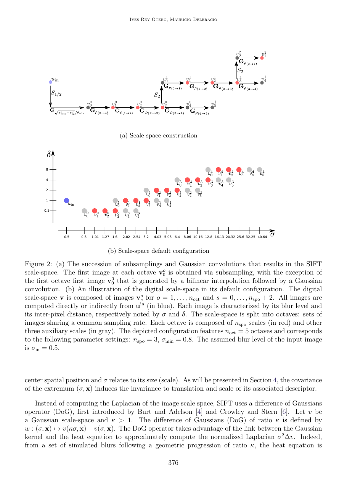
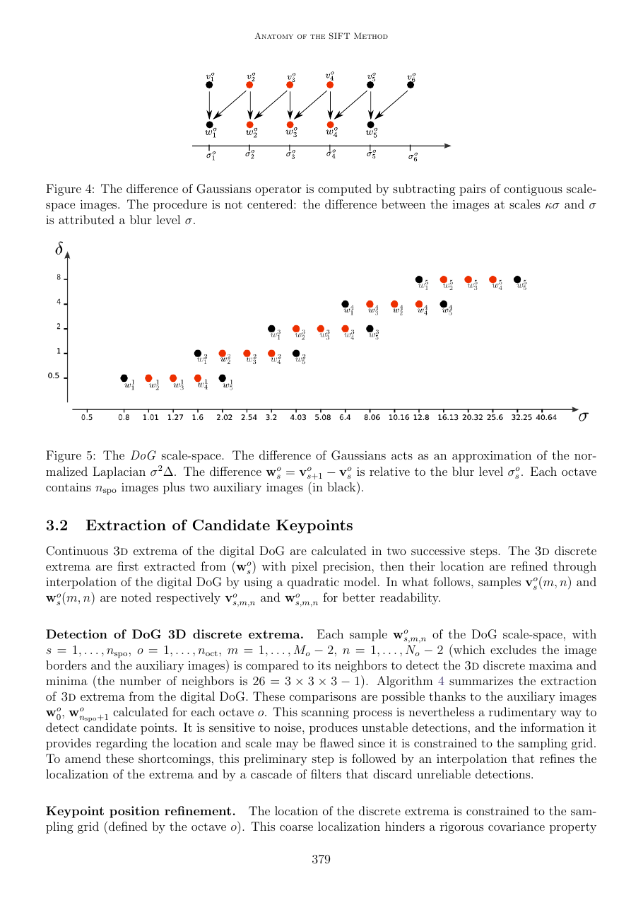
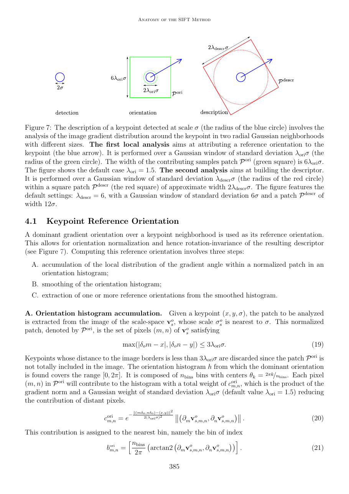

# 번역: SIFT 방법의 해부

- 원제: Anatomy of the SIFT Method
- 저자: Ives Rey-Otero (CMLA, ENS Cachan, 프랑스), Mauricio Delbracio (CMLA, ENS Cachan, 프랑스 및 Duke University ECE)
- 서지: Image Processing On Line 4 (2014), pp. 370-396. DOI 10.5201/ipol.2014.82. 2013-03-27 제출, 2014-12-02 채택, 2014-12-22 게재. CC-BY-NC-SA.
- 원문: 같은 폴더의 `ReyOtero2014_IPOL_AnatomySIFT.pdf` (27쪽, http://www.ipol.im/pub/art/2014/82/article.pdf 에서 2026-11-04 받음)
- 번역 범위: 전문 (초록, 본문, 그림과 표 캡션, 의사코드 13개, 감사의 글, 그림 출처). 참고문헌은 원문 그대로 둔다.
- 번역 방식: `pdftotext -layout`으로 본문을 뽑고, 수식과 그림은 쪽 이미지로 대조했다. 수식은 읽기 쉽게 LaTeX 꼴로 다시 적었다. 번역자 주석은 [역주]로 표시한다.
- 그림: 핵심 그림 3개(그림 2, 그림 4와 5, 그림 7)를 쪽 이미지로 넣었다. 나머지 그림은 캡션만 번역했다.

---

## 초록

이 글은 널리 쓰이는 영상 짝짓기 알고리즘인 SIFT(Scale Invariant Feature Transform, 크기 불변 특징 변환)를 자세히 설명하고 구현한다.
이 연구는 SIFT의 복잡한 변환 사슬을 자세히 해부하고, 설계 파라미터 하나하나를 꼼꼼히 제시한다.
함께 제공하는 온라인 데모에서 독자는 SIFT를 직접 돌리고, 파라미터를 하나씩 바꿔 결과에 주는 영향을 분석할 수 있다.

**소스 코드.** 소스 코드(ANSI C), 문서, 온라인 데모는 이 글의 IPOL 웹 페이지(https://doi.org/10.5201/ipol.2014.82)에서 볼 수 있다.

**핵심어:** sift, 특징 검출, 영상 비교

## 1. 전체 설명

크기 불변 특징 변환 SIFT [17]는 영상에서 서술자(descriptor) 묶음을 뽑는다. 뽑은 서술자는 영상의 평행이동, 회전, 크기 변화(축소)에 불변이다.
SIFT 서술자는 넓은 범위의 영상 변환에도 강하다는 것이 밝혀졌다. 예를 들면 다음과 같다.
- 시점의 작은 변화
- 잡음
- 블러
- 명암 대비 변화
- 장면 변형

그러면서도 짝짓기에 쓸 만큼 서로를 구별하는 힘은 유지한다.

1999년에 SIFT를 처음 소개한 논문 [16] 뒤로 경쟁 방법이 폭발적으로 나왔다. SURF [2], Harris와 Hessian 기반 검출기 [19], MOPS [3], ASIFT [28], SFOP [8], 그리고 이진 서술자를 쓰는 BRISK [13], ORB [24]는 성공한 변형의 일부일 뿐이다.
여기에 여러 단일 크기(다중 크기가 아닌) 검출기도 더해진다. Harris-Stephens 검출기 [10], SUSAN [25], Förstner 검출기 [7], 형태학적 코너 검출기 [1], 기계학습 기반 FAST [23]와 AGAST [18]가 그 예다.

SIFT 알고리즘은 서로 독립인 두 연산을 차례로 한다.
1. 관심점(키포인트) 검출
2. 각 키포인트에 딸린 서술자 추출

서술자가 강건하므로 보통 영상 쌍을 짝짓는 데 쓴다. 물체 인식과 동영상 흔들림 보정도 널리 알려진 응용이다.
서술자 비교는 엄밀히 말하면 SIFT 방법의 한 단계가 아니다. 그래도 설명을 완결하려고 함께 넣었다.

**알고리즘 원리.** SIFT는 다중 크기 영상 표현에서 키포인트를 찾는다. 이 다중 크기 표현은 점점 더 흐려지는 영상의 묶음이다.
각 키포인트는 덩어리(blob) 모양 구조이며, 중심 위치 (x, y)와 특성 크기 σ를 정확히 정한다.
SIFT는 각 키포인트 둘레 영역에서 주된 방향 θ를 계산한다. 키포인트마다 네 값 (x, y, σ, θ)가 정규화 패치의 중심, 크기, 방향을 정하고, 그 패치에서 SIFT 서술자를 계산한다.
이 정규화 덕분에 SIFT 키포인트 서술자는 이론상 모든 평행이동, 회전, 크기 변화에 불변이다.
서술자는 키포인트 둘레의 공간 기울기 분포를 128차원 벡터로 부호화한다. 이 특징 벡터는 보통 서로 다른 영상에서 뽑은 키포인트를 짝짓는 데 쓴다.

**알고리즘 사슬.** 크기 불변성을 얻으려고 SIFT는 가우시안 크기 공간 위에 지어진다. 가우시안 크기 공간은 입력 영상을 점점 더 흐리게 만든 판들로, 가능한 모든 축소(zoom-out)를 흉내 내는 다중 크기 영상 표현이다(쉬운 소개는 [27]).
이 널리 쓰이는 다중 크기 틀에서 가우시안 합성곱은 광학 블러의 근사이고, 가우시안 커널은 카메라 점확산함수(PSF)를 근사한다. 따라서 가우시안 크기 공간은 서로 다른 축소 배율에 대응하는 영상 묶음으로 해석할 수 있다. 가우시안 크기 공간 표현은 2절에서 다룬다.

평행이동, 회전, 크기 불변성을 얻으려면 뽑은 키포인트가 크기와 위치 모두에서 모호하지 않게 정해지는 구조와 이어져야 한다.
**이 조건은 영상의 코너와 에지를 배제한다. 코너와 에지는 크기와 공간 모두에서 정확히 위치를 정할 수 없기 때문이다.** 따라서 위치와 크기로 특징지어지는 영상 덩어리나 더 복잡한 국소 구조가 SIFT에 가장 알맞다.
[역주] 이 문장은 우리 과제에서 중요하다. QR의 X 코너, L 코너는 SIFT가 정의상 피하는 구조다.

키포인트 검출과 위치 결정은 크기 공간에 미분 연산자를 적용한 결과의 3차원 극값을 계산하는 일이다. SIFT의 미분 연산자는 가우시안 차(DoG)이며 3.1절에서 다룬다.
3차원 연속 극값 추출은 두 단계다.
1. DoG 표현에서 3차원 이산 극값을 훑는다. 극값의 첫 대략 위치를 준다.
2. 국소 2차 모델로 부화소 정밀도까지 다듬는다.

3차원 극값 추출은 3.2절에서 자세히 다룬다. 불안정한 키포인트가 검출되는 현상이 많으므로, SIFT는 덜 믿을 만한 것을 버리는 시험을 차례로 건다. 위치가 정확하고 명암 대비가 충분한 것만 남긴다. 3.3절은 두 가지 버리기 단계를 다룬다.
- DoG 값이 작은 3차원 극값 버리기
- 에지 위에 놓인 키포인트 후보 버리기

SIFT는 각 키포인트에 기준 방향을 주어 회전 불변성을 얻는다. 기준 방향은 키포인트 이웃의 기울기 방향으로 계산하며 4.1절에서 다룬다.
끝으로 방향을 맞춘 패치 안의 기울기 공간 분포를 부호화해 SIFT 키포인트 서술자를 만든다. 서술자 설계는 4.2절에서 다룬다. 여기까지가 SIFT 알고리즘을 정의하는 사슬이다.
덧붙여 5절에서 SIFT 서술자로 영상 쌍 사이 국소 짝을 찾는 법을 보인다. 여기 제시한 방법은 D. Lowe의 원 논문 [16]에 있는 짝짓기 절차다.

이 복잡한 변환 사슬은 많은 설계 파라미터에 따라 움직인다. 6절에서 이를 정리하고 각 파라미터의 영향을 분석한다. 표 1은 쓰는 기호를, 표 2는 SIFT 알고리즘의 단계를 요약한다.

## 2. 가우시안 크기 공간

가우시안 크기 공간 표현은 점점 더 흐려지는 영상의 묶음이다. 이 흐리기 과정은 장면을 점점 더 멀리서 찍을 때(즉 축소 배율이 커질 때) 생기는 세부 손실을 흉내 낸다.
따라서 크기 공간은 주어진 장면을 서로 다른 거리에서 찍은 사진 묶음을 흉내 낸 것으로 해석할 수 있고, 이것이 SIFT에 크기 불변성을 준다. 아래에서 SIFT 크기 공간을 만드는 법을 자세히 적는다.

**표 1: 이 글에서 쓰는 기호 요약.**

| 기호 | 뜻 |
|---|---|
| u | 연속 영역 (x, y) = x ∈ R² 에서 정의한 영상 |
| **u** | 직사각 격자 (m, n) ∈ {0,...,M−1}×{0,...,N−1} 에서 정의한 디지털 영상 |
| v | 연속 영역 (σ, x) ∈ R⁺×R² 에서 정의한 가우시안 크기 공간 |
| **v** | 디지털 가우시안 크기 공간. 옥타브 목록 v = (v^o), o = 1,...,n_oct. 각 옥타브 v^o 는 이산 격자 (s, m, n) ∈ {0,...,n_spo+2}×{0,...,M_o−1}×{0,...,N_o−1} 에서 정의 |
| w | 연속 영역에서 정의한 가우시안 차(DoG) |
| **w** | 디지털 DoG. 옥타브 목록 w = (w^o). 각 옥타브는 (s, m, n) ∈ {0,...,n_spo+1}×... 에서 정의 |
| ω | 3차원 극값 부화소 정밀화 뒤의 DoG 값 |
| ∂_x v | x 방향 크기 공간 기울기(y 방향은 ∂_y v) |
| ∂_m **v** | x 방향 디지털 크기 공간 기울기(y 방향은 ∂_n **v**). 각 옥타브는 (s, m, n) ∈ {2,...,n_spo}×{1,...,M_o−2}×{1,...,N_o−2} |
| G_ρ | 표준편차 ρ 인 연속 가우시안 합성곱 |
| **G**_ρ | 표준편차 ρ 인 디지털 가우시안 합성곱 (식 (4)) |
| S₂ | 2배 솎기 연산자, (S₂u)(m, n) = u(2m, 2n) |
| I_δ | 1/δ 배 디지털 쌍선형 보간 (알고리즘 2) |

### 2.1 가우시안 흐리기

모든 x = (x, y) ∈ R² 에서 정의된 연속 영상 u(x)를 생각한다. 연속 가우시안 평활은 다음 합성곱이다.

$$G_\sigma u(\mathbf{x}) := \int G_\sigma(\mathbf{x}')\,u(\mathbf{x}-\mathbf{x}')\,d\mathbf{x}'$$

여기서 $G_\sigma(\mathbf{x}) = \frac{1}{2\pi\sigma^2} e^{-|\mathbf{x}|^2/(2\sigma^2)}$ 은 표준편차 σ ∈ R⁺ 인 가우시안 커널이다. 가우시안 평활 연산자는 반군 관계를 만족한다.

$$G_{\sigma_2}(G_{\sigma_1}u)(\mathbf{x}) = G_{\sqrt{\sigma_1^2+\sigma_2^2}}\,u(\mathbf{x}) \tag{1}$$

u의 가우시안 크기 공간을 다음 3차원 함수로 부른다.

$$v : (\sigma, \mathbf{x}) \mapsto G_\sigma u(\mathbf{x}) \tag{2}$$

디지털 영상에서는 연속 가우시안 평활 연산자의 이산판을 어떻게 정할지 다소 모호하다 [9, 22]. 이 글에서는 Lowe의 원 연구처럼, 잘린 가우시안 커널의 표본과 이산 합성곱으로 디지털 가우시안 평활을 구현한다.

**표 2: SIFT 알고리즘 요약.**

| 단계 | 설명 | 입력 | 출력 |
|:-:|---|---|---|
| 1 | 가우시안 크기 공간 계산 | u 영상 | v 크기 공간 |
| 2 | 가우시안 차(DoG) 계산 | v 크기 공간 | w DoG |
| 3 | 후보 키포인트 찾기 (DoG의 3차원 이산 극값) | w DoG | {(x_d, y_d, σ_d)} 이산 극값 목록(위치와 크기) |
| 4 | 후보 키포인트 위치를 부화소 정밀도로 다듬기 | w DoG, 이산 극값 목록 | {(x, y, σ)} 보간한 극값 목록 |
| 5 | 잡음 때문에 불안정한 키포인트 거르기 | w DoG, {(x, y, σ)} | 거른 키포인트 목록 |
| 6 | 에지 위에 놓인 불안정한 키포인트 거르기 | w DoG, {(x, y, σ)} | 거른 키포인트 목록 |
| 7 | 각 키포인트에 기준 방향 주기 | 크기 공간 기울기 (∂_m v, ∂_n v), 키포인트 목록 | {(x, y, σ, θ)} 방향 있는 키포인트 목록 |
| 8 | 키포인트 서술자 만들기 | 크기 공간 기울기, 방향 있는 키포인트 목록 | {(x, y, σ, θ, f)} 서술자 붙은 키포인트 목록 |

**디지털 가우시안 평활.** g_σ 를 표준편차 σ 인 잘린 가우시안 함수를 표본화해 얻은 1차원 디지털 커널이라 하자.

$$g_\sigma(k) = K e^{-\frac{k^2}{2\sigma^2}},\quad -\lceil 4\sigma\rceil \le k \le \lceil 4\sigma\rceil,\ k\in\mathbb{Z} \tag{3}$$

⌈x⌉ 는 올림 함수이고, K는 Σ g_σ(k) = 1 이 되도록 정한다. **G**_σ 를 파라미터 σ 인 디지털 가우시안 합성곱, **u** 를 M×N 크기 디지털 영상이라 하자. 디지털 가우시안 평활 **G**_σ**u** 는 분리 가능한 2차원 이산 합성곱으로 계산한다.

$$\mathbf{G}_\sigma \mathbf{u}(k,l) := \sum_{k'=-\lceil 4\sigma\rceil}^{\lceil 4\sigma\rceil} g_\sigma(k') \sum_{l'=-\lceil 4\sigma\rceil}^{\lceil 4\sigma\rceil} g_\sigma(l')\,\bar{\mathbf{u}}(k-k', l-l') \tag{4}$$

여기서 ū 는 u를 −1/2 기준 대칭으로 Z² 전체에 늘린 것이다.

$$\bar{\mathbf{u}}(k,l) = \mathbf{u}(s_M(k), s_N(l)),\quad s_M(k) = \min(k \bmod 2M,\ 2M-1-k \bmod 2M)$$

이 알고리즘에서 다루는 σ 범위(σ ≥ 0.7)에서는, 화소값이 0~1일 때 디지털 가우시안 평활 연산자가 10⁻⁴ 아래 오차로 반군 관계를 거의 만족한다 [22]. 파라미터 σ₁, σ₂ 인 디지털 가우시안 평활을 차례로 두 번 하면, 파라미터 √(σ₁²+σ₂²) 인 디지털 가우시안 평활 한 번과 거의 같다.

$$\mathbf{G}_{\sigma_2}(\mathbf{G}_{\sigma_1}\mathbf{u}) = \mathbf{G}_{\sqrt{\sigma_1^2+\sigma_2^2}}\,\mathbf{u} \tag{5}$$

### 2.2 디지털 가우시안 크기 공간

앞서 말했듯이 가우시안 크기 공간 v : (x, σ) ↦ G_σ u(x) 는 점점 더 흐려지는 영상 묶음이고, 크기 공간 위치 (x, σ) 는 블러 σ로 만든 영상의 화소 x를 가리킨다. 아래에서 연속 가우시안 크기 공간의 이산판인 디지털 크기 공간을 계산하는 법을 적는다.

디지털 크기 공간은 이산 블러 단계와 여러 표본화 비율로 만든 디지털 영상 묶음이다. 모두 블러 수준을 σ_in 으로 가정한 입력 영상 u_in 에서 나온다.
이 묶음은 같은 표본화 비율을 공유하는 작은 묶음으로 나뉜다. 원래 SIFT에서는 표본화 비율을 2배씩 줄이므로 이 작은 묶음을 옥타브라 부른다.

n_oct 를 디지털 크기 공간의 전체 옥타브 수, o ∈ {1,...,n_oct} 를 옥타브 번호, δ_o 를 그 화소 간 거리라 하자. 입력 영상 u_in 의 화소 간 거리를 δ_in = 1 로 둔다. 그러면 δ = 0.5 는 이 영상을 2배 늘린 것, δ = 2 는 2배 솎은 것에 해당한다.
n_spo 를 옥타브당 크기 수(기본값 n_spo = 3)라 하자. 옥타브 o는 s = 1,...,n_spo 인 영상 v_s^o 를 담고, 각각 다른 블러 수준 σ_s^o 를 가진다. 디지털 크기 공간의 블러 수준은 입력 영상 u_in 의 표본 격자 간격(δ_in = 1)을 단위 길이로 잰다. 이 설정을 그림 1에 보인다.

> **그림 1:** 디지털 크기 공간 v의 표본 격자에 대해 정한 약속. 블러 수준은 입력 영상의 표본 격자를 기준으로 본다. 파라미터는 기본값 σ_min = 0.8, n_spo = 3, n_oct = 8, σ_in = 0.5 로 두었다.

디지털 크기 공간에는 옥타브마다 보조 영상 셋 v_0^o, v_{n_spo+1}^o, v_{n_spo+2}^o 이 더 있다. 그 이유는 뒤에서 분명해진다.

디지털 크기 공간 만들기는 씨앗 영상 v_0^1 계산에서 시작한다. 이 영상의 블러 수준은 고려하는 최소 블러 σ_0^1 = σ_min 이고, 화소 간 거리는 δ_0 = δ_min 이다. u_in 에서 다음과 같이 계산한다.

$$\mathbf{v}_0^1 = \mathbf{G}_{\frac{1}{\delta_{\min}}\sqrt{\sigma_{\min}^2-\sigma_{\rm in}^2}}\ \mathbf{I}_{\delta_{\min}}\mathbf{u}_{\rm in} \tag{6}$$

I_δmin 은 1/δ_min 배 디지털 쌍선형 보간기(알고리즘 1)이고, **G**_σ 는 앞서 정의한 디지털 가우시안 합성곱이다. 디지털 크기 공간 전체가 이 씨앗 영상에서 나온다.
기본값 δ_min = 0.5 는 처음에 2배 보간을 뜻한다. 입력 영상 표본 격자 기준으로 씨앗 영상의 블러 수준은 기본값 σ_min = 0.8 이다.

각 옥타브의 두 번째 이후 영상 s = 1,...,n_spo+2 는 다음 점화식으로 계산한다.

$$\mathbf{v}_s^o = \mathbf{G}_{\rho[(s-1)\to s]}\,\mathbf{v}_{s-1}^o,\quad \rho[(s-1)\to s] = \frac{\sigma_{\min}}{\delta_{\min}}\sqrt{2^{2s/n_{\rm spo}} - 2^{2(s-1)/n_{\rm spo}}} \tag{7}$$

옥타브 o = 2,...,n_oct 의 첫 영상(s = 0)은 다음과 같다.

$$\mathbf{v}_0^o = S_2\,\mathbf{v}_{n_{\rm spo}}^{o-1} \tag{8}$$

S₂ 는 2배 솎기 연산자 (S₂u)(m, n) = u(2m, 2n) 이다. 이 절차로 영상 묶음 (v_s^o), o = 1,...,n_oct, s = 0,...,n_spo+2 를 얻는다. 화소 간 거리와 블러 수준은 다음과 같다.

$$\delta_o = \delta_{\min} 2^{o-1} \tag{9}$$

$$\sigma_s^o = \frac{\delta_o}{\delta_{\min}}\,\sigma_{\min}\,2^{s/n_{\rm spo}} \tag{10}$$

따라서 흉내 낸 블러는 등비수열을 따른다. 크기 공간 만들기 과정은 알고리즘 1에 정리했다. 디지털 크기 공간 만들기는 다섯 파라미터로 정해진다.
- 옥타브 수 n_oct
- 옥타브당 크기 수 n_spo
- 크기 공간 첫 영상 v_0^1 의 표본 간격 δ_min
- 크기 공간 첫 영상 v_0^1 의 블러 수준 σ_min
- 입력 영상 u_in 에 가정한 블러 수준 σ_in

그림 2의 그림은 디지털 크기 공간 구조를 표본화 비율과 블러 수준으로 보여 준다. 점 하나가 화소 간 거리 δ_o, 블러 수준 σ_s^o 인 크기 공간 영상 v_s^o 하나를 나타낸다. 보인 설정은 Lowe SIFT 알고리즘의 기본값 σ_min = 0.8, δ_min = 0.5, n_spo = 3, σ_in = 0.5 로 만든 것이다. 옥타브 수 n_oct 는 가능한 솎기 횟수로 위가 막힌다. 그림 3은 이 설정으로 만든 디지털 크기 공간 영상의 예다.

> **그림 2:** (a) SIFT 크기 공간을 만드는 솎기와 가우시안 합성곱의 연쇄. 각 옥타브의 첫 영상 v_0^o 는 솎기로 얻는다. 단, 첫 옥타브의 첫 영상 v_0^0 은 쌍선형 보간 뒤 가우시안 합성곱으로 만든다. (b) 기본 설정의 디지털 크기 공간 그림. 디지털 크기 공간 v는 o = 1,...,n_oct, s = 0,...,n_spo+2 인 영상 v_s^o 로 이루어진다. 모든 영상은 u_in(파란색)에서 직접 또는 간접으로 계산한다. 각 영상은 블러 수준 σ와 화소 간 거리 δ로 특징지어진다. 크기 공간은 옥타브, 즉 같은 표본화 비율을 공유하는 영상 묶음으로 나뉜다. 각 옥타브는 n_spo 개 크기(빨간색)와 보조 크기 셋(회색)으로 이루어진다. 보인 설정은 n_oct = 5 옥타브이고, 파라미터 n_spo = 3, σ_min = 0.8 에 해당한다. 입력 영상에 가정한 블러 수준은 σ_in = 0.5 다.

## 3. 키포인트 정의

관심 있는 영상 특징을 정확히 검출하는 일은 어려운 문제다. SIFT에서 키포인트 특징은 정규화 라플라시안 크기 공간 σ²Δv 의 극값으로 정의한다 [14].
라플라시안 극값은 크기 공간 좌표 (σ, x) 로 한 가지 뜻으로 특징지어진다. x는 중심 공간 위치, σ는 크기(규모)와 관련된다. 4절에서 보이겠지만, 극값 (σ, x) 의 공변성이 그에 딸린 서술자의 평행이동, 크기 불변성을 낳는다.

SIFT는 영상 크기 공간의 라플라시안을 직접 계산하지 않고, Burt와 Adelson [4], Crowley와 Stern [6]이 처음 도입한 가우시안 차(DoG) 연산자를 쓴다.
v를 가우시안 크기 공간, κ > 1 이라 하자. 비율 κ 인 가우시안 차(DoG)는 w : (σ, x) ↦ v(κσ, x) − v(σ, x) 로 정의한다.
DoG 연산자는 가우시안 커널과 열 방정식의 관계를 이용해 정규화 라플라시안 σ²Δv 를 근사로 계산한다. 비율 κ 인 등비수열 블러 묶음에서 열 방정식은 다음처럼 근사된다.

$$\sigma\Delta v = \frac{\partial v}{\partial \sigma} \approx \frac{v(\kappa\sigma,\mathbf{x}) - v(\sigma,\mathbf{x})}{\kappa\sigma-\sigma} = \frac{w(\sigma,\mathbf{x})}{(\kappa-1)\sigma} \tag{11}$$

따라서 w(σ, x) ≈ (κ − 1)σ²Δv(σ, x) 이다.

> **그림 3:** 예시 영상의 가우시안 크기 공간에서 뽑은 영상 일부를 잘라 보였다. 크기 공간 파라미터는 n_spo = 3, σ_min = 0.8, 입력 영상 가정 블러 σ_in = 0.5 다. 보기 좋게 각 화소를 한 변 δ_o 인 정사각형으로 그렸다. (보인 영상: v_1^1 δ=0.5 σ=1.0, v_2^2 δ=1.0 σ=2.5, v_3^2 δ=2.0 σ=5.1, v_4^2 δ=4.0 σ=10.2, v_5^3 δ=8.0 σ=25.6, v_5^5 δ=8.0 σ=40.6)

영상의 SIFT 키포인트는 가우시안 차(DoG)의 3차원 극값으로 정의한다. 디지털 영상을 다루므로 DoG의 연속 3차원 극값을 바로 계산할 수 없다. 그래서 디지털 DoG의 이산 극값을 먼저 찾고 그 위치를 다듬는다. 찾은 점은 마지막으로 검증해, 잡음 때문에 생길 수 있는 불안정하거나 거짓인 검출을 버린다. 따라서 SIFT 키포인트 검출은 다음 단계로 이루어진다.
1. 디지털 DoG를 계산한다.
2. 디지털 DoG에서 3차원 이산 극값을 훑는다.
3. 2차 보간으로 후보의 위치와 크기를 다듬는다.
4. 대비가 약한 후보, 에지 위에 놓인 후보 같은 불안정한 후보를 버린다.

아래에서 각 단계를 자세히 적는다.

### 3.1 크기 공간 분석: 가우시안 차

디지털 DoG **w** 는 디지털 크기 공간 **v** 로 만든다. 각 옥타브 o = 1,...,n_oct 와 각 영상 w_s^o (s = 0,...,n_spo+1) 에 대해 다음과 같다.

$$\mathbf{w}_s^o(m,n) = \mathbf{v}_{s+1}^o(m,n) - \mathbf{v}_s^o(m,n)$$

m = 0,...,M_o−1, n = 0,...,N_o−1 이다. 영상 w_s^o 에는 블러 수준 σ_s^o 를 준다. 이 계산은 그림 4에 보이고 알고리즘 3에 정리했다. 디지털 크기 공간에서 DoG 근사 w_{n_spo+1}^o 를 계산하려면 보조 영상 v_{n_spo+2}^o 가 필요하다는 점에 주의한다. 그림 5는 앞서 소개한 가우시안 크기 공간 v에 대한 DoG 크기 공간 w를 보인다. 그림 6은 DoG 크기 공간 예시 영상이다.

> **그림 4:** 가우시안 차 연산자는 이웃한 크기 공간 영상 쌍을 빼서 계산한다. 이 절차는 가운데를 맞추지 않는다. 크기 κσ 와 σ 영상의 차에 블러 수준 σ를 준다.

> **그림 5:** DoG 크기 공간. 가우시안 차는 정규화 라플라시안 σ²Δ 의 근사로 작동한다. 차 w_s^o = v_{s+1}^o − v_s^o 는 블러 수준 σ_s^o 에 대응한다. 각 옥타브는 n_spo 개 영상과 보조 영상 둘(검은색)을 담는다.

### 3.2 후보 키포인트 추출

디지털 DoG의 연속 3차원 극값은 두 단계로 계산한다. 먼저 (w_s^o) 에서 화소 정밀도로 3차원 이산 극값을 뽑는다. 다음으로 2차 모델로 디지털 DoG를 보간해 위치를 다듬는다. 아래에서는 읽기 쉽게 표본 v_s^o(m, n), w_s^o(m, n) 을 v^o_{s,m,n}, w^o_{s,m,n} 으로 적는다.

**DoG 3차원 이산 극값 검출.** DoG 크기 공간의 각 표본 w^o_{s,m,n} (s = 1,...,n_spo, o = 1,...,n_oct, m = 1,...,M_o−2, n = 1,...,N_o−2, 즉 영상 가장자리와 보조 영상은 뺀다) 를 이웃과 비교해 3차원 이산 극대와 극소를 찾는다(이웃 수는 26 = 3×3×3 − 1). 알고리즘 4는 디지털 DoG에서 3차원 극값을 뽑는 법을 정리한다. 이 비교는 옥타브마다 계산한 보조 영상 w_0^o, w_{n_spo+1}^o 덕분에 가능하다.
그러나 이 훑기 과정은 후보점을 찾는 초보적인 방법이다. 잡음에 민감하고, 불안정한 검출을 내며, 위치와 크기 정보가 표본 격자에 묶여 있어 틀릴 수 있다. 이 약점을 고치려고 이 예비 단계 뒤에 극값 위치를 다듬는 보간과 믿을 수 없는 검출을 버리는 거르기 연쇄를 둔다.

**키포인트 위치 정밀화.** 이산 극값의 위치는 (옥타브 o가 정하는) 표본 격자에 묶여 있다. 이 대략 위치는 키포인트 집합의 엄밀한 공변성을 방해하고, 따라서 그에 딸린 서술자의 완전한 크기, 평행이동 불변성을 막는다. SIFT는 국소 보간 모델로 각 후보 키포인트의 위치와 크기를 다듬는다.

> **그림 6:** 예시 영상의 DoG 크기 공간에서 뽑은 영상 일부를 잘라 보였다. DoG 연산자는 정규화 라플라시안 연산자 σ²Δv 의 근사다. 이 예의 DoG 크기 공간 파라미터는 기본값 n_spo = 3, σ_min = 0.8, σ_in = 0.5 다. 보기 좋게 각 화소를 한 변 δ_o 인 정사각형으로 그렸다.

옥타브 o의 표본점 (s, m, n) 에서의 2차 함수를 ω^o_{s,m,n}(α) 라 하고 다음과 같이 정한다.

$$\omega^o_{s,m,n}(\alpha) = w^o_{s,m,n} + \alpha^T \bar{g}^o_{s,m,n} + \frac{1}{2}\alpha^T \bar{H}^o_{s,m,n}\alpha \tag{12}$$

여기서 α = (α₁, α₂, α₃)ᵀ ∈ [−1/2, 1/2]³ 이다. ḡ^o_{s,m,n} 과 H̄^o_{s,m,n} 은 옥타브 o의 (s, m, n) 에서의 3차원 기울기와 헤세 행렬이며, 다음 유한차분으로 계산한다.

$$\bar{g}^o_{s,m,n} = \begin{bmatrix}(w^o_{s+1,m,n} - w^o_{s-1,m,n})/2\\ (w^o_{s,m+1,n} - w^o_{s,m-1,n})/2\\ (w^o_{s,m,n+1} - w^o_{s,m,n-1})/2\end{bmatrix},\quad \bar{H}^o_{s,m,n} = \begin{bmatrix}h_{11}&h_{12}&h_{13}\\h_{12}&h_{22}&h_{23}\\h_{13}&h_{23}&h_{33}\end{bmatrix} \tag{13}$$

$$\begin{aligned}
h_{11} &= w^o_{s+1,m,n} + w^o_{s-1,m,n} - 2w^o_{s,m,n}, & h_{12} &= (w^o_{s+1,m+1,n} - w^o_{s+1,m-1,n} - w^o_{s-1,m+1,n} + w^o_{s-1,m-1,n})/4,\\
h_{22} &= w^o_{s,m+1,n} + w^o_{s,m-1,n} - 2w^o_{s,m,n}, & h_{13} &= (w^o_{s+1,m,n+1} - w^o_{s+1,m,n-1} - w^o_{s-1,m,n+1} + w^o_{s-1,m,n-1})/4,\\
h_{33} &= w^o_{s,m,n+1} + w^o_{s,m,n-1} - 2w^o_{s,m,n}, & h_{23} &= (w^o_{s,m+1,n+1} - w^o_{s,m+1,n-1} - w^o_{s,m-1,n+1} + w^o_{s,m-1,n-1})/4.
\end{aligned}$$

이 2차 함수는 바탕 연속 함수의 2차 테일러 전개를 근사한 것이다(도함수는 유한차분으로 근사한다).

옥타브 o_e 의 이산 극값 (s_e, m_e, n_e) 위치를 다듬으려고 SIFT는 다음처럼 한다.
1. (s, m, n) 을 극값의 이산 좌표 (s_e, m_e, n_e) 로 둔다.
2. ∇ω^o_{s,m,n}(α) = 0 을 풀어 ω^o_{s,m,n} 의 연속 극값을 구한다(알고리즘 7). 결과는 다음과 같다.
$$\alpha^* = -\left(\bar{H}^o_{s,m,n}\right)^{-1}\bar{g}^o_{s,m,n} \tag{14}$$
3. max(|α₁*|, |α₂*|, |α₃*|) ≤ 0.5 이면(즉 2차 함수의 극값이 유효 영역 안에 있으면) 극값을 받아들인다. 크기 공간 구조(식 (10), (9))에 따라 해당 키포인트 좌표는 다음과 같다.
$$(\sigma, x, y) = \left(\frac{\delta_{o_e}}{\delta_{\min}}\sigma_{\min}2^{(\alpha_1^*+s)/n_{\rm spo}},\ \delta_{o_e}(\alpha_2^*+m),\ \delta_{o_e}(\alpha_3^*+n)\right) \tag{15}$$
4. α* 가 유효 영역 밖에 있으면 이 보간을 버리고 다시 보간한다. (s, m, n) 을 (s, m, n) + α* 에 가장 가까운 이산 값으로 바꾸고 2부터 되풀이한다.

이 과정을 보간이 유효해질 때까지 최대 다섯 번 되풀이한다. 다섯 번 뒤에도 유효하지 않으면 후보 키포인트를 버린다. 실제로는 조각별 보간 모델이 연속이 아니어서 생길 수 있는 수치 불안정을 피하려고, 유효 영역을 max(|α₁*|, |α₂*|, |α₃*|) < 0.6 으로 정한다. 자세한 것은 알고리즘 6에 있다.

국소 보간 모델 (12)에 따라 DoG 보간 극값의 값은 다음과 같다.

$$\omega := \omega^o_{s,m,n}(\alpha^*) = w^o_{s,m,n} + (\alpha^*)^T\bar{g}^o_{s,m,n} + \frac{1}{2}(\alpha^*)^T\bar{H}^o_{s,m,n}\alpha^* = w^o_{s,m,n} + \frac{1}{2}(\alpha^*)^T\bar{g}^o_{s,m,n} \tag{16}$$

이 값은 대비가 약한 키포인트를 버리는 데 쓴다.

### 3.3 불안정한 키포인트 거르기

**대비가 약한 극값 버리기**

영상 잡음은 보통 여러 개의 가짜 DoG 극값을 만든다. 이런 극값은 불안정하고 영상의 특정 구조와 이어져 있지 않다. SIFT는 DoG 값 ω 가 문턱 C_DoG 보다 작은 후보 키포인트를 버려 이런 거짓 검출을 없애려 한다(알고리즘 8).

  |ω| < C_DoG 이면 후보 키포인트를 버린다.

DoG 함수는 (κ − 1)σ²Δv 를 근사하고 κ 는 옥타브당 크기 수 n_spo 의 함수이므로, 문턱 C_DoG 는 n_spo 에 따라야 한다(n_spo = 3 일 때 기본값 C_DoG = 0.015). 제공한 소스 코드에서 쓰는 문턱은 다음과 같다. C_DoG 는 n_spo = 3 기준 값이다.

$$\tilde{C}_{\rm DoG} = \frac{2^{1/n_{\rm spo}}-1}{2^{1/3}-1}\,C_{\rm DoG}$$

이렇게 하면 쓰는 문턱이 표본화 설정과 무관해진다. 극값 정밀화 전에 쓸데없는 계산을 줄이려고, 3차원 이산 극값에는 C_DoG 의 80 %인 덜 보수적인 문턱을 먼저 건다(알고리즘 5).

  |w^o_{s,m,n}| < 0.8 × C_DoG 이면 3차원 이산 극값을 버린다.

**에지 위 후보 키포인트 버리기**

에지 위에 놓인 후보 키포인트는 위치를 정확히 정하기 어렵다. 에지가 주축 방향 평행이동에 불변이라는 사실의 직접 결과다. 이런 검출은 공변 키포인트를 정하는 데 도움이 되지 않으므로 버려야 한다.
DoG의 2차원 헤세 행렬이 이런 원치 않는 후보를 특징짓는다. 에지는 에지에 수직인 방향으로 큰 주곡률, 에지를 따라서는 작은 주곡률을 가진다. 헤세 행렬 고윳값으로 말하면, 에지가 있다는 것은 가장 큰 고윳값 λ_max 와 가장 작은 고윳값 λ_min 의 비가 크다는 뜻이다.

DoG의 헤세 행렬은 가장 가까운 격자 표본에서 유한차분으로 계산한다.

$$H^o_{s,m,n} = \begin{bmatrix}h_{11}&h_{12}\\h_{12}&h_{22}\end{bmatrix} \tag{17}$$

$$h_{11} = w^o_{s,m+1,n} + w^o_{s,m-1,n} - 2w^o_{s,m,n},\quad h_{22} = w^o_{s,m,n+1} + w^o_{s,m,n-1} - 2w^o_{s,m,n},$$
$$h_{12} = h_{21} = (w^o_{s,m+1,n+1} - w^o_{s,m+1,n-1} - w^o_{s,m-1,n+1} + w^o_{s,m-1,n-1})/4.$$

SIFT는 고윳값 비 r := λ_max/λ_min 이 문턱 C_edge (기본값 C_edge = 10) 보다 큰 후보를 버린다. 이 비만 중요하므로 고윳값 계산은 피할 수 있다. 헤세 행렬의 대각합 제곱과 행렬식의 비는 r과 다음 관계가 있다.

$$\text{edgeness}(H^o_{s,m,n}) = \frac{\text{tr}(H^o_{s,m,n})^2}{\det(H^o_{s,m,n})} = \frac{(\lambda_{\max}+\lambda_{\min})^2}{\lambda_{\max}\lambda_{\min}} = \frac{(r+1)^2}{r} \tag{18}$$

따라서 에지 위 후보 거르기는 다음 시험이다.

  edgeness(H^o_{s,m,n}) > (C_edge + 1)²/C_edge 이면 후보 키포인트를 버린다.

H^o_{s,m,n} 은 키포인트 보간 때 이미 계산한 H̄^o_{s,m,n} (13) 의 오른쪽 아래 2×2 부분 행렬이라는 점에 주의한다. 알고리즘 9가 에지 위 키포인트를 버리는 법을 정리한다.

### 3.4 의사코드

**알고리즘 1: 디지털 가우시안 크기 공간 계산**
- 입력: u_in, M×N 화소 입력 디지털 영상
- 출력: (v_s^o), 디지털 크기 공간, o = 1,...,n_oct, s = 0,...,n_spo+2. v_s^o 는 크기 M_o×N_o, 블러 수준 σ_s^o (식 (10)), 화소 간 거리 δ_o = δ_min 2^{o−1} 인 디지털 영상. M_o = ⌊(δ_min/δ_o) M⌋, N_o = ⌊(δ_min/δ_o) N⌋. v_s^o 의 표본은 v_s^o(m, n) 으로 적는다.
- 파라미터: n_oct 옥타브 수, n_spo 옥타브당 크기 수, σ_min 씨앗 영상 블러 수준, δ_min 씨앗 영상 표본 간격, σ_in 입력 영상 가정 블러 수준
- 절차
  1. 첫 옥타브 계산. 씨앗 영상 v_0^1 계산
     1. 원 영상을 보간한다(쌍선형 보간, 알고리즘 2). u′ ← bilinear_interpolation(u_in, δ_min)
     2. 보간한 영상을 흐린다(가우시안 블러, 식 (4)). v_0^1 = G_{(1/δ_min)√(σ_min² − σ_in²)} u′
  2. 첫 옥타브의 나머지 영상: s = 1,...,n_spo+2 에 대해 v_s^1 = G_{ρ[(s−1)→s]} v_{s−1}^1
  3. 다음 옥타브 계산: o = 2,...,n_oct 에 대해
     1. 솎기로 옥타브 첫 영상 계산: 모든 m, n 에 대해 v_0^o(m, n) ← v_{n_spo}^{o−1}(2m, 2n)
     2. 옥타브의 나머지 영상: s = 1,...,n_spo+2 에 대해 v_s^o = G_{ρ[(s−1)→s]} v_{s−1}^o

**알고리즘 2: 영상의 쌍선형 보간**
- 입력: u, M×N 화소 디지털 영상. 표본은 u(m, n)
- 출력: u′, M′×N′ 화소 디지털 영상. M′ = ⌊M/δ′⌋, N′ = ⌊N/δ′⌋
- 파라미터: δ′ < 1, 출력 영상의 화소 간 거리
- 절차: m′ = 0,...,M′−1, n′ = 0,...,N′−1 에 대해 x ← δ′m′, y ← δ′n′ 로 두고
  u′(m′, n′) ← (x − ⌊x⌋)(y − ⌊y⌋) ū(⌊x⌋+1, ⌊y⌋+1) + (1 + ⌊x⌋ − x)(y − ⌊y⌋) ū(⌊x⌋, ⌊y⌋+1) + (x − ⌊x⌋)(1 + ⌊y⌋ − y) ū(⌊x⌋+1, ⌊y⌋) + (1 + ⌊x⌋ − x)(1 + ⌊y⌋ − y) ū(⌊x⌋, ⌊y⌋)
- ū 는 u를 −0.5 기준 대칭으로 Z² 에 늘린 것이다. ū(k, l) = u(s_M(k), s_N(l)), s_N(k) = min(k mod 2M, 2M − 1 − k mod 2M). ⌊x⌋ 는 내림 함수.

**알고리즘 3: 가우시안 차 크기 공간(DoG) 계산**
- 입력: (v_s^o), 디지털 가우시안 크기 공간, o = 1,...,n_oct, s = 0,...,n_spo+2
- 출력: (w_s^o), 디지털 DoG, o = 1,...,n_oct, s = 0,...,n_spo+1
- 절차: 모든 o, s, m, n 에 대해 w_s^o(m, n) = v_{s+1}^o(m, n) − v_s^o(m, n)

**알고리즘 4: DoG 크기 공간의 3차원 이산 극값 훑기**
- 입력: (w_s^o), 디지털 DoG. 디지털 영상 w_s^o 의 표본은 w^o_{s,m,n} 으로 적는다.
- 출력: L_A = {(o, s, m, n)}, DoG 3차원 이산 극값 목록
- 절차: o = 1,...,n_oct 와 s = 1,...,n_spo, m = 1,...,M_o−2, n = 1,...,N_o−2 에 대해, 표본 w^o_{s,m,n} 이 이웃 3³ − 1 = 26 개 모두보다 크거나 모두보다 작으면 이산 극값 (o, s, m, n) 을 L_A 에 더한다.

**알고리즘 5: 대비가 약한 후보 키포인트 버리기 (보수적 시험)**
- 입력: (w_s^o) 디지털 DoG, L_A = {(o, s, m, n)} DoG 3차원 이산 극값 목록
- 출력: L_A′ = {(o, s, m, n)}, 거른 DoG 3차원 이산 극값 목록
- 파라미터: 문턱 C_DoG
- 절차: L_A 의 각 극값에 대해 |w^o_{s,m,n}| ≥ 0.8 × C_DoG 이면 L_A′ 에 더한다.

**알고리즘 6: 키포인트 보간**
- 입력: L_A′ = {(o, s, m, n)} DoG 3차원 이산 극값 목록, (w_s^o) 디지털 DoG 크기 공간
- 출력: L_B = {(o, s, m, n, x, y, σ, ω)}, 후보 키포인트 목록
- 절차: 각 이산 극값 (o_e, s_e, m_e, n_e) 에 대해
  1. (s, m, n) ← (s_e, m_e, n_e) 로 보간 위치를 정한다.
  2. 되풀이
     1. 국소 2차 함수의 극값 위치와 값을 계산한다(알고리즘 7). (α*, ω) ← quadratic_interpolation(o_e, s, m, n)
     2. 해당 절대 좌표를 계산한다. (σ, x, y) = ((δ_{o_e}/δ_min) σ_min 2^{(α₁*+s)/n_spo}, δ_{o_e}(α₂*+m), δ_{o_e}(α₃*+n))
     3. 보간 위치를 바꾼다. (s, m, n) ← ([s + α₁*], [m + α₂*], [n + α₃*])
  3. max(|α₁*|, |α₂*|, |α₃*|) < 0.6 이 되거나 다섯 번 실패할 때까지 되풀이한다.
  4. max(|α₁*|, |α₂*|, |α₃*|) < 0.6 이면 후보 키포인트 (o_e, s, m, n, σ, x, y, ω) 를 L_B 에 더한다.
- [x] 는 반올림 함수.

**알고리즘 7: 이산 DoG 표본에서의 2차 보간**
- 입력: (w_s^o) 디지털 DoG 크기 공간, (o, s, m, n) DoG 3차원 이산 극값 좌표
- 출력: α* 보간한 3차원 극값의 중심으로부터 거리, ω 보간한 3차원 극값의 값
- 절차
  1. 식 (13)으로 ḡ^o_{s,m,n}, H̄^o_{s,m,n} (DoG 3차원 기울기와 헤세 행렬) 을 계산한다.
  2. α* = −(H̄^o_{s,m,n})⁻¹ ḡ^o_{s,m,n} 를 계산한다.
  3. ω = w^o_{s,m,n} − ½ (ḡ^o_{s,m,n})ᵀ (H̄^o_{s,m,n})⁻¹ ḡ^o_{s,m,n} 를 계산한다.

**알고리즘 8: 대비가 약한 후보 키포인트 버리기**
- 입력: L_B = {(o, s, m, n, σ, x, y, ω)} 후보 키포인트 목록
- 출력: L_B′, 줄인 후보 키포인트 목록
- 파라미터: 문턱 C_DoG
- 절차: L_B 의 각 후보에 대해 |ω| ≥ C_DoG 이면 L_B′ 에 더한다.

**알고리즘 9: 에지 위 후보 키포인트 버리기**
- 입력: (w_s^o) DoG 크기 공간, L_B′ 후보 키포인트 목록
- 출력: L_C = {(o, s, m, n, σ, x, y, ω)}, SIFT 키포인트 목록
- 파라미터: C_edge, 헤세 행렬 첫째와 둘째 고윳값 비의 문턱
- 절차: L_B′ 의 각 후보에 대해
  1. 식 (17)로 2차원 헤세 행렬 H^o_{s,m,n} 를 계산한다.
  2. edgeness = tr(H^o_{s,m,n})² / det(H^o_{s,m,n}) 를 계산한다.
  3. edgeness < (C_edge + 1)²/C_edge 이면 L_C 에 더한다.

## 4. 키포인트 서술

문헌에서 회전 불변 서술자는 두 갈래로 나뉜다. 한쪽은 이미 회전 불변인 영상 성질에 기반한 서술자이고, 다른 쪽은 기준 방향에 대한 정규화에 기반한 서술자다. SIFT 서술자는 정규화에 기반한다.
국소 주된 기울기 각도를 계산해 기준 방향으로 쓴다. 그런 다음 국소 기울기 분포를 이 기준 방향에 대해 정규화한다(그림 7).

SIFT 서술자는 정규화한 영상 기울기 방향을 양자화한 히스토그램 꼴로 만든다. 아래에서 각 키포인트에 고유한 기준 방향을 어떻게 정의하고 계산하는지 적는다.

> **그림 7:** 크기 σ(파란 원의 반지름)에서 검출한 키포인트를 서술하려면, 키포인트 둘레의 크기가 다른 두 방사형 가우시안 이웃에서 영상 기울기 분포를 분석한다. 첫 국소 분석은 키포인트에 기준 방향(파란 화살표)을 주려는 것이다. 표준편차 λ_ori σ 인 가우시안 창(초록 원의 반지름)에서 한다. 기여 표본 패치 P^ori (초록 정사각형) 의 너비는 6λ_ori σ 다. 그림은 기본값 λ_ori = 1.5 경우다. 둘째 분석은 서술자를 만들려는 것이다. 대략 너비 2λ_descr σ 인 정사각형 패치 P^descr (빨간 정사각형) 안에서 표준편차 λ_descr σ (빨간 원의 반지름) 인 가우시안 창으로 한다. 그림은 기본 설정 λ_descr = 6, 즉 표준편차 6σ 인 가우시안 창과 너비 12σ 인 패치 P^descr 를 보인다.

### 4.1 키포인트 기준 방향

키포인트 이웃의 주된 기울기 방향을 기준 방향으로 쓴다. 이로써 방향 정규화가 가능해지고 결과 서술자가 회전 불변이 된다(그림 7). 기준 방향 계산은 세 단계다.
- A. 정규화 패치 안 기울기 각도의 국소 분포를 방향 히스토그램에 쌓는다.
- B. 방향 히스토그램을 부드럽게 한다.
- C. 부드럽게 한 히스토그램에서 기준 방향 하나 이상을 뽑는다.

**A. 방향 히스토그램 쌓기.** 키포인트 (x, y, σ) 가 주어지면, 분석할 패치를 크기 σ_s^o 가 σ에 가장 가까운 크기 공간 영상 v_s^o 에서 뽑는다. P^ori 로 적는 이 정규화 패치는 다음을 만족하는 v_s^o 의 화소 (m, n) 집합이다.

$$\max(|\delta_o m - x|, |\delta_o n - y|) \le 3\lambda_{\rm ori}\sigma \tag{19}$$

영상 경계까지 거리가 3λ_ori σ 보다 작은 키포인트는 패치 P^ori 가 영상 안에 다 들어가지 않으므로 버린다.
주된 방향을 찾는 방향 히스토그램 h는 [0, 2π] 를 덮는다. 중심이 θ_k = 2πk/n_bins 인 n_bins 개 칸으로 이루어진다. P^ori 의 각 화소 (m, n) 은 가중치 c^ori_{m,n} 으로 히스토그램에 기여한다. 이 가중치는 기울기 크기와, 먼 화소의 기여를 줄이는 표준편차 λ_ori σ (기본값 λ_ori = 1.5) 가우시안 가중의 곱이다.

$$c^{\rm ori}_{m,n} = e^{-\frac{\|(m\delta_o, n\delta_o)-(x,y)\|^2}{2(\lambda_{\rm ori}\sigma)^2}}\left\|\left(\partial_m v^o_{s,m,n},\ \partial_n v^o_{s,m,n}\right)\right\| \tag{20}$$

이 기여는 가장 가까운 칸, 즉 다음 번호의 칸에 준다.

$$b^{\rm ori}_{m,n} = \left[\frac{n_{\rm bins}}{2\pi}\arctan2\left(\partial_m v^o_{s,m,n},\ \partial_n v^o_{s,m,n}\right)\right] \tag{21}$$

[x] 는 반올림 함수이고, arctan2 는 치역이 [0, 2π] 인 두 인자 역탄젠트 함수다 (각주 2). 크기 공간 영상 v_s^o 의 기울기 성분은 유한차분으로 계산한다.

$$\partial_m v^o_{s,m,n} = \frac{1}{2}\left(v^o_{s,m+1,n} - v^o_{s,m-1,n}\right),\quad \partial_n v^o_{s,m,n} = \frac{1}{2}\left(v^o_{s,m,n+1} - v^o_{s,m,n-1}\right) \tag{22}$$

m = 1,...,M_o−2, n = 1,...,N_o−2 에 대해서다.

**B. 히스토그램 부드럽게 하기.** 쌓은 뒤 방향 히스토그램에 세 탭 상자 필터 [1, 1, 1]/3 의 순환 합성곱을 여섯 번 걸어 부드럽게 한다.

**C. 기준 방향 뽑기.** 키포인트 기준 방향은 부드럽게 한 히스토그램의 극대 위치 가운데서 고른다. 더 정확히는, 전체 최댓값의 t배(기본값 t = 0.8)보다 큰 극대 위치를 기준 방향으로 한다.
k ∈ {1,...,n_bins} 를 h_k > h_{k−}, h_k > h_{k+} 이고 h_k ≥ t max(h) 인 칸 번호라 하자. 여기서 k− = (k − 1) mod n_bins, k+ = (k + 1) mod n_bins 다. 이 칸은 방향 θ_k = 2π(k − 1)/n_bins 에 중심을 둔다. 해당 키포인트 기준 방향 θ_ref 는 h_{k−}, h_k, h_{k+} 를 보간하는 2차 함수의 최댓값 위치로 계산한다.

$$\theta_{\rm ref} = \theta_k + \frac{\pi}{n_{\rm bins}}\left(\frac{h_{k^-} - h_{k^+}}{h_{k^-} - 2h_k + h_{k^+}}\right) \tag{23}$$

뽑은 기준 방향 하나마다 키포인트 이웃의 국소 서술자 하나를 계산한다. 그래서 서술자 수가 키포인트 수보다 많을 수 있다. 그림 8은 키포인트에 기준 방향을 주는 법을 보인다.

> **그림 8:** 기준 방향 주기. (평행이동과 크기에 대해) 정규화한 패치 P^ori 의 너비는 6λ_ori σ_key 다. 기울기 크기에 표준편차 λ_ori σ_key 인 가우시안 창을 곱한다. 기울기 방향을 방향 히스토그램 h에 쌓고, 이어서 부드럽게 한다.

각주 2: 두 인자 역탄젠트는 한 인자 역탄젠트와 달리 입력의 부호라는 추가 정보로 각도의 사분면을 정한다. arctan2(x, y) = arctan(x/y) + (π/2) sign(y)(1 − sign(x)).

### 4.2 키포인트 정규화 서술자

SIFT 서술자는 특정 이웃에서 기울기 방향의 국소 공간 분포를 부호화한다. SIFT 서술자는 어디서나, 심지어 영상 전체나 그 크기 공간에서 조밀하게도 계산할 수 있다 [15, 11].
그러나 원래 SIFT 방법에서는 검출한 모든 키포인트에 대해 정규화 이웃에서 서술자를 계산해, 평행이동, 회전, 축소에 불변이게 한다. 검출한 키포인트가 주어지면, 정규화 이웃은 키포인트에 중심을 두고 기준 방향에 맞춘 정사각형 패치다.

서술자는 정규화 정사각형 패치의 여러 영역에서 계산한 기울기 방향 가중 히스토그램 묶음이다.

**정규화 패치.** 각 키포인트 (x_key, y_key, σ_key, θ_key) 에 대해, 크기 σ_key 에 가장 가까운 이산 크기 (o, s) 의 가우시안 크기 공간 영상 v_s^o 에서 정규화 패치를 떼어 낸다. 입력 영상 표본 격자 기준 좌표가 (x_{m,n}, y_{m,n}) = (mδ_o, nδ_o) 인 v_s^o 의 표본 (m, n) 은 키포인트 (x_key, y_key, σ_key, θ_key) 에 대해 다음 정규화 좌표 (x̂_{m,n}, ŷ_{m,n}) 을 가진다.

$$\hat{x}_{m,n} = \left((m\delta_o - x_{\rm key})\cos\theta_{\rm key} + (n\delta_o - y_{\rm key})\sin\theta_{\rm key}\right)/\sigma_{\rm key},$$
$$\hat{y}_{m,n} = \left(-(m\delta_o - x_{\rm key})\sin\theta_{\rm key} + (n\delta_o - y_{\rm key})\cos\theta_{\rm key}\right)/\sigma_{\rm key} \tag{24}$$

P^descr 로 적는 정규화 패치는 정규화 좌표가 다음을 만족하는 v_s^o 의 표본 (m, n) 집합이다.

$$\max(|\hat{x}_{m,n}|, |\hat{y}_{m,n}|) \le \lambda_{\rm descr} \tag{25}$$

패치 P^descr 가 영상 안에 들어가도록, 영상 경계까지 거리가 √2 λ_descr σ 보다 작은 키포인트는 버린다. 영상 재표본화는 하지 않는다는 점에 주의한다. 각 표본 (m, n) 은 키포인트 방향 θ_key 에 대해 정규화한 기울기 방향으로 특징지어진다.

$$\hat{\theta}_{m,n} = \arctan2\left(\partial_m v^o_{s,m,n},\ \partial_n v^o_{s,m,n}\right) - \theta_{\rm key} \bmod 2\pi \tag{26}$$

또 총 기여 c^descr_{m,n} 을 가진다. 총 기여는 기울기 크기와, 먼 화소의 기여를 줄이는 (표준편차 λ_descr σ_key 인) 가우시안 가중의 곱이다.

$$c^{\rm descr}_{m,n} = e^{-\frac{\|(m\delta_o, n\delta_o)-(x,y)\|^2}{2(\lambda_{\rm descr}\sigma)^2}}\left\|\left(\partial_m v^o_{s,m,n},\ \partial_n v^o_{s,m,n}\right)\right\| \tag{27}$$

**방향 히스토그램 배열.** 정규화 패치 P^descr 의 각 화소 기울기 방향을 n_hist × n_hist 개 방향 히스토그램 배열(기본값 n_hist = 4)에 쌓는다. 각 히스토그램 h^{i,j} ((i, j) ∈ {1,...,n_hist}²) 는 키포인트 (x_key, y_key, σ_key, θ_key) 에 대해 다음 위치를 가진다.

$$\hat{x}^i = \left(i - \frac{1+n_{\rm hist}}{2}\right)\frac{2\lambda_{\rm descr}}{n_{\rm hist}},\quad \hat{y}^j = \left(j - \frac{1+n_{\rm hist}}{2}\right)\frac{2\lambda_{\rm descr}}{n_{\rm hist}}$$

각 히스토그램 h^{i,j} 는 θ̂^k = 2π(k − 1)/n_ori 에 중심을 둔 n_ori 개 칸 h_k^{i,j} (k ∈ {1,...,n_ori}) 로 이루어진다(기본값 n_ori = 8). 정규화 패치 P^descr 의 각 표본 (m, n) 은 가장 가까운 히스토그램(최대 네 개)에 기여한다. 총 기여 c^descr_{m,n} 을 각 히스토그램까지의 거리에 따라 가장 가까운 히스토그램들에 쌍선형으로 나눈다(그림 10). 같은 방식으로 각 히스토그램 안 기여는 가장 가까운 두 칸에 선형으로 나눈다. 그 결과 표본 (m, n) 에 대해 다음 갱신이 일어난다.

다음을 만족하는 모든 (i, j, k) ∈ {1,...,n_hist}² × {1,...,n_ori} 에 대해

$$|\hat{x}^i - \hat{x}_{m,n}| \le \frac{2\lambda_{\rm descr}}{n_{\rm hist}},\quad |\hat{y}^j - \hat{y}_{m,n}| \le \frac{2\lambda_{\rm descr}}{n_{\rm hist}},\quad |\hat{\theta}^k - \hat{\theta}_{m,n} \bmod 2\pi| \le \frac{2\pi}{n_{\rm ori}}$$

히스토그램 h_k^{i,j} 를 다음처럼 갱신한다.

$$h_k^{i,j} \leftarrow h_k^{i,j} + \left(1 - \frac{n_{\rm hist}}{2\lambda_{\rm descr}}|\hat{x}^i - \hat{x}_{m,n}|\right)\left(1 - \frac{n_{\rm hist}}{2\lambda_{\rm descr}}|\hat{y}^j - \hat{y}_{m,n}|\right)\left(1 - \frac{n_{\rm ori}}{2\pi}|\hat{\theta}^k - \hat{\theta}_{m,n} \bmod 2\pi|\right)c^{\rm descr}_{m,n} \tag{28}$$

> **그림 9:** SIFT 서술자 만들기. 서술하는 정규화 패치를 명시적으로 재표본화하지 않는다. 정규화 패치 P^descr 를 n_hist × n_hist 개 작은 패치(기본값 n_hist = 4)로 나눈다. (mδ_o, nδ_o) 에 있는 P^descr 안 각 표본 (m, n) 은 정규화 좌표 (x̂_{m,n}, ŷ_{m,n}) (식 (24)) 의 함수인 양만큼 기여한다. 각 작은 패치 P^descr_{(i,j)} 는 (x̂^i, ŷ^j) 에 중심을 둔다.

**SIFT 특징 벡터.** 쌓은 히스토그램 배열을 길이 n_hist × n_hist × n_ori 인 특징 벡터 f로 부호화한다.

$$f_{(i-1)n_{\rm hist}n_{\rm ori} + (j-1)n_{\rm ori} + k} = h_k^{i,j}$$

i = 1,...,n_hist, j = 1,...,n_hist, k = 1,...,n_ori 다. 특징 벡터 성분은 유클리드 노름의 20 %에서 포화시킨다. 즉 f_k ← min(f_k, 0.2‖f‖) 다. 이 포화는 포화된 영역 같은 비선형 조명 변화의 영향을 줄이려는 것이다.

마지막으로 벡터를 ‖f‖₂ = 512 가 되도록 다시 정규화하고, f_k ← min(⌊f_k⌋, 255) 로 8비트 정수로 양자화한다. 양자화는 특징 벡터 사이 거리 계산을 빠르게 하려는 것이다(각주 3). 그림 9와 그림 11은 방향 있는 키포인트에 SIFT 특징 벡터를 주는 법을 보인다.

각주 3: D. Lowe가 제공한 실행 파일(http://www.cs.ubc.ca/~lowe/keypoints/, 2014-09-11 확인)은 다른 좌표계를 쓴다(소스 코드의 README.txt 참고).

> **그림 10:** 패치 P^descr 안 표본의 공간 기여 그림. 표본 (m, n) 은 가중 히스토그램 (2, 2)(초록), (2, 3)(주황), (3, 2)(파랑), (3, 3)(분홍)에 기여한다. 기여 c^descr_{m,n} 은 식 (28)에 따라 네 쌍의 칸에 나뉜다.

> **그림 11:** 위 영상은 키포인트에 대한 n_hist × n_hist 작은 패치 배열을 보인다. 해당 n_ori 칸 히스토그램들을 1차원 벡터 v로 다시 늘어놓는다(아래). 이 벡터를 이어서 문턱 처리하고, 서술자마다 유클리드 노름이 512 가 되도록 정규화한다. 이 예의 특징 벡터 차원은 128 이고, 파라미터 n_hist = 4, n_ori = 8 (기본값) 에 해당한다.

### 4.3 의사코드

**알고리즘 10: 크기 공간 각 영상의 2차원 기울기 계산**
- 입력: (v_s^o), 디지털 가우시안 크기 공간
- 출력: (∂_m v^o_{s,m,n}) x 방향 크기 공간 기울기, (∂_n v^o_{s,m,n}) y 방향 크기 공간 기울기, o = 1,...,n_oct, s = 1,...,n_spo
- 절차: 모든 o, s 와 m = 1,...,M_o−2, n = 1,...,N_o−2 에 대해
  ∂_m v^o_{s,m,n} = (v^o_{s,m+1,n} − v^o_{s,m−1,n})/2, ∂_n v^o_{s,m,n} = (v^o_{s,m,n+1} − v^o_{s,m,n−1})/2

**알고리즘 11: 키포인트 기준 방향 계산**
- 입력: L_C = {(o_key, s_key, x_key, y_key, σ_key, ω)} 키포인트 목록, x 와 y 방향 크기 공간 기울기
- 파라미터: λ_ori (σ_key 크기 키포인트의 패치 P^ori 너비는 6λ_ori σ_key, 가우시안 창 표준편차는 λ_ori σ_key), n_bins 방향 히스토그램 칸 수, t 둘째 기준 방향 문턱
- 출력: L_D = {(o, s′, m′, n′, x, y, σ, ω, θ)} 방향 있는 키포인트 목록
- 임시: h_k, 방향 히스토그램, k = 1,...,n_bins, h_k 는 [2π(k − 3/2)/n_bins ; 2π(k − 1/2)/n_bins] 를 덮는다.
- 절차: L_C 의 각 키포인트에 대해
  1. 키포인트가 영상 경계에서 충분히 먼지 확인한다. 3λ_ori σ_key ≤ x_key ≤ h − 3λ_ori σ_key 이고 3λ_ori σ_key ≤ y_key ≤ w − 3λ_ori σ_key 이면 다음을 한다.
  2. 방향 히스토그램을 0으로 둔다.
  3. 정규화 패치 P^ori (식 (19)) 의 표본을 쌓는다. m = [(x_key − 3λ_ori σ_key)/δ_{o_key}],...,[(x_key + 3λ_ori σ_key)/δ_{o_key}], n 도 같은 방식으로 돌면서
     1. 표본 기여를 계산한다. c^ori_{m,n} = exp(−‖(mδ_{o_key}, nδ_{o_key}) − (x_key, y_key)‖² / (2(λ_ori σ_key)²)) ‖(∂_m v, ∂_n v)‖
     2. 해당 칸 번호를 계산한다. b^ori_{m,n} = [(n_bins/2π) arctan2(∂_m v, ∂_n v) mod 2π]
     3. 히스토그램을 갱신한다. h_{b^ori_{m,n}} ← h_{b^ori_{m,n}} + c^ori_{m,n}
  4. h 에 필터 [1, 1, 1]/3 의 순환 합성곱을 여섯 번 건다.
  5. 기준 방향을 뽑는다. 1 ≤ k ≤ n_bins 에 대해 h_k > h_{k−}, h_k > h_{k+}, h_k ≥ t max(h) 이면 기준 방향 θ_key = θ_k + (π/n_bins)(h_{k−} − h_{k+})/(h_{k−} − 2h_k + h_{k+}) 를 계산한다.
- [x] 는 반올림 함수, arctan2 는 두 인자 역탄젠트.

**알고리즘 12: 키포인트 서술자 만들기**
- 입력: L_D = {(o_key, s_key, x_key, y_key, σ_key, θ_key)} 키포인트 목록, x 와 y 방향 크기 공간 기울기(알고리즘 10)
- 출력: L_E = {(o_key, s_key, x_key, y_key, σ_key, θ_key, f)} 특징 벡터 f 가 붙은 키포인트 목록
- 파라미터: n_hist (서술자는 n_hist × n_hist 방향 히스토그램 배열), n_ori (방향 히스토그램 칸 수, 특징 벡터 길이는 n_hist × n_hist × n_ori), λ_descr (가우시안 창 표준편차는 λ_descr σ_key, 패치 P^descr 너비는 2λ_descr ((n_hist + 1)/n_hist) σ_key)
- 임시: h_k^{i,j}, 방향 가중 히스토그램 배열
- 절차: L_D 의 각 키포인트에 대해
  1. 키포인트가 영상 경계에서 충분히 먼지 확인한다. √2 λ_descr σ_key ≤ x_key ≤ h − √2 λ_descr σ_key 이고 y 도 같으면 다음을 한다.
  2. 가중 히스토그램 배열을 0으로 둔다.
  3. 정규화 패치 P^descr (식 (25)) 의 표본을 히스토그램 배열에 쌓는다. m = [(x_key − √2 λ_descr σ_key (n_hist+1)/n_hist)/δ_o],...,[(x_key + √2 λ_descr σ_key (n_hist+1)/n_hist)/δ_o], n 도 같은 방식으로 돌면서
     1. 정규화 좌표를 계산한다(식 (24)).
     2. 표본 (m, n) 이 정규화 패치 안에 있는지 확인한다. max(|x̂_{m,n}|, |ŷ_{m,n}|) < λ_descr (n_hist+1)/n_hist 이면
        1. 정규화 기울기 방향 θ̂_{m,n} = arctan2(∂_m v, ∂_n v) − θ_key mod 2π 를 계산한다.
        2. 표본 (m, n) 의 총 기여 c^descr_{m,n} 을 계산한다.
        3. 가장 가까운 히스토그램과 가장 가까운 칸을 갱신한다(식 (28)). |x̂^i − x̂_{m,n}| ≤ 2λ_descr/n_hist, |ŷ^j − ŷ_{m,n}| ≤ 2λ_descr/n_hist 인 (i, j) 와 |θ̂^k − θ̂_{m,n} mod 2π| < 2π/n_ori 인 k 에 대해 h_k^{i,j} 를 식 (28)대로 더한다.
  4. 가중 히스토그램 배열로 특징 벡터 f 를 만든다. f_{(i−1)n_hist n_ori + (j−1)n_ori + k} = h_k^{i,j}
  5. 모든 l 에 대해 f_l ← min(f_l, 0.2‖f‖) (정규화와 문턱 처리), 이어서 L2 노름을 계산해 f_l ← min(⌊512 f_l/‖f‖⌋, 255) (8비트 정수로 양자화)
  6. (x, y, σ, θ, f) 를 L_E 에 더한다.

## 5. 짝짓기

키포인트를 검출하고 서술하는 전통적 목적은 영상 사이 짝(키포인트 쌍)을 찾는 것이다. 문제에 대한 추가 지식(예: 기하 제약)이 없으면, 짝짓기 절차는 보통 두 단계다.
1. 각 영상에서 비슷한 키포인트를 짝짓는다.
2. 믿을 만한 짝을 고른다.

아래에서 D. Lowe의 원 논문 [17]에 적힌 짝짓기 방법을 제시한다. L_A 와 L_B 를 영상 u_A, u_B 에서 검출한 키포인트에 딸린 서술자 집합이라 하자. 짝짓기는 목록 L_A 의 각 서술자에 대해 목록 L_B 에서 가능한 짝 하나를 찾는 방식이다. 서술자 f^a ∈ L_A 는 서술자 사이 유클리드 거리를 가장 작게 하는 서술자 f^b ∈ L_B 와 짝이 된다.

$$f^b = \arg\min_{f\in L_B}\|f - f^a\|_2$$

서술자 f^a 인 키포인트를 짝지으려면 L_B 의 모든 서술자까지 거리를 계산해야 한다. 짝은 절대 거리가 어떤 문턱 C^match_absolute 보다 작을 때만 믿을 만하다고 본다. 그렇지 않으면 버린다.

절대 거리에 기대지 않으려고 SIFT 방법은 둘째로 가까운 이웃으로 믿을 만한 짝을 정의한다. SIFT는 적응 문턱 ‖f^a − f^{b′}‖ C^match_relative 를 쓴다. 여기서 f^{b′} 은 둘째로 가까운 이웃이다.

$$f^{b'} = \arg\min_{f\in L_B\setminus\{f^b\}}\|f - f^a\|_2$$

자세한 것은 알고리즘 13에 있다. **상대 문턱의 큰 단점은 영상 안 반복 구조에 딸린 키포인트의 짝을 빠뜨린다는 것이다. 그런 경우에는 가장 가까운 서술자까지 거리와 둘째로 가까운 서술자까지 거리가 비슷하기 때문이다.** 반복 구조가 있는 영상을 강건하게 짝짓는 더 정교한 기법들이 개발되었다 [20].
[역주] 우리 QR 모듈 격자는 전형적인 반복 구조다. 이 문단이 Q2의 원리 근거다.

이 짝짓기 알고리즘의 계산 시간은 c × N_A × N_B 다. N_A, N_B 는 각각 영상 u_A, u_B 의 키포인트 수이고, c는 SIFT 특징 둘을 비교하는 시간에 비례하는 상수다. 키포인트 짝짓기는 병렬화가 아주 쉽지만, 이 방식은 보통 크기의 영상에서도 감당하기 어려울 만큼 느리다.
더 나은 해법은 거리 계산 비용을 줄이는(즉 c를 줄이는) 더 작은 서술자 [26]를 쓰는 것이다. 제안된 해법 가운데에는 더 작은 SIFT 비슷한 서술자 [2, 12]나, 두 이진 벡터 사이 해밍 거리를 빨리 계산하는 장점을 쓰는 이진 서술자 [5, 24, 21]가 있다.

**알고리즘 13: 키포인트 짝짓기**
- 입력: L_A = {(x^a, y^a, σ^a, θ^a, f^a)} 영상 u_A 의 키포인트와 서술자, L_B = {(x^b, y^b, σ^b, θ^b, f^b)} 영상 u_B 의 키포인트와 서술자
- 출력: M = {((x^a, y^a, σ^a, θ^a, f^a), (x^b, y^b, σ^b, θ^b, f^b))} 위치가 붙은 짝 목록
- 파라미터: C^match_relative 상대 문턱
- 절차: L_A 의 각 서술자 f^a 에 대해
  1. f^a 의 가장 가까운 이웃 f^b 와 둘째로 가까운 이웃 f^{b′} 를 찾는다. L_B 의 각 서술자 f 에 대해 거리 d(f^a, f) 를 계산한다.
  2. 상대 문턱을 만족하는 쌍을 고른다. d(f^a, f^b) < C^match_relative d(f^a, f^{b′}) 이면 쌍 (f^a, f^b) 를 M 에 더한다.

## 6. 파라미터 요약

이 글과 함께 제공하는 온라인 데모는 SIFT 알고리즘 각 단계의 동작을 자세히 살핀다. 아래에서 데모에서 조정할 수 있는 모든 파라미터를 정리한다.

**디지털 크기 공간 설정과 키포인트 검출**

**표 3: 크기 공간 이산화와 SIFT 키포인트 검출의 파라미터.**

| 파라미터 | 기본값 | 설명 |
|---|---|---|
| σ_min | 0.8 | v_0^1 (씨앗 영상) 의 블러 수준 |
| δ_min | 0.5 | 영상 v_0^1 의 표본 간격 (2배 보간에 해당) |
| σ_in | 0.5 | u_in (입력 영상) 에 가정한 블러 수준 |
| n_oct | 8 | 옥타브 수 (영상 크기로 위가 막힘: ⌊log₂(min(w, h)/δ_min/12)⌋ + 1) |
| n_spo | 3 | 옥타브당 크기 수 |
| C_DoG | 0.015 | DoG 응답 문턱 (n_spo = 3 기준 값) |
| C_edge | 10 | 주곡률 비 문턱 (edgeness) |

디지털 크기 공간 구조는 네 구조 파라미터 n_oct, n_spo, σ_min, δ_min 과 입력 영상 블러 수준 σ_in 으로 한 가지 뜻으로 정해진다. 함께 제공하는 온라인 데모에서 이 값을 바꿀 수 있다. 특정 요구에 맞게 조정할 수 있다(각주 4).
예를 들어 옥타브당 크기 수 n_spo 와 처음 보간 배율 δ_min 을 늘리면 검출 수가 늘어난다. 반대로 줄이면 알고리즘이 빨라진다.

SIFT가 검출할 수 있는 영상 구조의 크기는 σ_min 에서 σ_min 2^{n_oct} 까지다. 그러니 가능한 가장 작은 σ_min (즉 σ_min = σ_in) 을 고르는 것이 자연스러워 보일 수 있다.
그러나 입력 영상의 선명도에 따라 작은 크기의 검출은 에일리어싱 잡티의 결과일 수 있어 피해야 한다. 따라서 파라미터 σ_min 을 올바르게 정하려면 영상 블러 수준 σ_in 과 에일리어싱 가능성을 함께 고려해야 한다.

C_DoG 로 조절하는 DoG 문턱 처리는 잡음 때문인 검출을 거르려고 만든 것이다. 이 목적이라면 C_DoG 는 입력 영상의 신호 대 잡음비에 따라야 한다. 그러나 이 접근이 타당한지 분석하는 것은 이 글의 범위를 넘는다. 다만 C_DoG 를 줄이면 검출 키포인트 수가 늘어난다는 점만 짚는다.
DoG 는 (2^{1/n_spo} − 1)σ²Δv 를 근사하므로 그 값은 옥타브당 크기 수 n_spo 에 따른다는 점을 기억하자. 제공한 소스 코드에서 쓰는 문턱은 C̃_DoG = ((2^{1/n_spo} − 1)/(2^{1/3} − 1)) C_DoG 이고, C_DoG 는 n_spo = 3 기준 값이다.

에지 위 키포인트를 버리는 문턱 C_edge 는 실제로는 알고리즘 성능에 주는 영향이 무시할 만하다. 에지 위 후보 키포인트 대부분은 이미 극값 정밀화 단계에서 버려졌기 때문이다.

각주 4: 마지막 옥타브의 영상이 적어도 12×12 화소가 되도록 계산 옥타브 수에 위 한계를 둔다.

**SIFT 서술자 계산**

제공한 데모는 키포인트 기준 방향 계산과, 검출한 아무 키포인트에 대한 특징 벡터 만들기를 보여 준다.

파라미터 λ_ori 는 기준 방향 계산을 얼마나 국소적으로 할지 정한다. 기울기 분석을 국소화하면 대체로 기준 방향 수가 늘어난다. 실제로 등방 구조에서 만든 방향 히스토그램은 거의 평평하므로 극대가 많다.
표 4에 넣지 않은 다른 설계 파라미터로 히스토그램에 거는 평활 정도(N_conv = 6)가 있다. 영향이 작아서 뺐다.

**표 4: SIFT 특징 벡터 계산 파라미터.**

| 파라미터 | 기본값 | 설명 |
|---|---|---|
| n_bins | 36 | 기울기 방향 히스토그램의 칸 수 |
| λ_ori | 1.5 | 기울기 분포 분석의 국소 정도를 정함. 가우시안 창 표준편차 λ_ori σ, 패치 너비 6λ_ori σ |
| t | 0.80 | 기울기 방향 히스토그램에서 극대로 볼 문턱 |
| n_hist | 4 | 정규화 패치 안 히스토그램 수는 n_hist × n_hist |
| n_ori | 8 | 서술자 히스토그램의 칸 수. 특징 벡터 차원은 n_hist × n_hist × n_ori |
| λ_descr | 6 | 서술자의 국소 정도를 정함. 가우시안 창 표준편차 λ_descr σ, 서술자 패치 너비 2λ_descr σ |

SIFT 서술자 계산에 쓰는 정규화 패치의 크기는 λ_descr 가 정한다. 패치가 크면 서술자의 구별력이 커지지만 장면 변형에는 덜 강하다. 히스토그램 수 n_hist × n_hist 와 칸 수 n_ori 를 조정해 특징 벡터를 더 작게 만들 수 있다. 이 구조 파라미터들이 강건성과 구별력 사이의 맞교환을 정한다.

**SIFT 특징 벡터 짝짓기**

SIFT 알고리즘은 영상 키포인트의 검출과 서술로 이루어진다. 데모는 여기에 더해 SIFT 특징을 짝짓는 단순한 알고리즘 두 개를 제공한다. 첫째는 가장 가까운 키포인트 특징까지 거리에 절대 문턱을 걸어 짝이 믿을 만한지 정한다. 둘째는 둘째로 가까운 키포인트 특징까지 거리에 따른 상대 문턱을 건다.

절대 문턱 C^match_absolute 를 키우면 당연히 짝 수가 줄어든다. 상대 문턱 방식에서는 문턱 C^match_relative 를 키우면 짝 수가 늘어난다. 특히 영상 안 반복 구조에 해당하는 쌍이 덜 빠진다. 그러나 이 때문에 거짓 짝이 늘 수 있다.

**표 5: SIFT 짝짓기 알고리즘 파라미터.**

| 파라미터 | 기본값 | 설명 |
|---|---|---|
| C^match_absolute | 250 ~ 300 | 가장 가까운 이웃까지 거리 문턱 |
| C^match_relative | 0.6 | 가장 가까운 이웃과 둘째로 가까운 이웃 사이 상대 문턱 |

## 감사의 글

이 연구는 일부 다음의 지원을 받았다.
- Centre National d'Etudes Spatiales (CNES, MISS Project)
- European Research Council (Advanced Grant Twelve Labours)
- Office of Naval Research (Grant N00014-97-1-0839)
- Direction Générale de l'Armement (DGA)
- Fondation Mathématique Jacques Hadamard
- Agence Nationale de la Recherche (Stereo project)

## 그림 출처

그림 3, 6, 8, 9, 11에는 T. Enami (1859-1929)의 입체 사진 카드를 잘라 썼다.

## 참고문헌 (원문 그대로)

[1] L. Alvarez and F. Morales, Affine morphological multiscale analysis of corners and multiple junctions, International Journal of Computer Vision, 25 (1997), pp. 95–107. http://dx.doi.org/10.1023/A:1007959616598.

[2] H. Bay, T. Tuytelaars, and L. van Gool, SURF: Speeded Up Robust Features, in European Conference on Computer Vision, 2006.

[3] M. Brown, R. Szeliski, and S. Winder, Multi-image matching using multi-scale oriented patches, in Proceedings of IEEE Conference on Computer Vision and Pattern Recognition, 2005. http://dx.doi.org/10.1109/CVPR.2005.235.

[4] P J Burt and E H Adelson, The Laplacian pyramid as a compact image code, IEEE Transactions on Communications, 31 (1983), pp. 532–540. http://dx.doi.org/10.1109/TCOM.1983.1095851.

[5] M. Calonder, V. Lepetit, C. Strecha, and P. Fua, BRIEF: Binary Robust Independent Elementary Features, in European Conference on Computer Vision, 2010, pp. 778–792. http://dx.doi.org/10.1007/978-3-642-15561-1_56.

[6] J L Crowley and R M Stern, Fast computation of the difference of low-pass transform, IEEE Transactions on Pattern Analysis and Machine Intelligence, (1984), pp. 212–222. http://dx.doi.org/10.1109/TPAMI.1984.4767504.

[7] Wolfgang Förstner, A framework for low level feature extraction, in European Conference on Computer Vision, 1994, pp. 383–394. http://dx.doi.org/10.1007/BFb0028370.

[8] W. Förstner, T. Dickscheid, and F. Schindler, Detecting interpretable and accurate scale-invariant keypoints, in Proceedings of IEEE International Conference on Computer Vision, 2009. http://dx.doi.org/10.1109/ICCV.2009.5459458.

[9] P Getreuer, A survey of Gaussian convolution algorithms, Image Processing On Line, 3 (2013), pp. 286–310. http://dx.doi.org/10.5201/ipol.2013.87.

[10] C. Harris and M. Stephens, A combined corner and edge detector, in Alvey Vision Conference, vol. 15, 1988, p. 50. http://dx.doi.org/10.5244/C.2.23.

[11] T. Hassner, V. Mayzels, and L. Zelnik-Manor, On SIFTs and their scales, in IEEE Conference on Computer Vision and Pattern Recognition, 2012, pp. 1522–1528. http://dx.doi.org/10.1109/CVPR.2012.6247842.

[12] Y. Ke and R. Sukthankar, PCA-SIFT: A more distinctive representation for local image descriptors, in IEEE Conference on Computer Vision and Pattern Recognition, vol. 2, 2004. http://dx.doi.org/10.1109/CVPR.2004.1315206.

[13] S. Leutenegger, M. Chli, and R.Y. Siegwart, BRISK: Binary Robust Invariant Scalable Keypoints, in Proceedings of IEEE International Conference on Computer Vision, 2011. http://dx.doi.org/10.1109/ICCV.2011.6126542.

[14] T. Lindeberg, Scale-space theory in computer vision, Springer, 1993. http://dx.doi.org/10.1007/978-1-4757-6465-9.

[15] C. Liu, J. Yuen, A. Torralba, J. Sivic, and W.T. Freeman, SIFT Flow: Dense correspondence across different scenes, in European Conference on Computer Vision, 2008. http://dx.doi.org/10.1007/978-3-540-88690-7_3.

[16] D. Lowe, Object recognition from local scale-invariant features, in IEEE International Conference on Computer Vision, 1999. http://dx.doi.org/10.1109/ICCV.1999.790410.

[17] ———, Distinctive image features from scale-invariant keypoints, International Journal of Computer Vision, 60 (2004), pp. 91–110. http://dx.doi.org/10.1023/B:VISI.0000029664.99615.94.

[18] E. Mair, G.D. Hager, D. Burschka, M. Suppa, and G. Hirzinger, Adaptive and generic corner detection based on the accelerated segment test, in European Conference on Computer Vision, Springer, 2010, pp. 183–196. http://dx.doi.org/10.1007/978-3-642-15552-9_14.

[19] K. Mikolajczyk, T. Tuytelaars, C. Schmid, A. Zisserman, J. Matas, F. Schaffalitzky, T. Kadir, and L. Van Gool, A comparison of affine region detectors, International Journal of Computer Vision, 65, pp. 43–72. http://dx.doi.org/10.1007/s11263-005-3848-x.

[20] J. Rabin, J. Delon, and Y. Gousseau, A statistical approach to the matching of local features, SIAM Journal on Imaging Science, 2 (2009), pp. 931–958. http://dx.doi.org/10.1137/090751359.

[21] M. Raginsky and S. Lazebnik, Locality-sensitive binary codes from shift-invariant kernels, in Advances in Neural Information Processing Systems, vol. 22, 2009, pp. 1509–1517.

[22] I. Rey-Otero and M. Delbracio, Computing an exact Gaussian scale-space. Preprint, http://www.ipol.im/pub/pre/117, 2014.

[23] E. Rosten and T. Drummond, Machine learning for high-speed corner detection, in European Conference on Computer Vision, 2006. http://dx.doi.org/10.1007/11744023_34.

[24] E. Rublee, V. Rabaud, K. Konolige, and G. Bradski, ORB: An efficient alternative to SIFT or SURF, in Proceedings of IEEE International Conference on Computer Vision, 2011, pp. 2564–2571. http://dx.doi.org/10.1109/ICCV.2011.6126544.

[25] S.M. Smith and J.M. Brady, SUSAN. A new approach to low level image processing, International Journal of Computer Vision, 23 (1997), pp. 45–78. http://dx.doi.org/10.1023/A:1007963824710.

[26] T. Tuytelaars and K. Mikolajczyk, Local invariant feature detectors: A survey, Foundations and Trends in Computer Graphics and Vision, 3 (2008), pp. 177–280. http://dx.doi.org/10.1561/0600000017.

[27] J. Weickert, S. Ishikawa, and A. Imiya, Linear scale-space has first been proposed in Japan, Journal of Mathematical Imaging and Vision, 10 (1999), pp. 237–252. http://dx.doi.org/10.1023/A:1008344623873.

[28] G. Yu and J-M. Morel, ASIFT: An Algorithm for Fully Affine Invariant Comparison, Image Processing On Line, 1 (2011). http://dx.doi.org/10.5201/ipol.2011.my-asift.
