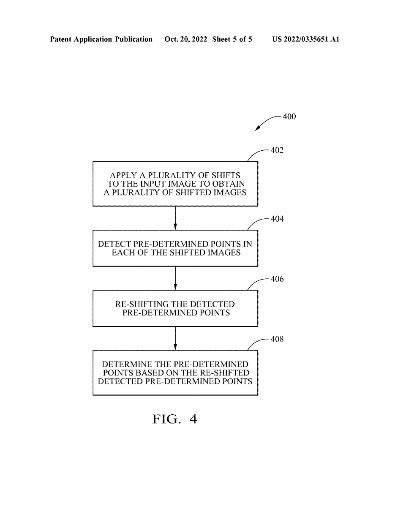
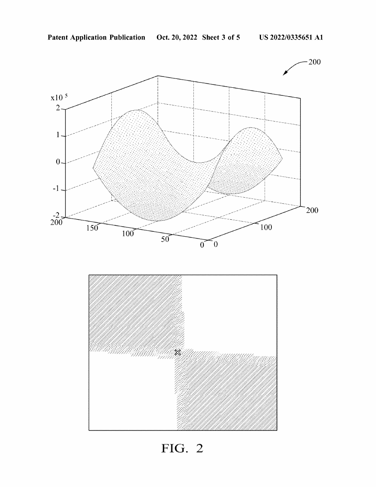
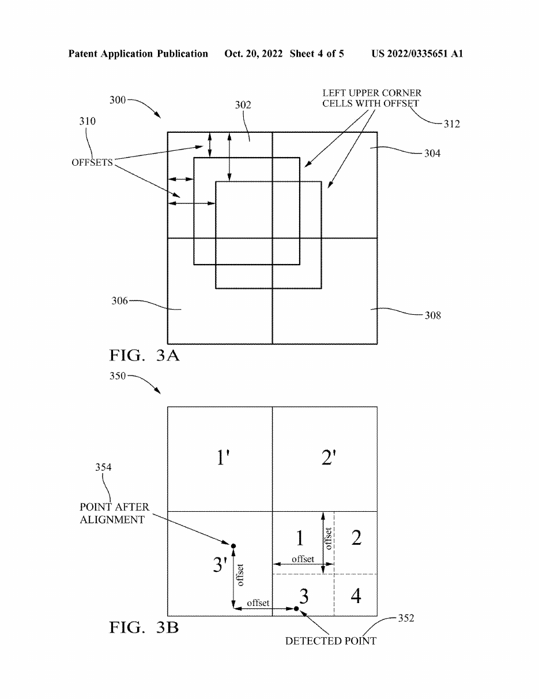

# US 2022/0335651 A1 번역: 입력 영상에서 미리 정한 점을 정하는 방법과 시스템

번역 범위: 전문 (서지 면, 초록, 명세서 [0001]~[0050], 도면 설명, 청구항 1~20)

- 원문 파일: 같은 폴더의 `US20220335651A1.pdf` (10쪽, 2026-11-04 patentimages.storage.googleapis.com에서 받음)
- 원문 PDF는 스캔 영상이다(tiff2pdf). 본문 글자는 Google Patents 본문 텍스트와 PDF 글자층(pdftotext -layout)을 대조해 옮겼다.
- 문단 번호 [00NN]은 공보의 번호다.
- 도면은 `도면/` 폴더에 쪽 단위 이미지로 넣었다.

---

## 서지 면

- (19) 미국 특허출원 공개
- (10) 공개번호: US 2022/0335651 A1
- (43) 공개일: 2022년 10월 20일
- (54) 발명의 명칭: 입력 영상에서 미리 정한 점을 정하는 방법과 시스템 (METHODS AND SYSTEMS FOR DETERMINING PRE-DETERMINED POINTS IN AN INPUT IMAGE)
- (71) 출원인: Aptiv Technologies Limited, St. Michael (BB)
- (72) 발명자: Kamil Lelowicz, Bogunice (PL); Mariusz Nowak, Katowice (PL)
- (21) 출원번호: 17/659,054
- (22) 출원일: 2022년 4월 13일
- (30) 외국 출원 우선권: 2021년 4월 15일 (EP) 21168656.3
- (51) 국제특허분류: G06T 7/80 (2006.01), G06T 7/13 (2006.01)
- (52) CPC: G06T 7/80 (2017.01), G06T 7/13 (2017.01), G06T 2207/20081 (2013.01), G06T 2207/20084 (2013.01)

## (57) 초록

이 개시는 카메라 보정 무늬에서 안장점을 찾는 알고리즘을 쓰는 시스템과 기법을 설명한다.
구현에서 이 알고리즘은 기계학습 모델이다.
한 측면에서, 입력 영상에서 미리 정한 점을 정하는 컴퓨터 구현 방법은 다음을 포함한다.
- 입력 영상에 여러 이동(shift)을 걸어 여러 이동 영상을 얻는다.
- 각 이동 영상에서 미리 정한 점을 검출한다.
- 검출한 점을 다시 되돌려 옮긴다(re-shift).
- 되돌려 옮긴 검출점을 바탕으로 미리 정한 점을 정한다.

(서지 면과 도 4의 대표 도면. 400 흐름도, 402 입력 영상에 여러 이동을 걸어 여러 이동 영상을 얻는다, 404 각 이동 영상에서 미리 정한 점을 검출한다, 406 검출한 점을 되돌려 옮긴다, 408 되돌린 검출점을 바탕으로 미리 정한 점을 정한다.)

---

## 관련 출원 상호 참조

[0001] 이 출원은 유럽 특허출원 21168656.3(2022년 4월 15일 출원)에 대해 우선권을 주장한다. 그 개시 내용 전체를 참조로 여기에 포함한다.
(옮긴이 주: 본문에는 "2022년 4월 15일"로 적혀 있지만, 서지 면 (30)과 Google Patents의 우선일은 2021년 4월 15일이다. 본문의 연도는 오기로 보인다.)

## 배경

[0002] 디지털 카메라 같은 디지털 촬상 장치는 자동차 분야에서 여러 작업에 쓰인다. 그런데 이 장치는 제대로 보정해야 할 수 있다. 따라서 효율적이고 믿을 만한 카메라 보정 방법이 필요하다.

## 요약

[0003] 이 개시는 독립항에 따른 컴퓨터 구현 방법, 컴퓨터 시스템, 비일시적 컴퓨터 판독 매체를 제공한다. 구현 예는 종속항, 명세서, 도면에 있다.

[0004] 한 측면에서, 이 개시는 입력 영상에서 미리 정한 점을 정하는 컴퓨터 구현 방법에 관한 것이다. 이 방법은 컴퓨터 하드웨어 구성요소가 수행하는 다음 단계를 포함한다.
- 입력 영상에 여러 이동을 걸어 여러 이동 영상을 얻는다.
- 각 이동 영상에서 미리 정한 점을 검출한다.
- 검출한 점을 되돌려 옮긴다.
- 되돌린 검출점을 바탕으로 미리 정한 점을 정한다.

[0005] 예를 들어, 검출은 이동 영상에서 하고, 검출 결과를 원래 좌표로 되돌려(re-shift) 그 결과로 미리 정한 점을 정할 수 있다. 또 다른 예로, 이동 가운데 하나는 0일 수 있다. 이 경우 그 이동 영상은 원 영상이다.

[0006] 한 구현에 따르면, 점을 검출하는 것은 (이동 영상 안의 점) 좌표를 정하는 것을 포함할 수 있다. 다른 구현에 따르면, 되돌려 옮기는 것은 그 좌표를 입력 영상의 좌표계로 옮기는 것을 포함할 수 있다. 또 다른 구현에 따르면, 점을 검출하는 것은 (각 좌표에 점이 있을) 확률을 정하는 것을 포함할 수 있다. 또 다른 구현에 따르면, 되돌린 검출점을 바탕으로 점을 정하는 것은 되돌린 검출점의 확률을 누적하는 것을 포함할 수 있다.

[0007] 다른 구현에 따르면, 입력 영상을 여러 셀로 나눌 수 있다. 각 셀은 입력 영상의 직사각형 부분이다. 어떤 경우에는 셀 크기가 같고, 다른 경우에는 다를 수 있다. 셀은 겹칠 수도, 겹치지 않을 수도 있다.

[0008] 한 구현에 따르면, 이동 영상은 셀 크기의 대략 1 %, 대략 2 %, 대략 5 %, 대략 10 % 가운데 적어도 하나만큼 옮겨질 수 있다.

[0009] 예를 들어 셀 크기는 8x8(가로 8 화소, 세로 8 화소)일 수 있다. 이동량은 방법의 입력 매개변수일 수 있다. 이동량은 정수(양수 또는 음수)일 수 있다. 또 이동량의 절댓값은 셀 크기보다 작을 수 있다. 구현에서는 방법을 병렬로 돌려 여러 이동을 한꺼번에 설정할 수 있다. 예를 들어 이동량을 [−6, −4, −2, 0, 2, 4, 6] 목록에서 고르고, 모든 이동의 결과를 합쳐 함께 쓸 수 있다.

[0010] 이동은 두 성분, 곧 세로와 가로로 할 수 있다. 예를 들어 세로 이동 길이와 가로 이동 길이를 같게 해서 대각선 이동을 만들 수 있다.

[0011] 한 구현에 따르면, 입력 영상은 체커보드를 담을 수 있다. 다른 구현에 따르면, 미리 정한 점은 체커보드의 안장점일 수 있다. 또 다른 구현에 따르면, 안장점은 체커보드의 흑백 경계가 교차하는 점일 수 있다. 또 다른 구현에 따르면, 각 이동 영상의 점은 기계학습 방법으로 정할 수 있다. 또 다른 구현에 따르면, 기계학습 방법은 인공 신경망을 포함할 수 있다.

[0012] 다른 측면에서, 이 개시는 컴퓨터 시스템에 관한 것이다. 이 시스템은 여기 설명한 컴퓨터 구현 방법의 단계 일부 또는 전부를 수행하도록 구성된 여러 하드웨어 구성요소를 포함할 수 있다.

[0013] 컴퓨터 시스템은 여러 하드웨어 구성요소(예: 프로세서, 처리 장치 또는 처리망, 적어도 하나의 메모리, 메모리 장치 또는 메모리망, 적어도 하나의 비일시적 저장 장치)를 포함할 수 있다. 시스템에서 방법 단계를 수행하는 데 다른 하드웨어 구성요소를 더 쓸 수 있다. 비일시적 저장 장치나 메모리 장치는, 예를 들어 처리 장치와 메모리를 써서 여기 설명한 방법의 단계나 측면 일부 또는 전부를 수행하도록 컴퓨터에 지시하는 프로그램을 담을 수 있다.

[0014] 한 구현에 따르면, 컴퓨터 시스템은 영상을 얻는 카메라를 더 포함할 수 있다.

[0015] 다른 측면에서, 이 개시는 여기 설명한 방법의 단계나 측면 일부 또는 전부를 수행하는 명령을 담은 비일시적 컴퓨터 판독 매체에 관한 것이다. 이 매체는 광학 매체(CD, DVD), 자기 매체(HDD), SSD, 플래시 같은 ROM 등일 수 있다. 또 인터넷 연결 같은 데이터 연결로 접근하는 저장소, 예를 들어 온라인 데이터 저장소나 클라우드 저장소일 수도 있다.

[0016] 이 개시는 또 여기 설명한 방법의 단계나 측면 일부 또는 전부를 컴퓨터가 수행하도록 지시하는 컴퓨터 프로그램에 관한 것이다. 여러 측면에서, 카메라 보정 무늬의 안장점을 찾는 알고리즘(예: 기계학습 모델)을 쓰는 시스템과 기법을 설명한다.

## 도면의 간단한 설명

[0017] 이 개시의 구현 예와 기능을 다음 도면과 함께 설명한다.

[0018] 도 1A는 입력 자료의 예를 보인다.

[0019] 도 1B는 입력 자료의 다른 예를 보인다.

[0020] 도 2는 안장점의 예를 보인다.

[0021] 도 3A는 여러 구현에 따른 입력 자료 이동을 보인다.

[0022] 도 3B는 여러 구현에 따른 정렬을 보인다.

[0023] 도 4는 여러 구현에 따라 입력 영상에서 미리 정한 점을 정하는 방법을 보인다.

## 상세한 설명

[0024] 여러 구현에 따르면, 안장점 검출기를 위한 비최대 억제(non-maximum suppression) 방법을 제공할 수 있다.

[0025] 사진(영상)의 안장점은 사진에서 뽑을 수 있는 가장 특징적인 요소 가운데 하나일 수 있다.

[0026] 안장점은 카메라 내부 보정, 외부 보정, 특징점 짝짓기에 널리 쓰일 수 있다.

[0027] 도 1A는 입력 자료(입력 영상)의 예를 그린 그림 100이다. 그림처럼 영상에는 체커보드가 있다. 또 그림처럼 영상의 왜곡이 클 수 있다.

[0028] 도 1B는 입력 자료의 다른 예를 그린 그림 150이다. 그림처럼 체커보드가 둘 이상의 평면에 놓일 수 있다.

[0029] 도 2는 안장점의 예를 그린 그림 200이다. 도 2 위쪽은 화소 좌표에 대한 화소값을 보인다. 아래쪽은 영상이며, 안장점은 어두운 영역과 밝은 영역의 경계가 교차하는 곳에 있다.

(도 2. 위: 화소 좌표(0~200)에 대한 화소값 곡면. 말안장 모양이다. 아래: 영상. 두 어두운 사각형이 대각으로 맞닿고, 표시한 점이 안장점이다.)

[0030] 안장점을 찾는 정확도는 카메라 보정 품질에 결정적인 영향을 줄 수 있다. 또 안장점을 모두 검출하는 것이 바람직할 수 있다. 안장점 하나를 놓치면 보정 절차의 뒤 단계에서 심각한 문제(예: 안장점과 그 예측 위치를 짝짓는 문제)가 생길 수 있기 때문이다.

[0031] 크기가 고정된 관심 영역으로 안장점을 검출하고 위치를 정하는 방법에서는, 안장점이 둘 이상의 관심 영역 경계에 놓일 때 문제가 생길 수 있다. 이런 위치의 안장점은 어느 관심 영역에도 속하지 않게 되는 일이 잦고, 그 결과 검출되지 않는다. 여러 구현에 따르면, 관심 영역 경계에 놓인 안장점의 재현율(recall)을 높일 수 있다.

[0032] 여러 구현에 따르면, 신경망의 안장점 재현율을 높이는 비최대 억제 방법을 제공할 수 있다. 비최대 억제(NMS) 방법은, 영상에서 여러 화소가 최댓값을 갖는 것처럼 보여도, 최대로 정해지는 화소(또는 부화소 해상도일 수 있는 위치)가 하나를 넘지 않게 한다.

[0033] 표준 NMS 방법은 "모두 대 모두" 짝짓기가 필요해 시간 복잡도가 O(n²)일 수 있다. 여기서 n은 영상의 폭(또는 높이)이다. 이와 달리 여러 구현에 따르면, 격자 구조를 활용해 O(n) 시간 복잡도를 얻을 수 있다.

[0034] 여러 구현에 따르면, 벡터화 기법(예: SIMD 명령)을 써서 더 빠르게 할 수 있다. 또 셀이 독립인 격자 구조의 계산은 그래픽 처리 장치(GPU)로 쉽게 옮길 수 있다. 그 결과 주 방법(코어라고 부를 수 있다)이 GPU에서 도는 동안, NMS도 자료를 CPU로 돌려보내지 않고 GPU에서 수행할 수 있다. CPU와 GPU 사이 자료 교환은 시간이 많이 들 수 있다. 여러 구현에 따르면 CPU와 GPU 사이 전송량을 최소로 할 수 있다.

[0035] 한 예로, 안장점이 셀의 변이나 모서리에 아주 가까이 나타나면 검출되지 않는 일이 잦다. 여러 구현에 따르면, 영상을 신경망에 여러 번 통과시켜 이 문제를 해결할 수 있다. 신경망에 통과시킬 때마다 틀(frame)의 위치를 달리 두어, 영상(사진)의 왼쪽 위 모서리가 원래 위치에서 옮겨지게 한다.

[0036] 이 방법은 셀 경계에 가까웠던 안장점을 경계에서 멀어지게 할 수 있다. 그러나 대부분의 안장점이 여러 번 검출되므로 이 방식은 비최대 억제(NMS)를 써야 할 수 있다. 그런데 NMS 방법은 계산 시간이 많이 든다.

[0037] 여러 구현에 따르면, 격자 구조로 실행 속도를 높여 이 문제를 해결할 수 있다. 서로 다른 오프셋으로 돌린 여러 실행의 출력을 정렬해 하나의 기준계 값으로 돌려준다. 그 결과 셀마다 셀 안 안장점의 최종 위치를, 점이 있을 확률을 가중치로 한 가중 평균으로, 셀끼리 독립적으로 병렬 계산할 수 있다.

[0038] 도 3은 여러 구현에 따른 입력 자료 이동을 그린 그림 300이다. 예를 들어 입력 영상은 네 셀 302, 304, 306, 308을 포함한 여러 셀로 나뉠 수 있다. 예를 들어 첫 셀 302는 왼쪽 위 모서리 셀일 수 있다. 안장점 검출은 여러 이동 영상(이동 셀)에 대해 할 수 있다. 예를 들어 첫 셀 302에 이동 310을 걸어, 첫 셀 302에 대응하는 여러 이동 셀 312를 만든다.

[0039] 도 3B는 여러 구현에 따른 정렬을 그린 그림 350이다. 정렬 과정은 안장점이 정렬 중에 어떻게 옮겨지는지를 보면 알 수 있다.

(도 3A, 그림 300: 네 셀 302, 304, 306, 308과 오프셋 310. 오프셋을 건 왼쪽 위 모서리 셀들 312가 겹쳐 그려져 있다. 도 3B, 그림 350: 오른쪽 아래 셀이 부분 영역 1, 2, 3, 4로 나뉜다. 부분 영역 3에서 검출된 점 352가 가로, 세로 오프셋만큼 거꾸로 옮겨져 이웃 셀 3′의 정렬 후 점 354가 된다. 위쪽 셀은 1′, 2′로 표시되어 있다.)

[0040] 예를 들어 안장점 352(검출된 안장점)가 오른쪽 아래 셀(부분 영역 1, 2, 3, 4로 나뉜 셀)에 있다고 하자. 또 이동량은 도 3B에 보인 오프셋과 같다고 하자.

[0041] 또 안장점은 네 부분 영역 가운데 하나에 있고, 정렬 후의 점 354는 같은 영역에 있을 수도, 다른 영역에 있을 수도 있다.

[0042] 점이 부분 영역 1 안에 있으면, 정렬 후 셀 1′로 옮겨진다. 정렬 후 셀 1′ 안의 위치는 주어진 오프셋을 (반대 방향으로) 써서 계산할 수 있다. 부분 영역 2와 3도 같다. 부분 영역 4라면 검출점은 여전히 같은 셀(오른쪽 아래 셀)에 있고, 위치만 오프셋의 영향을 받는다.

[0043] 영상에서 왜곡이 심한 영역에서는 안장점이 늘어나 그 크기가 셀 크기보다 커질 수 있다. 이 경우 안장점 중심이 셀 중심에서 멀면, 안장점 검출기가 올바른 출력을 내기 어려울 수 있다. 흔히 쓰는 방법은 안장점을 놓칠 수 있지만, 여러 구현에 따른 방법은 모든 안장점을 제대로 검출할 수 있다.

[0044] 여러 구현에 따른 방법은 빠르고, 재현율을 98 %에서 99.9 %로 높일 수 있다. 또 놓친 안장점 수를 20배 넘게 줄일 수 있다.

[0045] 정답(GT) 자료는 반자동으로 만들 수 있다. "표준 검출기"의 결과를 사람이 손으로 고친다. 거짓 양성 검출은 지우고 빠진 검출은 더한다. 문제는 안장점이 정확히 어디 있는지 판단하기 어렵다는 것이다. 정답을 만들 때 안장점 위치는 ±1 px 정확도 안에서만 추정할 수 있다. 예측이 정답에서 2 화소보다 가까우면 참 양성(TP)으로 본다. 이때 재현율은 TP 수를 입력 영상의 전체 정답 수로 나눈 값으로 정의한다.

[0046] 위에서 말했듯, 예측의 "위치 오차"를 평가하기는 어려울 수 있다. 안장점 위치는 카메라 내부 보정에 쓰일 수 있다. 따라서 같은 영상에서 검출한 안장점 두 묶음을, 카메라가 얼마나 잘 보정되는지로 비교할 수 있다. 예를 들어 어느 묶음에서 카메라 보정(모델 최적화)의 잔차가 더 작은지를 본다.

[0047] 도 4는 여러 구현에 따라 입력 영상에서 미리 정한 점을 정하는 방법을 보인 흐름도 400이다. 402에서 입력 영상에 여러 이동을 걸어 여러 이동 영상을 얻을 수 있다. 404에서 각 이동 영상에서 미리 정한 점을 검출할 수 있다. 406에서 검출한 점을 되돌려 옮길 수 있다. 408에서 되돌린 검출점을 바탕으로 미리 정한 점을 정할 수 있다.

[0048] 여러 구현에 따르면, 점 검출은 좌표를 정하는 것을 포함하거나 그 자체일 수 있다. 여러 구현에 따르면, 되돌려 옮기는 것은 좌표를 입력 영상의 좌표계로 옮기는 것을 포함하거나 그 자체일 수 있다. 여러 구현에 따르면, 점 검출은 확률을 정하는 것을 포함하거나 그 자체일 수 있다. 여러 구현에 따르면, 되돌린 검출점으로 점을 정하는 것은 되돌린 검출점의 확률을 누적하는 것을 포함하거나 그 자체일 수 있다. 여러 구현에 따르면, 입력 영상은 여러 셀로 나뉠 수 있다. 여러 구현에 따르면, 이동 영상은 셀 크기의 대략 1 %, 2 %, 5 %, 10 % 가운데 적어도 하나만큼 옮겨질 수 있다. 여러 구현에 따르면, 영상은 체커보드를 포함하거나 보일 수 있다.

[0049] 여러 구현에 따르면, 미리 정한 점은 체커보드의 안장점을 포함하거나 그 자체일 수 있다. 여러 구현에 따르면, 안장점은 체커보드 흑백 경계의 교차점일 수 있다. 여러 구현에 따르면, 각 이동 영상의 점은 기계학습 방법으로 정할 수 있다. 여러 구현에 따르면, 기계학습 방법은 인공 신경망을 포함하거나 그 자체일 수 있다.

[0050] 다른 측면에서, 단계 402, 404, 406, 408과 위에서 설명한 다른 단계는 각각 컴퓨터 하드웨어 구성요소가 수행할 수 있다.

(옮긴이 주: 도 1A, 1B(왜곡이 큰 체커보드 영상, 여러 평면의 체커보드)는 입력 예시 사진이라 따로 싣지 않았다. 원문 PDF 2~3쪽에 있다.)

---

## 청구항 (20개)

청구하는 것은 다음과 같다.

1. 컴퓨터 구현 방법으로서, 다음을 포함한다.
   - 입력 영상에 여러 이동을 걸어 여러 이동 영상을 얻는다.
   - 각 이동 영상에서 미리 정한 점을 검출한다.
   - 검출한 점을 되돌려 옮긴다.
   - 되돌린 검출점을 바탕으로 미리 정한 점을 정한다.
2. 청구항 1에서, 점 검출은 좌표를 정하는 것을 포함한다.
3. 청구항 2에서, 되돌려 옮기는 것은 좌표를 입력 영상의 좌표계로 옮기는 것을 포함한다.
4. 청구항 1 중 적어도 하나에서, 점 검출은 확률을 정하는 것을 포함한다.
5. 청구항 1 중 적어도 하나에서, 되돌린 검출점을 바탕으로 점을 정하는 것은 되돌린 검출점의 확률을 누적하는 것을 포함한다.
6. 청구항 1 중 적어도 하나에서, 입력 영상은 여러 셀로 나뉜다.
7. 청구항 1 중 적어도 하나에서, 이동 영상은 셀 크기의 대략 1 %, 2 %, 5 %, 10 % 가운데 적어도 하나만큼 옮겨진다.
8. 청구항 1에서, 입력 영상은 체커보드를 포함한다.
9. 청구항 8에서, 미리 정한 점은 체커보드의 안장점을 포함한다.
10. 청구항 9에서, 안장점은 체커보드 흑백 경계의 교차점이다.
11. 청구항 1에서, 각 이동 영상의 점은 기계학습 방법으로 정한다.
12. 청구항 11에서, 기계학습 방법은 인공 신경망을 포함한다.
13. 컴퓨터 시스템으로서, 하나 이상의 프로세서와, 프로세서에 연결되어 프로세서가 실행할 하나 이상의 프로그램을 저장한 메모리를 포함하고, 그 프로그램은 다음 명령을 포함한다.
   - 입력 영상에 여러 이동을 걸어 여러 이동 영상을 얻는다.
   - 각 이동 영상에서 미리 정한 점을 검출한다.
   - 검출한 점을 되돌려 옮긴다.
   - 되돌린 검출점을 바탕으로 미리 정한 점을 정한다.
14. 청구항 13의 시스템에서, 입력 영상을 얻는 카메라를 더 포함한다.
15. 청구항 14의 컴퓨터 구현 방법에서, 입력 영상은 체커보드를 포함한다.
16. 청구항 15의 방법에서, 미리 정한 점은 체커보드의 안장점을 포함한다.
17. 청구항 16의 방법에서, 안장점은 체커보드 흑백 경계의 교차점이다.
18. 하나 이상의 프로그램을 저장한 비일시적 컴퓨터 판독 저장 매체로서, 그 프로그램은 프로세서가 실행하면 프로세서가 다음을 하게 하는 명령을 포함한다.
   - 입력 영상에 여러 이동을 걸어 여러 이동 영상을 얻는다.
   - 각 이동 영상에서 미리 정한 점을 검출한다.
   - 검출한 점을 되돌려 옮긴다.
   - 되돌린 검출점을 바탕으로 미리 정한 점을 정한다.
19. 청구항 18의 매체에서, 각 이동 영상의 점을 정하도록 구성된 기계학습 모델을 더 포함한다.
20. 청구항 19의 컴퓨터 구현 방법에서, 기계학습 방법은 인공 신경망을 포함한다.

(옮긴이 주: 청구항 4~7의 "at least one of claim 1", 청구항 15~17과 20의 "computer-implemented method of claim 14/15/16/19"는 원문 표현을 그대로 옮겼다. 원문에서도 인용 관계가 어색하다.)

---

## 인용 문헌 (Google Patents 표기 원문 그대로)

특허 인용
- US20140119651A1
- US9064315
- US20160337632A1
- US10334229
- US20220180491A1
- CN111640157A

비특허 인용
- "Chen": B. Chen, Y. Liu and C. Xiong, "Automatic Checkerboard Detection for Robust Camera Calibration," 2021 IEEE International Conference on Multimedia and Expo (ICME), Shenzhen, China, 2021, pp. 1-6, doi: 10.1109/ICME51207.2021.9428389. (Year: 2021)
- Mao Yang, Xiaobo Chen, and Chengyi Yu, "Camera calibration using a planar target with pure translation," Appl. Opt. 58, 8362-8370 (2019) (Year: 2019)
