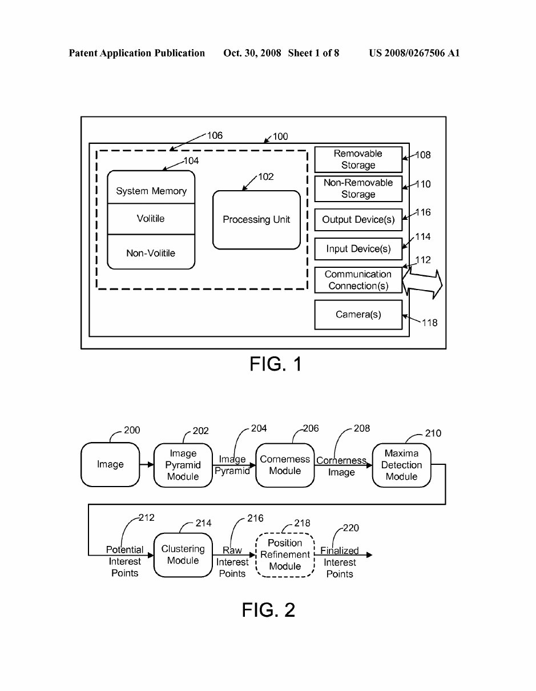
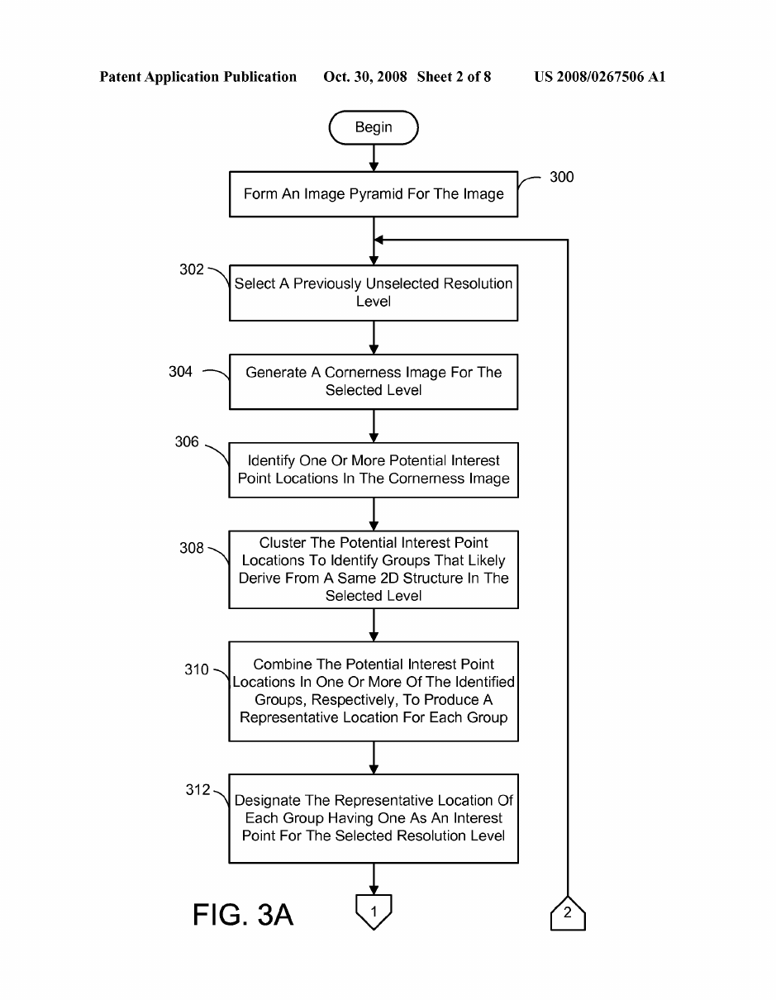
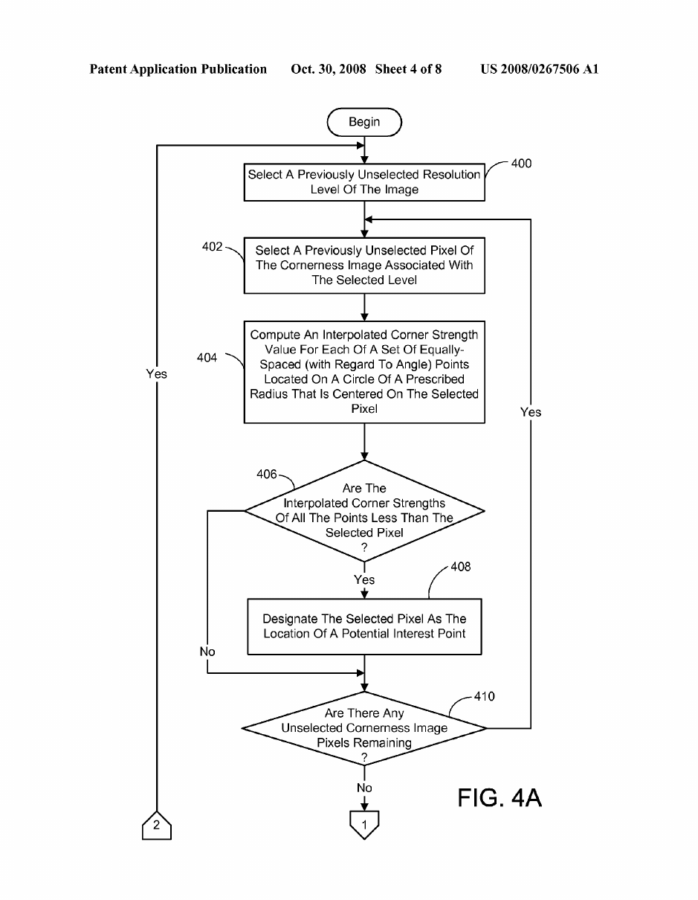
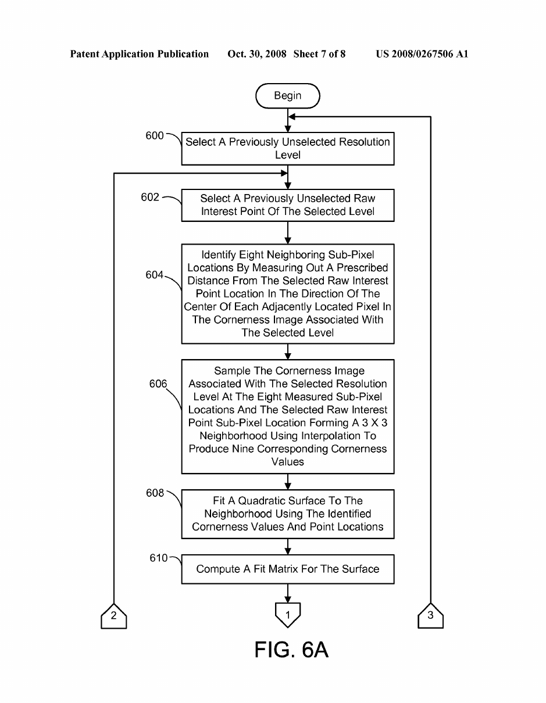
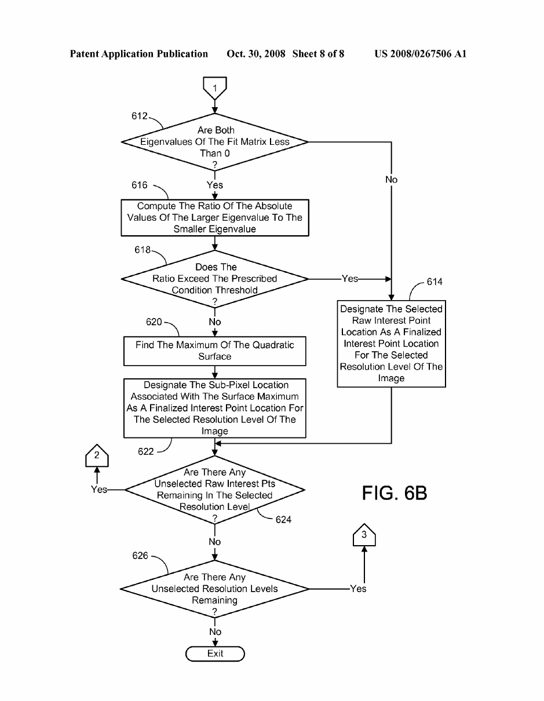

# US 2008/0267506 A1 관심점 검출 (전문 번역)

번역 범위: 전문 (서지, 초록, 배경, 요약, 도면 설명, 상세 설명, 청구항 1~20).
원문: 같은 폴더의 `US20080267506A1.pdf` (16쪽, 2026-11-04 Google Patents의 patentimages 링크에서 받음).
수식은 PDF 글자 추출이 깨져서 Google Patents 본문 텍스트(MathML)로 확인해 적었다.
번역 2026-11-04.

## 서지

- (19) 미국, (12) 특허출원 공개
- (10) 공개번호: US 2008/0267506 A1
- (43) 공개일: 2008년 10월 30일
- (54) 발명의 명칭: 관심점 검출 (INTEREST POINT DETECTION)
- (75) 발명자: Simon Winder, 미국 워싱턴주 시애틀
- (73) 양수인: Microsoft Corporation, 미국 워싱턴주 레드먼드
- (21) 출원번호: 11/739,672
- (22) 출원일: 2007년 4월 24일
- (51) 국제특허분류: G06K 9/46 (2006.01)
- (52) 미국 분류: 382/190
- Google Patents 표시 (법적 판단 아님): 같은 출원이 US8126275B2로 등록됨, 상태 "Expired - Fee Related"(유지료 미납으로 소멸).

## (57) 초록

관심점 검출 기법을 제시한다.
구체적으로, 여러 개일 수 있는 영상 피라미드 해상도마다 코너 강도 영상(cornerness image)을 만든다.
코너 강도 영상에서 관심점 위치 후보를 하나 이상 찾는다.
이는 정해진 크기의 주변 화소 이웃보다 코너 강도 값이 큰 화소에 해당하는 위치를 찾는 일이다.
그다음 관심점 위치 후보들을 묶어(clustering), 같은 2차원 구조에서 나왔을 가능성이 큰 무리를 찾는다.
찾은 무리 가운데 하나 이상에서, 무리 안의 후보 위치들을 각각 합쳐 그 무리를 대표하는 한 위치를 만든다.
무리마다의 대표 위치를 관심점으로 지정한다.
선택 사항으로 위치 정밀화도 할 수 있다.



*도면 1장(Sheet 1 of 8). FIG. 1 장치 구성과 FIG. 2 모듈 구성 (FIG. 1은 공보 첫 쪽에도 실림).*

## 배경

[0001] 영상 사이의 대응 특징을 찾는 일은, 두 장 이상의 영상에서 정보를 뽑으려는 거의 모든 비전 응용의 핵심 요소다.
예를 들어 영상 짝짓기, 시점 기반 물체 인식 같은 응용은 영상 사이의 대응 특징 찾기에 기대고 있다.

[0002] 이런 대응 특징을 찾는 많은 방법에서 핵심 단계는 이른바 관심점을 찾는 일이다.
일반적으로 이상적인 관심점은 다음과 같은 점으로 정의할 수 있다.
- 영상 공간에서 위치가 잘 정해진다(흔히 부화소 수준으로).
- 주변 이웃에 구별할 정보가 많다.
- 시점 변화, 조명과 밝기 변화에 거의 변하지 않는다.

이런 관심점은 반복성이 높다.
즉 같은 장면을 다른 촬영 조건에서 찍어도 같은 점이 검출된다.

## 요약

[0003] 이 요약은 아래 상세 설명에서 더 설명할 개념 일부를 간단한 형태로 소개하려는 것이다.
이 요약은 청구한 대상의 핵심 특징이나 필수 특징을 밝히려는 것이 아니며, 청구 대상의 범위를 정하는 데 보조 자료로 쓰려는 것도 아니다.

[0004] 이 기법은 일반적으로 영상에서 관심점을 하나 이상 검출한다.
보통은 여러 해상도에서 하지만 꼭 그래야 하는 것은 아니다.
여러 해상도 실시예를 쓴다고 하면, 먼저 영상의 영상 피라미드를 만든다.
피라미드의 해상도 단계마다 코너 강도 영상을 만든다.
이 영상은 화소마다 코너 강도 값을 가진다.
코너 강도 영상에서 관심점 위치 후보를 하나 이상 찾는다.
이는 정해진 크기의 주변 화소 이웃보다 코너 강도 값이 큰 화소에 해당하는 위치를 찾는 일이다.
그다음 후보 위치들을 묶어서, 해당 해상도 단계에서 같은 2차원 구조(예: 코너)에서 나왔을 가능성이 큰 무리를 찾는다.
찾은 무리 가운데 하나 이상에서 후보 위치를 각각 합쳐 그 무리를 대표하는 한 위치를 만든다.
후보 위치 개수가 너무 적은 무리는 합치기에서 뺄 수 있다.
그다음 크기가 충분한 무리마다 대표 위치를 그 해상도 단계의 관심점으로 지정한다.

[0005] 선택 사항으로 위치 정밀화를 할 수 있다.
먼저 관심점이 위치 정밀화 대상이 되는지 판단한다.
관심점 위치를 중심으로 한 정해진 크기의 이웃에 이차 곡면을 맞추고, 그 곡면이 극대를 가지는지 보면 된다.
극대가 있으면 대상이 되는 관심점의 위치를 정밀화한다.
한 실시예에서는 이차 곡면의 극대를 찾고, 그 극대에 해당하는 부화소 위치를 정밀화한 관심점 위치로 지정한다.
대상이 된 관심점은 정밀화한 위치를 그 해상도 단계의 최종 관심점 위치로 지정한다.
대상이 되지 않은 관심점은 정밀화하지 않은 위치를 그 해상도 단계의 최종 관심점 위치로 지정한다.

## 도면의 설명

[0006] 본 발명의 구체적인 특징, 측면, 장점은 다음 설명, 첨부한 청구항, 도면을 보면 더 잘 이해될 것이다.

[0007] FIG. 1은 본 발명을 구현하는 예시 시스템을 이루는 범용 계산 장치를 나타낸 그림이다.

[0008] FIG. 2는 이 관심점 검출 기법의 기본 모듈을 나타낸 블록도다.

[0009] FIG. 3A~B는 영상에서 관심점 하나 이상의 위치를 검출하는, FIG. 3(원문 표기 그대로. FIG. 2를 뜻하는 것으로 보인다)의 모듈 전체 동작의 한 실시예를 대략 나타낸 이어지는 흐름도다.

[0010] FIG. 4A~B는 이 기법의 극대 검출 단계의 한 실시예를 대략 나타낸 이어지는 흐름도다.

[0011] FIG. 5는 이 기법의 묶음(clustering) 단계의 한 실시예를 대략 나타낸 흐름도다.

[0012] FIG. 6A~B는 이 기법의 선택 사항인 위치 정밀화 단계의 한 실시예를 대략 나타낸 이어지는 흐름도다.

## 상세한 설명

[0013] 아래 본 발명 실시예 설명에서는 이 설명의 일부를 이루는 첨부 도면을 참조한다.
도면에는 발명을 실시할 수 있는 구체적인 실시예를 예시로 보였다.
다른 실시예를 쓸 수 있고, 본 발명의 범위를 벗어나지 않고 구조를 바꿀 수 있음을 이해해야 한다.

### 1.0 계산 환경

[0014] 관심점 검출 기법의 실시예를 설명하기 전에, 그 일부를 구현할 수 있는 알맞은 계산 환경을 간단히 일반적으로 설명한다.
이 기법은 여러 범용 또는 특수 목적 계산 시스템 환경이나 구성에서 작동한다.
알맞을 수 있는 잘 알려진 계산 시스템, 환경, 구성의 예는 다음과 같으며 이에 한정되지 않는다.
- 개인용 컴퓨터, 서버 컴퓨터
- 휴대용 또는 노트북 장치
- 다중 처리기 시스템, 마이크로프로세서 기반 시스템
- 셋톱 박스, 프로그램 가능한 소비자 전자기기
- 네트워크 PC, 미니컴퓨터, 메인프레임 컴퓨터
- 위 시스템이나 장치를 포함하는 분산 계산 환경 등

[0015] FIG. 1은 알맞은 계산 시스템 환경의 한 예다.
이 계산 시스템 환경은 알맞은 계산 환경의 한 예일 뿐이며, 관심점 검출 기법의 사용 범위나 기능에 어떤 한계를 시사하려는 것이 아니다.
예시 운용 환경에 나온 구성 요소 하나나 그 조합에 의존하거나 그것을 요구하는 것으로 해석해서도 안 된다.
FIG. 1을 보면, 이 기법을 구현하는 예시 시스템은 계산 장치 100 같은 계산 장치를 포함한다.
가장 기본 구성에서 계산 장치 100은 보통 처리 장치 102 하나 이상과 메모리 104를 가진다.
계산 장치의 정확한 구성과 종류에 따라 메모리 104는 휘발성(RAM 등), 비휘발성(ROM, 플래시 메모리 등), 또는 둘의 조합일 수 있다.
이 가장 기본 구성을 FIG. 1에 점선 106으로 나타냈다.
장치 100은 추가 특징이나 기능도 가질 수 있다.
예를 들어 자기 디스크, 광 디스크, 테이프 같은 추가 저장 장치(탈착식 또는 고정식)를 가질 수 있으며 이에 한정되지 않는다.
이런 추가 저장 장치를 FIG. 1에 탈착식 저장 장치 108과 고정식 저장 장치 110으로 나타냈다.
컴퓨터 저장 매체는 컴퓨터가 읽을 수 있는 명령, 자료 구조, 프로그램 모듈, 기타 자료 같은 정보를 저장하는 어떤 방법이나 기술로든 구현한 휘발성과 비휘발성, 탈착식과 고정식 매체를 포함한다.
메모리 104, 탈착식 저장 장치 108, 고정식 저장 장치 110은 모두 컴퓨터 저장 매체의 예다.
컴퓨터 저장 매체는 RAM, ROM, EEPROM, 플래시 메모리나 기타 메모리 기술, CD-ROM, DVD나 기타 광 저장 장치, 자기 카세트, 자기 테이프, 자기 디스크 저장 장치나 기타 자기 저장 장치, 또는 원하는 정보를 저장하는 데 쓸 수 있고 장치 100이 접근할 수 있는 기타 어떤 매체든 포함하며 이에 한정되지 않는다.
이런 컴퓨터 저장 매체는 어느 것이든 장치 100의 일부일 수 있다.

[0016] 장치 100은 다른 장치와 통신할 수 있게 하는 통신 연결 112도 가질 수 있다.
통신 연결 112는 통신 매체의 한 예다.
통신 매체는 보통 컴퓨터가 읽을 수 있는 명령, 자료 구조, 프로그램 모듈, 기타 자료를 반송파나 기타 전송 메커니즘 같은 변조된 자료 신호에 담으며, 어떤 정보 전달 매체든 포함한다.
"변조된 자료 신호"는 신호 안에 정보를 부호화하는 방식으로 특성 하나 이상이 설정되거나 바뀐 신호를 뜻한다.
예를 들어 통신 매체는 유선 네트워크나 직접 유선 연결 같은 유선 매체, 음향, RF, 적외선 같은 무선 매체를 포함하며 이에 한정되지 않는다.
여기서 컴퓨터가 읽을 수 있는 매체라는 말은 저장 매체와 통신 매체를 모두 포함한다.

[0017] 장치 100은 키보드, 마우스, 펜, 음성 입력 장치, 터치 입력 장치 같은 입력 장치 114도 가질 수 있다.
디스플레이, 스피커, 프린터 같은 출력 장치 116도 포함할 수 있다.
이런 장치는 모두 이 분야에 잘 알려져 있어 길게 설명하지 않는다.

[0018] 특히 장치 100은 일련의 영상을 찍을 수 있는 카메라 118(디지털 또는 전자식 정지 카메라나 비디오 카메라, 또는 필름이나 사진 스캐너)을 입력 장치로 포함할 수 있다.
또 여러 카메라 118을 입력 장치로 포함할 수 있다.
카메라 하나 이상에서 나온 영상은 알맞은 인터페이스(도시하지 않음)를 거쳐 장치 100에 입력된다.
다만 영상 자료는 카메라 없이도 컴퓨터가 읽을 수 있는 어떤 매체에서든 장치 100에 입력될 수 있다.

[0019] 이 관심점 검출 기법은 계산 장치가 실행하는 프로그램 모듈 같은 컴퓨터 실행 명령의 일반적인 맥락에서 설명할 수 있다.
일반적으로 프로그램 모듈은 특정 작업을 하거나 특정 추상 자료형을 구현하는 루틴, 프로그램, 객체, 구성 요소, 자료 구조 등을 포함한다.
이 기법은 통신망으로 연결된 원격 처리 장치가 작업을 하는 분산 계산 환경에서도 실시할 수 있다.
분산 계산 환경에서 프로그램 모듈은 메모리 저장 장치를 포함한 지역과 원격 컴퓨터 저장 매체 양쪽에 있을 수 있다.

[0020] 예시 운용 환경을 설명했으니, 이 설명 절의 나머지는 관심점 검출 기법을 구현하는 프로그램 모듈 설명에 쓴다.

### 2.0 관심점 검출

[0021] FIG. 2를 보면, 이 관심점 검출 기법은 대체로 다음 모듈을 쓴다.
1. 관심점을 찾을 영상 200을 먼저 영상 피라미드 모듈 202에 넣는다. 이 모듈은 원본 영상에서 시작해 점점 해상도를 낮춘 영상들로 이어지는 계층 해상도 단계들을 만든다.
2. 영상 피라미드 자료 204를 코너 강도 모듈 206에 넣는다. 이 모듈은 해상도 단계마다 코너 강도 영상을 만든다. 코너 강도 영상의 화소 값은 그 화소에서 계산한 코너 강도다.
3. 해상도 단계마다의 코너 강도 영상 자료 208을 극대 검출 모듈 210에 넣는다. 이 모듈은 해상도 단계마다 관심점의 개수와 위치를 정하고 점점 다듬는 일련의 모듈 가운데 첫째다. 극대 검출 모듈은 주변 지역보다 코너 강도가 큰 위치를 찾아 관심점 위치 후보 여러 개를 만든다.
4. 해상도 단계마다의 관심점 후보 위치 자료 212를 묶음 모듈 214에 넣는다. 묶음 모듈은 해당 해상도 단계에서 같은 2차원 구조(예: 코너)에서 나왔을 가능성이 큰 관심점 후보의 무리를 찾는다. 각 단계의 무리마다 합쳐서 원시 관심점 하나로 나타낸다.
5. 해상도 단계마다의 원시 관심점 자료 216을 위치 정밀화 모듈 218에 넣는다. 위치 정밀화 모듈은 원시 관심점의 위치를 더 정밀화할 수 있는지 판단하고, 그럴 수 있으면 정밀화한 위치를 계산한다.

위치 정밀화 모듈 218의 출력은 검사한 영상의 해상도 단계마다 최종 관심점 위치 220 전체 목록이다.
FIG. 2에 점선 상자로 나타낸 것처럼 위치 정밀화 모듈은 선택 사항이다.
위치 정밀화를 하지 않으면 묶음 모듈 214가 원시 관심점을 해상도 단계마다의 최종 관심점 위치 220으로 출력한다.



*FIG. 3A. 전체 동작 흐름 앞부분: 피라미드 만들기(300), 해상도 단계 고르기(302), 코너 강도 영상 만들기(304), 후보 위치 찾기(306), 후보 묶기(308), 무리별 대표 위치 만들기(310), 관심점 지정(312). FIG. 3B는 정밀화 대상 판단(314), 정밀화(316), 최종 위치 지정(318, 320), 모든 단계 처리 확인(322)으로 이어진다.*

[0022] 영상에서 관심점 하나 이상의 위치를 검출하는 위 모듈들의 전체 동작을 FIG. 3A~B 흐름도에 대략 나타냈다.
1. 먼저 영상의 영상 피라미드를 만든다. 피라미드는 해상도 단계가 여럿이다(300).
2. 아직 고르지 않은 해상도 단계를 하나 고르고(302), 고른 단계의 코너 강도 영상을 만든다(304). 이 영상은 화소마다 코너 강도 값을 가진다.
3. 정해진 크기의 주변 화소 이웃보다 코너 강도 값이 큰 화소에 해당하는 위치를 찾아, 코너 강도 영상에서 관심점 위치 후보를 하나 이상 찾는다(306).
4. 이 후보 위치들을 묶어 고른 해상도 단계에서 같은 2차원 구조에서 나왔을 가능성이 큰 무리를 찾는다(308).
5. 찾은 무리 가운데 하나 이상에서 후보 위치를 각각 합쳐 무리를 대표하는 한 위치를 만든다(310). 모든 무리를 합쳐 대표 위치를 만들지는 않을 수 있는데, 뒤에서 설명하듯 크기에 따라 일부 무리를 고려에서 뺄 수 있기 때문이다.
6. 크기가 충분한 무리마다 대표 위치를 고른 해상도 단계의 관심점으로 지정한다(312).
7. 끝으로 선택 사항인 위치 정밀화(FIG. 3B의 점선 상자)를 할 수 있다. 먼저 각 관심점이 위치 정밀화 대상인지 판단한다. 해당 관심점 위치를 중심으로 한 정해진 크기의 이웃에 맞춘 이차 곡면이 극대를 가지는지 보면 된다(314).
8. 그다음 대상이 되는 관심점의 위치를 정밀화한다(316). 한 실시예에서는 이차 곡면의 극대를 찾고, 그 극대에 해당하는 부화소 위치를 정밀화한 관심점 위치로 지정한다. 대상이 된 관심점의 정밀화한 위치를 고른 해상도 단계의 최종 관심점 위치로 지정한다(318).
9. 정밀화 대상이 아닌 관심점(또는 정밀화 선택 사항을 구현하지 않은 경우)은 정밀화하지 않은 위치를 고른 해상도 단계의 최종 관심점 위치로 지정한다(320).
10. 모든 해상도 단계를 고르고 처리했는지 판단한다(322). 아니면 302~322를 반복한다. 그렇지 않으면 동작을 끝낸다.

[0023] 앞의 각 모듈과 관련 동작을 다음 절들에서 더 자세히 설명한다.

### 2.1 영상 피라미드

[0024] 입력 영상 I(x,y)마다 영상 피라미드를 만든다.
가장 낮은 단계는 P₀(x,y)=I(x,y)이고, 위 단계들은 평활화와 부표본화로 이어진다.

```
P'_l(x,y) = P_l(x,y) * g_σp(x,y)          (2)
P_{l+1}(x,y) = P'_l(sx, sy)
```

여기서 l은 해상도 단계, g_σ(x,y)는 표준편차 σ인 가우시안 커널이다.
예로(한정은 아님) 부표본화 비율 s=2, 피라미드 평활화 σp=1.0을 쓸 수 있다.
일반적으로는 s에 약 1.1~3.0, σp에 약 0.55~1.5 범위의 값을 쓸 수 있다.
관심점은 피라미드의 각 단계에서 뽑는다.

(원문에는 식 (1)이 없고 식 번호가 (2)부터 시작한다.)

### 2.2 코너 강도 영상

[0025] 영상의 한 해상도 단계에서 어떤 점이 관심점이 될 가능성을 수치로 나타내려고 코너 강도 영상을 쓴다.
여러 방법으로 할 수 있다.
그 가운데 어느 것이든 쓸 수 있지만, 이 기법은 이른바 Harris 코너 방식을 쓴다.
일반적으로 Harris 코너 방식은 해상도 단계 안에서 한 점 주변의 2차원 구조(예: 코너 같은 것)와 관련된 화소를 찾는다.
그림으로 설명하면 다음과 같다.
영상의 한 화소를 고르고, 그 점 둘레에 창을 정한 뒤 창을 움직인다(예: 모든 방향으로 정해진 화소 수만큼 옮긴다).
옮긴 창마다 원래 창과 비교해 상관이 높은지 낮은지 판단한다.
코너는 어느 방향으로 옮겨도 옮긴 창에서 큰 변화를 만든다.
따라서 코너는 모든 방향에서 상관이 낮다.
이 조건이 그 점이 코너임을 나타낸다.

[0026] 수학적으로 Harris 코너 방식은 다음과 같이 구현할 수 있다.
피라미드 단계 l, 위치 (x,y)에서의 Harris 행렬은 기울기의 외적을 평활화한 것이다.

```
H_l(x,y) = ∇_σd P_l(x,y) ∇_σd P_l(x,y)^T * g_σi(x,y)     (3)
```

여기서 ∇_σ는 척도 σ에서의 공간 미분이다. 즉

```
∇_σ f(x,y) = ∇f(x,y) * g_σ(x,y)          (4)
```

예로(한정은 아님) 적분 척도는 σi=1.5, 미분 척도는 σd=1.0으로 둘 수 있다.
일반적으로는 σi에 약 0.5~2.5, σd에 약 0.5~2.5 범위의 값을 쓸 수 있다.

[0027] 그다음 코너 강도 함수로 해당 해상도 단계의 각 화소의 코너 강도를 계산한다.
코너 강도는 그 화소가 코너 화소일 가능성의 척도다.
이 기법의 한 실시예에서는 조화 평균 코너 검출 함수를 쓴다.
이 함수는 다음과 같다.

```
f_HM(x,y) = det H_l(x,y) / tr H_l(x,y) = λ1 λ2 / (λ1 + λ2)     (5)
```

이는 H의 고유값 (λ1, λ2)의 조화 평균이다.
관심점 위치를 찾는 데 다른 코너 강도 함수도 쓸 수 있다.
예를 들어 다른 한 실시예에서는

```
f_H = λ1 λ2 − 0.04 (λ1 + λ2)² = det H − 0.04 (tr H)²          (6)
```

또 다른 실시예에서는

```
f_ST = min(λ1, λ2)          (7)
```

[0028] 위 코너 강도 함수를 영상 각 해상도 단계의 화소마다 계산한다.
그러면 해상도 단계마다 코너 강도 지도, 곧 "코너 강도 영상"이 나온다.
이 지도는 그 단계의 화소마다 코너 강도를 알려 준다.

### 2.3 극대 검출

[0029] 계산량을 생각하면 영상마다 관심점 수를 줄이는 것이 바람직하다.
따라서 약한 점까지 포함한 많은 점보다, "강한" 관심점 적은 수를 찾는 것이 바람직하다.
강한 관심점이란 잡음, 노출, 조명, 방향 같은 변화가 있어도 영상에서 쉽게 검출되는 점이다.
이런 강한 관심점을 찾는 첫 단계를 극대 검출이라고 한다.



*FIG. 4A. 극대 검출 흐름: 해상도 단계 고르기(400), 화소 고르기(402), 정해진 반지름 원 위에 같은 각도 간격으로 놓인 점들의 보간 코너 강도 계산(404), 모든 점이 고른 화소보다 작은지 판단(406), 작으면 후보 위치로 지정(408). FIG. 4B는 남은 해상도 단계 확인(412)이다.*

[0030] 일반적으로 극대 검출은 영상의 해상도 단계마다, 코너 강도 영상에서 주변에 정한 화소 무리보다 코너 강도가 큰 화소를 찾는 일이다.
구체적으로 FIG. 4A~B를 보면 다음과 같다.
1. 검사하는 영상의 아직 고르지 않은 해상도 단계를 고른다(400).
2. 고른 해상도 단계에서 계산한 코너 강도 영상의 아직 고르지 않은 화소를 고른다(402).
3. 고른 화소를 중심으로 하는 정해진 반지름의 원 위에, 각도로 같은 간격을 둔 점들을 놓고 점마다 보간한 코너 강도 값을 계산한다(404). 점 개수도 정해 둔다(예: 8개 이상). 원의 각도 방향은 임의로 둔다(편의를 위해 점 하나를 고른 화소가 있는 화소 행에 맞출 수는 있다). 보간 방법은 아무것이나 쓸 수 있다. 예를 들어 화소에 지정된 코너 강도 값이 그 화소 중심에 있다고 보고 쌍선형 보간을 쓴다. 따라서 어떤 점이 화소 안에 있지만 중심이 아니면, 그 점의 보간 코너 강도는 주변 화소 값들로부터, 그 점이 각 주변 화소 중심에 얼마나 가까운지에 비례해 계산한다. 이 기법의 한 실시예에서는 반지름을 2화소로 두었다. 다만 반지름은 약 1화소에서 약 4화소까지 쓸 수 있다.
4. 원 위 모든 점의 보간 코너 강도가 고른 화소보다 작은지 판단한다(406). 그러면 고른 화소를 관심점 후보 위치로 지정한다(408). 고른 화소의 코너 강도가 주변 점들보다 크지 않으면 아무것도 하지 않는다.
5. 결과와 상관없이, 검사 중인 코너 강도 영상에 아직 고르지 않은 화소가 남았는지 판단한다(410). 남았으면 402~410을 알맞게 반복한다.
6. 남지 않았으면, 아직 고르지 않고 처리하지 않은 해상도 단계가 남았는지 판단한다(412). 남았으면 400~412를 알맞게 반복한다. 그렇지 않으면 극대 검출을 끝낸다.

### 2.4 묶음 (Clustering)

[0031] 강한 관심점을 찾는 둘째 단계는 묶음 단계다.
앞의 극대 검출 결과는 영상의 해상도 단계마다 관심점 후보 위치의 무리다.
이 위치들은 영상의 "강한 코너" 근처에 모여 있는 경향이 있다.
따라서 묶음 방식으로 어떤 후보들이 같은 "강한 코너"와 관련될 가능성이 큰지 찾을 수 있다.
그다음 관련 있다고 본 후보 위치 무리마다 관심점 위치 하나를 계산한다.

[0032] 구체적으로 FIG. 5를 보면 다음과 같다.
1. 영상의 아직 고르지 않은 해상도 단계를 고른다(500).
2. 고른 해상도 단계에서 앞서 지정한 관심점 후보 위치들을 묶는다(502). 이 목적에는 알맞은 묶음 절차를 아무것이나 쓸 수 있다. 이 기법을 시험한 실시예에서는 범람 채움(flood fill) 묶음 절차를 썼다. 묶음 결과로 같은 "강한 코너"와 관련될 가능성이 큰 관심점 후보 무리들이 나온다.
3. 이 무리 가운데 아직 고르지 않은 하나를 고른다(504).
4. 이때 선택 사항으로 작은 무리를 버릴 수 있다. 예를 들어 고른 무리의 관련 후보 수가 정해진 최소 개수보다 적은지 판단한다(506). 적으면 그 무리를 고려에서 빼고(508) 510~512를 건너뛴다. FIG. 5에서 마지막 두 동작이 선택 사항임을 점선 상자로 나타냈다.

[0033] 정해진 최소 개수는 앞서 설명한 반지름에 따라 고른다.
극대 검출 단계에서 쓴 반지름이다.
구체적으로, 쓰는 반지름 크기에 따라 코너마다 찾아지는 관심점 후보의 대략적인 기대 개수가 있다.
반지름이 작으면(예: 1화소까지 작으면) 후보가 적게 나올 것으로 기대한다.
반지름이 크면 특정 코너에서 후보가 더 많이 나올 것으로 기대한다.
따라서 기대 후보 개수나 그에 가까운 수를 앞의 최소 개수로 고른다.
반지름을 2로 둔 시험 실시예에서는 최소 개수를 5로 두었다.

[0034] 다시 FIG. 5를 보면, 고른 무리의 관심점 후보 수가 정해진 최소 개수 이상이면 그 무리의 대표 관심점 위치 하나를 계산한다(510).
대표 위치는 여러 방법으로 계산할 수 있다.
예를 들어 단순 평균 위치를 계산할 수 있다.
구체적으로 무리의 각 후보 위치를 (x,y) 좌표로 나타내면 대표점은 다음과 같다.

```
( Σx / N , Σy / N )          (8)
```

여기서 N은 고른 무리의 전체 점 수다.
대표 위치를 계산하는 다른 방법도 있다.
먼저 무리의 각 후보에 대해, 해당 해상도 단계의 코너 강도 영상에서 그 후보 위치를 자기 영역 안에 포함하는 화소의 코너 강도를 찾는다.
무리의 모든 후보 위치에 대해 코너 강도를 찾았으면 어느 것이 가장 큰지 판단한다.
코너 강도가 가장 큰 화소에 해당하는 후보 위치를 그 무리의 대표 위치로 고른다.
무리에서 대표 위치를 고르는 다른 방법도 가능하며, 이 기법의 범위를 벗어나지 않고 원하는 대로 쓸 수 있다.

[0035] 다시 FIG. 5를 보면, 묶음 단계의 다음 동작은 고른 무리에서 계산한 관심점 위치 하나를 원시 관심점으로 지정하는 일이다(512).
그다음 아직 고르지 않은 무리가 남았는지 판단한다(514).
남았으면 504~514를 알맞게 반복한다.
남지 않았으면 아직 고르지 않고 처리하지 않은 해상도 단계가 남았는지 판단한다(516).
남았으면 500~516을 알맞게 반복한다.
그렇지 않으면 묶음 단계를 끝낸다.

### 2.5 위치 정밀화

[0036] 원시 관심점을 중심으로 한 이웃에서 코너 강도 영상 화소들의 코너 강도 값에 따라, 관심점 위치를 더 정밀화할 수 있을 때가 있다.
이 기법의 한 실시예에서 위치 정밀화 단계는 다음과 같이 한다.



*FIG. 6A. 위치 정밀화 앞부분: 해상도 단계 고르기(600), 원시 관심점 고르기(602), 이웃 화소 중심 방향으로 정해진 거리만큼 떨어진 부화소 위치 8개 정하기(604), 이 8곳과 원시 관심점 위치에서 코너 강도 영상을 보간 표본화해 3x3 이웃의 값 9개 만들기(606), 이차 곡면 맞추기(608), 맞춤 행렬 계산(610).*

[0037] FIG. 6A~B를 보면 다음과 같다.
1. 아직 고르지 않은 해상도 단계를 고르고(600), 고른 단계에서 아직 고르지 않은 원시 관심점을 고른다(602).
2. 고른 원시 관심점 위치에서, 고른 해상도 단계 코너 강도 영상의 이웃 화소 각각의 중심 방향으로 정해진 거리를 재어 이웃 부화소 위치 8개를 정한다(604). 시험 실시예에서는 정해진 거리를 1화소로 두었다. 이는 고른 해상도 단계 코너 강도 영상에서 이웃 화소 중심 사이의 가장 짧은 거리다. 따라서 시험 실시예에서 3x3 이웃은 부화소 위치 9개(고른 원시 관심점의 부화소 위치와, 잰 이웃 부화소 위치 8개)로 정해진다.
3. 고른 해상도 단계의 코너 강도 영상을 이 부화소 위치 9곳에서 보간으로 표본화해 대응하는 코너 강도 값 9개를 만든다(606). 앞에서처럼 보간 방법은 아무것이나 쓸 수 있다. 예를 들어 화소에 지정된 코너 강도 값이 그 화소 중심에 있다고 보고 쌍선형 보간을 쓴다.

[0038] 찾은 코너 강도 값들과 이웃 화소, 중심 화소의 점 위치를 써서 3x3 이웃에 이차 곡면을 맞춘다(608).
곡면에 대해 2x2 최소제곱 이차 맞춤 행렬을 계산한다. 이 행렬은 고유값 λ1, λ2 두 개를 가진다(610).
이 두 동작은 통상의 방법으로 한다.
두 고유값이 모두 음수이면(즉 λ1<0이고 λ2<0이면) 곡면이 최소점이나 안장점이 아니라 극대를 가진다는 뜻이며, 원시 관심점을 정밀화할 수 있다.

[0039] 구체적으로, 다음으로 두 고유값이 모두 0보다 작은지 판단한다(612).
그렇지 않으면 위치 정밀화를 할 수 없고, 고른 원시 관심점 위치를 영상의 고른 해상도 단계의 최종 관심점 위치로 지정한다(614).
두 고유값이 모두 0보다 작으면 맞춤 행렬의 조건수를 살핀다.
구체적으로 큰 고유값의 절댓값과 작은 고유값의 절댓값의 비를 계산한다(616).
그다음 이 비가 정해진 조건 임계값을 넘는지 판단한다(618).
정해진 조건 임계값은 1~10 범위일 수 있으며, 이 기법의 시험 실시예에서는 1~5 범위의 임계값을 썼다.
조건 임계값을 넘으면 위치 정밀화를 할 수 없고, 고른 원시 관심점 위치를 고른 해상도 단계의 최종 관심점 위치로 지정한다(614).
반면 계산한 고유값 비가 조건 임계값 이하이면 정밀화할 수 있다.
이를 위해 이차 곡면의 극대를 찾고(620), 이웃 안에서 그 극대에 해당하는 부화소 위치를 영상의 고른 해상도 단계의 최종 관심점 위치로 지정한다(622).



*FIG. 6B. 위치 정밀화 뒷부분: 두 고유값이 모두 0보다 작은지(612), 큰 고유값과 작은 고유값의 절댓값 비 계산(616), 비가 조건 임계값을 넘는지(618). 넘거나 고유값 조건을 못 채우면 원시 위치를 그대로 최종 위치로(614), 아니면 곡면 극대를 찾아(620) 그 부화소 위치를 최종 위치로(622). 이어서 남은 원시 관심점(624)과 남은 해상도 단계(626)를 확인한다.*

[0040] 다음으로 고른 해상도 단계에 아직 고르지 않은 원시 관심점 위치가 남았는지 판단한다(624).
남았으면 602~624를 알맞게 반복한다.
남지 않았으면 아직 고르지 않고 살피지 않은 해상도 단계가 남았는지 판단한다(626).
남았으면 600~626을 알맞게 반복한다.
그렇지 않으면 위치 정밀화를 끝낸다.

[0041] 앞의 기법의 결과는 검사한 영상에 대해 앞의 영상 피라미드에 대응하는 여러 해상도 단계의 관심점 집합이다.
이 관심점들은 영상 짝짓기, 시점 기반 물체 인식, 기타 비전 응용에 쓸 수 있다.

### 3.0 다른 실시예

[0042] 앞의 관심점 검출 기법 설명에서는 검사하는 영상에서 얻은 영상 피라미드의 해상도 단계마다 관심점을 찾았다.
이는 척도에 불변인 관심점을 만들기 위해서였다.
그러나 꼭 그럴 필요는 없으며, 영상의 원래 해상도에서만 관심점을 계산할 수도 있다.

[0043] 또한 설명 전체에 걸친 앞의 실시예들은 원하는 어떤 조합으로든 써서 추가 혼합 실시예를 만들 수 있다.
대상을 구조적 특징이나 방법적 동작에 특정한 말로 설명했지만, 첨부한 청구항에 정의한 대상이 위에 설명한 특정 특징이나 동작에 반드시 한정되지는 않음을 이해해야 한다.
오히려 위에 설명한 특정 특징과 동작은 청구항을 구현하는 예시 형태로 개시한 것이다.

## 청구항

1. 영상에서 관심점 하나 이상의 위치를 검출하는, 컴퓨터로 구현한 공정으로서, 컴퓨터를 써서 다음 공정 동작을 수행하는 것을 포함한다.
   - 영상에서 여러 해상도 단계로 이루어진 영상 피라미드를 만드는 것
   - 영상 피라미드의 해상도 단계마다
     - 화소마다 코너 강도 값을 가진 코너 강도 영상을 만드는 것
     - 코너 강도 영상에서 관심점 위치 후보를 하나 이상 찾는 것. 각 후보 위치는 정해진 크기의 주변 화소 이웃보다 코너 강도 값이 큰 화소에 해당한다.
     - 후보 위치들을 묶어, 해당 해상도 단계에서 같은 구조에서 나왔을 가능성이 큰 무리를 찾는 것
     - 찾은 위치 무리 가운데 하나 이상에서 후보 위치를 각각 합쳐, 합친 무리를 대표하는 한 위치를 만드는 것
     - 대표 위치를 가진 각 무리의 대표 위치를 해당 해상도 단계의 관심점으로 지정하는 것 (원문 "each group having one")

2. 청구항 1의 공정으로서, 코너 강도 영상을 만드는 공정 동작은 조화 평균 코너 검출 함수를 쓰는 Harris 코너 방식을 쓰는 동작을 포함한다.

3. 청구항 1의 공정으로서, 코너 강도 영상에서 관심점 위치 후보를 하나 이상 찾는 공정 동작은 다음 동작을 포함한다.
   - 코너 강도 영상의 화소마다
     - 검사 중인 화소를 중심으로 한 정해진 반지름의 원 위에 같은 간격으로 놓인 점들 각각의 보간 코너 강도 값을 계산하는 것. 이때 코너 강도 영상 각 화소의 코너 강도 값은 화소 중심에 있다고 본다.
     - 같은 간격 점들의 보간 코너 강도가 모두 검사 중인 화소보다 작은지 판단하는 것
     - 같은 간격 점들의 보간 코너 강도가 모두 검사 중인 화소보다 작을 때마다 그 화소를 관심점 후보 위치로 지정하는 것

4. 청구항 3의 공정으로서, 상기 반지름은 약 1화소에서 약 4화소 사이다.

5. 청구항 1의 공정으로서, 후보 위치들을 묶는 공정 동작은 다음 동작을 포함한다.
   - 찾은 관심점 후보 무리마다
     - 검사 중인 무리의 관련 점 수가 정해진 최소 개수보다 적은지 판단하는 것
     - 검사 중인 무리의 점 수가 정해진 최소 개수보다 적을 때마다, 관심점 위치 검출에서 그 무리를 더 고려하지 않고 빼는 것

6. 청구항 1의 공정으로서, 후보 위치를 합쳐 합친 무리를 대표하는 한 위치를 만드는 공정 동작은, 합치는 각 무리마다 다음 동작을 포함한다.
   - 무리의 평균 위치를 계산하는 것
   - 무리의 평균 위치를 합친 무리를 대표하는 한 위치로 지정하는 것

7. 청구항 1의 공정으로서, 후보 위치를 합쳐 합친 무리를 대표하는 한 위치를 만드는 공정 동작은, 합치는 각 무리마다 다음 동작을 포함한다.
   - 검사 중인 피라미드 해상도 단계의 코너 강도 영상에서, 검사 중인 무리의 관심점 후보 부화소 위치를 자기 영역 안에 포함하는 각 화소의 코너 강도 값을 찾는 것
   - 찾은 값 가운데 가장 큰 코너 강도 값을 판단하는 것
   - 찾은 값 가운데 가장 큰 코너 강도 값을 가진 것으로 판단된, 검사 중인 코너 강도 영상 화소 안에 부화소 위치가 있는 후보 위치를 합친 무리를 대표하는 한 위치로 지정하는 것

8. 청구항 1의 공정으로서, 다음 동작을 더 포함한다.
   - 관심점이 위치 정밀화 대상인지 평가하는 것. 이 평가는 검사 중인 관심점 위치를 중심으로 한 정해진 크기의 지역 이웃에 맞춘 이차 곡면이 극대를 가지는지 판단하는 것을 포함한다.
   - 대상인 관심점의 위치를 정밀화하는 것
   - 대상인 관심점의 정밀화한 위치를 해당 해상도 단계의 최종 관심점 위치로 지정하는 것
   - 위치 정밀화 대상이 아닌 관심점은 그 관심점의 위치를 해당 해상도 단계의 최종 관심점 위치로 지정하는 것

9. 청구항 8의 공정으로서, 관심점이 위치 정밀화 대상인지 평가하는 공정 동작은 다음 동작을 포함한다.
   - 검사 중인 관심점의 이웃 부화소 위치 8개를 정하는 것. 이는 검사 중인 관심점 위치에서, 해당 해상도 단계 코너 강도 영상의 이웃 화소 각각의 중심 방향으로 정해진 거리를 재어 이웃 부화소 위치를 정하는 것을 포함한다.
   - 잰 부화소 위치 8곳과 검사 중인 관심점에서 코너 강도 영상을 보간으로 표본화해 대응하는 코너 강도 값 9개를 만들고, 이 보간 값들을 이웃으로 지정하는 것
   - 보간 코너 강도 값 9개와 그 값들의 부화소 위치를 써서 이웃에 이차 곡면을 맞추는 것
   - 이차 곡면에 대해 고유값 두 개를 가진 맞춤 행렬을 계산하는 것
   - 두 고유값이 모두 음수인지 판단하는 것
   - 두 고유값이 모두 음수가 아닐 때마다 검사 중인 관심점 위치를 위치 정밀화 대상이 아니라고 보는 것
   - 두 고유값이 모두 음수라고 판단될 때마다, 큰 고유값과 작은 고유값의 절댓값 비를 계산하고 그 비가 정해진 조건 임계값을 넘는지 판단하는 것
   - 비가 정해진 조건 임계값을 넘는다고 판단될 때마다 검사 중인 관심점 위치를 위치 정밀화 대상이 아니라고 보는 것
   - 비가 정해진 조건 임계값을 넘지 않거나 같다고 판단될 때마다 검사 중인 관심점 위치를 위치 정밀화 대상이라고 보는 것

10. 청구항 9의 공정으로서, 대상인 관심점의 위치를 정밀화하는 공정 동작은 대상인 관심점마다 다음 동작을 포함한다.
    - 이차 곡면의 극대를 찾는 것
    - 이차 곡면의 극대에 해당하는 부화소 위치를 정밀화한 관심점 위치로 지정하는 것

11. 청구항 9의 공정으로서, 상기 정해진 거리는 해당 해상도 단계 코너 강도 영상에서 이웃 화소 중심 사이의 가장 짧은 거리로 둔다.

12. 청구항 9의 공정으로서, 상기 정해진 조건 임계값은 1~10 범위다.

13. 청구항 1에 적은 공정 동작을 수행하는 컴퓨터 실행 명령을 가진, 컴퓨터가 읽을 수 있는 매체.

14. 영상에서 관심점 하나 이상의 위치를 검출하는 시스템으로서, 다음을 포함한다.
    - 범용 계산 장치
    - 계산 장치가 실행할 수 있는 프로그램 모듈로 이루어진 컴퓨터 프로그램. 계산 장치는 이 프로그램의 프로그램 모듈의 지시를 받아 다음을 한다.
      - 화소마다 코너 강도 값을 가진 코너 강도 영상을 만든다.
      - 코너 강도 영상에서 관심점 위치 후보를 하나 이상 찾는다. 각 후보 위치는 정해진 크기의 주변 화소 이웃보다 코너 강도 값이 큰 화소에 해당한다.
      - 후보 위치들을 묶어 영상에서 같은 구조에서 나왔을 가능성이 큰 무리를 찾고, 찾은 위치 무리 가운데 하나 이상에서 후보 위치를 각각 합쳐 합친 무리를 대표하는 한 위치를 만들고, 대표 위치를 가진 각 무리의 대표 위치를 영상의 관심점으로 지정한다.

15. 청구항 14의 시스템으로서, 만들기, 찾기, 묶기, 합치기, 지정하기 프로그램 모듈을 실행하기 전에 여러 해상도 단계로 이루어진 영상 피라미드를 만드는 프로그램 모듈을 더 포함하며, 만들기, 찾기, 묶기, 합치기, 지정하기 프로그램 모듈을 영상의 해상도 단계마다 실행해 영상의 해상도 단계마다 관심점을 지정한다.

16. 청구항 14의 시스템으로서, 코너 강도 영상에서 관심점 위치 후보를 하나 이상 찾는 프로그램 모듈은 다음 하위 모듈을 포함한다.
    - (a) 코너 강도 영상의 아직 고르지 않은 화소를 고른다.
    - (b) 고른 화소를 중심으로 한 정해진 반지름의 원 위에 같은 간격으로 놓인 점들 각각의 보간 코너 강도 값을 계산한다.
    - (c) 같은 간격 점들의 보간 코너 강도가 모두 고른 화소보다 작은지 판단한다.
    - (d) 같은 간격 점들의 보간 코너 강도가 모두 고른 화소보다 작을 때마다 고른 화소를 관심점 후보 위치로 지정한다.
    - (e) 코너 강도 영상의 모든 화소를 골랐는지 판단하고, 아니면 하위 모듈 (a)~(e)를 반복한다.

17. 청구항 16의 시스템으로서, 후보 위치들을 묶는 프로그램 모듈은 다음 하위 모듈을 포함한다.
    - (a) 찾은 관심점 후보 무리 가운데 아직 고르지 않은 것을 고른다.
    - (b) 고른 무리의 관련 점 수가 정해진 최소 개수보다 적은지 판단한다.
    - (c) 고른 무리의 점 수가 정해진 최소 개수보다 적을 때마다 관심점 위치 검출에서 그 무리를 더 고려하지 않고 뺀다.
    - (d) 찾은 관심점 후보 무리를 모두 골랐는지 판단하고, 아니면 하위 모듈 (a)~(d)를 반복한다.

18. 청구항 17의 시스템으로서, 관심점 후보 무리의 정해진 최소 개수는 코너 강도 영상에서 관심점 후보 위치를 찾을 때 쓴 정해진 반지름에 따라 고른다.

19. 청구항 14의 시스템으로서, 다음 프로그램 모듈을 더 포함한다.
    - 관심점이 위치 정밀화 대상인지 평가한다. 이 평가는 검사 중인 관심점 위치를 중심으로 한 정해진 크기의 지역 이웃에 맞춘 이차 곡면이 극대를 가지는지 판단하는 것을 포함한다.
    - 대상인 관심점의 위치를 정밀화한다.
    - 대상인 관심점의 정밀화한 위치를 최종 관심점 위치로 지정한다.
    - 위치 정밀화 대상이 아닌 관심점은 그 관심점의 위치를 최종 관심점 위치로 지정한다.

20. 청구항 19의 시스템으로서, 대상인 관심점의 위치를 정밀화하는 프로그램 모듈은 대상인 관심점마다 다음 하위 모듈을 포함한다.
    - 이차 곡면의 극대를 찾는다.
    - 이차 곡면의 극대에 해당하는 부화소 위치를 정밀화한 관심점 위치로 지정한다.

## 참고문헌

공보 본문에 인용 문헌 목록이 없다.
