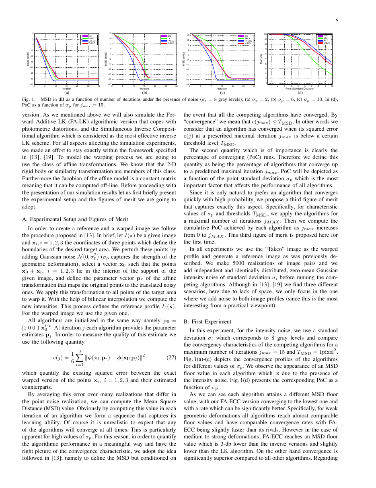
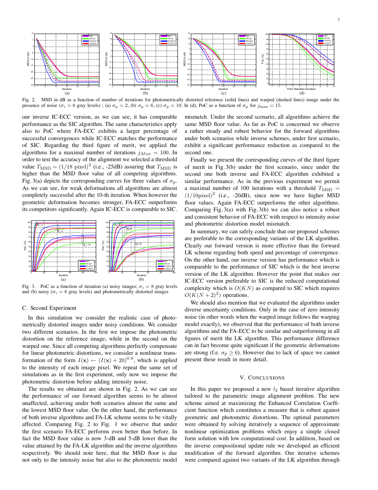

# 번역: 향상된 상관 계수 최대화를 이용한 매개변수 영상 정렬

- 원제: Parametric Image Alignment Using Enhanced Correlation Coefficient Maximization
- 저자: Georgios D. Evangelidis, Emmanouil Z. Psarakis (그리스 파트라스 대학교 컴퓨터공학정보학과)
- 원문: 같은 폴더의 `Evangelidis2008_TPAMI_ECC_preprint.pdf` (HAL hal-00864385, 저자 투고본 9쪽. 1쪽은 HAL 표지)
- 출판본: IEEE TPAMI 30(10):1858-1865, 2008. doi:10.1109/TPAMI.2008.113
- 번역 범위: 전문(초록, 본문, 그림 캡션, 부록). 참고문헌은 원문 그대로 둔다.
- 번역 메모: 수식은 원문 기호를 따라 LaTeX로 옮겼다. 위 줄(bar)은 평균을 뺀 벡터, 모자(hat)는 평균을 빼고 길이 1로 나눈 벡터다. 투고본과 출판본의 쪽, 문구가 조금 다를 수 있다.

---

## 초록

이 논문은 영상 정렬 문제의 성능 기준으로 상관 계수를 고친 형태를 쓰자고 제안한다.
고친 기준은 밝기 왜곡(photometric distortion)에 불변이라는 좋은 성질을 가진다.
이 유사도는 워프(warp) 매개변수에 대해 비선형이다.
그래서 이를 최대화하는 반복 방식 두 가지를 만든다.
하나는 정방향 가산(forward additive) 방식이고, 다른 하나는 역합성(inverse compositional) 방식이다.
반복 최적화에서 흔히 하듯이, 매 반복마다 비선형 목적 함수를 최적화가 쉬운 다른 식으로 근사한다.
우리는 효율적인 근사를 제안한다.
이 근사는 반복마다 닫힌 형태의 해를 주고 계산량이 적다.
이 장점은 역방향 판에서 특히 크다.
제안한 두 방식을 정방향 가산 Lucas-Kanade(FA-LK), 동시 역합성(SIC) 알고리즘과 모의 실험으로 비교했다.
잡음과 밝기 왜곡이 있을 때, 정방향 판은 더 정확하게 정렬하고 더 빨리 수렴한다.
역방향 판은 SIC와 성능이 비슷하지만 계산량이 더 적다.

색인어: 영상 정합, 움직임 추정, 기울기 방법, 매개변수 움직임, 상관 계수.

## I. 서론

매개변수 영상 정렬 문제는 두 영상 프로파일을 맞추는 변환을 찾는 문제다.
프로파일은 영상 정합(image registration) 문제처럼 영상 전체일 수 있다 [1], [2].
영역 추적 [3], [4], [5], 움직임 추정 [6], [7], [8], [9], 스테레오 대응 [10], [11]처럼 부분 영상일 수도 있다.
영상 정합에서는 정렬 문제를 한 번만 풀면 된다.
영역 추적에서는 한 템플릿 영상을 영상 열 전체에 맞춰야 한다.
움직임 추정과 스테레오 대응에서는 두 영상의 모든 점에 대한 대응을 찾는 것이 목표다.

정렬 문제는 두 영상의 좌표계 사이 사상(mapping)으로 볼 수 있다.
그래서 첫 단계는 이 사상을 잘 나타내는 기하 변환을 고르는 것이다.
기존 모델은 대체로 매개변수 모델이다 [12].
정확한 형태는 응용과, 정렬 문제를 푸는 전략에 크게 달려 있다 [3], [13].
아핀 변환과 그 특수한 경우(순수 평행이동 등)가 많은 응용에서 주로 다뤄졌다 [1], [2], [3], [4], [6], [10], [11], [13].
다른 접근은 사영 변환(호모그래피), 더 넓게는 비선형 변환을 쓴다 [5], [13], [14], [15].

기하 매개변수 변환을 정하면, 정렬 문제는 매개변수 추정 문제가 된다.
그래서 두 번째 단계는 알맞은 성능 척도, 곧 목적 함수를 정하는 것이다.
목적 함수를 최적화하면 최적 매개변수 추정값이 나온다.
기존 방법 대부분은 두 영상의 오차에 대한 lp 노름을 쓴다.
오차는 영상 프로파일 전체(화소 기반 기법) 또는 프로파일의 특정 특징(특징 기반 기법) 사이에서 잰다 [12].
지금까지 가장 많이 쓰인 것은 단연 l2 노름이다 [1], [3], [6], [7], [9], [10], [13], [15], [16].
l2 기반 목적 함수는 보통 제곱차 합(SSD) 척도라고 부르고, 이에 해당하는 최적화 문제를 SSD 기법이라고 부른다 [5], [9].
이 접근의 변형은 광류 계산이라는 중요한 문제에도 제안되었다 [5], [7], [17].
이상치에 맞서는 강건한 판도 개발되었다 [18].

최적 매개변수를 추정하려면, 기존 목적 함수는 모두 비선형 최적화가 필요하다.
푸는 전략에 따라 기법은 크게 두 부류로 나뉜다.
첫째는 기울기 기반 또는 미분 접근이고, 둘째는 직접 탐색 기법이다 [12].
기울기 기반 방식은 계산 비용이 낮아서 컴퓨터 비전 응용에 더 알맞다고 여겨진다 [13], [19].
그러나 균일한 영역이나 기울어진 에지 하나(조리개 문제 [20])가 있으면 수렴에 실패하는 일이 눈에 띄게 많다.
변위가 크면 의미 없는 추정이 나올 수도 있다.
반면 직접 탐색 기법은 이런 약점이 없다.
영상 전체를 탐색하므로 큰 움직임도 쉽게 다룬다.
안타깝게도 계산 비용이 매우 크다.
정확한 추정을 위해 촘촘한 양자화가 필요하면 비용은 더 커진다 [6].
촘촘한 양자화 대신 보간을 쓰거나 두 부류를 섞어 계산량을 줄이려는 시도가 [9], [15], [21]에 있다.

기존 기법 대부분에 공통된 가정은, 두 프로파일에서 대응하는 점이나 영역의 밝기가 같다는 밝기 항상성 가정이다 [20].
그러나 이 가정은 특정한 경우에만 맞고, 조명이 바뀌면 분명히 깨진다.
그래서 실제 상황에서는 정렬 알고리즘이 조명 변화를 고려할 수 있어야 한다.
대비와 밝기의 밝기 왜곡을 보상하는 정렬 기법이 [1], [6], [8], [10], [16]에 제안되었다.
다른 방식은 임의 조명 조건을 다루려고 기저 영상 집합을 쓰거나 [3], [22], 공간에 따라 달라지는 밝기 모델을 쓴다 [7].

이 논문에서는 최근 제안된 유사도인 향상된 상관 계수(enhanced correlation coefficient) [2], [11]를 정렬 문제의 목적 함수로 쓴다.
이 척도에는 아주 바람직한 성질이 두 가지 있다.
첫째, 대비와 밝기의 밝기 왜곡에 불변이다.
둘째, 매개변수에 대해 비선형 함수이지만, 우리가 만들 반복 방식은 선형이 되어 계산량이 적다.
최종 알고리즘은 조명 변화를 고려하는 잘 알려진 Lucas-Kanade 정렬 방법의 변형 [10], [19]과 닮았지만, 뒤에서 보듯이 성능은 눈에 띄게 낫다.
향상된 상관 계수 기준은 스테레오 대응의 1차원 평행이동 추정 [11]과 정합의 2차원 평행이동 추정 [2]에 성공적으로 쓰였다.

이 논문의 나머지 구성은 다음과 같다.
II절에서 매개변수 영상 정렬 문제를 세운다.
III절에 주요 해석 결과를 담는다. 곧 목적 함수의 정의, 최적화를 위한 정방향 반복 방식과 역합성 반복 방식, 그리고 제안 방식과 기존 SSD 기법의 관계다.
IV절에서 제안 방식을 현재 가장 널리 쓰이는 Lucas-Kanade와 동시 역합성(SIC) 방법과 여러 실험으로 비교한다.
V절에서 결론을 맺는다.

## II. 문제 정식화

한 쌍의 영상 프로파일(밝기) $I_r(\mathbf{x})$, $I_w(\mathbf{y})$가 있다고 하자.
앞의 것은 기준(reference) 영상 또는 템플릿 영상이고, 뒤의 것은 워프된(warped) 영상이다.
$\mathbf{x}=[x_1, x_2]^t$, $\mathbf{y}=[y_1, y_2]^t$는 좌표다.
또 기준 영상에서 좌표 집합 $T=\{\mathbf{x}_k, k=1,\dots,K\}$가 주어졌다고 하자. 이를 목표 영역(target area)이라 부른다.
정렬 문제는 워프된 영상에서 이에 대응하는 좌표 집합을 찾는 것이다.
물론 임의의 대응이 아니라, 잘 정의된 벡터 사상 $\mathbf{y}=\phi(\mathbf{x};\mathbf{p})$로 모델링할 수 있는 구조적인 대응에 관심이 있다.
여기서 $\mathbf{p}=[p_1,\dots,p_N]^t$는 모르는 매개변수 벡터다.
이런 대응 문제는 실제로 자주 나오며, 가장 흔한 경우는 영상 열에서의 움직임 추정이다.
이 응용에서는 장면과 카메라의 상대 운동 때문에 목표 영역 전체가 시간에 따라 다르게 보인다.

변환 모델이 주어지고 밝기 항상성 가정이 맞는다면, 정렬 문제는 다음을 만족하는 매개변수 $\mathbf{p}$를 추정하는 문제가 된다.

$$I_r(\mathbf{x}) = I_w(\phi(\mathbf{x};\mathbf{p})),\quad \forall \mathbf{x}\in T. \tag{1}$$

유일한 해를 얻을 가능성이 있으려면, 모르는 매개변수 수 $N$이 목표 좌표 수 $K$를 넘지 않아야 한다.
실제로는 보통 $N \ll K$이므로 (1)은 과결정된 (비선형) 연립방정식이다.

기존 알고리즘 대부분은 두 프로파일의 차이 또는 비유사도를 최소화해 매개변수 벡터 $\mathbf{p}$를 구한다.
비유사도는 두 영상 밝기 차의 lp 노름을 담은 목적 함수 $E(\mathbf{p})$로 나타낸다.
실제 응용에서는 보는 방향이나 조명 조건이 달라 밝기 항상성 가정이 깨진다.
그래서 밝기 변화를 설명하는 밝기 변환 $\Psi(I,\boldsymbol{\alpha})$를 추가로 넣어야 한다. 이 변환은 모르는 매개변수 벡터 $\boldsymbol{\alpha}$로 표현된다.
전형적인 최적화 문제는 다음 꼴이다.

$$\min_{\mathbf{p},\boldsymbol{\alpha}} E(\mathbf{p},\boldsymbol{\alpha}) = \min_{\mathbf{p},\boldsymbol{\alpha}} \sum_{\mathbf{x}\in T} |I_r(\mathbf{x}) - \Psi(I_w(\phi(\mathbf{x};\mathbf{p})),\boldsymbol{\alpha})|^p. \tag{2}$$

(2) 꼴의 최적화 문제는 흔히 잘 정의되지 않으며(ill-posed), 받아들일 만한 해를 얻으려면 대개 규칙성(매끄러움) 조건을 더 붙여야 한다 [17].

이 최적화 문제는 대응 부분의 비선형성 때문에 결코 쉽지 않다.
기존 방식의 계산량과 추정 품질은 어떤 lp 노름을 쓰는지, 워프와 밝기 왜곡에 어떤 모델을 쓰는지에 달려 있다.
노름의 차수 p는 대부분 p=2(유클리드 노름)를 쓴다.
다음 절에서 자세히 설명할 우리 접근도 그렇다.

## III. 제안 기준과 주요 결과

워프 변환 $\phi(\mathbf{x};\mathbf{p})$ 아래에서 목표 영역 $T$의 좌표 $\mathbf{x}_k$, $k=1,\dots,K$는 좌표 $\mathbf{y}_k(\mathbf{p})=\phi(\mathbf{x}_k;\mathbf{p})$로 옮겨진다.
기준 벡터 $\mathbf{i}_r$과 이에 대응하는 워프 벡터 $\mathbf{i}_w(\mathbf{p})$를 다음처럼 정의한다.
$\mathbf{i}_r=[I_r(\mathbf{x}_1)\ I_r(\mathbf{x}_2)\ \cdots\ I_r(\mathbf{x}_K)]^t$, $\mathbf{i}_w(\mathbf{p})=[I_w(\mathbf{y}_1(\mathbf{p}))\ I_w(\mathbf{y}_2(\mathbf{p}))\ \cdots\ I_w(\mathbf{y}_K(\mathbf{p}))]^t$.
$\bar{\mathbf{i}}_r$과 $\bar{\mathbf{i}}_w(\mathbf{p})$는 각 벡터에서 산술 평균을 뺀 영평균 판이다.
그러면 매개변수 $\mathbf{p}$인 워프 변환의 성능을 재는 다음 기준을 제안한다.

$$E_{ECC}(\mathbf{p}) = \left\| \frac{\bar{\mathbf{i}}_r}{\|\bar{\mathbf{i}}_r\|} - \frac{\bar{\mathbf{i}}_w(\mathbf{p})}{\|\bar{\mathbf{i}}_w(\mathbf{p})\|} \right\|^2, \tag{3}$$

여기서 $\|\cdot\|$는 보통의 유클리드 노름이다.

(3)에서 이 기준이 오프셋(bias)과 이득(gain) 변화에 불변임이 분명하다.
이는 우리 척도가 밝기 그리고/또는 대비의 밝기 왜곡에 불변이라는 뜻이기도 하다.
따라서 1차 근사로는 밝기 변환을 완전히 무시하고 기하 변환에만 집중할 수 있다.
또 [23]에 보고된 대로, 이 척도는 이상치에 대해 통계적 강건성을 보인다는 점도 흥미롭다.
이런 좋은 성질은 제안 기준이 매개변수 영상 정렬 문제에 알맞은 목적 함수가 되리라는 기대를 분명히 뒷받침한다.

### A. 성능 척도 최적화

성능 척도를 정했으니, 이를 최소화해 최적 매개변수 값을 구한다.
$E_{ECC}(\mathbf{p})$를 최소화하는 것은 다음 향상된 상관 계수를 최대화하는 것과 같음을 쉽게 보일 수 있다 [11].

$$\rho(\mathbf{p}) = \frac{\bar{\mathbf{i}}_r^t \bar{\mathbf{i}}_w(\mathbf{p})}{\|\bar{\mathbf{i}}_r\|\|\bar{\mathbf{i}}_w(\mathbf{p})\|} = \hat{\mathbf{i}}_r^t \frac{\bar{\mathbf{i}}_w(\mathbf{p})}{\|\bar{\mathbf{i}}_w(\mathbf{p})\|}, \tag{4}$$

여기서 간단히 $\hat{\mathbf{i}}_r=\bar{\mathbf{i}}_r/\|\bar{\mathbf{i}}_r\|$로 영평균 기준 벡터의 정규화판을 나타낸다. 이것은 상수다.
$\bar{\mathbf{i}}_w(\mathbf{p})$가 매개변수 벡터 $\mathbf{p}$에 선형으로 의존하더라도, 워프 벡터를 정규화하기 때문에 목적 함수는 여전히 $\mathbf{p}$에 대해 비선형이다.
그래서 최대화에는 비선형 최적화 기법이 필요하다.

서론에서 말했듯이 $\rho(\mathbf{p})$의 최대화는 직접 탐색이나 기울기 기반 접근으로 할 수 있다.
여기서는 기울기 기반을 쓴다.
반복 기법에서 흔히 하듯이, 원래 최적화 문제를 이차적인 최적화의 열로 바꾼다.
각 이차 최적화는 앞 단계의 결과에 기대므로, 원하는 최적 벡터로 수렴하기를 바라는 매개변수 추정값의 사슬이 만들어진다.
각 반복에서는 목적 함수 자체가 아니라 그 근사를 최적화한다.
물론 근사는 최적해를 쉽게 계산할 수 있도록 골라야 한다.
이제 목적 함수에 쓸 근사를 소개하고, 그것을 최대화하는 해를 유도한다.

$\mathbf{p}$가 어떤 명목 매개변수 벡터 $\tilde{\mathbf{p}}$에 "가깝다"고 하고 $\mathbf{p}=\tilde{\mathbf{p}}+\Delta\mathbf{p}$로 쓰자. $\Delta\mathbf{p}$는 섭동 벡터다.
$\tilde{\mathbf{y}}=\phi(\mathbf{x};\tilde{\mathbf{p}})$를 명목 매개변수 아래의 워프 좌표, $\mathbf{y}=\phi(\mathbf{x};\mathbf{p})$를 섭동된 매개변수 아래의 워프 좌표라 하자.
좌표 $\mathbf{y}$에서 워프 영상의 밝기를 생각하고 매개변수에 대해 1차 테일러 전개를 하면 다음을 얻는다.

$$I_w(\mathbf{y}) \approx I_w(\tilde{\mathbf{y}}) + [\nabla_y I_w(\tilde{\mathbf{y}})]^t \frac{\partial \phi(\mathbf{x};\tilde{\mathbf{p}})}{\partial \mathbf{p}} \Delta\mathbf{p}, \tag{5}$$

여기서 $\nabla_y I_w(\tilde{\mathbf{y}})$는 명목 워프 좌표 $\tilde{\mathbf{y}}$에서 계산한, 워프 영상 밝기 함수 $I_w(\mathbf{y})$의 길이 2 기울기 벡터다.
$\phi(\mathbf{x};\mathbf{p})$는 (워프 좌표를 내기 위한) 길이 2의 벡터 변환이므로, $\partial\phi(\mathbf{x};\tilde{\mathbf{p}})/\partial\mathbf{p}$는 명목 매개변수 값에서 계산한, 매개변수에 대한 변환의 2×N 야코비 행렬이다.
밝기 함수 $I_w$와 워프 변환 $\phi$가 필요한 편미분이 존재할 만큼 충분히 매끄럽다고 조용히 가정했음에 유의한다.

이제 목표 영역 $T$의 모든 좌표 $\mathbf{x}_k$, $k=1,\dots,K$에 (5)를 적용할 수 있다.
그러면 매개변수 $\mathbf{p}$인 워프 벡터의 선형화판을 얻는다.

$$\mathbf{i}_w(\mathbf{p}) \approx \mathbf{i}_w(\tilde{\mathbf{p}}) + G(\tilde{\mathbf{p}})\Delta\mathbf{p}, \tag{6}$$

여기서 $G(\tilde{\mathbf{p}})$는 명목 매개변수 값에서 계산한, 매개변수에 대한 워프 밝기 벡터의 K×N 야코비 행렬이다.
이 행렬을 정확히 정하려고 워프 변환이 $\phi(\mathbf{x};\mathbf{p})=[\phi_1(\mathbf{x};\mathbf{p}),\phi_2(\mathbf{x};\mathbf{p})]^t$ 꼴이라 하자. $\phi_1$, $\phi_2$는 스칼라 함수다.
그러면 G의 (k, n) 원소는 다음과 같다.

$$G(\tilde{\mathbf{p}})_{k,n} = \sum_{i=1}^{2} \left.\frac{\partial I_w(\mathbf{y})}{\partial y_i}\right|_{\mathbf{y}=\mathbf{y}_k(\tilde{\mathbf{p}})} \times \left.\frac{\partial \phi_i(\mathbf{x}_k;\mathbf{p})}{\partial p_n}\right|_{\mathbf{p}=\tilde{\mathbf{p}}} \tag{7}$$

여기서 $k=1,\dots,K$, $n=1,\dots,N$이고, $\mathbf{y}=[y_1,y_2]^t$는 워프 영상의 좌표임을 다시 떠올리자.

이제 워프 벡터의 영평균판을 계산해야 한다.
(6)을 쓰면 (4)에 정의한 목적 함수 $\rho(\mathbf{p})$의 다음 근사를 얻는다.

$$\rho(\mathbf{p}) \approx \rho(\Delta\mathbf{p}|\tilde{\mathbf{p}}) = \hat{\mathbf{i}}_r^t \frac{\bar{\mathbf{i}}_w(\tilde{\mathbf{p}}) + \bar{G}(\tilde{\mathbf{p}})\Delta\mathbf{p}}{\|\bar{\mathbf{i}}_w(\tilde{\mathbf{p}}) + \bar{G}(\tilde{\mathbf{p}})\Delta\mathbf{p}\|} \tag{8}$$

여기서 $\bar{G}(\tilde{\mathbf{p}})$와 $\bar{\mathbf{i}}_w(\tilde{\mathbf{p}})$는 각각 $G(\tilde{\mathbf{p}})$와 $\mathbf{i}_w(\tilde{\mathbf{p}})$의 열별 영평균판이다.

이제부터 표기를 간단히 하려고 워프 벡터의 $\mathbf{p}$ 의존성을 빼고 쓰면, 앞의 근사는 다음처럼 쓸 수 있다.

$$\rho(\Delta\mathbf{p}|\tilde{\mathbf{p}}) = \frac{\hat{\mathbf{i}}_r^t\bar{\mathbf{i}}_w + \hat{\mathbf{i}}_r^t\bar{G}\Delta\mathbf{p}}{\sqrt{\|\bar{\mathbf{i}}_w\|^2 + 2\bar{\mathbf{i}}_w^t\bar{G}\Delta\mathbf{p} + \Delta\mathbf{p}^t\bar{G}^t\bar{G}\Delta\mathbf{p}}}. \tag{9}$$

$\rho(\Delta\mathbf{p}|\tilde{\mathbf{p}})$는 $\Delta\mathbf{p}$에 대해 비선형이지만, 최대화는 간단하고 닫힌 형태의 식이 나온다.
이는 필요한 결과를 주는 다음 정리 덕분이다.

**정리 I.** 다음 스칼라 함수를 생각하자.

$$f(\mathbf{x}) = \frac{u + \mathbf{u}^t\mathbf{x}}{\sqrt{v + 2\mathbf{v}^t\mathbf{x} + \mathbf{x}^tQ\mathbf{x}}} \tag{10}$$

여기서 $u$, $v$는 스칼라, $\mathbf{u}$, $\mathbf{v}$는 길이 N 벡터, $Q$는 크기 N인 대칭 양의 정부호 정사각 행렬이고, $v$, $\mathbf{v}$, $Q$는 다음을 만족한다.

$$v > \mathbf{v}^tQ^{-1}\mathbf{v} \tag{11}$$

그러면 $f(\mathbf{x})$의 최댓값에 대해 다음 두 경우로 나뉜다.

경우 $u > \mathbf{u}^tQ^{-1}\mathbf{v}$: 최댓값이 있으며, 구체적으로

$$\max_{\mathbf{x}} f(\mathbf{x}) = \sqrt{\frac{(u - \mathbf{u}^tQ^{-1}\mathbf{v})^2}{v - \mathbf{v}^tQ^{-1}\mathbf{v}} + \mathbf{u}^tQ^{-1}\mathbf{u}} \tag{12}$$

이고, 다음에서 이 값에 이른다.

$$\mathbf{x} = Q^{-1}\left\{\frac{v - \mathbf{v}^tQ^{-1}\mathbf{v}}{u - \mathbf{u}^tQ^{-1}\mathbf{v}}\mathbf{u} - \mathbf{v}\right\}. \tag{13}$$

경우 $u \le \mathbf{u}^tQ^{-1}\mathbf{v}$: 상한(supremum)이 있으며 그 값은

$$\sup_{\mathbf{x}} f(\mathbf{x}) = \sqrt{\mathbf{u}^tQ^{-1}\mathbf{u}} \tag{14}$$

이다. 다음을 고르면 이 값에 원하는 만큼 가까이 갈 수 있다.

$$\mathbf{x} = Q^{-1}\{\lambda\mathbf{u} - \mathbf{v}\}, \tag{15}$$

여기서 $\lambda$는 충분히 큰 양의 스칼라다(각주 1).

각주 1: 더 정확히는, 모든 $\epsilon>0$에 대해 충분히 큰 스칼라 $\lambda_\epsilon$이 있어서 그때의 $f(\mathbf{x})$가 상한에 $\epsilon$만큼 가깝다는 뜻이다.

증명: 슈바르츠 부등식을 되풀이해 쓴다. 자세한 내용은 모두 부록에 있다.

이제 (9)에 정의한 $\rho(\Delta\mathbf{p}|\tilde{\mathbf{p}})$의 최대화에 정리 I을 쓸 수 있는지 살펴보자.
이를 위해 (11)이 성립하는지 확인해야 한다.
지금 문제에서 이는 부등식 $\|\bar{\mathbf{i}}_w\|^2 > \bar{\mathbf{i}}_w^t P_G \bar{\mathbf{i}}_w$가 된다. 여기서 $P_G=\bar{G}(\bar{G}^t\bar{G})^{-1}\bar{G}^t$다.
이 관계는 쉽게 성립한다.
$P_G$는 직교 사영 연산자($P_G^2=P_G$, $P_G^t=P_G$)이므로 $\|\bar{\mathbf{i}}_w\|^2 = \|P_G\bar{\mathbf{i}}_w\|^2 + \|[I-P_G]\bar{\mathbf{i}}_w\|^2 \ge \|P_G\bar{\mathbf{i}}_w\|^2 = \bar{\mathbf{i}}_w^tP_G\bar{\mathbf{i}}_w$로 쓸 수 있다. $I$는 단위 행렬이다.
등호는 $[I-P_G]\bar{\mathbf{i}}_w=0$일 때만, 곧 $\bar{\mathbf{i}}_w$가 $\bar{G}$의 열들의 선형 결합일 때만 성립한다.
이런 일이 생길 확률은 특히 잡음이 있으면 분명히 0이다.
따라서 실제로는 원하는 부등식이 언제나 엄격하게 성립한다.

정리 I을 쓸 수 있으므로, (13)에 따라 최적 섭동은 다음과 같다.

$$\Delta\mathbf{p} = (\bar{G}^t\bar{G})^{-1}\bar{G}^t\left\{\frac{\|\bar{\mathbf{i}}_w\|^2 - \bar{\mathbf{i}}_w^tP_G\bar{\mathbf{i}}_w}{\hat{\mathbf{i}}_r^t\bar{\mathbf{i}}_w - \hat{\mathbf{i}}_r^tP_G\bar{\mathbf{i}}_w}\hat{\mathbf{i}}_r - \bar{\mathbf{i}}_w\right\}, \tag{16}$$

이는 $\hat{\mathbf{i}}_r^t\bar{\mathbf{i}}_w > \hat{\mathbf{i}}_r^tP_G\bar{\mathbf{i}}_w$일 때다. 그렇지 않으면 (15)에 따라

$$\Delta\mathbf{p} = (\bar{G}^t\bar{G})^{-1}\bar{G}^t\left\{\lambda\hat{\mathbf{i}}_r - \bar{\mathbf{i}}_w\right\}, \tag{17}$$

이며, 이는 $\hat{\mathbf{i}}_r^t\bar{\mathbf{i}}_w \le \hat{\mathbf{i}}_r^tP_G\bar{\mathbf{i}}_w$일 때다.
여기서 $\lambda$는 그 결과인 $\rho(\Delta\mathbf{p}|\tilde{\mathbf{p}})$가 $\rho(\Delta\mathbf{p}|\tilde{\mathbf{p}}) > \rho(0|\tilde{\mathbf{p}})$를 만족하도록 골라야 한다.
다시 말해 상관을 키우고 음수가 아니게 하는 섭동을 고르고 싶다.
다음 보조정리가 쓸 수 있는 $\lambda$ 값을 준다.

**보조정리 I.** $\hat{\mathbf{i}}_r^t\bar{\mathbf{i}}_w \le \hat{\mathbf{i}}_r^tP_G\bar{\mathbf{i}}_w$라 하고, $\lambda$의 두 값을 다음처럼 정의한다.

$$\lambda_1 = \sqrt{\frac{\bar{\mathbf{i}}_w^tP_G\bar{\mathbf{i}}_w}{\hat{\mathbf{i}}_r^tP_G\hat{\mathbf{i}}_r}},\quad \lambda_2 = \frac{\hat{\mathbf{i}}_r^tP_G\bar{\mathbf{i}}_w - \hat{\mathbf{i}}_r^t\bar{\mathbf{i}}_w}{\hat{\mathbf{i}}_r^tP_G\hat{\mathbf{i}}_r}. \tag{18}$$

그러면 $\lambda \ge \lambda_1$이면 $\rho(\Delta\mathbf{p}|\tilde{\mathbf{p}}) > \rho(0|\tilde{\mathbf{p}})$이고, $\lambda \ge \lambda_2$이면 $\rho(\Delta\mathbf{p}|\tilde{\mathbf{p}}) \ge 0$이다.
끝으로 $\lambda \ge \max\{\lambda_1,\lambda_2\}$이면 두 부등식이 모두 성립한다.

증명: (17)의 $\Delta\mathbf{p}$ 값을 (9)에 넣으면 목적 함수는 $\lambda$의 다음 함수가 된다.

$$f(\lambda) = \frac{(\hat{\mathbf{i}}_r^t\bar{\mathbf{i}}_w - \hat{\mathbf{i}}_r^tP_G\bar{\mathbf{i}}_w) + \lambda\hat{\mathbf{i}}_r^tP_G\hat{\mathbf{i}}_r}{\sqrt{(\|\bar{\mathbf{i}}_w\|^2 - \bar{\mathbf{i}}_w^tP_G\bar{\mathbf{i}}_w) + \lambda^2\hat{\mathbf{i}}_r^tP_G\hat{\mathbf{i}}_r}}. \tag{19}$$

$f(\lambda)$의 도함수가 음이 아님을 쉽게 확인할 수 있으므로 $f(\lambda)$는 $\lambda$에 대해 증가한다.
따라서 $\lambda \ge \lambda_2$이면 $f(\lambda)\ge 0$이다.
이제 $\lambda=\lambda_1$에서 다음처럼 쓸 수 있다.

$$f(\lambda_1) = \frac{\hat{\mathbf{i}}_r^t\bar{\mathbf{i}}_w - \hat{\mathbf{i}}_r^tP_G\bar{\mathbf{i}}_w + \sqrt{\bar{\mathbf{i}}_w^tP_G\bar{\mathbf{i}}_w}\sqrt{\hat{\mathbf{i}}_r^tP_G\hat{\mathbf{i}}_r}}{\|\bar{\mathbf{i}}_w\|} \ge \rho(0|\tilde{\mathbf{p}}), \tag{20}$$

마지막 부등식은 $\hat{\mathbf{i}}_r^tP_G\bar{\mathbf{i}}_w$에 슈바르츠 부등식을 쓰고 $P_G$가 직교 사영 연산자임을 떠올리면 나온다.

**참고.** $\bar{\mathbf{i}}_w$가 $\bar{\mathbf{i}}_r$에 가까워지면 주로 (16)을 쓰리라 예상할 수 있다. $\bar{\mathbf{i}}_w \approx \bar{\mathbf{i}}_r$이면 $\hat{\mathbf{i}}_r^t\bar{\mathbf{i}}_w \approx \hat{\mathbf{i}}_r^t\bar{\mathbf{i}}_r > \hat{\mathbf{i}}_r^tP_G\bar{\mathbf{i}}_r \approx \hat{\mathbf{i}}_r^tP_G\bar{\mathbf{i}}_w$이기 때문이다.
그런데 흥미롭게도, 늘 (16)만 고집하면 $\hat{\mathbf{i}}_r^t\bar{\mathbf{i}}_w \le \hat{\mathbf{i}}_r^tP_G\bar{\mathbf{i}}_w$인 경우에 음의 상관 $\rho(\Delta\mathbf{p}|\tilde{\mathbf{p}})$가 나온다($\rho(0|\tilde{\mathbf{p}})>0$이어도 그렇다). 이 값은 언제나 $\rho(0|\tilde{\mathbf{p}})$보다 작다.
다시 말해 원래 목표처럼 상관 계수를 키우는 대신, 이 경우에는 줄이게 된다.
이는 보조정리 I의 식 (18)이 가리키는 $\lambda$ 값으로 (17)을 쓰는 편이 낫다는 것을 분명히 보여 준다.

**표 I. 제안한 정방향 가산 ECC(FA-ECC) 정밀화 알고리즘 개요**

| 구분 | 내용 |
|---|---|
| 초기화 | 기준 영상 $I_r$로 영평균 정규화 벡터 $\hat{\mathbf{i}}_r$을 계산한다. $\mathbf{p}_0$을 초기화하고 $j=1$로 둔다. |
| S1 | $\phi(\mathbf{x};\mathbf{p}_{j-1})$로 $I_w$를 워프하고, 그 영평균 벡터 $\bar{\mathbf{i}}_w(\mathbf{p}_{j-1})$를 계산한다. |
| S2 | $\phi(\mathbf{x};\mathbf{p}_{j-1})$로 (7)을 써서 야코비 $\bar{G}(\mathbf{p}_{j-1})$를 계산한다. |
| S3 | $\hat{\mathbf{i}}_r^t\bar{\mathbf{i}}_w$와 $\hat{\mathbf{i}}_r^tP_G\bar{\mathbf{i}}_w$를 비교하고, (16) 또는 (17)과 (18)로 섭동 $\Delta\mathbf{p}_j$를 계산한다. |
| S4 | 매개변수 벡터를 $\mathbf{p}_j=\mathbf{p}_{j-1}+\Delta\mathbf{p}_j$로 갱신한다. $\|\Delta\mathbf{p}_j\|\ge T$이면 $j$를 1 늘리고 S1로 간다. 아니면 멈춘다. |

### B. 정방향 가산 ECC 반복 알고리즘

이제 앞의 결과를 원래 비선형 최적화 문제의 해를 얻는 반복 방식으로 옮기자.
반복 $j-1$에서 매개변수 벡터 추정값 $\mathbf{p}_{j-1}$이 있다고 하면, $\bar{\mathbf{i}}_w(\mathbf{p}_{j-1})$와 $\bar{G}(\mathbf{p}_{j-1})$를 계산할 수 있다.
그러면 $\rho(\Delta\mathbf{p}_j|\mathbf{p}_{j-1})$로 (8)처럼 $\rho(\mathbf{p})$를 근사하고, 이 근사를 $\Delta\mathbf{p}_j$에 대해 최적화할 수 있다.
그 결과 매개변수 갱신 규칙 $\mathbf{p}_j=\mathbf{p}_{j-1}+\Delta\mathbf{p}_j$가 나온다.
단계 S4에 나온 대로, 갱신 벡터 $\Delta\mathbf{p}_j$의 노름이 미리 정한 문턱값 $T$보다 작아지면 반복을 멈춘다.
반복 단계는 표 I에 정리했고, 이 알고리즘을 정방향 가산 ECC(FA-ECC)라 부른다.

목표 영역 $T$의 화소 수 $K$와 길이 $N$인 매개변수 벡터 추정값 $\mathbf{p}_{j-1}$이 주어지면, 제안 방식의 반복당 계산량을 쉽게 어림할 수 있다.
표 I에서, 보통 $K \gg N$임을 고려하면, 가장 계산이 많은 부분은 (16) 또는 (17)로 $\Delta\mathbf{p}_j$를 구하는 단계 S3임을 알 수 있다.
이 단계에서는 행렬 $\bar{G}^t\bar{G}$를 만들어야 하며, 이는 $O(KN^2)$ 연산이 든다.
다른 단계는 반복당 많아야 $O(KN)$이므로, 이것이 알고리즘의 주된 계산량이다.

### C. 역합성 ECC 반복 알고리즘

정렬 문제를 특정 부류의 매개변수 모델로 좁히면, 알고리즘의 일부를 미리(off-line) 계산할 수 있어 더 효율적인 판을 만들 수 있다 [3], [13], [15].
예를 들어 [19]에서 제안한 방법론을 따르면, 반복당 계산량이 $O(KN)$으로 크게 줄어든 역합성 ECC(IC-ECC) 판을 만들 수 있다.
간단히 말해 [3], [13], [15]의 방법론은 $\mathbf{i}_w$와 $\mathbf{i}_r$의 역할을 맞바꾸는 데 기댄다.
그러면 행렬 G는 템플릿 밝기 벡터의 야코비 행렬이 되고, 이 벡터의 워프 함수는 항등 변환이므로 G는 상수이고 $\bar{G}^t\bar{G}$를 미리 계산할 수 있다.
이것이 계산량이 한 자릿수 줄어드는 이유다.
다른 판인 IC-ECC의 개요는 표 I의 FA-ECC 판을 알맞게 고치면 쉽게 얻을 수 있다.

역방향 알고리즘(가산과 합성)과 정방향 합성 알고리즘은 특정 부류의 워프에만 쓸 수 있다는 점을 짚어야 한다.
또 역방향 알고리즘은 정방향 알고리즘보다 잡음에 더 민감하다고 알려져 있다 [13].
이 중요한 약점 때문에 이런 알고리즘은 실제 사용이 제한된다.

### D. 기존 SSD 기반 척도와의 관계

이 절에서는 우리 성능 척도를 다른 방식으로 유도한다.
이는 우리 척도를 문헌에서 현재 가장 널리 쓰이는 두 SSD 접근과 관련짓는 데도 도움이 된다.
분석을 위해 밝기 왜곡이 전역 밝기와 대비 변화로만 한정된다고 가정한다.
이 단순한 밝기 변화 아래에서 매개변수 정렬 문제에 대해 다음 성능 척도를 정의할 수 있다.

$$E(\mathbf{p},\boldsymbol{\alpha}) = \|\alpha_1\mathbf{i}_w(\mathbf{p}) + \alpha_2 - \mathbf{i}_r\|^2, \tag{21}$$

여기서 $\boldsymbol{\alpha}=[\alpha_1\ \alpha_2]^t$는 밝기 변환의 매개변수 벡터다.
물론 목표는 모든 매개변수에 대해 목적 함수를 최소화하는 것이다.
첫 밝기 매개변수에 대해서는, $\alpha_1$이 음수이면 색이 뒤집히는 반전 효과가 생긴다는 점을 짚어야 한다.
따라서 이런 색 반전이 일어날 수 없다는 사전 지식이 있으면, $\alpha_1$을 양수로 제한하는 것이 논리적이다.
이제 먼저 $\alpha_1$, $\alpha_2$에 대해 목적 함수를 최소화하면 다음 흥미로운 결과를 얻는다.

$$E(\mathbf{p}) = \min_{\alpha_1\ge 0,\alpha_2} E(\mathbf{p},\boldsymbol{\alpha}) = \|\bar{\mathbf{i}}_r\|^2\left(1 - [\max\{\rho(\mathbf{p}),0\}]^2\right), \tag{22}$$

여기서 $\rho(\mathbf{p})$는 (4)에 정의한 상관 함수다.
기준 영상이 상수이므로 앞 식에 들어 있는 노름 $\|\bar{\mathbf{i}}_r\|^2$도 상수다. 그래서 $\mathbf{p}$에 대한 추가 최소화는 $(1-[\max\{\rho(\mathbf{p}),0\}]^2)$를 최소화하는 것과 같다.
그런데 이 식은 $\rho(\mathbf{p})$에 대해 감소하므로, 상관 함수 $\rho(\mathbf{p})$를 최대화하는 것과 같다. 이렇게 우리 기준이 다시 나온다.
이 최종 최적화 문제는 매우 이치에 맞는다.
$\rho(\mathbf{p})$에는 (여기서 다루는 단순한 형태의) 밝기 왜곡이 없고 색 반전이 없다는 것을 알고 있으므로, 가장 큰 양의 상관을 찾는 것이 아주 그럴듯하다.

(22)에서 제약 $\alpha_1\ge 0$을 빼면, 목적 함수의 최소화는 Fuh와 Maragos [6]가 제안한 최적화 문제가 된다.
먼저 $\alpha_1$, $\alpha_2$에 대해 최적화하면 다음이 나온다.

$$E_{FM}(\mathbf{p}) = \min_{\alpha_1,\alpha_2} E(\mathbf{p},\boldsymbol{\alpha}) = \|\bar{\mathbf{i}}_r\|^2\{1-\rho^2(\mathbf{p})\}. \tag{23}$$

이제 이 척도는 $|\rho(\mathbf{p})|$의 감소 함수이므로, $\mathbf{p}$에 대한 추가 최소화는 상관 함수의 절댓값 $|\rho(\mathbf{p})|$를 최대화하는 것과 같다.
이 최적화 문제는 색 반전이 없다는 사전 지식을 고려하지 않는다는 점이 분명하다.
[6]에서는 N차원으로 양자화된 매개변수 공간에서 전수 탐색으로 최대화했다.
색 반전이 없는 상황에서는 이런 탐색이 올바른 최대 양의 상관을 낸다(물론 워프 영상에 목표 영역의 반전판인 부분이 없다면).
그러나 서론에서 말했듯이 전수 탐색은 계산량이 크고, 미세한 부화소 정확도를 원하면 매우 부담이 커진다.

[6]에서 제안하지는 않았지만, 우리 척도에 제안한 것과 비슷한 반복 접근을 쓸 수도 있다.
그러나 (8)과 같은 근사로 $|\rho(\mathbf{p})|$를 최대화하려 하면, 최적 섭동 $\Delta\mathbf{p}$가 늘 (16)으로 주어짐을 보일 수 있다.
보조정리 I 뒤의 참고에서 말했듯이, 이 전략을 쓰면 원하는 최댓값 대신 $\rho(\mathbf{p})$의 국소 최솟값에 해당하는 음의 상관이 나올 수 있다.
다시 말해 반복 알고리즘이 잘못된 국소 극값에 갇힐 가능성이 우리 접근보다 크다.

(21)에서 $\mathbf{i}_w$와 $\mathbf{i}_r$의 역할을 바꾸면 다른 척도가 나온다.

$$E(\mathbf{p},\boldsymbol{\alpha}) = \|\alpha_1\mathbf{i}_r + \alpha_2 - \mathbf{i}_w(\mathbf{p})\|^2. \tag{24}$$

이것이 Lucas-Kanade [10]가 택한 접근이며, 그 변형과 함께 실제로 가장 널리 쓰이는 알고리즘을 낳는다고 알려져 있다.
앞의 두 경우와 비슷한 단계를 따라, 먼저 두 밝기 매개변수에 대해 최소화하면 다음이 나온다.

$$E_{LK}(\mathbf{p}) = \min_{\alpha_1,\alpha_2} E(\mathbf{p},\boldsymbol{\alpha}) = \|\bar{\mathbf{i}}_w(\mathbf{p})\|^2\{1-\rho^2(\mathbf{p})\}. \tag{25}$$

이 결과에서 기준식에 매개변수 $\mathbf{p}$에 의존하는 항이 둘 있음을 본다.
익숙한 부분인 $\{1-\rho^2(\mathbf{p})\}$와, (상수가 아닌) 워프 영상의 크기 $\|\bar{\mathbf{i}}_w(\mathbf{p})\|^2$다.
따라서 매개변수에 대해 $E_{LK}(\mathbf{p})$를 최소화하는 것은 두 항의 결합을 최소화하는 것이다.
첫째, 이 기준은 우리 척도와 반드시 같은 해를 내지는 않는다.
둘째, 항 $\|\bar{\mathbf{i}}_w(\mathbf{p})\|^2$ 때문에, 반복 알고리즘이 $\|\bar{\mathbf{i}}_w(\mathbf{p})\|^2\approx 0$이 되는 해(예를 들어 밝기가 균일한 영역)에 갇힐 수 있다.
셋째, 항 $\rho^2(\mathbf{p})$ 때문에 알고리즘이 음의 상관에 갇힐 수 있다.

앞의 관찰에도 불구하고, Lucas-Kanade 성능 척도는 영상 정렬 문제에서 가장 널리 쓰이는 반복 알고리즘을 낳았다.
그래서 이를 기준점으로 삼아 우리 방식과 비교한다.
따라서 그 정방향 가산(FA-LK) 갱신판을 더 자세히 보이자.
$\bar{\mathbf{i}}_w(\mathbf{p})$의 선형 근사를 (25)에 넣고 $\Delta\mathbf{p}$에 대해 최소화하면 다음 최적 갱신 섭동을 얻는다.

$$\Delta\mathbf{p}_{LK} = (\bar{G}^t\bar{G})^{-1}\bar{G}^t\left\{\frac{\hat{\mathbf{i}}_r^t\bar{\mathbf{i}}_w - \hat{\mathbf{i}}_r^tP_G\bar{\mathbf{i}}_w}{1-\hat{\mathbf{i}}_r^tP_G\hat{\mathbf{i}}_r}\hat{\mathbf{i}}_r - \bar{\mathbf{i}}_w\right\}, \tag{26}$$

이 식은 언제나 쓸 수 있다.
(16)과 (26)을 비교하면, 차이는 벡터 $\hat{\mathbf{i}}_r$ 앞의 스칼라 값뿐임을 알 수 있다.
뒤에서 보듯이, 이 사소해 보이는 차이가 (17)과 함께 성능을 크게 높인다.

Lucas-Kanade 접근에서는 임의의 선형 외관 변화를 다룰 수 있는 특별한 SSD 기반 척도를 정의할 수 있다.
그 최소화를 위해 Hager와 Belhumeur가 역가산 갱신 규칙을 쓰는 반복 알고리즘을 [3]에서 제안했다.
같은 SSD 척도를 바탕으로 Baker 등 [19]은 역합성 접근을 써서 Hager-Belhumeur 알고리즘의 여러 변형을 제안했다.
이 변형들 가운데 동시 역합성(SIC) 알고리즘이 가장 성능이 좋다고 보고되었다 [19].
그래서 다음 절에서 이 알고리즘도 시험한다.

## IV. 모의 실험 결과

이 절에서는 제안한 정방향 FA-ECC와 역방향 IC-ECC 알고리즘을 평가하려고 여러 모의 실험을 한다.
앞서 말했듯이, 밝기 왜곡을 다루는 정방향 가산 LK(FA-LK) 알고리즘과, 가장 효과적인 역방향 LK 방식으로 여겨지는 동시 역합성 알고리즘도 모의 실험한다.
모의 실험에 영향을 주는 모든 측면에서 [13], [19]에 정한 틀을 그대로 지키려고 애썼다.
워프 과정 모델로는 아핀 변환 부류를 쓴다.
2차원 강체 변환과 닮음 변환은 이 부류에 속한다.
또 아핀 모델의 야코비는 상수 행렬이라서 미리 계산할 수 있다.
모의 실험 결과를 보이기 전에, 실험 구성과 쓸 성능 지표를 간단히 소개한다.

그림 1. 밝기 잡음($\sigma_i$=8 회색도)이 있을 때 반복 횟수에 따른 MSD(dB). (a) $\sigma_p$=2, (b) $\sigma_p$=6, (c) $\sigma_p$=10. (d)는 $j_{max}$=15일 때 $\sigma_p$에 따른 PoC.

### A. 실험 구성과 성능 지표

기준 영상과 워프 영상을 만들 때 [13]에서 제안한 절차를 따른다.
간단히 말해, 주어진 영상을 $I(\mathbf{x})$라 하고, 원하는 목표 영역의 경계를 정하는 세 점의 좌표를 $\mathbf{x}_i$, $i=1,2,3$이라 하자.
이 점들에 가우스 잡음 $N(0,\sigma_p^2)$를 더해 흔든다($\sigma_p$는 기하 변형의 세기를 나타낸다).
점 $\mathbf{x}_0+\mathbf{x}_i$, $i=1,2,3$이 주어진 영상의 지지 영역 안에 놓이도록 벡터 $\mathbf{x}_0$를 고른다.
그리고 원래 점들을 평행이동하고 잡음을 더한 점들로 옮기는 아핀 변환의 매개변수 벡터 $\mathbf{p}_r$을 정한다.
이 변환을 목표 영역의 모든 점에 적용해 워프한다.
쌍선형 보간으로 새 밝기를 계산한다.
이 과정이 기준 프로파일 $I_r(\mathbf{x})$를 정한다.
워프 영상으로는 주어진 영상을 그대로 쓴다.

모든 알고리즘은 같은 방식, 곧 $\mathbf{p}_0=[1\ 0\ 0\ 1\ \mathbf{x}_0^t]^t$로 초기화한다.
반복 $j$에서 각 알고리즘은 매개변수 추정값 $\mathbf{p}_j$를 낸다.
이 추정값의 품질을 재려고 다음 양을 쓴다.

$$e(j) = \frac{1}{6}\sum_{i=1}^{3}\|\phi(\mathbf{x}_i;\mathbf{p}_r) - \phi(\mathbf{x}_i;\mathbf{p}_j)\|^2 \tag{27}$$

이는 점 $\mathbf{x}_i$, $i=1,2,3$의 정확한 워프판과 추정판 사이의 제곱 오차를 나타낸다.

점 잡음 실현이 서로 다른 많은 실현에 대해 이 오차를 평균하면 평균 제곱 거리(MSD) 값을 계산할 수 있다.
알고리즘의 매 반복에서 이 값을 계산하면, 그 학습 능력을 보여 주는 수열이 만들어진다.
물론 어떤 알고리즘도 늘 수렴하리라고 기대하는 것은 비현실적이다.
이는 $\sigma_p$가 클 때 특히 뚜렷하다.
그래서 알고리즘 성능을 의미 있게 정량화하고 수렴 특성을 바르게 보려고 [13]의 생각을 따른다.
곧 경쟁하는 모든 알고리즘이 수렴한 경우에 한정한 조건부 MSD를 정의한다.
"수렴"이란 $e(j_{max}) \le T_{MSD}$를 뜻한다.
다시 말해 정해진 최대 반복 $j_{max}$에서의 제곱 오차 $e(j)$가 어떤 문턱 $T_{MSD}$ 아래이면 알고리즘이 수렴했다고 본다.

두 번째로 중요한 양은 분명히 수렴한 실행의 비율(PoC)이다.
그래서 이 양을, 미리 정한 최대 반복 $j_{max}$까지 수렴한 알고리즘의 백분율로 정의한다.
PoC는 점 표준편차 $\sigma_p$의 함수로 그린다. $\sigma_p$는 모든 알고리즘의 성능에 가장 크게 영향을 주는 요인이다.

높은 확률로 빨리 수렴하는 알고리즘을 고르는 것이 당연하므로, 바로 이 측면을 담는 세 번째 성능 지표를 제안한다.
구체적으로, 대표적인 $\sigma_p$ 값과 문턱 $T_{MSD}$에 대해 알고리즘을 최대 $j_{MAX}$번까지 돌린다.
그리고 $j_{max}$를 0에서 $j_{MAX}$까지 늘리면서 각 알고리즘이 이룬 누적 PoC를 계산한다.
이 세 번째 지표는 여기서 처음 제안하는 것이다.

모든 실험에서 "Takeo" 영상을 워프 프로파일로 쓰고, 앞에서 설명한 대로 기준 영상을 만든다.
영상 쌍을 5000번 실현하고, 경쟁 알고리즘을 돌리기 전에 서로 독립이고 같은 분포를 따르는 평균 0, 표준편차 $\sigma_i$의 가우스 밝기 잡음을 더한다.
[13], [19]에는 세 가지 시나리오가 있지만, 지면이 모자라 여기서는 두 영상 프로파일 모두에 잡음을 더하는 경우만 다룬다(실제 관점에서 가장 흥미로운 경우이기 때문이다).

### B. 첫 번째 실험

이 실험에서는 밝기 잡음 표준편차 $\sigma_i$를 8 회색도로 두고, 최대 반복 $j_{max}$=15, $T_{MSD}$=1 pixel²에서 경쟁 알고리즘의 수렴 특성을 비교한다.
그림 1(a)-(c)는 여러 $\sigma_p$ 값에서 알고리즘의 수렴 곡선을 보인다.
각 알고리즘에 MSD 바닥값이 나타나는데, 이는 밝기 잡음 때문이다.
그림 1(d)는 $\sigma_p$에 따른 PoC를 보인다.

보듯이 알고리즘마다 MSD 바닥값이 다르다. 우리 FA-ECC 판이 가장 낮은 바닥값에 수렴하며, 그 속도도 상당히 더 빠를 수 있다.
구체적으로, 약한 기하 변형에서는 모든 알고리즘이 거의 비슷한 바닥값에 이르고 수렴 속도도 비슷하다. FA-ECC가 경쟁 알고리즘보다 조금 빠르다.
그러나 중간에서 강한 변형에서는 FA-ECC가 역방향 판보다 3 dB 낮고 LK 알고리즘보다 조금 낮은 MSD 바닥값에 이른다.
한편 수렴은 다른 모든 알고리즘보다 상당히 낫다.
우리 역방향 IC-ECC 판은 보듯이 SIC 알고리즘과 성능이 비슷하다.
PoC에도 같은 특성이 나타난다. FA-ECC가 더 높은 성공 수렴 비율을 보이고, IC-ECC는 SIC의 성능과 맞먹는다.

세 번째 성능 지표에서는 알고리즘을 최대 반복 $j_{MAX}$=100까지 돌렸다.
정렬 정확도를 시험하려고 문턱값을 $T_{MSD}=(1/18\ \text{pixel})^2$(곧 −25 dB)로 골랐다. 이는 $T_{MSD}$가 모든 경쟁 알고리즘의 MSD 바닥값보다 높도록 보장한다.
그림 3(a)는 세 $\sigma_p$ 값에 대한 해당 곡선을 보인다.
보듯이 약한 변형에서는 10번째 반복 뒤 모든 알고리즘이 거의 완전히 성공한다.
그러나 기하 변형이 강해지면 FA-ECC가 경쟁 알고리즘보다 상당히 낫다.
여기서도 IC-ECC는 SIC와 비슷하다.

그림 2. 밝기 잡음($\sigma_i$=8 회색도)이 있을 때, 밝기 왜곡된 기준 영상(실선)과 워프 영상(점선)에 대해 반복 횟수에 따른 MSD(dB). (a) $\sigma_p$=2, (b) $\sigma_p$=6, (c) $\sigma_p$=10. (d)는 $j_{max}$=15일 때 $\sigma_p$에 따른 PoC.

그림 3. 반복 횟수에 따른 PoC. (a) 잡음 있는 영상($\sigma_i$=8 회색도), (b) 잡음 있고($\sigma_i$=8 회색도) 밝기 왜곡된 영상.

(그림 2와 그림 3은 원문 같은 쪽에 함께 있어 위 쪽 이미지 하나에 담았다.)

### C. 두 번째 실험

이 모의 실험에서는 잡음이 있는 조건에서 밝기가 왜곡된 영상이라는 현실적인 경우를 다룬다.
두 가지 시나리오를 생각한다.
첫째는 밝기 왜곡을 기준 영상에 주고, 둘째는 워프 영상에 준다.
경쟁 알고리즘은 모두 선형 밝기 왜곡을 완전히 보상하므로, 각 화소 밝기에 $I(\mathbf{x}) \leftarrow (I(\mathbf{x})+20)^{0.9}$ 꼴의 비선형 변환을 적용한다.
첫 번째 실험과 같은 모의 실험을 되풀이하되, 이번에는 밝기 잡음을 더하기 전에 밝기 왜곡을 준다.

얻은 결과는 그림 2에 있다.
보듯이 우리 정방향 알고리즘의 성능은 거의 영향을 받지 않는 듯하며, 두 시나리오 모두에서 거의 같고 가장 낮은 MSD 바닥값에 이른다.
반면 두 역방향 알고리즘과 FA-LK 방식의 성능은 크게 영향을 받는 듯하다.
그림 2를 그림 1과 비교하면, 첫 번째 시나리오에서 FA-ECC가 이전보다 더 나은 성능을 보인다.
실제로 이제 MSD 바닥값이 FA-LK 알고리즘보다 3 dB, 역방향 알고리즘보다 5 dB 낮다.
여기서 MSD 바닥값은 밝기 잡음 때문만이 아니라 밝기 모델 불일치 때문이기도 함을 짚어 둔다.
두 번째 시나리오에서는 모든 알고리즘이 같은 MSD 바닥값에 이른다.
PoC를 보면, 정방향 알고리즘은 두 시나리오에서 꽤 안정적이고 강건한 반면, 역방향 방식은 첫 번째 시나리오에서 두 번째보다 성능이 크게 떨어진다.

끝으로 첫 번째 시나리오에서 세 번째 지표의 해당 곡선을 그림 3(b)에 보인다. 두 번째 시나리오에서는 역방향 알고리즘과 FA-ECC가 비슷한 성능을 보였기 때문이다.
앞의 실험처럼 최대 100번 반복을 허용하고, 이제 MSD 바닥값이 더 높으므로 문턱을 $T_{MSD}=(1/10\ \text{pixel})^2$(곧 −20 dB)로 둔다.
여기서도 FA-ECC가 다른 알고리즘보다 낫다.
그림 3(a)와 그림 3(b)를 비교하면, 밝기 잡음과 밝기 왜곡 모델 불일치에 대해 FA-ECC가 강건하고 일관되게 동작함도 알 수 있다.

요약하면, 제안 방식이 LK 알고리즘의 해당 변형보다 낫다고 결론지어도 무방하다.
분명히 우리 정방향 판은 속도와 수렴 비율 모두에서 정방향 LK 방식보다 효과적이다.
한편 우리 역방향 판의 성능은 LK 알고리즘의 가장 좋은 역방향 판인 SIC와 비슷하다.
그러나 IC-ECC 판을 SIC보다 낫게 만드는 점은 계산량이 줄었다는 것이다. IC-ECC는 $O(KN)$이고 SIC는 $O(K(N+2)^2)$ 연산이 든다.

여러 불확실성 조건에서도 알고리즘을 평가했다는 점도 덧붙인다.
밝기 잡음이 0인 경우(곧 워프 영상이 워프 모델을 정확히 따르는 경우)에만, 두 역방향 알고리즘과 FA-ECC의 성능이 비슷하고 모든 성능 지표에서 LK 알고리즘보다 나았다.
기하 변형이 강하면(예: $\sigma_p\ge 6$) 이 성능 차이는 실제로 꽤 커질 수 있다.
그러나 지면이 모자라 이 결과를 더 자세히 보일 수 없다.

## V. 결론

이 논문에서는 매개변수 영상 정렬 문제에 맞춘 새로운 l2 기반 반복 알고리즘을 제안했다.
새 방식은 향상된 상관 계수 함수를 최대화하는 것을 목표로 한다. 이 함수는 기하 왜곡과 밝기 왜곡에 강건한 척도다.
최적 매개변수는 근사한 비선형 최적화 문제의 열을 반복해서 풀어 얻는다. 각 문제는 계산 비용이 낮은 간단한 닫힌 형태의 해를 가진다.
또 역합성 갱신 규칙을 바탕으로 정방향 알고리즘의 효율적인 변형을 만들었다.
우리 반복 방식을 LK 알고리즘의 두 변형과 많은 모의 실험으로 비교했다.
이상적인 조건에서는 제안 알고리즘과 동시 역합성 알고리즘이 비슷한 성능을 보이며 정방향 LK 알고리즘보다 나았다.
그러나 잡음과 밝기 왜곡이 있는 더 현실적인 경우, 우리 정방향 알고리즘은 수렴 속도, 정확도, 수렴 비율에서 눈에 띄게 나은 성능을 보였다.

## 부록 I. 정리 I의 증명

정리 I의 증명은 슈바르츠 부등식을 쓰는 데 기댄다.
설명을 간단히 하려고 다음 변수 변환을 한다.

$$\mathbf{z} = Q^{1/2}\mathbf{x} + Q^{-1/2}\mathbf{v};\quad \tilde{\mathbf{u}} = Q^{-1/2}\mathbf{u};\quad \tilde{\mathbf{v}} = Q^{-1/2}\mathbf{v}, \tag{28}$$

그러면 최적화하려는 함수는 $\mathbf{z}$의 함수가 되고 다음 꼴을 가진다.

$$f(\mathbf{z}) = \frac{(u - \tilde{\mathbf{u}}^t\tilde{\mathbf{v}}) + \tilde{\mathbf{u}}^t\mathbf{z}}{\sqrt{(v - \|\tilde{\mathbf{v}}\|^2) + \|\mathbf{z}\|^2}}. \tag{29}$$

조건 $v > \|\tilde{\mathbf{v}}\|^2$가 분모의 제곱근 안의 양이 양수임을 보장한다는 점에 유의한다.

먼저 $u - \tilde{\mathbf{u}}^t\tilde{\mathbf{v}} > 0$인 경우를 보자. 그러면 다음을 정의할 수 있다.

$$\tilde{\mathbf{z}} = \left[\mathbf{z}^t\ \ \sqrt{v-\|\tilde{\mathbf{v}}\|^2}\right]^t;\quad \tilde{\mathbf{w}} = \left[\tilde{\mathbf{u}}^t\ \ \frac{u-\tilde{\mathbf{u}}^t\tilde{\mathbf{v}}}{\sqrt{v-\|\tilde{\mathbf{v}}\|^2}}\right]^t, \tag{30}$$

그러면 목적 함수는 다음이 된다.

$$f(\mathbf{z}) = \frac{\tilde{\mathbf{w}}^t\tilde{\mathbf{z}}}{\|\tilde{\mathbf{z}}\|} \le \frac{|\tilde{\mathbf{w}}^t\tilde{\mathbf{z}}|}{\|\tilde{\mathbf{z}}\|} \le \|\tilde{\mathbf{w}}\|, \tag{31}$$

마지막 부등식은 슈바르츠 부등식을 쓴 결과다.
이제 $\|\tilde{\mathbf{w}}\|$는 상수이며 목적 함수의 상계가 됨을 보자.
이 상계는 두 부등식이 모두 등식이 될 때 이를 수 있다.
슈바르츠 부등식에서 $\tilde{\mathbf{z}}=\lambda\tilde{\mathbf{w}}$($\lambda$는 어떤 스칼라)로 고르면 등식이 됨을 안다.
이 선택에서 첫 부등식도 등식이 되려면 $\lambda>0$이어야 한다.
$\tilde{\mathbf{z}}=\lambda\tilde{\mathbf{w}}$에서 마지막 원소끼리 같다고 놓으면 $\lambda=(v-\|\tilde{\mathbf{v}}\|^2)/(u-\tilde{\mathbf{u}}^t\tilde{\mathbf{v}})$이다. 이는 $u-\tilde{\mathbf{u}}^t\tilde{\mathbf{v}}>0$일 때만 양수이며, $\mathbf{z}=(v-\|\tilde{\mathbf{v}}\|^2)\tilde{\mathbf{u}}/(u-\tilde{\mathbf{u}}^t\tilde{\mathbf{v}})$를 준다.
$u-\tilde{\mathbf{u}}^t\tilde{\mathbf{v}}\le 0$이면 상계 $\|\tilde{\mathbf{w}}\|$가 빈틈없지 않아(이를 수 없어) 이 경우는 다음처럼 따로 다뤄야 한다는 점이 흥미롭다.

$u-\tilde{\mathbf{u}}^t\tilde{\mathbf{v}}\le 0$일 때 상한을 찾으려고 다음 부등식을 쓴다.

$$f(\mathbf{z}) = \frac{(u-\tilde{\mathbf{u}}^t\tilde{\mathbf{v}}) + \tilde{\mathbf{u}}^t\mathbf{z}}{\sqrt{(v-\|\tilde{\mathbf{v}}\|^2)+\|\mathbf{z}\|^2}} \le \frac{\tilde{\mathbf{u}}^t\mathbf{z}}{\sqrt{(v-\|\tilde{\mathbf{v}}\|^2)+\|\mathbf{z}\|^2}} \le \|\tilde{\mathbf{u}}\|\frac{\|\mathbf{z}\|}{\sqrt{(v-\|\tilde{\mathbf{v}}\|^2)+\|\mathbf{z}\|^2}} \le \|\tilde{\mathbf{u}}\|. \tag{32}$$

첫 부등식은 (가정에 따라) $u-\tilde{\mathbf{u}}^t\tilde{\mathbf{v}}$가 양수가 아니어서 성립한다. 둘째는 분자에 슈바르츠 부등식을 썼다. 마지막은 비가 1보다 작다는 사실을 썼다.
이 경우에는 다른(더 작은) 상계가 나옴을 본다.
이것이 빈틈없는지(곧 상한인지) 확인하려고, 슈바르츠 부등식이 알려 주는 선택, 곧 $\lambda>0$인 $\mathbf{z}=\lambda\tilde{\mathbf{u}}$를 다시 쓰고 목적 함수 값을 계산한다.
$\lambda\to\infty$로 보내면 $\|\tilde{\mathbf{u}}\|$로 수렴함을 알 수 있다.
이는 충분히 큰 $\lambda$로 원하는 상계에 원하는 만큼 가까이 갈 수 있다는 뜻이다(그러나 정확히 이르는 유한한 $\mathbf{z}$는 없다!).
이로써 증명을 마친다.

## 참고문헌 (원문 그대로)

[1] S. Periaswamy and H. Farid, "Elastic registration in the presence of intensity variation," IEEE Transactions on Medical Imaging, vol. 22, no. 7, pp. 865–874, 2003.
[2] I. Karybali, E. Z. Psarakis, K. Berberidis, and G. D. Evangelidis, "Efficient image registration with subpixel accuracy," in Proc. of 14th European Signal Processing Conference (EUSIPCO), 2006, Florence, Italy.
[3] G. D. Hager and P. N. Belhumeur, "Efficient region tracking with parametric models of geometry and illumination," IEEE Trans. Pattern Anal. Machine Intell., vol. 20, no. 10, pp. 1025–1039, 1998.
[4] J. Shi and C. Tomasi, "Good features to track," in Proc. of IEEE International Conference on Computer Vision and Pattern Recognition (CVPR'94), 1994, Seattle, USA.
[5] M. Gleicher, "Projective registration with difference decomposition," in Proc. of IEEE International Conference on Computer Vision and Pattern Recognition (CVPR'97), 1997, San Juan, Puerto Rico.
[6] C. Fuh and P. Maragos, "Motion dislpacement estimation using an affine model for image matching," Optical Engineering, vol. 30, no. 7, pp. 881–887, 1991.
[7] Y. Altunbasak, R. M. Mersereau, and A. J. Patti, "A fast parametric motion estimation algorithm with illumination and lens distortion correction," IEEE Trans. Image Processing, vol. 12, no. 4, pp. 395–408, 2003.
[8] B. K. P. Horn and E. J. Weldon, "Direct methods for recovering motion," International Journal of Computer Vision, vol. 2, pp. 51–76, 1988.
[9] P. Anandan, "A computational framework and an algorithm for the measurement of visual motion," International Journal of Computer Vision, vol. 2, no. 3, pp. 283–310, 1989.
[10] B. D. Lucas and T. Kanade, "An iterative image registration technique with an application to stereo vision," in Proc. of 7th International Joint Conf on Artificial Intelligence (IJCAI), 1981, Vancouver, British Columbia.
[11] E. Z. Psarakis and G. D. Evangelidis, "An enhanced correlation-based method for stereo correspondence with sub-pixel accuracy," in Proc. of 10th IEEE International Conference on Computer Vision (ICCV 2005), 2005, Beijing, China.
[12] R. Szeliski, Handbook of Mathematical Models of Computer Vision, N. Paragios, Y. Chen, and O. Faugeras, Eds. Springer, 2005, ch. 17.
[13] S. Baker and I. Matthews, "Lucas-kanade 20 years on: A unifying framework: Part 1: The quantity approximated, the warp update rule, and the gradient descent approximation." International Journal on Computer Vision, vol. 56, no. 3, pp. 221–255, 2004.
[14] M. J. Black and Y. Yacoob, "Tracking and recognizing rigid and non-rigid facial motions using local parametric models of image motion," in Proc. of 5th IEEE International Conference on Computer Vision (ICCV'95), 1995, Cambridge, MA, USA.
[15] H. Shum and R. Szeliski, "Construction of panoramic image mosaics with global and local alignment," International Journal on Computer Vision, vol. 36, no. 2, pp. 101–130, 2000.
[16] S. Nagahdaripour and C. H. Yu, "A generalized brightness change model for computing optical flow," in Proc. of 4th IEEE International Conference on Computer Vision (ICCV'93), 1993, Berlin, Germany.
[17] B. K. P. Horn and B. G. Schunk, "Determining optical flow," Artificial Intelligence, vol. 17, pp. 185–203, 1981.
[18] M. J. Black and P. Anandan, "A framework for the robust estimation of optical flow," in Proc. of 4th IEEE International Conference on Computer Vision (ICCV'93), 1993, Berlin, Germany.
[19] S. Baker, R. Gross, and I. Matthews, "Lucas-kanade 20 years on: A unifying framework: Part 3," Robotics Institute, Carnegie Mellon University, Pittsburgh, PA, Tech. Rep. CMU-RI-TR-03-35, Nov. 2004.
[20] B. K. P. Horn, Robot Vision. MIT Press, McGraw-Hill, 1986.
[21] J. R. Bergen, P. Anandan, K. J. Hanna, and R. Hingorani, "Hierarchical model-based motion estimation," in Proc. of 2th European Conference on Computer Vision (ECCV'92), 1992, Santa Margherita Liguere, Italy.
[22] P. Hallinan, "A low-dimensional representation of human faces for arbitrary lighting conditions," in Proc. of IEEE International Conference on Computer Vision and Pattern Recognition (CVPR'94), 1994, Seattle, USA.
[23] V. Barnett and T. Lewis, Outliers in Statistical Data. John Wiley and Sons, 1978.
