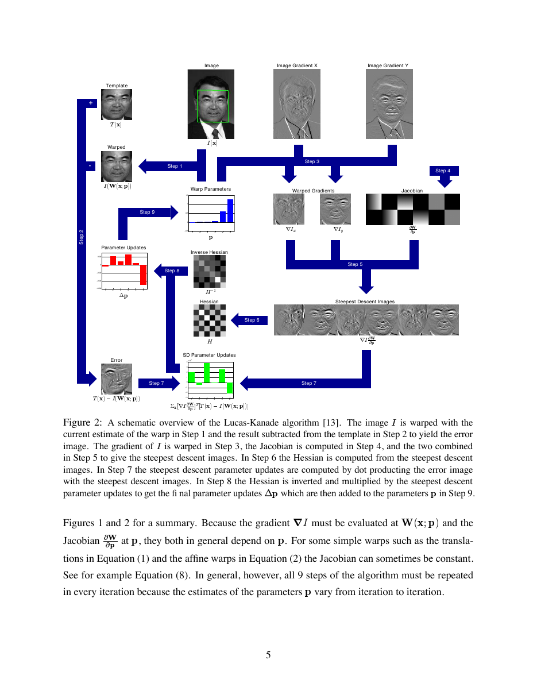
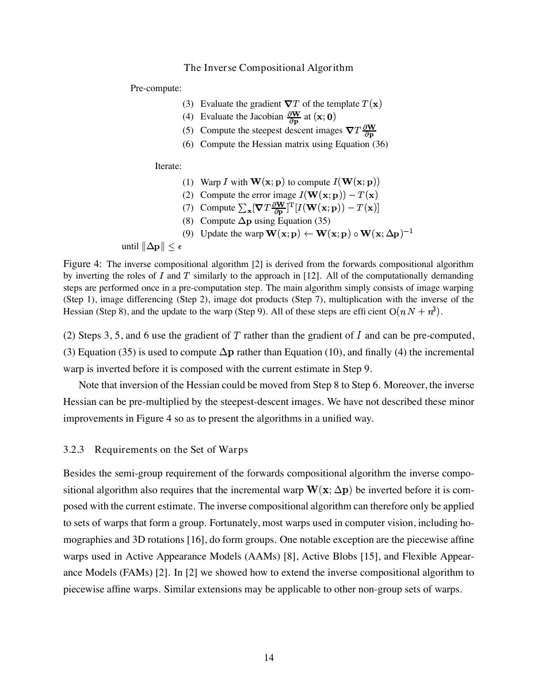
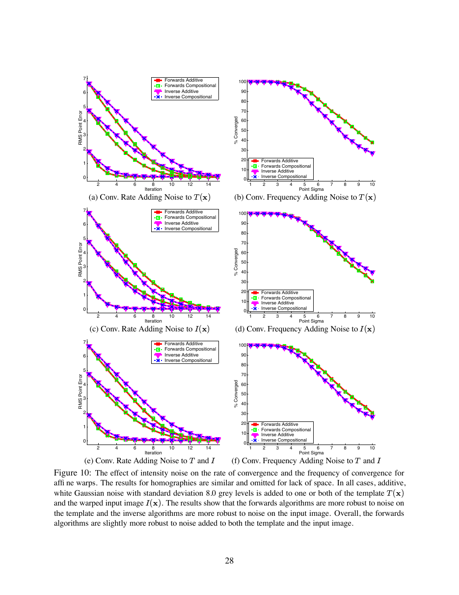

# Lucas-Kanade 20년: 하나로 묶는 틀 (1부) 번역

번역 범위: 전문 (초록, 본문, 그림과 표 캡션, 부록 A). 참고문헌은 원문 그대로.

- 원문 파일: `Baker2004_IJCV_LK20years_Part1_CMU.pdf` (CMU Robotics Institute 공개본, 머리글 "To Appear in the International Journal of Computer Vision", 54쪽)
- 받은 곳: https://www.ri.cmu.edu/pub_files/pub3/baker_simon_2004_1/baker_simon_2004_1.pdf (2026-11-04, HTTP 200)
- 이 파일은 게재 확정 원고(accepted manuscript)다. IJCV 출판본(56(3):221-255)과 쪽 번호와 편집이 다를 수 있다.
- 과제에서 준 figshare 링크(6555452)는 같은 제목 연작의 **4부**(사전분포, CMU-RI-TR-04-14)였고, figshare 6555449는 **3부**(밝기 변화, CMU-RI-TR-03-35)였다. 둘 다 IJCV 논문(1부)이 아니라서 쓰지 않았다.
- PDF의 수식 글꼴이 Type 3라서 `pdftotext -layout` 출력에서 수식이 깨졌다. 수식은 쪽 이미지를 눈으로 보고 옮겼다. 쪽 번호는 원고 아래쪽에 찍힌 번호다(PDF 쪽 = 원고 쪽 + 2).
- 번역자 주는 "(옮긴이: ...)"로 표시했다.

---

## 표지

국제 컴퓨터 비전 저널(IJCV) 게재 예정

**Lucas-Kanade 20년: 하나로 묶는 틀**

**1부: 근사하는 양, 변형 갱신 규칙, 경사 하강 근사**

Simon Baker, Iain Matthews
The Robotics Institute, Carnegie Mellon University, Pittsburgh, PA 15213

### 초록

Lucas-Kanade 알고리즘이 1981년에 나온 뒤, 영상 정렬(image alignment)은 컴퓨터 비전에서 가장 널리 쓰이는 기법 가운데 하나가 되었다. 쓰임새는 광학 흐름, 추적, 층 움직임(layered motion), 모자이크 만들기, 얼굴 부호화까지 넓다. 수많은 알고리즘이 제안되었고 원래 식에 여러 확장이 붙었다. 우리는 영상 정렬을 개관하면서, 대부분의 알고리즘과 확장을 하나의 일관된 틀로 설명한다. 특히 우리가 최근 제안한 효율적 알고리즘인 **역합성(inverse compositional) 알고리즘**에 집중한다. Lucas-Kanade의 확장 가운데 어떤 것은 역합성 알고리즘과 함께 써도 효율이 크게 떨어지지 않고, 어떤 것은 그렇지 않은지 살핀다. 연작의 1부인 이 논문에서는 근사하는 양(quantity approximated), 변형 갱신 규칙(warp update rule), 경사 하강 근사(gradient descent approximation)를 다룬다. 이후 논문에서는 오차 노름의 선택, 선형 외관 변화의 허용, 매개변수에 사전분포 넣기, 국소 최소를 피하는 여러 기법을 다룬다.

핵심어: 영상 정렬, Lucas-Kanade, 하나로 묶는 틀, 가산 대 합성 알고리즘, 정방향 대 역방향 알고리즘, 역합성 알고리즘, 효율, 최급 하강, Gauss-Newton, Newton, Levenberg-Marquardt.

---

## 1 서론

영상 정렬은 템플릿을 움직이고, 필요하면 변형해서, 템플릿과 영상의 차이를 최소로 만드는 일이다. Lucas-Kanade 광학 흐름 알고리즘[13]에서 처음 쓰인 뒤, 영상 정렬은 컴퓨터 비전에서 가장 널리 쓰이는 기법이 되었다. 광학 흐름 말고도 추적[5, 12], 매개변수 움직임과 층 움직임 추정[4], 모자이크 만들기[16], 의료 영상 정합[7], 얼굴 부호화[2, 8]에 쓰인다.

영상 정렬의 보통 접근은 경사 하강이다. 차이 분해(difference decomposition)[11], 선형 회귀[8] 같은 다른 수치 방법도 제안되었지만, 사실상 표준은 경사 하강이다. 그런데 경사 하강을 하는 방법은 여러 가지다. 한 가지 차이는 매개변수에 더할 증분을 구하는지(가산 접근[13]), 아니면 증분 변형을 구해서 현재 변형 추정과 합성하는지(합성 접근[16])이다. 또 한 가지 차이는 매 경사 하강 단계에서 Gauss-Newton, Newton, 최급 하강, Levenberg-Marquardt 가운데 어떤 근사를 쓰는지이다.

우리는 영상 정렬을 하나로 묶는 틀을 제안하고, 여러 알고리즘과 확장을 일관되게 설명한다. 틀 전체에서 우리가 최근 제안한 효율적 알고리즘인 역합성 알고리즘[2]에 집중한다. Lucas-Kanade의 확장 가운데 어떤 것이 효율 손실 없이 역합성 알고리즘에 적용되고, 어떤 확장이 추가 계산을 요구하는지 살핀다. 가능한 곳마다 실험 결과로 알고리즘과 확장을 보여 준다.

연작의 1부인 이 논문은 2절에서 Lucas-Kanade 알고리즘을 다시 본다. 3절에서는 여러 영상 정렬 알고리즘이 근사하는 양과 쓰는 변형 갱신 규칙을 분석한다. 알고리즘을 가산 또는 합성, 정방향 또는 역방향으로 나눈다. 여러 선택지가 1차까지 동치임을 증명하고, 각 알고리즘의 효율을 유도하고, 각 선택지를 적용할 수 있는 변형의 집합을 설명하고, 끝으로 실험으로 비교한다. 4절에서는 매 반복에 쓸 수 있는 여러 경사 하강 근사, 곧 Gauss-Newton, Newton, 대각 헤시안, Levenberg-Marquardt, 최급 하강[14]을 설명한다. 이 선택지들을 속도와 실험 성능 둘 다로 비교한다. 5절에서 논의로 마친다. 이 연작의 이후 논문(준비 중)에서는 오차 노름의 선택, 선형 외관 변화의 허용, 매개변수에 사전분포 넣기, 국소 최소를 피하는 기법을 다룬다.

## 2 배경: Lucas-Kanade

원래의 영상 정렬 알고리즘은 Lucas-Kanade 알고리즘[13]이다. 목표는 템플릿 영상 $T(\mathbf{x})$를 입력 영상 $I(\mathbf{x})$에 맞추는 것이다. 여기서 $\mathbf{x}=(x,y)^T$는 화소 좌표를 담은 열벡터다. 광학 흐름을 구하거나 시각 $t=1$에서 $t=2$로 영상 조각을 추적할 때, 템플릿 $T(\mathbf{x})$는 $t=1$ 영상에서 떼어 낸 작은 영역(예를 들어 5x5 창)이고 $I(\mathbf{x})$는 $t=2$의 영상이다.

$\mathbf{W}(\mathbf{x};\mathbf{p})$를 허용된 변형(warp)의 매개변수 집합이라 하자. $\mathbf{p}=(p_1,\ldots,p_n)^T$는 매개변수 벡터다. 변형 $\mathbf{W}(\mathbf{x};\mathbf{p})$는 템플릿 $T$의 좌표계에 있는 화소 $\mathbf{x}$를 영상 $I$의 좌표계에 있는 부화소 위치 $\mathbf{W}(\mathbf{x};\mathbf{p})$로 보낸다. 예를 들어 광학 흐름을 구할 때 변형은 평행이동일 수 있다.

$$\mathbf{W}(\mathbf{x};\mathbf{p})=\begin{pmatrix}x+p_1\\y+p_2\end{pmatrix}\tag{1}$$

이때 매개변수 벡터 $\mathbf{p}=(p_1,p_2)^T$가 곧 광학 흐름이다. 3차원에서 움직이는 더 큰 영상 조각을 추적한다면 아핀 변형을 쓸 수 있다.

$$\mathbf{W}(\mathbf{x};\mathbf{p})=\begin{pmatrix}(1+p_1)x+p_3y+p_5\\p_2x+(1+p_4)y+p_6\end{pmatrix}=\begin{pmatrix}1+p_1&p_3&p_5\\p_2&1+p_4&p_6\end{pmatrix}\begin{pmatrix}x\\y\\1\end{pmatrix}\tag{2}$$

여기서 매개변수는 6개, $\mathbf{p}=(p_1,\ldots,p_6)^T$이다. 예를 들어 [4]가 이렇게 했다. (아핀 변형을 매개변수화하는 다른 방법도 있다. 이 틀의 뒷부분에서 무엇이 가장 좋은지 살핀다.) 일반적으로 매개변수 수 $n$은 얼마든지 클 수 있고 $\mathbf{W}(\mathbf{x};\mathbf{p})$도 얼마든지 복잡할 수 있다. 복잡한 변형의 한 예는 능동 외관 모델(AAM)[8, 2]과 Active Blobs[15]에 쓰이는 조각별 아핀 변형이다.

### 2.1 Lucas-Kanade 알고리즘의 목표

Lucas-Kanade 알고리즘의 목표는 두 영상, 곧 템플릿 $T$와 템플릿 좌표계로 되돌려 변형한 영상 $I$ 사이의 제곱 오차 합을 최소로 만드는 것이다.

$$\sum_{\mathbf{x}}\left[I(\mathbf{W}(\mathbf{x};\mathbf{p}))-T(\mathbf{x})\right]^2\tag{3}$$

$I$를 되돌려 변형해 $I(\mathbf{W}(\mathbf{x};\mathbf{p}))$를 구하려면 부화소 위치 $\mathbf{W}(\mathbf{x};\mathbf{p})$에서 영상 $I$를 보간해야 한다. 식 (3)의 최소화는 $\mathbf{p}$에 대해 하고, 합은 템플릿 영상 $T(\mathbf{x})$의 모든 화소 $\mathbf{x}$에 대해 한다. $\mathbf{W}(\mathbf{x};\mathbf{p})$가 $\mathbf{p}$에 대해 선형이어도 식 (1)(옮긴이: 식 (3)의 오기로 보인다)의 최소화는 비선형 최적화 문제다. 화소값 $I(\mathbf{x})$가 일반적으로 $\mathbf{x}$에 대해 비선형이기 때문이다. 사실 화소값 $I(\mathbf{x})$는 화소 좌표 $\mathbf{x}$와 사실상 무관하다. 식 (3)을 최적화하려고 Lucas-Kanade 알고리즘은 $\mathbf{p}$의 현재 추정을 안다고 가정하고, 매개변수의 증분 $\Delta\mathbf{p}$를 반복해 푼다. 곧 다음 식을 $\Delta\mathbf{p}$에 대해 (근사적으로) 최소화한다.

$$\sum_{\mathbf{x}}\left[I(\mathbf{W}(\mathbf{x};\mathbf{p}+\Delta\mathbf{p}))-T(\mathbf{x})\right]^2\tag{4}$$

그리고 매개변수를 갱신한다.

$$\mathbf{p}\leftarrow\mathbf{p}+\Delta\mathbf{p}\tag{5}$$

이 두 단계를 매개변수 추정 $\mathbf{p}$가 수렴할 때까지 되풀이한다. 보통 수렴 판정은 벡터 $\Delta\mathbf{p}$의 어떤 노름이 문턱 $\epsilon$보다 작은지, 곧 $\|\Delta\mathbf{p}\|\le\epsilon$인지이다.

### 2.2 Lucas-Kanade 알고리즘의 유도

Lucas-Kanade 알고리즘(Gauss-Newton 경사 하강 비선형 최적화 알고리즘이다)은 다음처럼 유도한다. 식 (4)의 비선형 식을 $I(\mathbf{W}(\mathbf{x};\mathbf{p}+\Delta\mathbf{p}))$의 1차 테일러 전개로 선형화한다.

$$\sum_{\mathbf{x}}\left[I(\mathbf{W}(\mathbf{x};\mathbf{p}))+\nabla I\frac{\partial\mathbf{W}}{\partial\mathbf{p}}\Delta\mathbf{p}-T(\mathbf{x})\right]^2\tag{6}$$

이 식에서 $\nabla I=(\frac{\partial I}{\partial x},\frac{\partial I}{\partial y})$는 $\mathbf{W}(\mathbf{x};\mathbf{p})$에서 계산한 영상 $I$의 기울기다. 곧 $\nabla I$는 $I$의 좌표계에서 계산한 뒤, 현재 변형 추정 $\mathbf{W}(\mathbf{x};\mathbf{p})$로 $T$의 좌표계에 되돌려 변형한다. $\frac{\partial\mathbf{W}}{\partial\mathbf{p}}$는 변형의 야코비안이다. $\mathbf{W}(\mathbf{x};\mathbf{p})=(W_x(\mathbf{x};\mathbf{p}),W_y(\mathbf{x};\mathbf{p}))^T$이면 다음과 같다.

$$\frac{\partial\mathbf{W}}{\partial\mathbf{p}}=\begin{pmatrix}\frac{\partial W_x}{\partial p_1}&\frac{\partial W_x}{\partial p_2}&\cdots&\frac{\partial W_x}{\partial p_n}\\\frac{\partial W_y}{\partial p_1}&\frac{\partial W_y}{\partial p_2}&\cdots&\frac{\partial W_y}{\partial p_n}\end{pmatrix}\tag{7}$$

열벡터에 대한 편미분은 행벡터로 늘어놓는다는 표기 약속을 따른다. 이렇게 하면 연쇄 법칙이 식 (6)처럼 행렬 곱이 된다는 장점이 있다. 예를 들어 식 (2)의 아핀 변형의 야코비안은 다음과 같다.

$$\frac{\partial\mathbf{W}}{\partial\mathbf{p}}=\begin{pmatrix}x&0&y&0&1&0\\0&x&0&y&0&1\end{pmatrix}\tag{8}$$

식 (6)의 최소화는 최소제곱 문제이고 닫힌 해가 있다. 식 (6)을 $\Delta\mathbf{p}$로 편미분하면 다음과 같다.

$$2\sum_{\mathbf{x}}\left[\nabla I\frac{\partial\mathbf{W}}{\partial\mathbf{p}}\right]^T\left[I(\mathbf{W}(\mathbf{x};\mathbf{p}))+\nabla I\frac{\partial\mathbf{W}}{\partial\mathbf{p}}\Delta\mathbf{p}-T(\mathbf{x})\right]\tag{9}$$

여기서 $\nabla I\frac{\partial\mathbf{W}}{\partial\mathbf{p}}$를 **최급 하강 영상(steepest descent images)** 이라 부른다. (이유는 4.3절을 보라.) 이 식을 0으로 놓고 풀면 식 (6)의 최소를 주는 닫힌 해가 나온다.

$$\Delta\mathbf{p}=H^{-1}\sum_{\mathbf{x}}\left[\nabla I\frac{\partial\mathbf{W}}{\partial\mathbf{p}}\right]^T\left[T(\mathbf{x})-I(\mathbf{W}(\mathbf{x};\mathbf{p}))\right]\tag{10}$$

여기서 $H$는 $n\times n$ 헤시안 행렬(의 Gauss-Newton 근사)이다.

$$H=\sum_{\mathbf{x}}\left[\nabla I\frac{\partial\mathbf{W}}{\partial\mathbf{p}}\right]^T\left[\nabla I\frac{\partial\mathbf{W}}{\partial\mathbf{p}}\right]\tag{11}$$

뒤에서 분명해질 이유로 $\sum_{\mathbf{x}}[\nabla I\frac{\partial\mathbf{W}}{\partial\mathbf{p}}]^T[T(\mathbf{x})-I(\mathbf{W}(\mathbf{x};\mathbf{p}))]$를 **최급 하강 매개변수 갱신**이라 부른다. 그러면 식 (10)은 매개변수 갱신 $\Delta\mathbf{p}$가 최급 하강 매개변수 갱신에 헤시안의 역행렬을 곱한 것이라는 뜻이 된다. Lucas-Kanade 알고리즘[13]은 식 (10)과 (5)를 반복 적용하는 것이다. 요약은 그림 1과 2를 보라.

> **그림 1: Lucas-Kanade 알고리즘**
>
> 반복:
> 1. $I$를 $\mathbf{W}(\mathbf{x};\mathbf{p})$로 변형해 $I(\mathbf{W}(\mathbf{x};\mathbf{p}))$를 구한다.
> 2. 오차 영상 $T(\mathbf{x})-I(\mathbf{W}(\mathbf{x};\mathbf{p}))$를 구한다.
> 3. 기울기 $\nabla I$를 $\mathbf{W}(\mathbf{x};\mathbf{p})$로 변형한다.
> 4. 야코비안 $\frac{\partial\mathbf{W}}{\partial\mathbf{p}}$를 $(\mathbf{x};\mathbf{p})$에서 계산한다.
> 5. 최급 하강 영상 $\nabla I\frac{\partial\mathbf{W}}{\partial\mathbf{p}}$를 구한다.
> 6. 식 (11)로 헤시안 행렬을 구한다.
> 7. $\sum_{\mathbf{x}}[\nabla I\frac{\partial\mathbf{W}}{\partial\mathbf{p}}]^T[T(\mathbf{x})-I(\mathbf{W}(\mathbf{x};\mathbf{p}))]$를 구한다.
> 8. 식 (10)으로 $\Delta\mathbf{p}$를 구한다.
> 9. 매개변수를 갱신한다. $\mathbf{p}\leftarrow\mathbf{p}+\Delta\mathbf{p}$
>
> $\|\Delta\mathbf{p}\|\le\epsilon$이 될 때까지
>
> 캡션: Lucas-Kanade 알고리즘[13]은 매개변수 추정이 수렴할 때까지 식 (10)과 (5)를 반복 적용한다. 보통 수렴 판정은 벡터 $\Delta\mathbf{p}$의 어떤 노름이 사용자가 정한 문턱 $\epsilon$보다 작은지이다. 기울기 $\nabla I$는 $\mathbf{W}(\mathbf{x};\mathbf{p})$에서, 야코비안 $\frac{\partial\mathbf{W}}{\partial\mathbf{p}}$는 $\mathbf{p}$에서 계산해야 하므로 9단계 모두를 알고리즘의 매 반복마다 되풀이해야 한다.

> **그림 2 캡션:** Lucas-Kanade 알고리즘[13]의 도식. 1단계에서 영상 $I$를 현재 변형 추정으로 변형하고, 2단계에서 템플릿에서 빼서 오차 영상을 얻는다. 3단계에서 $I$의 기울기를 변형하고, 4단계에서 야코비안을 구하고, 5단계에서 둘을 합쳐 최급 하강 영상을 얻는다. 6단계에서 최급 하강 영상으로 헤시안을 구한다. 7단계에서 오차 영상과 최급 하강 영상의 내적으로 최급 하강 매개변수 갱신을 구한다. 8단계에서 헤시안의 역행렬을 최급 하강 매개변수 갱신에 곱해 최종 매개변수 갱신 $\Delta\mathbf{p}$를 얻고, 9단계에서 이를 매개변수 $\mathbf{p}$에 더한다.

기울기 $\nabla I$는 $\mathbf{W}(\mathbf{x};\mathbf{p})$에서, 야코비안은 $\mathbf{p}$에서 계산해야 하므로 둘 다 일반적으로 $\mathbf{p}$에 따라 달라진다. 식 (1)의 평행이동과 식 (2)의 아핀 변형 같은 단순한 변형에서는 야코비안이 상수일 때도 있다. 예를 들어 식 (8)을 보라. 그러나 일반적으로는 매개변수 추정 $\mathbf{p}$가 반복마다 바뀌므로 알고리즘의 9단계 모두를 매 반복마다 되풀이해야 한다.

> **표 1:** Lucas-Kanade 알고리즘 한 반복의 계산 비용. $n$이 변형 매개변수 수이고 $N$이 템플릿 $T$의 화소 수이면, 한 반복의 비용은 $O(n^2N+n^3)$이다. 가장 비싼 단계는 단연 6단계, 곧 헤시안 계산이며 이것 하나로 $O(n^2N)$이 든다.
>
> | 1단계 | 2단계 | 3단계 | 4단계 | 5단계 | 6단계 | 7단계 | 8단계 | 9단계 | 합계 |
> |---|---|---|---|---|---|---|---|---|---|
> | $O(nN)$ | $O(N)$ | $O(nN)$ | $O(nN)$ | $O(nN)$ | $O(n^2N)$ | $O(nN)$ | $O(n^3)$ | $O(n)$ | $O(n^2N+n^3)$ |

### 2.3 변형 집합에 대한 요구 조건

변형 $\mathbf{W}(\mathbf{x};\mathbf{p})$에 대한 유일한 요구는 변형 매개변수 $\mathbf{p}$에 대해 미분 가능해야 한다는 것이다. 야코비안 $\frac{\partial\mathbf{W}}{\partial\mathbf{p}}$를 구하려면 이 조건이 필요하다. 보통 변형은 $\mathbf{x}$에 대해서도 (조각별로) 미분 가능하지만, 이 조건은 엄밀히 필요하지 않다.

### 2.4 Lucas-Kanade 알고리즘의 계산 비용

변형 매개변수 수를 $n$, $T$의 화소 수를 $N$이라 하자. 1단계는 보통 $O(nN)$이 든다. $T$의 각 화소 $\mathbf{x}$마다 $\mathbf{W}(\mathbf{x};\mathbf{p})$를 구하고 그 위치에서 $I$를 표본화한다. $\mathbf{W}(\mathbf{x};\mathbf{p})$의 계산 비용은 $\mathbf{W}$에 따라 다르지만 대부분의 변형에서는 화소당 $O(n)$이다. 2단계는 $O(N)$이 든다. 3단계는 1단계와 같은 시간, 보통 $O(nN)$이 든다. 4단계의 야코비안 계산도 $\mathbf{W}$에 따라 다르지만 대부분의 변형에서 화소당 $O(n)$이다. 따라서 4단계 전체 비용은 $O(nN)$이다. 5단계는 $O(nN)$, 6단계는 $O(n^2N)$, 7단계는 $O(nN)$이 든다. 8단계는 헤시안 역행렬에 $O(n^3)$, 그 결과를 7단계의 최급 하강 매개변수 갱신에 곱하는 데 $O(n^2)$이 든다. 9단계는 매개변수에 갱신을 더하는 데 $O(n)$만 든다. 따라서 한 반복의 전체 계산 비용은 $O(n^2N+n^3)$이고, 가장 비싼 단계는 6단계다. 계산 비용 요약은 표 1을 보라.

## 3 근사하는 양과 변형 갱신 규칙

Lucas-Kanade는 매 반복에서 $\sum_{\mathbf{x}}[I(\mathbf{W}(\mathbf{x};\mathbf{p}+\Delta\mathbf{p}))-T(\mathbf{x})]^2$를 $\Delta\mathbf{p}$에 대해 근사적으로 최소화하고, 9단계에서 매개변수 추정을 $\mathbf{p}\leftarrow\mathbf{p}+\Delta\mathbf{p}$로 갱신한다. 놀랍게도 이 두 단계를 되풀이하는 것만이 식 (3)을 최소화하는 방법은 아니다. 이 절에서는 Lucas-Kanade 알고리즘과 동치임이 증명되는 대안 3가지를 소개한다. 그리고 실험으로 동치임을 보인다.

### 3.1 합성 영상 정렬

Lucas-Kanade 알고리즘의 첫 번째 대안은 합성(compositional) 알고리즘이다.

#### 3.1.1 합성 알고리즘의 목표

합성 알고리즘은 [16]이 대표적으로 썼다. 매 반복에서 다음 식을 $\Delta\mathbf{p}$에 대해 근사적으로 최소화한다.

$$\sum_{\mathbf{x}}\left[I(\mathbf{W}(\mathbf{W}(\mathbf{x};\Delta\mathbf{p});\mathbf{p}))-T(\mathbf{x})\right]^2\tag{12}$$

그리고 변형 추정을 다음처럼 갱신한다.

$$\mathbf{W}(\mathbf{x};\mathbf{p})\leftarrow\mathbf{W}(\mathbf{x};\mathbf{p})\circ\mathbf{W}(\mathbf{x};\Delta\mathbf{p})\tag{13}$$

곧 합성 접근은 매개변수에 더할 증분이 아니라 증분 변형 $\mathbf{W}(\mathbf{x};\Delta\mathbf{p})$를 반복해 푼다. 이와 대비하려고, 식 (4)와 (5)의 Lucas-Kanade 알고리즘을 가산(additive) 접근이라 부른다. 합성 접근과 가산 접근이 $\Delta\mathbf{p}$의 1차까지 동치임은 3.1.5절에서 증명한다. 다음 식

$$\mathbf{W}(\mathbf{x};\mathbf{p})\circ\mathbf{W}(\mathbf{x};\Delta\mathbf{p})\equiv\mathbf{W}(\mathbf{W}(\mathbf{x};\Delta\mathbf{p});\mathbf{p})\tag{14}$$

은 두 변형의 합성이다. 예를 들어 $\mathbf{W}(\mathbf{x};\mathbf{p})$가 식 (2)의 아핀 변형이면 다음과 같다.

$$\mathbf{W}(\mathbf{x};\mathbf{p})\circ\mathbf{W}(\mathbf{x};\Delta\mathbf{p})=\begin{pmatrix}(1+p_1)((1+\Delta p_1)x+\Delta p_3y+\Delta p_5)+p_3(\Delta p_2x+(1+\Delta p_4)y+\Delta p_6)+p_5\\p_2((1+\Delta p_1)x+\Delta p_3y+\Delta p_5)+(1+p_4)(\Delta p_2x+(1+\Delta p_4)y+\Delta p_6)+p_6\end{pmatrix}\tag{15}$$

곧 $\mathbf{W}(\mathbf{x};\mathbf{p})\circ\mathbf{W}(\mathbf{x};\Delta\mathbf{p})$의 매개변수는 다음과 같다.

$$\begin{pmatrix}p_1+\Delta p_1+p_1\Delta p_1+p_3\Delta p_2\\p_2+\Delta p_2+p_2\Delta p_1+p_4\Delta p_2\\p_3+\Delta p_3+p_1\Delta p_3+p_3\Delta p_4\\p_4+\Delta p_4+p_2\Delta p_3+p_4\Delta p_4\\p_5+\Delta p_5+p_1\Delta p_5+p_3\Delta p_6\\p_6+\Delta p_6+p_2\Delta p_5+p_4\Delta p_6\end{pmatrix}\tag{16}$$

$\mathbf{W}(\mathbf{x};\mathbf{p})$와 $\mathbf{W}(\mathbf{x};\Delta\mathbf{p})$의 매개변수의 단순한 쌍선형 결합이다.

#### 3.1.2 합성 알고리즘의 유도

합성 접근에서 Lucas-Kanade 알고리즘에 해당하는 것을 유도하려고, 식 (12)에 1차 테일러 전개를 적용한다.

$$\sum_{\mathbf{x}}\left[I(\mathbf{W}(\mathbf{W}(\mathbf{x};\mathbf{0});\mathbf{p}))+\nabla I(\mathbf{W})\frac{\partial\mathbf{W}}{\partial\mathbf{p}}\Delta\mathbf{p}-T(\mathbf{x})\right]^2\tag{17}$$

이 식에서 $I(\mathbf{W})(\mathbf{x})$는 변형된 영상 $I(\mathbf{W}(\mathbf{x};\mathbf{p}))$를 뜻한다. 다음처럼 더 전개할 수도 있다.

$$\nabla I(\mathbf{W})\equiv\frac{\partial I(\mathbf{W})}{\partial\mathbf{x}}=\frac{\partial I}{\partial\mathbf{x}}\frac{\partial\mathbf{W}}{\partial\mathbf{x}}=\nabla I\frac{\partial\mathbf{W}}{\partial\mathbf{x}}\tag{18}$$

그러나 변형된 영상 $I(\mathbf{W})$는 Lucas-Kanade 알고리즘의 1단계(그림 1)에서 어차피 구하므로 그 기울기를 쉽게 대신 쓸 수 있다. 그래서 이 전개는 할 가치가 없다.

진행하려고 가정을 하나 한다. $\mathbf{W}(\mathbf{x};\mathbf{0})$가 항등 변형, 곧 $\mathbf{W}(\mathbf{x};\mathbf{0})=\mathbf{x}$라고 가정한다. 고려하는 변형 집합에 항등 변형이 들어 있으면 $\mathbf{W}(\mathbf{x};\mathbf{0})=\mathbf{x}$가 되도록 다시 매개변수화할 수 있다. 따라서 실제로는 항등 변형이 집합 안에 있다는 것만 가정한다. $\mathbf{W}(\mathbf{x};\mathbf{0})=\mathbf{x}$이면 식 (17)은 다음처럼 단순해진다.

$$\sum_{\mathbf{x}}\left[I(\mathbf{W}(\mathbf{x};\mathbf{p}))+\nabla I(\mathbf{W})\frac{\partial\mathbf{W}}{\partial\mathbf{p}}\Delta\mathbf{p}-T(\mathbf{x})\right]^2\tag{19}$$

식 (19)와 Lucas-Kanade 유도의 해당 식 (6) 사이에는 차이가 2가지 있다. 첫째, ($\mathbf{W}(\mathbf{x};\mathbf{p})$에서 계산한) $I(\mathbf{x})$의 기울기가 $I(\mathbf{W})$의 기울기로 바뀐다. 두 기울기는 다르다. 둘째 차이는 간결한 표기에 숨어 있다. 야코비안 $\frac{\partial\mathbf{W}}{\partial\mathbf{p}}$는 식 (6)에서 $(\mathbf{x};\mathbf{p})$에서 계산하지만, 식 (19)에서는 테일러 전개를 한 곳인 $(\mathbf{x};\mathbf{0})$에서 계산한다. 따라서 야코비안은 상수이고 미리 계산할 수 있다. 또 해석적으로도 대개 더 간단하다[16].

따라서 합성 알고리즘은 가산 알고리즘(Lucas-Kanade 알고리즘)과 거의 똑같다. 차이는 셋뿐이다. (1) 3단계에서 $I(\mathbf{W}(\mathbf{x};\mathbf{p}))$의 기울기를 쓴다. (2) 야코비안을 4단계에서 매 반복 다시 구하지 않고 $(\mathbf{x};\mathbf{0})$에서 계산하므로 미리 계산할 수 있다. (3) 9단계에서 변형을 $\mathbf{W}(\mathbf{x};\mathbf{p})\leftarrow\mathbf{W}(\mathbf{x};\mathbf{p})\circ\mathbf{W}(\mathbf{x};\Delta\mathbf{p})$로 갱신한다. 합성 알고리즘의 요약은 그림 3에 있다.

#### 3.1.3 변형 집합에 대한 요구 조건

Lucas-Kanade 알고리즘처럼 가산 갱신 $\Delta\mathbf{p}$를 현재 매개변수 추정 $\mathbf{p}$에 단순히 더하는 대신, 합성 알고리즘에서는 증분 변형 $\mathbf{W}(\mathbf{x};\Delta\mathbf{p})$를 현재 변형 추정 $\mathbf{W}(\mathbf{x};\mathbf{p})$와 합성해야 한다.

> **그림 3: 합성 알고리즘**
>
> 미리 계산:
> 4. 야코비안 $\frac{\partial\mathbf{W}}{\partial\mathbf{p}}$를 $(\mathbf{x};\mathbf{0})$에서 계산한다.
>
> 반복:
> 1. $I$를 $\mathbf{W}(\mathbf{x};\mathbf{p})$로 변형해 $I(\mathbf{W}(\mathbf{x};\mathbf{p}))$를 구한다.
> 2. 오차 영상 $T(\mathbf{x})-I(\mathbf{W}(\mathbf{x};\mathbf{p}))$를 구한다.
> 3. 영상 $I(\mathbf{W}(\mathbf{x};\mathbf{p}))$의 기울기 $\nabla I(\mathbf{W})$를 구한다.
> 5. 최급 하강 영상 $\nabla I(\mathbf{W})\frac{\partial\mathbf{W}}{\partial\mathbf{p}}$를 구한다.
> 6. 식 (11)로 헤시안 행렬을 구한다.
> 7. $\sum_{\mathbf{x}}[\nabla I(\mathbf{W})\frac{\partial\mathbf{W}}{\partial\mathbf{p}}]^T[T(\mathbf{x})-I(\mathbf{W}(\mathbf{x};\mathbf{p}))]$를 구한다.
> 8. 식 (10)으로 $\Delta\mathbf{p}$를 구한다.
> 9. 변형을 갱신한다. $\mathbf{W}(\mathbf{x};\mathbf{p})\leftarrow\mathbf{W}(\mathbf{x};\mathbf{p})\circ\mathbf{W}(\mathbf{x};\Delta\mathbf{p})$
>
> $\|\Delta\mathbf{p}\|\le\epsilon$이 될 때까지
>
> 캡션: [16]이 쓴 합성 알고리즘은 Lucas-Kanade 알고리즘과 비슷하다. 차이는 (1) 3단계에서 $\mathbf{W}(\mathbf{x};\mathbf{p})$에서 계산한 $I$의 기울기 대신 $I(\mathbf{W}(\mathbf{x};\mathbf{p}))$의 기울기를 쓰고, (2) 야코비안을 $(\mathbf{x};\mathbf{0})$에서 계산하므로 상수라서 미리 계산할 수 있고, (3) 9단계에서 증분 변형 $\mathbf{W}(\mathbf{x};\Delta\mathbf{p})$를 현재 추정과 합성해 갱신한다는 것뿐이다.

이 연산은 보통 두 행렬을 곱해 합성된 변형의 매개변수를 구하는 일이다. 아핀 변형이면 식 (16)과 같다. 더 복잡한 변형에서는 두 변형의 합성이 더 까다로울 수 있다[2]. 따라서 변형 집합에 요구 조건이 둘 있다. (1) 변형 집합에 항등 변형이 들어 있어야 하고, (2) 변형 집합이 합성에 대해 닫혀 있어야 한다. 곧 변형 집합은 반군(semi-group)을 이루어야 한다. 이 요구는 그리 강하지 않다. 호모그래피와 3차원 회전[16]을 포함해 컴퓨터 비전에서 쓰는 대부분의 변형은 자연스럽게 반군을 이룬다.

#### 3.1.4 합성 알고리즘의 계산 비용

합성 알고리즘의 계산 비용은 Lucas-Kanade 알고리즘과 거의 똑같다. 요약은 표 2, 자세한 것은 [3]을 보라. 바뀌는 단계는 3, 4, 9단계뿐이다. 특히 9단계에서 두 변형을 합성하는 비용은 $\mathbf{W}$에 따라 다르지만, 식 (16)의 아핀 변형을 포함해 대부분의 변형에서 $O(n^2)$ 이하다.

> **표 2:** 합성 알고리즘의 계산 비용. 4단계의 야코비안을 한 번 미리 계산하는 비용은 $O(nN)$이다. 그 뒤 한 반복의 비용은 $O(n^2N+n^3)$이다.
>
> 미리 계산: 4단계 $O(nN)$, 합계 $O(nN)$
>
> | 반복당 | 1단계 | 2단계 | 3단계 | 5단계 | 6단계 | 7단계 | 8단계 | 9단계 | 합계 |
> |---|---|---|---|---|---|---|---|---|---|
> | | $O(nN)$ | $O(N)$ | $O(N)$ | $O(nN)$ | $O(n^2N)$ | $O(nN)$ | $O(n^3)$ | $O(n^2)$ | $O(n^2N+n^3)$ |

#### 3.1.5 가산 알고리즘과 합성 알고리즘의 동치

이제 가산 접근과 합성 접근이, $\Delta\mathbf{p}$의 1차 근사까지 매 반복 같은 걸음을 간다는 뜻에서 동치임을 보인다. 곧 변형의 갱신이 근사적으로 같다. 식 (6)의 가산 식에서는 다음을 최소화한다.

$$\sum_{\mathbf{x}}\left[I(\mathbf{W}(\mathbf{x};\mathbf{p}))+\nabla I\frac{\partial\mathbf{W}}{\partial\mathbf{p}}\Delta\mathbf{p}-T(\mathbf{x})\right]^2\tag{20}$$

이를 $\Delta\mathbf{p}$에 대해 최소화하고 $\mathbf{p}\leftarrow\mathbf{p}+\Delta\mathbf{p}$로 갱신한다. 테일러 전개를 하면, 대응하는 변형의 갱신은 다음과 같다.

$$\mathbf{W}(\mathbf{x};\mathbf{p})\leftarrow\mathbf{W}(\mathbf{x};\mathbf{p}+\Delta\mathbf{p})\approx\mathbf{W}(\mathbf{x};\mathbf{p})+\frac{\partial\mathbf{W}}{\partial\mathbf{p}}\Delta\mathbf{p}\tag{21}$$

식 (19)의 합성 식에서는 다음을 최소화한다.

$$\sum_{\mathbf{x}}\left[I(\mathbf{W}(\mathbf{x};\mathbf{p}))+\nabla I(\mathbf{W})\frac{\partial\mathbf{W}}{\partial\mathbf{p}}\Delta\mathbf{p}-T(\mathbf{x})\right]^2\tag{22}$$

식 (18)을 쓰면 이는 다음처럼 단순해진다.

$$\sum_{\mathbf{x}}\left[I(\mathbf{W}(\mathbf{x};\mathbf{p}))+\nabla I\frac{\partial\mathbf{W}}{\partial\mathbf{x}}\frac{\partial\mathbf{W}}{\partial\mathbf{p}}\Delta\mathbf{p}-T(\mathbf{x})\right]^2\tag{23}$$

합성 접근에서 변형의 갱신은 $\mathbf{W}(\mathbf{x};\mathbf{p})\leftarrow\mathbf{W}(\mathbf{x};\mathbf{p})\circ\mathbf{W}(\mathbf{x};\Delta\mathbf{p})$이다. 이 식을 단순화하려고 다음을 보자.

$$\mathbf{W}(\mathbf{x};\Delta\mathbf{p})\approx\mathbf{W}(\mathbf{x};\mathbf{0})+\frac{\partial\mathbf{W}}{\partial\mathbf{p}}\Delta\mathbf{p}=\mathbf{x}+\frac{\partial\mathbf{W}}{\partial\mathbf{p}}\Delta\mathbf{p}\tag{24}$$

는 $\mathbf{W}(\mathbf{x};\Delta\mathbf{p})$의 1차 테일러 전개이고,

$$\mathbf{W}(\mathbf{x};\mathbf{p})\circ\mathbf{W}(\mathbf{x};\Delta\mathbf{p})=\mathbf{W}(\mathbf{W}(\mathbf{x};\Delta\mathbf{p});\mathbf{p})\tag{25}$$

이다. 이 두 식을 합치고 테일러 전개를 한 번 더 하면, 합성 식에서의 갱신은 다음과 같다.

$$\mathbf{W}(\mathbf{x};\mathbf{p})\leftarrow\mathbf{W}(\mathbf{x};\mathbf{p})+\frac{\partial\mathbf{W}}{\partial\mathbf{x}}\frac{\partial\mathbf{W}}{\partial\mathbf{p}}\Delta\mathbf{p}\tag{26}$$

$\Delta\mathbf{p}$의 1차까지 보면, 식 (20)과 (21)의 가산 식과 식 (23)과 (26)의 합성 식의 차이는 $\frac{\partial\mathbf{W}}{\partial\mathbf{p}}$가 $\frac{\partial\mathbf{W}}{\partial\mathbf{x}}\frac{\partial\mathbf{W}}{\partial\mathbf{p}}$로 바뀐다는 것뿐이다. 따라서 식 (20)과 (22)는 일반적으로 서로 다른 $\Delta\mathbf{p}$ 추정을 준다. (두 번째 식에서 $\frac{\partial\mathbf{W}}{\partial\mathbf{p}}$는 첫 번째 식의 $(\mathbf{x};\mathbf{p})$가 아니라 $(\mathbf{x};\mathbf{0})$에서 계산한다는 점에 주의하라.)

그러나 가산 식의 벡터 $\frac{\partial\mathbf{W}}{\partial\mathbf{p}}$와 합성 식의 벡터 $\frac{\partial\mathbf{W}}{\partial\mathbf{x}}\frac{\partial\mathbf{W}}{\partial\mathbf{p}}$가 같은 선형 공간을 생성한다면, 식 (21)과 (26)의 최종 변형 갱신은 $\Delta\mathbf{p}$의 1차까지 같고 두 식은 1차까지 동치다. 곧 식 (20)의 최적 $\frac{\partial\mathbf{W}}{\partial\mathbf{p}}\Delta\mathbf{p}$는 식 (22)의 최적 $\frac{\partial\mathbf{W}}{\partial\mathbf{x}}\frac{\partial\mathbf{W}}{\partial\mathbf{p}}\Delta\mathbf{p}$와 근사적으로 같다. 식 (21)에서 첫 번째 식은

$$\frac{\partial\mathbf{W}}{\partial\mathbf{p}}=\frac{\partial\mathbf{W}(\mathbf{x};\mathbf{p}+\Delta\mathbf{p})}{\partial\Delta\mathbf{p}}\tag{27}$$

이고, 식 (26)에서 두 번째 식은

$$\frac{\partial\mathbf{W}}{\partial\mathbf{x}}\frac{\partial\mathbf{W}}{\partial\mathbf{p}}=\frac{\partial\,\mathbf{W}(\mathbf{x};\mathbf{p})\circ\mathbf{W}(\mathbf{x};\mathbf{p}+\Delta\mathbf{p})}{\partial\Delta\mathbf{p}}\tag{28}$$

이다. 따라서 가산 식의 벡터 $\frac{\partial\mathbf{W}}{\partial\mathbf{p}}$와 합성 식의 벡터 $\frac{\partial\mathbf{W}}{\partial\mathbf{x}}\frac{\partial\mathbf{W}}{\partial\mathbf{p}}$는, ($\epsilon>0$이 있어서) $\|\Delta\mathbf{p}\|\le\epsilon$인 모든 $\Delta\mathbf{p}$에 대해 다음을 만족하는 $\Delta\mathbf{p}'$가 있으면, 같은 선형 공간, 곧 다양체 $\mathbf{W}(\mathbf{x};\mathbf{p})$의 접공간을 생성한다.

$$\mathbf{W}(\mathbf{x};\mathbf{p}+\Delta\mathbf{p})=\mathbf{W}(\mathbf{x};\mathbf{p})\circ\mathbf{W}(\mathbf{x};\mathbf{p}+\Delta\mathbf{p}')\tag{29}$$

이 조건은 $\Delta\mathbf{p}$와 $\Delta\mathbf{p}'$ 사이의 함수가 양방향으로 정의된다는 뜻이다. 그러면 식 (27)과 (28)의 식은 같은 선형 공간을 생성한다. 변형이 가역이면 식 (29)는 언제나 성립한다. $\Delta\mathbf{p}'$를 다음처럼 고를 수 있기 때문이다.

$$\mathbf{W}(\mathbf{x};\mathbf{p}+\Delta\mathbf{p}')=\mathbf{W}(\mathbf{x};\mathbf{p})^{-1}\circ\mathbf{W}(\mathbf{x};\mathbf{p}+\Delta\mathbf{p})\tag{30}$$

정리하면, 변형이 가역이면 두 식은 동치다. 3.1.3절에서 합성 알고리즘을 적용하려면 변형 집합이 반군을 이루어야 한다고 했다. 이는 맞지만, 합성 알고리즘이 Lucas-Kanade 알고리즘과 동치임이 증명되려면 변형 집합이 군(group)을 이루어야 한다. 곧 모든 변형이 가역이어야 한다.

### 3.2 역합성 영상 정렬

여러 저자가 지적했듯이, Lucas-Kanade 알고리즘에서는 매 반복 헤시안을 다시 계산하는 비용이 매우 크다[12, 9, 16]. 헤시안이 상수라면 미리 계산해 두고 다시 쓸 수 있다. 그러면 알고리즘(그림 1)의 매 반복은 영상 변형(1단계), 영상 차(2단계), 영상 "내적" 모음(7단계), 결과에 헤시안 곱하기(8단계), 매개변수 갱신(9단계)만으로 이루어진다. 이 연산들은 모두 (거의) 프레임 속도로 할 수 있다[9].

불행히도 두 식 모두에서 헤시안은 $\mathbf{p}$의 함수다. 여러 근사 해법을 쓸 수 있지만(헤시안을 몇 반복마다 한 번만 갱신하기, 헤시안이 영상 전체에서 거의 일정하다고 가정해 근사하기[16] 등), 이 근사들은 깔끔하지 않고 얼마나 좋은 근사인지 말하기 어렵다. 문제를 동치이면서 헤시안이 상수인 꼴로 다시 쓸 수 있다면 훨씬 낫다.

#### 3.2.1 역합성 알고리즘의 목표

효율의 열쇠는 영상과 템플릿의 역할을 바꾸는 것이다. [12]에서처럼 변수를 바꿔 템플릿과 영상의 역할을 맞바꾸거나 뒤집는다. 이런 변수 바꾸기는 가산 접근[12]에서도 합성 접근[2]에서도 할 수 있다. (호모그래피에 한정된 역합성 알고리즘이 [9]에서 제안되었다. 또 [11]에서도 역합성 알고리즘과 동치인 것이 쓰였을 수 있다. 판단하기 어렵다. [6]의 "차이 분해" 알고리즘은 가산 접근을 쓴다.) 더 간단하므로 역합성 접근을 먼저 설명한다. 앞의 알고리즘과 새 알고리즘을 구별하려고, 원래 알고리즘을 정방향 가산(곧 Lucas-Kanade) 알고리즘과 정방향 합성 알고리즘이라 부른다. 역할을 뒤집은 대응 알고리즘은 역가산 알고리즘과 역합성 알고리즘이라 부른다.

정방향 합성과 역합성 알고리즘의 동치 증명은 3.2.5절에 있다. 결론적으로 역합성 알고리즘은 다음 식을 $\Delta\mathbf{p}$에 대해 최소화한다($I$와 $T$의 역할이 뒤바뀐 점에 주의하라).

$$\sum_{\mathbf{x}}\left[T(\mathbf{W}(\mathbf{x};\Delta\mathbf{p}))-I(\mathbf{W}(\mathbf{x};\mathbf{p}))\right]^2\tag{31}$$

그리고 변형을 갱신한다.

$$\mathbf{W}(\mathbf{x};\mathbf{p})\leftarrow\mathbf{W}(\mathbf{x};\mathbf{p})\circ\mathbf{W}(\mathbf{x};\Delta\mathbf{p})^{-1}\tag{32}$$

식 (13)의 정방향 합성 갱신과의 유일한 차이는, 증분 변형 $\mathbf{W}(\mathbf{x};\Delta\mathbf{p})$를 현재 추정과 합성하기 전에 역변환한다는 것이다. 예를 들어 식 (2)의 아핀 변형의 역변환 매개변수는 다음과 같다.

$$\frac{1}{(1+p_1)(1+p_4)-p_2p_3}\begin{pmatrix}-p_1-p_1p_4+p_2p_3\\-p_2\\-p_3\\-p_4-p_1p_4+p_2p_3\\-p_5-p_4p_5+p_3p_6\\-p_6-p_1p_6+p_2p_5\end{pmatrix}\tag{33}$$

$(1+p_1)(1+p_4)-p_2p_3=0$이면 아핀 변형은 퇴화해 역변환이 없다. 모든 화소가 $I$ 안의 한 직선 위로 보내진다. 이런 아핀 변형은 모두 고려에서 뺀다. 그래도 남은 아핀 변형의 집합은 여전히 합성에 대해 닫혀 있다. 식 (16)의 매개변수로 $(1+p_1)(1+p_4)-p_2p_3$를 계산해 보면 알 수 있다. 상당히 정리하면 이 값은 $[(1+p_1)(1+p_4)-p_2p_3]\cdot[(1+\Delta p_1)(1+\Delta p_4)-\Delta p_2\Delta p_3]$가 되며, 합성하는 두 변형 가운데 하나가 퇴화할 때만 0이 될 수 있다.

#### 3.2.2 역합성 알고리즘의 유도

식 (31)에 1차 테일러 전개를 하면 다음을 얻는다.

$$\sum_{\mathbf{x}}\left[T(\mathbf{W}(\mathbf{x};\mathbf{0}))+\nabla T\frac{\partial\mathbf{W}}{\partial\mathbf{p}}\Delta\mathbf{p}-I(\mathbf{W}(\mathbf{x};\mathbf{p}))\right]^2\tag{34}$$

다시 일반성을 잃지 않고 $\mathbf{W}(\mathbf{x};\mathbf{0})$가 항등 변형이라 가정하면, 이 최소제곱 문제의 해는 다음과 같다.

$$\Delta\mathbf{p}=H^{-1}\sum_{\mathbf{x}}\left[\nabla T\frac{\partial\mathbf{W}}{\partial\mathbf{p}}\right]^T\left[I(\mathbf{W}(\mathbf{x};\mathbf{p}))-T(\mathbf{x})\right]\tag{35}$$

여기서 $H$는 $I$를 $T$로 바꾼 헤시안 행렬이다.

$$H=\sum_{\mathbf{x}}\left[\nabla T\frac{\partial\mathbf{W}}{\partial\mathbf{p}}\right]^T\left[\nabla T\frac{\partial\mathbf{W}}{\partial\mathbf{p}}\right]\tag{36}$$

야코비안 $\frac{\partial\mathbf{W}}{\partial\mathbf{p}}$는 $(\mathbf{x};\mathbf{0})$에서 계산한다. 헤시안 안에 $\mathbf{p}$에 의존하는 것이 없으므로, 헤시안은 반복 사이에 일정하고 미리 계산할 수 있다. 따라서 그림 3의 정방향 합성 알고리즘의 3~6단계는 매 반복이 아니라 미리 계산 단계에서 한 번만 하면 된다. 정방향 합성과 역합성 알고리즘(그림 3과 4)의 차이는 다음뿐이다. (1) 오차 영상을 $I$와 $T$의 역할을 바꾼 뒤 계산한다. (2) 3, 5, 6단계에서 $I$의 기울기 대신 $T$의 기울기를 쓰며 미리 계산할 수 있다. (3) $\Delta\mathbf{p}$를 식 (10) 대신 식 (35)로 구한다. (4) 9단계에서 증분 변형을 현재 추정과 합성하기 전에 역변환한다.

> **그림 4: 역합성 알고리즘**
>
> 미리 계산:
> 3. 템플릿 $T(\mathbf{x})$의 기울기 $\nabla T$를 구한다.
> 4. 야코비안 $\frac{\partial\mathbf{W}}{\partial\mathbf{p}}$를 $(\mathbf{x};\mathbf{0})$에서 구한다.
> 5. 최급 하강 영상 $\nabla T\frac{\partial\mathbf{W}}{\partial\mathbf{p}}$를 구한다.
> 6. 식 (36)으로 헤시안 행렬을 구한다.
>
> 반복:
> 1. $I$를 $\mathbf{W}(\mathbf{x};\mathbf{p})$로 변형해 $I(\mathbf{W}(\mathbf{x};\mathbf{p}))$를 구한다.
> 2. 오차 영상 $I(\mathbf{W}(\mathbf{x};\mathbf{p}))-T(\mathbf{x})$를 구한다.
> 7. $\sum_{\mathbf{x}}[\nabla T\frac{\partial\mathbf{W}}{\partial\mathbf{p}}]^T[I(\mathbf{W}(\mathbf{x};\mathbf{p}))-T(\mathbf{x})]$를 구한다.
> 8. 식 (35)로 $\Delta\mathbf{p}$를 구한다.
> 9. 변형을 갱신한다. $\mathbf{W}(\mathbf{x};\mathbf{p})\leftarrow\mathbf{W}(\mathbf{x};\mathbf{p})\circ\mathbf{W}(\mathbf{x};\Delta\mathbf{p})^{-1}$
>
> $\|\Delta\mathbf{p}\|\le\epsilon$이 될 때까지
>
> 캡션: 역합성 알고리즘[2]은 [12]의 접근과 비슷하게 $I$와 $T$의 역할을 뒤집어 정방향 합성 알고리즘에서 유도한다. 계산이 많이 드는 단계는 모두 미리 계산 단계에서 한 번만 한다. 본 알고리즘은 영상 변형(1단계), 영상 차(2단계), 영상 내적(7단계), 헤시안 역행렬 곱하기(8단계), 변형 갱신(9단계)으로만 이루어진다. 이 단계들은 모두 효율적이다, $O(nN+n^3)$.

헤시안의 역행렬 계산은 8단계에서 6단계로 옮길 수 있다. 또 헤시안의 역행렬을 최급 하강 영상에 미리 곱해 둘 수도 있다. 알고리즘을 통일된 방식으로 보이려고 그림 4에는 이 작은 개선들을 적지 않았다.

#### 3.2.3 변형 집합에 대한 요구 조건

역합성 알고리즘은 정방향 합성 알고리즘의 반군 요구에 더해, 증분 변형 $\mathbf{W}(\mathbf{x};\Delta\mathbf{p})$를 현재 추정과 합성하기 전에 역변환할 수 있어야 한다. 따라서 역합성 알고리즘은 군을 이루는 변형 집합에만 적용할 수 있다. 다행히 호모그래피와 3차원 회전[16]을 포함해 컴퓨터 비전에서 쓰는 대부분의 변형은 군을 이룬다. 눈에 띄는 예외는 능동 외관 모델(AAM)[8], Active Blobs[15], 유연 외관 모델(FAM)[2]에 쓰이는 조각별 아핀 변형이다. [2]에서 역합성 알고리즘을 조각별 아핀 변형으로 넓히는 방법을 보였다. 군이 아닌 다른 변형 집합에도 비슷한 확장을 적용할 수 있을 것이다.

> **표 3:** 역합성 알고리즘의 계산 비용. 3~6단계에서 최급 하강 영상과 헤시안을 한 번 미리 계산하는 비용은 $O(n^2N)$이다. 그 뒤 한 반복의 비용은 $O(nN+n^2)$로, Lucas-Kanade와 합성 알고리즘보다 크게 줄어든다. (옮긴이: 캡션은 $O(nN+n^2)$, 표의 합계 칸은 $O(nN+n^3)$로 적혀 있다. 8단계가 $O(n^3)$이므로 표의 값이 맞다.)
>
> | 미리 계산 | 3단계 | 4단계 | 5단계 | 6단계 | 합계 |
> |---|---|---|---|---|---|
> | | $O(N)$ | $O(nN)$ | $O(nN)$ | $O(n^2N)$ | $O(n^2N)$ |
>
> | 반복당 | 1단계 | 2단계 | 7단계 | 8단계 | 9단계 | 합계 |
> |---|---|---|---|---|---|---|
> | | $O(nN)$ | $O(N)$ | $O(nN)$ | $O(n^3)$ | $O(n^2)$ | $O(nN+n^3)$ |

#### 3.2.4 역합성 알고리즘의 계산 비용

역합성 알고리즘은 Lucas-Kanade 알고리즘이나 합성 알고리즘보다 계산 효율이 훨씬 좋다. 요약은 표 3, 자세한 것은 [3]을 보라. 가장 시간이 많이 드는 6단계의 헤시안 계산을 미리 계산으로 한 번만 하면 된다. (이 미리 계산 때문에 헤시안과 최급 하강 영상을 저장해야 한다. $n<10$, $N\approx100\times100$ 같은 보통 문제에서는 최급 하강 영상이 프로세서 캐시에 쉽게 들어간다. 게다가 최급 하강 영상은 차례로 처리되므로 아주 큰 문제에서도 메모리 문제로 계산이 느려지는 일은 드물다.) 추가 비용은 $\mathbf{W}(\mathbf{x};\Delta\mathbf{p})$를 역변환하고 $\mathbf{W}(\mathbf{x};\mathbf{p})$와 합성하는 것뿐이다. 이 두 단계는 식 (15)와 (33)의 아핀 변형처럼 보통 $O(n^2)$이 든다. [2]처럼 이 두 단계가 꽤 복잡할 수도 있지만, 추가 계산은 거의 언제나 무시할 만하다.

#### 3.2.5 정방향 합성 알고리즘과 역합성 알고리즘의 동치

이제 역합성 알고리즘이 3.1절의 정방향 합성 알고리즘과 동치임을 보인다. 정방향 합성 알고리즘이 Lucas-Kanade 알고리즘과 동치임은 3.1.5절에서 이미 보였으므로, 역합성 알고리즘도 Lucas-Kanade와 동치가 된다. 여기서의 증명은 3.1.5절과 아주 다른 꼴이다. 첫 단계는 식 (12)와 (31)의 합이 적분의 이산 근사라는 점을 보는 것이다. 식 (12)는 다음의 이산판이다.

$$\int_T\left[I(\mathbf{W}(\mathbf{W}(\mathbf{x};\Delta\mathbf{p});\mathbf{p}))-T(\mathbf{x})\right]^2d\mathbf{x}\tag{37}$$

여기서 적분은 템플릿 $T$ 위에서 한다. $\mathbf{y}=\mathbf{W}(\mathbf{x};\Delta\mathbf{p})$, 곧 $\mathbf{x}=\mathbf{W}(\mathbf{y};\Delta\mathbf{p})^{-1}$로 놓고 변수를 바꾸면 식 (37)은 다음이 된다.

$$\int_{\mathbf{W}(T)}\left[I(\mathbf{W}(\mathbf{y};\mathbf{p}))-T(\mathbf{W}(\mathbf{y};\Delta\mathbf{p})^{-1})\right]^2\left|\frac{\partial\mathbf{W}^{-1}}{\partial\mathbf{y}}\right|d\mathbf{y}\tag{38}$$

이제 적분은 변형 $\mathbf{W}(\mathbf{x};\Delta\mathbf{p})$에 의한 $T$의 상 위에서 한다. 이를 $\mathbf{W}(T)=\{\mathbf{W}(\mathbf{x};\Delta\mathbf{p})\,|\,\mathbf{x}\in T\}$로 쓴다. $\mathbf{W}(\mathbf{x};\mathbf{0})$가 항등 변형이므로 다음이 따른다.

$$\left|\frac{\partial\mathbf{W}^{-1}}{\partial\mathbf{y}}\right|=1+O(\Delta\mathbf{p})\tag{39}$$

적분 영역 $\mathbf{W}(T)$도 0차 근사로 $T=\{\mathbf{W}(\mathbf{x};\mathbf{0})\,|\,\mathbf{x}\in T\}$와 같다. $\Delta\mathbf{p}$의 고차항을 무시하므로 식 (38)은 다음처럼 단순해진다.

$$\int_T\left[T(\mathbf{W}(\mathbf{x};\Delta\mathbf{p})^{-1})-I(\mathbf{W}(\mathbf{x};\mathbf{p}))\right]^2d\mathbf{x}\tag{40}$$

이 단순화에서 $T(\mathbf{W}(\mathbf{y};\Delta\mathbf{p})^{-1})-I(\mathbf{W}(\mathbf{y};\mathbf{p}))$, 또는 같은 말로 $T(\mathbf{y})-I(\mathbf{W}(\mathbf{y};\mathbf{p}))$가 $O(\Delta\mathbf{p})$라고 가정했다. (이 가정은 현재 매개변수 추정이 근사적으로 맞다는 [12]의 가정과 같다.) 그러면 야코비안과 적분 영역의 1차항을 무시할 수 있다. 식 (40)은 $\mathbf{W}(\mathbf{x};\Delta\mathbf{p})$ 항이 역변환되어 있다는 점만 빼면 식 (31)의 연속판이다. 따라서 역합성 알고리즘이 식 (31)로 구한 $\Delta\mathbf{p}$ 추정은, 합성 알고리즘이 식 (12)로 구한 증분 변형의 역인 $\mathbf{W}(\mathbf{x};\Delta\mathbf{p})$를 준다. 역합성 알고리즘은 9단계에서 $\mathbf{W}(\mathbf{x};\mathbf{p})$와 합성하기 전에 $\mathbf{W}(\mathbf{x};\Delta\mathbf{p})$를 역변환하므로, 두 알고리즘은 $\Delta\mathbf{p}$의 1차까지 같은 걸음을 간다.

### 3.3 역가산 영상 정렬

여기서 자연스러운 질문은, 식 (37)을 식 (38)로 바꾸는 변수 바꾸기 요령을 가산 식에도 쓸 수 있는가이다. 같은 단계를 쓸 수는 있지만, 변수 바꾸기가 $\mathbf{y}=\mathbf{W}(\mathbf{x};\Delta\mathbf{p})$가 아니라 $\mathbf{y}=\mathbf{W}(\mathbf{x};\mathbf{p}+\Delta\mathbf{p})$의 꼴이 된다. 그래서 식 (39)의 야코비안 단순화를 할 수 없다. 항 $\frac{\partial\mathbf{W}^{-1}}{\partial\mathbf{y}}$가 역가산 알고리즘에 어떤 꼴로든 들어가야 한다.

#### 3.3.1 역가산 알고리즘의 목표

이 어려움을 다룬 영상 정렬 알고리즘이 Hager-Belhumeur 알고리즘[12]이다. [12]의 유도는 3.2.5절과 조금 다르지만, Hager-Belhumeur 알고리즘은 우리 틀에서 역가산 알고리즘에 들어맞는다. Hager-Belhumeur 알고리즘의 처음 목표는 Lucas-Kanade 알고리즘과 같다. 곧 $\sum_{\mathbf{x}}[I(\mathbf{W}(\mathbf{x};\mathbf{p}+\Delta\mathbf{p}))-T(\mathbf{x})]^2$를 $\Delta\mathbf{p}$에 대해 최소화하고 매개변수를 $\mathbf{p}\leftarrow\mathbf{p}+\Delta\mathbf{p}$로 갱신한다. 3.2.5절처럼 변수를 바꾸는 대신, 템플릿과 영상의 역할을 다음처럼 바꾼다. 먼저 2.1절에서처럼 테일러 전개를 한다.

$$\sum_{\mathbf{x}}\left[I(\mathbf{W}(\mathbf{x};\mathbf{p}))+\nabla I\frac{\partial\mathbf{W}}{\partial\mathbf{p}}\Delta\mathbf{p}-T(\mathbf{x})\right]^2\tag{41}$$

그다음 $\nabla I$와 $\nabla T$의 관계를 유도해 템플릿과 영상을 바꾼다. [12]에서는 현재 매개변수 추정이 근사적으로 맞다고 가정한다. 곧

$$I(\mathbf{W}(\mathbf{x};\mathbf{p}))\approx T(\mathbf{x})\tag{42}$$

이다. 이는 3.2.5절에서 $T(\mathbf{W}(\mathbf{y};\Delta\mathbf{p})^{-1})-I(\mathbf{W}(\mathbf{y};\mathbf{p}))$가 $O(\Delta\mathbf{p})$라고 한 가정과 같다. $\mathbf{x}$로 편미분하고 연쇄 법칙을 쓰면 다음을 얻는다.

$$\nabla I\frac{\partial\mathbf{W}}{\partial\mathbf{x}}\approx\nabla T\tag{43}$$

$\frac{\partial\mathbf{W}}{\partial\mathbf{x}}$를 역행렬로 하고 식 (43)을 식 (41)에 넣으면 다음을 얻는다.

$$\sum_{\mathbf{x}}\left[I(\mathbf{W}(\mathbf{x};\mathbf{p}))+\nabla T\left(\frac{\partial\mathbf{W}}{\partial\mathbf{x}}\right)^{-1}\frac{\partial\mathbf{W}}{\partial\mathbf{p}}\Delta\mathbf{p}-T(\mathbf{x})\right]^2\tag{44}$$

템플릿과 영상 $I$의 역할을 완전히 바꾸려고 $\Delta\mathbf{p}$를 $-\Delta\mathbf{p}$로 바꾼다. 그러면 Hager-Belhumeur 알고리즘의 최종 목표는 다음을 반복해 푸는 것이다.

$$\sum_{\mathbf{x}}\left[T(\mathbf{x})+\nabla T\left(\frac{\partial\mathbf{W}}{\partial\mathbf{x}}\right)^{-1}\frac{\partial\mathbf{W}}{\partial\mathbf{p}}\Delta\mathbf{p}-I(\mathbf{W}(\mathbf{x};\mathbf{p}))\right]^2\tag{45}$$

그리고 매개변수를 $\mathbf{p}\leftarrow\mathbf{p}-\Delta\mathbf{p}$로 갱신한다.

#### 3.3.2 역가산 알고리즘의 유도

2.2절처럼 식 (45)의 해를 헤시안으로 쓸 수 있음은 분명하다. 그러나 일반적으로 헤시안은 $(\frac{\partial\mathbf{W}}{\partial\mathbf{x}})^{-1}$과 $\frac{\partial\mathbf{W}}{\partial\mathbf{p}}$를 통해 $\mathbf{p}$에 의존한다. 그래서 단순하게 하면 매 반복 헤시안을 다시 계산해야 하고, 결과 알고리즘은 원래 Lucas-Kanade 알고리즘만큼 비효율적이다.

효율적인 역가산 알고리즘을 유도하려고 Hager와 Belhumeur는 변형 $\mathbf{W}$가 특별한 꼴이라고 가정했다. 두 야코비안의 곱을 다음처럼 쓸 수 있다고 가정했다.

$$\left(\frac{\partial\mathbf{W}}{\partial\mathbf{x}}\right)^{-1}\frac{\partial\mathbf{W}}{\partial\mathbf{p}}=\Gamma(\mathbf{x})\Sigma(\mathbf{p})\tag{46}$$

여기서 $\Gamma(\mathbf{x})$는 템플릿 좌표만의 함수인 $2\times k$ 행렬이고, $\Sigma(\mathbf{p})$는 변형 매개변수만의 함수인 $k\times n$ 행렬이다($k$는 어떤 양의 정수). 모든 변형을 이 꼴로 쓸 수는 없지만 몇몇은 쓸 수 있다. 예를 들어 $\mathbf{W}$가 식 (2)의 아핀 변형이면

$$\left(\frac{\partial\mathbf{W}}{\partial\mathbf{x}}\right)^{-1}=\begin{pmatrix}1+p_1&p_3\\p_2&1+p_4\end{pmatrix}^{-1}=\frac{1}{(1+p_1)(1+p_4)-p_2p_3}\begin{pmatrix}1+p_4&-p_3\\-p_2&1+p_1\end{pmatrix}\tag{47}$$

이고, 따라서

$$\left(\frac{\partial\mathbf{W}}{\partial\mathbf{x}}\right)^{-1}\frac{\partial\mathbf{W}}{\partial\mathbf{p}}=\frac{1}{(1+p_1)(1+p_4)-p_2p_3}\begin{pmatrix}1+p_4&-p_3\\-p_2&1+p_1\end{pmatrix}\begin{pmatrix}x&0&y&0&1&0\\0&x&0&y&0&1\end{pmatrix}\tag{48}$$

이다. 대각 행렬은 어떤 행렬과도 교환되고, $2\times6$ 행렬 $\frac{\partial\mathbf{W}}{\partial\mathbf{p}}$는 $2\times2$ 행렬 3블록으로 볼 수 있으므로, 식 (48)은 다음처럼 다시 쓸 수 있다.

$$\frac{1}{\det}\begin{pmatrix}x&0&y&0&1&0\\0&x&0&y&0&1\end{pmatrix}\begin{pmatrix}1+p_4&-p_3&0&0&0&0\\-p_2&1+p_1&0&0&0&0\\0&0&1+p_4&-p_3&0&0\\0&0&-p_2&1+p_1&0&0\\0&0&0&0&1+p_4&-p_3\\0&0&0&0&-p_2&1+p_1\end{pmatrix}\tag{49}$$

(옮긴이: 원문 원고에는 마지막 대각 원소가 $1+p_3$로 인쇄되어 있다. 앞의 두 블록과 식 (47)로 보아 $1+p_1$의 오식으로 보고 고쳐 적었다.)

여기서 $\det=(1+p_1)(1+p_4)-p_2p_3$이다. 이로써 두 야코비안의 곱을 식 (46)의 꼴로 썼다. 그러면 식 (45)는 다음처럼 다시 쓸 수 있다.

$$\sum_{\mathbf{x}}\left[T(\mathbf{x})+\nabla T\,\Gamma(\mathbf{x})\Sigma(\mathbf{p})\Delta\mathbf{p}-I(\mathbf{W}(\mathbf{x};\mathbf{p}))\right]^2\tag{50}$$

식 (50)의 닫힌 해는 다음과 같다.

$$\Delta\mathbf{p}=H^{-1}\sum_{\mathbf{x}}\left[\nabla T\,\Gamma(\mathbf{x})\Sigma(\mathbf{p})\right]^T\left[I(\mathbf{W}(\mathbf{x};\mathbf{p}))-T(\mathbf{x})\right]\tag{51}$$

여기서 $H$는 $n\times n$ 헤시안 행렬(의 1차 근사)이다.

$$H=\sum_{\mathbf{x}}\left[\nabla T\,\Gamma(\mathbf{x})\Sigma(\mathbf{p})\right]^T\left[\nabla T\,\Gamma(\mathbf{x})\Sigma(\mathbf{p})\right]\tag{52}$$

$\Sigma(\mathbf{p})$는 $\mathbf{x}$에 의존하지 않으므로 헤시안은 다음처럼 다시 쓸 수 있다.

$$H=\Sigma(\mathbf{p})^T\left(\sum_{\mathbf{x}}\left[\nabla T\,\Gamma(\mathbf{x})\right]^T\left[\nabla T\,\Gamma(\mathbf{x})\right]\right)\Sigma(\mathbf{p})\tag{53}$$

다음처럼 놓고

$$H_*=\sum_{\mathbf{x}}\left[\nabla T\,\Gamma(\mathbf{x})\right]^T\left[\nabla T\,\Gamma(\mathbf{x})\right]\tag{54}$$

$\Sigma(\mathbf{p})$가 가역이라 가정하면(Hager와 Belhumeur는 실제로 조금 더 일반적인 경우를 다룬다. 관심 있는 독자는 [12]를 보라), 다음을 얻는다.

$$H^{-1}=\Sigma(\mathbf{p})^{-1}H_*^{-1}\Sigma(\mathbf{p})^{-T}\tag{55}$$

이를 식 (51)에 넣고 정리하면 다음을 얻는다.

$$\Delta\mathbf{p}=\Sigma(\mathbf{p})^{-1}H_*^{-1}\sum_{\mathbf{x}}\left[\nabla T\,\Gamma(\mathbf{x})\right]^T\left[I(\mathbf{W}(\mathbf{x};\mathbf{p}))-T(\mathbf{x})\right]\tag{56}$$

식 (56)은 두 단계로 나눌 수 있다.

$$\Delta\mathbf{p}_*=H_*^{-1}\sum_{\mathbf{x}}\left[\nabla T\,\Gamma(\mathbf{x})\right]^T\left[I(\mathbf{W}(\mathbf{x};\mathbf{p}))-T(\mathbf{x})\right]\tag{57}$$

그리고

$$\Delta\mathbf{p}=\Sigma(\mathbf{p})^{-1}\Delta\mathbf{p}_*\tag{58}$$

첫 단계에는 현재 변형 매개변수 추정 $\mathbf{p}$에 의존하는 것이 없다. Hager-Belhumeur 알고리즘은 식 (57)을 반복 적용하고 매개변수를 $\mathbf{p}\leftarrow\mathbf{p}-\Sigma(\mathbf{p})^{-1}\Delta\mathbf{p}_*$로 갱신하는 것이다. 식 (2)의 아핀 변형이면 다음과 같다.

$$\Sigma(\mathbf{p})^{-1}=\begin{pmatrix}1+p_1&p_3&0&0&0&0\\p_2&1+p_4&0&0&0&0\\0&0&1+p_1&p_3&0&0\\0&0&p_2&1+p_4&0&0\\0&0&0&0&1+p_1&p_3\\0&0&0&0&p_2&1+p_4\end{pmatrix}\tag{59}$$

Hager-Belhumeur 역가산 알고리즘의 요약은 그림 5에 있다. 그림 4의 역합성 알고리즘과의 주된 차이는 다음과 같다. (1) 4단계에서 야코비안 대신 $\Gamma(\mathbf{x})$ 항을 계산한다. (2) 5단계에서 수정된 최급 하강 영상을 구한다. (3) 6단계에서 수정된 헤시안 $H_*$를 구한다. (3) 7, 8단계에서 식 (57)로 $\Delta\mathbf{p}_*$를 구한다. 끝으로 (4) 9단계에서 증분 변형을 역변환해 현재 변형 추정과 합성하는 대신 $\mathbf{p}\leftarrow\mathbf{p}-\Sigma(\mathbf{p})^{-1}\Delta\mathbf{p}_*$로 갱신한다.

> **그림 5: Hager-Belhumeur 역가산 알고리즘**
>
> 미리 계산:
> 3. 템플릿 $T(\mathbf{x})$의 기울기 $\nabla T$를 구한다.
> 4. $\Gamma(\mathbf{x})$를 구한다.
> 5. 수정된 최급 하강 영상 $\nabla T\,\Gamma(\mathbf{x})$를 구한다.
> 6. 식 (54)로 수정된 헤시안 $H_*$를 구한다.
>
> 반복:
> 1. $I$를 $\mathbf{W}(\mathbf{x};\mathbf{p})$로 변형해 $I(\mathbf{W}(\mathbf{x};\mathbf{p}))$를 구한다.
> 2. 오차 영상 $I(\mathbf{W}(\mathbf{x};\mathbf{p}))-T(\mathbf{x})$를 구한다.
> 7. $\sum_{\mathbf{x}}[\nabla T\,\Gamma(\mathbf{x})]^T[I(\mathbf{W}(\mathbf{x};\mathbf{p}))-T(\mathbf{x})]$를 구한다.
> 8. 식 (57)로 $\Delta\mathbf{p}_*$를 구한다.
> 9. $\Sigma(\mathbf{p})^{-1}$을 구하고 $\mathbf{p}\leftarrow\mathbf{p}-\Sigma(\mathbf{p})^{-1}\Delta\mathbf{p}_*$로 갱신한다.
>
> $\|\Delta\mathbf{p}\|\le\epsilon$이 될 때까지
>
> 캡션: Hager-Belhumeur 역가산 알고리즘[12]은 그림 4의 역합성 알고리즘과 매우 비슷하다. 주된 차이 둘은 야코비안 대신 $\Gamma(\mathbf{x})$를 쓰고, 증분 변형을 역변환해 현재 추정과 합성하는 대신 $\Sigma(\mathbf{p})^{-1}\Delta\mathbf{p}_*$로 변형을 갱신한다는 것이다. 그 밖에는 두 알고리즘이 비슷함이 분명하다. 두 알고리즘의 계산 비용도 거의 똑같다. 그러나 Hager-Belhumeur 알고리즘의 문제는 식 (46)의 가정이 성립하는 (아주 적은) 변형에만 적용할 수 있다는 것이다.

#### 3.3.3 변형 집합에 대한 요구 조건

Hager-Belhumeur 알고리즘은 유도가 훨씬 복잡하다는 것 말고도, 역합성 알고리즘에 비해 아주 작은 변형 집합에만 적용할 수 있다는 큰 단점이 있다. Hager-Belhumeur 알고리즘을 쓰려면 두 야코비안의 곱을 식 (46)의 꼴로 쓸 수 있어야 한다. 이 요구는 매우 제한적이다. 어떤 변형 집합에 이 알고리즘을 쓸 수 있는지 판단하기도 매우 어렵다. [12]에서 저자들은 2차원 평행이동, 2차원 닮음 변환, 2차원 아핀 변형, 그리고 소수의 특이한 비선형 변형에 쓸 수 있음을 보였다. 다른 변형 집합에도 쓸 수 있을지 모르지만, 식 (47)~(49)와 같은 분석을 해 보지 않고는 말할 수 없다. 이에 비해 역합성 알고리즘은 군을 이루는 어떤 변형 집합에도 적용할 수 있다. 아주 약한 요구다. 컴퓨터 비전에서 쓰는 거의 모든 변형이 군을 이룬다. 게다가 역합성 알고리즘은 군이 아닌 많은 변형으로도 넓힐 수 있다[2].

#### 3.3.4 역가산 알고리즘의 계산 비용

Hager-Belhumeur 알고리즘의 계산 비용은 역합성 알고리즘과 비슷하다. 대부분의 단계에서 비용은 $n$이 아닌 $k$의 함수이지만, Hager-Belhumeur 알고리즘에서도 대부분의 단계가 어차피 $k=n$의 시간이 든다. $k=n$이면 두 알고리즘은 거의 똑같은 시간이 든다. 요약은 표 4, 자세한 것은 [3]을 보라.

> **표 4:** Hager-Belhumeur 알고리즘의 계산 비용. $k=n$이면 미리 계산 비용과 반복당 비용 모두 역합성 알고리즘과 거의 똑같다.
>
> | 미리 계산 | 3단계 | 4단계 | 5단계 | 6단계 | 합계 |
> |---|---|---|---|---|---|
> | | $O(N)$ | $O(kN)$ | $O(kN)$ | $O(k^2N)$ | $O(k^2N)$ |
>
> | 반복당 | 1단계 | 2단계 | 7단계 | 8단계 | 9단계 | 합계 |
> |---|---|---|---|---|---|---|
> | | $O(nN)$ | $O(N)$ | $O(kN)$ | $O(k^3)$ | $O(k^2)$ | $O(nN+kN+k^3)$ |

#### 3.3.5 아핀 변형에서 역가산 알고리즘과 합성 알고리즘의 동치

3.1.5절과 3.2.5절에서 역합성 알고리즘이 Lucas-Kanade 알고리즘과 동치임을 보였다. Hager-Belhumeur 알고리즘도 같은 뜻에서 Lucas-Kanade 알고리즘과 동치다. 자세한 것은 [12]를 보라. 따라서 역합성 알고리즘과 Hager-Belhumeur 알고리즘도 $\Delta\mathbf{p}$의 1차까지 같은 걸음을 가야 한다. 이 동치를 확인할 수 있는 가장 흥미로운 변형 집합은 식 (2)의 2차원 아핀 변형이다. Hager-Belhumeur 알고리즘은 호모그래피 같은 더 흥미로운 변형 집합에는 쓸 수 없다.

식 (8)과 (49)를 비교하면 아핀 변형에서 $\Gamma(\mathbf{x})=\frac{\partial\mathbf{W}}{\partial\mathbf{p}}$이다. 따라서 Hager-Belhumeur 알고리즘과 역합성 알고리즘의 유일한 차이는 9단계, 곧 매개변수 갱신이다. Hager-Belhumeur 알고리즘의 갱신은 다음과 같다.

$$\mathbf{p}\leftarrow\mathbf{p}-\begin{pmatrix}1+p_1&p_3&0&0&0&0\\p_2&1+p_4&0&0&0&0\\0&0&1+p_1&p_3&0&0\\0&0&p_2&1+p_4&0&0\\0&0&0&0&1+p_1&p_3\\0&0&0&0&p_2&1+p_4\end{pmatrix}\Delta\mathbf{p}_*\tag{60}$$

아핀 변형에서는 두 알고리즘의 1~8단계가 같으므로, Hager-Belhumeur 알고리즘의 $\Delta\mathbf{p}_*$는 역합성 알고리즘의 $\Delta\mathbf{p}$와 같다. 역합성 알고리즘의 증분 변형이 $\mathbf{W}(\mathbf{x};\Delta\mathbf{p})$이면 $\mathbf{W}(\mathbf{x};\Delta\mathbf{p})^{-1}$의 매개변수는 다음과 같다.

$$\frac{1}{(1+\Delta p_1)(1+\Delta p_4)-\Delta p_2\Delta p_3}\begin{pmatrix}-\Delta p_1-\Delta p_1\Delta p_4+\Delta p_2\Delta p_3\\-\Delta p_2\\-\Delta p_3\\-\Delta p_4-\Delta p_1\Delta p_4+\Delta p_2\Delta p_3\\-\Delta p_5-\Delta p_4\Delta p_5+\Delta p_3\Delta p_6\\-\Delta p_6-\Delta p_1\Delta p_6+\Delta p_2\Delta p_5\end{pmatrix}=\begin{pmatrix}-\Delta p_1\\-\Delta p_2\\-\Delta p_3\\-\Delta p_4\\-\Delta p_5\\-\Delta p_6\end{pmatrix}\tag{61}$$

($\Delta\mathbf{p}$의 1차까지.) 이 식을 식 (16)에 넣으면, $\mathbf{W}(\mathbf{x};\mathbf{p})\circ\mathbf{W}(\mathbf{x};\Delta\mathbf{p})^{-1}$의 매개변수가 식 (60) 우변의 매개변수와 같음을 알 수 있다. 따라서 두 알고리즘을 모두 쓸 수 있는 아핀 변형에서, Hager-Belhumeur 알고리즘과 역합성 알고리즘은 $\Delta\mathbf{p}$의 1차까지 같은 걸음을 간다. 물론 호모그래피와 3차원 회전[16]처럼 역합성 알고리즘은 쓸 수 있지만 Hager-Belhumeur 알고리즘은 쓸 수 없는 변형이 많다[2].

### 3.4 실험 검증

네 영상 정렬 알고리즘이, 적어도 넷 모두 쓸 수 있는 변형 집합에서는 $\Delta\mathbf{p}$의 1차까지 같은 걸음을 간다는 것을 수학으로 증명했다. 네 알고리즘의 동치를 확인하려고 다음 실험을 했다.

#### 3.4.1 수렴 예시

그림 2의 영상 $I(\mathbf{x})$로 실험했다. 얼굴 가운데에서 $100\times100$ 화소 템플릿 $T(\mathbf{x})$를 손으로 골랐다. 그다음 아핀 변형 $\mathbf{W}(\mathbf{x};\mathbf{p})$를 다음처럼 무작위로 만들었다. 템플릿에서 기준점 3개를 골랐다. 왼쪽 아래 모서리 $(0,0)$, 오른쪽 아래 모서리 $(99,0)$, 위쪽 가운데 화소 $(49,99)$를 기준점으로 썼다. 이 점들을 어떤 분산의 가산 백색 가우스 잡음으로 무작위로 흔들고, 흔든 3점이 정하는 아핀 변형 매개변수 $\mathbf{p}$를 맞췄다. 그다음 이 아핀 변형 $\mathbf{W}(\mathbf{x};\mathbf{p})$로 $I$를 변형하고, 항등 변형에서 시작해 네 영상 정렬 알고리즘을 돌렸다.

아핀 변형의 매개변수 6개는 단위가 서로 달라서, 매개변수 오차 대신 다음 오차 척도를 쓴다. 현재 변형 추정으로 기준점 3개의 도착 위치를 구하고 올바른 위치와 비교한다. 현재 위치와 올바른 위치 사이 거리의 3점 RMS 오차를 구한다. (6개 매개변수의 오차를 비교할 수 있게 단위를 정규화하는 것보다 이 척도를 좋아한다.)

호모그래피에도 비슷한 실험 절차를 썼다. 유일한 차이는 아핀 변형의 기준점 3개 대신 템플릿 모서리의 기준점 4개, 곧 왼쪽 아래 $(0,0)$, 오른쪽 아래 $(99,0)$, 왼쪽 위 $(0,99)$, 오른쪽 위 $(99,99)$를 쓴 것이다.

그림 6에 알고리즘이 수렴하는 예시를 넣었다. 기준점 위치의 RMS 오차를 반복 번호에 대해 그렸다. 그림 6(a), (c), (e)는 아핀 변형, 그림 6(b), (d), (f)는 호모그래피 결과다. 보듯이 알고리즘들이 같은 속도로 수렴해 동치를 확인해 준다. 역가산 알고리즘은 호모그래피에 쓸 수 없어서 그림 6(b), (d), (f)에는 곡선이 3개만 있다. 호모그래피에 대한 역합성 알고리즘의 유도는 부록 A를 보라.

#### 3.4.2 평균 수렴 속도

무작위로 만든 많은 수(5000개)의 입력에 대해 평균 수렴 속도도 구했다. 알고리즘 가운데 하나 이상이 발산한 경우로 결과가 치우치지 않도록, 4개 알고리즘이 모두 수렴한 표본만 평균에 넣었다. 이 실험에서는 최종 기준점 위치 RMS 오차가 입력 때보다 크면 발산했다고 본다. 평균 수렴 속도는 그림 7에 있다. 기준점 위치에 더한 잡음의 분산 3가지에 대해 곡선 3개를 그렸다. 보듯이 4개 알고리즘(호모그래피는 3개)이 거의 똑같은 속도로 수렴해 다시 동치를 확인해 준다. 처음 오차의 크기에 따라 모든 알고리즘이 수렴에 5~15회 반복이 필요하다. (가우스 피라미드에서 위계적으로 처리하면 더 빨리 수렴할 수 있다[4].)

#### 3.4.3 평균 수렴 빈도

알고리즘이 발산하는 경우는 어떤가? 무작위로 만든 5000개 입력으로 비슷한 두 번째 실험을 했다. 이번에는 각 알고리즘이 수렴한 횟수를 셌다. 이 두 번째 실험에서는 15회 반복 뒤 기준점 위치의 RMS 오차가 1.0 화소보다 작으면 수렴했다고 본다. 기준점 위치에 더한 잡음의 여러 분산에 대해 각 알고리즘이 수렴한 비율을 구했다. 결과는 그림 8에 있다. 다시 네 알고리즘의 성능이 거의 같아 동치를 확인해 준다. 기준점 위치의 흔들림이 약 4.0 화소보다 작으면 네 알고리즘 모두 거의 언제나 수렴한다. 그보다 크면 수렴 빈도가 빠르게 떨어진다.

어느 알고리즘도 강건성을 높이는 다중 척도 피라미드를 쓰지 않았다. 이 확장은 모든 알고리즘에 쓸 수 있다. 우리 목표는 기본 알고리즘의 동치를 확인하는 것뿐이었다. 다중 척도 피라미드의 효과는 이후 논문에서 다룬다.

> **그림 6 캡션:** 네 알고리즘이 수렴하는 예시. 템플릿의 기준점 3개(호모그래피는 4개) 위치의 RMS 오차를 알고리즘 반복 번호에 대해 그렸다. 모든 예시에서 알고리즘들이 같은 속도로 수렴해 동치를 확인해 준다. 역가산 알고리즘은 호모그래피에 쓸 수 없으므로 (b), (d), (f)의 호모그래피에는 곡선이 3개만 있다. (부분 그림: (a), (c), (e) 아핀 변형의 수렴 예시, (b), (d), (f) 호모그래피의 수렴 예시. 범례: 정방향 가산, 정방향 합성, 역가산, 역합성.)

> **그림 7 캡션:** 무작위로 만든 많은 변형에서 구한 평균 수렴 속도. 입력 변형을 만들려고 기준점 위치에 더한 잡음의 분산 3가지에 대해 곡선 3개를 그렸다. 네 알고리즘이 모두 같은 속도로 수렴해 다시 동치를 확인해 준다. (부분 그림: (a) 아핀 평균 수렴 속도, (b) 호모그래피 평균 수렴 속도.)

> **그림 8 캡션:** 무작위로 만든 많은 변형에서 구한 평균 수렴 빈도. 기준점 위치에 더한 잡음의 여러 분산에 대해 수렴 빈도를 구했다. 네 알고리즘이 모두 똑같이 자주 수렴해 동치를 확인해 준다. (부분 그림: (a) 아핀 변형의 수렴 빈도, (b) 호모그래피의 수렴 빈도. 가로축 Point Sigma 1~10, 세로축 수렴 비율 %.)

#### 3.4.4 입력 영상에 따른 변화

알고리즘이 입력 영상에 따라 얼마나 달라지는지 보려고, 3.4.2절과 3.4.3절의 실험을 영상 3개로 다시 돌렸다. "Simon"(제1저자의 얼굴 영상), "Knee"(무릎 X선 영상), "Car"(자동차 영상)이다. 결과는 그림 9에 있다. 지면이 모자라 아핀 변형 결과만 넣었다. 호모그래피 결과도 비슷하며, 우리가 온라인에 공개하는 구현으로 재현할 수 있다. 6절을 보라. 새 영상 3개의 결과는 정성적으로 앞과 같다. 무엇보다 네 알고리즘이 모두 똑같이 빨리 수렴하고 똑같이 자주 발산한다. 따라서 동치가 더 확인된다. 그러나 영상에 따라 성능 차이가 상당하다. 특히 "Car" 영상에서 네 알고리즘 모두의 성능이 평균 수렴 속도와 평균 발산 빈도 둘 다에서 다른 세 영상보다 훨씬 나쁘다.

> **그림 9 캡션:** 서로 다른 영상 3개, "Simon"(제1저자의 얼굴 영상), "Knee"(무릎 X선 영상), "Car"(자동차 영상)에서 아핀 변형의 평균 수렴 속도와 평균 수렴 빈도. 이 결과는 그림 7, 8과 같은 정성적 행동을 보인다. 무엇보다 네 알고리즘이 모두 똑같이 빨리 수렴하고 똑같이 자주 발산한다. 따라서 동치가 더 확인된다. 그러나 영상에 따라 성능이 상당히 다르다. "Car"에서 네 알고리즘 모두의 성능이 다른 영상보다 훨씬 나쁘다. (부분 그림: (a), (c), (e) Simon, Knee, Car의 평균 수렴 속도, (b), (d), (f) 같은 영상의 수렴 빈도.)

#### 3.4.5 가산 밝기 잡음의 영향

지금까지의 결과에는 영상 자체에 잡음이 없었다(기준점 위치에만 잡음이 있었는데, 이는 진짜 잡음이 아니라 무작위 변형을 만드는 방법일 뿐이다). 영상 $I(\mathbf{x})$를 $\mathbf{W}(\mathbf{x};\mathbf{p})$로 변형해 입력 영상을 만드는데, 이 과정에서 아주 작은 재표본화 잡음이 생기지만 무시할 만하다.

영상에 가산 백색 가우스 잡음을 더해 위 실험을 되풀이했다. 세 경우를 보았다. (1) 영상 $I(\mathbf{x})$에 잡음, (2) 템플릿 $T(\mathbf{x})$에 잡음, (3) $T(\mathbf{x})$와 $I(\mathbf{x})$ 모두에 잡음. 표준편차 8 회색 단계의 가산 잡음 결과가 그림 10에 있다.

먼저 볼 것은 잡음이 정방향과 역방향 알고리즘의 동치를 깬다는 점이다. 놀랄 일은 아니다. 동치 증명에서 $T(\mathbf{x})-I(\mathbf{W}(\mathbf{x};\mathbf{p}))$가 $O(\Delta\mathbf{p})$라고 가정했다. 잡음이 있으면 이는 참이 아니다. 정방향 알고리즘은 $I$의 기울기를, 역방향 알고리즘은 $T$의 기울기를 계산하므로, $I$에 잡음을 더하면 역방향 알고리즘이 더 잘(더 빨리, 더 자주) 수렴하고, 반대로 $T$에 잡음을 더하면 정방향 알고리즘이 더 잘 수렴하는 것은 놀랍지 않다. 두 영상에 같은 잡음을 더하면, 역방향 알고리즘은 정방향 알고리즘의 1차 근사일 뿐이므로 정방향 알고리즘이 아주 조금 더 낫다. 전체적으로 정방향 알고리즘이 가산 잡음에 아주 조금 더 강하다고 결론짓는다. 그러나 얼굴 모델링[2] 같은 많은 응용에서 템플릿 영상 $T(\mathbf{x})$는 많은 영상의 평균으로 구할 수 있어 입력 영상 $I(\mathbf{x})$보다 잡음이 적어야 한다. 그런 경우에는 역방향 알고리즘이 잡음에 더 강하다.

> **그림 10 캡션:** 밝기 잡음이 아핀 변형의 수렴 속도와 수렴 빈도에 미치는 영향. 호모그래피 결과도 비슷해서 지면 관계로 뺐다. 모든 경우에 표준편차 8.0 회색 단계의 가산 백색 가우스 잡음을 템플릿 $T(\mathbf{x})$와 변형된 입력 영상 $I(\mathbf{x})$ 가운데 하나 또는 둘 다에 더했다. 결과는 정방향 알고리즘이 템플릿의 잡음에 더 강하고, 역방향 알고리즘이 입력 영상의 잡음에 더 강함을 보인다. 전체적으로 정방향 알고리즘이 템플릿과 입력 영상 둘 다에 더한 잡음에 조금 더 강하다. (부분 그림: (a), (b) $T(\mathbf{x})$에 잡음을 더했을 때의 수렴 속도와 빈도, (c), (d) $I(\mathbf{x})$에 더했을 때, (e), (f) $T$와 $I$ 모두에 더했을 때.)

(옮긴이: 캡션 문장은 원문대로 옮겼다. 본문 설명과 순서가 반대로 읽힐 수 있다. 본문은 "$I$에 잡음이면 역방향이 낫고, $T$에 잡음이면 정방향이 낫다"이고, 그림 10(b)에서 $T$에 잡음을 넣으면 역방향 두 곡선(분홍, 파랑)이 아래에 있다. 둘은 같은 내용이다.)

#### 3.4.6 시간 측정 결과

네 알고리즘을 Matlab으로 구현했다. 영상 변형(1단계, 정방향 가산 알고리즘의 3단계에도 쓰임)의 Matlab 구현은 매우 느리다. 그래서 그 단계는 "C"로 다시 구현했다. 933MHz Pentium-IV에서 $100\times100$ 화소 회색조 템플릿으로 6매개변수 아핀 변형의 시간을 잰 결과가 표 5에 있다. 보듯이 두 역방향 알고리즘은 계산의 많은 부분을 미리 계산으로 옮겨 반복당 훨씬 빠르다. 정방향 합성 알고리즘도 정방향 가산 알고리즘보다 조금 빠르다. 3단계에서 영상 기울기를 변형할 필요가 없고, 영상 기울기를 보통 더 큰 입력 영상이 아니라 템플릿 위에서 계산하기 때문이다.

> **표 5:** 네 알고리즘의 Matlab 구현 시간(밀리초). $100\times100$ 화소 템플릿, 6매개변수 아핀 변형, 933MHz Pentium-IV.
>
> 미리 계산
>
> | | 3단계 | 4단계 | 5단계 | 6단계 | 합계 |
> |---|---|---|---|---|---|
> | 정방향 가산(FA) | - | - | - | - | 0.0 |
> | 정방향 합성(FC) | - | 17.4 | - | - | 17.4 |
> | 역가산(IA) | 8.30 | 17.1 | 27.5 | 37.0 | 89.9 |
> | 역합성(IC) | 8.31 | 17.1 | 27.5 | 37.0 | 90.0 |
>
> 반복당
>
> | | 1단계 | 2단계 | 3단계 | 4단계 | 5단계 | 6단계 | 7단계 | 8단계 | 9단계 | 합계 |
> |---|---|---|---|---|---|---|---|---|---|---|
> | FA | 1.88 | 0.740 | 36.1 | 17.4 | 27.7 | 37.2 | 6.32 | 0.111 | 0.108 | 127 |
> | FC | 1.88 | 0.736 | 8.17 | - | 27.6 | 37.0 | 6.03 | 0.106 | 0.253 | 81.7 |
> | IA | 1.79 | 0.688 | - | - | - | - | 6.22 | 0.106 | 0.624 | 9.43 |
> | IC | 1.79 | 0.687 | - | - | - | - | 6.22 | 0.106 | 0.409 | 9.21 |

### 3.5 요약

원래의 정방향 가산 Lucas-Kanade 알고리즘 말고 영상 정렬 접근 3가지를 소개했다. 정방향 합성, 역가산, 역합성 알고리즘이다. 3.1.5, 3.2.5, 3.3.5절에서 네 알고리즘 모두가 $\Delta\mathbf{p}$의 1차까지 매 반복 같은 걸음을 간다는 뜻에서 동치임을 증명했다. 3.4절에서 이 동치를 실험으로 확인했다.

그러나 네 알고리즘은 다른 두 면에서 다르다. 요약은 표 6을 보라. 두 정방향 알고리즘의 계산 요구량은 거의 같고 두 역방향 알고리즘의 계산 요구량도 거의 같지만, 두 역방향 알고리즘이 두 정방향 알고리즘보다 훨씬 효율적이다. 한편 정방향 가산 알고리즘은 어떤 변형에도 쓸 수 있고, 정방향 합성 알고리즘은 반군을 이루는 변형 집합에만, 역합성 알고리즘은 군을 이루는 변형 집합에만 쓸 수 있다. 역가산 알고리즘은 아주 적은 변형, 주로 평행이동과 아핀 변형 같은 단순한 2차원 선형 변형에만 쓸 수 있다.

여기서 자연스러운 질문은 네 알고리즘 가운데 무엇을 써야 하는가이다.

> **표 6:** 경사 하강 영상 정렬 알고리즘의 틀. 경사 하강 영상 정렬 알고리즘은 가산 또는 합성, 정방향 또는 역방향일 수 있다. 역방향 알고리즘은 계산 효율이 좋고 정방향 알고리즘은 그렇지 않다. 알고리즘마다 적용할 수 있는 변형 집합이 다르다. 컴퓨터 비전의 대부분의 변형 집합은 군을 이루므로 정방향 가산, 정방향 합성, 역합성 알고리즘은 대부분의 변형 집합에 쓸 수 있다. 역가산 알고리즘은 아주 작은 부류의 변형, 주로 2차원 선형 변형에만 쓸 수 있다.
>
> | 알고리즘 | 예 | 복잡도 | 적용 대상 |
> |---|---|---|---|
> | 정방향 가산 | Lucas-Kanade [13] | $O(n^2N+n^3)$ | 모든 변형 |
> | 정방향 합성 | Shum-Szeliski [16] | $O(n^2N+n^3)$ | 모든 반군 |
> | 역가산 | Hager-Belhumeur [12] | $O(nN+n^3)$ | 단순 선형 2차원 + |
> | 역합성 | Baker-Matthews [2] | $O(nN+kN+k^3)$ | 모든 군 |
>
> (옮긴이: 원고의 복잡도 칸은 위처럼 인쇄되어 있다. 표 3과 표 4로 보면 역가산이 $O(nN+kN+k^3)$, 역합성이 $O(nN+n^3)$이어서 두 칸이 서로 바뀐 것으로 보인다.)

효율이 문제가 아니면 두 정방향 알고리즘 가운데 편한 것을 쓰면 된다. 두 알고리즘 사이에 차이는 거의 없다. 정방향 합성 알고리즘은 야코비안이 상수이고 대개 더 단순해서 잘못 계산할 가능성이 적다는 작은 장점이 있다[16]. 대신 증분 변형을 현재 추정과 합성하는 것이 매개변수 갱신을 그냥 더하는 것보다 조금 더 복잡하다. 전체적으로 두 정방향 알고리즘을 구별할 것이 별로 없다.

높은 효율이 중요하면 역합성 알고리즘과 역가산 알고리즘 사이에서 고르게 된다. 여기서는 역합성 알고리즘이 분명히 낫다. 역합성 알고리즘의 유도가 훨씬 간단하고, 새 변형 집합에 역합성 알고리즘을 쓸 수 있는지, 어떻게 쓰는지 판단하기가 훨씬 쉽다. 아핀 변형 같은 변형에서는 두 알고리즘이 거의 똑같으므로 역가산 알고리즘을 쓸 이유가 없다. 역합성 알고리즘은 똑같이 효율적이고, 개념적으로 더 깔끔하며, 역가산 알고리즘보다 더 널리 쓸 수 있다.

## 4 경사 하강 근사

대부분의 비선형 최적화와 매개변수 추정 알고리즘은 두 단계를 되풀이한다. 첫 단계는 최적성 기준을 근사적으로 최소화한다. 보통 현재 매개변수 추정 주변에서 선형 또는 2차 근사를 한다. 둘째 단계는 매개변수 추정을 갱신한다. 예를 들어 역합성 알고리즘은 식 (31)을 근사적으로 최소화하고 식 (32)로 매개변수를 갱신한다.

2절과 3절에서 동치인 "근사하는 양과 매개변수 갱신 규칙"의 짝 4개를 보았다. 각 경우에 쓴 근사는 Gauss-Newton 근사라 한다. 이 절에서는 먼저 역합성 알고리즘의 Gauss-Newton 근사를 다시 유도하고, 몇 가지 대안 근사를 본다. 그다음 모든 대안을 역합성 알고리즘에 적용해 4.6절에서 실험으로 평가한다. 4.7절에서 경사 하강 선택지를 요약하고, 4.8절에서 관련된 다른 알고리즘 몇 가지를 살펴 이 절을 마친다.

### 4.1 Gauss-Newton 알고리즘

Gauss-Newton 역합성 알고리즘은 식 (31)을 최소화하려 한다.

$$\sum_{\mathbf{x}}[F(\mathbf{x};\Delta\mathbf{p})]^2\equiv\sum_{\mathbf{x}}\left[T(\mathbf{W}(\mathbf{x};\Delta\mathbf{p}))-I(\mathbf{W}(\mathbf{x};\mathbf{p}))\right]^2\tag{62}$$

여기서 $F(\mathbf{x};\Delta\mathbf{p})=T(\mathbf{W}(\mathbf{x};\Delta\mathbf{p}))-I(\mathbf{W}(\mathbf{x};\mathbf{p}))$이며, $F(\mathbf{x};\Delta\mathbf{p})$의 1차 테일러 전개를 쓴다.

$$\sum_{\mathbf{x}}\left[F(\mathbf{x};\mathbf{0})+\frac{\partial F}{\partial\mathbf{p}}\Delta\mathbf{p}\right]^2\equiv\sum_{\mathbf{x}}\left[T(\mathbf{W}(\mathbf{x};\mathbf{0}))+\nabla T\frac{\partial\mathbf{W}}{\partial\mathbf{p}}\Delta\mathbf{p}-I(\mathbf{W}(\mathbf{x};\mathbf{p}))\right]^2\tag{63}$$

여기서 $F(\mathbf{x};\mathbf{0})=T(\mathbf{W}(\mathbf{x};\mathbf{0}))-I(\mathbf{W}(\mathbf{x};\mathbf{p}))=T(\mathbf{x})-I(\mathbf{W}(\mathbf{x};\mathbf{p}))$, $\frac{\partial F}{\partial\mathbf{p}}=\nabla T\frac{\partial\mathbf{W}}{\partial\mathbf{p}}$이고, $\frac{\partial F}{\partial\mathbf{p}}$는 $F$의 둘째 벡터 인자 $\Delta\mathbf{p}$에 대한 편미분을 뜻한다. 식 (63)은 $\Delta\mathbf{p}$의 2차식이고 닫힌 해가 있다.

$$\Delta\mathbf{p}=-H^{-1}\sum_{\mathbf{x}}\left[\frac{\partial F}{\partial\mathbf{p}}\right]^TF(\mathbf{x};\mathbf{0})\equiv H^{-1}\sum_{\mathbf{x}}\left[\nabla T\frac{\partial\mathbf{W}}{\partial\mathbf{p}}\right]^T\left[I(\mathbf{W}(\mathbf{x};\mathbf{p}))-T(\mathbf{x})\right]\tag{64}$$

여기서 $H$는 헤시안 행렬의 1차(Gauss-Newton) 근사다.

$$H=\sum_{\mathbf{x}}\left[\frac{\partial F}{\partial\mathbf{p}}\right]^T\left[\frac{\partial F}{\partial\mathbf{p}}\right]\equiv\sum_{\mathbf{x}}\left[\nabla T\frac{\partial\mathbf{W}}{\partial\mathbf{p}}\right]^T\left[\nabla T\frac{\partial\mathbf{W}}{\partial\mathbf{p}}\right]\tag{65}$$

식 (64)와 (65)가 식 (63)의 닫힌 해임을 보는 간단한 방법은 식 (63)을 $\Delta\mathbf{p}$로 미분해 0으로 놓는 것이다.

$$2\sum_{\mathbf{x}}\left[\frac{\partial F}{\partial\mathbf{p}}\right]^T\left[F(\mathbf{x};\mathbf{0})+\frac{\partial F}{\partial\mathbf{p}}\Delta\mathbf{p}\right]=\mathbf{0}\tag{66}$$

이 식을 정리하면 식 (64)와 (65)의 닫힌 해가 나온다.

### 4.2 Newton 알고리즘

$F(\mathbf{x};\Delta\mathbf{p})=T(\mathbf{W}(\mathbf{x};\Delta\mathbf{p}))-I(\mathbf{W}(\mathbf{x};\mathbf{p}))$로 쓰고 $F$를 1차 테일러 전개하는 대신, Newton 알고리즘의 유도[10, 14]에서는 $G(\mathbf{x};\Delta\mathbf{p})=\frac{1}{2}[F(\mathbf{x};\Delta\mathbf{p})]^2=\frac{1}{2}[T(\mathbf{W}(\mathbf{x};\Delta\mathbf{p}))-I(\mathbf{W}(\mathbf{x};\mathbf{p}))]^2$으로 쓰고 2차 테일러 전개를 한다.

$$\sum_{\mathbf{x}}G(\mathbf{x};\Delta\mathbf{p})=\sum_{\mathbf{x}}G(\mathbf{x};\mathbf{0})+\sum_{\mathbf{x}}\frac{\partial G}{\partial\mathbf{p}}\Delta\mathbf{p}+\frac{1}{2}\sum_{\mathbf{x}}\Delta\mathbf{p}^T\frac{\partial^2G}{\partial\mathbf{p}^2}\Delta\mathbf{p}\tag{67}$$

여기서

$$\sum_{\mathbf{x}}\frac{\partial G}{\partial\mathbf{p}}=\sum_{\mathbf{x}}\left(\frac{\partial G}{\partial p_1}\ \frac{\partial G}{\partial p_2}\ \cdots\ \frac{\partial G}{\partial p_n}\right)\tag{68}$$

은 $\sum_{\mathbf{x}}G(\mathbf{x};\Delta\mathbf{p})$의 기울기이고,

$$\sum_{\mathbf{x}}\frac{\partial^2G}{\partial\mathbf{p}^2}=\sum_{\mathbf{x}}\begin{pmatrix}\frac{\partial^2G}{\partial p_1\partial p_1}&\cdots&\frac{\partial^2G}{\partial p_1\partial p_n}\\\vdots&&\vdots\\\frac{\partial^2G}{\partial p_n\partial p_1}&\cdots&\frac{\partial^2G}{\partial p_n\partial p_n}\end{pmatrix}\tag{69}$$

은 $\sum_{\mathbf{x}}G(\mathbf{x};\Delta\mathbf{p})$의 헤시안이다.

#### 4.2.1 Gauss-Newton 알고리즘의 헤시안과의 관계

Newton 알고리즘의 유도를 마치기 전에, 이 헤시안과 Gauss-Newton 접근의 "헤시안의 1차 근사"의 관계를 짧게 설명한다. [10]의 4.7.2절도 보라. 식 (63)을 펼치면 다음 2차식이 된다.

$$\frac{1}{2}\sum_{\mathbf{x}}\left[F(\mathbf{x};\mathbf{0})+\frac{\partial F}{\partial\mathbf{p}}\Delta\mathbf{p}\right]^2=\frac{1}{2}\sum_{\mathbf{x}}\left[F^2(\mathbf{x};\mathbf{0})+2F(\mathbf{x};\mathbf{0})\frac{\partial F}{\partial\mathbf{p}}\Delta\mathbf{p}+\Delta\mathbf{p}^T\frac{\partial F}{\partial\mathbf{p}}^T\frac{\partial F}{\partial\mathbf{p}}\Delta\mathbf{p}\right]\tag{70}$$

식 (67)과 (70)을 비교하면, Newton과 Gauss-Newton 근사의 차이는 기울기가 $\frac{\partial G}{\partial\mathbf{p}}=F(\mathbf{x};\mathbf{0})\frac{\partial F}{\partial\mathbf{p}}$이고 헤시안을 다음처럼 근사한다는 것이다.

$$\frac{\partial^2G}{\partial\mathbf{p}^2}=\frac{\partial F}{\partial\mathbf{p}}^T\frac{\partial F}{\partial\mathbf{p}}\tag{71}$$

이 근사는 $G$의 헤시안을 $F$의 기울기로 근사한다는 뜻에서 1차 근사다. $F$의 헤시안은 근사에서 무시한다. $G$의 헤시안의 전체 식은 다음과 같다.

$$\frac{\partial^2G}{\partial\mathbf{p}^2}=\frac{\partial F}{\partial\mathbf{p}}^T\frac{\partial F}{\partial\mathbf{p}}+F\frac{\partial^2F}{\partial\mathbf{p}^2}\tag{72}$$

#### 4.2.2 기울기와 헤시안의 유도

$G(\mathbf{x};\Delta\mathbf{p})=\frac{1}{2}[T(\mathbf{W}(\mathbf{x};\Delta\mathbf{p}))-I(\mathbf{W}(\mathbf{x};\mathbf{p}))]^2$이면 기울기는 다음과 같다.

$$\frac{\partial G}{\partial\mathbf{p}}=\left[\nabla T\frac{\partial\mathbf{W}}{\partial\mathbf{p}}\right]\left[T(\mathbf{W}(\mathbf{x};\Delta\mathbf{p}))-I(\mathbf{W}(\mathbf{x};\mathbf{p}))\right]\tag{73}$$

여기서 편의상 $\frac{\partial G}{\partial\mathbf{p}}$로 $G$의 둘째 벡터 인자 $\Delta\mathbf{p}$에 대한 편미분을 나타낸다. 헤시안은 다음과 같다.

$$\frac{\partial^2G}{\partial\mathbf{p}^2}=\left[\frac{\partial\mathbf{W}}{\partial\mathbf{p}}\right]^T\left[\frac{\partial^2T}{\partial\mathbf{x}^2}\right]\left[\frac{\partial\mathbf{W}}{\partial\mathbf{p}}\right]\left[T(\mathbf{W}(\mathbf{x};\Delta\mathbf{p}))-I(\mathbf{W}(\mathbf{x};\mathbf{p}))\right]+\nabla T\left[\frac{\partial^2\mathbf{W}}{\partial\mathbf{p}^2}\right]\left[T(\mathbf{W}(\mathbf{x};\Delta\mathbf{p}))-I(\mathbf{W}(\mathbf{x};\mathbf{p}))\right]+\left[\nabla T\frac{\partial\mathbf{W}}{\partial\mathbf{p}}\right]^T\left[\nabla T\frac{\partial\mathbf{W}}{\partial\mathbf{p}}\right]\tag{74}$$

여기서

$$\frac{\partial^2T}{\partial\mathbf{x}^2}=\begin{pmatrix}\frac{\partial^2T}{\partial x^2}&\frac{\partial^2T}{\partial x\partial y}\\\frac{\partial^2T}{\partial x\partial y}&\frac{\partial^2T}{\partial y^2}\end{pmatrix}\tag{75}$$

는 템플릿 $T$의 2차 미분 행렬이고,

$$\nabla T\left[\frac{\partial^2\mathbf{W}}{\partial\mathbf{p}^2}\right]=\frac{\partial T}{\partial x}\begin{pmatrix}\frac{\partial^2W_x}{\partial p_1\partial p_1}&\cdots&\frac{\partial^2W_x}{\partial p_1\partial p_n}\\\vdots&&\vdots\\\frac{\partial^2W_x}{\partial p_n\partial p_1}&\cdots&\frac{\partial^2W_x}{\partial p_n\partial p_n}\end{pmatrix}+\frac{\partial T}{\partial y}\begin{pmatrix}\frac{\partial^2W_y}{\partial p_1\partial p_1}&\cdots&\frac{\partial^2W_y}{\partial p_1\partial p_n}\\\vdots&&\vdots\\\frac{\partial^2W_y}{\partial p_n\partial p_1}&\cdots&\frac{\partial^2W_y}{\partial p_n\partial p_n}\end{pmatrix}\tag{76}$$

이다. 식 (73)과 (74)는 임의의 $\Delta\mathbf{p}$에서 성립한다. Newton 알고리즘에서는 $\Delta\mathbf{p}=\mathbf{0}$에서의 값만 필요하다. $\Delta\mathbf{p}=\mathbf{0}$이면 기울기는 다음처럼 단순해진다.

$$\frac{\partial G}{\partial\mathbf{p}}=\left[\nabla T\frac{\partial\mathbf{W}}{\partial\mathbf{p}}\right]\left[T(\mathbf{x})-I(\mathbf{W}(\mathbf{x};\mathbf{p}))\right]\tag{77}$$

헤시안은 다음처럼 단순해진다.

$$\frac{\partial^2G}{\partial\mathbf{p}^2}=\left(\left[\frac{\partial\mathbf{W}}{\partial\mathbf{p}}\right]^T\left[\frac{\partial^2T}{\partial\mathbf{x}^2}\right]\left[\frac{\partial\mathbf{W}}{\partial\mathbf{p}}\right]+\nabla T\left[\frac{\partial^2\mathbf{W}}{\partial\mathbf{p}^2}\right]\right)\left[T(\mathbf{x})-I(\mathbf{W}(\mathbf{x};\mathbf{p}))\right]+\left[\nabla T\frac{\partial\mathbf{W}}{\partial\mathbf{p}}\right]^T\left[\nabla T\frac{\partial\mathbf{W}}{\partial\mathbf{p}}\right]\tag{78}$$

이 식들은 변형의 야코비안 $\frac{\partial\mathbf{W}}{\partial\mathbf{p}}$와 헤시안 $\frac{\partial^2\mathbf{W}}{\partial\mathbf{p}^2}$에 의존한다. 식 (2)의 아핀 변형에서는 다음과 같다.

$$\frac{\partial\mathbf{W}}{\partial\mathbf{p}}=\begin{pmatrix}x&0&y&0&1&0\\0&x&0&y&0&1\end{pmatrix}\quad\&\quad\frac{\partial^2\mathbf{W}}{\partial\mathbf{p}^2}=\mathbf{0}\tag{79}$$

호모그래피에 대한 같은 식의 유도는 부록 A를 보라.

#### 4.2.3 Newton 알고리즘의 유도

Newton 알고리즘의 유도는 식 (67), 곧 $\sum_{\mathbf{x}}G(\mathbf{x};\Delta\mathbf{p})=\sum_{\mathbf{x}}\frac{1}{2}[T(\mathbf{W}(\mathbf{x};\Delta\mathbf{p}))-I(\mathbf{W}(\mathbf{x};\mathbf{p}))]^2$의 2차 근사에서 시작한다. 이 식을 $\Delta\mathbf{p}$로 미분해 0으로 놓으면 다음을 얻는다[10, 14].

$$\left[\sum_{\mathbf{x}}\frac{\partial G}{\partial\mathbf{p}}\right]^T+\sum_{\mathbf{x}}\frac{\partial^2G}{\partial\mathbf{p}^2}\Delta\mathbf{p}=\mathbf{0}\tag{80}$$

그러면 최소는 다음에서 얻는다.

$$\Delta\mathbf{p}=-\left[\sum_{\mathbf{x}}\frac{\partial^2G}{\partial\mathbf{p}^2}\right]^{-1}\left[\sum_{\mathbf{x}}\frac{\partial G}{\partial\mathbf{p}}\right]^T\tag{81}$$

여기서 기울기 $\frac{\partial G}{\partial\mathbf{p}}$와 헤시안 $\frac{\partial^2G}{\partial\mathbf{p}^2}$는 식 (77)과 (78)에 있다. 부호 바뀜과 전치를 무시하면, 식 (77), (78), (81)은 3.2절 역합성 알고리즘 설명의 식 (35)와 (36)과 거의 같다. 유일한 차이는 식 (78) 헤시안의 2차항(첫째 항)이다. 이 항을 빼면 정확히 같은 $\Delta\mathbf{p}$ 식이 된다. 2차항을 넣으면 헤시안이 $I(\mathbf{W}(\mathbf{x};\mathbf{p}))$를 통해 $\mathbf{p}$에 의존하므로 더 이상 매개변수와 무관하지 않다. 따라서 헤시안을 매 반복 다시 계산해야 한다. Newton 역합성 알고리즘의 개요는 그림 11에 있다.

#### 4.2.4 Newton 역합성 알고리즘의 계산 비용

Newton 역합성 알고리즘은 헤시안을 매 반복 다시 계산해야 하므로 Gauss-Newton판보다 계산 비용이 훨씬 크다. 헤시안의 2차 근사도 더 복잡하고 템플릿과 변형의 2차 미분을 미리 계산해야 한다. 요약은 표 7, 자세한 것은 [3]을 보라.

> **그림 11: Newton 역합성 알고리즘**
>
> 미리 계산:
> 3. 기울기 $\nabla T$와 2차 미분 $\frac{\partial^2T}{\partial\mathbf{x}^2}$을 구한다.
> 4. 야코비안 $\frac{\partial\mathbf{W}}{\partial\mathbf{p}}$와 헤시안 $\frac{\partial^2\mathbf{W}}{\partial\mathbf{p}^2}$를 $(\mathbf{x};\mathbf{0})$에서 구한다.
> 5. $\nabla T\frac{\partial\mathbf{W}}{\partial\mathbf{p}}$, $[\frac{\partial\mathbf{W}}{\partial\mathbf{p}}]^T[\frac{\partial^2T}{\partial\mathbf{x}^2}][\frac{\partial\mathbf{W}}{\partial\mathbf{p}}]+\nabla T[\frac{\partial^2\mathbf{W}}{\partial\mathbf{p}^2}]$, $[\nabla T\frac{\partial\mathbf{W}}{\partial\mathbf{p}}]^T[\nabla T\frac{\partial\mathbf{W}}{\partial\mathbf{p}}]$을 구한다.
>
> 반복:
> 1. $I$를 $\mathbf{W}(\mathbf{x};\mathbf{p})$로 변형해 $I(\mathbf{W}(\mathbf{x};\mathbf{p}))$를 구한다.
> 2. 오차 영상 $I(\mathbf{W}(\mathbf{x};\mathbf{p}))-T(\mathbf{x})$를 구한다.
> 6. 식 (78)로 헤시안 행렬 $\sum_{\mathbf{x}}\frac{\partial^2G}{\partial\mathbf{p}^2}$를 구한다.
> 7. $[\sum_{\mathbf{x}}\frac{\partial G}{\partial\mathbf{p}}]^T=\sum_{\mathbf{x}}[\nabla T\frac{\partial\mathbf{W}}{\partial\mathbf{p}}]^T[T(\mathbf{x})-I(\mathbf{W}(\mathbf{x};\mathbf{p}))]$를 구한다.
> 8. 식 (81)로 $\Delta\mathbf{p}$를 구한다.
> 9. 변형을 갱신한다. $\mathbf{W}(\mathbf{x};\mathbf{p})\leftarrow\mathbf{W}(\mathbf{x};\mathbf{p})\circ\mathbf{W}(\mathbf{x};\Delta\mathbf{p})^{-1}$
>
> $\|\Delta\mathbf{p}\|\le\epsilon$이 될 때까지
>
> 캡션: 그림 4의 Gauss-Newton 역합성 알고리즘에 비해 Newton 역합성 알고리즘은 상당히 더 복잡하다. 헤시안이 반복마다 바뀌므로 매번 다시 계산해야 한다. 헤시안 식도 상당히 더 복잡하고 템플릿 $T$와 변형 $\mathbf{W}(\mathbf{x};\mathbf{p})$ 모두의 2차 미분이 필요하다. Newton 역합성 알고리즘의 계산 비용은 $O(n^2N+n^3)$이고 미리 계산 비용은 $O(n^2N)$이다.

> **표 7:** Newton 역합성 알고리즘의 계산 비용. 3~5단계의 한 번 미리 계산 비용은 $O(n^2N)$이다. 그 뒤 한 반복의 비용은 $O(n^2N+n^3)$로, 그림 4의 Gauss-Newton 역합성 알고리즘보다 상당히 크고, 2절 그림 1의 원래 Lucas-Kanade 알고리즘과 점근적으로 같다.
>
> | 미리 계산 | 3단계 | 4단계 | 5단계 | 합계 |
> |---|---|---|---|---|
> | | $O(N)$ | $O(n^2N)$ | $O(n^2N)$ | $O(n^2N)$ |
>
> | 반복당 | 1단계 | 2단계 | 6단계 | 7단계 | 8단계 | 9단계 | 합계 |
> |---|---|---|---|---|---|---|---|
> | | $O(nN)$ | $O(N)$ | $O(n^2N)$ | $O(nN)$ | $O(n^3)$ | $O(n^2)$ | $O(n^2N+n^3)$ |

### 4.3 최급 하강

Gauss-Newton 알고리즘과 Newton 알고리즘의 차이는 $G(\mathbf{x};\Delta\mathbf{p})=\frac{1}{2}[T(\mathbf{W}(\mathbf{x};\Delta\mathbf{p}))-I(\mathbf{W}(\mathbf{x};\mathbf{p}))]^2$에 대한 근사다. Gauss-Newton 알고리즘은 $F(\mathbf{x};\Delta\mathbf{p})=T(\mathbf{W}(\mathbf{x};\Delta\mathbf{p}))-I(\mathbf{W}(\mathbf{x};\mathbf{p}))$에 1차 테일러 전개를 하고, Newton 알고리즘은 $G(\mathbf{x};\Delta\mathbf{p})$에 2차 전개를 한다. Gauss-Newton 알고리즘은 사실상 전체 Newton 헤시안

$$\frac{\partial^2G}{\partial\mathbf{p}^2}=\left(\left[\frac{\partial\mathbf{W}}{\partial\mathbf{p}}\right]^T\left[\frac{\partial^2T}{\partial\mathbf{x}^2}\right]\left[\frac{\partial\mathbf{W}}{\partial\mathbf{p}}\right]+\nabla T\left[\frac{\partial^2\mathbf{W}}{\partial\mathbf{p}^2}\right]\right)\left[T(\mathbf{x})-I(\mathbf{W}(\mathbf{x};\mathbf{p}))\right]+\left[\nabla T\frac{\partial\mathbf{W}}{\partial\mathbf{p}}\right]^T\left[\nabla T\frac{\partial\mathbf{W}}{\partial\mathbf{p}}\right]\tag{82}$$

을 1차항

$$\left[\nabla T\frac{\partial\mathbf{W}}{\partial\mathbf{p}}\right]^T\left[\nabla T\frac{\partial\mathbf{W}}{\partial\mathbf{p}}\right]\tag{83}$$

으로 근사한다. 이 근사의 장점은 헤시안이 상수가 되어 미리 계산할 수 있다는 것이다. 매 반복 다시 계산해야 하는 Newton 알고리즘과 다르다.

자연스럽게 다음 질문이 따른다. 다른 효율적 경사 하강 알고리즘을 낳는 헤시안 근사가 또 있는가? 가장 단순한 것은 헤시안을 단위 행렬에 비례한다고 근사하는 것이다. 다음처럼 근사하면

$$\left[\sum_{\mathbf{x}}\frac{\partial^2G}{\partial\mathbf{p}^2}\right]^{-1}=c\,\mathrm{I}\tag{84}$$

($\mathrm{I}$는 $n\times n$ 단위 행렬) 최급 하강 알고리즘을 얻는다. 이를 식 (81)에 넣으면 다음을 얻는다.

$$\Delta\mathbf{p}=-c\left[\sum_{\mathbf{x}}\frac{\partial G}{\partial\mathbf{p}}\right]^T\tag{85}$$

곧 매개변수를 오차 $G(\mathbf{x};\Delta\mathbf{p})$의 기울기의 몇 배로 갱신한다.

#### 4.3.1 최급 하강 알고리즘의 유도

남은 질문은 $c$를 어떻게 고르는가이다. 상수로 할까, 반복마다 바꿀까? 일반적으로 $c$를 고르는 것은 꽤 복잡하다[10]. 간단한 방법은 식 (85)를 식 (67)에 다시 넣는 것이다.

$$\sum_{\mathbf{x}}G(\mathbf{x};\Delta\mathbf{p})=\sum_{\mathbf{x}}G(\mathbf{x};\mathbf{0})-c\left[\sum_{\mathbf{x}}\frac{\partial G}{\partial\mathbf{p}}\right]\left[\sum_{\mathbf{x}}\frac{\partial G}{\partial\mathbf{p}}\right]^T+\frac{1}{2}c^2\left[\sum_{\mathbf{x}}\frac{\partial G}{\partial\mathbf{p}}\right]\left[\sum_{\mathbf{x}}\frac{\partial^2G}{\partial\mathbf{p}^2}\right]\left[\sum_{\mathbf{x}}\frac{\partial G}{\partial\mathbf{p}}\right]^T\tag{86}$$

이 식을 $c$로 미분해 최소값을 구하면 다음을 얻는다.

$$c=\frac{\left[\sum_{\mathbf{x}}\frac{\partial G}{\partial\mathbf{p}}\right]\left[\sum_{\mathbf{x}}\frac{\partial G}{\partial\mathbf{p}}\right]^T}{\left[\sum_{\mathbf{x}}\frac{\partial G}{\partial\mathbf{p}}\right]\left[\sum_{\mathbf{x}}\frac{\partial^2G}{\partial\mathbf{p}^2}\right]\left[\sum_{\mathbf{x}}\frac{\partial G}{\partial\mathbf{p}}\right]^T}\tag{87}$$

여기서 앞에서처럼

$$\frac{\partial G}{\partial\mathbf{p}}=\left[\nabla T\frac{\partial\mathbf{W}}{\partial\mathbf{p}}\right]\left[T(\mathbf{x})-I(\mathbf{W}(\mathbf{x};\mathbf{p}))\right]\tag{88}$$

이다. 바로 이 때문에 2절의 Lucas-Kanade 알고리즘에서 $\nabla T\frac{\partial\mathbf{W}}{\partial\mathbf{p}}$(옮긴이: 2절 표기로는 $\nabla I\frac{\partial\mathbf{W}}{\partial\mathbf{p}}$)를 최급 하강 영상, $\sum_{\mathbf{x}}[\nabla T\frac{\partial\mathbf{W}}{\partial\mathbf{p}}]^T[T(\mathbf{x})-I(\mathbf{W}(\mathbf{x};\mathbf{p}))]$를 최급 하강 매개변수 갱신이라 불렀다.

$c$를 이렇게 정하는 방법에는 헤시안 $\sum_{\mathbf{x}}\frac{\partial^2G}{\partial\mathbf{p}^2}$가 필요하다는 뻔한 문제가 있다. 전체 Newton 헤시안을 쓰면 느린 알고리즘이 된다. 한 가지 해결책은 식 (87)에서 $c$를 구할 때 Gauss-Newton 헤시안 근사를 쓰는 것이다. 헤시안은 수 하나를 추정하는 데만 쓰이므로 추정이 완벽할 필요는 없다. 다른 해결책은 적응형 알고리즘으로 $c$를 구하는 것이다. 예를 들어 4.5절의 Levenberg-Marquardt 알고리즘 같은 접근을 쓸 수 있다. 이 논문에서는 다른 알고리즘과 자연스럽게 비교되므로 첫째 해결책을 쓴다. Gauss-Newton 최급 하강 역합성 알고리즘의 요약은 그림 12에 있다.

> **그림 12: GN 최급 하강 역합성 알고리즘**
>
> 미리 계산:
> 3. 템플릿 $T(\mathbf{x})$의 기울기 $\nabla T$를 구한다.
> 4. 야코비안 $\frac{\partial\mathbf{W}}{\partial\mathbf{p}}$를 $(\mathbf{x};\mathbf{0})$에서 구한다.
> 5. 최급 하강 영상 $\nabla T\frac{\partial\mathbf{W}}{\partial\mathbf{p}}$를 구한다.
> 6. $\sum_{\mathbf{x}}[\nabla T\frac{\partial\mathbf{W}}{\partial\mathbf{p}}]^T[\nabla T\frac{\partial\mathbf{W}}{\partial\mathbf{p}}]$를 구한다.
>
> 반복:
> 1. $I$를 $\mathbf{W}(\mathbf{x};\mathbf{p})$로 변형해 $I(\mathbf{W}(\mathbf{x};\mathbf{p}))$를 구한다.
> 2. 오차 영상 $I(\mathbf{W}(\mathbf{x};\mathbf{p}))-T(\mathbf{x})$를 구한다.
> 7. $\sum_{\mathbf{x}}\frac{\partial G}{\partial\mathbf{p}}=\sum_{\mathbf{x}}[\nabla T\frac{\partial\mathbf{W}}{\partial\mathbf{p}}]^T[T(\mathbf{x})-I(\mathbf{W}(\mathbf{x};\mathbf{p}))]$를 구한다.
> 8. 식 (87)로 $c$를, 식 (85)로 $\Delta\mathbf{p}$를 구한다.
> 9. 변형을 갱신한다. $\mathbf{W}(\mathbf{x};\mathbf{p})\leftarrow\mathbf{W}(\mathbf{x};\mathbf{p})\circ\mathbf{W}(\mathbf{x};\Delta\mathbf{p})^{-1}$
>
> $\|\Delta\mathbf{p}\|\le\epsilon$이 될 때까지
>
> 캡션: Gauss-Newton 최급 하강 역합성 알고리즘은 기울기에 헤시안 역행렬을 곱하는 대신, 매개변수 갱신을 기울기의 상수배로 추정한다. 상수 배율을 구하는 데는 헤시안이 필요하며, 여기서는 Gauss-Newton 근사로 추정한다. 최급 하강 역합성 알고리즘은 원래 역합성 알고리즘보다 조금 빠르며 반복당 $O(nN+n^2)$이 든다.

#### 4.3.2 Gauss-Newton 최급 하강 알고리즘의 계산 비용

Gauss-Newton 최급 하강 알고리즘의 계산 비용은 원래 역합성 알고리즘과 거의 똑같다. 요약은 표 8, 자세한 것은 [3]을 보라.

> **표 8:** GN 최급 하강 역합성 알고리즘의 계산 비용. 원래 역합성 알고리즘에서 바뀐 것은 8단계뿐이다. 헤시안 역행렬을 구하는 대신 식 (87)로 $c$를 구한다. 이는 $O(n^3)$이 아니라 $O(n^2)$이 든다. 따라서 반복당 비용은 $O(nN+n^3)$이 아니라 $O(nN+n^2)$이다. 미리 계산 시간은 여전히 $O(n^2N)$이다.
>
> | 미리 계산 | 3단계 | 4단계 | 5단계 | 6단계 | 합계 |
> |---|---|---|---|---|---|
> | | $O(N)$ | $O(nN)$ | $O(nN)$ | $O(n^2N)$ | $O(n^2N)$ |
>
> | 반복당 | 1단계 | 2단계 | 7단계 | 8단계 | 9단계 | 합계 |
> |---|---|---|---|---|---|---|
> | | $O(nN)$ | $O(N)$ | $O(nN)$ | $O(n^2)$ | $O(n^2)$ | $O(nN+n^2)$ |

### 4.4 헤시안의 대각 근사

최급 하강 알고리즘은 헤시안을 단위 행렬로 근사한다고 볼 수 있다. 다음으로 단순한 근사는 헤시안의 대각 근사다.

$$\mathrm{Diag}\left[\frac{\partial^2G}{\partial\mathbf{p}^2}\right]=\sum_{\mathbf{x}}\begin{pmatrix}\frac{\partial^2G}{\partial p_1\partial p_1}&0&\cdots&0\\0&\frac{\partial^2G}{\partial p_2\partial p_2}&\cdots&0\\\vdots&\vdots&&\vdots\\0&0&\cdots&\frac{\partial^2G}{\partial p_n\partial p_n}\end{pmatrix}\tag{89}$$

주대각 원소만 계산하면, 미리 계산과 매 반복 모두에서 모든 단계의 계산 비용이 $O(n^2N)$이 아니라 많아야 $O(nN)$이 된다. 다음 벡터를

$$\mathrm{Diag}\left[\sum_{\mathbf{x}}\frac{\partial^2G}{\partial\mathbf{p}^2}\right]^{-1}=\left(\frac{1}{\sum_{\mathbf{x}}\frac{\partial^2G}{\partial p_1\partial p_1}},\ \frac{1}{\sum_{\mathbf{x}}\frac{\partial^2G}{\partial p_2\partial p_2}},\ \cdots,\ \frac{1}{\sum_{\mathbf{x}}\frac{\partial^2G}{\partial p_n\partial p_n}}\right)^T\tag{90}$$

로 쓰면, 식 (81)의 변형 매개변수 갱신은 다음이 된다.

$$\Delta\mathbf{p}=-\mathrm{Diag}\left[\sum_{\mathbf{x}}\frac{\partial^2G}{\partial\mathbf{p}^2}\right]^{-1}\cdot\left[\sum_{\mathbf{x}}\frac{\partial G}{\partial\mathbf{p}}\right]^T\tag{91}$$

여기서 두 벡터 사이의 곱 $\cdot$은 원소별 곱을 뜻하고, 기울기와 헤시안은 식 (77)과 (78)에 있다. 그러면 헤시안의 대각 근사를 Newton 알고리즘에 바로 쓸 수 있다. 요약은 그림 13을 보라. 이 근사는 매개변수가 많은 최적화 문제에서 흔히 쓴다. 비전에서는 스테레오[17]와 초해상[1]이 이 대각 근사를 쓴 예다.

> **그림 13: 대각 헤시안 역합성 알고리즘**
>
> 미리 계산:
> 3. 기울기 $\nabla T$와 2차 미분 $\frac{\partial^2T}{\partial\mathbf{x}^2}$을 구한다.
> 4. $\frac{\partial\mathbf{W}}{\partial\mathbf{p}}$와 $\mathrm{Diag}[\frac{\partial^2\mathbf{W}}{\partial\mathbf{p}^2}]$를 $(\mathbf{x};\mathbf{0})$에서 구한다.
> 5. $\nabla T\frac{\partial\mathbf{W}}{\partial\mathbf{p}}$와 $\mathrm{Diag}[(\frac{\partial\mathbf{W}}{\partial\mathbf{p}})^T(\frac{\partial^2T}{\partial\mathbf{x}^2})(\frac{\partial\mathbf{W}}{\partial\mathbf{p}})+\nabla T(\frac{\partial^2\mathbf{W}}{\partial\mathbf{p}^2})]$를 구한다.
>
> 반복:
> 1. $I$를 $\mathbf{W}(\mathbf{x};\mathbf{p})$로 변형해 $I(\mathbf{W}(\mathbf{x};\mathbf{p}))$를 구한다.
> 2. 오차 영상 $I(\mathbf{W}(\mathbf{x};\mathbf{p}))-T(\mathbf{x})$를 구한다.
> 6. 대각 헤시안 행렬 $\mathrm{Diag}[\sum_{\mathbf{x}}\frac{\partial^2G}{\partial\mathbf{p}^2}]$를 구한다.
> 7. $[\sum_{\mathbf{x}}\frac{\partial G}{\partial\mathbf{p}}]^T=\sum_{\mathbf{x}}[\nabla T\frac{\partial\mathbf{W}}{\partial\mathbf{p}}]^T[T(\mathbf{x})-I(\mathbf{W}(\mathbf{x};\mathbf{p}))]$를 구한다.
> 8. 식 (91)로 $\Delta\mathbf{p}$를 구한다.
> 9. 변형을 갱신한다. $\mathbf{W}(\mathbf{x};\mathbf{p})\leftarrow\mathbf{W}(\mathbf{x};\mathbf{p})\circ\mathbf{W}(\mathbf{x};\Delta\mathbf{p})^{-1}$
>
> $\|\Delta\mathbf{p}\|\le\epsilon$이 될 때까지
>
> 캡션: 헤시안의 대각 근사를 쓴 Newton 역합성 알고리즘은 그림 11의 전체 Newton판과 거의 똑같다. 유일한 차이는 4, 5, 6단계에서 헤시안의 주대각 원소만 계산하고, 이를 8단계의 매개변수 갱신 계산에 쓴다는 것이다. 결과는 훨씬 효율적인 알고리즘이다. 요약은 표 9를 보라.

> **표 9:** 헤시안 대각 근사를 쓴 Newton 역합성 알고리즘의 계산 비용. 알고리즘은 그림 13을 보라. 헤시안에서 $n$개 원소만 계산하면 되므로 4, 5, 6단계는 $O(n^2N)$이 아니라 $O(nN)$이 든다. 8단계도 조금 빨라진다. 전체적으로 미리 계산은 $O(nN)$만, 반복당 비용은 $O(nN+n^2)$만 든다.
>
> | 미리 계산 | 3단계 | 4단계 | 5단계 | 합계 |
> |---|---|---|---|---|
> | | $O(N)$ | $O(nN)$ | $O(nN)$ | $O(nN)$ |
>
> | 반복당 | 1단계 | 2단계 | 6단계 | 7단계 | 8단계 | 9단계 | 합계 |
> |---|---|---|---|---|---|---|---|
> | | $O(nN)$ | $O(N)$ | $O(nN)$ | $O(nN)$ | $O(n)$ | $O(n^2)$ | $O(nN+n^2)$ |

#### 4.4.1 헤시안 대각 근사의 계산 비용

헤시안의 대각 근사는 Newton 역합성 알고리즘을 훨씬 효율적으로 만든다. 비용은 Gauss-Newton 역합성 알고리즘과 비슷하다. 주대각에 원소가 $n$개뿐이므로 4, 5, 6단계는 $O(n^2N)$이 아니라 $O(nN)$만 든다. 요약은 표 9, 자세한 것은 [3]을 보라.

### 4.5 Levenberg-Marquardt 알고리즘

여러 근사 가운데 최급 하강과 대각 근사는 대개 국소 최소에서 먼 곳에서 더 잘 되고, Newton과 Gauss-Newton 근사는 2차 근사가 좋은 국소 최소 가까이에서 더 잘 된다[10, 14]. 지금까지 다룬 어느 알고리즘도 고려하지 않은 또 하나의 면은, 각 반복 뒤 오차가 좋아지는지 나빠지는지이다. 오차가 나빠지면, 경사 하강 알고리즘은 오차를 나쁘게 만들기보다 같은 방향으로 더 작은 걸음을 시도하고 싶을 것이다.

대각 근사와 전체 헤시안을 합쳐 두 장점을 모두 얻으려는 알고리즘이 잘 알려진 Levenberg-Marquardt 알고리즘이다. Gauss-Newton 헤시안과 Newton 헤시안 어느 것이든 쓸 수 있다. 효율적 알고리즘을 얻으려고 Gauss-Newton 근사를 쓴다. Gauss-Newton Levenberg-Marquardt 알고리즘은 다음 헤시안을 쓴다.

$$H_{LM}=\sum_{\mathbf{x}}\left[\nabla T\frac{\partial\mathbf{W}}{\partial\mathbf{p}}\right]^T\left[\nabla T\frac{\partial\mathbf{W}}{\partial\mathbf{p}}\right]+\delta\sum_{\mathbf{x}}\begin{pmatrix}(\nabla T\frac{\partial\mathbf{W}}{\partial p_1})^2&0&\cdots&0\\0&(\nabla T\frac{\partial\mathbf{W}}{\partial p_2})^2&\cdots&0\\\vdots&\vdots&&\vdots\\0&0&\cdots&(\nabla T\frac{\partial\mathbf{W}}{\partial p_n})^2\end{pmatrix}\tag{92}$$

여기서 $\nabla T\frac{\partial\mathbf{W}}{\partial p_i}=\frac{\partial T}{\partial x}\frac{\partial W_x}{\partial p_i}+\frac{\partial T}{\partial y}\frac{\partial W_y}{\partial p_i}$, $\delta>0$이고, 변형 갱신 매개변수는 다음처럼 추정한다.

$$\Delta\mathbf{p}=-H_{LM}^{-1}\sum_{\mathbf{x}}\left[\nabla T\frac{\partial\mathbf{W}}{\partial\mathbf{p}}\right]^T\left[T(\mathbf{x})-I(\mathbf{W}(\mathbf{x};\mathbf{p}))\right]\tag{93}$$

$\delta\ll1$로 아주 작으면 Levenberg-Marquardt 헤시안 $H_{LM}$은 Gauss-Newton 헤시안과 거의 같다. $\delta\gg1$로 크면, 헤시안은 Gauss-Newton 대각 근사와 거의 같지만 걸음 크기가 $\frac{1}{\delta}$로 줄어든다. Levenberg-Marquardt는 작은 초기값, 예를 들어 $\delta=0.01$로 시작한다. 각 반복 뒤 매개변수를 잠정적으로 갱신하고 새 오차를 계산한다. 오차가 줄었으면 델타 값을 줄인다. 예를 들어 $\delta\to\delta/10$. 오차가 늘었으면 잠정 갱신을 되돌리고 $\delta$를 늘린다. 예를 들어 $\delta\to\delta\times10$. Levenberg-Marquardt 역합성 알고리즘의 요약은 그림 14에 있다.

#### 4.5.1 Levenberg-Marquardt 역합성 알고리즘의 계산 비용

Gauss-Newton 역합성 알고리즘에 비해 Levenberg-Marquardt 알고리즘은 몇 단계의 순서를 바꾸고, 두어 단계를 넓히고, 새 단계 둘을 더해야 한다. 순서 바꾸기는 알고리즘의 계산 비용에 영향을 주지 않는다. 미리 계산 시간이 점근적으로는 아니지만 약간 늘어날 뿐이다. 새 0단계와 10단계는 둘 다 시간이 아주 적게 든다. 새 데이터와 옛 데이터를 가리키는 포인터로 구현하면 상수 시간이다. 전체적으로 Levenberg-Marquardt 알고리즘은 Gauss-Newton 역합성 알고리즘만큼 효율적이다. 요약은 표 10, 자세한 것은 [3]을 보라.

> **그림 14: Levenberg-Marquardt 역합성 알고리즘**
>
> 미리 계산:
> 0. $\delta=0.01$로 초기화한다.
> 1. $I$를 $\mathbf{W}(\mathbf{x};\mathbf{p})$로 변형해 $I(\mathbf{W}(\mathbf{x};\mathbf{p}))$를 구한다.
> 2. $I(\mathbf{W}(\mathbf{x};\mathbf{p}))-T(\mathbf{x})$와 $e=\sum_{\mathbf{x}}[I(\mathbf{W}(\mathbf{x};\mathbf{p}))-T(\mathbf{x})]^2$을 구한다.
> 3. 템플릿 $T(\mathbf{x})$의 기울기 $\nabla T$를 구한다.
> 4. 야코비안 $\frac{\partial\mathbf{W}}{\partial\mathbf{p}}$를 $(\mathbf{x};\mathbf{0})$에서 구한다.
> 5. 최급 하강 영상 $\nabla T\frac{\partial\mathbf{W}}{\partial\mathbf{p}}$를 구한다.
> 6. GN 헤시안 행렬 $\sum_{\mathbf{x}}[\nabla T\frac{\partial\mathbf{W}}{\partial\mathbf{p}}]^T[\nabla T\frac{\partial\mathbf{W}}{\partial\mathbf{p}}]$를 구한다.
>
> 반복:
> 7. $\sum_{\mathbf{x}}[\nabla T\frac{\partial\mathbf{W}}{\partial\mathbf{p}}]^T[I(\mathbf{W}(\mathbf{x};\mathbf{p}))-T(\mathbf{x})]$를 구한다.
> 8. 식 (92)로 $H_{LM}$을, 식 (93)으로 $\Delta\mathbf{p}$를 구한다.
> 9. 변형을 갱신한다. $\mathbf{W}(\mathbf{x};\mathbf{p})\leftarrow\mathbf{W}(\mathbf{x};\mathbf{p})\circ\mathbf{W}(\mathbf{x};\Delta\mathbf{p})^{-1}$
> 1. $I$를 $\mathbf{W}(\mathbf{x};\mathbf{p})$로 변형해 $I(\mathbf{W}(\mathbf{x};\mathbf{p}))$를 구한다.
> 2. $I(\mathbf{W}(\mathbf{x};\mathbf{p}))-T(\mathbf{x})$와 $e^*=\sum_{\mathbf{x}}[I(\mathbf{W}(\mathbf{x};\mathbf{p}))-T(\mathbf{x})]^2$을 구한다.
> 10. $e<e^*$이면 $\delta\to\delta\times10$로 하고 9, 1, 2단계를 되돌린다. 아니면 $\delta\to\delta/10$, $e=e^*$로 한다.
>
> $\|\Delta\mathbf{p}\|\le\epsilon$이 될 때까지
>
> 캡션: Gauss-Newton Levenberg-Marquardt 역합성 알고리즘. 8단계에서 Levenberg-Marquardt 헤시안을 쓰고 1, 2단계의 순서를 조금 바꾼 것 말고, 이 알고리즘은 각 반복 끝 10단계에서 오차가 줄었는지 확인한다. 오차가 줄었으면 $\delta$ 값을 줄이고 다음 반복을 시작한다. 오차가 늘었으면 $\delta$ 값을 늘리고 9, 1, 2단계를 "되돌려" 현재 갱신을 취소한다. Levenberg-Marquardt 알고리즘의 계산 비용은 표 10에 자세히 있다. 이 알고리즘은 원래 Gauss-Newton 역합성 알고리즘만큼 효율적이며 반복당 $O(nN+n^3)$이 든다. 미리 계산 비용은 $O(n^2N)$이다.

### 4.6 실험 검증

역합성 영상 정렬 알고리즘의 변형 6가지를 설명했다. Gauss-Newton, Newton, Gauss-Newton 최급 하강, 대각 헤시안(Gauss-Newton과 Newton), Levenberg-Marquardt이다. 이제 이 알고리즘들을 실험으로 비교한다. 아핀 변형 결과만 보인다. 호모그래피 결과도 비슷하며 지면 관계로 뺐다.

#### 4.6.1 평균 수렴 빈도

성능이 아주 나쁜 몇 알고리즘을 걸러 내려고, 평균 수렴 속도보다 평균 수렴 빈도부터 본다. 그림 15(a)에 밝기 잡음 없이 (5000 표본으로 구한) 평균 수렴 빈도를 그렸다. 그림 15(b)에는 템플릿과 입력 영상 모두에 표준편차 8.0 회색 단계의 화소 밝기 잡음을 더해 (역시 5000 표본으로 구한) 평균 수렴 빈도를 그렸다. 3.4절처럼 15회 반복 뒤 기준점 위치의 RMS 오차가 1.0 화소보다 크면 수렴하지 못했다고 본다.

> **표 10:** Levenberg-Marquardt 역합성 알고리즘의 계산 비용. 그림 4의 원래 알고리즘에 비해 몇 단계의 순서를 바꾸고, 두어 단계를 넓히고, 새 단계 둘을 넣었다. 그러나 전체적으로 새 알고리즘은 원래 알고리즘만큼 효율적이며 반복당 $O(nN+n^3)$, 미리 계산 비용 $O(n^2N)$이 든다.
>
> | 미리 계산 | 0단계 | 1단계 | 2단계 | 3단계 | 4단계 | 5단계 | 6단계 | 합계 |
> |---|---|---|---|---|---|---|---|---|
> | | $O(1)$ | $O(nN)$ | $O(N)$ | $O(N)$ | $O(nN)$ | $O(nN)$ | $O(n^2N)$ | $O(n^2N)$ |
>
> | 반복당 | 7단계 | 8단계 | 9단계 | 1단계 | 2단계 | 10단계 | 합계 |
> |---|---|---|---|---|---|---|---|
> | | $O(nN)$ | $O(n^3)$ | $O(n^2)$ | $O(nN)$ | $O(N)$ | $O(1)$ | $O(nN+n^3)$ |

> **그림 15 캡션:** 역합성 알고리즘의 변형 6가지, 곧 Gauss-Newton, Newton, 최급 하강, 대각 헤시안 근사(Gauss-Newton과 Newton), Levenberg-Marquardt의 평균 수렴 빈도. Gauss-Newton과 Levenberg-Marquardt가 가장 좋고 Newton은 상당히 나쁘다. 다른 세 알고리즘은 모두 아주 나쁘다. (부분 그림: (a) 잡음 없을 때의 수렴 빈도, (b) 잡음 표준편차 8.0일 때의 수렴 빈도.)

그림 15에서 먼저 볼 것은 가장 좋은 알고리즘이 Gauss-Newton과 Levenberg-Marquardt라는 점이다. 놀랍게도 Levenberg-Marquardt는 기준점 위치의 변위가 클 때조차 Gauss-Newton보다 낫지 않다.

둘째로 볼 것은 Newton 알고리즘이 Gauss-Newton보다 상당히 나쁘다는 점이다. 많은 최적화 문제에서는 Newton 알고리즘이 더 정교한 헤시안 추정을 쓰므로 더 나을 것으로 기대한다. 그러나 이 기대는 헤시안 추정에 잡음이 없다는 가정에 기댄다. 우리 경우 Gauss-Newton 헤시안은 템플릿 $T(\mathbf{x})$의 기울기에 의존하므로 잡음이 있다. Newton 헤시안은 템플릿의 2차 미분에도 의존한다. 템플릿의 2차 미분을 추정할 때 늘어나는 잡음이 알고리즘의 정교함이 주는 이득보다 큰 것 같다. 전체적으로 전체 Newton 헤시안은 쓰지 말아야 한다고 결론짓는다.

그림 15에서 마지막으로 볼 것은 최급 하강과 대각 헤시안 근사가 아주 나쁘다는 점이다. 전체 헤시안 근사를 쓰는 것이 중요하다고 결론짓는다. 이 세 알고리즘의 성능은 아래 4.6.3절과 4.6.4절에서 더 다룬다.

> **그림 16 캡션:** Gauss-Newton, Newton, Levenberg-Marquardt 알고리즘의 평균 수렴 속도. 다른 세 알고리즘은 너무 느리게 수렴해 결과를 뺐다. Gauss-Newton과 Levenberg-Marquardt는 비슷하게, 가장 빨리 수렴한다. Newton은 상당히 느리게 수렴한다. (부분 그림: (a) 잡음 없을 때의 수렴 속도, (b) 잡음 표준편차 8.0일 때의 수렴 속도.)

#### 4.6.2 평균 수렴 속도

최급 하강과 대각 헤시안 알고리즘은 아주 드물게 수렴하므로, Gauss-Newton, Newton, Levenberg-Marquardt 알고리즘의 평균 수렴 속도만 그린다. 다른 세 알고리즘은 아주 느리게 수렴하고 때로 진동한다. 4.6.3절에서 더 논의한다. 그림 16(a)에 밝기 잡음 없는 평균 수렴 속도를, 그림 16(b)에 템플릿과 입력 영상 모두에 표준편차 8.0 회색 단계 잡음을 더한 평균 수렴 속도를 그렸다. 결과는 4.6.1절과 일치한다. Gauss-Newton과 Levenberg-Marquardt 알고리즘이 가장 빨리 수렴한다. Newton 알고리즘은 잡음이 없을 때도 평균적으로 상당히 느리게 수렴한다.

#### 4.6.3 최급 하강과 대각 헤시안 근사의 성능

최급 하강과 대각 헤시안 근사는 아주 나쁘다. 그림 15에서 특히 놀라운 점은 최급 하강 알고리즘이 Gauss-Newton 대각 헤시안 근사보다 낫다는 것이다. 어떻게 가능한가? 헤시안의 대각 근사가 헤시안을 단위 행렬로 근사하는 것보다 언제나 나을 것 같다.

최급 하강 알고리즘이 대각 헤시안 근사 알고리즘보다 나은 까닭은, 걸음 크기를 정하는 데 Gauss-Newton 헤시안을 쓰기 때문이다. 식 (87)과 (88)을 보라. 대각 헤시안 근사는 하강 방향은 더 잘 추정하지만, 걸음 크기는 자주 잘못 추정한다. 그 결과 걸음 크기 추정이 너무 크면(여기서 그렇다) "진동"하거나 발산까지 할 수 있다.

대각 헤시안 근사 알고리즘에도 Gauss-Newton 헤시안을 써서 비슷한 걸음 크기 추정 단계를 더할 수 있다. (다른 걸음 크기 추정 알고리즘도 쓸 수 있다. [10]에 몇 가지 가능성이 있다.) 이 단계를 더하면 대각 헤시안 알고리즘의 성능이 극적으로 좋아진다. 걸음 크기 추정 단계를 넣은 것과 넣지 않은 대각 헤시안 알고리즘의 성능 비교는 그림 17을 보라.

> **그림 17 캡션:** 최급 하강 알고리즘에 쓴 걸음 크기 추정 단계(식 (87)과 (88))를 넣은 경우와 넣지 않은 경우의 대각 헤시안 근사 알고리즘 성능. 걸음 크기 추정 단계를 넣으면 대각 헤시안 알고리즘의 성능이 극적으로 좋아진다. (부분 그림: (a) 평균 수렴 속도, (b) 평균 수렴 빈도.)

헤시안의 대각 근사는 스테레오[17]와 초해상[1] 같은 여러 비전 알고리즘에 쓰인다. 우리 결과는, 특히 걸음 크기를 제대로 고르지 않았다면, 이 알고리즘들이 쓰는 최적화 방법 때문에 성능이 덜 나오고 있을 수 있음을 시사한다.

#### 4.6.4 매개변수화의 중요성

걸음 크기를 바로잡은 뒤에도 최급 하강과 대각 헤시안 알고리즘의 성능은 여전히 놀랄 만큼 나쁘다. 성능이 이렇게 나쁜 한 가지 이유는 매개변수화다. 일반적으로 변형 집합을 매개변수화하는 방법은 여럿이다. 아핀 변형에서 식 (1)(옮긴이: 식 (2)의 오기로 보인다)의 매개변수화가 유일한 방법은 아니다. 아핀 변형을 매개변수화하는 다른 방법은, 우리 오차 척도에 쓴 것과 비슷하게 기준점 3개의 도착 위치로 하는 것이다.

최급 하강과 대각 헤시안 알고리즘은 둘 다 매개변수화에 아주 크게 의존한다. 방금 설명한 것 같은 선형 재매개변수화만으로도 성능이 극적으로 바뀔 수 있다. Gauss-Newton은 매개변수화에 훨씬 덜 의존한다. 이 점을 보이려고, 기준점 3개의 도착 위치에 기반한 매개변수화로 알고리즘을 빠르게 다시 구현했다. 이 새 매개변수화에서 최급 하강과 대각 헤시안 알고리즘은 Gauss-Newton보다는 여전히 조금 나쁘지만 훨씬 낫다. 그림 18을 보라.

> **그림 18 캡션:** 아핀 변형의 두 매개변수화, (1) 식 (1)의 매개변수화와 (2) 기준점 3개의 위치에 기반한 매개변수화에서 Gauss-Newton, 최급 하강, 헤시안의 Gauss-Newton 대각 근사의 성능. Gauss-Newton은 재매개변수화에 비교적 영향을 받지 않지만, 다른 알고리즘의 성능은 극적으로 좋아진다. (부분 그림: (a) 평균 수렴 속도, (b) 평균 수렴 빈도.)

매개변수화에 대한 이 극적인 의존은 최급 하강이나 헤시안 대각 근사를 쓰지 말아야 할 또 하나의 이유다. 이는 스테레오[17]와 초해상[1]에 쓰인 최적화 알고리즘에 다시 의문을 던진다. 변형 집합을 어떻게 매개변수화하는 것이 가장 좋은지의 질문은 이 연작의 이후 논문으로 넘긴다.

#### 4.6.5 시간 측정 결과

여섯 알고리즘의 Matlab 구현 시간(밀리초)이 표 11에 있다. 933MHz Pentium-IV에서 $100\times100$ 화소 회색조 템플릿, 6매개변수 아핀 변형의 결과다. 보듯이 Newton 알고리즘만 훨씬 느리고, 나머지 알고리즘은 대체로 똑같이 빠르다. 대각 Newton 알고리즘도 매 반복 헤시안 행렬을 계산해야 해서 조금 느리다. 대각 Gauss-Newton과 최급 하강 알고리즘은 반복당은 아니지만 미리 계산이 조금 빠르다.

> **표 11:** 여섯 알고리즘의 Matlab 구현 시간(밀리초). $100\times100$ 화소 회색조 템플릿, 6매개변수 아핀 변형, 933MHz Pentium-IV. Levenberg-Marquardt의 0단계와 10단계는 무시할 만해서 지면 관계로 뺐다.
>
> 미리 계산
>
> | | 1단계 | 2단계 | 3단계 | 4단계 | 5단계 | 6단계 | 합계 |
> |---|---|---|---|---|---|---|---|
> | Gauss-Newton (GN) | - | - | 8.31 | 17.1 | 27.5 | 37.0 | 90.0 |
> | Newton (N) | - | - | 24.5 | 17.1 | 209 | - | 250 |
> | 최급 하강 (SD) | - | - | 8.36 | 17.0 | 27.5 | 36.6 | 89.5 |
> | Gauss-Newton 대각 (Diag-GN) | - | - | 8.31 | 17.1 | 27.5 | 4.48 | 57.4 |
> | Newton 대각 (Diag-N) | - | - | 24.4 | 17.1 | 78.4 | - | 120 |
> | Levenberg-Marquardt (LM) | 1.83 | 0.709 | 8.17 | 17.1 | 27.6 | 40.8 | 96.2 |
>
> 반복당
>
> | | 1단계 | 2단계 | 3단계 | 4단계 | 5단계 | 6단계 | 7단계 | 8단계 | 9단계 | 합계 |
> |---|---|---|---|---|---|---|---|---|---|---|
> | GN | 1.79 | 0.687 | - | - | - | - | 6.22 | 0.106 | 0.409 | 9.21 |
> | N | 1.76 | 0.713 | - | - | - | 39.5 | 5.99 | 0.106 | 0.414 | 48.5 |
> | SD | 1.76 | 0.688 | - | - | - | - | 6.22 | 0.140 | 0.409 | 9.22 |
> | Diag-GN | 1.78 | 0.777 | - | - | - | - | 6.16 | 0.107 | 0.414 | 9.23 |
> | Diag-N | 1.88 | 0.692 | - | - | - | 8.20 | 6.53 | 0.107 | 0.417 | 17.8 |
> | LM | 1.83 | 0.709 | - | - | - | - | 6.06 | 0.319 | 0.348 | 9.26 |

### 4.7 요약

이 절에서 경사 하강 근사의 선택을 살폈다. 영상 정렬 알고리즘은 전통적으로 헤시안의 Gauss-Newton 1차 근사를 썼지만, 이것만이 가능한 선택은 아니다. 대안 5가지를 보였다. (1) Newton, (2) 최급 하강, (3) Gauss-Newton 헤시안의 대각 근사, (4) Newton 헤시안의 대각 근사, (5) Levenberg-Marquardt. 살펴본 경사 하강 근사 6가지의 요약은 표 12에 있다.

최급 하강과 헤시안 대각 근사들은 수렴 속도와 수렴 빈도 둘 다에서 아주 나쁘다는 것을 알았다. 이 세 알고리즘은 걸음 크기 추정과 변형의 매개변수화에도 아주 민감하다. Newton 알고리즘은 Gauss-Newton 알고리즘보다 상당히 나쁘다(다른 세 알고리즘보다는 낫다). 가장 그럴듯한 이유는 템플릿의 2차 미분을 계산할 때 생기는 잡음이다. Levenberg-Marquardt는 Gauss-Newton만큼 효율적으로 구현할 수 있지만 그보다 낫지 않다.

경사 하강 근사 6가지를 역합성 알고리즘과 결합해 살폈다. Newton 알고리즘을 빼면 모든 대안이 역합성 알고리즘과 결합했을 때 Gauss-Newton 알고리즘만큼 효율적이다. 어느 대안이든 정방향 가산이나 정방향 합성 알고리즘과도 쓸 수 있다. 이때 Gauss-Newton과 Levenberg-Marquardt 알고리즘은 덜 효율적이다. 최급 하강과 대각 헤시안 알고리즘은 여전히 효율적이다. 이 유도의 자세한 내용은 지면 관계로 뺐다. 요점은 이 알고리즘들은 헤시안의 대각만 계산하면 되므로 언제나 효율적이라는 것이다.

> **표 12:** 살펴본 경사 하강 근사 6가지. Gauss-Newton, Newton, 최급 하강, 대각 헤시안(Gauss-Newton과 Newton), Levenberg-Marquardt. 역합성 알고리즘과 결합하면 Newton 말고는 여섯 대안 모두 효율적이다. 정방향 합성 알고리즘과 결합하면 최급 하강과 대각 헤시안 알고리즘만 효율적이다. 실험에서 잘 수렴하는 것은 Gauss-Newton과 Levenberg-Marquardt뿐이다.
>
> | 알고리즘 | 역합성과의 복잡도 | 정방향 합성과의 복잡도 | 수렴 속도 | 수렴 빈도 |
> |---|---|---|---|---|
> | Gauss-Newton | $O(nN+n^3)$ | $O(n^2N+n^3)$ | 빠름 | 높음 |
> | Newton | $O(n^2N+n^3)$ | $O(n^2N+n^3)$ | 보통 | 보통 |
> | 최급 하강 | $O(nN+n^2)$ | $O(nN+n^2)$ | 느림 | 낮음 |
> | Gauss-Newton 대각 헤시안 | $O(nN+n^2)$ | $O(nN+n^2)$ | 느림 | 낮음 |
> | Newton 대각 헤시안 | $O(nN+n^2)$ | $O(nN+n^2)$ | 느림 | 낮음 |
> | Levenberg-Marquardt | $O(nN+n^3)$ | $O(n^2N+n^3)$ | 빠름 | 높음 |

### 4.8 다른 알고리즘

경사 하강 근사 6가지를 살폈지만, 이것만이 선택지는 아니다. 다른 많은 알고리즘을 쓸 수 있다. 대안 몇 가지는 다음과 같다.

#### 4.8.1 헤시안의 다른 근사

4절의 초점은 헤시안 근사였다. Gauss-Newton 근사, 최급 하강(단위 행렬) 근사, 대각 근사다. 헤시안을 근사하는 다른 방법도 연구되었다. [16]에서는 정방향 합성 알고리즘의 Gauss-Newton 헤시안을 효율적으로 추정하는 알고리즘을 제안한다. 헤시안 행렬 계산이 오래 걸리는 한 가지 이유는 템플릿 전체에 대한 합이기 때문이다. 식 (11)을 보라. [16]에서는 템플릿을 조각으로 나누고 식 (11)에서 더하는 항이 조각마다 일정하다고 가정해 이 계산을 빠르게 할 수 있다고 제안한다. 그러면 헤시안 계산을 템플릿 전체가 아니라 조각(의 가운데 화소)들에 대한 합으로 할 수 있다. 관련된 접근이 [9]로, 헤시안(과 최급 하강 영상)을 템플릿의 부분집합에서만 계산한다.

#### 4.8.2 경사 하강이 아닌 알고리즘

경사 하강 근사의 본질은 매개변수 증분과 오차 영상 사이의 선형 관계를 찾는 것이다. 식 (10)을 보라. 역합성 알고리즘에서는 이 선형 관계의 계수가 상수인 알고리즘을 해석적으로 유도했다. 계수가 상수이므로 미리 계산할 수 있다. 다른 접근은 선형 관계가 상수라고 가정하고, (1) 선형 회귀로 계수를 찾거나[8], (2) "차이 분해"로 계수를 수치 추정한다[11, 15, 6].

## 5 논의

두 부분으로 된, 영상 정렬을 하나로 묶는 틀을 설명했다. 앞 부분에서는 알고리즘을 근사하는 양과 변형 갱신 규칙으로 나누었다. 알고리즘은 가산 또는 합성, 정방향 또는 역방향으로 나눌 수 있다. 뒷 부분에서는 경사 하강 근사를 살폈다. Gauss-Newton 근사, Newton 근사, 최급 하강 근사, 대각 헤시안 근사 둘, Levenberg-Marquardt 근사를 보았다. 이 두 선택은 서로 독립(직교)이다. 예를 들어 정방향 합성 최급 하강 알고리즘을 유도할 수도 있다.

앞 부분의 결과는 표 6에 요약되어 있다. 네 알고리즘 모두 실험에서 동등하게 동작한다. 알고리즘 사이의 차이는 계산 복잡도와 적용할 수 있는 변형 집합뿐이다. 뒷 부분의 결과는 표 12에 요약되어 있다. 알고리즘들은 계산 복잡도와 실험 성능 둘 다에서 다르다.

전체적으로 어떤 알고리즘을 쓸지는 주로 두 가지에 달려 있다. (1) 잡음이 템플릿에 더 많을지 입력 영상에 더 많을지, (2) 알고리즘이 효율적이어야 하는지. 템플릿에 잡음이 더 많으면 정방향 알고리즘을 써야 한다. 입력 영상에 잡음이 더 많으면 역방향 알고리즘을 써야 한다. 효율적인 알고리즘이 필요하면, 가장 좋은 선택은 역합성 Gauss-Newton과 역합성 Levenberg-Marquardt 알고리즘이다. 대각 헤시안과 최급 하강 정방향 알고리즘도 하나의 선택이지만, 수렴 성질이 나쁘므로 템플릿에 잡음이 있어도 역합성 알고리즘을 쓰는 편이 아마 낫다.

이 논문에서 다룬 선택 말고도, 영상 정렬 알고리즘이 해야 할 선택이 몇 가지 더 있다. 오차 노름의 선택, 밝기나 더 일반적인 외관 변화를 허용할지, 매개변수에 사전분포를 넣을지, 국소 최소를 피하는 기법을 쓸지이다. 이 연작의 이후 논문에서 틀을 넓혀 이 선택들을 다루고, 특히 역합성 알고리즘이 Lucas-Kanade 알고리즘의 이런 확장들과 함께 쓸 수 있는지 살핀다.

## 6 Matlab 코드, 시험 영상, 스크립트

이 논문에서 설명한 모든 알고리즘의 Matlab 구현을 http://www.cs.cmu.edu/~iainm/lk20 에 공개한다. 이 논문의 실험 결과를 만드는 데 쓴 시험 영상과 스크립트도 모두 넣었다.

## 감사의 글

영상 정렬에 대해 논의해 준 Bob Collins, Matthew Deans, Frank Dellaert, Daniel Huber, Takeo Kanade, Jianbo Shi, Sundar Vedula, Jing Xiao에게, 그리고 이 논문의 초고에서 대수 오류 두어 개를 지적해 준 Sami Romdhani에게 감사한다. 익명의 IJCV 심사위원들과 [2]의 CVPR 심사위원들의 의견에도 감사한다. 이 논문의 연구는 미국 해군연구청(Office of Naval Research) 계약 N00014-00-1-0915로 수행했다.

## 참고문헌 (원문 그대로)

[1] S. Baker and T. Kanade. Limits on super-resolution and how to break them. In Proceedings of the IEEE Conference on Computer Vision and Pattern Recognition, pages 372–379, 2000.

[2] S. Baker and I. Matthews. Equivalence and efficiency of image alignment algorithms. In Proceedings of the IEEE Conference on Computer Vision and Pattern Recognition, volume 1, pages 1090–1097, 2001.

[3] S. Baker and I. Matthews. Lucas-kande 20 years on: A unifying framework: Part 1. Technical Report CMU-RI-TR-02-16, Carnegie Mellon University Robotics Institute, 2002.

[4] J.R. Bergen, P. Anandan, K.J. Hanna, and R. Hingorani. Hierarchical model-based motion estimation. In Proceedings of the European Conference on Computer Vision, pages 237–252, 1992.

[5] M. Black and A. Jepson. Eigen-tracking: Robust matching and tracking of articulated objects using a view-based representation. International Journal of Computer Vision, 36(2):101–130, 1998.

[6] M. La Cascia, S. Sclaroff, and V. Athitsos. Fast, reliable head tracking under varying illumination: An approach based on registration of texture-mapped 3D models. IEEE Transactions on Pattern Analysis and Machine Intelligence, 22(6):322–336, 2000.

[7] G.E. Christensen and H.J. Johnson. Image consistent registration. IEEE Transactions on Medical Imaging, 20(7):568–582, 2001.

[8] T.F. Cootes, G.J. Edwards, and C.J. Taylor. Active appearance models. In Proceedings of the European Conference on Computer Vision, volume 2, pages 484–498, 1998.

[9] F. Dellaert and R. Collins. Fast image-based tracking by selective pixel integration. In Proceedings of the ICCV Workshop on Frame-Rate Vision, pages 1–22, 1999.

[10] P.E. Gill, W. Murray, and M.H. Wright. Practical Optimization. Academic Press, 1986.

[11] M. Gleicher. Projective registration with difference decomposition. In Proceedings of the IEEE Conference on Computer Vision and Pattern Recognition, pages 331–337, 1997.

[12] G.D. Hager and P.N. Belhumeur. Efficient region tracking with parametric models of geometry and illumination. IEEE Transactions on Pattern Analysis and Machine Intelligence, 20(10):1025–1039, 1998.

[13] B. Lucas and T. Kanade. An iterative image registration technique with an application to stereo vision. In Proceedings of the International Joint Conference on Artificial Intelligence, pages 674–679, 1981.

[14] W.H. Press, B.P. Flannery, S.A. Teukolsky, and W.T. Vetterling. Numerical Recipes in C: The Art of Scientific Computing. Cambridge University Press, second edition, 1992.

[15] S. Sclaroff and J. Isidoro. Active blobs. In Proceedings of the 6th IEEE International Conference on Computer Vision, pages 1146–1153, 1998.

[16] H.-Y. Shum and R. Szeliski. Construction of panoramic image mosaics with global and local alignment. International Journal of Computer Vision, 16(1):63–84, 2000.

[17] R. Szeliski and P. Golland. Stereo matching with transparency and matting. In Proceedings of the 6th IEEE International Conference on Computer Vision, pages 517–524, 1998.

## 부록 A 호모그래피에 대한 역합성 유도

### A.1 Gauss-Newton 역합성 알고리즘

Gauss-Newton 역합성 알고리즘(3.2절 그림 4)을 새 변형 집합에 쓰려면 네 가지를 해야 한다. (1) 변형 집합 $\mathbf{W}(\mathbf{x};\mathbf{p})$를 정하고, (2) 야코비안을 유도하고, (3) 변형과 증분 변형의 합성 $\mathbf{W}(\mathbf{x};\mathbf{p})\circ\mathbf{W}(\mathbf{x};\Delta\mathbf{p})$의 식을 유도하고, (4) 변형의 역 $\mathbf{W}(\mathbf{x};\mathbf{p})^{-1}$의 식을 유도한다. 이제 호모그래피에 대해 이 네 단계를 한다. 호모그래피는 매개변수가 8개, $\mathbf{p}=(p_1,p_2,p_3,p_4,p_5,p_6,p_7,p_8)^T$이고 다음처럼 매개변수화할 수 있다.

$$\mathbf{W}(\mathbf{x};\mathbf{p})=\frac{1}{1+p_7x+p_8y}\begin{pmatrix}(1+p_1)x+p_3y+p_5\\p_2x+(1+p_4)y+p_6\end{pmatrix}\tag{94}$$

호모그래피를 매개변수화하는 다른 방법도 있지만, 이 방법이 아마 가장 흔하다. 식 (94)의 호모그래피의 야코비안은 다음과 같다.

$$\frac{\partial\mathbf{W}}{\partial\mathbf{p}}=\frac{1}{1+p_7x+p_8y}\begin{pmatrix}x&0&y&0&1&0&\frac{-x[(1+p_1)x+p_3y+p_5]}{1+p_7x+p_8y}&\frac{-y[(1+p_1)x+p_3y+p_5]}{1+p_7x+p_8y}\\0&x&0&y&0&1&\frac{-x[p_2x+(1+p_4)y+p_6]}{1+p_7x+p_8y}&\frac{-y[p_2x+(1+p_4)y+p_6]}{1+p_7x+p_8y}\end{pmatrix}\tag{95}$$

$\mathbf{W}(\mathbf{x};\mathbf{p})\circ\mathbf{W}(\mathbf{x};\Delta\mathbf{p})$의 매개변수는 다음과 같다.

$$\frac{1}{1+p_7\Delta p_5+p_8\Delta p_6}\begin{pmatrix}p_1+\Delta p_1+p_1\Delta p_1+p_3\Delta p_2+p_5\Delta p_7-p_7\Delta p_5-p_8\Delta p_6\\p_2+\Delta p_2+p_2\Delta p_1+p_4\Delta p_2+p_6\Delta p_7\\p_3+\Delta p_3+p_1\Delta p_3+p_3\Delta p_4+p_5\Delta p_8\\p_4+\Delta p_4+p_2\Delta p_3+p_4\Delta p_4+p_6\Delta p_8-p_7\Delta p_5-p_8\Delta p_6\\p_5+\Delta p_5+p_1\Delta p_5+p_3\Delta p_6\\p_6+\Delta p_6+p_2\Delta p_5+p_4\Delta p_6\\p_7+\Delta p_7+p_7\Delta p_1+p_8\Delta p_2\\p_8+\Delta p_8+p_7\Delta p_3+p_8\Delta p_4\end{pmatrix}\tag{96}$$

끝으로 $\mathbf{W}(\mathbf{x};\mathbf{p})^{-1}$의 매개변수는 다음과 같다.

$$\frac{1}{\det\cdot[(1+p_1)(1+p_4)-p_2p_3]}\begin{pmatrix}1+p_4-p_6p_8-\det\cdot[(1+p_1)(1+p_4)-p_2p_3]\\-p_2+p_6p_7\\-p_3+p_5p_8\\1+p_1-p_5p_7-\det\cdot[(1+p_1)(1+p_4)-p_2p_3]\\-p_5-p_4p_5+p_3p_6\\-p_6-p_1p_6+p_2p_5\\-p_7-p_4p_7+p_2p_8\\-p_8-p_1p_8+p_3p_7\end{pmatrix}\tag{97}$$

여기서 $\det$는 다음 행렬식이다.

$$\det=\begin{vmatrix}1+p_1&p_3&p_5\\p_2&1+p_4&p_6\\p_7&p_8&1\end{vmatrix}\tag{98}$$

### A.2 Newton 역합성 알고리즘

호모그래피에 Newton 역합성 알고리즘(4.2절)을 쓰려면 호모그래피의 Newton 헤시안도 필요하다. Newton 헤시안에서 아직 유도하지 않은 부분은 $\frac{\partial^2\mathbf{W}}{\partial\mathbf{p}^2}$뿐이다. 이 양은 변형 $\mathbf{W}(\mathbf{x};\mathbf{p})=(W_x(\mathbf{x};\mathbf{p}),W_y(\mathbf{x};\mathbf{p}))^T$의 두 성분마다 하나씩, 성분이 둘이다. $x$ 성분은 다음과 같다.

$$\frac{\partial^2W_x}{\partial\mathbf{p}^2}=\frac{1}{(1+p_7x+p_8y)^2}\begin{pmatrix}0&0&0&0&0&0&-x^2&-xy\\0&0&0&0&0&0&0&0\\0&0&0&0&0&0&-xy&-y^2\\0&0&0&0&0&0&0&0\\0&0&0&0&0&0&-x&-y\\0&0&0&0&0&0&0&0\\-x^2&0&-xy&0&-x&0&\frac{2x^2[(1+p_1)x+p_3y+p_5]}{1+p_7x+p_8y}&\frac{2xy[(1+p_1)x+p_3y+p_5]}{1+p_7x+p_8y}\\-xy&0&-y^2&0&-y&0&\frac{2xy[(1+p_1)x+p_3y+p_5]}{1+p_7x+p_8y}&\frac{2y^2[(1+p_1)x+p_3y+p_5]}{1+p_7x+p_8y}\end{pmatrix}\tag{99}$$

$y$ 성분은 다음과 같다.

$$\frac{\partial^2W_y}{\partial\mathbf{p}^2}=\frac{1}{(1+p_7x+p_8y)^2}\begin{pmatrix}0&0&0&0&0&0&0&0\\0&0&0&0&0&0&-x^2&-xy\\0&0&0&0&0&0&0&0\\0&0&0&0&0&0&-xy&-y^2\\0&0&0&0&0&0&0&0\\0&0&0&0&0&0&-x&-y\\0&-x^2&0&-xy&0&-x&\frac{2x^2[p_2x+(1+p_4)y+p_6]}{1+p_7x+p_8y}&\frac{2xy[p_2x+(1+p_4)y+p_6]}{1+p_7x+p_8y}\\0&-xy&0&-y^2&0&-y&\frac{2xy[p_2x+(1+p_4)y+p_6]}{1+p_7x+p_8y}&\frac{2y^2[p_2x+(1+p_4)y+p_6]}{1+p_7x+p_8y}\end{pmatrix}\tag{100}$$
