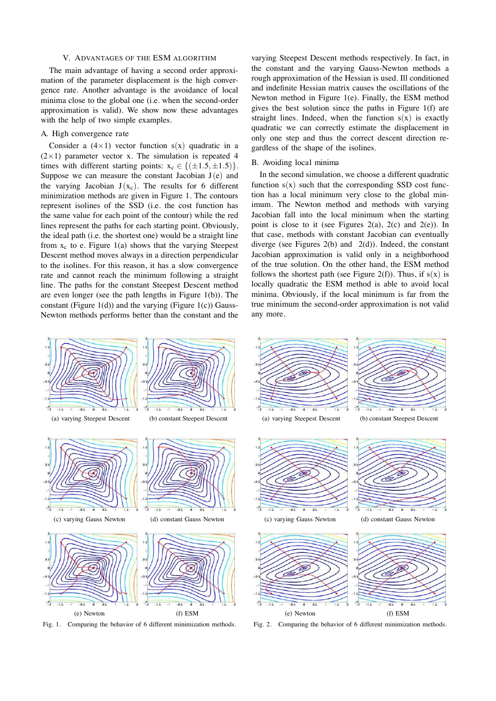
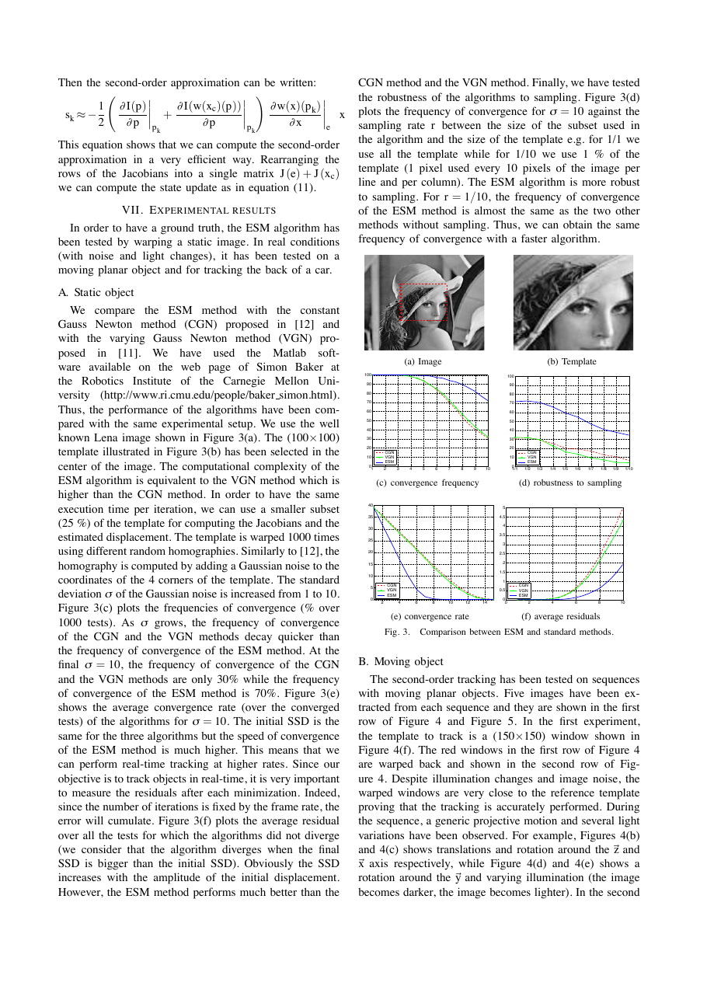
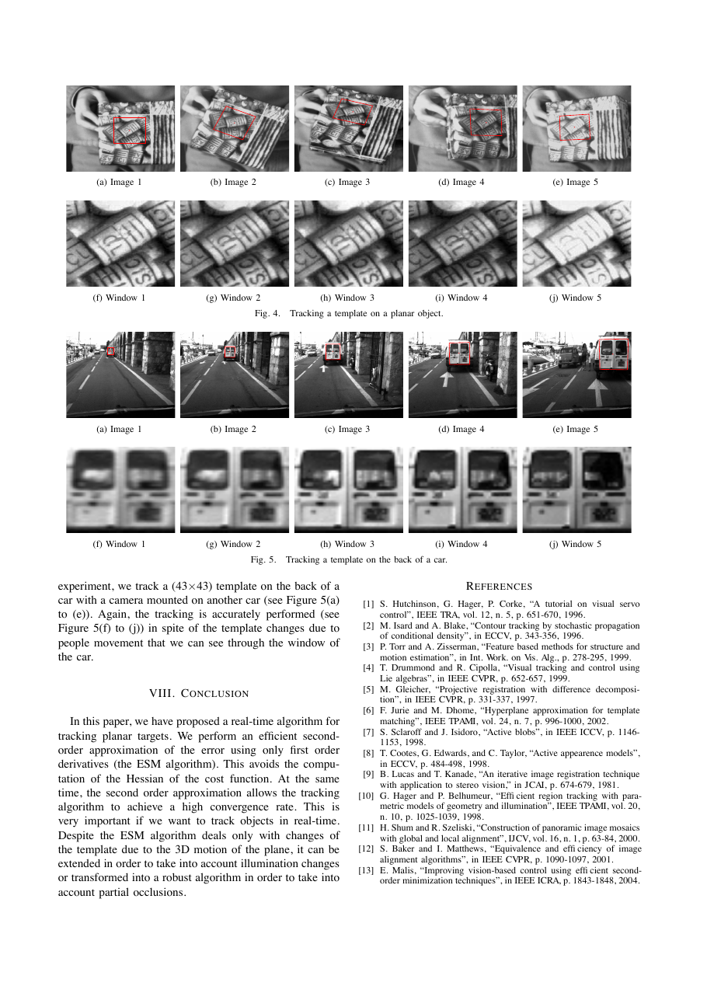

# 효율적 2차 최소화(ESM)를 이용한 평면의 실시간 영상 기반 추적

번역 범위: 전문(초록, 본문, 그림 캡션). 참고문헌은 원문 그대로 둔다.

- 원제: Real-time image-based tracking of planes using Efficient Second-order Minimization
- 저자: Selim BENHIMANE, Ezio MALIS (I.N.R.I.A. Sophia-Antipolis, 프랑스)
- 출처: 2004 IEEE/RSJ International Conference on Intelligent Robots and Systems (IROS), 2004년 9월, 일본 센다이, pp.943-948. doi:10.1109/IROS.2004.1389474
- 원문 파일: [Benhimane2004_IROS_ESM_HAL.pdf](Benhimane2004_IROS_ESM_HAL.pdf) (HAL hal-04655006v1, 2024-07-20 등록, CC BY 4.0)
- 번역 메모: pdftotext -layout으로 뽑은 본문을 쪽 이미지와 대조했다. 수식은 원문 기호를 살려 글자로 옮겼다. 원문에서 Δ 기호가 빠진 채 인쇄된 곳(6절 D)은 앞뒤 문맥에 맞게 Δ를 넣고 표시했다.

---

## 초록

이 논문의 추적 알고리즘은 주어진 템플릿과 현재 영상 사이의 차이 제곱합(SSD)을 최소화하는 데 바탕을 둔다.
이론상 표준 최소화 알고리즘 가운데 Newton 방법의 국소 수렴 속도가 가장 빠르다. SSD의 2차 테일러 전개에 바탕을 두기 때문이다.
그러나 Newton 방법은 헤시안을 계산해야 해서 시간이 많이 든다.
또 헤시안이 양의 정부호가 아니면 수렴 문제가 생길 수 있다.
그래서 여러 방법이 헤시안의 근사를 쓴다. 그 대가로 높은 수렴 속도를 잃는다.
이 논문의 목적은 헤시안을 계산할 필요가 없는 2차 최소화 방법에 바탕을 둔 추적 알고리즘을 제안하는 것이다.

## I. 서론

시각 추적은 쓰임이 많다. 특히 로봇의 비전 기반 제어 시스템의 핵심이다[1].
실시간 로봇 응용에서 추적 알고리즘에 필요한 주요 조건은 효율, 정확도, 강건성이다.
이 논문은 주로 시각 추적 방법의 효율과 정확도에 집중한다.

시각 추적 방법은 크게 두 무리로 나눌 수 있다.
첫째 무리는 선분, 에지, 윤곽 같은 국소 특징을 영상열에서 따라가는 방법이다[2]-[4].
이 기법들은 특징 검출에 민감하다. 따라갈 특별한 특징 집합이 없는 복잡한 영상에는 쓸 수 없다.
둘째 무리는 영상 밝기 정보만 쓰는 방법이다.
이 방법들은 영상 밝기에 바탕을 둔 오차 척도를 최소화해서, 두 프레임 사이에서 기준 템플릿의 움직임, 변형, 조명 파라미터를 추정한다.

잰 오차와 파라미터 변화 사이의 관계를 찾는 방법은 많이 제안되었다.
어떤 방법은 이 관계를 오프라인 처리 단계에서 학습한다. 차이 분해[5][6], 액티브 블롭[7], 액티브 외관 모델[8]이 그렇다.
이 방법들은 문제를 풀지만, 학습 단계를 온라인으로 처리할 수 없는 일부 실시간 로봇 응용에는 쓸 수 없다.
예를 들어 모르는 환경에서 움직이는 로봇이, 시야에 갑자기 나타난 물체를 바로 추적해야 하는 경우를 생각해 보자.

다른 쪽으로는, 파라미터 모델을 써서 기준 템플릿과 현재 영상 사이의 차이 제곱합(SSD)을 최소화하는 방법들이 있다[9]-[12].
변환 파라미터를 추정하는 데 여러 최소화 알고리즘을 쓸 수 있다.
이론상 Newton 방법의 국소 수렴 속도가 가장 빠르다. SSD의 2차 테일러 전개에 바탕을 두기 때문이다.
그러나 Newton 방법의 헤시안 계산은 시간이 많이 든다. 또 헤시안이 양의 정부호가 아니면 수렴 문제가 생길 수 있다.

이 논문에서는 이 문제를 풀기 위해 효율적 2차 최소화 방법(ESM)[13]을 쓰자고 제안한다.
ESM은 Newton 방법처럼 수렴 속도가 빠르지만, 헤시안을 계산할 필요가 없다.
이론 분석과 다른 추적 방법과의 비교 모의실험은 이 방법의 수렴 속도가 다른 최소화 기법보다 빠름을 보인다.
그 결과 ESM 알고리즘은 프레임 사이 움직임이 더 커도 추적한다.

## II. 표기와 정의

I를 (n × m) 영상 템플릿이라 하자. 이것은 행렬로 볼 수 있다.
p = (u, v)를 화소 좌표를 담은 (2×1) 벡터라 하자. (u, v) ∈ {1, 2, ..., n} × {1, 2, ..., m}이다. 따라서 I(p)는 화소 p의 밝기다.

w(x)를 영상 변환 연산자(예: 평행이동, 아핀 변환, 사영 변환)라 하자. p ↦ w(x)(p)이다.
변환 w(x)의 파라미터 p개는 벡터 x ∈ R^p 안에 있다.
∘를 이항 연산이라 하고, (R^p, ∘)가 변환군이고 사상 w가 군 작용이라 하자.
e를 이 변환군의 항등원이라 하자. 다음 성질이 있다.

- w(e)는 항등 사상이다. 즉 모든 p ∈ R²에 대해
  w(e)(p) = p  (1)
- 작용의 합성은 합성의 작용과 같다. 즉 모든 p ∈ R², x1, x2 ∈ R^p에 대해
  w(x1)(w(x2)(p)) = w(x1 ∘ x2)(p)  (2)
- 작용의 역은 역의 작용과 같다. 즉 모든 x ∈ R^p에 대해
  (w(x))⁻¹ = w(x⁻¹)  (3)

q = nm을 영상 I의 전체 화소 수라 하자.
영상 행렬 I를 w(x)로 워프한 뒤 그 원소를 다시 늘어놓아 얻은 (q×1) 벡터 s(x)를 생각한다.

s(x) = ( I(w(x)(p1)), I(w(x)(p2)), ..., I(w(x)(pq)) )  (4)

여기서 모든 k ∈ {1, 2, ..., q}에 대해 pk ∈ {1, 2, ..., n} × {1, 2, ..., m}이다.
(q × p) 야코비 행렬을 J(x) = ∂s(x)/∂x로 적는다.
k번째 (p × p) 헤시안 행렬을 Hk(x) = ∂²sk(x)/∂x² (모든 k ∈ {1, 2, ..., q})로 적는다.
헤시안 행렬은 q개, 즉 화소마다 하나씩 있다.

## III. 이론 배경

기준 영상에서 어떤 물체에 붙일 n × m 템플릿을 골랐다고 하자.
일반성을 잃지 않고, 템플릿이 항등 사상 w(e)로 자기 자신에게 변환되었다고 하자. 그러면 s(e)는 템플릿 밝기를 담은 (q×1) 벡터다.
같은 물체의 현재 영상을, 주어진 움직임 모델(예: 사영 변환)로 템플릿을 워프해서 얻을 수 있다고 하자.
xc를 모르는 현재 변환 파라미터를 담은 벡터라 하자. 현재 영상은 (q×1) 벡터 s(xc)로 다시 늘어놓을 수 있다.
템플릿 기반 추적 알고리즘의 목표는 s(Δx ∘ xc)가 주어진 템플릿 영상 s(e)와 일치하는 Δx를 찾는 것이다. 최적의 Δx는 Δx = xc⁻¹이다.
벡터 Δx는 s(e)와 s(Δx ∘ xc) 사이의 SSD인 함수 f(Δx)를 최소화해서 추정할 수 있다. sk를 벡터 s의 k번째 원소라 하면 f는 다음과 같다.

f(Δx) = (1/2) Σ_{k=1..q} ( sk(Δx ∘ xc) − sk(e) )² = (1/2) ‖ s(Δx ∘ xc) − s(e) ‖²

이 비선형 함수의 최소화는 반복으로 한다. 반복마다 비용 함수의 최소점을 찾아 상태 갱신 Δx를 추정한다.
비용 함수의 최소점을 찾기 위한 필요조건은 다음이다.

∂f(Δx)/∂Δx = 0  (5)

이것은 비선형 방정식이다. f의 도함수를 Δx = e 근처에서 다음처럼 근사해 선형화할 수 있다.

∂f(Δx)/∂Δx ≈ gᵀ + Δxᵀ S  (6)

여기서 Δs = s(xc) − s(e)로 두면 다음과 같다.

g = ( ∂f(Δx)/∂Δx |_{Δx=e} )ᵀ = Jᵀ(xc) Δs

S = ∂²f(Δx)/∂Δx² |_{Δx=e} = Jᵀ(xc) J(xc) + Σ_{k=1..q} Hk(xc) Δsk

Δsk는 벡터 Δs의 k번째 원소다.
표준 Newton 최소화 방법은 근사 (6)을 써서 식 (5)를 다음처럼 푼다. Δx = −S⁻¹ g.
Newton 방법은 e의 근방에서 2차 수렴을 한다.
함수 f가 볼록 2차 함수이면, 근사 (6)이 등식이 되므로 Δx = xc⁻¹를 단 한 번의 반복으로 추정할 수 있다.
함수 f가 볼록 2차 함수가 아니면, 헤시안이 양의 정부호가 아닐 때 수렴 문제가 생길 수 있다.
수렴 문제를 피하려고 여러 방법이 헤시안 S를 양의 정부호 행렬 Ŝ로 근사한다. 예는 다음과 같다.

| 방법 | 근사 |
|---|---|
| 최급강하(Steepest Descent) | Ŝ = α I |
| 가우스-뉴턴(Gauss-Newton) | Ŝ = Jᵀ J |
| 레벤버그-마쿼트(Levenberg-Marquardt) | Ŝ = Jᵀ J + α diag(Jᵀ J) |

헤시안을 근사하면 계산 비용이 줄어드는 장점이 있다.
그러나 근사한 헤시안을 반복마다 갱신해야 한다.
계산을 더 줄이려면 다음 함수를 쓸 수 있다.

f̃(Δx) = (1/2) Σ_{k=1..q} ( sk(Δx) − sk(xc) )² = (1/2) ‖ s(Δx) − s(xc) ‖²

함수 f와 마찬가지로, 이 경우 Newton 최소화 방법은 Δx = −S̃⁻¹ g̃를 계산한다. 여기서

g̃ = ( ∂f̃(Δx)/∂Δx |_{Δx=e} )ᵀ = −Jᵀ(e) Δs

S̃ = ∂²f̃(Δx)/∂Δx² |_{Δx=e} = −Jᵀ(e) J(e) − Σ_{k=1..q} Hk(e) Δsk

이 함수를 쓰면 행렬 J와 Hk를 e에서 추정하므로 한 번에 미리 계산해 둘 수 있다.
그 대가로 수렴 근방이 좁아진다.

## IV. 다른 2차 근사

Newton 최소화 방법은 비용 함수의 헤시안 행렬을 써서 비용 함수를 2차 근사한다.
이 논문에서는 [13]에서 제안한 효율적 2차 근사를 쓴다.
벡터 함수 s(x)를 xc 주위에서 2차 테일러 전개하고 e에서 값을 매긴다.

s(e) ≈ s(xc) + J(xc) Δx + (1/2) M(xc, Δx) Δx  (7)

여기서 M(xc, Δx)는 Δx와, xc에서 값을 매긴 s(x)의 헤시안 행렬 q개에 의존하는 (q × p) 행렬이다.
행렬 J(x)를 xc 주위에서 1차 전개하고 e에서 값을 매기면 다음을 얻는다.

J(e) ≈ J(xc) + M(xc, Δx)  (8)

식 (8)을 식 (7)에 넣으면 다음을 얻는다.

s(e) ≈ s(xc) + (1/2) ( J(e) + J(xc) ) Δx  (9)

다음 식은 작은 Δx에 대한 Δs의 2차 근사다.

Δs ≈ −(1/2) ( J(e) + J(xc) ) Δx  (10)

헤시안을 계산하지 않고 Δs의 효율적 2차 근사를 얻었다. 즉 1차 도함수만 쓴다.
따라서 [13]에서 제안한 효율적 2차 최소화(ESM)를 템플릿 기반 시각 추적을 개선하는 데 쓸 수 있다.
[10]이나 [12]와 마찬가지로 야코비 J(e)는 상수이고 미리 계산할 수 있다. 한편 [9]와 마찬가지로 J(xc)는 xc에 따라 갱신한다.
지금은 J(xc)를 계산하거나 근사할 수 있다고 가정하자.
변위는 두 야코비 평균의 유사역행렬을 계산해 얻을 수 있다.

Δx ≈ −2 ( J(e) + J(xc) )⁺ Δs  (11)

s(x)가 x에 대해 2차 함수이면 식 (10)은 더 이상 근사가 아니다. 따라서 워프의 참 파라미터를 단 한 번의 반복으로 추정할 수 있다.
벡터 함수 s(x)가 2차 함수가 아니어도, 표준 Newton 2차 최소화보다 나아질 것으로 기대할 수 있다.
수렴하려고 비용 함수의 헤시안이 양의 정부호일 필요가 없기 때문이다.

## V. ESM 알고리즘의 장점

파라미터 변위를 2차 근사로 얻는 주된 장점은 수렴 속도가 빠르다는 것이다.
또 하나의 장점은 전역 최소점 가까이 있는 국소 최소점을 피한다는 것이다(2차 근사가 맞는 범위에서).
두 가지 간단한 예로 이 장점들을 보인다.

### A. 빠른 수렴 속도

(2×1) 파라미터 벡터 x에 대해 2차 함수인 (4×1) 벡터 함수 s(x)를 생각한다.
모의실험을 서로 다른 시작점 xc ∈ {(±1.5, ±1.5)}에서 4번 반복한다.
상수 야코비 J(e)와 변하는 야코비 J(xc)를 잴 수 있다고 하자.
6가지 최소화 방법의 결과를 그림 1에 보였다.
등고선은 SSD의 등치선이다(즉 등고선 위 모든 점에서 비용 함수 값이 같다). 빨간 선은 각 시작점에서 출발한 경로다.
당연히 이상적인 경로(가장 짧은 경로)는 xc에서 e로 가는 직선이다.

*원문 4쪽. 왼쪽 그림 1, 오른쪽 그림 2.*

그림 1(a)는 변하는 최급강하 방법이 언제나 등치선에 수직인 방향으로 움직임을 보인다. 그래서 수렴이 느리고 직선을 따라 최소점에 이르지 못한다.
상수 최급강하 방법의 경로는 더 길다(그림 1(b)의 경로 길이를 보라).
상수 가우스-뉴턴(그림 1(d))과 변하는 가우스-뉴턴(그림 1(c))은 각각 상수 최급강하와 변하는 최급강하보다 낫다.
실제로 상수와 변하는 가우스-뉴턴 방법에서는 헤시안의 거친 근사를 쓴다.
조건이 나쁘고 부정부호인 헤시안 행렬 때문에 그림 1(e)의 Newton 방법은 진동한다.
마지막으로 ESM 방법이 가장 좋은 해를 준다. 그림 1(f)의 경로가 직선이기 때문이다.
실제로 함수 s(x)가 정확히 2차이면, 단 한 단계로 변위를 바르게 추정할 수 있다. 따라서 등치선 모양과 상관없이 바른 내려가는 방향을 얻는다.

### B. 국소 최소점 피하기

두 번째 모의실험에서는 다른 2차 함수 s(x)를 골라, 해당 SSD 비용 함수가 전역 최소점 아주 가까이에 국소 최소점을 갖게 했다.
Newton 방법과 변하는 야코비를 쓰는 방법들은 시작점이 국소 최소점에 가까우면 그 국소 최소점에 빠진다(그림 2(a), 2(c), 2(e)).
그 경우 상수 야코비를 쓰는 방법은 결국 발산할 수 있다(그림 2(b), 2(d)). 상수 야코비 근사는 참 해의 근방에서만 맞기 때문이다.
반면 ESM 방법은 가장 짧은 경로를 따른다(그림 2(f)).
따라서 s(x)가 국소적으로 2차이면 ESM 방법은 국소 최소점을 피할 수 있다.
당연히 국소 최소점이 참 최소점에서 멀면 2차 근사는 더 이상 맞지 않는다.

그림 캡션

- 그림 1. 서로 다른 최소화 방법 6가지의 동작 비교. (a) 변하는 최급강하, (b) 상수 최급강하, (c) 변하는 가우스-뉴턴, (d) 상수 가우스-뉴턴, (e) Newton, (f) ESM.
- 그림 2. 서로 다른 최소화 방법 6가지의 동작 비교. (a)~(f)는 그림 1과 같다.

## VI. 호모그래피 움직임 모델에 적용

이 절에서는 움직임 모델이 호모그래피일 때 ESM 알고리즘을 어떻게 쓰는지 보인다.
당연히 호모그래피 모델의 특수한 경우, 예를 들어 아핀 모델이나 단순 평행이동을 고려해 워프 파라미터에 사전 조건을 더할 수도 있다.

### A. 호모그래피 워프

평면 물체를 추적한다고 하자. 물체가 3차원 공간에서 움직이면 물체의 영상 변환은 호모그래피다.
호모그래피를 정하려면 파라미터 p = 8개가 필요하다. 호모그래피는 (3×3) 행렬 H(x)로 나타낸다.

H(x) = [ h11(x) h12(x) h13(x) ; h21(x) h22(x) h23(x) ; h31(x) h32(x) h33(x) ]

여기서 x = (x1, x2, ..., x8)은 호모그래피 파라미터를 담은 벡터다. 변환된 영상 점은 다음처럼 쓸 수 있다.

p′ = w(x)(p) = [ (h11(x) u + h12(x) v + h13(x)) / (h31(x) u + h32(x) v + h33(x)) ; (h21(x) u + h22(x) v + h23(x)) / (h31(x) u + h32(x) v + h33(x)) ]

### B. 호모그래피 매개변수화

호모그래피 매개변수화를 고른다는 것은 함수 hij(x), (i, j) ∈ {1, 2, 3} × {1, 2, 3}를 고르는 것이다.
호모그래피는 배율을 빼고 정의되므로 매개변수화가 여러 가지 있다. 따라서 행렬 H에 제약을 하나 더해야 한다.
보통은 h33(x) = 1로 두어 H를 P(2)(사영군) 안에서 고른다.
그러나 카메라가 크게 움직이면 h33(x) = 0인 x가 나올 수 있다.
이 때문에 우리는 H의 행렬식이 1이 되도록 고르는 쪽을 택한다.
이 선택은 근거가 충분하다. det(H) = 0은 관측 평면이 카메라의 광학 중심을 지나는 특이한 경우에 해당하기 때문이다. 이 특이한 경우에는 평면의 모든 점이 한 직선으로 투영된다.
따라서 추가 제약은 H ∈ SL(3)(3차 특수 선형군)이다.
SL(3)는 행렬식이 1인 (3 × 3) 행렬의 군이다.
sl(3)을 이 군에 대응하는 리 대수라 하자. 이 대수의 행렬은 대각합이 0이다.
H의 매개변수화는 다음처럼 한다.
Gi (모든 i ∈ {1, 2, ..., 8})를 sl(3)의 기저라 하자(즉 trace(Gi) = 0인 일차독립 상수 행렬).
행렬 A(x)는 행렬 Gi의 일차결합으로 쓸 수 있다.

A(x) = Σ_{i=1..8} xi Gi

행렬 A(x)는 sl(3)의 행렬이고 H(x) = exp(A(x))이다.
이 매개변수화에서는 H(e) = I, H(x1 ∘ x2) = H(x1) H(x2), H⁻¹(x) = H(x⁻¹) = H(−x)이다. x⁻¹ = −x임에 주의한다.
다음 절에서 이 매개변수화가 야코비 계산을 단순하게 하고, ESM 알고리즘에서 가장 좋은 성능을 얻는 데 꼭 필요함을 보인다.

### C. 야코비 계산

식 (11)을 쓰려면 x = e와 x = xc에서 J(x)를 계산해야 한다.
식 (4)를 쓰면 행렬 J(x)의 k번째 행 rk(x)는 다음처럼 쓸 수 있다.

rk(x) = ∂I(w(y)(pk))/∂y |_{y=x}

여기서 pk는 k번째 화소의 영상 좌표다(모든 k ∈ {1, 2, ..., q}).
w(x)의 성질 (1, 2, 3)을 쓰면 다음을 얻는다.

rk(x) = ∂I(w(x)(w(x⁻¹ ∘ y)(pk)))/∂y |_{y=x}  (12)

이것은 다음 곱으로 쓸 수 있다.

rk(x) = ( ∂I(w(x)(p))/∂p |_{p=pk} ) ( ∂w(x)(pk)/∂x |_{x=e} ) ( ∂(x⁻¹ ∘ y)/∂y |_{y=x} )  (13)

(1×2) 벡터 ∂I(w(x)(p))/∂p |_{p=pk}는 (w(x)로 워프한 뒤의) 영상의 pk에서의 기울기를 담는다.
따라서 x = e이면 ∂I(w(e)(p))/∂p |_{p=pk}는 기준 영상의 pk에서 계산한 기울기에 해당한다.
x = xc이면 ∂I(w(xc)(p))/∂p |_{p=pk}는 현재 워프 영상의 pk에서 계산한 기울기에 해당한다.
현재 파라미터 xc를 명시적으로 알지 못해도 기울기를 계산할 수 있다는 점이 매우 중요하다.
(2×p) 야코비 ∂w(x)(pk)/∂x |_{x=e}는 x에 의존하지 않으며 [10]이나 [12]처럼 미리 계산할 수 있다.
마지막으로 세 번째 (p×p) 야코비는 일반적으로 x에 의존한다.
그러나 리 대수를 쓴 호모그래피 매개변수화 덕분에 다음 단순화 공식을 얻는다.

( ∂(x⁻¹ ∘ y)/∂y |_{y=x} ) x = x  (14)

이 공식은 야코비를 계산하는 데 x를 알 필요가 없음을 보인다. 다음 절에서 2차 근사를 계산하는 데 이를 쓴다.
리 대수를 쓴 호모그래피 매개변수화가 이 알고리즘의 핵심인 이유가 여기에 있다.
다른 매개변수화를 쓰면 야코비 행렬이 x에 의존할 수 있다. 그 경우 야코비는 근사로만 구할 수 있다.

### D. 2차 근사 계산

식 (10)의 2차 근사를 생각하자. 벡터 Δs의 k번째 원소는 다음처럼 쓸 수 있다. (원문은 이 절의 Δ 기호가 인쇄에서 빠졌다. 문맥에 맞게 넣었다.)

Δsk ≈ −(1/2) rk(e) Δx − (1/2) rk(xc) Δx

식 (13)을 쓰면 다음을 얻는다.

rk(e) Δx = ( ∂I(p)/∂p |_{p=pk} ) ( ∂w(x)(pk)/∂x |_{x=e} ) Δx

식 (14)에서 Δx = xc⁻¹ = −xc이므로 다음을 얻는다.

rk(xc) Δx = ( ∂I(w(xc)(p))/∂p |_{p=pk} ) ( ∂w(x)(pk)/∂x |_{x=e} ) Δx

그러면 2차 근사는 다음처럼 쓸 수 있다.

Δsk ≈ −(1/2) ( ∂I(p)/∂p |_{pk} + ∂I(w(xc)(p))/∂p |_{pk} ) ( ∂w(x)(pk)/∂x |_{e} ) Δx

이 식은 2차 근사를 매우 효율적으로 계산할 수 있음을 보인다.
야코비의 행들을 하나의 행렬 J(e) + J(xc)로 다시 늘어놓으면 식 (11)처럼 상태 갱신을 계산할 수 있다.

## VII. 실험 결과

참값을 갖기 위해 정지 영상을 워프해서 ESM 알고리즘을 시험했다.
실제 조건(잡음과 조명 변화가 있는 경우)에서는 움직이는 평면 물체와 자동차 뒷면 추적으로 시험했다.

### A. 정지 물체

ESM 방법을 [12]에서 제안한 상수 가우스-뉴턴 방법(CGN), [11]에서 제안한 변하는 가우스-뉴턴 방법(VGN)과 비교했다.
카네기멜론 대학 로봇 연구소 Simon Baker의 웹 페이지(http://www.ri.cmu.edu/people/baker_simon.html)에 공개된 Matlab 소프트웨어를 썼다.
따라서 같은 실험 설정에서 알고리즘 성능을 비교했다.
잘 알려진 Lena 영상(그림 3(a))을 썼다.
그림 3(b)에 보인 (100×100) 템플릿을 영상 가운데에서 골랐다.
ESM 알고리즘의 계산 복잡도는 VGN 방법과 같고, CGN 방법보다 높다.
반복당 실행 시간을 같게 하려고, 야코비와 추정 변위를 계산할 때 템플릿의 더 작은 부분집합(25 %)을 쓸 수 있다.
템플릿을 서로 다른 무작위 호모그래피로 1000번 워프했다.
[12]와 마찬가지로 템플릿 네 모서리 좌표에 가우스 잡음을 더해 호모그래피를 만들었다.
가우스 잡음의 표준편차 σ를 1에서 10까지 늘렸다.

*원문 6쪽. 오른쪽 가운데가 그림 3.*

그림 3(c)는 수렴 빈도(1000번 시험 중 %)를 보인다.
σ가 커질수록 CGN과 VGN 방법의 수렴 빈도는 ESM 방법보다 빨리 떨어진다.
마지막 σ = 10에서 CGN과 VGN 방법의 수렴 빈도는 30%뿐이지만, ESM 방법은 70%다.
그림 3(e)는 σ = 10일 때 (수렴한 시험에 대한) 알고리즘들의 평균 수렴 속도를 보인다.
처음 SSD는 세 알고리즘이 같지만, ESM 방법의 수렴 속도가 훨씬 빠르다.
이는 더 높은 속도로 실시간 추적을 할 수 있음을 뜻한다.
우리 목표는 물체를 실시간으로 추적하는 것이므로, 각 최소화 뒤의 잔차를 재는 것이 매우 중요하다.
실제로 반복 횟수가 프레임 속도로 정해지므로 오차가 쌓인다.
그림 3(f)는 알고리즘이 발산하지 않은 모든 시험의 평균 잔차를 보인다(마지막 SSD가 처음 SSD보다 크면 발산으로 본다).
당연히 SSD는 처음 변위의 크기에 따라 커진다.
그러나 ESM 방법이 CGN과 VGN 방법보다 훨씬 낫다.

마지막으로 표본화에 대한 알고리즘의 강건성을 시험했다.
그림 3(d)는 σ = 10일 때의 수렴 빈도를 표본화 비율 r에 따라 그린 것이다. r은 알고리즘에 쓴 부분집합 크기와 템플릿 크기의 비율이다.
예를 들어 1/1이면 템플릿 전체를 쓰고, 1/10이면 템플릿의 1 %를 쓴다(영상의 각 행과 각 열에서 10화소마다 1화소).
ESM 알고리즘이 표본화에 더 강건하다.
r = 1/10에서 ESM 방법의 수렴 빈도는 표본화하지 않은 다른 두 방법과 거의 같다.
따라서 더 빠른 알고리즘으로 같은 수렴 빈도를 얻을 수 있다.

그림 3 캡션: ESM과 표준 방법의 비교. (a) 영상, (b) 템플릿, (c) 수렴 빈도, (d) 표본화에 대한 강건성, (e) 수렴 속도, (f) 평균 잔차.

번역자 메모(그림 읽기, 원문 본문에 없는 내용): 그림 3(c)의 가로축은 σ(1~10), 세로축은 수렴 빈도(%)다. 그림 3(e)의 가로축은 반복 횟수(0~14), 세로축은 SSD로 보인다. ESM은 약 6회 반복 근처에서 바닥에 닿고, CGN과 VGN은 14회에서도 내려가는 중이다. 그림 3(f)의 가로축은 σ, 세로축은 평균 잔차다. 축 이름은 그림에 적혀 있지 않아 눈으로 읽은 것이다.

### B. 움직이는 물체

움직이는 평면 물체가 있는 영상열에서 2차 추적을 시험했다.
각 영상열에서 영상 5장을 뽑아 그림 4와 그림 5의 첫째 줄에 보였다.
첫 번째 실험에서 추적할 템플릿은 그림 4(f)에 보인 (150×150) 창이다.
그림 4 첫째 줄의 빨간 창을 거꾸로 워프해 그림 4 둘째 줄에 보였다.
조명 변화와 영상 잡음이 있어도 거꾸로 워프한 창은 기준 템플릿과 매우 가깝다. 추적이 정확하게 이루어졌음을 보여 준다.
영상열 동안 일반적인 사영 움직임과 여러 번의 조명 변화가 관측되었다.
예를 들어 그림 4(b)와 4(c)는 각각 평행이동과 z축 둘레 회전, x축 둘레 회전을 보인다. 그림 4(d)와 4(e)는 y축 둘레 회전과 조명 변화(영상이 어두워졌다가 밝아짐)를 보인다.

*원문 7쪽. 위가 그림 4, 아래가 그림 5.*

두 번째 실험에서는 다른 차에 단 카메라로 자동차 뒷면의 (43×43) 템플릿을 추적했다(그림 5(a)~(e)).
이번에도 추적이 정확하게 이루어졌다(그림 5(f)~(j)). 자동차 창 너머로 보이는 사람의 움직임 때문에 템플릿이 바뀌었는데도 그렇다.

그림 캡션

- 그림 4. 평면 물체 위 템플릿 추적. (a)~(e) 영상 1~5, (f)~(j) 창 1~5.
- 그림 5. 자동차 뒷면 위 템플릿 추적. (a)~(e) 영상 1~5, (f)~(j) 창 1~5.

## VIII. 결론

이 논문에서는 평면 표적을 추적하는 실시간 알고리즘을 제안했다.
1차 도함수만 써서 오차를 효율적으로 2차 근사한다(ESM 알고리즘).
이것으로 비용 함수의 헤시안 계산을 피한다.
동시에 2차 근사 덕분에 추적 알고리즘의 수렴 속도가 빠르다. 물체를 실시간으로 추적하려면 이 점이 매우 중요하다.
ESM 알고리즘은 평면의 3차원 움직임에 의한 템플릿 변화만 다루지만, 조명 변화를 고려하도록 확장하거나, 부분 가림을 고려하도록 강건한 알고리즘으로 바꿀 수 있다.

## 참고문헌 (원문 그대로)

[1] S. Hutchinson, G. Hager, P. Corke, "A tutorial on visual servo control", IEEE TRA, vol. 12, n. 5, p. 651-670, 1996.
[2] M. Isard and A. Blake, "Contour tracking by stochastic propagation of conditional density", in ECCV, p. 343-356, 1996.
[3] P. Torr and A. Zisserman, "Feature based methods for structure and motion estimation", in Int. Work. on Vis. Alg., p. 278-295, 1999.
[4] T. Drummond and R. Cipolla, "Visual tracking and control using Lie algebras", in IEEE CVPR, p. 652-657, 1999.
[5] M. Gleicher, "Projective registration with difference decomposition", in IEEE CVPR, p. 331-337, 1997.
[6] F. Jurie and M. Dhome, "Hyperplane approximation for template matching", IEEE TPAMI, vol. 24, n. 7, p. 996-1000, 2002.
[7] S. Sclaroff and J. Isidoro, "Active blobs", in IEEE ICCV, p. 1146-1153, 1998.
[8] T. Cootes, G. Edwards, and C. Taylor, "Active appearence models", in ECCV, p. 484-498, 1998.
[9] B. Lucas and T. Kanade, "An iterative image registration technique with application to stereo vision," in JCAI, p. 674-679, 1981.
[10] G. Hager and P. Belhumeur, "Efficient region tracking with parametric models of geometry and illumination", IEEE TPAMI, vol. 20, n. 10, p. 1025-1039, 1998.
[11] H. Shum and R. Szeliski, "Construction of panoramic image mosaics with global and local alignment", IJCV, vol. 16, n. 1, p. 63-84, 2000.
[12] S. Baker and I. Matthews, "Equivalence and efficiency of image alignment algorithms", in IEEE CVPR, p. 1090-1097, 2001.
[13] E. Malis, "Improving vision-based control using efficient second-order minimization techniques", in IEEE ICRA, p. 1843-1848, 2004.
