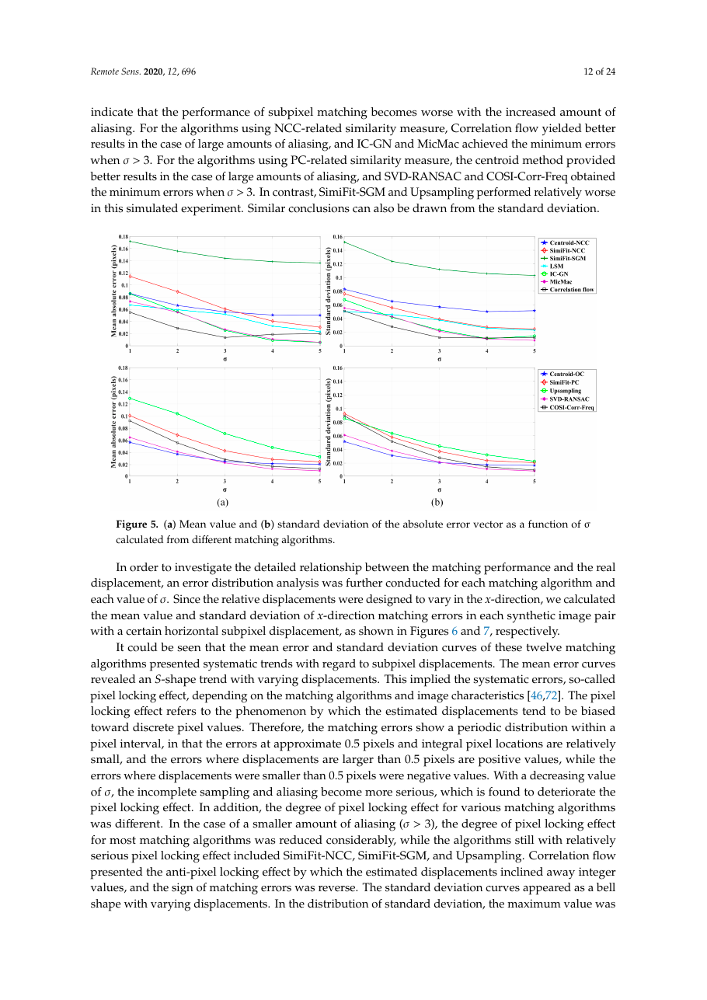
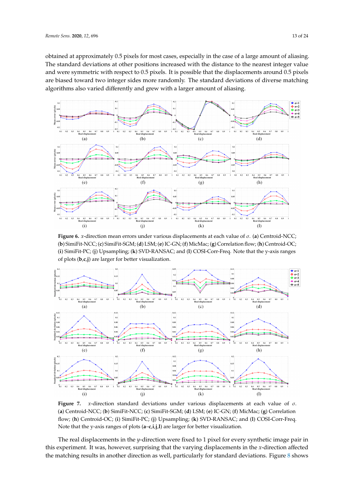
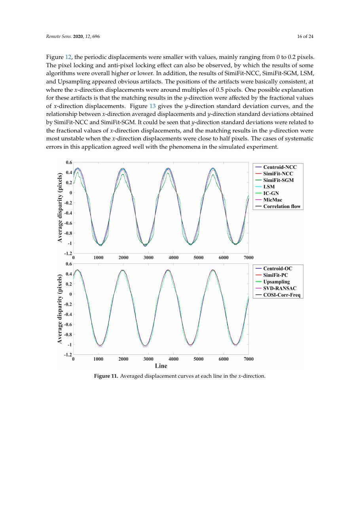

# 번역: 원격탐사용 부화소 정확도 영역 기반 조밀 영상 정합, 실용 분석과 비교 연구

- 원제: Area-Based Dense Image Matching with Subpixel Accuracy for Remote Sensing Applications: Practical Analysis and Comparative Study
- 저자: Zhen Ye, Yusheng Xu(교신), Hao Chen, Jingwei Zhu, Xiaohua Tong, Uwe Stilla
  - 뮌헨 공과대학교(TUM) 사진측량원격탐사과
  - 퉁지대학교 측량지리정보학원
- 출판: Remote Sensing 12(4):696, 2020. doi:10.3390/rs12040696. 접수 2020-01-11, 채택 2020-02-18, 게재 2020-02-20. CC BY 4.0.
- 원문: 같은 폴더의 `Ye2020_RemoteSens_rs12040696_mediaTUM.pdf` (TUM 기관 저장소 mediaTUM 1594054의 출판본 사본, 24쪽)
- 번역 범위: 전문(초록, 본문, 그림, 표 캡션, 저자 기여, 연구비, 감사). 참고문헌은 원문 그대로 둔다.
- 번역 메모
  - PDF 10~19쪽에는 심사본(FOR PEER REVIEW) 글자 층이 겹쳐 있어 `pdftotext` 결과가 섞여 나온다. 겹친 두 층은 같은 문장이라, 쪽 이미지를 보고 출판본 문장으로 맞춰 옮겼다.
  - 수식은 원문 기호를 따라 LaTeX로 옮겼다.
  - 그림은 해당 쪽 전체를 110 dpi로 이미지화했다.
  - 용어: dense image matching은 조밀 영상 정합, patch는 창(조각), similarity measure는 유사도 척도, pixel locking은 픽셀 로킹(정수 화소 쪽으로 끌리는 편향), aliasing은 엘리어싱으로 옮겼다.

---

## 초록

조밀 영상 정합은 많은 영상 처리 작업에서 핵심 단계다.
영상 해상도와 응용의 요구를 생각하면, 특히 원격탐사 분야에서는 부화소 정확도와 소수점 단위 측정을 흔히 추구한다.
이 연구에서는 원격탐사 응용을 위한 부화소 정확도의 영역 기반 조밀 영상 정합을 실용적으로 분석하고 비교했다.
특히 부화소 능력과 강건성에 초점을 두었다.
상관 기반 유사도 척도 2종과 부화소 방법 7종을 쓰는 대표 정합 알고리즘 12개를 골랐다.
기존 정합 알고리즘들을 두 방식으로 비교하고 평가했다.
하나는 엘리어싱 양을 바꾼 합성 영상 쌍을 쓰는 모의 실험이다.
다른 하나는 두 실제 응용, 곧 자세 떨림(attitude jitter) 검출과 시차 추정이다.
실험 결과는 계통 오차가 두 종류임을 보여 준다.
하나는 변위의 소수부에 따라 달라지는 변위 의존 오차다.
다른 하나는 변위와 무관한 오차로, 이 연구에서는 뜻밖의 물결 모양 인공물로 나타났다.
또 이 두 계통 오차에 대한 각 정합 알고리즘의 강건성, 강점과 한계를 조사하고 논의했다.

핵심어: 조밀 영상 정합, 부화소 정확도, 유사도 척도, 계통 오차, 원격탐사 응용

## 1. 서론

조밀 영상 정합은 겹치는 두 장 이상의 영상 사이 대응을 높은 밀도로, 또는 화소마다 정하는 과정이다.
여러 자료원을 합쳐 정보를 드러내는 많은 영상 처리 작업에서 핵심 단계다.
조밀 영상 정합은 사실 여러 작업의 용어를 일반화한 말이다.
예를 들면 영상 정렬[1], 스테레오 정합[2], 광류[3], 디지털 영상 상관(DIC)[4]이 있다.
영상 정합은 크게 특징 기반 방법과 영역 기반 방법으로 구현한다.
영역 기반 방법은 정밀도, 분포, 안정성 면에서 장점이 있다[5].
이 연구는 영역 기반 조밀 영상 정합에 집중했다.
곧, 변환한 템플릿 영상과 기준 영상 사이 밝기 정보의 유사도를 직접 최대화해 높은 밀도의 대응을 구하는 방법이다.
템플릿 영상을 기준 영상으로 옮기는 변환 함수 $w$는 위치마다 달라지는 변위 벡터 $(m_0, n_0)$로 다음처럼 쓸 수 있다.

$$w : x, y \rightarrow x - m_0,\; y - n_0. \tag{1}$$

원격탐사 분야에서도 겹치는 원격탐사 영상을 구하기가 쉬워지면서, 영상 사이의 정밀하고 조밀한 변위장을 주는 조밀 영상 정합이 큰 관심을 받았다.
이 연구는 단일 채널 영상의 조밀 정합만 다룬다.
따라서 여러 종류의 원격탐사 영상을 조밀 정합하기 전에 다음 처리가 필요하다.

- 다중분광, 초분광 영상처럼 채널이 여럿인 영상은 밴드 선택이나 가중 평균으로 단일 밴드 영상을 뽑아야 한다.
- SAR, LIDAR 영상처럼 방식이 다른 영상은 밝기 영상으로 바꿔야 한다.

구한 변위장에서 관측한 장면과 대상의 성질과 상태를 되찾을 수 있다.
예를 들면 장면 안의 높이 정보[6], 지질 작용과 기후 변화로 생긴 지표 변형[7], 대상의 움직임[8]이 있다.
또 변위장으로 센서와 기하 처리의 품질도 평가할 수 있다.
센서 왜곡[9], 자세 변화[10], 보정이나 이어 붙이기 뒤에 남은 불일치[11] 같은 정보를 반영하기 때문이다.
그래서 조밀 영상 정합은 꼭 필요한 연구 분야이며, 원격탐사 분야의 여러 응용에서 널리 쓰인다[12-16].

영상 자료의 공간 해상도와 응용의 요구에 따라, 화소 수준 정확도로는 흔히 부족하다.
측정 정밀도를 높이려고 소수점 변위를 얻는 부화소 정합을 추구한다[17].
이 연구는 부화소 조밀 정합 문제를 직접 다룬다.
일반적으로 부화소 정확도는 이산 영상을 연속 근사한다고 가정해서 얻는다.
변환을 부화소 정밀도로 추정하는 여러 부화소 방법이 고안되었다.
흔히 쓰는 것을 대략 나누면 다음과 같다.

- 피크 무게중심[18]
- 유사도 맞춤(fitting)[19]
- 유사도 보간[20]
- 밝기 보간[21]
- 연속 최적화. 국소 최적화[22]와 전역 최적화[23]를 포함한다.
- 위상 기반 방법[24]

이 부화소 방법들은 모두 여러 응용에서 중요한 역할을 하며 저마다 강점이 있다.
그러나 응용마다 강조점이 다르고, 대개 특정 부화소 방법에 집중한다.
예를 들어 광류 문제를 푸는 주된 방법은 연속 최적화 기반이다[3].
입체 수치표고모형 생성에서는 유사도 맞춤을 곁들인 준전역 정합(SGM)[25]이나 최소제곱 정합(LSM)[26]이 주로 쓰인다.
밝기 보간과 위상 기반 방법은 움직임 추적을 위한 지표 동역학 감시에 널리 쓰인다[13,27].
국소 최적화 기반 방법은 변형 측정을 위한 디지털 영상 상관에 자주 쓰인다[4].
그래서 기존의 부화소 조밀 정합 성능 평가와 오차 분석은 대부분 특정 응용 안에서 특정 종류의 알고리즘만 다룬다[13,21,27-34].
또 부화소 정합에는 피할 수 없이 계통 오차가 생기며, 이것이 응용 가능성을 떨어뜨린다[35-38].
계통 오차는 알고리즘 구현과 실험 구성에 따라 달라진다[39,40].
따라서 여러 응용 상황에서 기존의 조밀 영상 정합 부화소 방법을 평가하고, 생길 수 있는 계통 오차와 알고리즘별 강건성을 조사할 필요가 있다.
원격탐사 응용에서는 특히 그렇다.

이 논문에서는 원격탐사 응용에서 기존 부화소 알고리즘의 가능성과 한계를 더 잘 이해하려고, 부화소 수준 영역 기반 조밀 영상 정합의 최신 알고리즘을 비교하고 실용적으로 분석했다.
공간 영역의 정규화 상호상관(NCC)이나 주파수 영역의 위상상관(PC)을 유사도 척도로 삼아 다음 12개 정합 알고리즘을 시험했다.

- Centroid-NCC[41]
- SimiFit-NCC[7]
- SimiFit-SGM(준전역 정합)[42]
- LSM[26]
- IC-GN(역합성 가우스-뉴턴)[43]
- MicMac[27]
- Correlation flow(상관 흐름)[44]
- Centroid-OC(방향 상관)[41]
- SimiFit-PC[45]
- Upsampling(업샘플링)[20]
- SVD-RANSAC(특이값 분해와 무작위 표본 합의)[46]
- COSI-Corr-Freq[7]

이 알고리즘들을 엘리어싱 양을 바꾼 모의 실험과, 자세 떨림 검출[10], 시차 추정[47]이라는 두 실제 응용에서 평가했다.
이 연구는 모든 부화소 알고리즘을 조사하려는 완전한 연구가 아니다.
부화소 측정으로 넓힐 수 있는 영역 기반 정합 알고리즘과 구현은 많다[48,49].
다만 고른 알고리즘들은 여러 응용에서 성공적으로 자주 쓰였고, 위에서 말한 부화소 방법 7종을 모두 덮는다.
이 연구의 목적과 기여는, 원격탐사 자료에서 조밀 영상 정합의 대표 알고리즘들의 상대 성능을 비교하고 조사하는 것이다.
특히 부화소 능력과, 생길 수 있는 계통 오차에 대한 강건성에 초점을 둔다.
이 논문의 나머지 구성은 다음과 같다.
2절은 부화소 조밀 영상 정합을 자세히 설명한다. 전체 작업 흐름, 채택한 유사도 척도, 조사한 부화소 방법을 다룬다.
3절은 비교한 부화소 정합 알고리즘의 구현과, 모의 자료와 실제 자료 실험의 설정을 제시한다.
4절은 실험 결과와 논의다.
5절은 결론이다.

## 2. 조밀 영상 정합

부화소 조밀 영상 정합은 겹치는 영상에서 높은 밀도의 대응을 부화소 정확도로 찾고 그 양을 재는 것을 목표로 한다.
이 절에서는 먼저 조밀 영상 정합의 전체 작업 흐름을 소개한다.
그다음 채택한 두 상관 기반 유사도 척도를 설명한다.
마지막으로 소수점 측정을 얻을 수 있는, 평가 대상 부화소 방법을 설명한다.

### 2.1. 전체 작업 흐름

응용마다 조밀 영상 정합의 구현이 완전히 같지는 않다.
하지만 전체 처리는 그림 1과 같은 흐름으로 요약할 수 있다.
입력은 쌍 정합을 할, 겹치는 두 영상이다. 정합은 템플릿 영상을 기준 영상으로 변환한다.
일반 틀은 세 가지 기본 요소로 이루어진다. 전처리, 영상 정합, 후처리다.
출력은 두 방향 변위 지도다. 이 지도는 응용에 따라 시차 정보, 움직임 정보, 변형 정보 등 다른 뜻을 가질 수 있다.

그림 1. 조밀 영상 정합의 전체 작업 흐름.

전처리 단계는 주로 두 측면을 포함한다. 방사 전처리와 기하 전처리다.
방사 전처리의 목적은 방사 인공물을 고치고 영상 대비를 높여, 이어지는 정합에 좋은 방사 특성을 갖추는 것이다[31].
기하 전처리는 영상 공동 정합(co-registration) 과정이다.
이것은 스테레오 영상 사이의 회전, 뜻밖의 요인으로 생긴 영상 변형 같은 큰 차이를 줄인다.
그래서 정합의 계산 효율과 신뢰성을 높인다.
공동 정합은 응용 상황에 따라 특징 대응, 센서 모델, 사전 지식 등 여러 방식으로 할 수 있다.
예를 들면 등극선 정렬[50], 정사보정[7], 전역 변환 모델을 쓴 정렬[1]이 있다.
정합 단계는 보통 거친 단계에서 세밀 단계로 진행한다.
거친 정합은 초기 추정을 주고, 화소 수준 정합이나 피라미드 기반 탐색으로 대략적인 대응을 계산해 세밀 정합의 탐색 범위를 좁힌다[42].
세밀 정합은 아래에서 설명할 부화소 방법에 기반한 국소 탐색이나 전역 최적화로 추정을 다듬는다.
여기서 후처리 단계는 잘못된 정합을 찾아 지우고, 필요하면 특정 필터로 구멍을 메워 변위 지도의 품질을 높인다.
필터링은 사용자 개입이 적어야 한다.
그리고 사전 지식, 이웃 값, 신뢰도 척도에 따라 구현한다. 신뢰도 척도의 예로 상관 계수, 신호 대 잡음비, 좌우 일관성이 있다[13].
이 세 요소가 모두 최종 출력 성능을 정한다.
이 연구에서는 부화소 조밀 정합의 성능과 그로 인한 계통 오차만 조사하려고, 추가 방사 전처리를 하지 않았다.
후처리의 오정합 제거는 사용한 정합 방법과 무관한 필터링 방법을 골라서 했다.

### 2.2. 유사도 척도

유사도 척도는 영역 기반 영상 정합에서 결정적인 역할을 한다.
이 연구에서는 상관 기반 유사도 척도 두 가지를 시험했다.
첫째는 공간 영역에서 계산하는 NCC다.
둘째는 주파수 영역에서 계산하는 PC다.

NCC는 단순하고 믿을 만해서 두 영상의 정합 대상 사이 유사도를 추정하는 데 자주 쓰인다[51].
기준 영상의 조각 $r(x, y)$와 템플릿 영상의 대응 조각 $t(x+m, y+n)$이 있다고 하자. $m$, $n$은 탐색 범위 안의 오프셋이다.
두 조각 사이의 NCC는 다음과 같이 정의한다[52].

$$C_{NCC}(m,n) = \frac{\sum_{x,y}\big(r(x,y)-\bar r\big)\big(t(x+m,y+n)-\bar t\big)}{\Big[\sum_{x,y}\big(r(x,y)-\bar r\big)^2 \sum_{x,y}\big(t(x+m,y+n)-\bar t\big)^2\Big]^{0.5}}, \tag{2}$$

여기서 $\bar r$, $\bar t$는 각각 조각 $r(x,y)$, $t(x+m,y+n)$의 평균 밝기다.
NCC 값은 −1(정확히 반대)에서 +1(같음) 사이다.
NCC는 여러 상관 시도에 두루 맞는 척도이고, 조명 변화의 오프셋과 선형 배율에 강건하다[22].
NCC는 미분할 수 없어서 연속 최적화 틀에 바로 넣기 어렵다는 점을 짚어 둔다.
다행히 NCC는 다음 관계로 영 정규화 차제곱합(ZNSSD)과 이어진다[22,44].

$$C_{NCC} = 1 - 0.5 \times C_{ZNSSD},\qquad C_{ZNSSD}(m,n)=\sum_{x,y}\left(\frac{r(x,y)-\bar r}{\big[\sum_{x,y}(r(x,y)-\bar r)^2\big]^{0.5}}-\frac{t(x+m,y+n)-\bar t}{\big[\sum_{x,y}(t(x+m,y+n)-\bar t)^2\big]^{0.5}}\right)^2 \tag{3}$$

ZNSSD를 쓰면 최적화가 훨씬 쉽다.

PC도 흔히 쓰는 조각 기반 유사도 척도다. 푸리에 변환의 이동 성질을 바탕으로 주파수 영역에서 정규화한다[53,54].
NCC와 달리, PC는 푸리에 변환 루틴을 쓰므로 반복 탐색 과정이 필요 없다.
PC의 상관 함수는 정규화한 교차 전력 스펙트럼 $Q$의 역푸리에 변환으로 계산하며 다음과 같다.

$$C_{PC} = \mathcal F^{-1}[Q(u,v)] = \mathcal F^{-1}\left[\frac{F_r(u,v)\,F_t^*(u,v)}{\big|F_r(u,v)\,F_t^*(u,v)\big|}\right] = \mathcal F^{-1}\big[\exp(-i(um_0+vn_0))\big], \tag{4}$$

여기서 $F_r(u,v)$, $F_t(u,v)$는 $r(x,y)$, $t(x,y)$의 푸리에 변환이다. $\mathcal F^{-1}$은 역푸리에 변환, $*$는 켤레 복소수, $i=\sqrt{-1}$이다.
위상 정보만 보므로 PC는 영상 내용에도 둔감하다.
NCC를 포함한 고전 상관과 비교하면, PC는 고속 푸리에 변환 덕분에 계산 효율이 좋다.
또 주된 위상차를 바꾸지 않는 주파수 의존 잡음에 강건하다[55].
정수 변위의 경우 PC 상관 함수는 이론상 $(m_0, n_0)$를 중심으로 하는 디랙 델타 함수다[56].
PC의 부화소 방법은 공간 영역에서 상관 함수의 피크를 찾거나, 주파수 영역에서 위상차를 추정해서 구현할 수 있다[24].

### 2.3. 부화소 영상 정합 방법

공간적으로 이산인 영상에서 부화소 정밀도를 얻으려면 연속 신호를 근사하는 특정 방법이 필요하다.
이 연구에서는 서로 다른 부화소 방법 7종을 시험하고 평가했다.
피크 무게중심, 유사도 맞춤, 유사도 보간, 밝기 보간, 국소 연속 최적화, 전역 연속 최적화, 위상 기반 방법이다.

피크 무게중심은 상관 곡면에서 부화소 피크 위치를 얻는 직관적이면서 효과적인 방법이다.
정수 피크 주변 이웃 화소의 상관 값은 참 피크와 각 화소 사이 거리에 반비례한다고 본다.
그러면 부화소 변위 $(m_0, n_0)$는 국소 이웃 $N$에서 상관 값을 가중 평균한 무게중심으로 간단히 추정할 수 있다[29].

$$m_0=\frac{\sum_{x,y\in N} x\,C(x,y)}{\sum_{x,y\in N} C(x,y)},\qquad n_0=\frac{\sum_{x,y\in N} y\,C(x,y)}{\sum_{x,y\in N} C(x,y)}. \tag{5}$$

믿음이 덜 가는 낮은 상관 값을 누르려고 문턱을 미리 정할 수 있다.

소수점 측정을 얻는 또 다른 직접적인 방법은 유사도 맞춤이다.
1차원 유사도 곡선이나 2차원 유사도 곡면을 맞춰 피크 위치를 찾는다.
어려운 점은 실제 곡선이나 곡면을 바르게 나타내는 최적 모델을 고르는 것이다.
여러 모델이 경험적, 이론적 연구에서 조사되었다[24].
이 연구에서는 단순해서 가장 흔히 쓰는 맞춤 모델, 곧 2차 함수를 시험했다.
1차원 포물선 맞춤에서는 정수 값 주 피크 $(x_0, y_0)$와 방향마다 가장 가까운 두 이웃으로 부화소 피크 위치를 구한다.

$$m_0 = x_0+\frac{C(x_0-1,y_0)-C(x_0+1,y_0)}{2\big(C(x_0-1,y_0)-2C(x_0,y_0)+C(x_0+1,y_0)\big)},\qquad n_0 = y_0+\frac{C(x_0,y_0-1)-C(x_0,y_0+1)}{2\big(C(x_0,y_0-1)-2C(x_0,y_0)+C(x_0,y_0+1)\big)} \tag{6}$$

여기서 $C$는 국소 탐색의 유사도 값일 수도 있고, 전역 에너지 함수의 정합 비용일 수도 있다.

PC 상관 함수에 대해서는, 해석적 유도로 PC가 역푸리에 변환 뒤 2차원 디리클레 핵이 됨을 보일 수 있다[56].

$$C(x,y)\simeq\frac{\alpha}{WH}\,\frac{\sin(\pi(x-m_0))}{\sin(\pi(x-m_0)/W)}\,\frac{\sin(\pi(y-n_0))}{\sin(\pi(y-n_0)/H)}, \tag{7}$$

여기서 $\alpha\le1$은 피크 값, $W$와 $H$는 조각의 너비와 높이다.
부화소 위치는 주 피크 주변 점들로 비선형 최적화를 해서 풀 수 있다[57].
식 (7)을 sinc 함수로 근사하면 1차원 피크 맞춤 모델을 다음과 같이 얻는다[45].

$$c(x)=\beta\,\frac{\sin(\pi(x-m_0))}{\pi(x-m_0)}. \tag{8}$$

유사도 값을 평균하거나 맞추는 피크 추정 외에, 또 하나의 직관적인 방법은 피크 주변 유사도 값을 더 높은 표본 간격으로 직접 다시 표본화하는 것이다.
푸리에 기반 영상 상관에서는, 교차 전력 스펙트럼의 역푸리에 변환을 주파수 영역에서 업샘플링할 수 있다.
방법은 영 덧붙이기(zero-padding)[29]와 행렬 곱 이산 푸리에 변환[20]이다.
후자의 장점은 작은 이웃 안의 국소 업샘플링에 더 알맞다는 점이다.
교차 전력 스펙트럼 전체를 영 덧붙이기할 필요가 없어 계산과 메모리 면에서 더 효율적이다.
예를 들어 초기 피크 주변 $s\times s$ 화소 이웃에서 국소 업샘플링한 상관 함수는 세 행렬을 곱해 계산할 수 있다.

$$C_{LU}[X_0,Y_0]=\exp\!\left(\frac{i2\pi Y_0V^T}{Hk}\right)\cdot Q[U,V]\cdot\exp\!\left(\frac{i2\pi U X_0^T}{Wk}\right)=\mathrm{Mat1}_{sk\times H}\cdot\mathrm{Mat2}_{H\times W}\cdot\mathrm{Mat3}_{W\times sk} \tag{9}$$

여기서 $Q[U,V]$는 식 (4)로 계산한 원래 교차 전력 스펙트럼 행렬, $k$는 업샘플링 배수다.
$[X_0,Y_0]$는 업샘플링한 격자에서 조각 화소의 공간 분포, $[U,V]$는 원래 격자에서 교차 전력 스펙트럼 행렬의 주파수 분포다.
새 해상도에서 피크 위치를 다시 잡을 수 있다.

위의 유사도 보간과 비슷하게, 유사도 값 대신 밝기 값을 보간해 더 높은 해상도 신호를 재구성할 수도 있다.
업샘플링한 두 영상의 상관은 원래 두 영상의 상관을 업샘플링한 것과 같기 때문이다[58].
이 방법에는 두 형태가 있다.
첫째는 영상이나 정합 조각을 원하는 해상도로 다시 표본화하는 것이다[21].
둘째는 영상 보간으로 미끄러지는 조각이나 정합 비용 계산에 소수 간격을 적용하는 것이다[27].
그다음 화소 수준 정합 알고리즘을 쓰고, 새 해상도에 맞춰 부화소 변위를 잰다.
업샘플링 배수나 소수 간격을 정하는 매개변수가 계산 부담과 부화소 정밀도를 정한다.
그리고 밝기 보간 방법의 선택이 정합 알고리즘 성능에 크게 영향을 준다[36,59].
이 부류의 부화소 방법은 대규모 응용과 높은 정밀도 요구에서는 계산 비용이 꽤 크다.

더 정교한 방법은 부화소 정합을 최적화 문제로 보고 연속 최적화 알고리즘으로 푼다.
여기서 변수는 제약이 허락하는 어떤 실수 값이든 가질 수 있다.
국소 방법은 보통 작은 조각에서 따로따로 추정하고 상대 변형을 매개변수 모델로 나타낸다.
전역 방법은 전역으로 최적화하며, 명시적 정칙화 항을 두어 사전 가정을 넣는다[23].
가장 널리 쓰이는 국소 방법 둘은 다음과 같다.

- 유사도 기준의 미분을 피하는 반복 공간 기울기 기반 방법. 예: LSM[26]
- 유사도 기준의 최적화를 포함하는 경사 하강 근사 기반 방법. 예: Lucas-Kanade 알고리즘과 그 변형들[60]

두 방법의 목표는 똑같이 매개변수 벡터를 푸는 것이다.
대응 조각 사이의 사상 함수로는 흔히 1차 아핀 워프 모델을 쓴다. 이 모델은 이동, 회전, 전단 변환을 허용한다.
LSM에서는 선형 방사 차이를 고려해, 기준 영상과 템플릿 영상의 두 조각 사이 관계를 다음처럼 쓴다.

$$r(x,y)=k_1\,t(a_0+a_1x+a_2y,\; b_0+b_1x+b_2y)+k_2+n(x,y), \tag{10}$$

여기서 $(a_0,a_1,a_2,b_0,b_1,b_2)$는 아핀 워프 모델의 미지 매개변수, $(k_1,k_2)$는 대비와 밝기 차이를 조절한다. $n(x,y)$는 무작위 잡음이다.
1차 테일러 급수로 선형화하면 잔차 함수는 다음과 같다.

$$V = CX - L, \tag{11}$$

여기서 $X=[da_0,da_1,da_2,db_0,db_1,db_2,dk_1,dk_2]^T$는 증분 매개변수 벡터다.
$C$는 각 미지 매개변수에 대한 편미분을 담은 야코비, 곧 계수 행렬이다.
$L=k_1^0\,t(a_0^0+a_1^0x+a_2^0y,\;b_0^0+b_1^0x+b_2^0y)+k_2^0-r(x,y)$는 관측 항이다.
매개변수 벡터는 정해진 종료 기준에 이를 때까지 매개변수를 갱신하며 최소제곱 조정으로 반복해서 푼다[61].

다른 방법으로, 마찬가지로 1차 사상 함수를 쓰는 매개변수 벡터 $p=[a_0,a_1,a_2,b_0,b_1,b_2]^T$를 유사도 척도, 예를 들어 식 (3)의 ZNSSD를 직접 최적화해서 풀 수 있다.
반복 뉴턴-랩슨 알고리즘으로 푼 해는 다음과 같다[22].

$$p = p_0 - \frac{\nabla C(p_0)}{\nabla\nabla C(p_0)}, \tag{12}$$

여기서 $p_0$는 매개변수 벡터의 초기값, $\nabla C(p_0)$는 유사도 함수의 기울기, $\nabla\nabla C(p_0)$는 유사도 함수의 2차 미분으로 흔히 헤시안 행렬이라 부른다.
이 정방향 가산 방식 외에, 매 반복마다 헤시안 행렬을 다시 계산하는 낭비를 피하는, 계산이 더 효율적인 역합성 방식을 쓸 수 있다[60,62].

전역 방법은 조밀 정합 문제를 전역 에너지 함수의 최소화로 놓는다. 이 함수는 보통 두 항의 가중합으로 쓴다[23].

$$E_{global}(w)=\iint_{\Omega} E_{data}(x,y,w)+\lambda E_{reg}(x,y,w)\,dx\,dy, \tag{13}$$

여기서 $\Omega$는 영상 전체 영역, $w$는 변환 함수다.
$E_{data}$는 데이터 항으로, 유사도 척도를 포함하는 전체 정합 오차를 정의한다.
$E_{reg}$는 정칙화 항으로, 균질한 영역에서는 매끄러움 제약을 주고 경계에서는 불연속을 보존한다.
$\lambda$는 두 항의 균형을 조절하는 매개변수다.
흔히 쓰는 정칙화 모델로는 공간 기울기 제약과 비국소 정칙화가 있다[3].
이 변분 틀은 오일러-라그랑주 방정식 기반 해법, 근접 분할(proximal splitting) 같은 연속 최적화 알고리즘으로 풀 수 있다[23].

PC 유사도 척도에서는, 역푸리에 변환 없이 위상차의 최적 근사를 명시적으로 찾아 주파수 영역에서 부화소 변위를 되찾을 수 있다.
푸리에 변환의 이동 성질과 오일러 공식에 따르면, 두 조각 사이의 위상차, 곧 식 (4)의 정규화 교차 전력 스펙트럼 $Q$의 위상각은 다음과 같다.

$$\varphi(u,v)=\angle Q(u,v) = -(um_0+vn_0). \tag{14}$$

이는 위상차가 $m$-$n$ 직교 좌표에서 기울기가 변위로 정해지는 2차원 평면임을 뜻한다.
또 정규화 교차 전력 스펙트럼 행렬은 분리 가능하므로 이론상 계수 1 행렬이다.
그래서 저계수 근사 뒤 위상차를 직선 맞춤해서 부화소 변위를 추정할 수 있다[63].

정규화 교차 전력 스펙트럼에서 부화소 변위를 되찾는 또 하나의 자연스러운 방법은, 계산한 $Q(u,v)$를 이론값 $\exp(-i(um_0+vn_0))$와 직접 비교하는 것이다.
예를 들어 가중 차이 행렬의 프로베니우스 노름을 최소화하도록 목적 함수를 다음처럼 쓴다[7].

$$\phi(m_0,n_0)=\sum_{u=-\pi}^{\pi}\sum_{v=-\pi}^{\pi} W(u,v)\cdot\big|Q(u,v)-\exp(-i(um_0+vn_0))\big|^2, \tag{15}$$

여기서 $W(u,v)$는 주파수 가중 행렬로, 교차 전력 스펙트럼의 크기에 따라 정의할 수 있다[7].
부화소 변위 $(m_0,n_0)$는 경사 하강 알고리즘으로 $\phi$를 최소화해서 푼다.

## 3. 실험 세부

### 3.1. 알고리즘 구현

이 논문에서는 표 1과 같이 부화소 정확도의 조밀 정합 알고리즘 12개로 실용 분석과 비교 연구를 했다.
그중 7개는 NCC 계열 유사도 척도를, 5개는 PC 계열 유사도 척도를 쓴다.
각 알고리즘의 구현 세부는 다음과 같다.

1. Centroid-NCC. 탐색 범위 안에서 NCC로 상관 함수를 계산하고, 정합 위치마다 초기 피크 주변 5x5 이웃에서 식 (5)로 부화소 변위를 추정했다. 평균값보다 낮은 상관 값은 고려하지 않았다. ImGRAFT 도구 상자[41]의 구현을 썼다.
2. SimiFit-NCC. 정합 위치마다 NCC 상관 값을 x, y 방향으로 따로 2차 곡선에 맞춰 부화소 변위를 추정했다. COSI-Corr[7]의 "통계 상관기(statistic correlator)" 구현을 썼다.
3. SimiFit-SGM. 이것도 2차 함수 맞춤을 쓰지만, 맞춤 대상이 전역 이산 최적화 알고리즘의 정합 비용이다. Ames Stereo Pipeline(ASP)[42]의 구현을 썼다. 조밀 정합은 거친 단계에서 세밀 단계로 가는 2단계로 했다. 비용은 준전역 정합[25]의 변형으로 계산했다. 이 변형은 2차원 시차 탐색으로 넓혔고, 더 많은 방향의 정보로 비용을 갱신해 줄무늬 인공물을 줄일 수 있다[64].
4. LSM. 새 NCC 값이 더 커지지 않을 때까지 식 (11)을 최소제곱 조정으로 풀어 8매개변수 벡터를 반복 갱신했다. 초기 변위는 통상의 NCC 정합으로 주었다.
5. IC-GN. 두 조각 사이의 ZNSSD 유사도를 직접 최적화하고, 1차 사상 함수의 매개변수를 반복 가우스-뉴턴 알고리즘으로 풀었다. ZNSSD는 식 (3)으로 NCC와 이어진다. 계산 효율과 강건성이 더 높은 역합성 방식을 썼다. 이 방식은 매개변수 벡터에 더하는 갱신 대신 증분 워프를 반복해서 풀고, 기준 영상과 템플릿 영상의 역할을 바꾼다[60]. Ncorr[43]의 구현을 썼다. 신뢰도 유도 전략을 써서 상관 계산 순서를 정하고 다음 위치의 초기 추정을 주었다[65].
6. MicMac. MicMac에 구현된 2차원 조밀 영상 정합 알고리즘은 이산화 간격과 밝기 보간으로 정한 모든 위치에서 변위를 계산했다[27]. 부화소 간격을 두고, 데이터 항과 정칙화 항을 포함하는 에너지 함수를 다방향 동적 계획법으로 최적화했다[66]. 데이터 항은 NCC 기반 비선형 정합 비용으로 만들었다.
7. Correlation flow. 식 (13) 꼴의 전역 에너지 함수를 푸는 광류 알고리즘이다[44]. 변분 틀에 NCC를 넣기 어려운 문제를 넘으려고, 식 (3)의 관계에 따라 각 영상에 상관 변환을 따로 적용했다. 데이터 항은 상관 변환들 사이의 차제곱합으로 계산했다. 변분 틀은 비국소 정칙화 항을 쓰고, 거친 단계에서 세밀 단계로 가는 워프 전략 안에서 투영 근접점 알고리즘으로 최적화했다[44].
8. Centroid-OC. Centroid-NCC와 비슷하지만, PC 계열 유사도 척도인 OC[67]를 썼다. OC는 PC와 정규화 방식이 다른 것으로 볼 수 있다. 밝기 기울기의 방향으로 계산한 복소 방향 영상에서 주파수 영역 상호상관을 한다.
9. SimiFit-PC. 식 (8)의 1차원 피크 맞춤 모델에 따라, 초기 피크와 그 주변 점으로 이루어진 여러 세 점 묶음에서 PC 상관 함수의 부화소 피크 위치를 찾았다. 반복이 필요 없다[45]. 정규화 교차 전력 스펙트럼에 저역 가우스 함수를 추가로 걸어 스펙트럼 가중을 했다.
10. Upsampling. 식 (9)처럼 이산 푸리에 변환의 행렬 곱 구현[20]으로 PC 유사도 값을 직접 더 높은 해상도로 다시 표본화했다. 초기 피크 주변 1.5x1.5 화소 국소 이웃을 200배로 업샘플링했다.
11. SVD-RANSAC. 정규화 교차 전력 스펙트럼 행렬의 주 특이 벡터 위상각을, 통합 무작위 표본 합의 알고리즘으로 강건하게 직선 맞춤해 부화소 변위를 추정했다[46]. 강건성을 높이려고 주파수 가림(masking)과 5x5 화소 크기의 줄무늬(fringe) 필터를 추가로 썼다.
12. COSI-Corr-Freq. COSI-Corr[7]의 "주파수 상관기(frequency correlator)" 구현이다. 피크 무게중심으로 초기값을 잡고, 두 점 간격(two-point step size) 알고리즘으로 식 (15)를 최소화해 부화소 변위를 추정했다. 주파수 가중 행렬은 정규화 로그 스펙트럼의 크기로 적응적으로 정했다. 상관은 다섯 번 반복했고, 반복마다 정규화 교차 전력 스펙트럼 행렬과 주파수 가중 행렬을 조정했다.

표 1. 이 연구에서 조사한 부화소 조밀 영상 정합 알고리즘.

| 알고리즘 | 유사도 척도 | 부화소 방법 | 조각 크기(화소) |
|---|---|---|---|
| Centroid-NCC | NCC | 피크 무게중심 | 25x25 |
| SimiFit-NCC | NCC | 유사도 맞춤 | 25x25 |
| SimiFit-SGM | NCC | 유사도 맞춤 | 7x7 |
| LSM | NCC | 국소 최적화 | 25x25 |
| IC-GN | ZNSSD | 국소 최적화 | 25x25 |
| MicMac | NCC | 밝기 보간 | 7x7 |
| Correlation flow | ZNSSD | 전역 최적화 | 7x7 |
| Centroid-OC | OC | 피크 무게중심 | 32x32 |
| SimiFit-PC | PC | 유사도 맞춤 | 32x32 |
| Upsampling | PC | 유사도 보간 | 32x32 |
| SVD-RANSAC | PC | 위상 기반 | 32x32 |
| COSI-Corr-Freq | PC | 위상 기반 | 32x32 |

이 알고리즘들의 나머지 매개변수는 원 논문의 권장 기본값을 따랐다.
부화소 정합에서 대응 조각 사이 유사도를 계산하는 조각 크기는 모든 실험에서 고정했다.
공간 영상 상관 알고리즘은 25x25 화소 조각을 골랐다.
PC 계열 유사도 척도를 쓰는 알고리즘은 푸리에 변환 전에 가장자리 효과를 줄이려고 창 함수를 추가로 쓴다. 그러면 실제 유효 조각이 좁아지므로 조금 더 큰 32x32 화소 조각을 골랐다.
정칙화를 쓰는 알고리즘(SimiFit-SGM, MicMac, Correlation flow)에는 더 작은 조각(예: 7x7 화소)이 더 알맞았다.

### 3.2. 실험 설정

이 연구에서는 위 12개 부화소 알고리즘의 정합 성능과 계통 오차에 대한 강건성을 두 방식으로 보았다.
참값을 아는 모의 실험에서는 정량적으로 비교했다.
두 실제 원격탐사 응용에서는 정성적으로 조사했다.

#### 3.2.1. 모의 실험

정합 알고리즘별 부화소 정확도를 평가하려고, 실제 고해상도 위성 영상 한 장에서 참값을 아는 합성 영상 쌍을 만들었다.
부화소 변위는 저역 필터링과 축소 표본화로 만들었다[46].
고해상도 영상에 정수 변위 $S$를 주고, 원래 영상과 옮긴 영상을 배수 $M$으로 축소 표본화했다.
축소 표본화한 영상 쌍 사이 상대 변위는 소수 값 $S/M$이 된다.
이 연구에서는 가로 정수 변위 $S_x$를 1에서 10화소까지 1화소 간격으로 바꾸었다.
세로 변위 $S_y$는 10화소로 고정했다. 축소 배수는 10으로 정했다.
실제 방사 조건에 맞추려고, 기준 영상에 이득과 오프셋의 선형 모델로 나타낸 계통 방사 차이도 넣었다[13].
이득과 오프셋 매개변수는 3x3 격자의 부분 영역마다 무작위로 만들었다.
또 엘리어싱도 고려했다. 엘리어싱은 영상이 공간적으로 대역 제한되지 않을 때 생기며 위성 시스템에서 흔하다.
엘리어싱 양을 조절하려고, 축소 표본화 전에 표준편차 $\sigma$인 저역 가우스 필터를 걸었다[68].
표준편차 $\sigma$는 1에서 5까지 1 간격으로 바꾸었다.
그래서 크기 1000x1000 화소인 합성 영상 쌍을 모두 50개 만들었다.

쓴 고해상도 위성 영상은 해상도 2.1 m, 양자화 10비트인 ZiYuan-3 전정색 영상이다.
그림 2는 가우스 필터의 표준편차를 바꿔 만든 기준 영상 표본이다.
확대한 부분 영상을 보면, $\sigma$가 커질수록 엘리어싱이 줄고 영상이 매끄러워진다.
모의 실험에서 후처리 단계는 편차가 미리 정한 문턱을 넘는 오정합만 제거했다.
그다음 알고리즘별로 구한 변위와 실제 변위 사이 정합 오차를 계산했다.
조밀 정합 성능은 영상 쌍마다 오차 벡터의 평균과 표준편차로 평가했다.

그림 2. 표준편차 σ를 바꿔 만든 표본 영상과 확대한 부분 영상.

#### 3.2.2. 실제 응용 1: 자세 떨림 검출

자세 떨림은 위성 자세의 주기적 불안정을 말한다.
이 미세한 자세 변화가 영상 센서에 전해져 영상 왜곡을 낳을 수 있다.
그래서 짧은 시간차를 둔 비동기 영상 자료에서 자세 떨림을 효과적으로 검출하고 추정할 수 있다[69].
이 과정에서는 자세 떨림이 만든 영상 왜곡을 되찾는 조밀 영상 정합의 정확도가 결정적이다.
여기서는 ZiYuan-3 위성의 해상도 5.8 m 다중분광 밴드들을 화소마다 정합했다.
ZiYuan-3 다중분광 센서는 네 분광 밴드(청, 녹, 적, 근적외)를 준다.
단순하게 하려고 이 연구에서는 앞의 두 밴드(청, 녹)를 썼다.
구한 변위는 자세 떨림에서 생기며, 진폭이 화소의 몇 분의 일인 대략 사인 모델로 나타남이 이미 밝혀졌다[70].
그래서 ZiYuan-3 위성의 자세 떨림 검출에서 하는 조밀 정합은, 여러 부화소 정합 알고리즘과 생길 수 있는 계통 오차를 실용적으로 연구하기에 알맞다.
그림 3은 이 연구에 쓴 다중분광 영상의 첫 밴드다.
전처리 단계의 거친 공동 정합은 초점면 위 두 밴드 사이의 설계 거리로 했다.
자세 떨림은 시간에 따라 바뀌고, ZiYuan-3 다중분광 영상은 푸시브룸 센서로 얻었다.
그래서 같은 영상 줄 안에서는 자세 떨림이 만든 영상 왜곡이 일정해야 한다.
따라서 조밀 정합 결과의 이상치를 영상 줄 안 통계로 걸렀다.
각 줄에서 평균과 표준편차의 세 배 넘게 다른 거짓 변위를 지웠다.
마지막으로 x, y 변위 지도의 각 줄에 1차원 중앙값 필터를 따로 걸었다.

그림 3. 이 연구에 쓴 ZiYuan-3 다중분광 영상의 첫 밴드.

#### 3.2.3. 실제 응용 2: 시차 추정

이 연구에서 여러 조밀 정합 알고리즘의 성능을 평가하는 또 다른 응용 상황은 시차 추정이다.
시차 추정은 3차원 재구성과 수치표고모형 생성의 필수 단계다[47].
여기서는 NASA 달 정찰 궤도선 카메라(LROC)[71]의 협각 카메라(NAC) 공학 자료 기록 영상 두 부분을 써서 지형 정보를 뽑았다.
스테레오 영상 쌍은 이웃한 두 궤도에서 약 2시간 간격으로 찍었고, 아폴로 17호 착륙지 주변의 같은 지역을 담았다. 왼쪽 영상은 그림 4a와 같다.
이 영상 쌍의 수렴각은 12.2°이고, 지상 표본 거리는 약 1.4 m였다.
그림 4b처럼, ASP[42]의 아핀 등극선 변환으로 영상 쌍을 전처리해 두 영상을 대략 정렬했다.
정렬한 영상을 여러 알고리즘으로 정합한 뒤, 시차 지도의 이상치를 이웃 시차에 따라 걸렀다[13].
5x5 평균 필터 결과에서 일정 문턱보다 많이 벗어난 시차를 가진 나쁜 대응을 지웠다.
시차 지도는 마지막으로 3x3 중앙값 필터로 다듬었다.

그림 4. 달 정찰 궤도선 카메라(LROC) 협각 카메라(NAC) 영상과 대응하는 정렬 영상. (a) LROC NAC 영상, (b) 아핀 등극선 변환 뒤 정렬 영상.

## 4. 실험 결과와 논의

### 4.1. 모의 실험 결과

여러 정합 알고리즘으로 계산한 절대 오차 벡터의 평균과 표준편차를 $\sigma$의 함수로 그림 5에 보였다.
알고리즘마다, $\sigma$ 값마다 모두 1000만 개의 정합 측정이 있었다.
보기 쉽게 하려고 NCC 계열과 PC 계열 유사도 척도를 쓰는 부화소 알고리즘을 따로 그렸다.

보듯이, 모든 알고리즘이 평균 절대 오차와 표준편차 0.2화소 미만의 결과를 냈다.
이는 엘리어싱이 있어도 이 정합 알고리즘들이 부화소 능력을 가짐을 보여 준다.
대부분 알고리즘의 정합 오차가 $\sigma$가 커질수록 전체적으로 줄어드는 경향이 뚜렷했다. 표준편차도 그랬다.
이 공통 경향은 엘리어싱 양이 늘수록 부화소 정합 성능이 나빠짐을 뜻한다.
NCC 계열 유사도 척도를 쓰는 알고리즘 가운데, 엘리어싱이 많을 때는 Correlation flow가 더 좋은 결과를 냈다. $\sigma>3$일 때는 IC-GN과 MicMac이 가장 작은 오차를 냈다.
PC 계열 유사도 척도를 쓰는 알고리즘 가운데, 엘리어싱이 많을 때는 무게중심 방법이 더 좋은 결과를 냈다. $\sigma>3$일 때는 SVD-RANSAC과 COSI-Corr-Freq가 가장 작은 오차를 냈다.
반면 SimiFit-SGM과 Upsampling은 이 모의 실험에서 상대적으로 나빴다.
표준편차에서도 비슷한 결론을 얻을 수 있다.

그림 5. 여러 정합 알고리즘으로 계산한 절대 오차 벡터의 (a) 평균과 (b) 표준편차를 σ의 함수로 그린 것. (원문 12쪽 전체를 이미지화했다. 위 줄은 NCC 계열, 아래 줄은 PC 계열이다.)

정합 성능과 실제 변위 사이의 자세한 관계를 조사하려고, 정합 알고리즘마다, $\sigma$ 값마다 오차 분포 분석을 더 했다.
상대 변위를 x 방향으로 바뀌도록 설계했으므로, 특정 가로 부화소 변위를 가진 각 합성 영상 쌍에서 x 방향 정합 오차의 평균과 표준편차를 계산했다. 결과는 각각 그림 6과 그림 7과 같다.

이 12개 정합 알고리즘의 평균 오차 곡선과 표준편차 곡선은 부화소 변위에 대해 계통적인 경향을 보였다.
평균 오차 곡선은 변위에 따라 S자 경향을 드러냈다.
이는 이른바 픽셀 로킹 효과라는 계통 오차를 뜻한다. 이 효과는 정합 알고리즘과 영상 특성에 따라 달라진다[46,72].
픽셀 로킹 효과는 추정 변위가 이산 화소 값 쪽으로 치우치는 현상을 말한다.
그래서 정합 오차는 한 화소 구간 안에서 주기적인 분포를 보인다.
약 0.5화소와 정수 화소 위치에서는 오차가 비교적 작다.
변위가 0.5화소보다 큰 곳의 오차는 양수이고, 0.5화소보다 작은 곳의 오차는 음수다.
$\sigma$가 작아질수록 불완전 표본화와 엘리어싱이 더 심해지며, 이것이 픽셀 로킹 효과를 악화시키는 것으로 나타났다.
또 픽셀 로킹 효과의 정도는 정합 알고리즘마다 달랐다.
엘리어싱이 적을 때($\sigma>3$)는 대부분 알고리즘의 픽셀 로킹 효과가 크게 줄었다.
그래도 비교적 심한 픽셀 로킹 효과가 남은 알고리즘은 SimiFit-NCC, SimiFit-SGM, Upsampling이었다.
Correlation flow는 반대 픽셀 로킹(anti-pixel locking) 효과를 보였다. 추정 변위가 정수 값에서 멀어지는 쪽으로 기울었고, 정합 오차의 부호가 반대였다.
표준편차 곡선은 변위에 따라 종 모양으로 나타났다.
표준편차 분포에서 최댓값은 대부분의 경우 약 0.5화소에서 나왔다. 엘리어싱이 많을 때 특히 그랬다.
다른 위치의 표준편차는 가장 가까운 정수 값까지의 거리에 따라 커졌고, 0.5화소에 대해 대칭이었다.
0.5화소 근처의 변위는 정수 양쪽으로 더 무작위로 치우쳤을 가능성이 있다.
여러 정합 알고리즘의 표준편차도 서로 다르게 변했고, 엘리어싱이 많을수록 커졌다.

그림 6. σ 값마다 여러 변위에서 본 x 방향 평균 오차. (a) Centroid-NCC, (b) SimiFit-NCC, (c) SimiFit-SGM, (d) LSM, (e) IC-GN, (f) MicMac, (g) Correlation flow, (h) Centroid-OC, (i) SimiFit-PC, (j) Upsampling, (k) SVD-RANSAC, (l) COSI-Corr-Freq. 보기 쉽게 하려고 (b, c, j)의 y축 범위를 더 크게 잡았다.

그림 7. σ 값마다 여러 변위에서 본 x 방향 표준편차. (a) Centroid-NCC, (b) SimiFit-NCC, (c) SimiFit-SGM, (d) LSM, (e) IC-GN, (f) MicMac, (g) Correlation flow, (h) Centroid-OC, (i) SimiFit-PC, (j) Upsampling, (k) SVD-RANSAC, (l) COSI-Corr-Freq. 보기 쉽게 하려고 (a-c, i, j, l)의 y축 범위를 더 크게 잡았다. (그림 6과 7은 원문 13쪽 이미지 하나에 함께 있다.)

이 실험에서 y 방향 실제 변위는 모든 합성 영상 쌍에서 1화소로 고정했다.
그런데 놀랍게도, x 방향 변위를 바꾸자 다른 방향의 정합 결과도 영향을 받았다. 특히 표준편차가 그랬다.
그림 8은 정합 알고리즘마다 y 방향 표준편차와 x 방향 부화소 변위 사이 관계를 보인다.
y 방향 표준편차의 무늬가 x 방향의 무늬와 비슷했고, y 방향 표준편차 값이 x 방향보다 조금 컸다는 점이 눈에 띈다.
y 방향 표준편차도 약 0.5화소에서 최댓값에 이르렀고, x 방향 변위와 가장 가까운 정수 값 사이 거리에 비례했다.
엘리어싱이 많을수록 y 방향 정합 안정성도 나빠졌다.

그림 8. σ 값마다 여러 x 방향 변위에서 본 y 방향 표준편차. (a) Centroid-NCC, (b) SimiFit-NCC, (c) SimiFit-SGM, (d) LSM, (e) IC-GN, (f) MicMac, (g) Correlation flow, (h) Centroid-OC, (i) SimiFit-PC, (j) Upsampling, (k) SVD-RANSAC, (l) COSI-Corr-Freq. 보기 쉽게 하려고 (a-c, i, j, l)의 y축 범위를 더 크게 잡았다.

### 4.2. 실제 응용 1의 결과

두 다중분광 밴드 영상을 화소마다 정합한 뒤, 정합 알고리즘마다 걸러 낸 변위 지도 두 장을 냈다. 그림 9와 그림 10과 같다.
x 방향과 y 방향 변위는 각각 롤(roll) 각과 피치(pitch) 각의 자세 떨림이 만든 영상 왜곡을 가리킨다.
변위 지도의 색 변화가 만드는 줄무늬는 자세 떨림이 있음을 보여 주며, 이 떨림은 롤 각에서 우세했다.
그림 9처럼, 비교한 모든 조밀 정합 알고리즘이 x 방향 영상 왜곡의 이 큰 변화를 잡아냈다. 눈으로 본 변위 지도 사이 차이는 거의 없었다.
변위 지도는 꽤 규칙적이었다. 줄무늬 간격은 주파수를, 색 변화 정도는 진폭을 반영했다.

그림 9. 여러 정합 알고리즘이 낸 x 방향 변위 지도. (a) Centroid-NCC, (b) SimiFit-NCC, (c) SimiFit-SGM, (d) LSM, (e) IC-GN, (f) MicMac, (g) Correlation flow, (h) Centroid-OC, (i) SimiFit-PC, (j) Upsampling, (k) SVD-RANSAC, (l) COSI-Corr-Freq.

그림 10의 결과를 보면, y 방향 변위 지도의 줄무늬는 덜 뚜렷했다.
피치 각 자세 떨림의 진폭이 비교적 작고, 짧은 기선 때문에 떨림 왜곡에 지형 정보가 섞이기 때문이다[69].
Centroid-NCC와 SimiFit-SGM이 낸 변위 지도는 잡음이 많았다.
SimiFit-NCC, SimiFit-SGM, LSM, Upsampling의 결과에는 인공물이 좀 보였다.
반면 다른 정합 알고리즘의 변위 지도는 눈으로 보기에 서로 비슷했다.

그림 10. 여러 정합 알고리즘이 낸 y 방향 변위 지도. (a) Centroid-NCC, (b) SimiFit-NCC, (c) SimiFit-SGM, (d) LSM, (e) IC-GN, (f) MicMac, (g) Correlation flow, (h) Centroid-OC, (i) SimiFit-PC, (j) Upsampling, (k) SVD-RANSAC, (l) COSI-Corr-Freq.

여러 정합 알고리즘의 성능을 더 분명히 비교하려고, 두 방향 변위 지도를 줄마다 평균했다. 떨림 왜곡은 각 줄에서 일정해야 하기 때문이다.
그림 11은 x 방향의 평균 변위 곡선이다.
대부분 정합 알고리즘의 결과가 서로 잘 맞았고, 주파수가 규칙적이며 값이 −1에서 0.5화소 사이인 사인 함수를 닮았다.
SimiFit-NCC, SimiFit-SGM, LSM, Upsampling의 결과는 픽셀 로킹 효과를 겪었다는 점을 짚어 둔다.
그래서 이 네 알고리즘의 변위 곡선은 반 화소와 정수 화소의 배수인 변위에서는 다른 것들과 맞았다.
그러나 −0.5에서 0화소 범위의 변위에서는 볼록했고, 0에서 0.5화소와 −1에서 −0.5화소 범위에서는 오목했다.
반면 Correlation flow 결과는 약한 반대 픽셀 로킹 효과를 보였다.
y 방향에서는 그림 12처럼 주기 변위가 더 작았고, 값은 주로 0에서 0.2화소 사이였다.
픽셀 로킹과 반대 픽셀 로킹 효과도 볼 수 있었다. 그래서 일부 알고리즘의 결과가 전체적으로 더 높거나 낮았다.
또 SimiFit-NCC, SimiFit-SGM, LSM, Upsampling의 결과에는 뚜렷한 인공물이 나타났다.
인공물의 위치는 대체로 일치했으며, x 방향 변위가 0.5화소의 배수 근처인 곳이었다.
이 인공물의 한 가지 가능한 설명은, y 방향 정합 결과가 x 방향 변위의 소수부에 영향을 받았다는 것이다.
그림 13은 SimiFit-NCC와 SimiFit-SGM이 얻은 y 방향 표준편차 곡선, 그리고 x 방향 평균 변위와 y 방향 표준편차 사이 관계를 보인다.
y 방향 표준편차가 x 방향 변위의 소수부와 관련되며, x 방향 변위가 반 화소에 가까울 때 y 방향 정합 결과가 가장 불안정했음을 볼 수 있다.
이 응용에서 본 계통 오차 사례는 모의 실험의 현상과 잘 맞았다.

그림 11. x 방향의 줄별 평균 변위 곡선. (원문 16쪽 전체를 이미지화했다. 이미지의 위 칸은 NCC 계열, 아래 칸은 PC 계열 알고리즘이다. 가로축은 영상 줄 0~7000, 세로축은 평균 시차 −1.2~0.6화소.)

그림 12. y 방향의 줄별 평균 변위 곡선.

그림 13. y 방향 표준편차 곡선(위)과, x 방향 변위와 y 방향 표준편차 사이 관계(아래). (a) SimiFit-NCC, (b) SimiFit-SGM.

### 4.3. 실제 응용 2의 결과

정렬한 영상 쌍을 정합해 시차 지도를 얻을 수 있다.
그림 14는 서로 다른 정합 알고리즘 12개가 낸 시차 지도다. 색 변화는 지형 기복에 대응한다.
여러 정합 알고리즘이 낸 전체 깊이 경향은 대체로 일관되었고, 모든 시차 지도에서 달 분화구 여럿을 알아볼 수 있었다.
그러나 시차 지도를 눈으로만 봐도 일부 정합 결과에 계통 오차가 있었다.
SimiFit-NCC, SimiFit-SGM, MicMac이 얻은 시차 지도에는 뚜렷한 물결 인공물이 나타났다.
LSM 결과에도 비교적 약한 인공물이 보였다. 나머지는 이 인공물이 없었다.
이 응용의 계통 오차가 앞의 두 실험과 다르다는 점이 주목할 만하다. 변위의 소수부와 관련이 없었다.
대신 물결 인공물이 특정 방향을 따라 규칙적으로 생겼다.

그림 14. 여러 정합 알고리즘이 낸 시차 지도. (a) Centroid-NCC, (b) SimiFit-NCC, (c) SimiFit-SGM, (d) LSM, (e) IC-GN, (f) MicMac, (g) Correlation flow, (h) Centroid-OC, (i) SimiFit-PC, (j) Upsampling, (k) SVD-RANSAC, (l) COSI-Corr-Freq.

또 두 단면(그림 14a의 단면 A와 B)을 따라 여러 정합 알고리즘의 시차 값을 살폈다. 결과는 그림 15와 같다.
보듯이, 모든 정합 알고리즘이 큰 달 분화구의 모양과 지형 기복의 바탕 경향을 잡아냈다.
그러나 무작위 오차로 생긴 잡음 섞인 결과 말고도, 일부 정합 결과는 계통 오차 때문에 바탕 경향 주위에서 뜻밖에 출렁였다.
시차 범위가 더 좁은 그림 15b의 단면 B가 이 경우를 더 분명히 보여 주었다.
이 계통 오차에 가장 심하게 영향받은 결과는 MicMac이었다.

그림 15. 두 단면을 따라 본 시차 곡선. (a) 단면 A, (b) 단면 B.

### 4.4. 요약과 논의

모의 자료와 실제 자료를 쓴 실험 결과에 따르면, 부화소 조밀 영상 정합에서 생기는 계통 오차는 크게 두 종류로 나눌 수 있다. 변위 의존 오차와 변위 무관 오차다.
변위 의존 계통 오차는 모의 실험과 실제 응용 1에서 드러났고, 픽셀 로킹 효과와 표준편차 인공물로 나타났다.
편향과 표준편차가 변위의 소수부에 따라 변하는 현상은 입자 영상 유속계(PIV)와 디지털 영상 상관 분야에서 보고된 바 있다[73,74].
이 연구는 이 현상이 원격탐사 응용에도 있음을 발견했다.
또 한 방향의 변위 소수부가 다른 방향의 정합 결과에도 영향을 줌을 보였다.
이 문제는 부화소 정합의 연속 가정과 실제 상황 사이의 불일치 탓으로 본다.
그래서 센서 해상도 향상, 주파수 평활화, 더 정교한 보간 방법과 맞춤 모델로 이 계통 오차를 줄일 수 있다.
반면 엘리어싱이 늘면 픽셀 로킹 효과와 표준편차 인공물이 더 심해진다.
그러나 변위 의존 계통 오차의 구체적 기제는 더 조사해야 한다.
변위 무관 계통 오차도 복잡하며, 모든 상황에서 뚜렷하게 나타나지는 않는다.
실제 응용 2의 일부 정합 결과에는 변위 값과 무관한 물결 인공물이 나타났다.
이 뜻밖의 인공물은 쓴 영상의 주파수 의존 방사 잡음 때문일 수 있다.
비슷한 물결 인공물이 예전의 조밀 정합 응용에서도 관찰되었다는 점을 짚어 둔다[7].

이 연구는 상관 기반 유사도 척도 2종과 부화소 방법 7종을 쓰는 여러 조밀 정합 알고리즘을 조사하고 평가했다.
유사도 척도 NCC와 PC는 각각 공간 영역과 주파수 영역에서 계산한다.
둘은 정규화 방식이 다르지만 모두 방사 변화에 둔감하다.
PC는 시각 대비가 나쁘고 밝기 차이가 클 때 더 낫고, NCC는 조각이 작을 때 더 낫다[13].
실험 결과는 PC를 쓰는 정합 알고리즘이 변위 무관 계통 오차를 겪지 않음을 보인다.
PC는 좁은 주파수 범위에 한정된, 생길 수 있는 주파수 의존 잡음에 강건하기 때문이다[55].
반면 PC는 상호상관보다 변위 의존 계통 오차를 더 심하게 겪을 수 있다.
PC는 여러 주파수에 퍼진 잡음에 민감하고 상관 피크가 더 뾰족하기 때문이다.
그러나 PC는 주파수 영역에서 계산하고 이론 모델이 있어서, 간단한 추가 처리로 엘리어싱과 잡음을 다루기 편하다[24].
예를 들어 SimiFit-PC의 성능은 주로 가우스 함수를 쓴 스펙트럼 가중 덕분이다.
SVD-RANSAC은 주파수 필터링과 강건 추정을 합친다. COSI-Corr-Freq도 주파수 가림과 강건 반복을 넣었다.
그래서 이 세 알고리즘은 계통 오차에 대해 만족스러운 강건성을 준다.
NCC 계열 알고리즘에서는 단순한 모델로 하는 유사도 맞춤이 NCC 값을 쓰든 SGM 비용을 쓰든 성능이 나빴다.
MicMac은 변위 무관 계통 오차에 묶인다.
반면 국소, 전역 연속 최적화 기반 알고리즘은 어느 정도 암묵적 평활 효과가 있어 계통 오차의 영향을 줄일 수 있다.
놀랍게도 피크 무게중심은 계통 오차에 잘 휘둘리지 않는, 단순하지만 효과적인 부화소 방법이었다. 다만 Centroid-NCC 결과는 실제 응용에서 잡음이 좀 많았다.
워프 가정을 보면, MicMac과 Correlation flow는 부화소 계산에 명시적 매끄러움 제약을 넣는다. 나머지는 국소 조각 사이에 0차나 1차 워프 모델을 쓴다.
그래서 MicMac과 Correlation flow는 더 매끄럽고 표준편차가 작은 결과를 내고 움직임 불연속을 더 잘 다룬다. 그러나 믿을 수 없는 표면 변화를 알아보지 못할 수 있다[30].
이 연구의 비교 분석 결과에 비추어, 정합 알고리즘 선택에 대해 다음을 제안할 수 있다.

1. 시간이 중요한 응용에서는 피크 무게중심 방법이 구현이 단순하고 강건성이 좋아 합리적인 선택이다.
2. PC 계열 알고리즘은 변위 무관 계통 오차에 잘 둔감하다. 그래서 주파수 의존 잡음이 있는 상황에서 더 낫다.
3. 입력 영상에 엘리어싱이 있으면, 정확도와 강건성이 좋은 부화소 정합 알고리즘, 예를 들어 IC-GN, MicMac, SVD-RANSAC, COSI-Corr-Freq가 생길 수 있는 변위 의존 계통 오차를 누르는 데 알맞다.
4. 움직임 불연속이 큰 장면의 정합에는, 작은 조각을 쓰는 전역 최적화 기반 알고리즘, 예를 들어 MicMac과 Correlation flow를 강하게 권한다.

이 연구에서는 영역 기반 조밀 영상 정합의 부화소 방법에 집중했고, 배타적 비교에 영향을 주는 추가 처리는 피했다.
부화소 방법 말고도, 조밀 정합의 최종 품질은 입력 영상의 특성을 바꿀 수 있는 전처리 단계와, 거짓 정합을 직접 걸러 낼 수 있는 후처리 단계에도 달려 있다.
사전 필터링이 변위 의존 계통 오차를 효과적으로 줄일 수 있다고 보고되었다[38,75].
이 연구의 추가 시험에서도 저역 필터링이나 방사 보정이 변위 무관 인공물을 줄일 수 있음을 발견했다.
그러나 평활 필터는 대개 영상의 세부와 기울기를 줄이고, 이것이 부화소 정합의 무작위 오차를 늘릴 수 있다.
계통 오차와 무작위 오차의 균형을 맞추는 사전 필터를 설계하기는 쉽지 않다.
그래서 실제 응용에서는 여러 부화소 정합 알고리즘의 고유 강건성을 조사하는 일이 여전히 꼭 필요하다.
또 조각 크기는 조밀 영상 정합의 필수 매개변수인데, 이 연구에서는 경험적으로 고정했다.
모든 경우에 알맞은 조각 크기를 고르기는 어렵다.
정보가 충분한 더 큰 조각은 정합 성능, 특히 정합 안정성을 높일 수 있다.
그러나 워프 가정에서 벗어나는 변형이 생길 가능성도 커진다.
조각 크기는 계통 오차의 존재에는 영향을 주지 않는다[28].
국소 구조 통계[14,76]나 계층 변화[34,77]에 기반해 조각 크기를 조정하는 적응 전략이 여럿 개발되었다.
조각 크기를 바꾸거나 적응 전략을 쓸 때 여러 정합 알고리즘의 성능은 앞으로의 연구에서 조사하겠다.

## 5. 결론

이 논문은 원격탐사 응용에서 영역 기반 조밀 영상 정합의 부화소 능력과 계통 오차에 대한 강건성을 실용적으로 분석하고 비교했다.
모의 자료와 실제 자료로 실험해 기존 정합 알고리즘 12개를 비교하고 평가했다.
모의 실험과 떨림 검출 응용은 변위 의존 계통 오차를 드러냈다.
이 오차는 정합 알고리즘의 고유한 연속 가정과 관련되며, 엘리어싱이 늘수록 심해졌다.
시차 추정 응용은 고주파 영상 잡음과 관련된 변위 무관 인공물을 보였다.
실험 결과에 따르면, 피크 무게중심은 단순하지만 효과적인 부화소 방법이다.
반면 2차 함수를 쓰는 유사도 맞춤은 쉽게 계통 오차를 낳는다.
MicMac은 변위 무관 인공물에 취약하다.
국소, 전역 연속 최적화 기반 알고리즘은 정도는 다르지만 계통 오차에 대한 강건성을 보장할 수 있다.
PC 계열 알고리즘은 변위 무관 인공물이 없고, 주파수 처리를 쉽게 덧붙여 변위 의존 계통 오차를 줄일 수 있다.
앞으로의 연구는 여러 정합 알고리즘과 정합 틀에 대한 이론 분석과 더 많은 구현 설정에 집중하겠다.

## 저자 기여

모든 저자가 이 원고에 기여했다.

- 개념화: Z.Y., Y.X.
- 방법론과 소프트웨어: Z.Y., Y.X., J.Z.
- 실험과 분석: Z.Y., H.C.
- 자료 정리: Y.X., X.T.
- 원고 초안 작성: Z.Y.
- 원고 검토와 편집: Y.X.
- 지도와 연구비 확보: X.T., U.S.

모든 저자가 게재본 원고를 읽고 동의했다.

## 연구비

이 연구는 독일연구재단(DFG)과 뮌헨 공과대학교의 오픈액세스 출판 지원 사업, 그리고 중국 국가 중점 연구개발 계획(과제 번호 2016YFC1400904, 2018YFB0505400, 2017YFB0502900)의 지원을 받았다.

## 감사

ZiYuan-3 자료를 준 중국 육상위성 원격탐사 응용센터와 LROC 자료를 준 NASA 행성 자료 시스템에 감사한다.
코드와 소프트웨어를 준 Sébastien Leprince, Alexandra Messerli, Justin Blaber, Marius Drulea, Manuel Guizar-Sicairos, Marc Pierrot Deseilligny, NASA 에임스 연구 센터에도 감사한다.

## 이해 상충

저자들은 이해 상충이 없다고 밝혔다.

## 참고문헌 (원문 그대로)

1. Zitova, B.; Flusser, J. Image registration methods: A survey. Image Vis. Comput. 2003, 21, 977–1000.
2. Scharstein, D.; Szeliski, R. A taxonomy and evaluation of dense two-frame stereo correspondence algorithms. Int. J. Comput. Vis. 2002, 47, 7–42.
3. Baker, S.; Scharstein, D.; Lewis, J.P.; Roth, S.; Black, M.J.; Szeliski, R. A database and evaluation methodology for optical flow. Int. J. Comput. Vis. 2011, 92, 1–31.
4. Sutton, M.A.; Orteu, J.-J.; Schreier, H. Image Correlation for Shape, Motion and Deformation Measurements: Basic Concepts, Theory and Applications; Springer: New York, NJ, USA, 2009.
5. Xiong, Z.; Zhang, Y. A novel interest-point-matching algorithm for high-resolution satellite images. IEEE Trans. Geosci. Remote Sens. 2009, 47, 4189–4200.
6. Haala, N.; Rothermel, M. Dense multi-stereo matching for high quality digital elevation models. Photogramm. Fernerkund. Geoinf. 2012, 2012, 331–343.
7. Leprince, S.; Barbot, S.; Ayoub, F.; Avouac, J.-P. Automatic and precise orthorectification, coregistration, and subpixel correlation of satellite images, application to ground deformation measurements. IEEE Trans. Geosci. Remote Sens. 2007, 45, 1529–1558.
8. Kääb, A.; Leprince, S. Motion detection using near-simultaneous satellite acquisitions. Remote Sens. Environ. 2014, 154, 164–179.
9. Leprince, S.; Musé, P.; Avouac, J.-P. In-Flight CCD distortion calibration for pushbroom satellites based on subpixel correlation. IEEE Trans. Geosci. Remote Sens. 2008, 46, 2675–2683.
10. Tong, X.; Ye, Z.; Xu, Y.; Tang, X.; Liu, S.; Li, L.; Xie, H.; Wang, F.; Li, T.; Hong, Z. Framework of jitter detection and compensation for high resolution satellites. Remote Sens. 2014, 6, 3944–3964.
11. Jhan, J.-P.; Rau, J.-Y.; Huang, C.-Y. Band-to-band registration and ortho-rectification of multilens/multispectral imagery: A case study of MiniMCA-12 acquired by a fixed-wing UAS. ISPRS J. Photogramm. Remote Sens. 2016, 114, 66–77.
12. Gruen, A. Development and status of image matching in photogrammetry. Photogramm. Rec. 2012, 27, 36–57.
13. Heid, T.; Kääb, A. Evaluation of existing image matching methods for deriving glacier surface displacements globally from optical satellite imagery. Remote Sens. Environ. 2012, 118, 339–355.
14. Gao, S.; Tong, X.; Chen, P.; Ye, Z.; Hu, O.; Wang, B.; Zhao, C.; Liu, S.; Xie, H.; Jin, Y.; et al. Full-Field deformation measurement by videogrammetry using self-adaptive window matching. Photogramm. Rec. 2019, 34, 36–62.
15. Tong, X.; Ye, Z.; Li, L.; Liu, S.; Jin, Y.; Chen, P.; Xie, H.; Zhang, S. Detection and estimation of along-track attitude jitter from Ziyuan-3 three-line-array images based on back-projection residuals. IEEE Trans. Geosci. Remote Sens. 2017, 55, 4272–4284.
16. Zhang, Z.; Vosselman, G.; Gerke, M.; Persello, C.; Tuia, D.; Yang, M.Y. Detecting building changes between airborne laser scanning and photogrammetric data. Remote Sens. 2019, 11, 2417.
17. Ye, Z.; Tong, X.; Xu, Y.; Gao, S.; Liu, S.; Xie, H.; Lu, W.; Liu, X. An improved subpixel phase correlation method with application in videogrammetric monitoring of shaking table tests. Photogramm. Eng. Remote Sens. 2018, 84, 579–592.
18. Michel, R.; Rignot, E. Flow of Glaciar Moreno, Argentina, from repeat-pass shuttle imaging radar images: Comparison of the phase correlation method with radar interferometry. J. Glaciol. 1999, 45, 93–100.
19. Tian, Q.; Huhns, M.N. Algorithms for subpixel registration. Comput. Vis. Graph. Image Process. 1986, 35, 220–233.
20. Guizar-Sicairos, M.; Thurman, S.T.; Fienup, J.R. Efficient subpixel image registration algorithms. Opt. Lett. 2008, 33, 156–158.
21. Debella-Gilo, M.; Kääb, A. Sub-Pixel precision image matching for measuring surface displacements on mass movements using normalized cross-correlation. Remote Sens. Environ. 2011, 115, 130–142.
22. Pan, B.; Qian, K.; Xie, H.; Asundi, A. Two-Dimensional digital image correlation for in-plane displacement and strain measurement: A review. Meas. Sci. Technol. 2009, 20.
23. Fortun, D.; Bouthemy, P.; Kervrann, C. Optical flow modeling and computation: A survey. Comput. Vis. Image Underst. 2015, 134, 1–21.
24. Tong, X.; Ye, Z.; Xu, Y.; Gao, S.; Xie, H.; Du, Q.; Liu, S.; Xu, X.; Liu, S.; Luan, K.; et al. Image registration with Fourier-based image correlation: A comprehensive review of developments and applications. IEEE J. Sel. Top. Appl. Earth Observ. Remote Sens. 2019, 12, 4062–4081.
25. Hirschmüller, H. Stereo processing by semiglobal matching and mutual information. IEEE Trans. Pattern Anal. Mach. Intell. 2008, 30, 328–341.
26. Ackermann, F. Digital image correlation: Performance and potential application in photogrammetry. Photogramm. Rec. 1984, 11, 429–439.
27. Rosu, A.-M.; Pierrot-Deseilligny, M.; Delorme, A.; Binet, R.; Klinger, Y. Measurement of ground displacement from optical satellite image correlation using the free open-source software MicMac. ISPRS J. Photogramm. Remote Sens. 2015, 100, 48–59.
28. Pan, B.; Wang, B. Digital image correlation with enhanced accuracy and efficiency: A comparison of two subpixel registration algorithms. Exp. Mech. 2016, 56, 1395–1409.
29. Alba, A.; Vigueras-Gomez, J.F.; Arce-Santana, E.R.; Aguilar-Ponce, R.M. Phase correlation with sub-pixel accuracy: A comparative study in 1D and 2D. Comput. Vis. Image Underst. 2015, 137, 76–87.
30. Le Bivic, R.; Allemand, P.; Quiquerez, A.; Delacourt, C. Potential and limitation of SPOT-5 ortho-image correlation to investigate the cinematics of landslides: The example of "Mare à Poule d'Eau" (Réunion, France). Remote Sens. 2017, 9, 106.
31. Bickel, V.T.; Manconi, A.; Amann, F. Quantitative assessment of digital image correlation methods to detect and monitor surface displacements of large slope instabilities. Remote Sens. 2018, 10, 865.
32. Sabater, N.; Blanchet, G.; Moisan, L.; Almansa, A.; Morel, J.-M. Review of low-baseline stereo algorithms and benchmarks. In Proceedings of the SPIE Image and Signal Processing for Remote Sensing XVI, Toulouse, France, 20–23 September 2010; p. 783005.
33. Remondino, F.; Spera, M.G.; Nocerino, E.; Menna, F.; Nex, F. State of the art in high density image matching. Photogramm. Rec. 2014, 29, 144–166.
34. Ye, Z.; Xu, Y.; Hoegner, L.; Tong, X.; Stilla, U. Precise disparity estimation for narrow baseline stereo based on multiscale superpixels and phase correlation. Int. Arch. Photogramm. Remote Sens. Spat. Inf. Sci. 2019, XLII-2/W13, 147–153.
35. Westerweel, J. Fundamentals of digital particle image velocimetry. Meas. Sci. Technol. 1997, 8, 1379–1392.
36. Schreier, H.W.; Braasch, J.R.; Sutton, M.A. Systematic errors in digital image correlation caused by intensity interpolation. Opt. Eng. 2000, 39, 2915–2921.
37. Van Puymbroeck, N.; Michel, R.; Binet, R.; Avouac, J.-P.; Taboury, J. Measuring earthquakes from optical satellite images. Appl. Opt. 2000, 39, 3486–3494.
38. Inglada, J.; Muron, V.; Pichard, D.; Feuvrier, T. Analysis of artifacts in subpixel remote sensing image registration. IEEE Trans. Geosci. Remote Sens. 2007, 45, 254–264.
39. Amiot, F.; Bornert, M.; Doumalin, P.; Dupré, J.-C.; Fazzini, M.; Orteu, J.-J.; Poilâne, C.; Robert, L.; Rotinat, R.; Toussaint, E.; et al. Assessment of digital image correlation measurement accuracy in the ultimate error regime: Main results of a collaborative benchmark. Strain 2013, 49, 483–496.
40. Uss, M.L.; Vozel, B.; Dushepa, V.A.; Komjak, V.A.; Chehdi, K. A precise lower bound on image subpixel registration accuracy. IEEE Trans. Geosci. Remote Sens. 2014, 52, 3333–3345.
41. Messerli, A.; Grinsted, A. Image georectification and feature tracking toolbox: ImGRAFT. Geosci. Instrum. Methods Data Syst. 2015, 4, 23–34.
42. Beyer, R.A.; Alexandrov, O.; McMichael, S. The Ames Stereo Pipeline: NASA's open source software for deriving and processing terrain data. Earth Space Sci. 2018, 5, 537–548.
43. Blaber, J.; Adair, B.; Antoniou, A. Ncorr: Open-Source 2D digital image correlation Matlab software. Exp. Mech. 2015, 55, 1105–1122.
44. Drulea, M.; Nedevschi, S. Motion estimation using the correlation transform. IEEE Trans. Image Process. 2013, 22, 3260–3270.
45. Nagashima, S.; Aoki, T.; Higuchi, T.; Kobayashi, K. A subpixel image matching technique using phase-only correlation. In Proceedings of the International Symposium on Intelligent Signal Processing and Communication Systems, Tottori, Japan, 12–15 December 2006; pp. 701–704.
46. Tong, X.; Ye, Z.; Xu, Y.; Liu, S.; Li, L.; Xie, H.; Li, T. A novel subpixel phase correlation method using singular value decomposition and unified random sample consensus. IEEE Trans. Geosci. Remote Sens. 2015, 53, 4143–4156.
47. Henriksen, M.R.; Manheim, M.R.; Burns, K.N.; Seymour, P.; Speyerer, E.J.; Deran, A.; Boyd, A.K.; Howington-Kraus, E.; Rosiek, M.R.; Archinal, B.A.; et al. Extracting accurate and precise topography from LROC narrow angle camera stereo observations. Icarus 2017, 283, 122–137.
48. Liu, C.; Yuen, J.; Torralba, A. SIFT flow: Dense correspondence across scenes and its applications. IEEE Trans. Pattern Anal. Mach. Intell. 2011, 33, 978–994.
49. Yuan, W.; Yuan, X.; Xu, S.; Gong, J.; Shibasaki, R. Dense image-matching via optical flow field estimation and fast-guided filter refinement. Remote Sens. 2019, 11, 2410.
50. Hartley, R.; Zisserman, A. Multiple View Geometry in Computer Vision; Cambridge University Press: Cambridge, UK, 2003.
51. Lewis, J.P. Fast template matching. In Proceedings of the Vision Interface, Quebec City, QC, Canada, 15–19 May 1995; pp. 120–123.
52. Tong, X.; Zheng, S.; Gao, S.; Liu, S.; Chen, P.; Guo, C.; Liu, S.; Xie, H.; Jin, Y.; Ye, Z.; et al. Acceleration of object tracking in high-speed videogrammetry using a parallel OpenMP and SIMD strategy. Photogramm. Rec. 2019, 34, 174–197.
53. Kuglin, C. The phase correlation image alignment method. In Proceedings of the International Conference on Cybernetics and Society, San Francisco, CA, USA, 23–25 September 1975; pp. 163–165.
54. Ye, Z.; Tong, X.; Zheng, S.; Guo, C.; Gao, S.; Liu, S.; Xu, X.; Jin, Y.; Xie, H.; Liu, S.; et al. Illumination-Robust subpixel Fourier-based image correlation methods based on phase congruency. IEEE Trans. Geosci. Remote Sens. 2019, 57, 1995–2008.
55. Brown, L.G. A survey of image registration techniques. ACM Comput. Surv. 1992, 24, 325–376.
56. Foroosh, H.; Zerubia, J.B.; Berthod, M. Extension of phase correlation to subpixel registration. IEEE Trans. Image Process. 2002, 11, 188–200.
57. Takita, K.; Aoki, T.; Sasaki, Y.; Higuchi, T.; Kobayashi, K. High-Accuracy subpixel image registration based on phase-only correlation. IEICE Trans. Fundam. Electron. Commun. Comput. Sci. 2003, 86, 1925–1934.
58. Young, S.S.; Driggers, R.G. Superresolution image reconstruction from a sequence of aliased imagery. Appl. Opt. 2006, 45, 5073–5085.
59. Nobach, H.; Damaschke, N.; Tropea, C. High-Precision sub-pixel interpolation in particle image velocimetry image processing. Exp. Fluids 2005, 39, 299–304.
60. Baker, S.; Matthews, I. Lucas-Kanade 20 years on: A unifying framework. Int. J. Comput. Vis. 2004, 56, 221–255.
61. Gruen, A. Adaptive least squares correlation: A powerful image matching technique. S. Afr. J. Photogramm. Remote Sens. Cartogr. 1985, 14, 175–187.
62. Pan, B.; Li, K.; Tong, W. Fast, robust and accurate digital image correlation calculation without redundant computations. Exp. Mech. 2013, 53, 1277–1289.
63. Hoge, W.S. A subspace identification extension to the phase correlation method [MRI application]. IEEE Trans. Med. Imaging 2003, 22, 277–280.
64. Facciolo, G.; De Franchis, C.; Meinhardt, E. MGM: A significantly more global matching for stereovision. In Proceedings of the British Machine Vision Conference, Swansea, UK, 7–10 September 2015.
65. Pan, B. Reliability-Guided digital image correlation for image deformation measurement. Appl. Opt. 2009, 48, 1535–1542.
66. Rupnik, E.; Daakir, M.; Pierrot Deseilligny, M. MicMac—A free, open-source solution for photogrammetry. Open Geospat. Data Softw. Stand. 2017, 2, 14.
67. Fitch, A.; Kadyrov, A.; Christmas, W.J.; Kittler, J. Orientation correlation. In Proceedings of the British Machine Vision Conference, Cardiff, UK, 2–5 September 2002; pp. 133–142.
68. Stone, H.S.; Orchard, M.T.; Chang, E.-C.; Martucci, S.A. A fast direct Fourier-based algorithm for subpixel registration of images. IEEE Trans. Geosci. Remote Sens. 2001, 39, 2235–2243.
69. Ye, Z.; Xu, Y.; Tong, X.; Zheng, S.; Zhang, H.; Xie, H.; Stilla, U. Estimation and analysis of along-track attitude jitter of ZiYuan-3 satellite based on relative residuals of tri-band multispectral imagery. ISPRS J. Photogramm. Remote Sens. 2019, 158, 188–200.
70. Tong, X.; Xu, Y.; Ye, Z.; Liu, S.; Tang, X.; Li, L.; Xie, H.; Xie, J. Attitude oscillation detection of the ZY-3 satellite by using multispectral parallax images. IEEE Trans. Geosci. Remote Sens. 2015, 53, 3522–3534.
71. Robinson, M.S.; Brylow, S.M.; Tschimmel, M.; Humm, D.; Lawrence, S.J.; Thomas, P.C.; Denevi, B.W.; Bowman-Cisneros, E.; Zerr, J.; Ravine, M.A.; et al. Lunar reconnaissance orbiter camera (LROC) instrument overview. Space Sci. Rev. 2010, 150, 81–124.
72. Shimizu, M.; Okutomi, M. Sub-Pixel estimation error cancellation on area-based matching. Int. J. Comput. Vis. 2005, 63, 207–224.
73. Scarano, F.; Riethmuller, M.L. Advances in iterative multigrid PIV image processing. Exp. Fluids 2000, 29, S051–S060.
74. Bornert, M.; Doumalin, P.; Dupré, J.-C.; Poilane, C.; Robert, L.; Toussaint, E.; Wattrisse, B. Shortcut in DIC error assessment induced by image interpolation used for subpixel shifting. Opt. Lasers Eng. 2017, 91, 124–133.
75. Zhou, Y.; Sun, C.; Song, Y.; Chen, J. Image pre-filtering for measurement error reduction in digital image correlation. Opt. Lasers Eng. 2015, 65, 46–56.
76. Debella-Gilo, M.; Kääb, A. Locally adaptive template sizes for matching repeat images of Earth surface mass movements. ISPRS J. Photogramm. Remote Sens. 2012, 69, 10–28.
77. Rothermel, M.; Wenzel, K.; Fritsch, D.; Haala, N. SURE: Photogrammetric surface reconstruction from imagery. In Proceedings of the LC3D Workshop, Berlin, Germany, 4–5 December 2012.

(원문 각 항목 뒤의 [CrossRef], [PubMed] 표시는 뺐다.)
