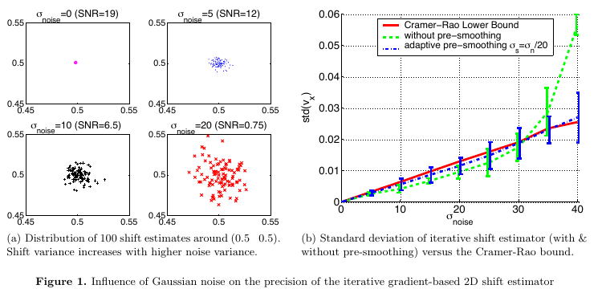
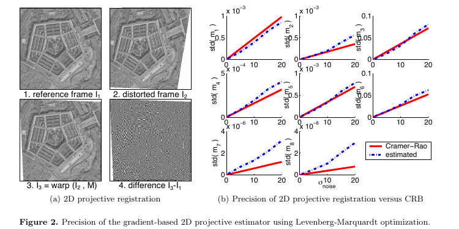

# 번역: 최적 정합 추정기의 성능

- 원제: Performance of Optimal Registration Estimators
- 저자: Tuan Q. Pham(1), Marijn Bezuijen(1), Lucas J. van Vliet(1), Klamer Schutte(2), Cris L. Luengo Hendriks(3)
  - (1) 델프트 공과대학교 정량영상그룹, 네덜란드 델프트 Lorentzweg 1, 2628 CJ
  - (2) TNO 물리전자연구소, 네덜란드 헤이그 P.O. Box 96864, 2509 JG
  - (3) 로런스 버클리 연구소 생명과학부, 미국 캘리포니아 버클리 One Cyclotron Road, 94720
- 원문: 같은 폴더의 `Pham2005_SPIE5817_performance_optimal_registration_TNO.pdf` (TNO 공개 저장소본 12쪽, 2005-02-04 TeX 출력. 출판본 Proc. SPIE 5817과 쪽 번호, 문구가 조금 다를 수 있다)
- 출판본: Proc. SPIE 5817, Visual Information Processing XIV, p.133, 2005. doi:10.1117/12.603304
- 번역 범위: 전문(초록, 본문, 그림 캡션, 부록 A). 참고문헌은 원문 그대로 둔다.
- 번역 메모
  - 수식은 pdftotext로 뽑은 글자가 깨져서, 원문 PDF를 보며 원문 기호대로 LaTeX로 다시 적었다.
  - 합 기호 $\sum_S$는 정합 영역 S 안의 모든 화소에 대한 합이다.
  - "registration"은 정합, "shift"는 이동(평행 이동량), "bias"는 편향, "Cramer-Rao bound(CRB)"는 크라메르-라오 하한으로 옮겼다.

---

## 초록

이 논문은 영상 정합의 이론 한계를 유도하고, 그 한계에 이르는 반복 추정기를 제시한다.
매개변수 정합의 분산은 크라메르-라오 하한(CRB)으로 아래가 막혀 있다.
이 하한은 신호에 따라 다르고, 입력 잡음의 분산에 비례한다.
지금 쓰이는 정합 방법은 대부분 편향되어 있어서 최적이 아니다.
그러나 반복 기울기 기반 추정기를 쓰면 편향을 실제로 0에 가깝게 줄일 수 있다.
해 근처에서 이 추정기는 2차 속도로 CRB에 수렴한다.
거친 척도에서 세밀한 척도로 가는 다중 척도 정합으로 두 영상을 미리 가깝게 맞추면 정합이 빨라진다.
끝으로, 평행 이동이 있는 여러 장의 저해상도 영상에서 반복 정합을 쓰면 영상 해상도가 크게 높아짐을 보인다.

핵심어: 정합 한계, 최적 정합, 크라메르-라오 하한, 정합 편향, 초해상도.

## 1. 서론

영상 정합은 움직임 추정[1], 파노라마 영상 만들기[10], 초해상도[4] 같은 여러 응용에서 핵심 역할을 하는 기본 작업이다.
정합이 어떤 영상에서는 다른 영상보다 잘 되고, 잡음이 정합 정확도를 선형으로 떨어뜨린다는 것은 널리 받아들여진다.
그러나 크라메르-라오 분석[5]을 영상 정합에 쓰기 전까지는 이 관찰을 받쳐 주는 잘 정리된 이론이 없었다.
CRB는 결정론적 매개변수를 추정할 때 평균제곱오차의 아래 한계를 준다.
이 논문의 CRB 분석은 [9]의 이동 추정 분석과 [6]의 아핀 정합 분석에서 출발했다.
그러나 평행 이동과 2차원 사영 정합을 포함해, 이에 한정되지 않는 모든 매개변수 정합으로 넓혔다.
이 모든 매개변수 움직임 모델에서 공통으로, CRB는 신호에 따라 다르고 입력 잡음의 분산에 비례한다.

이 논문은 또 CRB에 이르는 최적 이동 추정기와 최적 사영 추정기를 제안한다.
지금 쓰이는 정합 추정기는 대부분 편향되어 있어서 최적이 아니다.
그러나 반복 과정을 거치면 기울기 기반 이동 추정기[7]와 2차원 사영 추정기의 편향을 없앨 수 있다.
반복 추정기는 편향이 없을 뿐 아니라, 분산이 CRB에 다가가므로 최적이기도 하다.
수렴 속도를 분석하면, 반복 이동 추정기의 오차는 단 두 번 반복한 뒤 100분의 1 화소 아래로 줄어든다.
2차원 사영 정합을 위한 레벤버그-마쿼트 최적화[10]도 거친 척도에서 세밀한 척도로 가는 다중 척도 전략에서 10~15번 반복 안에 이 수준의 정확도에 이른다.

논문의 구성은 다음과 같다.
2절은 모든 매개변수 정합의 크라메르-라오 하한을 유도하고, 평행 이동과 2차원 사영 정합을 특별한 경우로 다룬다.
3절은 국소 신호의 테일러 급수 전개에서 유도한 기울기 기반 이동 추정기를 보인다.
테일러 급수를 자른 데서 오는 편향과 입력 잡음에서 오는 편향도 밝힌다.
4절은 편향을 반복으로 고치고, 반복 기울기 기반 추정기가 최적임을 보인다.
5절은 제안한 정합 추정기를 쓰는 초해상도 응용을 보인다.

교신 저자: Tuan Pham, 전자우편 tuan@qi.tnw.tudelft.nl, 전화 +31 15 278 6054, 팩스 +31 15 278 6740

## 2. 영상 정합의 최소 분산 하한

결정론적 매개변수의 어떤 추정이든 평균제곱오차에는 크라메르-라오 하한(CRB)[5]이라는 아래 한계가 있다.
구체적으로, 매개변수 벡터 $\mathbf{m} = [m_0\ m_1\ \dots\ m_n]^T$를 주어진 측정 집합에서 추정하면, CRB는 오차 상관 행렬에 다음 한계를 준다.

$$E[\varepsilon\varepsilon^T] \ge \left(\mathbf{I} + \frac{\partial \mathbf{b}}{\partial \mathbf{m}}\right) \mathbf{F}^{-1}(\mathbf{m}) \left(\mathbf{I} + \frac{\partial \mathbf{b}}{\partial \mathbf{m}}\right)^T + \mathbf{b}\mathbf{b}^T \quad (1)$$

여기서 $\varepsilon = \hat{\mathbf{m}} - \mathbf{m}$은 추정 오차다(모자 기호는 그 아래 변수의 추정값이다).
$\mathbf{b} = E[\hat{\mathbf{m}}] - \mathbf{m}$은 추정기의 편향이다($E[\cdot]$은 괄호 안 식의 기댓값이다).
$\mathbf{I}$는 단위 행렬이다.
$\mathbf{F}(\mathbf{m})$은 피셔 정보 행렬(FIM)이다.
FIM은 관측 자료로부터 미지 매개변수 벡터 $\mathbf{m}$을 얼마나 잘 추정할 수 있는지를 나타낸다.
식 (1)의 $\ge$ 기호는 좌변 행렬에서 우변 행렬을 뺀 것이 음이 아닌 정부호라는 뜻이다.
따라서 이 부등식은 모든 대각 원소에서 성립한다.

추정기에 편향이 없으면($\mathbf{b} = 0$), 매개변수의 기대 분산은 FIM 역행렬의 주대각 원소에서 바로 얻는다.

$$E\left[(\hat{m}_i - m_i)^2\right] \ge F^{-1}_{ii}(\mathbf{m}) \quad (2)$$

피셔 정보 행렬은 최대 가능도 원리에서 나온다.
$\Pr(\mathbf{r}|\mathbf{m})$을 잡음 섞인 관측 자료 $\mathbf{r}(\mathbf{m})$의 확률 밀도 함수라 하자.
피셔 정보 행렬은 가능도 함수가 봉우리 근처에서 얼마나 가파른지를 재는 양이다.

$$\mathbf{F}(\mathbf{m}) = E\left[\left(\frac{\partial}{\partial \mathbf{m}} \log \Pr(\mathbf{r}|\mathbf{m})\right)\left(\frac{\partial}{\partial \mathbf{m}} \log \Pr(\mathbf{r}|\mathbf{m})\right)^T\right] \quad (3)$$

가파른 가능도 함수의 봉우리는 완만한 것보다 잡음에 덜 민감하다.
그래서 FIM은 관측 자료로 $\mathbf{m}$을 얼마나 정확히 추정할 수 있는지를 나타낸다.

### 2.1. 영상 정합의 피셔 정보 행렬

영상 정합은 두 영상의 밝기 상관을 바탕으로 두 영상 좌표 사이의 매개변수 변환을 찾는 일이다.
두 영상 $I_1$, $I_2$가 잡음 없는 장면 $I$에 평균 0, 분산 $\sigma^2$인 가우스 잡음이 더해져 만들어졌다고 하자.

$$I_1(x, y) = I(x, y) + n_1(x, y), \qquad I_2(x, y) = I(x', y') + n_2(x, y) \quad (4)$$

여기서 $x' = f(x, y, \mathbf{m})$, $y' = g(x, y, \mathbf{m})$은 좌표 변환이다.
$\mathbf{m} = [m_1\ m_2\ \dots\ m_n]^T$는 미지의 정합 매개변수다.
예를 들어 평행 이동에서는 $x' = x - v_x$, $y' = y - v_y$, $\mathbf{m} = [v_x\ v_y]^T$다.
잡음 $n_1$, $n_2$가 정합 영역 S 위에서 정규 분포를 따르면, $\mathbf{m}$의 추정값이 주어졌을 때 미지 장면 $I$의 전체 확률은 다음과 같다.

$$\Pr(I|\hat{\mathbf{m}}) = \prod_S \frac{1}{\sigma\sqrt{2\pi}} \exp\left(-\frac{(I_1 - I)^2}{2\sigma^2}\right) \prod_S \frac{1}{\sigma\sqrt{2\pi}} \exp\left(-\frac{(I_2 - I')^2}{2\sigma^2}\right) \quad (5)$$

$I_1$, $I_2$, $I$의 좌표는 암묵적으로 $(x, y)$다.
다만 $I' = I(x', y')$만 다르다.
따라서 로그 가능도 함수는 다음과 같다.

$$\log \Pr(I|\hat{\mathbf{m}}) = -\frac{1}{2\sigma^2} \sum_S \left\{(I_1 - I)^2 + (I_2 - I')^2\right\} + \text{const} \quad (6)$$

식 (3)에서, $n$개 매개변수 벡터 $\mathbf{m}$의 피셔 정보 행렬은 $n \times n$ 행렬 $\mathbf{F}$이고 원소는 다음과 같이 계산한다.

$$F_{ij} = -E\left[\frac{\partial^2}{\partial m_i \partial m_j} \log \Pr(I|\hat{\mathbf{m}})\right] = -E\left[\frac{\partial}{\partial m_i}\left(\frac{1}{\sigma^2}\sum_S (I_2 - I')\frac{\partial I'}{\partial m_j}\right)\right]$$
$$= -E\left[\frac{1}{\sigma^2}\sum_S \left(n_2 \frac{\partial^2 I'}{\partial m_i \partial m_j} - \frac{\partial I'}{\partial m_i}\frac{\partial I'}{\partial m_j}\right)\right] = \frac{1}{\sigma^2}\sum_S \frac{\partial I'}{\partial m_i}\frac{\partial I'}{\partial m_j} \quad (7)$$

잡음 없는 둘째 영상 $I' = I(x', y')$를 각 미지 매개변수 $m_i$로 미분한 값은, 둘째 영상의 미분과 정합 모델의 미분으로 계산할 수 있다.

$$\frac{\partial I'}{\partial m_i} = \frac{\partial I'}{\partial x'}\frac{\partial x'}{\partial m_i} + \frac{\partial I'}{\partial y'}\frac{\partial y'}{\partial m_i} \quad (8)$$

### 2.2. 2차원 이동 추정의 크라메르-라오 하한

앞 절의 피셔 정보 행렬 일반 유도를 쓰면, 편향 없는 모든 이동 추정기의 크라메르-라오 하한을 유도할 수 있다.
2차원 이동 추정은 두 영상 사이의 평행 이동 벡터 $\mathbf{v} = [v_x\ v_y]^T$를 찾는 일이다($x' = x - v_x$, $y' = y - v_y$).
피셔 정보 행렬은 식 (7), (8)로 계산할 수 있다[9].

$$\mathbf{F}(\mathbf{v}) = \frac{1}{\sigma^2}\begin{bmatrix} \sum_S I_x^2 & \sum_S I_x I_y \\ \sum_S I_x I_y & \sum_S I_y^2 \end{bmatrix}, \qquad I_x = \frac{\partial I}{\partial x},\ I_y = \frac{\partial I}{\partial y} \quad (9)$$

식 (2)에 따라, 추정 이동량 분산의 크라메르-라오 하한은 다음과 같다.

$$\mathrm{var}(v_x) \ge F^{-1}_{11} = \sigma^2 \sum_S I_y^2 \Big/ \mathrm{Det}(\mathbf{F}), \qquad \mathrm{var}(v_y) \ge F^{-1}_{22} = \sigma^2 \sum_S I_x^2 \Big/ \mathrm{Det}(\mathbf{F}) \quad (10)$$

여기서 $\mathrm{Det}(\mathbf{F}) = \sum_S I_x^2 \sum_S I_y^2 - \left(\sum_S I_x I_y\right)^2$은 FIM의 행렬식이다.
식 (10)의 부등식은 [9]의 것보다 엄격하다.
[9]는 $\mathrm{Det}(\mathbf{F})$의 둘째 항을 무시해 더 단순한 CRB에 이르렀다.

$$\mathrm{var}(v_x) \ge \sigma^2 \Big/ \sum_S I_x^2, \qquad \mathrm{var}(v_y) \ge \sigma^2 \Big/ \sum_S I_y^2 \quad (11)$$

단순화한 식 (11)은 다음을 분명히 보여 준다.
이동 분산은 입력 잡음 분산 $\sigma^2$에 선형으로 비례한다.
그리고 이동 방향의 전체 기울기 에너지에 반비례한다.
그래서 기울기가 큰 세부가 많고 잡음이 적은 큰 영상 조각은 정확한 이동 추정을 낳기 쉽다.
그러나 식 (11)의 느슨한 하한에 등호가 성립하기는 어렵다([9]에서 $(\sum I_x I_y)^2$을 0으로 두었기 때문이다).
따라서 식 (10)의 참 CRB를 써야 한다.

CRB는 손상되지 않은 신호 $I$로 이동 분산을 나타낸다는 점에 주의한다.
실제 상황에서는 $I$를 얻을 수 없다.
그러나 관심 영역 S가 크면, $I$의 전체 기울기 에너지는 손상된 영상 $I_1$의 것과, 같은 분산을 가진 잡음 한 실현의 것으로 계산할 수 있다.

$$\sum_S I_x^2 \approx \sum_S \left(\frac{\partial I_1}{\partial x}\right)^2 - \sum_S \left(\frac{\partial n_1}{\partial x}\right)^2, \quad \sum_S I_y^2 \approx \sum_S \left(\frac{\partial I_1}{\partial y}\right)^2 - \sum_S \left(\frac{\partial n_1}{\partial y}\right)^2, \quad \sum_S I_x I_y \approx \sum_S \frac{\partial I_1}{\partial x}\frac{\partial I_1}{\partial y} \quad (12)$$

### 2.3. 2차원 사영 정합의 크라메르-라오 하한

이동 추정처럼, 크라메르-라오 하한은 2차원 사영 변환 같은 다른 움직임 모델에도 쓸 수 있다.
2차원 사영 변환은 평행 이동, 유클리드, 닮음, 아핀 변환을 포함한다.
이 하한도 이동 추정 때처럼 피셔 정보 행렬에서 계산한다.
평면 사영 정합은 두 영상 좌표를 다음과 같이 바꾸는 8개 매개변수 벡터 $\mathbf{m} = [m_1\ m_2\ \dots\ m_8]^T$를 찾는다.

$$x' = \frac{m_1 x + m_2 y + m_3}{m_7 x + m_8 y + 1}, \qquad y' = \frac{m_4 x + m_5 y + m_6}{m_7 x + m_8 y + 1} \quad (13)$$

$D = m_7 x + m_8 y + 1$로 두면

$$\left[\frac{\partial x'}{\partial \mathbf{m}}\ \frac{\partial y'}{\partial \mathbf{m}}\right]^T = \frac{1}{D}\begin{bmatrix} x & y & 1 & 0 & 0 & 0 & -x'x & -x'y \\ 0 & 0 & 0 & x & y & 1 & -y'x & -y'y \end{bmatrix}$$

이므로, 식 (8)은 다음이 된다.

$$\left[\frac{\partial I'}{\partial \mathbf{m}}\right]^T = \frac{1}{D}\left[x\frac{\partial I'}{\partial x'}\ \ y\frac{\partial I'}{\partial x'}\ \ \frac{\partial I'}{\partial x'}\ \ x\frac{\partial I'}{\partial y'}\ \ y\frac{\partial I'}{\partial y'}\ \ \frac{\partial I'}{\partial y'}\ \ -x\left(x'\frac{\partial I'}{\partial x'} + y'\frac{\partial I'}{\partial y'}\right)\ \ -y\left(x'\frac{\partial I'}{\partial x'} + y'\frac{\partial I'}{\partial y'}\right)\right] \quad (14)$$

그러면 8x8 피셔 정보 행렬을 식 (7)과 (14)로 유도할 수 있다.
8x8 행렬의 역행렬이 복잡해서, 크라메르-라오 하한의 정확한 식은 여기에 적지 않는다.
그러나 이동 추정처럼, 사영 정합 매개변수의 분산은 입력 잡음 분산에 비례하고 전체 기울기 에너지에 반비례한다.

## 3. 기울기 기반 이동 추정기의 편향

앞 절의 크라메르-라오 하한은 편향 없는 이동 추정기에 쓸 수 있다.
따라서 편향된 추정기는 분산 하한이 더 높다.
지금 쓰이는 이동 추정기는 대부분 편향되어 있지만, 그 편향을 쉽게 나타낼 수는 없다[9].
이 절에서는 1차원 기울기 기반 이동 추정기의 편향을 분석한다.
2차원 이동 추정기의 편향도 비슷하며 부록에 넣었다.
원래 연구[2]는 [9]의 공간 영역과 주파수 영역을 섞은 분석과 달리, 전부 공간 영역에서 이루어졌다.

테일러 급수 전개에 따르면, 연속 신호는 가까운 신호로부터 다항식 전개로 근사할 수 있다.
이 근사로 조금 이동한 두 신호를 연결할 수 있다.

$$s_2(x) = s_1(x + v_x) = s_1(x) + v_x \frac{\partial s_1}{\partial x} + \frac{1}{2!}v_x^2 \frac{\partial^2 s_1}{\partial x^2} + \frac{1}{3!}v_x^3 \frac{\partial^3 s_1}{\partial x^3} + \dots \quad (15)$$

여기서 1차원 신호 $s_2$는 $s_1$을 작은 변위 $v_x$만큼 이동한 것과 같다.
$v_x$가 작으므로 식 (15)의 $v_x$ 높은 거듭제곱은 무시할 수 있다.
따라서 $s_2$는 테일러 급수를 1차 미분 뒤에서 잘라 근사할 수 있다.
그러면 지원 영역 S의 N개 표본에 대한 평균제곱오차(MSE)를 최소화하는 선형 연립방정식으로 변위 $v_x$를 풀 수 있다.

$$MSE = \frac{1}{N}\sum_S \left(s_2(x) - s_1(x) - v_x \frac{\partial s_1}{\partial x}\right)^2 \quad (16)$$

이것은 다음 최소제곱 해를 준다[7].

$$v_x^{LQ} = \frac{\sum_S (s_2(x) - s_1(x))\frac{\partial s_1}{\partial x}}{\sum_S \left(\frac{\partial s_1}{\partial x}\right)^2} \quad (17)$$

이 근사는 식 (15)의 2차 이상 미분이 작을 때만 정확하다.
그래서 테일러 전개 방법으로 믿을 만하게 추정할 수 있는 것은 미분 척도(이산 신호에서 $\sigma_s \approx 1$ 화소)보다 작은 변위뿐이다.
변위가 1화소보다 큰 신호는 상호상관 같은 다른 방법으로 먼저 정수 정확도까지 맞춰야 한다.
또는 거친 척도에서 세밀한 척도로 변위를 추정하고 다듬는 다해상도 테일러 이동 추정을 쓸 수도 있다.

테일러 전개 방법에 남는 문제는, 이동량을 등식이 아니라 근사식 묶음에서 추정한다는 것이다.
해 (17)도 잡음 없는 신호에 대해서만 유도된 것이다.
그 결과, 영상 내용과 변위 자체에 따라 달라지는 계통 편향이 생긴다.
사실 이 편향은 테일러 급수 자르기, 밝기 잡음 같은 여러 모델링 오차가 합쳐진 효과다.
다음 소절들은 편향 보정의 출발점으로 쓰기 위해 이 편향들을 밝힌다.

### 3.1. 테일러 급수 자르기에서 오는 편향

가장 눈에 띄는 변위 편향은 식 (15)의 테일러 급수를 자른 오차에서 온다.

$$\varepsilon = \frac{1}{2!}v_x^2 \frac{\partial^2 s_1}{\partial x^2} + \frac{1}{3!}v_x^3 \frac{\partial^3 s_1}{\partial x^3} + \dots \quad (18)$$

$s_2(x) - s_1(x) = v_x \frac{\partial s_1}{\partial x} + \varepsilon$을 식 (17)의 최소제곱 추정에 넣으면, 자르기 편향은 다음과 같이 계산된다.

$$bias_T = v_x^{LQ} - v_x = \frac{\sum_S \varepsilon \frac{\partial s_1}{\partial x}}{\sum_S \left(\frac{\partial s_1}{\partial x}\right)^2} = \frac{v_x^3}{3!}\frac{\sum_S \frac{\partial^3 s_1}{\partial x^3}\frac{\partial s_1}{\partial x}}{\sum_S \left(\frac{\partial s_1}{\partial x}\right)^2} + \frac{v_x^5}{5!}\frac{\sum_S \frac{\partial^5 s_1}{\partial x^5}\frac{\partial s_1}{\partial x}}{\sum_S \left(\frac{\partial s_1}{\partial x}\right)^2} + \dots \quad (19)$$

여기서 짝수 차수 항은 파스발 정리[8] 때문에 사라진다.

$$\sum_S \frac{\partial^{2n} s}{\partial x^{2n}}\frac{\partial s}{\partial x} \approx \int_{-\infty}^{+\infty} f^* g\, dx = \frac{1}{2\pi}\int_{-\pi}^{+\pi} F^* G\, d\omega = \frac{j(-1)^n}{2\pi}\int_{-\pi}^{+\pi} \omega^{2n+1}|S(\omega)|^2 d\omega = 0 \quad (20)$$

여기서

$$s(x) \Leftrightarrow S(\omega), \qquad f(x) = \frac{\partial s(x)}{\partial x} \Leftrightarrow F(\omega) = j\omega S(\omega), \qquad g(x) = \frac{\partial^{2n} s(x)}{\partial x^{2n}} \Leftrightarrow G(\omega) = (-1)^n \omega^{2n} S(\omega) \quad (21)$$

### 3.2. 잡음에서 오는 편향

자르기 편향 식은 잡음 없는 두 영상 사이의 이동 추정에 쓸 수 있다.
실제로는 잡음이 늘 있고, 잡음은 훨씬 큰 정합 오차의 원인이다.
원래 영상과 상관이 없고 실현끼리도 상관이 없는 가법 가우스 잡음을 가정한다.

$$s_1^*(x) = s_1(x) + n_1(x), \qquad s_2^*(x) = s_1(x + v_x) + n_2(x) \quad (22)$$

가우스 잡음에서도 식 (16)의 MSE를 최소화하는 이동 추정은 성립하고, 해 (17)도 성립한다.
다만 영상 기울기는 잡음 없는 신호 $s_1$에서 구해야 한다는 예외가 있다.
$s_1$을 얻을 수 없으므로, 식 (17)에는 잡음 섞인 신호 $s_1^*$를 쓴다.
잡음은 자르기 편향에는 영향을 주지 않지만, 추정 이동량에 다른 편향을 만든다.

$$bias_N = v_x^* - v_x = \frac{\sum_S (s_2^*(x) - s_1^*(x))\frac{\partial s_1^*}{\partial x}}{\sum_S \left(\frac{\partial s_1^*}{\partial x}\right)^2} - v_x = \frac{\sum_S (s_2(x) - s_1(x))\frac{\partial s_1}{\partial x}}{\sum_S \left(\frac{\partial s_1}{\partial x}\right)^2 + \sum_S \left(\frac{\partial n_1}{\partial x}\right)^2} - v_x = -\frac{N}{S + N}v_x \quad (23)$$

여기서 $v_x^*$는 잡음 섞인 신호 $s_i^*$로 계산한 추정 이동량이다.
$S = \sum_S \left(\frac{\partial s_1}{\partial x}\right)^2$과 $N = \sum_S \left(\frac{\partial n_1}{\partial x}\right)^2$은 각각 신호와 잡음의 기울기 에너지다.
번역 메모: 원문 식 (23) 맨 끝은 $\frac{N}{S+N}v_x$로 인쇄되어 있다. 바로 뒤 문장("늘 과소 추정한다")과 중간 식에 맞추면 부호는 음이다. 크기는 같다.

잡음이 있으면 테일러 이동 추정기가 늘 변위를 과소 추정한다는 점이 흥미롭다.
잡음에서 오는 편향은 이동량에 비례한다.
따라서 이동량의 세제곱에 비례하는 테일러 급수 자르기보다 더 심각한 편향 원인이다.

## 4. 최적 정합 추정기

추정기가 크라메르-라오 하한에 이르면 최적이라고 한다.
최소제곱 추정기는 편향이 없을 때 최적인 경우가 많다.
기울기 기반 이동 추정기는 편향되어 있지만, 그 편향은 반복으로 고칠 수 있다.
그 결과로 얻는 이동 추정기는 최적이다.
이 절에서는 이 주장을 확인하는 실험도 한다.

### 4.1. 반복 기울기 기반 이동 추정기

식 (19)와 (23)에서, 기울기 기반 이동 추정기의 전체 편향은 다음과 같이 쓸 수 있다.

$$bias = bias_N + bias_T = v_x \frac{\sum_S \left(\frac{\partial n_1}{\partial x}\right)^2}{\sum_S \left(\frac{\partial s_1}{\partial x}\right)^2 + \sum_S \left(\frac{\partial n_1}{\partial x}\right)^2} + \frac{v_x^3}{3!}\frac{\sum_S \frac{\partial^3 s_1}{\partial x^3}\frac{\partial s_1}{\partial x}}{\sum_S \left(\frac{\partial s_1}{\partial x}\right)^2} + \frac{v_x^5}{5!}\frac{\sum_S \frac{\partial^5 s_1}{\partial x^5}\frac{\partial s_1}{\partial x}}{\sum_S \left(\frac{\partial s_1}{\partial x}\right)^2} + \dots \quad (24)$$

첫 항은 잡음에서 오고, 나머지 항은 모두 자르기 오차에서 온다.

테일러 자르기와 잡음에서 오는 편향은 해석적으로 유도할 수 있지만, 우리는 직접 편향 보정을 좋아하지 않는다.
첫째 이유는 초기 이동 추정이 부정확하다는 것이다.
편향은 이 초기 추정에서 유도되므로, 보정도 정확하지 않다.
둘째 이유는 식 (24)에 손상되지 않은 신호 $s_1$의 미분이 필요한데, 이를 얻을 수 없다는 것이다.
게다가 이 편향은 무한히 큰 관심 영역이나 가우스 잡음 같은, 애초에 맞지 않는 여러 가정에서 유도되었다.
그래서 우리는 간접 편향 보정 방법을 택한다.
식 (24)는 상대 편향 $bias/v_x \approx N/(S + N)$이 양수이고 1보다 작다는 것을 보여 준다.
따라서 이동을 보정한 영상 쌍에 대해 이동 추정을 반복하면, 편향이 지수 속도로 줄어드는 것이 보장된다.
편향을 실제로 0까지 줄일 수 있으므로, 반복 이동 추정은 편향 없는 해로 수렴한다.

반복 이동 추정 알고리즘은 다음과 같다.
이 알고리즘은 부화소 이동만 다루므로, 정수 변위는 먼저 보정해야 한다.

1. 반복 횟수 $i = 0$, 임시 신호 $s_2(0) = s_2$, 누적 변위 $v_x = 0$으로 둔다.
2. $s_1$과 $s_2(i)$에 테일러 이동 추정을 해서 변위 $v_x(i)$를 얻는다.
3. 마지막으로 구한 변위를 누적한다: $v_x = v_x + v_x(i)$.
4. 둘째 신호를 누적 변위만큼 옮긴다: $s_2(i + 1) = shift(s_2, v_x)$.
5. 증분 변위 $v_x(i)$가 원하는 정확도 안에 들거나 최대 반복 횟수에 이르면 반복을 끝낸다. 그렇지 않으면 $i = i + 1$로 하고 2단계로 돌아간다.

이 반복 알고리즘은 정확도 조건이나 최대 반복 횟수 가운데 먼저 닿는 쪽 때문에 반드시 끝난다.
실용적인 SNR($SNR = 10\log_{10}(S/N)$)에서 이 알고리즘은 아주 빨리 수렴한다.
정합 편향은 단 2번 반복한 뒤 $O(10^{-3})$ 수준으로 줄어든다.

$$bias(1\text{차 반복}) \approx \frac{N}{S+N}v_x \le \frac{1}{11} \times 0.5 \approx 4.5 \times 10^{-2}$$
$$bias(2\text{차 반복}) \approx \frac{N}{S+N}bias(1\text{차}) \approx \left(\frac{N}{S+N}\right)^2 v_x \le \left(\frac{1}{11}\right)^2 \times 0.5 \approx 4.1 \times 10^{-3} \qquad (SNR \ge 10\text{dB}) \quad (25)$$

반복 해법은 매우 효율적이기도 하다.
식 (17)의 영상 미분을 반복 사이에 다시 쓸 수 있기 때문이다.
사실 이동 추정 한 번을 더 반복하는 데 드는 계산은 편향 보정 방법[2]보다 적다.

### 4.2. 정규 분포와 최적성

반복 이동 추정기의 분산에 잡음이 주는 영향을 보기 위해, 서로 이동한 8비트 256x256 영상 쌍에 이동 추정을 적용했다.
[0.5 0.5]만큼 이동한 쌍은 큰 펜타곤 영상(1028x1028)을 가우스 평활($\sigma = 2$)한 뒤 4배 솎아 내어 만들었다.
추정 전에 두 영상에 같은 분산의 가우스 잡음을 더했다.
잡음 수준마다 잡음 실현 100개를 시험했고, 추정 이동량을 그림 1a에 그렸다.
점들이 [0.5 0.5] 둘레에 모이는 것은 추정 이동량에 편향이 없음을 시사한다.
그러나 추정 이동량이 정확히 [0.5 0.5]는 아니다.
입력 잡음 분산에 비례하는 확률적 변동이 있기 때문이다.

그림 1. 반복 기울기 기반 2차원 이동 추정기의 정밀도에 가우스 잡음이 주는 영향.
(a) (0.5 0.5) 둘레의 이동 추정 100개 분포. 잡음 분산이 크면 이동 분산이 커진다. 네 칸은 $\sigma_{noise}$ = 0(SNR=19), 5(SNR=12), 10(SNR=6.5), 20(SNR=0.75)이다.
(b) 반복 이동 추정기(사전 평활 있음과 없음)의 표준편차와 크라메르-라오 하한 비교. 범례: 크라메르-라오 하한, 사전 평활 없음, 적응 사전 평활 $\sigma_s = \sigma_n/20$. 세로축 std($v_x$), 가로축 $\sigma_{noise}$.

추정 이동량이 입력 잡음 때문에 흔들리는 것은 2차원 기울기 기반 이동 추정의 해(부록 A에서 유도)로 설명할 수 있다.

$$v_x = \left(\sum_S I_x I_t \sum_S I_y^2 - \sum_S I_y I_t \sum_S I_x I_y\right) \Big/ \mathrm{Det}, \qquad v_y = \left(\sum_S I_y I_t \sum_S I_x^2 - \sum_S I_x I_t \sum_S I_x I_y\right) \Big/ \mathrm{Det} \quad (26)$$

여기서 $\mathbf{v} = [v_x\ v_y]^T$는 기준 영상 $I_1$에 대한 영상 $I_2$의 변위다.
$\mathrm{Det} = \sum_S I_x^2 \sum_S I_y^2 - \left(\sum_S I_x I_y\right)^2$은 기준 영상 $I_1$을 나타내는 헤시안 행렬(식 (9)와 같은 행렬)의 행렬식이다.
$I_x$, $I_y$, $I_t$는 각각 $\partial I_1/\partial x$, $\partial I_1/\partial y$, $I_2 - I_1$의 줄임이다.
반복 해가 수렴하므로, 전체 이동량의 정밀도는 마지막 추정의 정밀도와 같다.
마지막 반복에서는 추정 이동량이 이미 꽤 정확하다.
그래서 옮겨진 영상 $I_2$는 기준 프레임 $I_1$과 잡음 항만큼만 다르다: $I_t = I_2 - I_1 \approx n_2 - n_1$.
$I_t$는 순수 잡음이므로 $E\left[\sum I_x I_t\right] = E\left[\sum I_y I_t\right] = 0$이고, 따라서 $v_x$, $v_y$는 0 둘레에 정규 분포한다.

그림 1b에서 반복 이동 추정의 정밀도를 크라메르-라오 하한과 비교했다.
실선은 이론 CRB다.
파선은 시행 100회에 걸친 $v_x$의 표준편차다(오차 막대는 이런 std($v_x$) 10개로 만들었다).
$v_y$의 정밀도 그림은 비슷해서 생략했다.
실용 SNR($SNR \ge 0$, 즉 $\sigma_{noise} \le 20$)에서는 이동 추정의 분산이 CRB보다 조금 작아지기도 한다.
CRB를 잡음 섞인 영상 미분(식 10)으로 계산했고, 그 미분은 어떤 척도에서 추정해야 하기 때문이다.
그림 1b에는 일점쇄선도 있다.
이 선은 신호를 미리 평활한 덕분에 잡음이 클 때 더 좋은 이동 분산을 보여 준다.
보이는 것처럼, 영상 사전 평활이 없는 이동 추정의 분산(파선)은 $\sigma_{noise} \ge 20$($SNR \le 0$)인 잡음에서 CRB 위로 치솟는다.
적응 척도 $\sigma_s = \sigma_{noise}/20$의 가우스 사전 평활을 쓰면, 이동 표준편차 곡선(일점쇄선)이 최적 하한과 실제로 들어맞는다.

### 4.3. 최적 2차원 사영 정합

여기 제시한 반복 이동 추정은 사실 많은 사람들[4, 7]이 그 최적성을 모른 채 써 왔다.
사실 반복 해는 국소 최소점으로 수렴하는 기울기 하강 과정이다.
비슷하게, 2차원 사영 정합은 반복 레벤버그-마쿼트 최적화 과정으로 푼다[10].
매 반복에서 정합 매개변수 $\mathbf{m}$(2.3절)은 선형 연립방정식으로 계산한 작은 양만큼 늘어난다.
이 연립방정식의 행렬은 식 (7)과 (14)로 유도한 8x8 피셔 정보 행렬과 같다.
기울기 하강이라는 성격이 비슷하므로, 레벤버그-마쿼트 2차원 사영 정합 추정기도 최적이라고 짐작할 수 있다.
이를 실험으로 확인했고, 결과는 그림 2에 있다.

그림 2. 레벤버그-마쿼트 최적화를 쓴 기울기 기반 2차원 사영 추정기의 정밀도.
(a) 2차원 사영 정합. 1. 기준 프레임 $I_1$, 2. 왜곡된 프레임 $I_2$, 3. $I_3 = warp(I_2, M)$, 4. 차이 $I_3 - I_1$.
(b) 2차원 사영 정합의 정밀도와 CRB 비교. 칸마다 std($m_1$)~std($m_8$), 가로축 $\sigma_{noise}$. 범례: 크라메르-라오(실선), 추정값(일점쇄선).

이 실험에서는 256x256 기준 영상(그림 2a-1)을 무작위 3x3 호모그래피 행렬(식 27)로 사영 왜곡해 영상 2a-2를 만들었다.
정합 행렬 $M$은 두 입력 영상에서 직접 추정했다.
그다음 왜곡된 영상을 첫 영상 위로 워프해 영상 2a-3을 얻었다.
영상 2a-3이 기준 영상과 아주 비슷해 보이므로 정합이 바르게 추정되었음을 알 수 있다.
그림 2a-4의 기준 영상과 워프 영상의 차이에도 눈에 띄는 차이가 없다.

$$M = \begin{bmatrix} 1.087094 & 0.041690 & -0.897298 \\ 0.039365 & 0.911578 & -1.471319 \\ 0.000313 & -0.000490 & 1.000000 \end{bmatrix} \quad (27)$$

추정 전에 입력 영상 2a-1과 2a-2에 서로 다른 잡음 실현을 더해, 앞 소절의 이동 추정과 같은 분산 분석을 했다.
그림 2b는 여러 입력 잡음 수준에서 추정 매개변수의 정밀도를 그린 것이다.
추정 정밀도(일점쇄선)는 크라메르-라오 하한(실선)과 들어맞는다.
이는 레벤버그-마쿼트 정합이 최적임을 뜻한다.

최적화에 매개변수 8개가 들어가므로, 2차원 사영 정합은 단순한 이동 추정보다 훨씬 많이 반복해야 한다.
과정을 빠르게 하고 틀린 국소 최소점으로 수렴할 가능성을 줄이려고 다중 척도 전략을 쓴다.
먼저 거친 척도에서 정합을 추정하고, 그 매개변수를 더 세밀한 척도의 추정 초기값으로 쓴다.
3척도 방식(가우스 평활 $\sigma$ = 4, 1, 0)에서 레벤버그-마쿼트 정합은 10~15번 반복으로 수렴한다.

### 4.4. 정합 한계 넘기

크라메르-라오 하한은 어떤 영상 정합이든 정밀도에 근본 한계가 있음을 말한다.
그러나 이 논문에서 유도한 CRB는 잡음 섞인 영상 두 장을 짝지어 정합할 때에만 적용된다.
정합 정밀도를 높이는 한 방법은 새 영상을, 이전 영상들로 다시 만든 고해상도 모자이크에 대고 정합하는 것이다.
모자이크 영상은 해상도가 더 높고 잡음이 더 적어서, 그 기울기 정보가 잡음 없는 참값에 더 가깝다.
그래서 이 기울기로 계산한 기울기 기반 해가 더 믿을 만하다.
정합 성능을 높이는 다른 방법은 여러 영상을 한 번의 추정에 함께 넣는 것이다.
묶음 조정(bundle adjustment)[3]은 여러 프레임 사이의 정합 일관성을 보장해, 짝지어 한 번 추정할 때의 잡음 오차를 줄인다.
예를 들어 다음 절에서 추정한 이동량은 정방향 이동 추정과 역방향 이동 추정의 평균이다.
아쉽게도 묶음 조정에 쓰는 영상 수에도 한계가 있다.
겹치는 영역이 줄고, 장면 안에 움직임이 있고, 원근이나 렌즈 왜곡이 있는 등 여러 요인 때문에 한 영상열의 모든 영상에서 정합 일관성이 성립하지는 않을 수 있다.

## 5. 초해상도 응용

부화소 정확도의 정합은 영상 모자이크, 초해상도(SR) 같은 많은 응용에서 필요하다.
사실 겹치는 프레임이 충분하면 SR을 영상 모자이크와 동시에 할 수 있다.
그림 4는 이동하는 영상열로 초해상도 파노라마를 만드는 예다.
그림 4d의 넓은 고속도로 장면은 128x128 저해상도(LR) 프레임 200장으로 재구성했다.
LR 프레임은 좌우로 도는(팬) 카메라로 찍었다.
0번, 122번, 199번 프레임은 그림 4a~c에서 볼 수 있다.
카메라는 SR에 필요한 세로 방향 부화소 이동이 생기도록 200프레임 동안 조금 위아래로도 기울어진다.
장면을 멀리서 팬 카메라로 찍었으므로 프레임 사이 움직임은 거의 평행 이동이다.
이웃한 모든 프레임 사이의 변위를 양방향으로 계산하고, 그 결과를 평균해 더 나은 이동 추정을 얻는다.
새 프레임은 최근접 이웃 화소 찍기로 기존 모자이크에 합친다.
여러 나쁜 자료 조건(작은 프레임, 낮은 대비, 큰 잡음, 밝기 깜빡임, 움직이는 차와 사람, 죽은 센서 등)에도, 추정 이동량은 꽤 좋다.
재구성한 모자이크에는 잘못된 정합 때문에 생기는 흐림이나 떨림 결함이 보이지 않는다.

2배 SR 결과와 LR 입력 한 장은 그림 3a~b에서 비교할 수 있다.
SR 영상은 잡음이 훨씬 적고 동적 범위가 더 넓다는 것이 분명하다.
이것은 장면을 훨씬 잘 보이게 한다.
예를 들어 고속도로를 따라 있는 콘크리트 구조물의 육각형 무늬는 SR 영상에서만 보인다.
SR 영상을 확대한 그림 3d를 같은 LR 영역의 그림 3c와 비교하면, 더 작은 세부와 줄어든 엘리어싱도 볼 수 있다.
이제 고속도로 교차로 양쪽의 울타리가 보인다는 점에 주목하자.
SR 영상에서는 나뭇가지도 배경과 구별된다.

그림 3. 2배 초해상도 영상과 저해상도 영상 비교. 모든 영상은 대비를 늘였다[11].
(a) LR 프레임 183번의 관심 영역, (b) 이동 영상열로 만든 2배 SR, (c) LR 영상 확대, (d) SR 영상 확대.

그림 4. 팬틸트 적외선 카메라로 찍은 영상열의 초해상도. 모든 영상은 대비를 늘였다[11].
(a) LR 프레임 0번, (b) LR 프레임 122번, (c) LR 프레임 199번, (d) LR 프레임 200장으로 만든 2배 초해상도 모자이크. 고속도로 위의 유령 효과는 움직이는 차 때문이다.

## 6. 결론

정리하면, 우리는 편향 없는 모든 매개변수 영상 정합에 대해 크라메르-라오 하한을 유도했다.
이동 추정의 최소 분산 하한은 입력 잡음 분산에 비례하고, 추정 방향의 전체 기울기 에너지에 반비례한다.
기울기 기반 이동 추정기는 편향되어 있지만, 반복 편향 보정 과정으로 편향을 없앨 수 있다.
이 반복 이동 추정기는 분산이 크라메르-라오 하한에 다가간다는 뜻에서 최적이다.
반복 이동 추정기는 매우 효율적이기도 하다.
보통 신호 대 잡음비($SNR > 10$dB)의 256x256 영상에서 단 두 번 반복으로 100분의 1 화소 정확도에 이른다.
이동 추정처럼, 반복 2차원 사영 정합도 레벤버그-마쿼트 최적화 10~15번 반복 뒤 크라메르-라오 하한에 이른다.
끝으로, 부화소 정확도의 정합을 영상 모자이크와 먼 거리 감시 영상의 초해상도 응용에 적용했다.

## 부록 A. 2차원 이동 추정

### A.1. 기울기 기반 2차원 이동 추정

2차원 신호의 국소 테일러 전개에서 시작한다.

$$I_2 = I_1 + v_x I_x + v_y I_y + \varepsilon \quad (28)$$

여기서 영상 $I_2$는 영상 $I_1$을 작은 변위 $(v_x, v_y)$만큼 옮긴 것이다.
$I_t = I_2 - I_1$은 이산 시간 미분이다.
$I_x$, $I_y$는 각각 x, y 방향 영상 미분이다.
$\varepsilon$은 자르기 오차다.

$$\varepsilon = \frac{1}{2}v_x^2 I_{xx} + v_x v_y I_{xy} + \frac{1}{2}v_y^2 I_{yy} + \frac{1}{6}v_x^3 I_{xxx} + \frac{1}{2}v_x^2 v_y I_{xxy} + \frac{1}{2}v_x v_y^2 I_{xyy} + \frac{1}{6}v_y^3 I_{yyy} + \dots \quad (29)$$

여기서 $I$의 아래 첨자에 x, y가 나오는 횟수가 그 방향의 미분 차수를 정한다.
$v_x$, $v_y$에 대해 MSE를 최소화하면 다음 행렬식 연립방정식이 나온다.

$$\begin{bmatrix} \sum_S I_x^2 & \sum_S I_x I_y \\ \sum_S I_x I_y & \sum_S I_y^2 \end{bmatrix}\begin{bmatrix} v_x \\ v_y \end{bmatrix} = \begin{bmatrix} \sum_S I_x I_t \\ \sum_S I_y I_t \end{bmatrix} \quad (30)$$

번역 메모: 원문 식 (30) 우변 아래 칸은 $\sum_S I_x I_t$로 인쇄되어 있으나, 식 (31)에 맞추면 $\sum_S I_y I_t$다.

해는 다음과 같다.

$$v_x = \frac{1}{\mathrm{Det}}\left(\sum_S I_x I_t \sum_S I_y^2 - \sum_S I_y I_t \sum_S I_x I_y\right), \qquad v_y = \frac{1}{\mathrm{Det}}\left(\sum_S I_y I_t \sum_S I_x^2 - \sum_S I_x I_t \sum_S I_x I_y\right) \quad (31)$$

여기서 $\mathrm{Det} = \sum_S I_x^2 \sum_S I_y^2 - \left(\sum_S I_x I_y\right)^2$은 식 (30) 헤시안 행렬의 행렬식이다.

### A.2. 2차원 이동 편향

2차원 테일러 이동 추정기의 자르기 편향은 $I_t = v_x I_x + v_y I_y + \varepsilon$을 식 (31)에 넣어 해석적으로 유도할 수 있다.

$$bias^T_x = \frac{1}{\mathrm{Det}}\left(\sum_S \varepsilon I_x \sum_S I_y^2 - \sum_S \varepsilon I_y \sum_S I_x I_y\right), \qquad bias^T_y = \frac{1}{\mathrm{Det}}\left(\sum_S \varepsilon I_y \sum_S I_x^2 - \sum_S \varepsilon I_x \sum_S I_x I_y\right) \quad (32)$$

여기서 $\sum_S \varepsilon I_x$와 $\sum_S \varepsilon I_y$의 짝수 차수 항은 파스발 정리 때문에 사라진다.
($\sum_S \varepsilon I_y$의 식은 비슷해서 생략한다.)

$$\sum_S \varepsilon I_x = \frac{1}{6}v_x^3 \sum_S I_{xxx}I_x + \frac{1}{2}v_x^2 v_y \sum_S I_{xxy}I_x + \frac{1}{2}v_x v_y^2 \sum_S I_{xyy}I_x + \frac{1}{6}v_y^3 \sum_S I_{yyy}I_x + \dots \quad (33)$$

2차원 경우 잡음에서 오는 편향은 더 복잡하다($bias^N_x$만 보인다).

$$bias^N_x = v_x^* - v_x = \frac{\sum_S I_x I_t \left(\sum_S I_y^2 + \sum_S n_y^2\right) - \sum_S I_y I_t \sum_S I_x I_y}{\left(\sum_S I_x^2 + \sum_S n_x^2\right)\left(\sum_S I_y^2 + \sum_S n_y^2\right) - \left(\sum_S I_x I_y\right)^2} - v_x = \frac{\sum_S I_x I_t \sum_S n_y^2}{\mathrm{Det} + N} + \frac{N}{\mathrm{Det} + N}v_x \quad (34)$$

여기서 $v_x^*$는 잡음 섞인 영상 $I_1^* = I_1 + n_1$의 미분으로 식 (31)을 계산한 추정 이동량이다.
$n_x$, $n_y$는 잡음 $n_1$의 x, y 방향 미분이다.
$N$은 잡음 섞인 영상의 기울기 정보를 쓸 때 헤시안 행렬식이 과대 추정되는 양이다.

$$N = \sum_S n_x^2 \sum_S I_y^2 + \sum_S n_y^2 \sum_S I_x^2 + \sum_S n_x^2 \sum_S n_y^2 \quad (35)$$

번역 메모: 식 (34) 마지막 항의 부호도 식 (23)과 같은 방식으로 인쇄되어 있다. 원문 그대로 옮겼다.

### A.3. 조리개 문제와 수렴

조리개 문제(aperture problem)[1]라는 현상 때문에, 계산으로 정확한 이동 추정을 늘 할 수 있는 것은 아니다.
조리개 문제에서는 신호 안의 균일한 구조 때문에 이동 추정의 해가 하나로 정해지지 않거나 정의되지 않는다.
예를 들어 1차원 신호가 추정 영역 위에서 상수이면 평행 이동이 정의되지 않는다.
이것은 1차원 이동 추정의 해 (17)에서 0으로 나누는 오류를 일으킨다.
2차원에서도 식 (30) 헤시안 행렬의 행렬식이 0이면 해 (31)이 정의되지 않을 수 있다.
이는 지원 영역 위에서 $I_y/I_x$가 상수일 때 일어난다.
다시 말해, 2차원 신호에서 조리개 문제는 이웃 전체에 방향이 하나뿐일 때 생긴다.

다른 모든 이동 추정기처럼, 반복 기울기 기반 이동 추정기도 조리개 문제에서는 실패한다.
게다가 조리개 문제에 가까운 조건에서도 불안정하다.
SNR이 낮고 방향이 크게 한쪽으로 모여 있으면, 상대 편향의 절댓값이 1보다 커질 수 있다.
그러면 반복 해가 수렴하지 못한다.

$$\frac{bias_x}{v_x} = \frac{1}{v_x}\frac{\sum_S I_x I_t \sum_S n_y^2}{\mathrm{Det} + N} + \frac{N}{\mathrm{Det} + N} + \frac{a v_x^2 + b v_x v_y + c v_y^2 + d\frac{v_y^3}{v_x} + \dots}{\mathrm{Det}} \quad (36)$$

잡음이 크거나 국소 방향이 한결같으면 $N \gg \mathrm{Det}$이고, 식 (36)의 둘째 항은 1에 가깝다.
$|v_x|$가 어떤 문턱보다 작아졌는데 $|v_y|$가 아직 크면, $1/v_x$ 항과 $v_y^3/v_x$ 항이 커져 상대 편향의 절댓값을 1보다 크게 키울 수 있다.
이것은 2차원 반복 이동 추정기의 수렴을 멈추게 하고, 해는 참값에서 멀리 떨어진 곳에서 끝난다.
그러나 이때는 크라메르-라오 하한(식 10)도 아주 크므로 전혀 놀랍지 않다.

이 불안정 문제를 줄이는 간단한 해법이 있다.
이동 추정 전에 영상을 미리 평활하는 것이다[9].
사전 평활은 식 (36)의 기울기에 따른 모든 항을 약하게 만든다.
$N$은 $\mathrm{Det}$보다 훨씬 빨리 줄어들므로, 식 (36)의 스칼라 항은 1보다 훨씬 작아지고 다른 항들도 그렇게 된다.
그러면 상대 편향이 1보다 충분히 작게 유지될 가능성이 커지고, 반복 해가 수렴한다.
정합이 더 정확해지면, $I_t \approx n_2 - n_1$이 순수 잡음이 되어 $\sum I_x I_t$가 0에 다가가므로, 식 (36)의 $1/v_x$ 항이 지나치게 튀지 않는다.

## 참고문헌 (원문 그대로)

1. J. Barron, D. Fleet and S. Beauchemin. Performance of optical flow techniques. IJCV, 12(1):43–77, 1994.
2. M. Bezuijen. Improved sub-pixel shift estimation in 2D gray-value images. Bachelor Thesis, Pattern Recognition Group, Delft University of Technology, the Netherlands, 2003.
3. D. Capel and A. Zisserman. Computer vision applied to super resolution. IEEE Signal Processing Magazine, May 2003. pp. 75–86.
4. M. Irani and S. Peleg. Improving resolution by image registration. CVGIP: Graphical Models and Image Processing, 53(3):231–239, 1991.
5. S.M. Kay. Fundamentals of Statistical Signal Processing: Estimation Theory. Prentice Hall, 1993.
6. W. Li and H. Leung. A Maximum Likelihood Approach for Image Registration Using Control Point and Intensity. In IEEE Trans. Image Processing, 13(8):1115–11127, 2004.
7. B.D. Lucas and T. Kanade. An Iterative Image Registration Technique with an Application to Stereo Vision. In Proc. of the 7th International Joint Conference on Artificial Intelligence (IJCAI '81), 1981. pp. 674–679.
8. A.V. Oppenheim, A.S. Willsky and I.T. Young. Signals and Systems. Prentice-Hall, 1983.
9. M.D. Robinson and P. Milanfar. Fundamental Performance Limits in Image Registration. In IEEE Trans. Image Processing, 13(9):1185–1199, 2004.
10. R. Szeliski. Video mosaics for virtual environments. In IEEE Computer Graphics and Applications, 16(2):22-30, 1996
11. K. Zuiderveld. Contrast Limited Adaptive Histogram Equalization in P.S. Heckbert (ed), Graphics Gems IV. Boston Academic Press, 1994. pp. 474–485.
