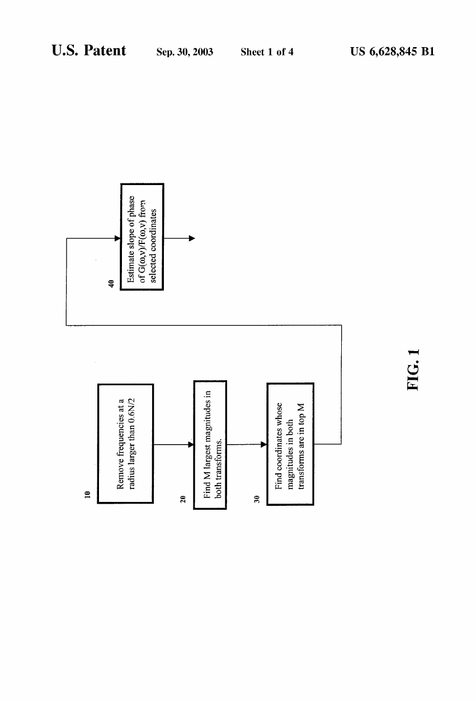
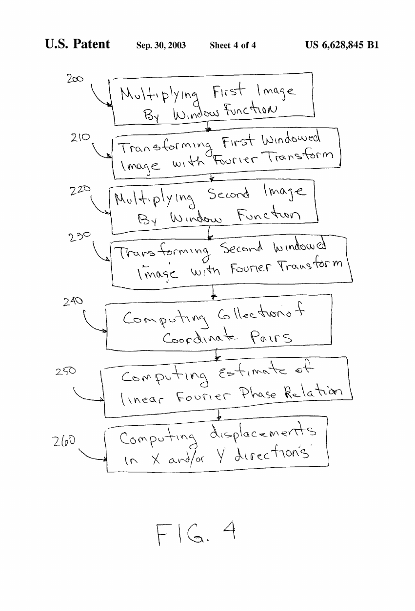
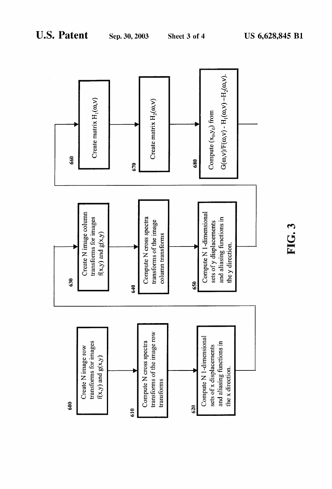

# 번역: 영상의 부화소 정합 방법 (US 6,628,845 B1)

- 원제: Method for Subpixel Registration of Images
- 공보: US 6,628,845 B1, 등록 2003-09-30
- 원문: 같은 폴더의 `US6628845B1.pdf` (Google Patents 공보 이미지, 14쪽. 1~2쪽 서지와 인용 문헌, 3~6쪽 도면 4장, 7~14쪽 명세서 16단)
- 번역 범위: 전문(서지, 초록, 명세서 본문, 도면 설명, 청구항 1~27). 인용 문헌은 원문 그대로 둔다.
- 번역 메모
  - 원문 텍스트는 공보 이미지의 OCR이라 수식이 깨져 있다. 수식은 원문 쪽 이미지를 직접 보고 옮겼다.
  - 원문의 ω는 가로 주파수 번호, v는 세로 주파수 번호, N은 표본 수다.
  - 식 (1)~(3)은 원문 그대로 옮겼다. 식 (1)은 i, j 두 첨자로 더하고 식 (2), (3)은 한 첨자로 더하며, 식 (4), (5)에는 1/N이 없다. 원문 표기가 일관되지 않는다. 번역자 메모로만 남긴다.
  - 원문은 G(ω)=F(ω)e^{−j2πωx/N}로 두었으므로 위상 기울기는 −2πx/N이다. 그런데 식 (6), (7)은 N/2π를 곱한 양의 부호로 적혀 있다. 부호 규약은 구현할 때 따로 확인해야 한다(번역자 메모, 우리 추론).

---

## 서지 사항 (1쪽)

- (12) 미국 특허, Stone 외
- (10) 특허 번호: US 6,628,845 B1
- (45) 등록일: 2003년 9월 30일
- (54) 발명의 명칭: 영상의 부화소 정합 방법
- (75) 발명자: Harold S. Stone (미국 뉴저지 프린스턴), Michael T. Orchard (미국 뉴저지 프린스턴), Ee-Chien Chang (싱가포르), Stephen Martucci (미국 뉴저지 켄들 파크)
- (73) 권리자: NEC Laboratories America, Inc., 미국 뉴저지 프린스턴
- (*) 고지: 이 특허의 존속 기간은 35 U.S.C. 154(b)에 따라 0일 연장 또는 조정된다.
- (21) 출원 번호: 09/526,417
- (22) 출원일: 2000년 3월 15일
- 관련 미국 출원: (60) 가출원 60/160,590, 1999년 10월 20일 출원
- (51) 국제 분류: G06K 9/32
- (52) 미국 분류: 382/294; 382/280
- (58) 검색 분야: 382/294, 295, 296, 289, 280, 151; 348/263, 264, 95; 358/450
- 심사관: Yon J. Couso
- 대리인: Scully, Scott, Murphy & Presser
- 청구항 27개, 도면 4장

### (56) 인용 문헌 (원문 그대로)

U.S. PATENT DOCUMENTS

- 4,308,521 A * 12/1981 Casasent et al. 340/146.3
- 5,384,648 A * 1/1995 Seidner et al. 358/534
- 5,850,486 A * 12/1998 Maas, III et al. 382/294
- 6,298,363 B1 * 10/2001 Iannuzzelli 708/400

OTHER PUBLICATIONS

- M. Berthod, et al., "Reconstruction of High Resolution 3D Visual Information", IEEE, pp. 654-657, 1994.
- D. M. Etter, et al., "Adaptive Estimation of Time Delays in Sampled Data Systems", IEEE Transactions on Acoustics, Speech, and Signal Processing, vol. ASSP-29, No. 3, pp. 582-587, Jun. 1981.
- C. M. Fan, et al., "A New Image Motion Estimation Algorithm Based on the EM Technique", IEEE Transactions on Pattern Analysis and Machine Intelligence, vol. 18, No. 3, pp. 348-352, Mar. 1996.
- P.L. Feintuch, et al., "Time Delay Estimation Using the LMS Adaptive Filter-Dynamic Behavior", IEEE Transactions on Acoustics, Speech, Signal Processing, vol. ASSP-29, No. 3, pp. 571-576, Jun. 1981.
- C.R. Guarino, "A Novel Method For Two-Dimensional Phase Estimation", IEEE, pp. 2279-2281, 1994.
- W. R. Hahn, et al., "Optimum Processing for Delay-Vector Estimation in Passive Signal Arrays", Manuscript received Dec. 20, 1972, revised Mar. 17, 1973.
- D. Keren, et al., "Image Sequence Enhancement Using Sub-pixel Displacements", IEEE, pp. 742-746, 1988.
- N.M. Namazi, et al., "Variable Time Delay Estimation in Colored and Correlated Noise Environment", IEEE Transactions on Aerospace and Electronic Systems, vol. 28, pp. 597-604, Apr. 1992.
- M. Namazi, et al., "A New Approach to Signal Registration With the Emphasis on Variable Time Delay Estimation", IEEE Transactions on Acoustics, Speech, and Signal Processing, vol. ASSP-35, No. 12, pp. 1649-1660, Dec. 1987.
- F.A. Reed, et al., "Time Delay Estimation Using the LMS Adaptive Filter-Static Behavior", IEEE Transactions on Acoustics, Speech, and Signal Processing, vol. ASSP-29, No. 3, pp. 561-571, Jun. 1981.
- H. Shekarforoush, et al., "Subpixel Image Registration by Estimating the Polyphase Decomposition of Cross Power Spectrum", IEEE, pp. 532-537, 1996.
- J.A. Stuller, et al., "New Perspectives for Maximum Likelihood Time-Delay Estimation", IEEE Transactions on Signal Processing, vol. 45, No. 3, pp. 513-525, Mar. 1997.
- P. Thévenaz, et al., "A Pyramid Approach to Subpixel Registration Based on Intensity", IEEE Transactions on Image Processing, vol. 7, No. 1, pp. 27-41, Jan. 1998.
- Qin-sheng Chen, et al., "Symmetric Phase-Only Matched Filtering of Fourier-Mellin Transforms for Image Registration and Recognition", IEEE Transactions on Pattern Analysis and Machine Intelligence, vol. 16, No. 12, pp. 1156-1168, Dec. 1994.
- B.S. Reddy, et al., "An FFT-Based Technique for Translation, Rotation, and Scale-Invariant Image Registration", IEEE Transactions on Image Processing, vol. 5, No. 8, pp. 1266-1271, Aug. 1996.
- A. Alliney, et al., "On The Registration Of An Object Translating On A Static Background", Pattern Recognition, vol. 29, No. 1, pp. 131-141, 1996.
- L. G. Brown, "A Survey of Image Registration Techniques", ACM Computing Surveys, vol. 24, No. 4, pp. 325-376, Dec. 1992.
- S. Alliney, et al., "Digital Image Registration Using Projections", IEEE Transactions on Pattern Analysis and Machine Intelligence, vol. PAMI-8, No. 2, pp. 222-233, Mar. 1986.
- E. De Castro, et al., "Registration of Translated and Rotated Images Using Finite Fourier Transforms", IEEE Transactions on Pattern Analysis and Machine Intelligence, vol. PAMI-9, No. 5, pp. 700-703, Sep. 1987.
- C.D. Kuglin, et al., "The Phase Correlation Image Alignment Method", Proceeding of the 1975 International Conference on Cybernetics and Society, pp. 163-165.
- S. Alliney, "Digital Analysis of Rotated Images", IEEE Transactions on Pattern Analysis and Machine Intelligence, vol. 15, No. 5, pp. 499-504, May 1993.
- R.L. Allen, et al., "Laplacian and Orthogonal Wavelet Pyramid Decompositions in Coarse-to-Fine Registration", IEEE Transactions on Signal Processing, vol. 41, No. 12, pp. 3536-3541, Dec. 1993.
- P.E. Anuta, "Spatial Registration of Multispectral and Multitemporal Digital Imagery Using Fast Fourier Transform Techniques", IEEE Transactions on Geoscience Electronics, vol. GE-8, No. 4, pp. 353-368, Oct. 1970.
- M.D. Pritt, et al., "Least-Squares Two-Dimensional Phase Unwrapping Using FFT's", IEEE Transactions on Geoscience and Remote Sensing, vol. 32, No. 3, pp. 706-708, May 1994.
- S.P. Kim, et al., "Subpixrl Accuracy Image Registration by Spectrum Cancellation", IEEE, pp. V-153-V-156, 1993.
- F.J. Harris, et al., "On the Use of Windows for Harmonic Analysis With the Discrete Fourier Transform", Proceedings of the IEEE, vol. 66, No. 1, pp. 51-82, Jan. 1978.
- I.E. Abdou, "Practical approach to the registration of multiple frames of video images", Part of the IS&T/SPIE Conference on Visual Communications and Image Processing '99, vol. 3653, pp. 371-382, Jan. 1999.
- C.L. Chan, et al., "Iterative Maximum Likelihood Displacement Field Estimation in Quantum-Limited Image Sequences", IEEE Transactions on Image Processing, vol. 4, No. 6, pp. 743-751, Jun. 1995.
- I.J. Cox, et al., "Predicting and Estimating the Accuracy of a Subpixel Registration Algorithm", IEEE Transactions on Pattern Analysis and Machine Intelligence, vol. 12, No. 8, pp. 721-734, Aug. 1990.

(* 심사관 인용)

## (57) 초록

x 방향, y 방향, 또는 두 방향으로 부화소 단위만큼 어긋난 첫째 영상과 둘째 영상을 정합하는 방법을 제공한다.
바람직한 구현은 다음 단계로 이루어진다.

1. 첫째 영상에 창 함수(window function)를 곱해 첫째 창 영상을 만든다.
2. 첫째 창 영상을 푸리에 변환해 첫째 영상 푸리에 변환을 만든다.
3. 둘째 영상에 같은 창 함수를 곱해 둘째 창 영상을 만든다.
4. 둘째 창 영상을 푸리에 변환해 둘째 영상 푸리에 변환을 만든다.
5. 두 푸리에 변환에서 좌표 쌍의 모음을 고른다. 고른 좌표 쌍에서는 두 변환 값에 엘리어싱(aliasing) 잡음이 매우 적을 가능성이 높다.
6. 고른 좌표 쌍에서 두 변환의 푸리에 위상을 써서, 두 변환 사이의 선형 푸리에 위상 관계를 최소제곱 의미로 추정한다.
7. 그 선형 위상 관계에서 x 방향, y 방향 변위를 계산한다.

이 방법을 실행하는 컴퓨터 판독 가능 프로그램 코드를 가진 컴퓨터 프로그램과, 명령 프로그램을 담은 프로그램 저장 장치도 함께 제공한다.

## 대표 도면 설명 (1쪽)

1쪽 아래에는 FIG. 3과 같은 흐름도가 대표 도면으로 실려 있다(600~680 단계). 내용은 아래 FIG. 3 설명과 같다.

---

## 명세서

### 관련 출원과의 상호 참조

이 출원은 1999년 10월 20일 출원한 가출원 60/160,590을 정규 출원으로 바꾼 것이다.

### 발명의 배경

#### 1. 발명의 분야

이 발명은 영상의 부화소 정합 방법에 관한 것이다.
더 구체적으로는, 지구 표면의 위성 영상을 부화소로 정합해 표면의 환경 변화를 정밀하게 알아내는 방법에 관한 것이다.

#### 2. 종래 기술

지구 표면의 위성 영상은 환경 변화를 연구하는 데 쓰인다.
특정 지역을 시간 간격을 두고 찍은 영상을 서로 비교한다.
환경 요인으로 생긴 변화를 재려면 영상끼리 정합해야 한다.
즉 한 영상의 한 지역이 둘째 영상의 같은 지역과 완벽하게 겹쳐야 한다.
제대로 맞으면 첫째 영상의 화소가 둘째 영상의 대응 화소 바로 위에 놓인다.
영상 정합에는 평행 이동(좌우 또는 상하 이동), 회전, 고른 축소나 확대에 의한 척도 변화, 그리고 더 복잡한 영상 휨(warping)이 들어갈 수 있다.

환경 변화를 재려면 정합이 매우 정확해야 한다는 것이 이 분야에서 이미 밝혀졌다.
잘못 정합해서 생긴 차이는 환경 때문에 생긴 변화와 구별할 수 없기 때문이다.
따라서 정합 오차에 대한 민감도가 매우 크다.
그래서 정합은 부화소 정밀도로 해야 한다.

대역 제한된 두 영상의 교차 전력 스펙트럼(cross-power spectrum)은 함수 sin(πx)sin(πy)/(π²xy)의 푸리에 변환이라는 것이 알려져 있다.
여기서 x와 y는 한 영상에 대한 다른 영상의 평행 이동량이다.
교차 전력 스펙트럼을 역변환하면, 봉우리 근처의 표본 두세 개를 써서 x와 y를 풀 수 있다.
그러나 위성 영상은 이 과정에 필요한 대역 제한 조건을 만족하지 않는다.
대역 제한된 영상은 반드시 매우 매끄럽고 날카로운 특징이 없다.
위성 영상은 날카로운 특징이 많고 높은 주파수에 에너지가 많다.
그래서 이런 영상에 이 과정을 쓰면 결과가 부정확하다.

종래 기술의 한 방법은 상관 봉우리에 포물선을 맞추고, 그 맞춤으로 봉우리 위치를 추정하자고 제안한다.
대안으로 상관 봉우리에 가우스 함수를 맞추자고도 제안한다.
같은 종래 기술은 조금 다른 방향의 방법도 설명한다.
이 방법은 참 이동량 추정값에 가장 가까운 정수 이동량 네 개에 대해, 두 영상 푸리에 변환의 위상 차를 계산한다.
그리고 관측한 위상 관계를 가장 잘 근사하는 네 위상 관계의 선형 보간을 찾아 참 이동량의 최종 추정값으로 삼는다.

다른 사람들은 이 생각의 변형을 보고했다.
서로 조금 어긋난 두 영상의 푸리에 변환 위상 관계에 변위 정보가 들어 있다는 것은 잘 알려져 있다.
그러나 변환에 생기는 엘리어싱 효과 때문에 그 정보를 꺼내기 어렵다.
이 분야의 어떤 사람들은 스펙트럼의 저주파 부분을 쓰자고 제안했다.
그 부분은 엘리어싱될 가능성이 작기 때문이다.

종래 기술의 다른 부분은 레이더와 소나 반사파의 시간 지연 추정 분야다.
여기서는 신호 지연의 최대 우도 추정기를 만든다.
이는 영상 평행 이동 문제에 대응한다.
이 방법은 잡음과 신호가 모두 대역 제한되었다고 가정한다.
그래서 표본점 사이에서 신호를 정확하게 보간할 수 있다.
잡음이 있으면 어떤 지연 시간에서도 정합이 완벽하지 않다.
그래서 문제는 가장 그럴듯한 지연 시간을 고르는 것이 된다.
즉 불일치를 설명하는 잡음이 관측되었을 가능성이 가장 큰 지연 시간을 고른다.
이 과정은 재귀 복조로 두 신호를 정합한다.
재귀는 지연 추정과 신호 추정을 번갈아 한다.
관측에 있는 잡음에 따라 정해지는 최대 우도 기준을 쓴다.
관련된 방식은 상관된 잡음을 다루려고 공분산 행렬을 계산해 잡음 영향을 없앤다.
나중에 설명된 방법은 위 전개의 대안인 방식으로 최대 우도 추정값을 만드는데, 이 역시 표본의 공분산 행렬에 기반한다.
좁은 대역 신호에 대해서는 적응 지연 알고리즘을 쓰는 방법이 설명되었다.
이 알고리즘은 최급 하강법으로 평균제곱오차가 최소인 지연을 찾는다.

다른 사람들은 이 문제를 적응 필터 문제로 접근했다.
이들은 지연이 동적으로 바뀌는 입력 신호에 맞춰 필터를 실시간으로 고치는 방법을 설명한다.
또 그 추적 방식의 정적 거동과 동적 거동을 각각 설명한다.

레이더와 소나 시스템에서 위상 추정은 신호의 시간 지연 추정과 비슷한 역할을 한다.
시간이 밀린 신호나 화소가 밀린 영상의 푸리에 변환 위상 관계는 밀린 양을 드러낸다.
이 분야의 사람들은 먼저 위상의 1차 도함수를 추정하고, 그 도함수를 적분해서 위상을 추정하는 방법을 설명했다.
이 과정은 위상을 직접 추정할 때 생기는 2π 배수의 모호성을 없앤다.
다른 사람들은 위상을 대칭화한 추정값으로 푸리에 영역에서 추정하는 대안을 제시했다.

영상 정합 분야에서는 또 다른 사람들이 영상 특징에 기반한 다중 해상도 부화소 정합을 썼다.
이들의 방법은 두 영상이 다른 변환 가운데 하나로 영상 휨을 허용한다.
휨을 허용하므로 이상적인 정합은 늘 존재한다.
그래서 문제는 이상적인 결과를 주는 여러 변환 가운데 영상 차이를 가장 그럴듯하게 설명하는 것을 고르는 일이 된다.
일부 응용, 특히 디지털 영상(비디오) 응용에서는 같은 장면을 작은 움직임만 다르게 찍은 영상이 두 장보다 많다.
이 분야에서는 여러 영상으로 하나의 초해상도 영상을 만들고, 거기서 부화소 정확도로 변위를 계산하는 방법이 설명되었다.
이런 방식은 화소 영역에서 평균과 보간을 써서 초해상도 영상을 만든다.

주어진 영상에 대해 부화소 정합의 정확도가 얼마일지 미리 예측하는 방법도 알려져 있다.
이 방식은 영상 안 특징의 분석에 기반한다.
이들의 정합 방법은 특징, 특히 선분을 맞춰 가장 좋은 대응을 찾고, 동시에 정합 정밀도의 추정값도 준다.

두 영상이 어떻게 다른지 설명하는 변위 벡터장을 찾는 문제는, 차이가 복잡한 휨 변환 때문일 때 생기는 정합 문제다.
이 경우 차이를 하나의 평행 이동이나 회전, 또는 둘의 조합으로 설명하지 못한다.
대신 장면의 화소마다 다를 수 있는 움직임 방향으로 설명해야 한다.
이 분야의 어떤 사람들은 기댓값 최대화(EM)에 기반한 알고리즘을 설명하고, 조명원이 양자 한계일 때 이 문제를 푸는 방법을 만들었다.
이들도 최대 우도 추정기를 써서 이 문제를 푼다.

### 발명의 요약

따라서 이 발명의 목적은 위성 영상에 썼을 때 정확한 결과를 주는 부화소 정합 방법을 제공하는 것이다.

이 발명의 또 다른 목적은 화소 영역에서 평균과 보간을 쓰지 않는 부화소 정합 방법을 제공하는 것이다.

이에 따라, x 방향, y 방향, 또는 두 방향으로 부화소 단위만큼 어긋난 첫째 영상과 둘째 영상을 정합하는 이 발명 방법의 첫째 실시예를 제공한다.
첫째 실시예의 방법은 다음 단계로 이루어진다.

- 첫째 영상에 창 함수를 곱해 첫째 창 영상을 만든다.
- 첫째 창 영상을 푸리에 변환해 첫째 영상 푸리에 변환을 만든다.
- 둘째 영상에 창 함수를 곱해 둘째 창 영상을 만든다.
- 둘째 창 영상을 푸리에 변환해 둘째 영상 푸리에 변환을 만든다.
- 두 영상 푸리에 변환에서 좌표 쌍의 모음을 계산한다. 각 좌표 쌍에서 두 변환 값은 엘리어싱 잡음이 매우 적을 가능성이 높다.
- 그 좌표 쌍에서 두 변환의 푸리에 위상을 써서, 두 변환 사이의 선형 푸리에 위상 관계 추정값을 최소제곱 의미로 계산한다.
- 선형 푸리에 위상 관계에서 x 방향, y 방향 변위를 계산한다.

첫째 실시예 방법의 변형도 제공한다.
이 변형은 부화소 단위만큼 어긋난 두 영상을 다음 단계로 정합한다.

- 첫째 영상과 둘째 영상을 가장 가까운 화소 위치로 정합한다.
- 첫째 영상과 둘째 영상을 가장 가까운 부화소 위치로 정합한다. 이 부화소 정합은 위 첫째 실시예의 일곱 단계(창 곱하기, 푸리에 변환, 좌표 쌍 고르기, 최소제곱 선형 위상 추정, 변위 계산)로 이루어진다.

첫째 실시예 방법의 바람직한 구현에서, 좌표 쌍의 모음을 계산하는 단계는 다음 가운데 두 개 이상을 함께 쓴다.

- 좌표 쌍이 가운데 봉우리에서 정해진 거리 안에 있도록 한다.
- 첫째 영상 푸리에 변환과 둘째 영상 푸리에 변환의 크기(magnitude)가, 가운데 봉우리에서 정해진 거리 안의 크기들 가운데 미리 정한 상위 비율 안에 들도록 한다.
- 첫째 영상 변환의 크기와 둘째 영상 변환의 크기의 비가 1/(1+p)와 1+p 사이에 있도록 한다. 여기서 p는 양수다.

부화소 단위만큼 어긋난 두 영상을 정합하는, 컴퓨터 판독 가능 매체에 담긴 컴퓨터 프로그램 제품도 제공한다.
이 제품은 위 첫째 실시예의 각 단계(창 곱하기, 첫째 변환, 둘째 창 곱하기, 둘째 변환, 엘리어싱 잡음이 적은 좌표 쌍 계산, 최소제곱 선형 위상 추정, 변위 계산)를 수행하는 컴퓨터 판독 가능 프로그램 코드 수단을 가진다.

또 기계가 읽을 수 있고, 기계가 실행할 수 있는 명령 프로그램을 실제로 담은 프로그램 저장 장치도 제공한다.
이 프로그램은 부화소 단위만큼 어긋난 두 영상을 정합하는 방법 단계를 수행한다.
그 방법 단계는 위 첫째 실시예의 각 단계와 같다.

부화소 단위만큼 어긋난 두 영상을 정합하는 이 발명 방법의 둘째 실시예도 제공한다.
둘째 실시예의 방법은 다음 단계로 이루어진다.

- (a) 첫째 영상을 푸리에 변환해 첫째 영상 푸리에 변환을 만든다.
- (b) 둘째 영상을 푸리에 변환해 둘째 영상 푸리에 변환을 만든다.
- (c) 첫째 영상 푸리에 변환의 에너지와 둘째 영상 푸리에 변환의 에너지를 더하고 2로 나눠 평균 영상 에너지를 만든다.
- (d) 반복 탐색을 위한 첫 변위를 하나 이상 고른다.
- (e) 각 첫 변위와 첫째 영상 푸리에 변환, 둘째 영상 푸리에 변환을 써서 첫째 "기저대역+엘리어싱" 푸리에 변환을 계산한다.
- (f) 첫째 기저대역+엘리어싱 푸리에 변환의 에너지를 평균 영상 에너지와 비교한다.
- (g) 에너지 비교가 정해진 정밀도 안이면 탐색을 멈춘다.
- (h) 에너지 비교가 정해진 정밀도 안이 아니면 새 변위를 골라 탐색을 이어 간다.
- (i) 새 변위와 첫째 영상 푸리에 변환, 둘째 영상 푸리에 변환으로 둘째 기저대역+엘리어싱 푸리에 변환을 계산한다.
- 정해진 정밀도에 이르거나, 탐색을 실패로 멈추는 기준을 만족할 때까지 (h)와 (i)를 되풀이한다.

### 도면의 간단한 설명

이 발명 방법의 이런 특징과 측면, 장점은 아래 설명과 첨부한 청구항, 도면을 보면 더 잘 이해된다.

- FIG. 1은 이 발명의 첫째 방법의 단계를 보여 주는 흐름도다.
- FIG. 2는 FIG. 1의 단계 40을 더 자세히 보여 주는 흐름도다.
- FIG. 3은 이 발명의 둘째 방법의 단계를 보여 주는 흐름도다.
- FIG. 4는 이 발명의 첫째 방법의 단계를 요약한 흐름도다.

### 바람직한 실시예의 상세한 설명

이 발명의 목적은 영상끼리 평행 이동만 다를 때 부화소 정확도로 정합하는 것이다.
이 발명의 방법은 영상이 더 일반적인 변환만큼 다를 때도 쓸모가 있다.
평행 이동은 그 변환의 한 성분이므로, 더 복잡한 정합 절차의 한 단계로 쓸 수 있기 때문이다.

이 발명의 목적은 영상에 높은 주파수 에너지가 많이 있는 경우에, 첫째 영상에 대한 둘째 영상의 평행 이동을 부화소로 정합하는 수단을 알려 주는 것이다.
여기서는 이 발명 방법의 두 실시예를 설명한다.
첫째 실시예는 계산이 효율적이다.
높은 주파수 에너지가 아주 크지는 않지만, 종래 기술의 과정을 무력하게 할 만큼은 클 때 쓸 수 있다.
둘째 실시예는 계산이 더 복잡하다.
그러나 높은 주파수 성분이 첫째 실시예가 받아들이는 수준보다 클 때도 작동한다.

높은 주파수 에너지가 아주 크면 정합 문제가 어려운 까닭은, 높은 주파수 영상의 이산 표본이 흔히 "엘리어싱"이라 부르는 문제를 겪기 때문이다.
이 문제를 이해하려고 N개 표본의 1차원 예를 생각하자.
주파수 영역에서 주파수 표본은 0부터 N−1까지 정수에 2π/N을 곱한 값에 있다.
표본화하기 전의 예에 2(N−1)π/N보다 높은 주파수가 있다고 하자.
그런 주파수 하나를 2π(K+N)/N이라 하자. 여기서 K는 N보다 작은 정수다.
이산 푸리에 변환은 이 주파수의 에너지를 주파수 2Kπ/N으로 옮긴다.
그곳에서 이 에너지는 원래 주파수 K에 있던 에너지와 더해진다.
주파수 K의 이산 스펙트럼만 봐서는 원래 영상의 주파수 K와 K+N의 에너지 기여를 직접 구별할 수 없다.
종래 기술의 대역 제한 가정은 엘리어싱이 없다는 말과 같다.
즉 낮은 주파수로 내려와 그 에너지와 섞일 만큼 높은 주파수에 영상 에너지가 없다는 뜻이다.

이 발명에서 설명하는 계산 방법은, 표본화율이 직접 지원하는 것보다 높은 주파수 스펙트럼을 영상에서 되찾으려 한다는 점에서 종래 기술과 다르다.
높은 주파수 스펙트럼을 잘 추정하면 정확한 부화소 정합을 할 수 있다.

이 발명 방법의 첫째 실시예는 엘리어싱된 에너지의 양이 크지 않다고 가정한다.
먼저 종래 기술의 방법으로 영상을 가장 가까운 화소까지 정합한다.
첫째 실시예의 방법은 이 지점에서 시작해 가장 가까운 부화소까지 정합을 찾는다.

간단히 하려고 첫째 실시예의 방법을 1차원 자료로 설명하고, 그다음 2차원으로 어떻게 넓히는지 보인다.
첫째 영상의 이산 푸리에 변환을 F(ω)라 하자.
둘째 영상이 첫째 영상과 평행 이동만큼 다르다고 하고, 그 이산 푸리에 변환을 G(ω)라 하자.
엘리어싱이 없으면 G(ω)=F(ω)e^{−j2πωx/N}라는 것이 잘 알려져 있다.
여기서 x는 두 영상의 평행 이동 차이다.
항 e^{−j2πωx/N}는 두 변환의 대응 복소 계수 사이의 위상 차다.
두 스펙트럼 사이의 위상 차는 평행 이동량 x에 따라 선형으로 커진다.
첫째 실시예의 방법은 ω에 대한 위상 함수의 기울기를 추정한다.
기울기는 2πx/N이다.
기울기를 알면 x를 풀 수 있다.

엘리어싱은 F(ω)와 G(ω)의 스펙트럼을 오염시킨다.
엘리어싱이 없으면 G(ω)=F(ω)e^{−j2πωx/N}이다.
엘리어싱이 있으면 주파수 성분 F(K)에는 전체 주파수 스펙트럼의 F(K)와 F(K+N)에서 온 에너지가 적어도 들어 있다.
마찬가지로 주파수 성분 G(K)에는 전체 주파수 스펙트럼의 G(K)와 G(K+N)에서 온 에너지가 적어도 들어 있다.
이동량 x에 대해 G(K)의 위상은 F(K)의 위상과 j2πKx/N만큼 다르다.
그러나 G(K+N)의 위상은 F(K+N)의 위상과 j2π(K+N)x/N만큼 다르다.
이는 j2πKx/N보다 j2πx만큼 크다.
x가 우연히 정수이면 추가 위상 차는 2π의 정수배이고, 이는 위상 0과 같다.
부화소 이동에서는 추가 위상 차가 0이 아니다.
그래서 G(K+N)은 "G(ω)와 F(ω)는 ω에 선형으로 변하는 위상만큼 다르다"는 가정과 맞지 않게 바뀐다.
그러나 엘리어싱 에너지가 작으면 위상 관계는 조금만 바뀐다.
그래서 여러 성분을 함께 보면 선형 위상 관계를 찾아낼 수 있다.

첫째 실시예의 방법은 FIG. 4를 참조해 다음 단계로 이루어지는 것이 바람직하다.

1. 정합할 첫째 영상과 둘째 영상에 화소마다 창 함수를 곱한다. 알맞은 창은 3항 Blackman 창이나 4항 Blackman-Harris 창이다. 4항 Blackman-Harris 창은 계산 비용이 조금 더 들지만 결과가 조금 더 좋다. 이 창들은 대칭형보다 주기형이 더 좋다.
2. 첫째 창 영상과 둘째 창 영상을 각각 푸리에 변환한다.
3. 알고리즘이 보는 주파수를 가운데 봉우리에서 정해진 반지름 안에 있는 것으로 제한한다. 푸리에 변환의 너비와 높이 가운데 작은 값을 N이라 하자. 그러면 변환 안에 들어가는, 가운데 봉우리 둘레 원의 최대 반지름은 N/2다. 정해진 반지름을 αN/2로 둔다. 알맞은 α 값은 0.6이다.
4. 그 영역 안에서 두 변환 각각에 대해, 주파수 성분 크기가 가장 큰 M개의 좌표 쌍을 찾는다. 알맞은 M 값은 정해진 반지름의 원 안에 있는 성분 수의 25퍼센트다.
5. 이렇게 얻은 M개 좌표 쌍 두 묶음에서, 두 묶음에 모두 들어 있는 부분 집합을 고른다. 그 좌표 쌍에 해당하는 주파수 성분이 선택 기준을 만족하는 성분이다.
6. 기준을 만족하는 주파수 성분만 써서, F(ω)와 G(ω) 사이의 선형 위상 관계를 가장 잘 근사하는 직선의 기울기를 계산한다. 알맞은 방법은 선형 최소제곱 계산이다. 선형 위상의 기울기 추정값은 곱 S=2πx/N의 추정값이다. NS/2π를 계산해 x를 푼다. 이 x를 부화소 평행 이동의 추정값으로 둔다.

이 단계들의 근거는 다음과 같다.

단계 1: 이산 푸리에 변환은 경계 효과 때문에 비정상적인 스펙트럼 누설을 보인다는 것이 잘 알려져 있다.
정합할 두 영상이 경계까지 정보를 담고 있으면, 경계 화소를 0으로 만들고 경계 근처 화소의 비중을 줄여 경계 효과를 없애야 한다.
종래 기술의 방법들은 여러 창이 경계 효과를 없앨 수 있음을 보였다.
창 연산은 영상 자료에 창 계수를 점마다 곱하는 것이다.

단계 3: 영상의 에너지는 낮은 주파수에 몰리는 경향이 있다.
엘리어싱 에너지는 기저대역 주파수로 옮겨질 때, 큰 엘리어싱 크기는 높은 기저대역 주파수로, 작은 엘리어싱 크기는 낮은 기저대역 주파수로 옮겨지는 경향이 있다.
그래서 엘리어싱 효과는 낮은 주파수에서 작은 경향이 있다.
엘리어싱 에너지 대 정상 에너지의 비가 낮은 주파수 범위에서 가장 낮기 때문이다.
따라서 낮은 주파수가 선형 위상 관계를 가장 잘 추정하는 경향이 있다.
이 분야의 어떤 사람들이 이 생각을 제안했다.
그러나 이 생각만으로는 정합 정밀도를 해치는 엘리어싱 효과를 없애지 못한다.

단계 4와 5: 엘리어싱의 영향은 기저 주파수 크기에 대한 엘리어싱 크기의 비에 비례한다.
크기가 큰 좌표만 고르면, 엘리어싱 영향이 작은 성분을 고르게 된다.
그래서 크기가 작은 좌표보다 정확도가 높다.

단계 6: 이 단계는 여러 상황에서 의미 있는, 널리 쓰이는 기준으로 가장 좋은 기울기를 계산한다.

2차원 영상에 대한 첫째 실시예의 방법은 FIGS. 1~2에 개략적으로 나타냈다.

FIG. 1. 첫째 방법의 흐름도. 단계 10: 반지름 0.6N/2보다 큰 주파수를 없앤다. 단계 20: 두 변환에서 가장 큰 크기 M개를 찾는다. 단계 30: 두 변환 모두에서 크기가 상위 M에 드는 좌표를 찾는다. 단계 40: 고른 좌표에서 G(ω,v)/F(ω,v) 위상의 기울기를 추정한다.

FIG. 1의 단계 10은 주파수를 반지름 αN/2 안으로 제한한다. 여기서 N은 영상의 너비와 높이 가운데 작은 값이다.
알맞은 α 값은 0.6이지만, 그 근처의 다른 많은 값도 거의 같은 정도로 잘 작동한다.
단계 20은 각 영상의 푸리에 변환에서 가장 큰 크기 M개를 찾는다.
알맞은 M 값은 블록 10에서 찾은 계수의 25퍼센트다.
10퍼센트에서 40퍼센트 범위의 다른 값도 거의 같은 정도로 잘 작동한다.
단계 30은 두 변환 모두에서 해당 푸리에 크기가 상위 M에 드는 주파수 좌표를 모두 찾는다.
단계 40은 단계 30이 남긴 모든 주파수에 대해 G(ω,v)와 F(ω,v) 사이 위상 관계의 기울기 추정값을 계산한다.

FIG. 2는 FIG. 1의 단계 40 안의 계산을 개략적으로 보여 준다.
FIG. 2. 단계 400: 시험 쌍 집합(Test Pair Set)으로 ωv, ω², v², ω phase, v phase의 평균을 계산한다. 단계 410: x₀, y₀를 계산한다.

단계 400은 시험 쌍 집합의 모든 쌍 (ω,v)에 대해 더해서, 아래 식으로 평균량 ωv, ω², v², ω phase, v phase를 계산한다.

$$\overline{\omega v} = (1/N)\sum_i\sum_j \omega_i v_j \tag{1}$$

$$\overline{\omega^2} = (1/N)\sum_i \omega_i^2 \tag{2}$$

$$\overline{v^2} = (1/N)\sum_i v_i^2 \tag{3}$$

$$\overline{\omega\,phase} = \sum_i\sum_j \omega_i\,phase\big(G(\omega_i,v_j)/F(\omega_i,v_j)\big) \tag{4}$$

$$\overline{v\,phase} = \sum_i\sum_j v_j\,phase\big(G(\omega_i,v_j)/F(\omega_i,v_j)\big) \tag{5}$$

단계 410은 다음 식으로 x₀를 계산한다.

$$x_0 = \left(\frac{N}{2\pi}\right)\left(\frac{\overline{\omega v}\cdot\overline{v\,phase} - \overline{v^2}\cdot\overline{\omega\,phase}}{(\overline{\omega v})^2 - (\overline{\omega^2})(\overline{v^2})}\right) \tag{6}$$

단계 410은 다음 식으로 y₀를 계산한다.

$$y_0 = \left(\frac{N}{2\pi}\right)\left(\frac{\overline{\omega v}\cdot\overline{\omega\,phase} - \overline{\omega^2}\cdot\overline{v\,phase}}{(\overline{\omega v})^2 - (\overline{\omega^2})(\overline{v^2})}\right) \tag{7}$$

이것으로 FIG. 1의 단계 40 안의 처리가 끝난다.

이 발명 방법의 둘째 실시예는 푸리에 변환 F(ω)와 G(ω) 안의 엘리어싱 성분을 추정하고, 그것을 없애려 한다.
엘리어싱 성분을 잘 없애면, 변환의 남은 값에는 두 변환의 상대 위상을 정확히 추정할 만큼 정보가 남는다.
F(ω)와 G(ω)의 상대 위상은 두 변환을 만든 영상 사이의 부화소 평행 이동과 같다.

엘리어싱 효과를 추정하려고, 엘리어싱은 기저 범위 바로 옆 주파수 범위에서 온 것이 대부분이라고 가정하고, 그보다 높은 주파수는 무시한다.
1차원에서 원점을 범위 가운데 두면, 기저 주파수 집합 X는 −N/2 ≤ ω < N/2 범위의 정수로 이루어진다.
이산 푸리에 변환은 주기적이므로, ω의 범위를 0 ≤ ω < N으로 옮기면 분석이 조금 간단해진다.
연속 영상의 스펙트럼은 범위가 무한하지만, 스펙트럼 성분의 포락선은 주파수가 높아질수록 떨어진다.
엘리어싱을 다루려고, 연속 영상을 0 ≤ ω < 2N 범위 주파수를 가진 길이 2N 스펙트럼으로 나타낸다고 생각한다.
주파수 영역의 이 표현을 0 ≤ ω < N에 대해 H(ω)라 하자.
이 표현을 만들 때, F(ω)의 N개 표본 안에 담긴 엘리어싱 에너지의 대부분이 H(ω)의 에너지에서 온다고 가정한다.
표본화한 영상의 스펙트럼 성분은 F(ω)=H(ω)+H(ω+N)를 따른다.
G(ω)를 x만큼 밀린 영상의 변환이라 하면, 그 변환은 G(ω)=H(ω)e^{−j2πωx/N}+H(ω+N)e^{−j2π(ω+N)x/N}이다.
이 발명의 목표 하나는 F(ω)와 G(ω)로 H(ω)와 H(ω+N)의 값을 추정하는 것이다.
그러면 H(ω+N)을 없애고, 0 ≤ ω < N에서 H(ω) 안의 엘리어싱되지 않은 성분으로 이동량을 계산할 수 있다.

H(ω)와 H(ω+N)을 풀려고, 위 두 식을 행렬 꼴로 쓸 수 있음에 주목한다.

$$\begin{bmatrix}F(\omega)\\ G(\omega)\end{bmatrix} = \begin{bmatrix}1 & 1\\ e^{-j2\pi\omega x/N} & e^{-j2\pi(\omega+N)x/N}\end{bmatrix}\begin{bmatrix}H(\omega)\\ H(\omega+N)\end{bmatrix},\quad 0\le\omega<N \tag{8}$$

역관계는 다음과 같다.

$$\begin{bmatrix}H(\omega)\\ H(\omega+N)\end{bmatrix} = \left(\frac{1}{e^{-j2\pi(\omega+N)x/N}-e^{-j2\pi\omega x/N}}\right)\begin{bmatrix}e^{-j2\pi(\omega+N)x/N} & -1\\ -e^{-j2\pi\omega x/N} & 1\end{bmatrix}\begin{bmatrix}F(\omega)\\ G(\omega)\end{bmatrix},\quad 0\le\omega<N \tag{9}$$

식 e^{−j2π(ω+N)x/N}−e^{−j2πωx/N}가 0이 아니면 역행렬이 존재하고 하나뿐이다.
이 식은 x가 정수일 때만 0이다. 이는 정수 화소만큼의 이동에 해당한다.
부화소 이동에서는 이 값이 0일 수 없다.

부화소 이동마다 서로 다른 쌍 H(ω), H(ω+N)을 찾을 수 있다.
x를 가장 잘 추정하는 쌍을 얻으려고 파스발(Parseval) 정리를 쓴다.
파스발 정리에 따르면, 영상 영역에서 모든 화소 값의 제곱합으로 나타낸 에너지는 영상 푸리에 성분 크기의 제곱합으로 나타낸 에너지와 정확히 같다.
그래서 F(ω) 안의 에너지는 영상 안의 에너지와 같다.

두 배 주파수 범위 안에 엘리어싱 에너지가 제한되어 있고, 그 범위 밖에는 의미 있는 에너지가 없는 영상의 부류를 생각하자.
즉 에너지의 대부분은 H(ω) 안에 있고, 스펙트럼 H(ω+N)에는 에너지가 아주 적다.
가능한 이동량 x마다 스펙트럼 추정값을 얻고, 이를 각각 H_x(ω), H_x(ω+N)으로 적는다.
정확한 답을 아는 합성 자료로 관측해 보니, F와 G가 상대 변위 x(x는 화소의 일부)를 가진 함수의 스펙트럼일 때 다음 등식이 성립한다.

$$(1/2)\big(\|F\|^2+\|G\|^2\big) = \|H_x\|^2 + \|G_x\|^2 \tag{10}$$

여기서 ‖F‖² 표기는 F의 복소 크기 제곱의 합을 뜻한다.
행 벡터 F에 대해 ‖F‖²는 F̄Fᵀ(곱)로 계산할 수 있다. 첫째 인수는 F의 켤레 복소수이고, 둘째 인수는 F를 행 벡터에서 열 벡터로 바꾼 전치다.
(번역자 메모: 식 (10) 오른쪽 둘째 항은 원문 이미지에 G_x로 적혀 있다. 앞 문맥으로는 H_x(ω+N)의 에너지로 읽힌다. 원문 표기를 그대로 둔다.)

에너지 함수가 2차식이므로, H의 에너지가 F 안이나 G 안의 에너지와 같아지는 x 값이 두 개 있을 수 있다.
한 해는 x=1/2이다. 이때 어떤 상수 k에 대해 H(ω)=(F(ω)+G(ω))/2, H(ω+N)=(F(ω)−G(ω))/2이다.
이 해는 화소에서 가장 먼 변위다.
이 해는 2차 방정식의 두 근이 같고 둘 다 1/2인 경우를 빼면 올바른 해가 아니다.
우리 관측에서는 1/2이 아닌 해가 높은 정밀도로 올바른 해였다.

에너지 관계를 지키고 식 (9)를 만족하는 x를 찾으려면, Newton-Raphson 같은 초월 방정식 반복 풀이법을 쓴다.
풀이 비용은 스펙트럼 크기에 선형으로 늘어난다.
실제로 반복 횟수는 작은 상수다. 반복마다 정밀도가 두 배가 되기 때문이다.

식 (9)는 x가 정수이거나 거의 정수일 때 불안정하다.
다행히 이런 값은 정수(또는 거의 정수) 화소만큼의 이동에 해당한다.
그 경우 이동은 화소 단위 평행 이동을 빼면 영상을 거의 바꾸지 않는다.
가정에 따라, 먼저 거친 정합 알고리즘으로 가장 가까운 화소까지 정합하고, 그다음 이 문서의 알고리즘으로 가장 가까운 부화소까지 정합한다.
부화소 값의 반복 탐색이 정수 값이나 0으로 움직이면 탐색을 끝낼 수 있다.
이동량의 정수 추정값은 처음의 가장 가까운 화소 정합에서 얻는다.

따라서 첫째 실시예의 방법은 FIG. 4를 참조해 다음과 같이 일반화할 수 있다.

FIG. 4. 첫째 방법의 요약 흐름도. 200: 첫째 영상에 창 함수 곱하기. 210: 첫째 창 영상을 푸리에 변환. 220: 둘째 영상에 창 함수 곱하기. 230: 둘째 창 영상을 푸리에 변환. 240: 좌표 쌍 모음 계산. 250: 선형 푸리에 위상 관계 추정. 260: x 방향, y 방향 변위 계산.

단계 200에서 첫째 영상에 창 함수를 곱해 첫째 창 영상을 만든다.
단계 210에서 첫째 창 영상을 푸리에 변환해 첫째 영상 푸리에 변환을 만든다.
단계 220에서 둘째 영상에 창 함수를 곱해 둘째 창 영상을 만든다.
단계 230에서 둘째 창 영상을 푸리에 변환해 둘째 영상 푸리에 변환을 만든다.
단계 240에서 두 영상 푸리에 변환에서 좌표 쌍의 모음을 계산한다. 각 좌표 쌍에서 두 변환 값은 엘리어싱 잡음이 매우 적을 가능성이 높다.
단계 250에서 그 좌표 쌍에서 두 변환의 푸리에 위상을 써서, 두 변환 사이의 선형 푸리에 위상 관계 추정값을 최소제곱 의미로 계산한다.
끝으로 단계 260에서 선형 푸리에 위상 관계로 x 방향, y 방향 변위를 계산한다.

이 분야의 사람에게는, 여기 설명한 방법의 바람직한 구현이 컴퓨터 소프트웨어 같은 명령 프로그램으로 구현된다는 것이 분명하다.
이 프로그램은 프로그램 저장 장치에 저장되고, 개인용 컴퓨터처럼 그 명령을 읽고 실행할 수 있는 기계가 실행한다.
FIG. 4 흐름도의 각 단계는 컴퓨터 소프트웨어 프로그램 안의 모듈 하나인 것이 바람직하다.

둘째 실시예의 방법은 2차원으로 바로 넓혀지지 않는다.
2차원에서는 제약 방정식의 수가 미지수의 수보다 적기 때문이다.
그러나 문제를 다음과 같이 1차원 문제들로 나눌 수 있다.
각 영상의 행을 푸리에 변환해 1차원 변환 쌍 N개를 만든다. 이것은 위의 1차원 알고리즘으로 다룰 수 있다.
그러면 x 변위 추정값 N개가 나오고, 이를 평균해 하나의 추정값으로 만든다.
또 N개 행 각각의 행 엘리어싱 스펙트럼 추정값도 나온다.
마찬가지로 두 영상의 열을 하나씩 변환해 1차원 알고리즘으로 다루면, y 변위 추정값 N개와 N개 열 각각의 엘리어싱 스펙트럼 추정값이 나온다.
이제 x, y 추정값을 다듬기 과정의 초기값으로 써서 최종 변위 추정값을 만들 수 있다.
전체 과정을 아래에 알고리즘으로, FIG. 3에 개략도로 나타냈다.

FIG. 3. 둘째 방법의 흐름도. 600: 영상 f(x,y), g(x,y)의 행 변환 N개를 만든다. 610: 행 변환의 교차 스펙트럼 N개를 계산한다. 620: x 방향 1차원 변위와 엘리어싱 함수 N묶음을 계산한다. 630: 영상 f(x,y), g(x,y)의 열 변환 N개를 만든다. 640: 열 변환의 교차 스펙트럼 N개를 계산한다. 650: y 방향 1차원 변위와 엘리어싱 함수 N묶음을 계산한다. 660: 행렬 H₁(ω,v)를 만든다. 670: 행렬 H₂(ω,v)를 만든다. 680: G(ω,v)/F(ω,v)−H₁(ω,v)−H₂(ω,v)에서 (x₀,y₀)를 계산한다.

다듬기 과정:

- 단계 1: 영상 f(x,y), g(x,y)에서 0 ≤ y < N인 영상 행 f_y(x), g_y(x)를 만든다.
- 단계 2: 행 교차 스펙트럼 G_y(ω)/F_y(ω)를 만든다.
- 단계 3: 각 행 교차 스펙트럼에 대해, 부화소 정렬 1차원 알고리즘으로 x 변위와 행 엘리어싱 함수 H_v(ω), H_v(ω+N)을 계산한다.
- 단계 4: 단계 3에서 계산한 변위의 평균을 x₀라 한다.
- 단계 5: 영상의 열에 단계 1~4를 되풀이해 변위 추정값 y₀와 열 엘리어싱 함수 H_ω(v), H_ω(v+N)을 얻는다.
- 단계 6: 구조가 [H_v(ω) H_v(ω+N)]인, N행 2N열 행렬을 만든다.
- 단계 7: 이 행렬의 열을 푸리에 변환한다. 이제 이 행렬의 구조는 다음과 같다.

$$[H_1(\omega,v)\ \ H_1(\omega+N,v)] \tag{11}$$

- 단계 8: 다음 행렬의 행에 단계 6과 7을 되풀이한다.

$$\begin{bmatrix}H_\omega(v)\\ H_\omega(n+N)\end{bmatrix} \tag{12}$$

이렇게 하면 다음 행렬이 만들어진다.

$$\begin{bmatrix}H_2(\omega,v)\\ H_2(\omega+N,v)\end{bmatrix} \tag{13}$$

- 단계 9: 단계 7과 8에서 얻은 H₁(ω,v+N)과 H₂(ω+N,v)로 행렬 H(ω,v)=G(ω,v)/F(ω,v)−H₁(ω,v)−H₂(ω,v)를 만든다. (행 엘리어싱 함수 H₁은 H와 맞추려고 N칸 왼쪽으로 밀고, 열 엘리어싱 함수 H₂(ω,v)는 H와 맞추려고 N칸 위로 민다.)
- 단계 10: H에 첫째 실시예의 방법을 써서 x, y 이동량을 계산한다.

FIG. 3에서 단계 600은 정합할 두 영상의 행 변환을 만들고, 단계 610은 두 영상의 행 쌍과 열 쌍에서 교차 스펙트럼 함수 N개를 만든다.
단계 620은 이 절에서 설명한 1차원 정합 알고리즘으로 x, y 변위와 엘리어싱 행렬을 계산한다.
단계 630, 640, 650은 두 영상 함수의 열에 대해 같은 연산을 한다.

단계 660은 단계 620이 넘긴 결과로 행렬 H₁(ω,v)를 만든다.
단계 670은 단계 650의 행렬 자료로 같은 일을 한다.
단계 670은 H(ω,v)를 계산하고, 단계 680은 최종 추정값을 만든다.

이 발명의 바람직한 실시예로 여겨지는 것을 보이고 설명했지만, 발명의 취지를 벗어나지 않고 형태나 세부를 여러 가지로 고치고 바꿀 수 있음은 물론이다.
그러므로 이 발명은 설명하고 보인 정확한 형태에 한정되지 않으며, 첨부한 청구항의 범위 안에 드는 모든 변경을 포함하도록 해석해야 한다.

---

## 청구항

청구하는 것은 다음과 같다.

1. x 방향, y 방향, 또는 두 방향으로 부화소 단위만큼 어긋난 첫째 영상과 둘째 영상을 정합하는 방법으로서, 다음 단계를 포함하는 방법:
   - 첫째 영상에 창 함수를 곱해 첫째 창 영상을 만드는 단계;
   - 첫째 창 영상을 푸리에 변환해 첫째 영상 푸리에 변환을 만드는 단계;
   - 둘째 영상에 그 창 함수를 곱해 둘째 창 영상을 만드는 단계;
   - 둘째 창 영상을 푸리에 변환해 둘째 영상 푸리에 변환을 만드는 단계;
   - 두 영상 푸리에 변환에서 좌표 쌍의 모음을 계산하되, 각 좌표 쌍에서 두 변환 값이 엘리어싱 잡음이 매우 적을 가능성이 높도록 하는 단계;
   - 그 좌표 쌍에서 두 변환의 푸리에 위상을 써서, 두 변환 사이의 선형 푸리에 위상 관계 추정값을 최소제곱 의미로 계산하는 단계; 및
   - 그 선형 푸리에 위상 관계에서 x 방향, y 방향 변위를 계산하는 단계.
2. 청구항 1에 있어서, 창이 주기형 창 함수인 방법.
3. 청구항 2에 있어서, 주기형 창 함수가 3항 Blackman 창인 방법.
4. 청구항 2에 있어서, 주기형 창 함수가 4항 Blackman-Harris 창인 방법.
5. 청구항 1에 있어서, 창 함수가 대칭형 창 함수인 방법.
6. 청구항 5에 있어서, 대칭형 창 함수가 3항 Blackman 창인 방법.
7. 청구항 5에 있어서, 대칭형 창 함수가 4항 Blackman-Harris 창인 방법.
8. 청구항 1에 있어서, 좌표 쌍의 모음을 계산하는 단계가 좌표 쌍을 가운데 봉우리에서 정해진 거리 안에 두는 것을 포함하는 방법.
9. 청구항 1에 있어서, 좌표 쌍의 모음을 계산하는 단계가 첫째 영상 푸리에 변환과 둘째 영상 푸리에 변환의 크기를, 가운데 봉우리에서 정해진 거리 안의 크기들 가운데 미리 정한 상위 비율 안에 두는 것을 포함하는 방법.
10. 청구항 1에 있어서, 좌표 쌍의 모음을 계산하는 단계가 첫째 영상 변환의 크기와 둘째 영상 변환의 크기의 비를 1/(1+p)와 1+p 사이에 두는 것을 포함하고, p는 양수인 방법.
11. 청구항 10에 있어서, p가 0.8과 1.5 사이인 방법.
12. 청구항 1에 있어서, 좌표 쌍의 모음을 계산하는 단계가 다음 가운데 두 개 이상을 함께 쓰는 것을 포함하는 방법:
    - 좌표 쌍을 가운데 봉우리에서 정해진 거리 안에 두는 것;
    - 첫째 영상 푸리에 변환과 둘째 영상 푸리에 변환의 크기를, 가운데 봉우리에서 정해진 거리 안의 크기들 가운데 미리 정한 상위 비율 안에 두는 것; 및
    - 첫째 영상 변환의 크기와 둘째 영상 변환의 크기의 비를 1/(1+p)와 1+p 사이에 두는 것(p는 양수).
13. x 방향, y 방향, 또는 두 방향으로 부화소 단위만큼 어긋난 첫째 영상과 둘째 영상을 정합하는 방법으로서, 다음 단계를 포함하는 방법:
    - 첫째 영상과 둘째 영상을 가장 가까운 화소 위치로 정합하는 단계; 및
    - 첫째 영상과 둘째 영상을 가장 가까운 부화소 위치로 정합하는 단계. 여기서 부화소 위치로 정합하는 단계는 다음 단계를 포함한다.
      - 첫째 영상에 창 함수를 곱해 첫째 창 영상을 만드는 단계;
      - 첫째 창 영상을 푸리에 변환해 첫째 영상 푸리에 변환을 만드는 단계;
      - 둘째 영상에 그 창 함수를 곱해 둘째 창 영상을 만드는 단계;
      - 둘째 창 영상을 푸리에 변환해 둘째 영상 푸리에 변환을 만드는 단계;
      - 두 영상 푸리에 변환에서 좌표 쌍의 모음을 계산하되, 각 좌표 쌍에서 두 변환 값이 엘리어싱 잡음이 매우 적을 가능성이 높도록 하는 단계;
      - 그 좌표 쌍에서 두 변환의 푸리에 위상을 써서, 두 변환 사이의 선형 푸리에 위상 관계 추정값을 최소제곱 의미로 계산하는 단계; 및
      - 그 선형 푸리에 위상 관계에서 x 방향, y 방향 변위를 계산하는 단계.
14. 청구항 13에 있어서, 창이 주기형 창 함수인 방법.
15. 청구항 14에 있어서, 주기형 창 함수가 3항 Blackman 창인 방법.
16. 청구항 14에 있어서, 주기형 창 함수가 4항 Blackman-Harris 창인 방법.
17. 청구항 13에 있어서, 창 함수가 대칭형 창 함수인 방법.
18. 청구항 17에 있어서, 대칭형 창 함수가 3항 Blackman 창인 방법.
19. 청구항 17에 있어서, 대칭형 창 함수가 4항 Blackman-Harris 창인 방법.
20. 청구항 13에 있어서, 좌표 쌍의 모음을 계산하는 단계가 좌표 쌍을 가운데 봉우리에서 정해진 거리 안에 두는 것을 포함하는 방법.
21. 청구항 13에 있어서, 좌표 쌍의 모음을 계산하는 단계가 첫째 영상 푸리에 변환과 둘째 영상 푸리에 변환의 크기를, 가운데 봉우리에서 정해진 거리 안의 크기들 가운데 미리 정한 상위 비율 안에 두는 것을 포함하는 방법.
22. 청구항 13에 있어서, 좌표 쌍의 모음을 계산하는 단계가 첫째 영상 변환의 크기와 둘째 영상 변환의 크기의 비를 1/(1+p)와 1+p 사이에 두는 것을 포함하고, p는 양수인 방법.
23. 청구항 22에 있어서, p가 0.8과 1.5 사이인 방법.
24. 청구항 13에 있어서, 좌표 쌍의 모음을 계산하는 단계가 다음 가운데 두 개 이상을 함께 쓰는 것을 포함하는 방법:
    - 좌표 쌍을 가운데 봉우리에서 정해진 거리 안에 두는 것;
    - 첫째 영상 푸리에 변환과 둘째 영상 푸리에 변환의 크기를, 가운데 봉우리에서 정해진 거리 안의 크기들 가운데 미리 정한 상위 비율 안에 두는 것; 및
    - 첫째 영상 변환의 크기와 둘째 영상 변환의 크기의 비를 1/(1+p)와 1+p 사이에 두는 것(p는 양수).
25. x 방향, y 방향, 또는 두 방향으로 부화소 단위만큼 어긋난 첫째 영상과 둘째 영상을 정합하는, 컴퓨터 판독 가능 매체에 담긴 컴퓨터 프로그램 제품으로서, 다음을 포함하는 제품:
    - 첫째 영상에 창 함수를 곱해 첫째 창 영상을 만드는 컴퓨터 판독 가능 프로그램 코드 수단;
    - 첫째 창 영상을 푸리에 변환해 첫째 영상 푸리에 변환을 만드는 컴퓨터 판독 가능 프로그램 코드 수단;
    - 둘째 영상에 그 창 함수를 곱해 둘째 창 영상을 만드는 컴퓨터 판독 가능 프로그램 코드 수단;
    - 둘째 창 영상을 푸리에 변환해 둘째 영상 푸리에 변환을 만드는 컴퓨터 판독 가능 프로그램 코드 수단;
    - 두 영상 푸리에 변환에서 좌표 쌍의 모음을 계산하되, 각 좌표 쌍에서 두 변환 값이 엘리어싱 잡음이 매우 적을 가능성이 높도록 하는 컴퓨터 판독 가능 프로그램 코드 수단;
    - 그 좌표 쌍에서 두 변환의 푸리에 위상을 써서, 두 변환 사이의 선형 푸리에 위상 관계 추정값을 최소제곱 의미로 계산하는 컴퓨터 판독 가능 프로그램 코드 수단; 및
    - 그 선형 푸리에 위상 관계에서 x 방향, y 방향 변위를 계산하는 컴퓨터 판독 가능 프로그램 코드 수단.
26. 기계가 읽을 수 있고, x 방향, y 방향, 또는 두 방향으로 부화소 단위만큼 어긋난 첫째 영상과 둘째 영상을 정합하는 방법 단계를 수행하도록 기계가 실행할 수 있는 명령 프로그램을 실제로 담은 프로그램 저장 장치로서, 그 방법이 다음 단계를 포함하는 장치:
    - 첫째 영상에 창 함수를 곱해 첫째 창 영상을 만드는 단계;
    - 첫째 창 영상을 푸리에 변환해 첫째 영상 푸리에 변환을 만드는 단계;
    - 둘째 영상에 그 창 함수를 곱해 둘째 창 영상을 만드는 단계;
    - 둘째 창 영상을 푸리에 변환해 둘째 영상 푸리에 변환을 만드는 단계;
    - 두 영상 푸리에 변환에서 좌표 쌍의 모음을 계산하되, 각 좌표 쌍에서 두 변환 값이 엘리어싱 잡음이 매우 적을 가능성이 높도록 하는 단계;
    - 그 좌표 쌍에서 두 변환의 푸리에 위상을 써서, 두 변환 사이의 선형 푸리에 위상 관계 추정값을 최소제곱 의미로 계산하는 단계; 및
    - 그 선형 푸리에 위상 관계에서 x 방향, y 방향 변위를 계산하는 단계.
27. x 방향, y 방향, 또는 두 방향으로 부화소 단위만큼 어긋난 첫째 영상과 둘째 영상을 정합하는 방법으로서, 다음 단계를 포함하는 방법:
    - (a) 첫째 영상을 푸리에 변환해 첫째 영상 푸리에 변환을 만드는 단계;
    - (b) 둘째 영상을 푸리에 변환해 둘째 영상 푸리에 변환을 만드는 단계;
    - (c) 첫째 영상 푸리에 변환의 에너지와 둘째 영상 푸리에 변환의 에너지를 더하고 2로 나눠 평균 영상 에너지를 만드는 단계;
    - (d) 반복 탐색을 위한 첫 변위를 하나 이상 고르는 단계;
    - (e) 각 첫 변위와 첫째 영상 푸리에 변환, 둘째 영상 푸리에 변환을 써서 첫째 기저대역+엘리어싱 푸리에 변환을 계산하는 단계;
    - (f) 첫째 기저대역+엘리어싱 푸리에 변환의 에너지를 평균 영상 에너지와 비교하는 단계;
    - (g) 에너지 비교가 정해진 정밀도 안이면 탐색을 멈추는 단계;
    - (h) 에너지 비교가 정해진 정밀도 안이 아니면 새 변위를 골라 탐색을 이어 가는 단계;
    - (i) 새 변위와 첫째 영상 푸리에 변환, 둘째 영상 푸리에 변환을 써서 둘째 기저대역+엘리어싱 푸리에 변환을 계산하는 단계;
    - 정해진 정밀도에 이르거나 탐색을 실패로 멈추는 기준을 만족할 때까지 (h)와 (i)를 되풀이하는 단계.

\* \* \* \* \*
