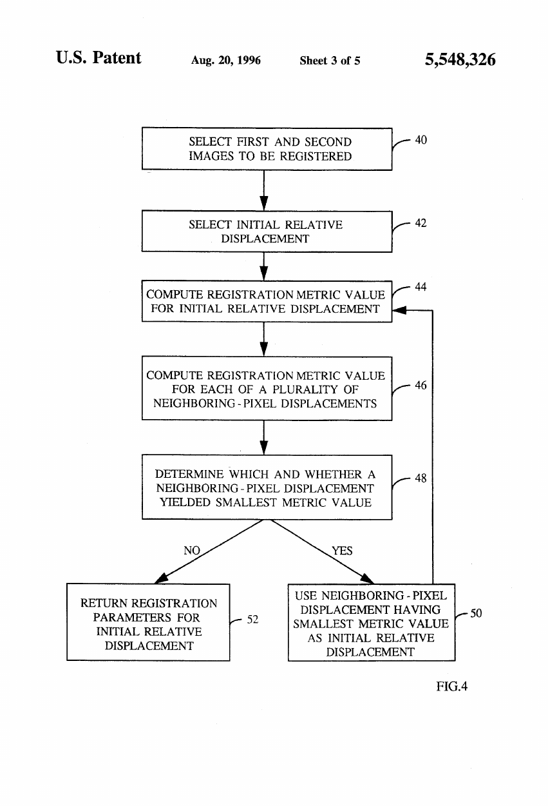
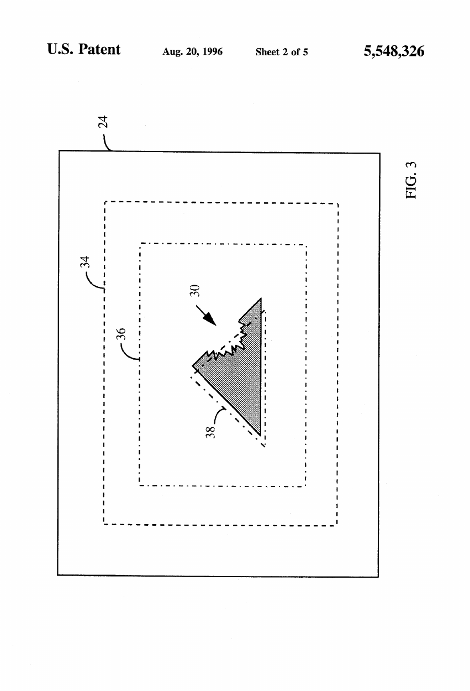
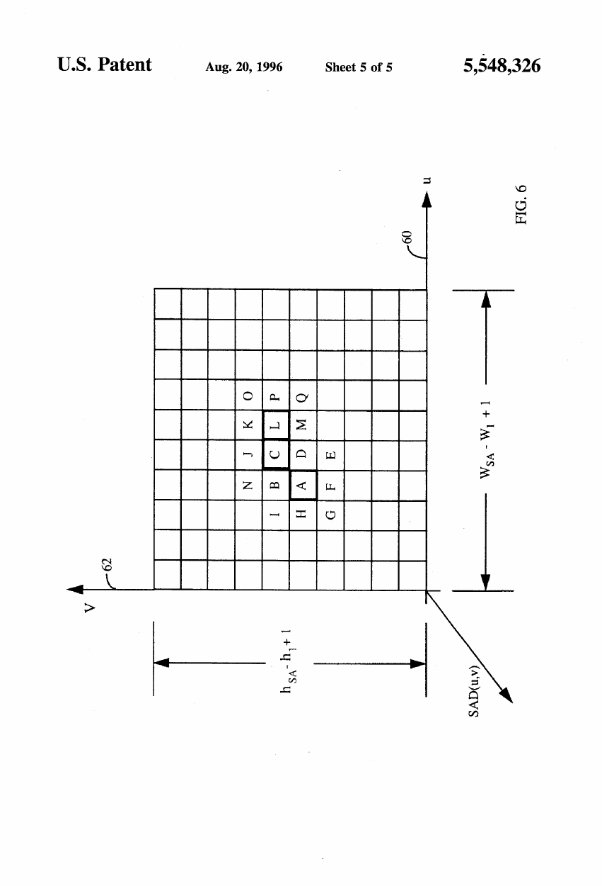

# US 5,548,326 A 효율적인 영상 정합 (번역)

번역 범위: 전문(서지, 초록, 본문, 도면 설명, 청구항 1~33).

- 원문: 같은 폴더의 `US5548326A.pdf` (USPTO 공식 공보, 13쪽, 스캔 영상)
- 원문 PDF에 글자 층이 없어 `pdftotext -layout` 결과가 비었다. 그래서 300dpi로 영상화한 뒤 tesseract(eng)로 글자를 읽고, 깨진 곳(식 (1), ±기호, 5단 일부)은 쪽 영상을 직접 보고 고쳤다.
- 도면은 공보 쪽 크기가 커서(2320x3408pt) `pdftoppm -r 110 -scale-to 1250`으로 줄여 `도면/`에 넣었다.
- 번역은 뜻을 살린 쉬운 말로 옮겼다. 청구항은 법률 문장이라 원문 구조를 되도록 지켰다.

---

## 서지

| 항목 | 내용 |
|---|---|
| [11] 특허 번호 | 5,548,326 |
| [45] 등록일 | 1996년 8월 20일 |
| [54] 제목 | EFFICIENT IMAGE REGISTRATION (효율적인 영상 정합) |
| [75] 발명자 | David Michael, 미국 매사추세츠주 Newton |
| [73] 권리자 | Cognex Corporation, 미국 매사추세츠주 Natick |
| [21] 출원 번호 | 299,015 |
| [22] 출원일 | 1994년 8월 31일 |
| [63] 관련 출원 | 1993년 10월 6일 출원한 Ser. No. 132,532의 일부계속출원(CIP). 원출원은 포기됨 |
| [51] 국제 분류 | H04N 7/18 |
| [52] 미국 분류 | 348/87; 348/94; 348/126; 382/151 |
| [58] 검색 분야 | 348/86, 87, 90, 92, 94, 95, 126; 382/145, 146, 147, 149, 150, 151; H04N 7/18 |
| 심사관 | Howard W. Britton |
| 대리인 | Russ Weinzimmer |
| 청구항, 도면 | 청구항 33개, 도면 5장 |

### [56] 인용 문헌 (원문 그대로)

U.S. PATENT DOCUMENTS

- 4,240,750 12/1980 Kurtz, 356/394
- 4,347,964 9/1982 Takasugi, 228/4.5
- 4,421,410 12/1983 Karasaki, 356/378
- 4,439,010 3/1984 Doty, 359/630
- (스캔이 흐려 한 줄을 읽지 못함)
- 4,805,123 2/1989 Specht et al., 348/126
- 4,855,928 8/1989 Yamanaka, 364/489
- 4,860,371 8/1989 Matsuyama et al., 348/126
- 5,138,180 8/1992 Yamanaka, 250/559.07
- 5,156,319 10/1992 Shibasaka, 228/9
- 5,170,062 10/1992 Miyahara, 250/559.07
- 5,229,891 7/1993 Choumed(스캔 판독 불확실), 356/376

OTHER PUBLICATIONS

- ACM Computing Surveys, vol. 24, No. 4, Dec. 1992, "A Survey of Image Registration Techniques," 27 pp.
- IEEE Transactions on Computers, vol. C-21, No. 2, Feb. 1972, "A Class of Algorithms for Fast Digital Image Registration," 8 pp.

---

## [57] 초록

디지털 영상 한 쌍을 효율적으로 정합하는 방법과 장치를 제공한다.
여러 개의 이웃 화소 상대 변위마다 절대차 합(SAD, Sum of Absolute Differences) 정합 지표를 계산해 지표 값을 얻는다.
그리고 예를 들어, 이웃 화소 상대 변위들 가운데서 새 초기 상대 변위를 되풀이해 고른다.
이때 다음에 고르는 초기 상대 변위는 언제나 더 작은 지표 값을 가져야 한다.
이 과정을 지표 값이 최소인 초기 상대 변위에 닿을 때까지 이어 간다.
일반적으로, 최소 지표 값을 주는 상대 변위는 2차원 수치 최적화 해석으로 찾는다.
이 발명은 결함 분석에 특히 쓸모가 있다.
예를 들어 골든 템플릿 분석, 공정 전후 광학 검사, 반도체 웨이퍼 위 다이 영상끼리의 쌍 비교가 있다.

*공보 1쪽 대표 도면이자 도 4: 바람직한 실시예의 흐름도. 40 정합할 제1, 제2 영상 고르기. 42 초기 상대 변위 고르기. 44 초기 상대 변위의 정합 지표 값 계산. 46 여러 이웃 화소 변위의 정합 지표 값 계산. 48 어느 이웃 화소 변위가 가장 작은 지표 값을 냈는지, 그런 변위가 있는지 판단. 예이면 50 가장 작은 지표 값을 낸 이웃 화소 변위를 새 초기 상대 변위로 쓰고 44로 돌아감. 아니오이면 52 초기 상대 변위의 정합 매개변수를 돌려줌.*

---

## 관련 출원과의 관계

이 출원은 1993년 10월 6일 출원한 출원 번호 08/132,532의 일부계속출원이다. 원출원은 포기되었다.

## 발명의 분야

이 발명은 넓게는 머신 비전에 관한 것이다.
좁게는 머신 비전 시스템이 얻은 디지털 영상의 정합에 관한 것이다.

## 발명의 배경

정확하고 효율적인 정합은 여러 분야에서 중요하다.
예를 들어 미세 전자 제조의 많은 단계가 어떤 형태든 정렬이나 정합, 곧 정밀한 상대 위치 맞춤을 요구한다.
노광부터 반도체 칩의 최종 패키징까지, 높은 수율은 반도체 부품과 생산 장비의 정밀한 상대 위치에 달려 있다.
특히 정렬과 정합 기술은 마스크 정합, 스테핑, 다이싱, 다이 집기, 다이 본딩, 와이어 본딩, 광학 검사에서 핵심 역할을 한다.
따라서 정렬, 정합 시스템의 속도, 정밀도, 반복성을 높이면 생산성이 바로 좋아진다.

머신 비전 기술은 정합할 물체를 디지털(양자화) 영상으로 먼저 나타냄으로써, 표준 정합 기술보다 더 빠르고 정확할 수 있다.
정합할 물체의 디지털 영상은 비디오 카메라로 찍고, 디지털 영상 해석으로 비교한다.

수학적으로 영상은 이산 2차원 함수 I(x,y)이다.
각 점 (x,y)에서 함수 값은 여러 회색 단계 가운데 하나를 나타낸다.
좌표 x, y와 회색 단계는 모두 일정 범위 안의 정수, 곧 양자화된 값이다.
보통 영상은 너비와 높이를 가진 직사각형이다.
영상 I(x,y)의 각 점 (x,y)를 "화소"라 하고, 각 화소는 양자화된 회색 값에 대응한다.
예를 들어 0 ≤ I(x,y) ≤ 255 범위의 정수 I(x,y)이다.
각 화소의 회색 값은 보통 그 영상이 나타내는 장면 속 대응 점의 복사휘도(단위 입체각, 단위 투영 면적당 일률)의 함수다.

"모델" 또는 "템플릿"은 영상과 비슷하다.
다만 직사각형일 필요가 없고, 한 덩어리로 이어질 필요도 없다.
곧 여러 영역의 모음일 수 있다.
모델은 영상처럼 다룰 수 있다.
영역 모음을 포함하는 직사각형 안의 각 화소에, 그 화소가 영역 안이면 회색 값을, 영역 밖이면 "무관(don't care)" 기호를 준다.
"무관" 기호는 0과 같지 않다는 점에 주의한다.

정렬은 제1 물체의 정렬 매개변수(평면 위치나 각도 방향 같은) 적어도 하나가 제2 물체의 대응 매개변수와 거의 같아지도록 제1 물체를 제2 물체에 대해 맞추는 일로 정의한다.
예를 들어 책상 위 연필 여러 자루가 모두 같은 방향을 향하면 정렬된 것이다.
또 다른 예로, 책상 위에 점이 하나씩 찍힌 종이 두 장이 있을 때, 첫 장의 점이 둘째 장의 점 위에 겹치면, 곧 두 점이 같은 투영 위치를 차지하면, 두 종이의 상대 회전과 상관없이 점은 정렬된 것이다.

물체 한 쌍의 정합은 제1 물체의 모든 정렬 매개변수가 제2 물체의 대응 매개변수와 거의 같아지도록 제1 물체를 맞추는 일로 정의한다.
예를 들어 첫 번째 반도체 마스크가 겹쳐진 두 번째 마스크와 정합되었다고 하는 경우는 다음 둘 중 하나다.
첫 마스크의 기준 표식 하나가 둘째 마스크의 대응 기준 표식과 같은 투영 위치에 있을 때.
또는 첫 마스크의 기준 표식 둘 이상이 둘째 마스크의 대응 표식에 대해 정렬되었을 때.

달리 말해, 정렬은 정밀하지 않은 정합으로 정의할 수 있다.
예를 들어 거친 상대 위치 맞춤을 위한 정렬 단계 뒤에, 더 정밀한 상대 위치 맞춤을 위한 정합 단계를 둘 수 있다.

디지털 영상 정합에 흔히 쓰는 알려진 방법은 "정규화 상관"이다.
패턴 인식과 머신 비전에서 "상관"은 제1 영상과 제2 영상의 닮은 정도를 말한다.
여기서 "영상"은 물체의 디지털 단색 표현이라고 가정한다.
정합에서는 똑같은 두 영상도 정합되지 않았으면 닮지 않은 것으로 본다.
이는 아래에서 설명할 상관 계수 계산 방식 때문이다.
또한 상관 계수는 두 영상 사이 어긋남의 정도를 나타낸다.

제1 영상 M과, 오프셋 (u,v)에서 제2 영상 I의 대응 부분 사이의 상관 계수 r은 다음과 같다.

$$
r(u,v)=\frac{N\sum_i I_iM_i-\left(\sum_i I_i\right)\left(\sum_i M_i\right)}
{\sqrt{\left[N\sum_i I_i^2-\left(\sum_i I_i\right)^2\right]\left[N\sum_i M_i^2-\left(\sum_i M_i\right)^2\right]}}
\qquad (1)
$$

여기서 I_i = I(u+x_i, v+y_i)이다.
r(u,v) 값은 언제나 −1 ≤ r(u,v) ≤ 1 범위에 있다.
1 또는 −1은 제1 영상과 제2 영상이 "완전히 맞음"을 뜻한다.

정규화 상관 계수 n(u,v)는 두 가지 형태가 있다.

$$ n(u,v)=r^2(u,v) \qquad (2a) $$

또는

$$ n(u,v)=\max(r(u,v),0)^2 \qquad (2b) $$

식 (2b)에서 "max" 함수는 r(u,v)의 음수 값을 모두 0으로 만든다.

영상 한 쌍의 정규화 상관 함수는, 모든 i에 대해 I_i가 유효한 영상 화소인 모든 위치 (u,v)에서의 상관 값 모음이다.
상관 함수는 보통 상관 값의 직사각형 배열이 된다.

정합할 두 영상 모두 결함이 없다고 하면, 두 영상의 상대 변위가 함수 n(u,v)를 최대로 만들 때 정합이 이루어진다.
완전한 정합은 국소 최대가 전역 최대이기도 해야 한다.
함수 n(u,v)의 전역 최대는 허용된 모든 u, v에서 n(u,v)가 가장 큰 값을 갖는 점이다.
n(u,v)의 국소 최대는 그 점의 정해진 이웃 안 어떤 값보다 n(u,v)가 큰 점이다.
따라서 전역 최대는 국소 최대이기도 하다.
n(u,v)에 −1을 곱하면 모든 국소 최대가 국소 최소로, 모든 국소 최소가 국소 최대로 바뀐다.

영상 가운데 적어도 하나에 결함이 있으면, 정규화 상관으로 한 영상을 다른 영상에 정합하는 데 문제가 생긴다.
영상이 원래 나타내려던 물체를 정확히 나타내지 못하면 그 영상은 결함이 있다고 본다.
예를 들어 물체 조명이 비정상이면 결함 영상이 생길 수 있다.
짙은 그림자를 만드는 조명이나, 물체의 반사가 강한 부분 때문에 생기는 지나치게 밝은 점이 그 예다.
물체가 다른 물체에 가려도 결함 영상이 생긴다.
또 공정이나 제조 오류로 물체 자체에 결함이 있어도 결함 영상이 생긴다.
이 경우 영상은 결함 있는 물체를 정확히 나타낼 수 있지만, 그래도 결함 없는 물체의 영상과는 다르다.

정합할 영상 가운데 적어도 하나에 결함이 있으면, 정규화 상관에 기반한 정합은 정합이 나쁘거나 잘못 정합된다.
곧 두 영상에서 함께 찾을 수 있는 특징 대부분이 정합 관계에 놓이지 않는다.
결함 영상에서 어떤 특징이 빠졌다면 그 특징을 다른 영상의 대응 특징과 정합할 수 없음은 당연하다.
그럼에도, 정합할 영상 하나에 결함이 있더라도 두 영상에 공통인 모든 특징을 실질적으로 정합하는 정합 방법이 바람직하다.

## 발명의 요약

효율적인 정합 방법과 장치는, 정합할 영상 하나에 결함이 있더라도, 영상 쌍에 공통인 모든 특징을 실질적으로 정합한다.

이 발명은 제1 영상과, 제1 영상에 대해 정합할 제2 영상 사이 차이의 절대값 합을 최소로 하는 데 기반한 정합 지표를 쓰는 것이 특징이다.
또 효율적인 최적화 기법도 쓴다.
예를 들어 경사 하강법의 한 형태로, 정합 지표 공간 전체를 계산하는 데 드는 것보다 적은 계산 자원으로 정합 지표 공간의 국소 최소를 가장 가까운 화소까지 찾는다.
바람직한 실시예에서는 부화소 보간 기법으로 부화소 정확도의 정합을 얻을 수 있다.

이 발명은 결함과 흠 검출 응용에 잘 맞는다.
골든 템플릿 비교, 공정 전후 광학 검사, 반복 기하 무늬 배열의 검사가 그 예다.
이런 응용에서는 정합을 한 뒤, 정합된 영상 쌍의 대응 화소 쌍마다 차이를 계산해 차 영상을 얻는다.

## 도면의 간단한 설명

다음 상세한 설명과 첨부 도면을 함께 보면 발명을 더 잘 이해할 수 있다.

- 도 1A: 삼각형의 직사각형 이진 제1 영상과, 삼각형 무게중심 위치를 가리키는 직교 십자선 한 쌍.
- 도 1B: 도 1A 영상의 여러 부분을 포함하는 직사각형 이진 제1 영상. 각 부분은 창 안에 들어 있고, 나머지는 "무관" 영역이다. 점은 삼각형의 무게중심 위치다.
- 도 2: 결함이 있는 삼각형의 직사각형 이진 제2 영상과, 삼각형 무게중심을 가리키는 직교 십자선 한 쌍.
- 도 3: 도 1의 직사각형 이진 제1 영상의 가상 윤곽(팬텀)을 도 2의 제2 영상 위에 상대 변위시켜 겹친 그림. 제2 영상 안의 탐색 영역도 보인다.
- 도 4: 발명 방법의 바람직한 실시예 흐름도.
- 도 5: 도 3 전체에 더해, 제1 영상의 치수 w_I, h_I, 제2 영상 탐색 영역의 치수 w_SA, h_SA, 둘 사이 상대 변위를 나타내는 변수 u, v를 보인 그림.
- 도 6: 도 4의 변수 u, v(각각 제1, 제2 영상의 화소 크기로 양자화됨)와, u, v의 함수인 지표 곡면 변수 M_uv를 나타낸 그래프. 상대 변위 위치 A부터 Q까지도 보인다.

## 도면의 상세한 설명

도 1을 보면, 삼각형 12의 직사각형 이진 제1 영상 10이 있다.
영상 10은 이진이지만, 이 발명의 방법과 장치는 화소가 두 가지보다 많은 회색 단계(예를 들어 256단계 가운데 하나)를 갖는 영상에도 적용할 수 있다.
실제로 이 발명은 그런 "회색조" 영상에 더 잘 맞는다.
따라서 영상 10이 이진인 것은 설명을 위한 것일 뿐이며, 발명의 범위나 적용성을 제한하려는 것이 아니다.

삼각형 12는 무게중심을 갖는다.
그 위치는 직교 십자선 14의 교점으로 나타낸다.
삼각형 12 같은 평면 도형에서 무게중심은, 같은 모양이고 두께와 재질이 고른 얇은 판의 질량 중심에 해당한다.
삼각형 12의 무게중심은, 정합 관계로 가져올 제2 영상에 대한 편리한 초기 상대 변위를 정하는 데 쓸 수 있다.
제2 영상의 무게중심을 삼각형 12의 무게중심에 겹치면 된다.
다른 방법으로, 영상 안의 다른 점을 써서 편리한 초기 상대 변위를 정할 수도 있다.
예를 들어 각 십자선 14의 양쪽에 같은 수의 화소가 놓이도록 정한 십자선 14의 위치가 그런 점이다.

도 1B를 보면, 도 1A 영상 10의 여러 부분을 포함하는 다른 직사각형 이진 제1 영상 16이 있다.
각 부분은 창 18 안에 들어 있다.
영상 16의 나머지는 "무관" 영역 20이다.
여기에는 이 발명으로 정합을 정할 때 고려에서 빠지는 "무관" 화소가 들어 있다.
점 22는 영상 16의 무게중심 위치를 나타낸다.
도 1B는 이 발명의 방법과 장치를 "무관" 영역이 있는 영상에도 적용할 수 있음을 보이려고 넣었다.

도 2는 삼각형 26의 결함 있는 직사각형 이진 제2 영상 24와, 삼각형 26의 무게중심 위치를 가리키는 직교 십자선 28을 보인다.
설명을 위해 삼각형 26에는 결함 30이 있다.
결함은 빠진 부분, 겹친 부분, 또는 의도한 이상적 영상 모양에서 크게 벗어난 다른 무엇이든 될 수 있다.
예를 들어 정반사(영상이 나타내는 물체의 반사가 강한 영역)나 렌즈 플레어가 있다.

영상 24 안의 탐색 영역 32는 탐색 영역 경계 34로 정해진다.
탐색 영역 32는 제1 영상 10과 제2 영상 24를 정합 관계로 가져오려고 제1 영상 10을 움직일 수 있는 제2 영상 24의 영역이다.
삼각형 12의 무게중심을 써서 편리한 초기 상대 변위를 정할 수 있지만, 영상 10이 경계 34를 조금도 넘지 않는다면 제1 영상 10은 탐색 영역 32 안 어디에든 처음에 놓을 수 있다.
제1 영상 일부가 경계 34를 넘도록 제1 영상 10을 제2 영상 24에 대해 움직여야 최적 정합을 얻을 수 있는 경우라도, 바람직한 실시예에서는 다음과 같이 한다.
경사 하강법이나 다른 2차원 수치 최적화 방법의 결과로 제1 영상 일부가 경계를 넘으면, 그때의 제1 영상 10 좌표를 정합 매개변수 결과로 돌려준다.

*도 3: 제2 영상 24(바깥 실선) 안의 탐색 영역 경계 34(점선), 그 위에 겹친 제1 영상의 팬텀 36(일점쇄선)과 팬텀 삼각형 38. 30은 제2 영상 삼각형의 결함(톱니 모양으로 빠진 부분)이다.*

도 3은 직사각형 이진 제1 영상 10의 팬텀 36을 보인다.
팬텀 36에는 삼각형 12에 대응하는 팬텀 삼각형 38이 있다.
팬텀 36은 그 무게중심이 제2 영상 24의 무게중심 위에 오도록 직사각형 이진 제2 영상 24 위에 상대 변위되어 겹쳐 있다.
팬텀 영상 36은 제2 영상 24의 탐색 영역 34 안에 들어 있다.

이 발명의 목적은, 제2 영상 24에 결함 30이 있더라도, 팬텀 영상 36으로 나타낸 제1 영상 10을 제2 영상 24와 정합 관계로 가져오는 것이다.
이 발명의 한 가지 장점은, 정규화 상관 같은 종래 방법에 비해 영상 결함의 영향이 최소가 된다는 점이다.
정규화 상관은 영상 결함의 영향을 부풀려 정합 시도가 실패하게 만드는 경향이 있다.

정규화 상관 같은 종래 방법에 비해 영상 결함의 영향이 최소가 되는 까닭은, 정합할 영상 화소의 회색 값에 대해 선형인 지표를 쓰기 때문이다.
예를 들어 쓸모 있는 지표가 절대차 합(SAD) 지표다.

제1 영상 M과 오프셋 (u,v)에서 제2 영상 I의 대응 부분 사이의 절대차 합 SAD(u,v)는 다음과 같다.

$$ \mathrm{SAD}(u,v)=\sum_i \left| I_i - M_i \right| \qquad (3) $$

여기서 I_i = I(u+x_i, v+y_i)이다.

식 (1)의 정규화 상관 지표와 달리, 절대차 합 지표에는 제곱 항이 없다.
종래 기술이 알아본 것처럼 제곱 항에는 나름의 장점이 있다.
그러나 정합할 영상 하나나 둘 모두에 결함이 하나 이상 있으면, 영상 정합 지표의 제곱 항이 자주 잘못된 정합을 낳는다는 점을 알아낸 것이 이 발명의 기여다.
또 이 발명이 알아낸 바로는, 제곱 항은 영상 결함에 지나치게 민감해 정합을 방해하거나 막는다.

절대차 합 지표에 정규화 인자를 넣어 바꿀 수도 있다.
예를 들어 제1, 제2 영상의 평균 회색 값에 기반한 인자다.
이렇게 하면 정규화 상관 지표의 제곱 항 같은 비선형성 문제를 끌어들이지 않는다.
정규화한 절대차 합 지표의 한 가지 특징은 영상 밝기가 일정하게 바뀌어도 둔감하다는 점이다.

또한 종래 기술에서 정규화 상관 지표는 영상 하나에 대해 계산 시간이 드는 학습 단계와 함께 쓰이기도 한다.
반면 이 발명은 절대차 합 지표를 쓰므로 학습 단계가 필요 없다.
따라서 일련의 정렬 단계에서 단계마다 정합할 영상 하나 이상을 바꾸어도 계산 시간 손해가 없다.

도 4를 보면, 각각 여러 화소를 포함하고 각 화소가 회색 값이나 무관 기호 가운데 적어도 하나에 대응하는 디지털 영상 한 쌍을 효율적으로 정합하려고, 이 발명은 다음 방법과 장치를 제공한다.
식 (3)의 절대차 합 지표와, 경사 하강법이나 최급 하강법 같은 2차원 수치 최적화 기법을 쓴다.

특히 방법의 첫 단계(40)는 정합할 제1, 제2 영상을 고르는 것이다.
제1 영상은 흑백 영상 10 같은 이진 영상을 포함해 어떤 회색조 영상이든 될 수 있다.
제1 영상에는 각각 여러 회색조 화소를 둘러싼 여러 창, 그 창들을 둘러싼 "무관" 화소 영역이 있을 수 있다.
창은 서로 겹쳐도 되고, 창 개수에 제한이 없다.
"무관" 영역은 고른 영상에 되풀이되는 정반사 같은 예측 가능한 영상 결함이 들어가지 않도록 배치할 수 있다.
그러면 정합 성능이 좋아진다.
그래도 무관 영역으로 영상 결함을 보상할 수 없을 때가 있다.
그런 경우에 이 발명이 특히 쓸모 있다.

다음 단계(42)는 제1 영상 10의 여러 화소가 제2 영상 24의 여러 화소와 겹치도록 두 영상 사이 초기 상대 변위를 고르는 것이다.
한 가지 방법은 제1 영상의 무게중심을 제2 영상의 무게중심 위에 겹치는 것이다.
다른 방법은 각 영상의 기하 중심을 찾아 제1 영상 중심을 제2 영상 중심 위에 겹치는 것이다.
제1 영상의 여러 화소가 제2 영상의 여러 화소와 겹치게 보장하는 다른 어떤 방법도 효과가 있다.
가장 가까운 화소까지의 올바른 정합에 대한 사전 최선 추정이 있으면, 그것을 초기 상대 변위의 바탕으로 쓰는 것이 좋다.
다른 바람직한 실시예에서는 제2 영상 안에 탐색 영역을 정한다.
예를 들어 x 방향으로 ±2화소, y 방향으로 ±5화소까지 어긋남을 허용하는 탐색 영역을 고를 수 있다.
두 영상은 제1 영상의 각 화소가 제2 영상의 탐색 영역 안에 들어가도록 상대 변위시키는 것이 좋다.

*도 6: u축 60과 v축 62로 이루어진 정수 변위 격자. 격자 크기는 (w_SA − w_I + 1) x (h_SA − h_I + 1)이고, 세 번째 축이 SAD(u,v)다. 굵은 칸 A, C, L은 하강 경로다. A의 8이웃은 B~I, C로 옮긴 뒤의 이웃은 J, K, L, M, D, A, B, N, L로 옮긴 뒤의 이웃은 K, O, P, Q, M, D, C, J이다.*

도 5는 초기 상대 변위를 보이고, 변수 u, v로 상대 변위를 나타내는 방법을 보인다.
u와 v가 모두 0이면 제1 영상의 왼쪽 아래 모서리가 탐색 영역 32의 왼쪽 아래 모서리에 딱 맞는다.
반대로 u와 v가 최대값 w_SA − w_I, h_SA − h_I를 가지면 제1 영상의 오른쪽 위 모서리가 탐색 영역 32의 오른쪽 위 모서리에 딱 맞는다.
여기서 w_SA는 탐색 영역 32의 너비, w_I는 제1 영상의 너비, h_SA는 탐색 영역 32의 높이, h_I는 제1 영상의 높이다.
각 치수는 도 5에 나와 있다.

다시 도 4와 도 6을 함께 보면, 다음 단계(44)에서는 초기 상대 변위 위치의 영상 쌍에 대해 정합 지표 값을 계산한다.
이때 선형 정합 지표 계산을 쓴다.
예를 들어 식 (3)의 절대차 합 지표 SAD(u,v)이며, 이는 u와 v, 곧 제1, 제2 영상 M과 I 사이 상대 변위의 함수다.
도 6에서 초기 상대 변위 위치는 글자 "A"로 표시했고, u의 이산값 하나와 v의 이산값 하나로 정해진다.
지표 SAD(u,v)의 값은 u축 60과 v축 62가 이루는 평면 위의 높이로 나타낼 수 있다.
따라서 u와 v의 정의역(각각 w_SA − w_I + 1, h_SA − h_I + 1개)에 걸친 SAD(u,v) 값의 범위를 하나의 곡면으로 볼 수 있다.
이 곡면(그림에는 없음)은 최소와 최대를 모두 가질 수 있고, 그것은 국소일 수도 전역일 수도 있다.
(정의상 전역 최소는 모든 국소 최소 가운데 가장 낮은 것이다.)

식 (3)의 지표를 구현하려면, 제1 영상 각 화소의 회색 값과, 그 화소와 겹치는 제2 영상 화소의 회색 값 사이 차이를 계산한다.
다음으로 차이의 절대값을 계산한다.
이 단계는 범용 마이크로프로세서보다 이런 계산을 더 빠르게 하도록 설계한 전용 계산 회로로 실행하면 유리하다.
예를 들어 매사추세츠주 Natick의 Cognex Corporation이 만든 "VC-2" 칩이 있다.

다음으로 제2 영상 화소와 겹치는 제1 영상 각 화소에 대해 계산한 절대값을 모두 더해 절대차 합을 얻는다.
이 "각 절대값의 합 계산" 단계도 범용 마이크로프로세서보다 빠르게 설계한 전용 계산 회로로 실행하면 유리하다.
예를 들어 역시 Cognex Corporation이 만든 "VC-1" 또는 "VC-3" 칩이 있다.

초기 상대 변위에 대해 계산한 절대차 합은 하나의 숫자다.
이 숫자는 그 특정 상대 변위에서 제1 영상이 제2 영상에 얼마나 잘 정합되었는지를 나타낸다.

다음 단계(46)에서는 식 (3)의 정합 지표 계산으로 여러 이웃 화소 변위마다 정합 지표 값을 계산한다.
예를 들어 도 6에서 초기 상대 변위 A는 이웃 화소 상대 변위 B, C, D, E, F, G, H, I로 둘러싸여 있다.
다른 실시예에서는 B, D, F, H만 쓴다.
일반적으로 "이웃 화소 변위"는 초기 상대 변위에서 한 화소보다 멀리 떨어진 화소도 포함할 수 있다.

다음 단계(48)는 여러 이웃 화소 상대 변위와 초기 상대 변위 가운데 어느 변위가 가장 작은 정합 지표 값을 냈는지 정하는 것이다.
가장 작은 지표 값을 낸 변위가 이웃 화소 변위 가운데 하나라면, 단계(50)에 보인 것처럼 그 이웃 화소 변위를 초기 상대 변위로 쓰고 단계 (44), (46), (48)을 되풀이한다.
예를 들어 도 6에서 상대 변위 C를 단계(44)의 초기 상대 변위로 쓰면, 단계(46)에서는 J, K, L, M, D, A, B, N이 이웃 화소 상대 변위가 된다.
마찬가지로 다음 반복에서 상대 변위 L을 단계(44)의 초기 상대 변위로 쓰면, 단계(46)에서는 K, O, P, Q, M, D, C, J가 이웃 화소 상대 변위가 된다.

초기 상대 변위 A가 어떤 이웃 화소 변위보다 낮은 정합 지표 값을 가지면, 그 값은 SAD(u,v)가 가질 수 있는 값 가운데 적어도 국소 최소다.
그러면 초기 상대 변위 A는 아마 적어도 쓸 만한 정합을 줄 것이다.
따라서 단계(52)에 보인 것처럼, 초기 상대 변위 A에 따라 디지털 영상 쌍을 정합 관계에 놓는 정합 매개변수를 돌려준다.

바람직한 실시예에서는 이 정합 매개변수로 부화소 정합 매개변수를 계산할 수 있다.
예를 들어 포물선 보간을 쓴다.
부화소 정합의 바람직한 방법은 차이 지표 값 다섯 개를 쓰는 것이다.
곧 최종 초기 상대 변위의 지표 값과, 그 바로 위, 아래, 오른쪽, 왼쪽에 있는 이웃 화소 상대 변위 네 개의 지표 값이다.
이 값들로 u축 60과 v축 62를 따른 부화소 오프셋을 서로 따로 계산한다.
구체적으로, u축을 따라서는 최종 초기 상대 변위와 그 왼쪽, 오른쪽 이웃 화소 변위를 쓴다.
그 세 점에 포물선을 "맞추고", 이 분야에서 잘 알려진 기법으로 포물선의 최소점을 찾는다.
그 최소점의 u좌표가 u축 60을 따른 부화소 정합 매개변수다.
v좌표도 같은 방법으로 찾는다.
물론 쌍선형이나 3차 보간 같은 다른 보간 방법도 쓸 수 있다.
네 개보다 많은 이웃 화소 상대 변위를 쓰는 등 더 넓은 "받침"도 쓸 수 있다.

결함이나 흠 검출을 목적으로 정합하는 응용에서는, 정합 매개변수를 돌려주는 대신(52) 또는 그와 함께 차 영상을 만들 수 있다.
제2 영상에서 제1 영상을 빼거나 그 반대로 빼면 된다.
차 영상은 결함을 검출하거나, 흠의 크기, 모양, 위치를 재는 데 쓸 수 있다.
부화소 보간은 응용에 따라 영상 빼기 단계 앞이나 뒤에 할 수 있다.
예를 들어 골든 템플릿 분석에서는 빼기 전에 부화소 보간을 한다.

바람직한 실시예에서 제2 영상은 적어도 제1 영상만큼 크다.
그리고 두 영상 사이 초기 상대 변위는 제1 영상의 각 화소가 제2 영상의 적어도 한 화소와 겹치도록 고른다.

도 6을 보면, 정합 지표 값을 되풀이해 계산하지 않음으로써 실행 속도를 높일 수 있다.
구체적으로, 지표 값을 그 값의 바탕이 된 상대 변위와 짝지어 저장해 두면, 다음 반복에서 다른 화소를 초기 상대 변위로 쓸 때 이미 계산한 상대 변위의 지표 값을 다시 계산하지 않고 메모리에서 꺼내 쓸 수 있다.
예를 들어 화소 A가 초기 상대 변위일 때 화소 B, C, D, E, F, G, H, I의 지표 값도 계산한다.
따라서 화소 C가 초기 상대 변위가 될 때, 화소 A, B, C, D의 지표 값은 앞서 저장해 두었다면 다시 계산할 필요가 없다.

요약하면, 디지털 영상 한 쌍을 효율적으로 정합하는 이 발명의 방법과 장치는 다음과 같다.
여러 이웃 화소 상대 변위마다 절대차 합 정합 지표 계산으로 지표 값을 얻는다.
그리고 이웃 화소 상대 변위들 가운데서 새 초기 상대 변위를 되풀이해 고르되, 다음에 고르는 초기 상대 변위가 언제나 더 작은 지표 값을 갖게 한다.
이를 최소 지표 값을 갖는 초기 상대 변위에 닿을 때까지 이어 간다.

더 일반적으로, 최소 정합 지표 값을 갖는 상대 변위는 2차원 수치 최적화 해석으로 찾는다.
바람직한 한 실시예에서 2차원 수치 최적화 해석은 경사 하강 해석이며, 그 한 형태를 위에서 설명했다.
다른 바람직한 실시예에서는 2차원 수치 최적화 해석이 최급 하강 해석이다.

이 발명은 골든 템플릿 분석, 공정 전후 광학 검사, 반도체 웨이퍼 위 다이 영상끼리의 쌍 비교 같은 결함과 흠 분석에 특히 쓸모 있다.

이 분야의 숙련자는 청구된 발명의 정신과 범위를 벗어나지 않는 다른 변형과 구현을 떠올릴 것이다.
따라서 위 설명은 다음 청구항에 나타낸 것 말고는 발명을 제한하려는 것이 아니다.

---

## 청구항

**1.** 제1 영상과 제2 영상을 포함하는 디지털 영상 한 쌍을 효율적으로 정합하는 방법으로서, 각 영상은 여러 화소를 포함하고, 각 화소는 회색 값과 무관 기호 가운데 적어도 하나에 대응하며, 이 방법은 다음 단계를 포함한다.

- (A) 상기 제1 영상의 여러 화소가 상기 제2 영상의 여러 화소와 겹치도록 상기 제1 영상과 상기 제2 영상 사이 초기 상대 변위를 고르는 단계.
- (B) 다음 단계를 포함하는 정합 지표 계산으로 상기 초기 상대 변위에 대응하는 정합 지표 값을 계산하는 단계.
  - 상기 제1 영상 각 화소의 회색 값과, 그 화소와 겹치는 상기 제2 영상 화소의 회색 값 사이 차이를 계산하는 단계.
  - 상기 제1 영상 각 화소의 회색 값과, 그 화소와 겹치는 상기 제2 영상 각 화소의 회색 값 사이 차이의 절대값을 계산하는 단계.
  - 상기 제2 영상 화소와 겹치는 상기 제1 영상 각 화소에 대해 계산한 각 절대값을 모두 더해 절대차 합을 계산하는 단계.
- (C) 상기 정합 지표 계산으로 여러 이웃 화소 변위 각각에 대응하는 정합 지표 값을 계산하는 단계.
- (D) 상기 여러 이웃 화소 변위와 상기 초기 상대 변위 가운데 어느 변위가 가장 작은 정합 지표 값을 냈는지 정하는 단계.
- (E) 가장 작은 정합 지표 값을 낸 변위가 상기 여러 이웃 화소 변위 가운데 하나이면, 그 변위를 상기 초기 상대 변위로 써서 단계 (A), (B), (C), (D), (E)를 되풀이하는 단계.
- (F) 그렇지 않으면, 상기 디지털 영상 쌍을 정합 관계에 놓도록 상기 초기 상대 변위의 가장 최근 값에 대응하는 정합 매개변수를 내놓는 단계.

**2.** 청구항 1의 방법으로서, 상기 정합 매개변수를 써서 부화소 정합 매개변수를 계산하는 단계를 더 포함한다.

**3.** 청구항 1의 방법으로서, 단계 (E) 뒤에, 가장 작은 정합 지표 값을 낸 변위가 상기 여러 이웃 화소 변위 가운데 하나가 아니면, 상기 제1 영상과 상기 제2 영상 사이 차이에 기반한 차 영상을 계산하는 단계를 더 포함한다. 이때 상기 제1, 제2 영상은 상기 초기 상대 변위의 가장 최근 값에 따라 상대 변위되어 있다.

**4.** 청구항 1의 방법으로서, 상기 제2 영상은 적어도 상기 제1 영상만큼 크고, 상기 제1 영상과 상기 제2 영상 사이 초기 상대 변위는 상기 제1 영상의 각 화소가 상기 제2 영상의 적어도 한 화소와 겹치도록 고른다.

**5.** 청구항 1의 방법으로서, 상기 제1 영상은 제1 화소 무리를 포함하는 영역을 포함하고, 제1 화소 무리의 각 화소는 회색 값에 대응하며, 상기 영역은 적어도 제2 화소 무리로 둘러싸이고, 제2 화소 무리의 각 화소는 무관 기호에 대응한다.

**6.** 청구항 1의 방법으로서, 상기 제2 영상 안에서 탐색 영역을 고르는 단계를 더 포함한다. 상기 탐색 영역은 상기 제2 영상의 화소를 모두 둘러쌀 수도 있는 탐색 영역 경계로 정해진다. 그리고 단계 (E)는, 가장 작은 정합 지표 값을 낸 변위가 탐색 영역 경계 밖에 놓이면, 상기 디지털 영상 쌍을 정합 관계에 놓도록 상기 초기 상대 변위의 가장 최근 값에 대응하는 정합 매개변수를 내놓는 단계를 더 포함한다.

**7.** 청구항 1의 방법으로서, 다음 단계를 더 포함한다.
- 단계 (B) 뒤에, 상기 정합 지표 값을 상기 초기 상대 변위와 짝지어 저장하는 단계.
- 단계 (C) 뒤에, 각 정합 지표 값을 대응하는 이웃 화소 변위와 짝지어 저장하는 단계.
- 그리고 단계 (E)에서 단계 (A), (B), (C), (D), (E)를 되풀이할 때마다, 어떤 상대 변위의 정합 지표 값은 그 상대 변위와 짝지어 앞서 계산해 저장한 값이 없을 때만 계산한다.

**8.** 청구항 1의 방법으로서, 상기 제1 영상과 상기 제2 영상 사이 초기 상대 변위는, 상기 제1 영상의 무게중심을 담은 제1 화소가 상기 제2 영상의 무게중심을 담은 제2 화소와 겹치도록 정한다.

**9.** 청구항 1의 방법으로서, 여러 이웃 화소 상대 변위 각각에 대응하는 정합 지표 값을 계산하는 단계는, 맞닿은 북, 동, 남, 서 이웃 화소 상대 변위에 대해 계산한다.

**10.** 청구항 1의 방법으로서, 여러 이웃 화소 상대 변위 각각에 대응하는 정합 지표 값을 계산하는 단계는, 맞닿은 북, 동, 남, 서, 북동, 남동, 남서, 북서 이웃 화소 상대 변위에 대해 계산한다.

**11.** 제1 영상과 제2 영상을 포함하는 디지털 영상 한 쌍을 효율적으로 정합하는 방법으로서, 각 영상은 여러 화소를 포함하고, 각 화소는 회색 값과 무관 기호 가운데 적어도 하나에 대응하며, 이 방법은 다음 단계를 포함한다.
- (A) 상기 제1 영상의 여러 화소가 상기 제2 영상의 여러 화소와 겹치도록 상기 제1 영상과 상기 제2 영상 사이 초기 상대 변위를 고르는 단계.
- (B) 절대차 합 정합 지표 계산으로 상기 초기 상대 변위에 대응하는 정합 지표 값을 계산하는 단계.
- (C) 상기 절대차 합 정합 지표 계산에 기반해 여러 이웃 화소 상대 변위 각각의 정합 지표 값을 얻고, 상기 여러 이웃 화소 상대 변위 가운데서 새 초기 상대 변위를 되풀이해 고르되, 다음에 고르는 새 초기 상대 변위가 더 작은 정합 지표 값에 대응하도록 하여, 최소 정합 지표 값에 대응하는 초기 상대 변위에 닿을 때까지 이어 가는 단계.

**12.** 청구항 11의 방법으로서, 최소 정합 지표에 대응하는 상기 초기 상대 변위에 기반해 부화소 정합 매개변수를 계산하는 단계를 더 포함한다.

**13.** 청구항 11의 방법으로서, 최소 정합 지표에 대응하는 상기 초기 상대 변위에 닿으면, 상기 제1 영상과 상기 제2 영상 사이 차이에 기반한 차 영상을 계산하는 단계를 더 포함한다. 이때 상기 제1, 제2 영상은 상기 초기 상대 변위에 따라 상대 변위되어 있다.

**14.** 청구항 11의 방법으로서, 상기 정합 지표 값을 얻는 단계는, 어떤 상대 변위에 대해 앞서 계산해 짝지어 저장한 정합 지표 값이 없을 때만 절대차 합 정합 지표 계산으로 그 상대 변위의 정합 지표 값을 계산하는 단계를 포함한다.

**15.** 청구항 11의 방법으로서, 상기 제2 영상은 적어도 상기 제1 영상만큼 크고, 초기 상대 변위는 상기 제1 영상의 각 화소가 상기 제2 영상의 적어도 한 화소와 겹치도록 고른다.

**16.** 청구항 11의 방법으로서, 상기 제1 영상은 제1 화소 무리를 포함하는 영역을 포함하고, 제1 화소 무리의 각 화소는 회색 값에 대응하며, 상기 영역은 적어도 제2 화소 무리로 둘러싸이고, 제2 화소 무리의 각 화소는 무관 기호에 대응한다.

**17.** 청구항 11의 방법으로서, 상기 제2 영상 안에서 탐색 영역을 고르는 단계를 더 포함한다. 상기 탐색 영역은 상기 제2 영상의 화소를 모두 둘러쌀 수도 있는 탐색 영역 경계로 정해진다. 그리고 정합 지표 값을 되풀이해 계산하는 단계는, 다음 새 초기 상대 변위가 탐색 영역 경계 밖에 놓일 때에도 끝난다. 그러면 탐색 영역 경계 밖에 놓이지 않은 초기 변위의 가장 최근 값에 대응하는 정합 매개변수를 내놓는다.

**18.** 청구항 11의 방법으로서, (D) 최소 정합 지표 값에 대응하는 초기 변위 값에 대응하는 정합 매개변수를 내놓는 단계를 더 포함한다.

**19.** 청구항 11의 방법으로서, 상기 최소 정합 지표 값은 국소 최소 정합 지표 값이다.

**20.** 청구항 11의 방법으로서, 초기 상대 변위는 상기 제1 영상의 무게중심을 담은 제1 화소가 상기 제2 영상의 무게중심을 담은 제2 화소와 겹치도록 정한다.

**21.** 청구항 11의 방법으로서, 여러 이웃 화소 상대 변위 각각의 정합 지표 값을 계산하는 단계는 맞닿은 북, 동, 남, 서 이웃 화소 상대 변위에 대해 계산한다.

**22.** 청구항 11의 방법으로서, 여러 이웃 화소 상대 변위 각각의 정합 지표 값을 계산하는 단계는 맞닿은 북, 동, 남, 서, 북동, 남동, 남서, 북서 이웃 화소 상대 변위에 대해 계산한다.

**23.** 제1 영상과 제2 영상을 포함하는 디지털 영상 한 쌍을 효율적으로 정합하는 방법으로서, 각 영상은 여러 화소를 포함하고, 각 화소는 회색 값과 무관 기호 가운데 적어도 하나에 대응하며, 이 방법은 다음 단계를 포함한다.
- (A) 상기 제1 영상의 여러 화소가 상기 제2 영상의 여러 화소와 겹치도록 두 영상 사이 초기 상대 변위를 고르는 단계.
- (B) 절대차 합 정합 지표 계산으로 상기 초기 상대 변위에 대응하는 정합 지표 값을 계산하는 단계.
- (C) 2차원 수치 최적화 해석으로 최소 정합 지표 값에 대응하는 상대 변위를 찾는 단계.

**24.** 청구항 23의 방법으로서, 최소 정합 지표 값에 대응하는 상기 상대 변위에 기반해 부화소 정합 매개변수를 계산하는 단계를 더 포함한다.

**25.** 청구항 23의 방법으로서, 단계 (C) 뒤에, 상기 제1 영상과 상기 제2 영상 사이 차이에 기반한 차 영상을 계산하는 단계를 더 포함한다. 이때 두 영상은 최소 정합 지표 값에 대응하는 상대 변위에 따라 상대 변위되어 있다.

**26.** 청구항 23의 방법으로서, 단계 (C)는, 어떤 상대 변위에 대해 앞서 계산해 짝지어 저장한 정합 지표 값이 없을 때만 절대차 합 정합 지표 계산으로 그 상대 변위의 정합 지표 값을 계산하는 단계를 더 포함한다.

**27.** 청구항 23의 방법으로서, 상기 제2 영상은 적어도 상기 제1 영상만큼 크고, 초기 상대 변위는 상기 제1 영상의 각 화소가 상기 제2 영상의 적어도 한 화소와 겹치도록 고른다.

**28.** 청구항 23의 방법으로서, 상기 제1 영상은 제1 화소 무리를 포함하는 영역을 포함하고, 제1 화소 무리의 각 화소는 회색 값에 대응하며, 상기 영역은 적어도 제2 화소 무리로 둘러싸이고, 제2 화소 무리의 각 화소는 무관 기호에 대응한다.

**29.** 청구항 23의 방법으로서, 상기 제2 영상 안에서 탐색 영역을 고르는 단계를 더 포함한다. 상기 탐색 영역은 상기 제2 영상의 화소를 모두 둘러쌀 수도 있는 탐색 영역 경계로 정해진다. 그리고 최소 정합 지표 값에 대응하는 상대 변위를 찾는 단계에서 그 상대 변위는 탐색 영역 경계 밖에 놓이지 않는다.

**30.** 청구항 23의 방법으로서, 상기 2차원 수치 최적화 해석은 경사 하강 해석이다.

**31.** 청구항 23의 방법으로서, 상기 2차원 수치 최적화 해석은 최급 하강 해석이다.

**32.** 제1 영상과 제2 영상을 포함하는 디지털 영상 한 쌍을 효율적으로 정합하는 장치로서, 각 영상은 여러 화소를 포함하고, 각 화소는 회색 값과 무관 기호 가운데 적어도 하나에 대응하며, 이 장치는 다음을 포함한다.
- (A) 상기 제1 영상의 여러 화소가 상기 제2 영상의 여러 화소와 겹치도록 두 영상 사이 초기 상대 변위를 고르는 수단.
- (B) 절대차 합 정합 지표 계산으로 상기 초기 상대 변위에 대응하는 정합 지표 값을 계산하는 수단.
- (C) 2차원 수치 최적화 해석으로 최소 정합 지표 값에 대응하는 상대 변위를 찾는 수단.

**33.** 청구항 32의 장치로서, 상기 정합 지표 값을 계산하는 수단은 다음을 포함한다.
- 상기 제1 영상 각 화소의 회색 값과, 그 화소와 겹치는 상기 제2 영상 각 화소의 회색 값 사이 차이의 절대값을 계산하는 수단.
- 상기 절대값 계산 수단과 연결되어, 상기 제2 영상 화소와 겹치는 상기 제1 영상 각 화소에 대해 계산한 각 절대값을 모두 더해 절대차 합을 계산하는 수단.

(끝)
